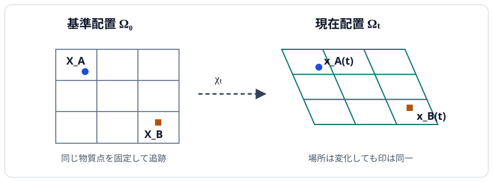

# CTM1 物質点・配置・運動をどう記述するか

[MECH1 の質点の軌道](../../MECH/MECH1/index.md#def-mech1-point-particle-trajectory)では、時刻ごとに一つの点の位置を追った。しかしゴム板や水のかたまりには無数の点があり、いま見えている一点が、最初のどの点だったかを記録する必要がある。**場所**と、そこにいる**物質点の身元**を分けることが、連続体の運動学の出発点である。

本章の中心問いは「一つの物体の各物質点を、時間を通して取り違えずに追うにはどうするか」である。基準時刻に名前を付け、運動写像で現在位置へ送り、そこから物質表示と空間表示の速度を結び付ける。力・応力や変形勾配による体積変化は、この後の講義で扱う。

## 1. 物質点は場所ではなく身元である

机の上の板に小さな印を二つ付ける。印が動いても「印 A」「印 B」という身元は変わらない。一方、机に固定した目印の場所には、時刻が変わると別の材料が来る可能性がある。

板を占める領域を三次元の[F0-00B で定義した開集合](../../../基礎科目/F0/F0-00B/index.md#def-f0-00b-03)でモデル化し、基準時刻を $t=0$、観察する時間を $0$ を含む開区間 $I\subset\mathbb R$ とする。長さは m、時刻は s で表す。体積全体ではなく開集合を使うのは、内部の点で微分を定義するためであり、境界について論じるときは別途仮定する。

基準時刻の位置座標 $X=(X_1,X_2,X_3)$ を**同じ物質点を追跡するラベル**として使う。$X$ の値は時間とともに変えない。ラベルの集合を基準領域 $\Omega_0$ と呼ぶ。

<!-- formal-statement-start -->
### 定義（物質点と基準配置）

$\Omega_0\subset\mathbb R^3$ を空でない開集合、$0\in I\subset\mathbb R$ を開区間とする。$X\in\Omega_0$ を、基準時刻 $t=0$ の位置によって識別した **物質点** と呼び、$\Omega_0$ を **基準配置の領域** と呼ぶ。物質点のラベル $X$ は時刻 $t\in I$ によって変化しない。
<!-- formal-statement-end -->

<!-- definition-example-start: def-ctm1-reference-material -->

### **定義の確認**：印の付いた小さな立方体

$$
\Omega_0=(0,1)^3,\qquad X_A=(1/4,1/4,1/2),\quad X_B=(3/4,1/2,1/2)
$$

とする。開立方体は空でない開集合であり、$X_A,X_B$ の各成分は $0$ と $1$ の間なので、どちらも $\Omega_0$ の元である。例えば $I=(-1,1)$ は $0$ を含む開区間である。時刻が変わっても $X_A$ と $X_B$ は同じ数値であり、これを物質点のラベルとして扱う、という定義の条件を満たす。

<!-- definition-example-end -->

図の左側の $X_A,X_B$ はラベル、右側の $x_A(t),x_B(t)$ は現時刻の場所を表す。矢印は各印を同じ物質点として対応させており、格子点が単なる空間の固定座標ではないことに注意する。

## 2. 物質点から現在位置への写像

ある時刻の各物質点の位置をまとめて返す規則を考える。これを **運動写像** と呼び、$\chi(X,t)$ と書く。$X$ は追跡対象の身元、$t$ は時間である。時刻を固定した写像を $\chi_t(X):=\chi(X,t)$ と書く。位置の集合 $\chi_t(\Omega_0)$ を **現在配置の領域** $\Omega_t$ とする。

現実の物体が同じ場所へ二つの物質点を押し込んで重なったり、局所的に裏返ったりしない通常の変形をモデル化するため、次の条件を課す。ここで $D_X\chi$ は $X$ に関する [RA6 の Jacobian 行列](../../../基礎科目/RA/RA6/index.md#def-ra6-jacobian)であり、標準基底での成分は $\partial\chi_i/\partial X_j$ である。$\det D_X\chi>0$ はその線形近似が可逆で向きを保持することを表す。行列式が正だからといって、それだけで全領域で単射になるわけではない。

<!-- formal-statement-start -->
### 定義（運動写像と現在配置）

$\Omega_0\subset\mathbb R^3$ を空でない開集合、$I\subset\mathbb R$ を $0$ を含む開区間とする。写像

$$
\chi:\Omega_0\times I\to\mathbb R^3
$$

を、以下を満たす **運動写像** と呼ぶ。

1. $\chi$ は $(X,t)$ に関して $C^1$ 級である。
2. $\chi(X,0)=X$ がすべての $X\in\Omega_0$ で成り立つ。
3. 各 $t\in I$ で $\chi_t:X\mapsto\chi(X,t)$ は単射である。
4. すべての $(X,t)\in\Omega_0\times I$ で $\det D_X\chi(X,t)>0$ が成り立つ。

時刻 $t$ における **現在配置の領域** を $\Omega_t:=\chi_t(\Omega_0)$ と定め、$x=\chi(X,t)\in\Omega_t$ を物質点 $X$ の現在位置と呼ぶ。
<!-- formal-statement-end -->

<!-- definition-example-start: def-ctm1-motion-configuration -->

### **定義の確認**：平行移動とせん断を合わせる

$I=(-1,1)$、$\Omega_0=(0,1)^3$ とし、時間 $t$ の単位を s とする。係数 $a$ の単位を s$^{-1}$、$c$ の単位を m/s として

$$
\chi(X,t)=
\begin{pmatrix}
X_1+atX_2+ct\\
X_2\\
X_3
\end{pmatrix}
$$

と置く。各成分は $(X,t)$ の多項式で $C^1$ 級である。$t=0$ では $\chi(X,0)=X$ となる。$x=\chi(X,t)$ が分かれば

$$
X_2=x_2,\quad X_3=x_3,\quad X_1=x_1-atx_2-ct
$$

と元の物質点が一意に復元できるから、$\chi_t$ は単射である。標準基底での Jacobian 行列は

$$
D_X\chi(X,t)=
\begin{pmatrix}
1&at&0\\0&1&0\\0&0&1
\end{pmatrix},
\qquad
\det D_X\chi=1>0.
$$

したがって四条件をすべて満たす。この運動では、位置 $x$ は変化しても身元を表す $X$ は変化しない。

<!-- definition-example-end -->

### 2.1 反例：単射性を落とすと身元が分からなくなる

$\Omega_0=(-1,1)^3$ で、ある時刻の写像を $\chi_t(X)=(X_1^2,X_2,X_3)$ とすると、$(s,0,0)$ と $(-s,0,0)$ は $0<s<1$ で異なる物質点なのに同じ現在位置 $(s^2,0,0)$ へ送られる。したがって逆写像は一価に定まらず、現在位置から身元を復元できない。また

$$
D_X\chi_t=\operatorname{diag}(2X_1,1,1),
\qquad
\det D_X\chi_t=2X_1
$$

であり、$X_1=0$ で局所逆写像を作るための可逆性も失われる。この例は基準時刻の恒等条件を与えた完全な運動の例ではなく、**各時刻の写像に要求する条件が欠けたときの障害**を示すものである。

逆に、各点で正の行列式を持っても大域単射性は出ない。例えば開集合 $\{(X_1,X_2,X_3):X_1\in(-1,1),\ X_2\in(0,4\pi),\ X_3\in(-1,1)\}$ 上で

$$
f(X)=\bigl(e^{X_1}\cos X_2,e^{X_1}\sin X_2,X_3\bigr)
$$

は $\det Df=e^{2X_1}>0$ だが、$X_2$ と $X_2+2\pi$ の両方が定義域にあると同じ場所に移る。[RA6A の逆関数定理](../../../基礎科目/RA/RA6A/index.md#thm-ra6a-inverse-function)が保証するのは局所逆であり、大域単射は別に要求する必要がある。

## 3. 一つの物質点を追う表示

基準時刻の位置 $X$ と現在位置 $\chi(X,t)$ の差を**変位** $u(X,t)$ と呼ぶ。これは長さの単位 m を持つ。固定した $X$ の現在位置を時間微分したものを**物質表示の速度** $V(X,t)$ と呼び、単位は m/s である。[MECH1 の速度の定義](../../MECH/MECH1/index.md#def-mech1-velocity-acceleration)を、連続体の各物質点の軌道 $t\mapsto\chi(X,t)$ に適用している。

<!-- formal-statement-start -->
### 定義（物質表示の変位と速度）

$\chi:\Omega_0\times I\to\mathbb R^3$ を前節の条件を満たす運動写像とする。物質点 $X\in\Omega_0$ を固定して、**変位** と **物質表示の速度** を

$$
u(X,t):=\chi(X,t)-X,
$$

$$
V(X,t):=\left.\frac{\partial\chi}{\partial t}\right|_X(X,t)
$$

で定義する。偏微分の下付き $X$ は「同じ物質点を固定して時刻だけを変える」ことを示す。
<!-- formal-statement-end -->

<!-- definition-example-start: def-ctm1-material-displacement-velocity -->

### **定義の確認**：平行移動する板

$\Omega_0=(0,1)^3$、$I=(-1,1)$、定数速度 $c\in\mathbb R^3$（m/s）について $\chi(X,t)=X+tc$ とする。$\chi$ は $C^1$、$t=0$ で恒等、任意の時刻で逆写像 $X=x-tc$ を持ち、$D_X\chi=I_3$ の行列式は $1$ なので、運動写像である。定義式へ代入すると

$$
u(X,t)=tc,\qquad V(X,t)=c.
$$

変位の単位は $(\mathrm{s})(\mathrm{m/s})=\mathrm{m}$、速度の単位は m/s となる。$V$ の式では $X$ を時間微分しておらず、身元 $X$ は固定されている。

<!-- definition-example-end -->

## 4. 空間の場所を固定する表示

今度は「時刻 $t$ に、場所 $x$ を通過している材料の速度はいくつか」を知りたい。これは特定の物質点を固定する先ほどの質問とは異なる。現在位置から物質点の身元を取り戻して、その物質点の速度を読む。

このための $\chi_t^{-1}$ の存在と滑らかさは思い込みではなく、運動写像の単射性と Jacobian の可逆性を組み合わせて導く。

<!-- formal-statement-start -->
### 定義（空間表示の速度場）

$\chi:\Omega_0\times I\to\mathbb R^3$ を前節の条件を満たす運動写像、$\Omega_t=\chi_t(\Omega_0)$ を現在配置とする。各時刻の逆写像 $\chi_t^{-1}:\Omega_t\to\Omega_0$ を用いて、**空間表示の速度場** $v$ を

$$
v(x,t):=V(\chi_t^{-1}(x),t),
\qquad x\in\Omega_t,\quad t\in I
$$

と定義する。$x$ はその時刻の空間内の場所であり、物質点の固定ラベルではない。
<!-- formal-statement-end -->

<!-- definition-example-start: def-ctm1-spatial-velocity -->

### **定義の確認**：伸びる板の位置依存速度

$I=(-1,1)$、$\Omega_0=(0,1)^3$、定数 $a>0$（s$^{-1}$）とし、

$$
\chi(X,t)=(e^{at}X_1,X_2,X_3)
$$

とする。$t=0$ で恒等、$C^1$、各時刻で単射、$\det D_X\chi=e^{at}>0$ で運動写像の条件を満たす。物質表示では

$$
V(X,t)=(ae^{at}X_1,0,0).
$$

現在位置の第1成分は $x_1=e^{at}X_1$ だから、逆写像は

$$
\chi_t^{-1}(x)=(e^{-at}x_1,x_2,x_3).
$$

これを $V$ の **$X_1$ に**代入すると

$$
v(x,t)=(ae^{at}e^{-at}x_1,0,0)=(ax_1,0,0).
$$

定義のうち「同じ現在位置に来ている物質点を逆写像で選ぶ」操作と「その点の物質速度を読む」操作の両方を実行した。

<!-- definition-example-end -->

### 4.1 速度場は本当に一つに定まるか

<!-- formal-statement-start -->
### 命題（空間速度の構成と物質軌道への復元）

$\Omega_0\subset\mathbb R^3$ は開集合、$I$ は $0$ を含む開区間、$\chi:\Omega_0\times I\to\mathbb R^3$ は上の四条件を満たす運動写像とする。このとき、各 $\Omega_t$ は開集合で、逆写像 $\chi_t^{-1}$ は $C^1$ 級である。空間速度場 $v$ は全時空領域

$$
\mathcal W:=\{(x,t):t\in I,\ x\in\Omega_t\}
$$

上で一意に定まり、連続である。任意の物質点 $X\in\Omega_0$ について

$$
\frac{d}{dt}\chi(X,t)=v(\chi(X,t),t)
$$

が成り立つ。
<!-- formal-statement-end -->

### 証明の見取り図

時刻と物質点を組にして $(X,t)\mapsto(\chi(X,t),t)$ を考える。時間座標を保持するので、各時刻での単射性から全体も単射になる。微分はブロック三角行列で、行列式は $\det D_X\chi>0$。この二つから局所逆写像をつなげ、速度を現在位置に書き直す。

<!-- proof-start -->
### 証明

時空の写像

$$
F:\Omega_0\times I\to\mathbb R^4,
\qquad
F(X,t)=(\chi(X,t),t)
$$

を定める。$F$ は $C^1$ 級であり、標準座標基底での微分は

$$
DF(X,t)=
\begin{pmatrix}
D_X\chi(X,t)&\partial_t\chi(X,t)\\
0\ \ 0\ \ 0&1
\end{pmatrix}.
$$

右下の成分が $1$ のブロック三角行列なので、

$$
\det DF(X,t)=\det D_X\chi(X,t)>0.
$$

従って $DF$ は可逆である。[RA6A の逆関数定理](../../../基礎科目/RA/RA6A/index.md#thm-ra6a-inverse-function)を、点 $(X,t)\in\mathbb R^4$ と写像 $F$ に適用すると、その点の近傍に $F$ の $C^1$ 級局所逆写像が存在する。

また $F(X,t)=F(Y,s)$ なら最後の成分から $t=s$、最初の三成分から $\chi_t(X)=\chi_t(Y)$ である。各 $\chi_t$ は単射だから $X=Y$。したがって $F$ は単射である。局所逆写像は重なりで元の点を同じように復元するため一致し、$\mathcal W=F(\Omega_0\times I)$ 上で一つの $C^1$ 級逆写像につながる。[RA6A の逆関数定理](../../../基礎科目/RA/RA6A/index.md#thm-ra6a-inverse-function)で得られる局所逆写像の定義域は開集合であり、それらの像を合わせた $\mathcal W$ も開集合である。

時刻成分は元の $t$ のままなので

$$
F^{-1}(x,t)=(\chi_t^{-1}(x),t).
$$

従って各固定 $t$ について $\Omega_t$ は $\mathcal W$ の切片として開集合であり、$\chi_t^{-1}$ は $C^1$ 級である。$\partial_t\chi$ は連続、$F^{-1}$ も連続なので、合成

$$
v(x,t)=\partial_t\chi(\chi_t^{-1}(x),t)
$$

も $\mathcal W$ 上で連続である。ここで $\chi_t$ が全単射であることから、$(x,t)$ ごとに $X=\chi_t^{-1}(x)$ はただ一つである。最後にその $X$ を固定して

$$
\begin{aligned}
v(\chi(X,t),t)
&=\partial_t\chi(\chi_t^{-1}(\chi(X,t)),t)\\
&=\partial_t\chi(X,t)\\
&=\frac{d}{dt}\chi(X,t).
\end{aligned}
$$

これで存在・一意性と軌道に沿う関係が得られた。
<!-- proof-end -->

**重要な区別**：命題が保証する $v$ の正則性は連続性までである。$\chi$ が $C^1$ 級というだけで $v$ の空間微分まで連続とは限らない。後続で速度勾配を計算するときは必要な追加の微分可能性を課す。

## 5. アフィン運動で二つの表示を往復する

各物質点の位置が $X$ の一次式と平行移動で表される **アフィン運動** は、空間表示への変換をすべて手計算できる例である。時刻 $t$ によって変わる $3\times3$ 行列 $A(t)$ と平行移動ベクトル $b(t)$ を使い、

$$
\chi(X,t)=A(t)X+b(t)
$$

とする。$A$ は長さを長さへ写す無次元行列、$b$ は m、$\dot A$ は s$^{-1}$、$\dot b$ は m/s の単位を持つ。$\det A(t)>0$ を課す理由は、$\det A\ne0$ によって同じ場所の二重割当てを防ぎ、正符号によって向きを保存するためである。

<!-- formal-statement-start -->
### 命題（アフィン運動の空間速度）

$I$ を $0$ を含む開区間、$\Omega_0\subset\mathbb R^3$ を空でない開集合とする。$C^1$ 級の $A:I\to\mathbb R^{3\times3}$、$b:I\to\mathbb R^3$ が

$$
A(0)=I_3,\quad b(0)=0,\quad \det A(t)>0\quad(t\in I)
$$

を満たすとする。このとき $\chi(X,t)=A(t)X+b(t)$ は運動写像であり、

$$
V(X,t)=\dot A(t)X+\dot b(t),
$$

$$
v(x,t)=\dot A(t)A(t)^{-1}(x-b(t))+\dot b(t)
$$

が $x\in A(t)\Omega_0+b(t)$ で成り立つ。
<!-- formal-statement-end -->

### 証明の見取り図

$A$ の可逆性を確認した後、まず同じ $X$ を固定して微分する。その次に $x=AX+b$ を $X$ について解き、その結果を代入する。単に $X$ を $x$ と書き換えるだけでは正しくない。

<!-- proof-start -->
### 証明

$A,b$ は $C^1$ 級なので $\chi$ も $C^1$ 級である。また $t=0$ では $\chi(X,0)=I_3X=X$。$D_X\chi=A(t)$ であり、$\det A(t)>0$ だから [LA3C の行列式と可逆性](../../../基礎科目/LA/LA3C/index.md#thm-la3c-det-invertible)より $A(t)^{-1}$ が存在する。従って $A(t)X+b(t)=A(t)Y+b(t)$ なら $A(t)(X-Y)=0$ なので $X=Y$。以上で運動写像の四条件を満たす。

$X$ を固定して時間微分すると、各行列成分の積を微分でき、

$$
\partial_t\chi(X,t)=\dot A(t)X+\dot b(t).
$$

一方、現在位置を固定した等式 $x=A(t)X+b(t)$ を変形すると、

$$
A(t)X=x-b(t),\qquad X=A(t)^{-1}(x-b(t)).
$$

[空間速度の定義](#def-ctm1-spatial-velocity)へ代入して

$$
\begin{aligned}
v(x,t)
&=V(A(t)^{-1}(x-b(t)),t)\\
&=\dot A(t)A(t)^{-1}(x-b(t))+\dot b(t).
\end{aligned}
$$

これが求める式である。
<!-- proof-end -->

### 5.1 例：時間依存せん断と一様平行移動

$a$（s$^{-1}$）、$c$（m/s）を定数として

$$
A(t)=\begin{pmatrix}1&at&0\\0&1&0\\0&0&1\end{pmatrix},
\qquad b(t)=\begin{pmatrix}ct\\0\\0\end{pmatrix}.
$$

このとき

$$
A(t)^{-1}=\begin{pmatrix}1&-at&0\\0&1&0\\0&0&1\end{pmatrix},
\qquad
\dot A(t)=\begin{pmatrix}0&a&0\\0&0&0\\0&0&0\end{pmatrix}.
$$

$A^{-1}(x-b)$ の第2成分は $x_2$ なので、[アフィン運動の命題](#prop-ctm1-affine-velocity)の途中式は

$$
\dot A A^{-1}(x-b)=\begin{pmatrix}ax_2\\0\\0\end{pmatrix},
\qquad
\dot b=\begin{pmatrix}c\\0\\0\end{pmatrix}.
$$

したがって

$$
v(x,t)=(ax_2+c,0,0).
$$

図の傾いた格子は、このようなせん断型運動の時刻を一つ固定した模式図として読める。アニメーションを見ずとも、どの物質点がどこへ移り、どの場所の速度を尋ねているかを式で再現できる。

## 6. よくある取り違えと次の講義

**誤り1：** $V(X,t)$ の $X$ をそのまま $x$ に置き換える。一般には $x=\chi(X,t)$ であるから、空間速度では $X=\chi_t^{-1}(x)$ に戻してから代入する。

**誤り2：** $\det D_X\chi>0$ だけをもって、大域的に身元が復元できるとする。[逆関数定理](../../../基礎科目/RA/RA6A/index.md#thm-ra6a-inverse-function)は局所的な主張で、全体の単射性を保証しない。

**誤り3：** 固定された場所 $x$ と、固定された物質点 $X$ を同じ意味に扱う。前者を通過する材料は時刻によって変わり得るが、後者は常に同じ材料である。

次の CTM2 では、運動写像の空間微分 $D_X\chi$ を**変形勾配**として読み、線分・面積・体積の変化へ進む。本章で示したのは、どの物質点を追うかという運動学の土台であり、応力や材料の力学法則はまだ仮定していない。

---

# 演習

各問では $\Omega_0\subset\mathbb R^3$ は非空開集合、時間区間は問題ごとに指定する。行列の単位を省略した例では、$X,x,b$ を m、$t$ を s と読む。

## Level A

### A1. 平行移動する物質点

$I=(-1,1)$、$\chi(X,t)=X+t(2,-1,0)$ とする。係数ベクトルの単位は m/s である。$u,V,v$、および物質点 $X=(1,1,1)$ の $t=1/2$ における現在位置を求めよ。運動写像の四条件を確認せよ。

- Level: A

<!-- solution-start -->
#### 詳細解答

$\chi$ は多項式なので $C^1$ 級であり、$\chi(X,0)=X$。$\chi_t^{-1}(x)=x-t(2,-1,0)$ が存在するので単射であり、$D_X\chi=I_3$ の行列式は $1>0$。従って四条件を満たす。[物質表示の変位と速度](#def-ctm1-material-displacement-velocity)から

$$
u(X,t)=t(2,-1,0),\quad V(X,t)=(2,-1,0).
$$

逆写像を使った[空間速度の定義](#def-ctm1-spatial-velocity)へ代入して

$$
v(x,t)=V(x-t(2,-1,0),t)=(2,-1,0).
$$

物質点の現在位置は

$$
\chi((1,1,1),1/2)=(1,1,1)+(1,-1/2,0)=(2,1/2,1).
$$

<!-- solution-end -->

### A2. 一様伸長で物質速度と空間速度を区別する

$I=(-1,1)$、$\chi(X,t)=(e^{2t}X_1,X_2,X_3)$ とする。係数 $2$ の単位は s$^{-1}$ とする。$V(X,t)$、$\chi_t^{-1}(x)$、$v(x,t)$ を求めよ。$t=0$ で $X_1=1/2$ の物質点の速度と、現在位置 $x_1=1/2$ を通る物質点の速度が一致するか確認せよ。

- Level: A

<!-- solution-start -->
#### 詳細解答

$D_X\chi=\operatorname{diag}(e^{2t},1,1)$ の行列式は $e^{2t}>0$、逆写像も存在し、基準時刻には恒等である。時間微分と逆写像はそれぞれ

$$
V(X,t)=(2e^{2t}X_1,0,0),
\qquad
\chi_t^{-1}(x)=(e^{-2t}x_1,x_2,x_3).
$$

従って

$$
v(x,t)=V(\chi_t^{-1}(x),t)=(2x_1,0,0).
$$

$t=0$ では $\chi_0$ が恒等写像なので、$X_1=1/2$ と $x_1=1/2$ は同じ物質点を指定する。どちらの速度も $(1,0,0)$ m/s で一致する。$t\ne0$ では物質点の座標と場所の座標が一致するとは限らない。
<!-- solution-end -->

### A3. せん断の単射性と向き

$I=(-1,1)$、$\chi(X,t)=(X_1+tX_2,X_2,X_3)$（$t$ に掛かる係数の単位は s$^{-1}$）とする。$\chi_t^{-1}$ を求め、行列式、単射性、基準時刻条件を確認し、$X=(1,2,0)$ の現在位置を求めよ。

- Level: A

<!-- solution-start -->
#### 詳細解答

$x_2=X_2$、$x_3=X_3$、$x_1=X_1+tx_2$ より

$$
\chi_t^{-1}(x)=(x_1-tx_2,x_2,x_3).
$$

これはすべての $t\in I$ で一価に定まるため単射である。$\chi$ は多項式で $C^1$、$\chi(X,0)=X$、Jacobian は上三角で対角成分が全て $1$ なので $\det D_X\chi=1>0$。指定物質点の現在位置は

$$
\chi((1,2,0),t)=(1+2t,2,0).
$$

<!-- solution-end -->

### A4. 物質点の衝突と向き反転

$f(X)=(X_1^2,X_2,X_3)$ を $\Omega=(-1,1)^3$ 上で考える。異なる二点が同じ位置に写る例を示せ。さらに $g(X)=(-X_1,X_2,X_3)$ の Jacobian の行列式を求め、それぞれ運動写像のどの条件と矛盾するかを説明せよ。これらは時刻を固定した写像の候補として検討する。

- Level: A

<!-- solution-start -->
#### 詳細解答

$0<s<1$ を取ると $(s,0,0)\ne(-s,0,0)$ なのに

$$
f(s,0,0)=f(-s,0,0)=(s^2,0,0).
$$

従って $f$ は単射性を満たさない。さらに $Df=\operatorname{diag}(2X_1,1,1)$ であり $X_1=0$ では行列式もゼロになる。$g$ は単射だが

$$
Dg=\operatorname{diag}(-1,1,1),\qquad \det Dg=-1<0
$$

だから向き保存条件を満たさない。いずれも基準時刻で恒等という条件まで備えた運動ではない。問われたのは各時刻の写像に必要な単射性・向き保存の検査である。
<!-- solution-end -->

## Level B

### B1. 空間のある場所を通過する材料を特定する

$\Omega_0=(0,2)^3$、$I=(-1,1)$、$\chi(X,t)=(X_1+tX_2,X_2,X_3)$ とする。$t=1/2$ に場所 $x=(3/2,1,1)$ にある物質点 $X$ と、その速度 $V$ を求めよ。$x$ を物質ラベルとみなして直接 $V(x,t)$ を評価する方法が一般に不適切な理由も述べよ。

- Level: B

<!-- solution-start -->
#### 詳細解答

[空間速度の定義](#def-ctm1-spatial-velocity)では最初に $\chi_t^{-1}(x)$ を求める。$x_2=X_2=1$、$x_3=X_3=1$ であり、

$$
X_1=x_1-tx_2=\frac32-\frac12\cdot1=1.
$$

よって $X=(1,1,1)\in\Omega_0$ であり、指定場所は確かに $\Omega_{1/2}$ の中にある。$\chi$ を固定 $X$ で時間微分すると $V(X,t)=(X_2,0,0)$ だから

$$
V((1,1,1),1/2)=(1,0,0)\ \mathrm{m/s}.
$$

この例ではたまたま $V$ が第2成分にしか依存しないため、$V(x,t)$ と数値が一致する。しかし一般の運動では $V$ はラベル $X$ の関数であり、今の場所 $x$ を代入するには身元への逆変換が必要である。両者を常に同一視するのは誤りである。
<!-- solution-end -->

### B2. 一様膨張に平行移動を重ねる

$I=(-1,1)$、$\chi(X,t)=e^{kt}X+ct\,e_1$ とする。$k>0$ は s$^{-1}$、$c$ は m/s、$e_1=(1,0,0)$ である。運動写像の四条件、$u,V,\chi_t^{-1},v$ を順に求めよ。

- Level: B

<!-- solution-start -->
#### 詳細解答

指数関数と多項式の和なので $\chi$ は $C^1$、$\chi(X,0)=X$。$\det D_X\chi=e^{3kt}>0$、逆写像は

$$
\chi_t^{-1}(x)=e^{-kt}(x-ct\,e_1)
$$

と求まるので単射である。[物質表示の変位と速度](#def-ctm1-material-displacement-velocity)から

$$
u(X,t)=(e^{kt}-1)X+ct\,e_1,
\qquad
V(X,t)=ke^{kt}X+c\,e_1.
$$

この逆写像を空間表示へ代入して

$$
\begin{aligned}
v(x,t)
&=ke^{kt}\bigl[e^{-kt}(x-ct\,e_1)\bigr]+c\,e_1\\
&=kx+(c-kct)e_1.
\end{aligned}
$$

特に $t=0$ では $v(x,0)=kx+ce_1=V(x,0)$、これは $\chi_0$ が恒等であることとも一致する。
<!-- solution-end -->

### B3. 行列で表された運動を検算する

$I=(-1,1)$、$\Omega_0=\mathbb R^3$、$A(t)=\operatorname{diag}(e^t,e^{-t},1)$、$b(t)=(t,0,0)$ とし、$\chi(X,t)=A(t)X+b(t)$ とする。$\det A(t)$ を求め、[アフィン運動の空間速度](#prop-ctm1-affine-velocity)を適用して $v(x,t)$ を計算せよ。物質点 $X=(1,1,0)$ の速度と $v(\chi(X,t),t)$ を照合せよ。

- Level: B

<!-- solution-start -->
#### 詳細解答

$A(0)=I_3$、$b(0)=0$、$\det A=e^t e^{-t}=1>0$ なので、アフィン運動の命題の仮定を満たす。成分ごとに微分して

$$
\dot A(t)=\operatorname{diag}(e^t,-e^{-t},0),
\qquad
A(t)^{-1}=\operatorname{diag}(e^{-t},e^t,1).
$$

従って

$$
\dot A A^{-1}=\operatorname{diag}(1,-1,0),
\qquad
\dot b=(1,0,0).
$$

式 $x-b=(x_1-t,x_2,x_3)$ へ作用させると

$$
v(x,t)=(x_1-t+1,-x_2,0).
$$

物質点 $X=(1,1,0)$ の軌道は $\chi(X,t)=(e^t+t,e^{-t},0)$、速度は

$$
V(X,t)=(e^t+1,-e^{-t},0).
$$

一方

$$
v(\chi(X,t),t)=(e^t+t-t+1,-e^{-t},0)=V(X,t)
$$

となり、[空間速度の復元命題](#prop-ctm1-spatial-reconstruction)と一致する。
<!-- solution-end -->

## Level C

### C1. 非一様せん断の運動を完全に再構成する

$\Omega_0=(0,1)^3$、$I=(-1,1)$、$k>0$（s$^{-1}$）、$a$（s$^{-1}$）、$c$（m/s）とし、

$$
\chi(X,t)=\bigl(e^{kt}X_1+atX_2+ct,\ X_2,\ X_3\bigr)
$$

とする。

1. 運動写像の四条件を確かめよ。
2. 物質表示の変位 $u$ と速度 $V$ を求めよ。
3. 現在配置 $\Omega_t$ の点 $x$ について $\chi_t^{-1}(x)$ を求めよ。
4. 空間表示の速度 $v(x,t)$ を求めよ。
5. 物質点 $X=(1/2,1/4,1/2)$ について $V(X,t)=v(\chi(X,t),t)$ を成分ごとに確かめよ。
6. $k=0$ の極限と $a=c=0$ の場合を検算し、空間表示と物質表示を混同するとどこで誤るか説明せよ。

- Level: C

<!-- solution-start -->
#### 詳細解答

$\chi$ は指数関数と多項式で $C^1$、$\chi(X,0)=X$。$x_2=X_2$、$x_3=X_3$ を先に解けば

$$
X_1=e^{-kt}(x_1-atx_2-ct)
$$

が一意に定まるので単射である。Jacobian は

$$
D_X\chi=
\begin{pmatrix}
e^{kt}&at&0\\0&1&0\\0&0&1
\end{pmatrix},
\qquad
\det D_X\chi=e^{kt}>0.
$$

したがって四条件を満たす。変位と物質速度は、固定した $X$ からそれぞれ

$$
u(X,t)=\bigl((e^{kt}-1)X_1+atX_2+ct,\ 0,\ 0\bigr),
$$

$$
V(X,t)=\bigl(ke^{kt}X_1+aX_2+c,\ 0,\ 0\bigr)
$$

である。逆写像は

$$
\chi_t^{-1}(x)=\bigl(e^{-kt}(x_1-atx_2-ct),\ x_2,\ x_3\bigr).
$$

[空間表示の定義](#def-ctm1-spatial-velocity)に代入して

$$
\begin{aligned}
v_1(x,t)
&=ke^{kt}\left[e^{-kt}(x_1-atx_2-ct)\right]+ax_2+c\\
&=k x_1+(a-kat)x_2+(c-kct),\\
v_2(x,t)&=v_3(x,t)=0.
\end{aligned}
$$

指定物質点は $\Omega_0$ の中にあり、現在位置は

$$
\chi(X,t)=
\left(\frac12e^{kt}+\frac14at+ct,\frac14,\frac12\right).
$$

これを空間速度へ代入すると

$$
\begin{aligned}
v_1(\chi(X,t),t)
&=k\left(\frac12e^{kt}+\frac14at+ct\right)
 +(a-kat)\frac14+c-kct\\
&=\frac{k}{2}e^{kt}+\frac{a}{4}+c.
\end{aligned}
$$

これは物質速度の第1成分 $V_1(X,t)$ と一致し、残る成分はいずれも $0$ で一致する。

$k=0$ なら $\chi_1=X_1+atX_2+ct$ であり $v_1=ax_2+c$、第5節のせん断例へ戻る。$a=c=0$ なら $v_1=kx_1$、第4節の一様伸長へ戻る。もし $V_1$ の $X_1$ を無条件に $x_1$ と置けば $ke^{kt}x_1+ax_2+c$ と誤り、$e^{kt}$ の相殺と平行移動・せん断の逆変換が抜ける。
<!-- solution-end -->
