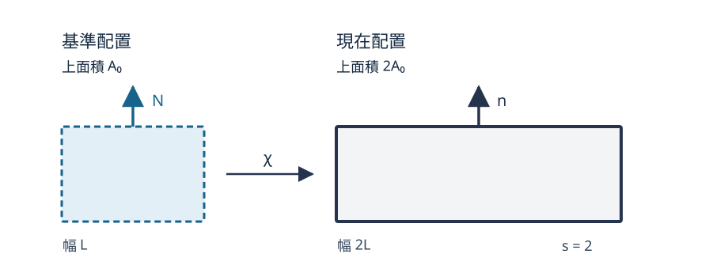

# CTM14 有限ひずみ弾性では応力をどのエネルギーから得るか

[CTM11 の Hooke 則](../CTM11/index.md#thm-ctm11-hooke)は小さい変位勾配なら扱いやすい。しかし、ゴムを長さの二倍まで伸ばしたり、大きくせん断したりすると、変形後の面積・法線も大きく変わる。微小ひずみで作ったエネルギーをそのまま使うと、有限の剛体回転にも偽のひずみを割り当てかねない。

[CTM3 の有限ひずみ](../CTM3/index.md#def-ctm3-green-strain)と[CTM8 の第一 Piola–Kirchhoff 応力](../CTM8/index.md#def-ctm8-first-piola)は、この困難を避けるための運動学と力の表現を用意した。[CTM10 の非散逸弾性則](../CTM10/index.md#prop-ctm10-isothermal-elastic)は、基準体積当たりの自由エネルギーを変形勾配で微分すると第一 Piola–Kirchhoff 応力になることを示した。本講では、**具体的なエネルギーを選んだ後に、どんな応力・面力・線形近似が出るか**を一歩ずつ計算する。

## 0. 前提と、どの面積を使うか

基準配置を開集合 $\Omega_0\subset\mathbb R^3$、現在位置を $x=\chi(X,t)$ とする。運動は十分滑らかで、各時刻に向きを保つ局所可逆な変形とし、次の[変形勾配](../CTM2/index.md#def-ctm2-deformation-gradient)を使う。

$$
F=D_X\chi\in GL^+(3),\qquad
GL^+(3)=\{F\in\mathbb R^{3\times3}:\det F>0\},\qquad J=\det F.
$$

$X$ と $x$ の単位は m、$F$ と $J$ は無次元である。$I=I_3$ は単位行列、上付き $T$ は転置、$U:V=\sum_{i,A}U_{iA}V_{iA}$ は同じ型の行列の二重内積とする。$F_{iA}$ の添字 $i$ は現在側の成分、$A$ は基準側の成分を表す。基準側の標準直交基底を $e_A$ とすると、$F$ の第 $A$ 列は基準線素 $e_A$ の像 $Fe_A$ である。[CTM3 の右 Cauchy–Green テンソル](../CTM3/index.md#def-ctm3-green-strain) $C=F^TF$ はこれらの線素の内積を記録し、

$
C_{AB}=(Fe_A)\cdot(Fe_B)=\sum_i F_{iA}F_{iB},\qquad
\operatorname{tr}C=\sum_A\|Fe_A\|^2.
$

行列を動かす方向 $H\in\mathbb R^{3\times3}$ での方向微分を $DW(F)[H]$ と書き、勾配 $\partial_F W$ は $DW(F)[H]=(\partial_F W):H$ を満たす行列として定める。時間依存の $F(t)$ では点記号 $\dot F=dF/dt$ は物質点 $X$ を固定した時間微分である。

[CTM8 の第一 Piola 応力と Nanson の関係](../CTM8/index.md#def-ctm8-first-piola)では、基準の外向き法線 $N$ と面積 $dA$ に対する力は $PN\,dA$、現在の法線 $n$ と面積 $da$ に対する力は $\sigma n\,da$ であり、

$$
P=J\sigma F^{-T},\qquad
\sigma=J^{-1}PF^T,\qquad
n\,da=JF^{-T}N\,dA
$$

となる。$P$、$\sigma$ の単位はいずれも Pa（N/m$^2$）だが、割る面積が異なる。同じ材料でも $P=\sigma$ と置いてはいけない。

以下は温度一定、熱流束零、散逸零の均質な**受動**弾性材料であり、内部変数、塑性、粘性、損傷は考えない。材料定数は空間的に一定とする。有限変形の存在・一意性一般論は必要としない。

## 1. 仕事率から応力を決める

[CTM8 の仕事共役性](../CTM8/index.md#thm-ctm8-work-conjugacy)では、基準体積当たりの機械仕事率が $P:\dot F$ となる。材料に蓄えられるエネルギーの同じ単位を J/m$^3$ としておけば、散逸が零の過程では

$$
\frac{d}{dt}W(F(t))=P(F(t)):\dot F(t).
$$

行列を少し動かす方向 $H$ を任意に選ぶと、左辺の連鎖律は $DW(F)[H]$ である。[CTM10 の等温・非散逸構成則](../CTM10/index.md#prop-ctm10-isothermal-elastic)は、固定した $F$ で正負両方向の速度を許すときに $P=\partial_F W$ を与える。

<!-- formal-statement-start -->
### 定義（基準体積エネルギーによる超弾性）

向きを保つ変形勾配の集合 $GL^+(3)$ 上で、$C^1$ 級のスカラー関数 $W:GL^+(3)\to\mathbb R$（単位 J/m$^3$）を与える。非散逸の等温応答で第一 Piola–Kirchhoff 応力を

$$
\boxed{P(F)=\partial_F W(F)},\qquad
DW(F)[H]=P(F):H\quad(H\in\mathbb R^{3\times3})
$$

によって定める模型を**超弾性模型**という。$\partial_F W$ は $F$ の九成分についての微分である。$W$ の定数加算は応力を変えない。
<!-- formal-statement-end -->

<!-- definition-example-start: def-ctm14-hyperelastic-energy -->
### **定義の確認**：一方向だけを伸ばす模型

例として $a>0$（Pa）を固定し、$W(F)=a(F^TF-I):(F^TF-I)/4$ とする。これは $GL^+(3)$ で滑らかな関数で、$F(s)=\operatorname{diag}(s,1,1)$（$s>0$）は $J=s>0$ を満たす。微分の意味をまず一変数で確かめると、

$$
W(F(s))=\frac a4(s^2-1)^2,\qquad
\frac{dW(F(s))}{ds}=a s(s^2-1).
$$

一方、一般の変分 $\delta F=H$（$\delta W=DW(F)[H]$）に対して、積の微分から $\delta C=F^TH+H^TF$ となる。$C-I$ は対称であり、行列内積の転置・積の関係 $(C-I):F^TH=F(C-I):H$ を使うと、

$
\begin{aligned}
\delta W
&=\frac a2(C-I):(F^TH+H^TF)\\
&=\frac a2\bigl\{F(C-I):H+F(C-I)^T:H\bigr\}\\
&=aF(C-I):H.
\end{aligned}
$

ゆえに定義どおり $P=aF(C-I)$ であり、$F(s)$ の位置では $P_{11}=as(s^2-1)$、他は零。特に $\dot F=\operatorname{diag}(\dot s,0,0)$ なら $P:\dot F=dW/dt$ が成立する。$F(s)$ が正の行列式をもち、エネルギーの全九成分微分が存在し、仕事共役も満たすことを別々に確認した。
<!-- definition-example-end -->

この例のエネルギーは一つの候補である。超弾性という条件自体は材料定数・安定性・客観性を保証しない。以下ではそれらを追加して実際に模型を選ぶ。

## 2. 剛体回転でも同じエネルギーか

回転行列の集合を $SO(3)=\{R\in\mathbb R^{3\times3}:R^TR=I,\ \det R=1\}$ と書く。以下、$Q\in SO(3)$ は現在側の観測者回転、$H\in SO(3)$ は基準側の材料方向の回転を表す。この節の $H$ は前節の任意の変分方向 $H$ とは別の役割である。観測者を回すと、変形勾配は左から $QF$ へ変わる。同じ物理的変形のエネルギーが観測者によらないための条件は、[CTM10 の客観的エネルギーの表示](../CTM10/index.md#prop-ctm10-energy-objectivity)により $W(QF)=W(F)$ であり、$C=F^TF$ の関数として書ける。一方、材料の向きを基準座標で回す操作は**右から** $FH$ を掛け、材料等方性は $W(FH)=W(F)$ と表す（[CTM10 の材料等方性](../CTM10/index.md#def-ctm10-material-isotropy)）。

これらの回転は違う位置に作用する。$C(QF)=F^TQ^TQF=C$、$C(FH)=H^TCH$ である。前者では $C$ 全体が変わらないが、後者では行列が基準側で直交共役される。

<!-- formal-statement-start -->
### 定義（有限変形の二つの等方的不変量）

任意の $F\in GL^+(3)$ に対し、右 Cauchy–Green テンソル $C=F^TF$ の第一不変量と体積倍率を

$$
I_1(F)=\operatorname{tr}(F^TF)=\sum_{i,A}F_{iA}^2,\qquad
J(F)=\det F>0
$$

と置く。この二量は、任意の $Q,H\in SO(3)$ に対して $F\mapsto QFH$ で変化しない。$I_1$ は無次元の線素伸び二乗和、$J$ は無次元の体積倍率である。
<!-- formal-statement-end -->

<!-- definition-example-start: def-ctm14-invariants -->
### **定義の確認**：せん断と回転を判別する

$F=\operatorname{diag}(2,1,1)$ では列の長さの二乗を足して $I_1=4+1+1=6$、行列式 $J=2$ である。任意の $Q,H\in SO(3)$ に対し、$Q^TQ=HH^T=I$ と行列式の積を使うと

$$
\operatorname{tr}((QFH)^T(QFH))
=\operatorname{tr}(H^TF^TFH)=\operatorname{tr}(F^TF)=6,\quad
\det(QFH)=1\cdot2\cdot1=2.
$$

ここで最後から二つ目の等号は $\operatorname{tr}(AB)=\operatorname{tr}(BA)$ の成分展開による。一方 $F=Q$ の純粋回転なら $I_1=3$、$J=1$ で、$F=I$ と一致する。線素の長さが変わらないことと両不変量の判定が整合する。
<!-- definition-example-end -->

一般に不変量はこれだけとは限らず、例えば $\operatorname{tr}(C^2)$ も等方不変である。次の模型は $I_1,J$ だけを選んだ**具体的な材料仮定**であり、すべての等方弾性材料の一般形ではない。

## 3. 圧縮可能 neo-Hooke 模型を微分する

非線形性を取り込みつつ、$F=I$ で応力零、小変形では等方 Hooke 則に戻るエネルギーを選ぶ。ここで $\mu>0$ と $\lambda\ge0$ は Pa 単位の定数であり、$\lambda$ は伸長倍率ではなく Lamé 型係数である。$\log J$ は $J>0$ でのみ実数として定義される。

<!-- formal-statement-start -->
### 定義（圧縮可能 neo-Hooke エネルギー）

$F\in GL^+(3)$、$\mu>0$、$\lambda\ge0$ に対し、基準体積当たりのエネルギー

$$
\boxed{
W(F)=\frac{\mu}{2}\left(I_1(F)-3-2\log J(F)\right)
+\frac{\lambda}{2}\{\log J(F)\}^2
}
$$

を採用する。$I_1(F)=\operatorname{tr}(F^TF)$、$J(F)=\det F>0$ である。この式で定める等温・非散逸の超弾性模型を、ここでは**圧縮可能 neo-Hooke 模型**という。$W(I)=0$ とする規格化を選んでいる。
<!-- formal-statement-end -->

<!-- definition-example-start: def-ctm14-neohookean -->
### **定義の確認**：せん断は体積を変えない

$\gamma\in\mathbb R$ に対して $F=I+\gamma e_1e_2^T$ は $J=1>0$、$I_1=3+\gamma^2$ を満たす。これを上のエネルギーに代入すると

$$
W(I+\gamma e_1e_2^T)=\frac{\mu}{2}\gamma^2\ge0.
$$

$\gamma=0$ で $W=0$、$W$ は $\gamma$ について微分可能である。この一変数族では $dF/d\gamma=\partial_\gamma F=e_1e_2^T$（他の変数は固定）なので、超弾性の定義と連鎖律から

$
\frac{d}{d\gamma}W(F(\gamma))
=DW(F(\gamma))[\partial_\gamma F]
=P(F(\gamma)):\partial_\gamma F=P_{12}(F(\gamma)).
$

左辺は $\mu\gamma$ である。続く定理で $P$ の全成分を求め、右辺と一致することを確認する。
<!-- definition-example-end -->

計算に使う二つの方向微分を先に導く。任意の行列方向 $H$ に対し $I_1(F)=\sum F_{iA}^2$ より

$$
DI_1(F)[H]=2\sum_{i,A}F_{iA}H_{iA}=2F:H.
$$

また $F\in GL^+(3)$ は可逆なので、十分小さい実数 $t$ に対して $F+tH\in GL^+(3)$ である。$A=F^{-1}H$ とすると行列式の乗法性と三列に関する多重線形性から

$
\det(F+tH)=J\det(I+tA)
=J\{1+t\operatorname{tr}A+O(t^2)\}.
$

実際、$t$ の一次項は三列のうち一列だけを $Ae_j$ に取り替えた行列式の和 $A_{11}+A_{22}+A_{33}$ であり、二列以上の置換項は $O(t^2)$ となる。ゆえに $DJ(F)[H]=J\operatorname{tr}(F^{-1}H)$。連鎖律を $J>0$ の $\log$ に適用して

$$
D(\log J)(F)[H]
=\frac{D J(F)[H]}{J}
=\operatorname{tr}(F^{-1}H)=F^{-T}:H.
$$

最後の式は $\operatorname{tr}(F^{-1}H)=\sum_{i,A}(F^{-1})_{Ai}H_{iA}$ を展開して確かめられる。**ここで $F^{-T}$ が出るのは体積倍率の微分のため**であって、逆行列を恣意的に差し込んだのではない。

<!-- formal-statement-start -->
### 定理（neo-Hooke 模型の三つの応力）

$F\in GL^+(3)$ と定数 $\mu>0,\lambda\ge0$ のもとで、上記の圧縮可能 neo-Hooke エネルギーを用いる。$B=FF^T$ を左 Cauchy–Green テンソル、$C=F^TF$ を右 Cauchy–Green テンソルとする。第一 Piola–Kirchhoff 応力 $P=\partial_F W$、第二 Piola–Kirchhoff 応力 $S=F^{-1}P$、Cauchy 応力 $\sigma=J^{-1}PF^T$ はそれぞれ

$$
\boxed{
\begin{aligned}
P&=\mu(F-F^{-T})+\lambda(\log J)F^{-T},\\
S&=\mu(I-C^{-1})+\lambda(\log J)C^{-1},\\
\sigma&=\frac{\mu}{J}(B-I)+\frac{\lambda\log J}{J}I.
\end{aligned}
}
$$

を満たす。$\sigma,S$ は対称で、$P$ は一般に対称でない。
<!-- formal-statement-end -->

### 証明の見取り図

エネルギーの $I_1$ と $\log J$ を独立に微分し、すべての変分方向 $H$ の係数を比較する。次に [CTM8 の第二 Piola 応力](../CTM8/index.md#def-ctm8-second-piola)と第一 Piola 応力の関係を使い、$F^{-1}F^{-T}=C^{-1}$、$F^{-T}F^T=I$ を計算する。

<!-- proof-start -->
### 証明

$W$ の方向微分へ上記の二式を入れる。係数 $\mu,\lambda$ は $F$ に依存しないので

$$
\begin{aligned}
DW(F)[H]
&=\frac{\mu}{2}\left(2F:H-2F^{-T}:H\right)\\
&\quad+\frac{\lambda}{2}\,2(\log J)F^{-T}:H\\
&=\bigl\{\mu(F-F^{-T})+\lambda(\log J)F^{-T}\bigr\}:H.
\end{aligned}
$$

すべての $H$ についての勾配が括弧内となる。次に $S=F^{-1}P$ と $C=F^TF$ から

$$
F^{-1}P=\mu(I-F^{-1}F^{-T})+\lambda(\log J)F^{-1}F^{-T},
\quad F^{-1}F^{-T}=(F^TF)^{-1}=C^{-1}.
$$

同じく $\sigma=J^{-1}PF^T$ へ代入すると

$$
\begin{aligned}
PF^T
&=\mu(FF^T-F^{-T}F^T)+\lambda(\log J)F^{-T}F^T\\
&=\mu(B-I)+\lambda(\log J)I,
\end{aligned}
$$

ゆえに三式を得る。$B,C,C^{-1},I$ は対称なので $\sigma,S$ は対称である。$P$ の非対称例は $F=Q\operatorname{diag}(2,1,1)$ の非自明な回転 $Q$ に対して生じる（後述）。$\square$
<!-- proof-end -->

この定理は、エネルギーの微分を別の応力へ直接転用してよいという意味ではない。[CTM4 の速度勾配と変形勾配の関係](../CTM4/index.md#prop-ctm4-velocity-deformation)から $L=\dot F F^{-1}$、[変形速度テンソルの定義](../CTM4/index.md#def-ctm4-rate-of-deformation-spin)から $D=(L+L^T)/2$ とすれば、$P:\dot F$ は基準体積当たり、$\sigma:D$ は現在体積当たりの仕事率であり、[CTM8 の仕事共役性](../CTM8/index.md#thm-ctm8-work-conjugacy)から $P:\dot F=J\sigma:D=S:\dot E$ で結ばれる。

## 4. 一様伸長：横方向の力も忘れない

基準の直方体を、現在位置 $\chi(X)=(sX_1,X_2,X_3)$、$s>0$ へ写す。固定時刻では $F=\operatorname{diag}(s,1,1)$、$J=s$、$B=\operatorname{diag}(s^2,1,1)$ である。$\mu>0,\lambda\ge0$ とする。

次の模式図は $s=2$ の三次元直方体を上から二次元投影したものである。上側の物質面（基準法線 $N=e_2$）は伸長方向 $e_1$ を含むため、面積は二倍になるが、現在法線は $n=e_2$ のままである。**同じ面の合力**を、左側では $PN\,dA$、右側では $\sigma n\,da$ として測ることに注目してほしい。

[図を拡大して確認する](assets/uniaxial-traction-areas.svg)

<!-- formal-statement-start -->
### 命題（一軸拘束伸長のエネルギーと表面力）

$F=\operatorname{diag}(s,1,1)$、$s>0$ を圧縮可能 neo-Hooke 模型に入れると

$$
\begin{aligned}
W(s)&=\frac{\mu}{2}(s^2-1-2\log s)+\frac{\lambda}{2}(\log s)^2,\\
P&=\operatorname{diag}\left(\mu(s-s^{-1})+\lambda\frac{\log s}{s},\ \lambda\log s,\ \lambda\log s\right),\\
\sigma&=\operatorname{diag}\left(\mu(s-s^{-1})+\lambda\frac{\log s}{s},\ \lambda\frac{\log s}{s},\ \lambda\frac{\log s}{s}\right).
\end{aligned}
$$

したがって $s\ne1$ かつ $\lambda>0$ なら、$X_2,X_3$ 方向の現在側側面に零表面力を指定してはならない。
<!-- formal-statement-end -->

### 証明の見取り図

$F$ と $F^{-T}$ は対角行列なので応力も対角。第1成分は $W(s)$ の微分と一致し、第2・3成分の表面力は拘束された横収縮に対応する。

<!-- proof-start -->
### 証明

$I_1=s^2+2$、$J=s$ をエネルギーに代入すると $W(s)$ が出る。さらに

$$
F^{-T}=\operatorname{diag}(s^{-1},1,1),\qquad
F-F^{-T}=\operatorname{diag}(s-s^{-1},0,0).
$$

[neo-Hooke 模型の三つの応力](#thm-ctm14-neohookean-stresses)を適用すると $P$ を得る。$PF^T$ の第1対角成分は $sP_{11}$、残りは $P_{22},P_{33}$ なので $J=s$ で割れば $\sigma$ の式になる。仕事率の整合は

$$
\frac{dW}{ds}=\frac{\mu}{2}(2s-2/s)+\frac{\lambda}{2}(2\log s/s)=P_{11}
$$

で確かめられる。現在配置の側面法線 $n=\pm e_2,\pm e_3$ に $\sigma n$ を掛けると $t=\pm(\lambda\log s/s)e_2,\pm(\lambda\log s/s)e_3$ である。$\lambda>0,s\ne1$ では零でない。$\square$
<!-- proof-end -->

例えば $s=2$、$\mu=2$ MPa、$\lambda=3$ MPa とすると $J=2$ で、

$$
P_{11}=\sigma_{11}=3+\frac32\log2\ {\rm MPa},\qquad
P_{22}=3\log2\ {\rm MPa},\quad
\sigma_{22}=\frac32\log2\ {\rm MPa}.
$$

第2方向では **同じ力を異なる面積で割る**ので $P_{22}$ と $\sigma_{22}$ が違う。基準面 $N=e_2$ の面積 $A_0$ は現在面積 $sA_0$ となり、$P_{22}A_0=\sigma_{22}(sA_0)$ が成り立つ。端面 $N=e_1$ の面積は変化しないので $P_{11}=\sigma_{11}$ となる。

横方向も自由な一軸**応力**試験なら、変形を $F=\operatorname{diag}(s,b,b)$ と別に置き、$\sigma_{22}=0$ を解かなければならない。[CTM11 の一軸応力と一軸ひずみの区別](../CTM11/index.md#thm-ctm11-elastic-constants)は有限変形でも重要である。この場合は $J=sb^2$ として

$$
P_{22}=\mu(b-b^{-1})+\lambda\frac{\log(sb^2)}b=0
\quad\Longleftrightarrow\quad
\mu(b^2-1)+\lambda\log(sb^2)=0.
$$

これは横方向伸び $b>0$ を決める方程式であり、前の $b=1$ とは境界条件が違う。

## 5. 単純せん断：Cauchy 応力に垂直成分が現れる

$\chi(X)=(X_1+\gamma X_2,X_2,X_3)$ とする。$\gamma\in\mathbb R$ は無次元のせん断量で、

$$
F=\begin{pmatrix}1&\gamma&0\\0&1&0\\0&0&1\end{pmatrix},
\quad
F^{-T}=\begin{pmatrix}1&0&0\\-\gamma&1&0\\0&0&1\end{pmatrix},
\quad J=1.
$$

<!-- formal-statement-start -->
### 命題（neo-Hooke 単純せん断の応力）

圧縮可能 neo-Hooke 模型で、上記の単純せん断 $F=I+\gamma e_1e_2^T$ に対し

$$
W=\frac{\mu\gamma^2}{2},\qquad
P=\mu\begin{pmatrix}0&\gamma&0\\\gamma&0&0\\0&0&0\end{pmatrix},
\qquad
\sigma=\mu\begin{pmatrix}\gamma^2&\gamma&0\\\gamma&0&0\\0&0&0\end{pmatrix}.
$$

$P_{11}=0$ でも $\sigma_{11}=\mu\gamma^2$ が現れる。$\lambda$ 項は $J=1$ のため消える。
<!-- formal-statement-end -->

### 証明の見取り図

まず $F^{-T}$ を行列で書いて $P$ を計算し、次に $PF^T$ の積を実行する。エネルギーの $\gamma$ 微分が $P_{12}$ に一致する。

<!-- proof-start -->
### 証明

$F-F^{-T}$ は $(1,2)$ と $(2,1)$ 成分だけが $\gamma$ の行列で、$\log J=0$ だから [neo-Hooke 模型の三つの応力](#thm-ctm14-neohookean-stresses)より $P$ を得る。次に

$$
\frac1\mu PF^T
=\begin{pmatrix}0&\gamma&0\\\gamma&0&0\\0&0&0\end{pmatrix}
\begin{pmatrix}1&0&0\\\gamma&1&0\\0&0&1\end{pmatrix}
=\begin{pmatrix}\gamma^2&\gamma&0\\\gamma&0&0\\0&0&0\end{pmatrix}.
$$

$J=1$ なのでこれが $\sigma/\mu$ となる。$I_1=3+\gamma^2$ を[圧縮可能 neo-Hooke エネルギー](#def-ctm14-neohookean)へ代入すると $W=\mu\gamma^2/2$、$\partial_\gamma W=\mu\gamma=P_{12}$ である。$\square$
<!-- proof-end -->

垂直応力が現れることは、単に Hooke 則のせん断成分を有限値まで延ばした場合との本質的な相違である。$P_{11}=0$ と $\sigma_{11}\ne0$ は矛盾ではない。両者の第一添字が表す力の方向は同じでも、第二添字が参照する面が異なる。例えば基準面 $N=e_1$ は現在面法線 $n\parallel(1,-\gamma,0)$ へ傾くため、$Pe_1$ と $\sigma e_1$ は対応する同一物質面の力ではない。

## 6. 回転と小変形の二つの検算

### 6.1 客観性と等方性を応力まで確認する

客観性の[既出定理](../CTM10/index.md#prop-ctm10-energy-objectivity)を、neo-Hooke 模型の具体式で確かめる。$Q,H\in SO(3)$ なら左・右回転のいずれでも $I_1,J$ は不変だから

$$
W(QFH)=W(F).
$$

左回転で $(QF)^{-T}=QF^{-T}$ なので [neo-Hooke 模型の三つの応力](#thm-ctm14-neohookean-stresses)から

$$
P(QF)=QP(F),\qquad
\sigma(QF)=Q\sigma(F)Q^T.
$$

右回転でも $(FH)^{-T}=F^{-T}H$ により $P(FH)=P(F)H$ が従う。これは客観性（左側）と材料等方性（右側）の違いを、微分後の応力で再確認したものだ。特に $F=Q$ の純粋回転で $J=1$、$B=I$ なので

$$
W(Q)=0,\qquad P(Q)=0,\qquad \sigma(Q)=0.
$$

$a=\operatorname{diag}(2,1,1)$ と $90^\circ$ の回転 $Q$ を組み合わせた $F=Qa$ では、$P(Qa)=Q P(a)$ は一般に対称でない。一方 $\sigma(Qa)=Q\sigma(a)Q^T$ は対称のままである。

### 6.2 微小変形へ戻す

$u(X)$ を滑らかな微小変位とし、$F=I+H$、$H=\nabla_Xu$ の成分が十分小さく、$I+H\in GL^+(3)$ とする。$\varepsilon=(H+H^T)/2$ を[CTM3 の微小ひずみ](../CTM3/index.md#def-ctm3-infinitesimal-strain)とする。逆行列と行列式の展開を、誤差が $O(\|H\|^2)$ になる形で記すと

$$
F^{-T}=I-H^T+O(\|H\|^2),\qquad
\log\det(I+H)=\operatorname{tr}H+O(\|H\|^2).
$$

この二式を [neo-Hooke 応力](#thm-ctm14-neohookean-stresses)へ代入すれば

$$
\begin{aligned}
P
&=\mu\{I+H-I+H^T\}+\lambda(\operatorname{tr}H)I+O(\|H\|^2)\\
&=2\mu\varepsilon+\lambda(\operatorname{tr}\varepsilon)I+O(\|H\|^2).
\end{aligned}
$$

同時に $J=1+O(\|H\|)$、$F^T=I+O(\|H\|)$、$P=O(\|H\|)$ なので $\sigma=J^{-1}PF^T=P+O(\|H\|^2)$。これは [CTM11 の等方 Hooke 則](../CTM11/index.md#thm-ctm11-hooke)と一次精度で一致する。

エネルギー側でも確かめる。二次までの行列式展開 $\log\det(I+H)=\operatorname{tr}H-\frac12\operatorname{tr}(H^2)+O(\|H\|^3)$ と $\operatorname{tr}(F^TF)=3+2\operatorname{tr}H+\operatorname{tr}(H^TH)$ により

$$
\begin{aligned}
W(I+H)
&=\frac{\mu}{2}\{\operatorname{tr}(H^TH)+\operatorname{tr}(H^2)\}
+\frac{\lambda}{2}(\operatorname{tr}H)^2+O(\|H\|^3)\\
&=\mu\varepsilon:\varepsilon+\frac{\lambda}{2}(\operatorname{tr}\varepsilon)^2+O(\|H\|^3).
\end{aligned}
$$

最後は $\operatorname{tr}(H^TH)+\operatorname{tr}(H^2)=2\varepsilon:\varepsilon$ を成分展開して得た。したがって**小変形で Hooke 則に戻るのは接線的な近似**であり、有限の剛体回転に微小ひずみの式を適用してよいという意味ではない。

## 7. 演習

すべて三次元で、$F\in GL^+(3)$、$\mu>0,\lambda\ge0$ とする。断りがなければ第3節の neo-Hooke 模型を使う。行列式、逆転置、微分方向と面法線の対応を、結果だけでなく途中式で示すこと。

### Level A

### A1. 体積微分と仕事共役

$F=\operatorname{diag}(a,b,c)$（$a,b,c>0$）と $H=\operatorname{diag}(h_1,h_2,h_3)$ に対し $D(\log J)(F)[H]$ を直接計算し、$F^{-T}:H$ と一致することを示せ。

- Level: A

<!-- solution-start -->
#### 詳細解答

$J=abc>0$ より $\log J=\log a+\log b+\log c$。$F+tH$ の対角成分は $a+th_1,b+th_2,c+th_3$ だから

$$
\left.\frac{d}{dt}\log\det(F+tH)\right|_{t=0}
=\frac{h_1}{a}+\frac{h_2}{b}+\frac{h_3}{c}.
$$

一方 $F^{-T}=\operatorname{diag}(1/a,1/b,1/c)$ なので

$$
F^{-T}:H=\frac{h_1}{a}+\frac{h_2}{b}+\frac{h_3}{c}.
$$

$t=0$ 近傍では対角成分が正であり、対数を微分できる。両者が一致する。
<!-- solution-end -->

### A2. 剛体回転の零応力

任意の $Q\in SO(3)$ に対し $W(Q),P(Q),\sigma(Q)$ を求めよ。$Q=I$ だけを代入した確認では不十分である。

- Level: A

<!-- solution-start -->
#### 詳細解答

$Q^TQ=I,\det Q=1$ から $I_1(Q)=\operatorname{tr}I=3$、$J(Q)=1$。したがって $W(Q)=\mu(3-3-0)/2+\lambda(0)^2/2=0$。$Q^{-T}=Q$ を [neo-Hooke 模型の三つの応力](#thm-ctm14-neohookean-stresses)へ入れると

$$
P(Q)=\mu(Q-Q)+\lambda(\log1)Q=0.
$$

$\sigma(Q)=J^{-1}P(Q)Q^T=0$。任意の回転で成立するので、観測者の向きによらず零応力である。
<!-- solution-end -->

### A3. せん断のエネルギー勾配

$F(\gamma)=I+\gamma e_1e_2^T$ に対し $W(\gamma)$ と $dW/d\gamma$ を求め、$P:\partial_\gamma F$ と比較せよ。

- Level: A

<!-- solution-start -->
#### 詳細解答

上三角行列の行列式は $J=1$、列二乗和は $I_1=3+\gamma^2$ である。[圧縮可能 neo-Hooke エネルギー](#def-ctm14-neohookean)より $W=\mu\gamma^2/2$ だから $dW/d\gamma=\mu\gamma$。[neo-Hooke 単純せん断の応力](#prop-ctm14-shear)から $P_{12}=\mu\gamma$。他方 $\partial_\gamma F=e_1e_2^T$ は $(1,2)$ 成分だけが $1$ なので

$$
P:\partial_\gamma F=\sum_{i,A}P_{iA}(\partial_\gamma F)_{iA}
=P_{12}=\mu\gamma=\frac{dW}{d\gamma}.
$$

すなわち仕事共役は一つの変化方向の勾配と一致する。
<!-- solution-end -->

### A4. 一軸拘束伸長の側面

$F=\operatorname{diag}(2,1,1)$、$\lambda>0$ に対し基準面 $N=e_2$、面積 $A_0$ の合力を基準と現在の両配置で求めよ。

- Level: A

<!-- solution-start -->
#### 詳細解答

$J=2$、$F^{-T}e_2=e_2$ で、[Nanson の面積変換公式](../CTM2/index.md#thm-ctm2-nanson)より $n\,da=2e_2\,dA$。したがってこの面は向きが $e_2$ のままで面積は $2A_0$。 [伸長命題](#prop-ctm14-uniaxial)から $P_{22}=\lambda\log2$、$\sigma_{22}=\lambda\log2/2$。二通りの合力は

$$
(Pe_2)A_0=\lambda(\log2)A_0e_2,\qquad
(\sigma e_2)(2A_0)=\lambda(\log2)A_0e_2.
$$

いずれも N 単位で一致する。$s=2$ は有限伸長で、側面自由条件は満たさない。
<!-- solution-end -->

### Level B

### B1. 自由側面に対する横伸び

$F=\operatorname{diag}(s,b,b)$、$s,b>0$ とし、側面の Cauchy 応力が零である条件を導け。さらに $s=1+\epsilon$、$b=1+\beta\epsilon+O(\epsilon^2)$ として $\beta$ を求め、[線形弾性の Poisson 比](../CTM11/index.md#thm-ctm11-elastic-constants)と照合せよ。

- Level: B

<!-- solution-start -->
#### 詳細解答

$J=sb^2>0$、$F^{-T}=\operatorname{diag}(1/s,1/b,1/b)$。[neo-Hooke 模型の三つの応力](#thm-ctm14-neohookean-stresses)から

$$
P_{22}=\mu(b-1/b)+\lambda\frac{\log(sb^2)}b,
\qquad \sigma_{22}=\frac b{sb^2}P_{22}.
$$

$b/(sb^2)>0$ なので $\sigma_{22}=0$ と $P_{22}=0$ は同値である。$b$ を掛けると

$$
\mu(b^2-1)+\lambda\log(sb^2)=0.
$$

$\epsilon\to0$ で $b^2-1=2\beta\epsilon+O(\epsilon^2)$、$\log(sb^2)=\log(1+\epsilon)+2\log(1+\beta\epsilon+O(\epsilon^2))=(1+2\beta)\epsilon+O(\epsilon^2)$。一次係数を零にすると

$$
2\mu\beta+\lambda(1+2\beta)=0,\qquad
\boxed{\beta=-\frac{\lambda}{2(\lambda+\mu)}}.
$$

$\lambda\ge0,\mu>0$ で分母は正。CTM11 の Poisson 比 $\nu=\lambda/[2(\lambda+\mu)]$ と一致し、横伸びは $b=1-\nu\epsilon+O(\epsilon^2)$ となる。
<!-- solution-end -->

### B2. 応力変換の非対称性

$D=\operatorname{diag}(2,1,1)$、$Q=\begin{pmatrix}0&-1&0\\1&0&0\\0&0&1\end{pmatrix}$ として $F=QD$ を考える。$P(F)$ が一般に非対称なのに $\sigma(F)$ が対称であることを、$\lambda>0,\mu>0$ の具体式で検算せよ。

- Level: B

<!-- solution-start -->
#### 詳細解答

$\det Q=1$、$Q^TQ=I$、$\det D=2>0$ から $F\in GL^+(3)$。まず $D^{-T}=\operatorname{diag}(1/2,1,1)$ と [neo-Hooke 模型の三つの応力](#thm-ctm14-neohookean-stresses)により

$$
P(D)=\operatorname{diag}\left(\frac32\mu+\frac{\lambda\log2}{2},\ \lambda\log2,\ \lambda\log2\right).
$$

左回転の変換則は $P(QD)=QP(D)$ だから、$a=\frac32\mu+\frac{\lambda\log2}{2}$、$b=\lambda\log2$ と置けば

$$
P(F)=\begin{pmatrix}0&-b&0\\a&0&0\\0&0&b\end{pmatrix}.
$$

$a+b=\frac32\mu+\frac32\lambda\log2>0$ は一般に零でなく、$P^T\ne P$。一方 $D$ の Cauchy 応力は $\sigma(D)=\operatorname{diag}(a,b/2,b/2)$ である。回転して

$$
\sigma(F)=Q\sigma(D)Q^T=\operatorname{diag}(b/2,a,b/2)
$$

となり対称。別の面積と法線を扱う二点テンソル $P$ に、空間応力の対称性を要求してはいけない。
<!-- solution-end -->

### B3. せん断とエネルギー仕事率

時間依存する $\gamma(t)$ の単純せん断を考える。$\dot W=P:\dot F=J\sigma:D$ をそれぞれ直接計算して一致を確かめよ。$D$ は現在配置の変形速度テンソルとする。

- Level: B

<!-- solution-start -->
#### 詳細解答

$F=I+\gamma e_1e_2^T$、$\dot F=\dot\gamma e_1e_2^T$、$F^{-1}=I-\gamma e_1e_2^T$ である。空間速度勾配は $L=\dot F F^{-1}=\dot\gamma e_1e_2^T$（$(e_1e_2^T)^2=0$ を使用）。よって

$$
D=\frac12(L+L^T)=\frac{\dot\gamma}{2}
\begin{pmatrix}0&1&0\\1&0&0\\0&0&0\end{pmatrix}.
$$

$W=\mu\gamma^2/2$ なので $\dot W=\mu\gamma\dot\gamma$。次に [neo-Hooke 単純せん断の応力](#prop-ctm14-shear)より $P:\dot F=P_{12}\dot\gamma=\mu\gamma\dot\gamma$。$\sigma_{12}=\sigma_{21}=\mu\gamma$、$D_{12}=D_{21}=\dot\gamma/2$ だから

$$
J\sigma:D=1\left(
\sigma_{12}D_{12}+\sigma_{21}D_{21}\right)
=2\mu\gamma\frac{\dot\gamma}{2}
=\mu\gamma\dot\gamma.
$$

$\sigma_{11}=\mu\gamma^2$ は $D_{11}=0$ のため、この仕事率には直接寄与しない。
<!-- solution-end -->

### B4. 客観性と等方性を区別する

固定単位ベクトル $a_0=e_1$ と係数 $k>0$（Pa）で $W_a(F)=k(|Fa_0|^2-1)^2/2$ を定める。$Q\in SO(3)$ への客観性を示し、右回転 $H$ の一般の等方性は成り立たないことを $F=\operatorname{diag}(2,1,1)$ で示せ。

- Level: B

<!-- solution-start -->
#### 詳細解答

左回転では $|QFa_0|^2=(Fa_0)^TQ^TQ(Fa_0)=|Fa_0|^2$ だから $W_a(QF)=W_a(F)$。右回転では $FH a_0$ が引数に現れ、固定された材料方向 $a_0$ を変えてしまう。$F=\operatorname{diag}(2,1,1)$ のとき $|Fa_0|^2=4$ なので $W_a(F)=k(4-1)^2/2=9k/2$。$H$ を $e_1$ を $e_2$ に移す $90^\circ$ 回転とすれば $|FH a_0|^2=|Fe_2|^2=1$ で $W_a(FH)=0$。この模型は客観的でも等方的ではない。固定繊維方向があり、右回転に伴って材料方向を一緒に回さないことが反例の仕組みである。
<!-- solution-end -->

### Level C

### C1. エネルギー・応力・境界力・微小極限を統合する

圧縮可能 neo-Hooke 模型で、一様変形 $F(q)=\operatorname{diag}(q,q^{-1},1)$（$q>0$）を考える。(i) $J,I_1,W,P,\sigma$ を求める。(ii) 基準の $N=e_1$ と $N=e_2$ の二つの面について、Nanson の公式で現在側の面積倍率を求め、$PN\,dA=\sigma n\,da$ を成分ごとに確認する。(iii) $q=1+h$、$|h|\ll1$ で応力を一次まで展開し、Hooke 則の予測に一致することを示せ。

- Level: C

<!-- solution-start -->
#### 詳細解答

(i) $F$ は正の対角行列なので $J=q\cdot q^{-1}\cdot1=1$、$I_1=q^2+q^{-2}+1$。$\log J=0$ のため

$$
W(q)=\frac\mu2(q^2+q^{-2}-2),\qquad
F^{-T}=\operatorname{diag}(q^{-1},q,1).
$$

[neo-Hooke 模型の三つの応力](#thm-ctm14-neohookean-stresses)より

$$
\begin{aligned}
P&=\mu\,\operatorname{diag}(q-q^{-1},\ q^{-1}-q,\ 0),\\
\sigma&=\mu\,\operatorname{diag}(q^2-1,\ q^{-2}-1,\ 0).
\end{aligned}
$$

$P$ は基準面積当たり、$\sigma$ は現在面積当たりの応力で、$P_{11}$ と $\sigma_{11}$ を同一視しない。

(ii) [Nanson の面積変換公式](../CTM2/index.md#thm-ctm2-nanson)から $n\,da=JF^{-T}N\,dA$。$N=e_1$ なら $n=e_1, da=q^{-1}dA$ だから

$$
\sigma e_1\,da=\mu(q^2-1)q^{-1}e_1\,dA
=\mu(q-q^{-1})e_1\,dA=Pe_1\,dA.
$$

$N=e_2$ なら $n=e_2,da=q\,dA$ だから

$$
\sigma e_2\,da=\mu(q^{-2}-1)q e_2\,dA
=\mu(q^{-1}-q)e_2\,dA=Pe_2\,dA.
$$

両方の面で力が一致する。$N=-e_i$ の対向面でも両辺が符号反転するだけなので整合する。

(iii) $q=1+h$ として $q^{-1}=1-h+O(h^2)$、$q^{2}=1+2h+O(h^2)$、$q^{-2}=1-2h+O(h^2)$ である。したがって

$$
P=\mu\,\operatorname{diag}(2h,-2h,0)+O(h^2),\qquad
\sigma=\mu\,\operatorname{diag}(2h,-2h,0)+O(h^2).
$$

一方 $H=F-I=\operatorname{diag}(h,-h,0)+O(h^2)$ は対称で、$\operatorname{tr}H=O(h^2)$。したがって [Hooke 則](../CTM11/index.md#thm-ctm11-hooke)の一次項 $2\mu\varepsilon+\lambda(\operatorname{tr}\varepsilon)I$ は同じ $\mu\operatorname{diag}(2h,-2h,0)$ となる。$\lambda$ 項が消えるのは、この変形が厳密に $J=1$ であるためである。
<!-- solution-end -->

## 8. まとめと次の見通し

- 非散逸・等温の超弾性では、基準体積当たりの自由エネルギーを $F$ で微分して $P$ を求める。現在面の応力は $\sigma=J^{-1}PF^T$ へ変換する。
- 客観性は $F\mapsto QF$ の左回転、材料等方性は $F\mapsto FH$ の右回転を区別する。$J>0$ は逆行列と $\log J$ の定義域を守る。
- neo-Hooke 模型では、有限せん断の Cauchy 応力に $\mu\gamma^2$ の垂直応力が現れる。小変形では Hooke 則へ戻るが、横方向の境界条件を忘れると同じ材料でも別の問題を解いてしまう。

次講では、ひずみだけでなく変形**速度**にも応力が依存する流体を扱い、非散逸弾性と粘性散逸の違いを方程式から比較する。
