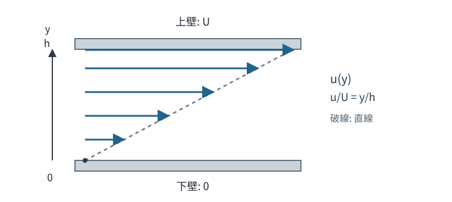

# CTM16 無次元化で粘性と慣性のどちらが効くか

[CTM15 の非圧縮 Navier–Stokes 方程式](../CTM15/index.md#thm-ctm15-incompressible-navier-stokes)は、圧力、粘性、加速度のすべてを含んでいる。しかし同じ方程式でも、微小な流路をゆっくり進む液体と、大きな流路を速く進む液体では支配的な項が違う。単位が異なる実験を、どんな尺度で比較したらよいのだろうか。

長さ・速度・時間・圧力をそれぞれ基準量で割り、**無次元の方程式**に直す。慣性と粘性の尺度比を求め、どちらの項を小さいと判断できるかを調べる。ただし、**移流慣性が小さいだけで非定常加速度まで消えるわけではない**。この点を確かめてから、二枚の板の間の Couette 流を境界条件から導く。

## 0. 対象・前提・記号

三次元の流体領域で、密度 $\rho>0$ と粘性係数 $\eta>0$ が**空間・時間とも一定**の非圧縮 Newton 流体を考える。速度 $v(x,t)$、圧力 $p(x,t)$、単位質量当たりの体積力 $b(x,t)$ は必要な範囲で滑らかとし、$v$ は時間 $C^1$・空間 $C^2$、$p$ は空間 $C^1$ とする。境界が登場するときは速度を壁まで連続に延ばせるものとする。一般の初期境界値問題の解の存在定理は主張しない。

[CTM4 の変形速度](../CTM4/index.md#def-ctm4-rate-of-deformation-spin)、[CTM5 の連続の式](../CTM5/index.md#thm-ctm5-mass-equivalence)、[CTM15 の非圧縮 Newton 構成則](../CTM15/index.md#def-ctm15-incompressible-newtonian)のもとで、[CTM15 の運動量方程式](../CTM15/index.md#thm-ctm15-incompressible-navier-stokes)は

$$
\rho\left\{\partial_t v+(v\cdot\nabla)v\right\}
=-\nabla p+\eta\Delta v+\rho b,\qquad \nabla\cdot v=0.
$$

ここで $\nu=\eta/\rho>0$ は動粘度（m$^2$/s）。座標は $x=(x_1,x_2,x_3)$、$\partial_j=\partial/\partial x_j$ とし、$\Delta$ は速度の各成分に作用する。$[x]=\mathrm m$、$[t]=\mathrm s$、$[v]=\mathrm{m/s}$、$[p]=\mathrm{Pa}$、$[\eta]=\mathrm{Pa\,s}$ である。

以下で求める尺度比は、ここで固定した**均質・等粘性**の模型と、選択した代表長さ・代表速度に対する値である。空間で $\eta$ が変わる流体へ、そのまま $\eta\Delta v$ を使ってはいけない。

## 1. 単位を外して流れを比べる

速度を二倍にし長さを半分にした場合、$\partial_t v$ と $\Delta v$ は同じ割合では変わらない。そこで代表長さ $L>0$、代表速度 $U>0$、代表時間 $T>0$、圧力変動の代表量 $P>0$ をまず決める。圧力は任意の基準圧 $p_{\mathrm{ref}}$ からの差を用いる。

<!-- formal-statement-start -->
### 定義（流れの無次元変数）

三次元の流れに対し $L,U,T,P>0$ と一定の $p_{\mathrm{ref}}$ を選び、次の無次元変数を定める。

$$
x=LX,\qquad t=Ts,\qquad v(x,t)=UV(X,s),\qquad
p(x,t)=p_{\mathrm{ref}}+Pq(X,s).
$$

無次元の微分演算子は $\nabla_X$ と $\Delta_X$ と書き、物理座標の $\nabla_x,\Delta_x$ と区別する。
<!-- formal-statement-end -->

なぜ $x=LX$ から微分係数が $1/L$ 倍になるのかを、成分で確かめる。$X_j=x_j/L$ を $x_j$ で微分すると $\partial X_j/\partial x_j=1/L$ なので、連鎖律から

$$
\partial_t v=\frac{U}{T}\partial_s V,\qquad
\partial_{x_j}v_i=\frac{U}{L}\partial_{X_j}V_i,\qquad
\partial_{x_j}^2v_i=\frac{U}{L^2}\partial_{X_j}^2V_i.
$$

さらに $v_j\partial_{x_j}v_i=(U^2/L)V_j\partial_{X_j}V_i$、$\partial_{x_i}p=(P/L)\partial_{X_i}q$ が従う。無次元化は変数名を変えるだけでなく、**各微分の尺度を揃える操作**である。

<!-- definition-example-start: def-ctm16-reference-scales -->
### **定義の確認**：単純な速度分布を変換する

長さ $h>0$、上壁速度 $U>0$ の $v=(Uy/h,0,0)$ に $L=h$ を選ぶ。第2座標は $x_2=y$ なので、[流れの無次元変数](#def-ctm16-reference-scales)の定義から

$$
X_2=\frac{x_2}{L}=\frac yh,\qquad
V_1=\frac{v_1}{U}=\frac yh=X_2
$$

となり、他の速度成分は零である。従って $V=(X_2,0,0)$。成分表示の連鎖律を使えば

$$
\partial_yv_1=\frac{U}{h}\partial_{X_2}V_1
=\frac{U}{h}\cdot1=\frac{U}{h}
$$

であり、元の速度の直接微分と一致する。$X_2=0,1$ が元の壁 $y=0,h$ に対応する。
<!-- definition-example-end -->

## 2. 慣性と粘性を測る Reynolds 数

慣性のうち移流加速度 $\rho(v\cdot\nabla)v$ の大きさは代表的に $\rho U^2/L$、粘性項 $\eta\Delta v$ は $\eta U/L^2$ と見積もられる。両者はともに単位体積当たりの力（N/m$^3$）なので、比を取れる。

<!-- formal-statement-start -->
### 定義（Reynolds 数）

一定密度 $\rho>0$、一定粘性係数 $\eta>0$ の Newton 流体について、代表速度 $U>0$ と代表長さ $L>0$ に対し、**Reynolds 数**を

$$
\boxed{\mathrm{Re}=\frac{\rho UL}{\eta}=\frac{UL}{\nu}}
$$

と定義する。これは代表的な**移流慣性項と粘性項の尺度比**であり、無次元の正数である。
<!-- formal-statement-end -->

実際、比の式を項ごとに書けば

$$
\frac{\rho U^2/L}{\eta U/L^2}
=\frac{\rho U^2}{L}\frac{L^2}{\eta U}
=\frac{\rho UL}{\eta}.
$$

$\rho$ の単位は kg/m$^3$、$UL$ は m$^2$/s、$\eta$ は kg/(m s) なので、$\rho UL/\eta$ の次元は $1$。**Reynolds 数が小さい**とは代表的な移流慣性が粘性より小さいという尺度判断であり、場の任意の点で加速度がゼロだという命題ではない。

<!-- definition-example-start: def-ctm16-reynolds -->
### **定義の確認**：微小流路と大きな流路

$\rho=10^3\,\mathrm{kg/m^3}$、$\eta=10^{-3}\,\mathrm{Pa\,s}$、$U=10^{-3}\,\mathrm{m/s}$、$L=10^{-4}\,\mathrm m$ なら

$$
\mathrm{Re}=\frac{10^3\cdot10^{-3}\cdot10^{-4}}{10^{-3}}=10^{-1}.
$$

粘性項の尺度は $\eta U/L^2=10^2\,\mathrm{N/m^3}$、移流慣性項の尺度は $\rho U^2/L=10\,\mathrm{N/m^3}$。比は確かに $0.1$ である。同じ材料と速度のまま $L$ を $10^{-2}$ m にすると $\mathrm{Re}=10$ となる。**材料だけでなく長さの選び方**が効く。
<!-- definition-example-end -->

## 3. 時間の尺度を独立に選ぶ：Strouhal 数

非定常加速度は $\rho U/T$ の尺度を持つ。移流慣性の $\rho U^2/L$ と比べると $L/(UT)$ である。流れが変化する時間 $T$ を、流体が距離 $L$ を速さ $U$ で進む時間 $L/U$ と区別する。

<!-- formal-statement-start -->
### 定義（Strouhal 数）

$L,U,T>0$ をそれぞれ代表長さ・代表速度・代表時間とするとき、**Strouhal 数**を

$$
\boxed{\mathrm{St}=\frac{L}{UT}}
$$

と定義する。$\mathrm{St}$ は、非定常加速度と移流加速度の代表的尺度の比である。
<!-- formal-statement-end -->

<!-- definition-example-start: def-ctm16-strouhal -->
### **定義の確認**：同じ流体でも異なる変化速度

$L=10^{-3}$ m、$U=10^{-2}$ m/s とする。移流時間は $L/U=0.1$ s。$T=0.1$ s なら $\mathrm{St}=1$ だが、$T=0.001$ s なら $\mathrm{St}=100$ である。同じ $L,U,\rho,\eta$ なら Reynolds 数は変わらない。$\mathrm{St}$ だけが時間変化の速さを区別する。
<!-- definition-example-end -->

## 4. 無次元方程式は何を示すか

前節までの変換を[CTM15 の Navier–Stokes 方程式](../CTM15/index.md#thm-ctm15-incompressible-navier-stokes)へ適用する。圧力を慣性尺度 $P=\rho U^2$ で割るか、粘性尺度 $P=\eta U/L$ で割るかにより、見える係数が変わる。**圧力が実際にその尺度で変動する**かどうかは、支配方程式と境界条件から調べるべきことである。

<!-- formal-statement-start -->
### 定理（非圧縮 Navier–Stokes 方程式の無次元形）

$\rho,\eta>0$ は一定で、$v,p,b$ は第0節の正則性を満たし、[CTM15 の非圧縮 Navier–Stokes 方程式](../CTM15/index.md#thm-ctm15-incompressible-navier-stokes)（$\nabla_x\cdot v=0$ を含む）を満たすとする。[無次元変数](#def-ctm16-reference-scales)の $L,U,T,P>0$ で変数を変え、無次元体積力を $B=(L/U^2)b$ と置く。このとき

$$
\boxed{
\mathrm{St}\,\partial_s V+(V\cdot\nabla_X)V
=-\mathrm{Eu}\,\nabla_Xq+\frac{1}{\mathrm{Re}}\Delta_X V+B,
\qquad \nabla_X\cdot V=0,
}
$$

ここで $\mathrm{Re}=\rho UL/\eta$、$\mathrm{St}=L/(UT)$、$\mathrm{Eu}=P/(\rho U^2)>0$ は圧力尺度と慣性尺度の比である。
<!-- formal-statement-end -->

### 証明の見取り図

時間・移流・粘性・圧力の四項へ連鎖律を適用し、全項を同じ慣性尺度 $\rho U^2/L$ で割る。非圧縮条件も同じ座標変換で保存される。

<!-- proof-start -->
### 証明

[無次元変数の導入](#def-ctm16-reference-scales)で得た各微分を、[CTM15 の運動量式](../CTM15/index.md#thm-ctm15-incompressible-navier-stokes)の左辺・右辺へ代入すると、

$$
\rho\left(\frac{U}{T}\partial_s V+\frac{U^2}{L}(V\cdot\nabla_X)V\right)
=-\frac{P}{L}\nabla_Xq+\frac{\eta U}{L^2}\Delta_XV+\rho b.
$$

$\rho U^2/L>0$ で両辺を割る。各係数は

$$
\frac{\rho U/T}{\rho U^2/L}=\frac{L}{UT}=\mathrm{St},\quad
\frac{P/L}{\rho U^2/L}=\frac{P}{\rho U^2}=\mathrm{Eu},\quad
\frac{\eta U/L^2}{\rho U^2/L}=\frac{\eta}{\rho UL}=\frac{1}{\mathrm{Re}}.
$$

最後の外力は $\rho b/(\rho U^2/L)=Lb/U^2=B$ となる。非圧縮条件も $\nabla_x\cdot v=(U/L)\nabla_X\cdot V=0$ であり、$U/L>0$ より $\nabla_X\cdot V=0$ を得る。$\square$
<!-- proof-end -->

**圧力尺度の選択**。$T=L/U$、$P=\rho U^2$ と選べば $\mathrm{St}=\mathrm{Eu}=1$ となる。低 Reynolds 数に注目するときは、粘性力と圧力勾配を同じ大きさに置く方が便利である。そこで

$$
P_{\mathrm v}=\frac{\eta U}{L},\qquad
\pi=\frac{p-p_{\mathrm{ref}}}{P_{\mathrm v}},\qquad
F=\frac{\rho L^2}{\eta U}b
$$

と定める。$\pi$ は**粘性圧力尺度で測った圧力変動**、$F$ は粘性力尺度で測った体積力である。これらを代入する、または上の無次元式を $\mathrm{Re}$ 倍して $\mathrm{Re}\,\mathrm{Eu}=\rho UL/\eta\cdot P/(\rho U^2)=P/P_{\mathrm v}$ を使えば、次を得る。

<!-- formal-statement-start -->
### 系（粘性尺度による無次元運動量式）

一定 $\rho,\eta>0$ の非圧縮 Newton 流体について、第0節の正則性、[CTM15 の非圧縮 Navier–Stokes 方程式](../CTM15/index.md#thm-ctm15-incompressible-navier-stokes)および長さ $L>0$、速度 $U>0$、時間 $T>0$ を仮定する。[無次元変数](#def-ctm16-reference-scales)の $V$ を使い、圧力を $P_{\mathrm v}=\eta U/L$ で、体積力を $\eta U/L^2$ で測ったとき、

$$
\boxed{
\mathrm{Re}\,\mathrm{St}\,\partial_s V
+\mathrm{Re}\,(V\cdot\nabla_X)V
=-\nabla_X\pi+\Delta_XV+F,\qquad
\nabla_X\cdot V=0.
}
$$

ここで $F=\rho L^2b/(\eta U)$、$\mathrm{Re}=\rho UL/\eta$、$\mathrm{St}=L/(UT)$ である。
<!-- formal-statement-end -->

これが低 Reynolds 数の議論に適した形である。**$\mathrm{Re}\ll1$ だけで左辺の二項をともに捨てることはできない**。第二項は小さくても、第一項の係数は $\mathrm{Re}\,\mathrm{St}$ だからである。

## 5. 定常低 Reynolds 数から Stokes 方程式へ

まず**定常**（$\partial_sV=0$）とする。さらに速度勾配が代表尺度に照らして有限であり、移流項が大きく膨れ上がらなければ、[粘性尺度の運動量式](#cor-ctm16-viscous-scaled-equation)で $\mathrm{Re}(V\cdot\nabla_X)V$ は小さくなる。得られる極限方程式は、圧力・粘性・体積力の釣合である。

ただし、**関数が収束することと、その微分が極限関数の微分に一致することは別問題**である。以下では、領域の内部に収まる任意のコンパクト集合（閉かつ有界な集合）上で、関数と必要な階数までの偏導関数がそれぞれ**一様に収束**することを仮定する。この条件で初めて微分と極限を交換できる。圧力そのものも定数差を適宜揃えて収束させる。

<!-- formal-statement-start -->
### 定理（条件付き低 Reynolds 数極限）

固定した開いた無次元領域 $\Omega\subset\mathbb R^3$ で、$\mathrm{Re}=\varepsilon>0$ の定常非圧縮解 $(V_\varepsilon,\pi_\varepsilon)$（$V_\varepsilon\in C^2(\Omega)$、$\pi_\varepsilon\in C^1(\Omega)$）が

$$
\varepsilon(V_\varepsilon\cdot\nabla_X)V_\varepsilon
=-\nabla_X\pi_\varepsilon+\Delta_XV_\varepsilon+F_\varepsilon,\qquad
\nabla_X\cdot V_\varepsilon=0
$$

を満たすとする。$\varepsilon\downarrow0$ に対し、$V_\varepsilon$ とその一階・二階空間偏導関数、$\pi_\varepsilon$ とその一階偏導関数、および $F_\varepsilon$ が、$\Omega$ 内の任意のコンパクト集合上でそれぞれ一様に収束すると仮定する。さらに $V_\varepsilon$ と $\nabla_XV_\varepsilon$ が $\varepsilon$ によらず領域内で一様有界であるとする。このとき、$V_0\in C^2(\Omega)$、$\pi_0\in C^1(\Omega)$ であり、極限 $(V_0,\pi_0)$ は**定常 Stokes 方程式**

$$
\boxed{-\nabla_X\pi_0+\Delta_XV_0+F_0=0,\qquad \nabla_X\cdot V_0=0}
$$

を満たす。これは極限が存在すると仮定した主張であり、一般の解の収束を保証する定理ではない。
<!-- formal-statement-end -->

### 証明の見取り図

小さくなるのは移流項に掛かる係数だけではない。速度とその空間勾配が有界である条件を使い、**係数と項の積全体**が消えることを確かめる。

<!-- proof-start -->
### 証明

$|V_\varepsilon|\le M_0$、$|\nabla_XV_\varepsilon|\le M_1$ となる領域内共通の上界を取る。成分 $i=1,2,3$ ごとに

$$
\left|\varepsilon\sum_{j=1}^3(V_\varepsilon)_j
\partial_{X_j}(V_\varepsilon)_i\right|
\le 3\varepsilon M_0M_1\longrightarrow0.
$$

微分と極限を交換してよい理由も確認する。例えば $X$ と $X+he_j$ を結ぶ線分が $\Omega$ に含まれるとき、各成分について

$$
(V_\varepsilon)_i(X+he_j)-(V_\varepsilon)_i(X)
=\int_0^h\partial_{X_j}(V_\varepsilon)_i(X+re_j)\,dr.
$$

線分上の一様収束により右辺の極限を積分の内側へ移せる。極限関数の差も左辺の極限となるので、$h$ による微分から $\partial_{X_j}(V_0)_i$ は偏導関数の極限に一致する。一階偏導関数へ同じ議論を繰り返せば二階も一致する。$\pi_\varepsilon$ の勾配についても同様である。従って二階微分・圧力勾配・体積力の極限を各成分の式へ代入でき、$-\nabla_X\pi_0+\Delta_XV_0+F_0=0$ を得る。一階微分の一致と $\nabla_X\cdot V_\varepsilon=0$ から $\nabla_X\cdot V_0=0$ も従う。$\square$
<!-- proof-end -->

物理単位へ戻すと、一定密度・粘性、定常・非圧縮の仮定のもとで、Stokes 方程式は

$$
-\nabla_xp+\eta\Delta_xv+\rho b=0,\qquad \nabla_x\cdot v=0.
$$

ただし圧力の定数部分は勾配から求まらない。また、定常化・低 Reynolds 数化と[CTM15 の無滑り条件](../CTM15/index.md#def-ctm15-no-slip)は別々の仮定である。

### **反例的な尺度比較**：Reynolds 数が小さくても非定常は残る

速度が境界で時間的に変わると、長さ $L$ を粘性が横断する代表時間は

$$
T_\nu=\frac{L^2}{\nu}=\frac{\rho L^2}{\eta}
=\mathrm{Re}\,\frac{L}{U}.
$$

ここで $T=T_\nu$ と選べば、$\mathrm{St}=L/(UT_\nu)=1/\mathrm{Re}$、従って

$$
\mathrm{Re}\,\mathrm{St}=1.
$$

粘性尺度による式で移流項の係数は $\mathrm{Re}$ と小さいままでも、非定常項の係数は $1$ である。**非定常 Stokes 方程式** $\partial_sV=-\nabla_X\pi+\Delta_XV+F$ を先に考える必要があり、定常 Stokes 方程式へは飛べない。この区別は第8節の非定常演習で具体的に検算する。

## 6. 平行平板 Couette 流を境界条件から解く

厚さ $h>0$ の流体が、下壁 $y=0$ と上壁 $y=h$ の間にある。下壁は静止し、上壁は $x$ 方向に一定速度 $U>0$ で動く。側方へ十分長い平行平板を理想化し、圧力勾配・体積力がなく、流れは時間に依存せず $x$ 方向速度だけが $y$ に依存すると仮定する。この節の $u'(y)=du/dy$、$u''(y)=d^2u/dy^2$ は $y$ に関する**常微分**である。第8節の $u(y,t)$ では時間と空間を別々に微分するので、$\partial_tu$、$\partial_y^2u$ と書き分ける。

[CTM15 の無滑り条件](../CTM15/index.md#def-ctm15-no-slip)を両壁へ課すので、速度を「なんとなく直線」と置くのではなく、微分方程式と二つの境界値から直線が決まる。

<!-- formal-statement-start -->
### 定理（定常平板 Couette 流の速度・せん断応力）

$0\le y\le h$、$h>0$ で一定 $\rho,\eta>0$ の非圧縮 Newton 流体を考える。$b=0$、$p=p_0$ 一定、$v(x,y,z)=(u(y),0,0)$ で $u\in C^2(0,h)\cap C([0,h])$ とし、壁の無滑り条件 $u(0)=0,\ u(h)=U>0$ を課す。この形の定常 Navier–Stokes 方程式の解は一意に

$$
\boxed{u(y)=\frac{U}{h}y}
$$

である。Cauchy 応力のせん断成分は $\sigma_{12}=\sigma_{21}=\eta U/h$、粘性散逸密度は $\eta(U/h)^2$ となる。この解は指定した一方向・定常の解クラスで**任意の $\mathrm{Re}=\rho Uh/\eta>0$ に対して厳密解**である。
<!-- formal-statement-end -->

### 証明の見取り図

非圧縮性と移流加速度を先に直接確認する。その後、運動量式は一変数の二階常微分方程式になり、積分定数二つを壁の速度で決める。

<!-- proof-start -->
### 証明

$v=(u(y),0,0)$ により

$$
\nabla\cdot v=\partial_xu(y)+0+0=0,\quad
(v\cdot\nabla)v=u(y)\partial_xv=0,\quad
\partial_tv=0.
$$

$\Delta v=(u''(y),0,0)$、$\nabla p=0$ を[CTM15 の非圧縮運動量式](../CTM15/index.md#thm-ctm15-incompressible-navier-stokes)へ代入する。他の成分は $0=0$ であり、$x$ 成分は

$$
\eta u''(y)=0\quad\Longrightarrow\quad u''(y)=0\qquad(\eta>0)
$$

となる。$y$ について二回積分すると、

$$
u'(y)=C_1,\qquad u(y)=C_1y+C_0.
$$

境界値を順に代入して $u(0)=C_0=0$、$u(h)=C_1h=U$ を得る。$h>0$ より $C_1=U/h$ と一意に決まるから、指定した解クラス内で解は一意である。

$\partial_jv_i$ のうち非零なのは $\partial_yv_x=u'(y)$ だけである。[CTM4 の変形速度の定義](../CTM4/index.md#def-ctm4-rate-of-deformation-spin) $D_{ij}=(\partial_jv_i+\partial_iv_j)/2$ を成分に適用すると、

$$
D_{12}=D_{21}=\frac{\partial_yv_x+\partial_xv_y}{2}
=\frac{u'}2=\frac{U}{2h},
$$

他の成分は零。[CTM15 の非圧縮 Newton 応力](../CTM15/index.md#def-ctm15-incompressible-newtonian) $\sigma=-p_0I+2\eta D$ では $I_{12}=0$ なので、$\sigma_{12}=\sigma_{21}=2\eta D_{12}=\eta U/h$。さらに $D:D=D_{12}^2+D_{21}^2=2(U/2h)^2$ である。[CTM15 の粘性散逸定理](../CTM15/index.md#thm-ctm15-viscous-dissipation)に代入して

$$
2\eta D:D=2\eta\cdot2\left(\frac{U}{2h}\right)^2
=\eta\left(\frac{U}{h}\right)^2
$$

を得る。移流項は**厳密に零**なので、$\mathrm{Re}$ の大小を仮定していない。$\square$
<!-- proof-end -->

図では矢印の長さが局所速度を表し、先端を結ぶ破線は直線分布を表す。上壁の運動方向・壁間距離・速度勾配の関係を図から確認したうえで、数式と表でも検算する。

[図を拡大して表示](assets/couette-linear-profile.svg)

位置と速度の対応を、まず数値を入れずに確認する。$Y=y/h$、$V_x=u/U$ なら

| 壁からの位置 $Y$ | $0$（下壁） | $1/4$ | $1/2$ | $3/4$ | $1$（上壁） |
| --- | ---: | ---: | ---: | ---: | ---: |
| 無次元速度 $V_x$ | $0$ | $1/4$ | $1/2$ | $3/4$ | $1$ |

この表の各点は $V_x=Y$ という**同じ直線**上に並ぶ。上壁速度を変えると物理速度の傾き $U/h$ は変わるが、同じ無次元座標に対するグラフ $V_x=Y$ の形は変わらない。$\rho$ や $\eta$ を変えて $\mathrm{Re}$ を変えても、この一方向定常解の速度分布は曲がらない。複雑な流れの Reynolds 数依存性を、この特別な厳密解へ勝手に持ち込まない。

[CTM6 の traction](../CTM6/index.md#def-ctm6-traction)では、流体領域の上壁の外向き法線は $+e_y$、下壁では $-e_y$ である。したがって、**壁が流体へ及ぼす**せん断 traction は上壁で $+\eta U/h$、下壁で $-\eta U/h$（$x$ 成分）となる。圧力成分は法線方向だけであり、各せん断力の符号を反転させない。

流体に上壁から供給される単位面積当たりの仕事率は $\eta U^2/h$。内部散逸を壁間で積分すると

$$
\int_0^h 2\eta D:D\,dy
=\int_0^h\eta\frac{U^2}{h^2}\,dy
=\frac{\eta U^2}{h},
$$

これと一致する（単位 W/m$^2$）。下壁の速度は零なので下壁がする仕事率は零である。

## 7. 適用判断：消した項と消していない項

- $\mathrm{Re}\ll1$ は**尺度比**の主張である。時間尺度が速ければ $\mathrm{Re}\,\mathrm{St}$ は小さくない。
- $\partial_tv=0$ なら非定常項は零だが、一般に移流項 $(v\cdot\nabla)v$ が零とは限らない。Couette 流では速度が $x$ に依存しないため両方が零となる。
- 圧力を慣性尺度で無次元化すると、低 Reynolds 数で $1/\mathrm{Re}$ が大きく現れる。**粘性尺度の圧力**で見れば圧力勾配と粘性力が同じ大きさになる。
- 一方向 Couette 流の厳密解に $\mathrm{Re}\ll1$ は不要。解が定常・一方向であるという**解クラスの仮定**と、一般の初期境界値問題の任意の解の振る舞いを混同しない。
- 壁の無滑りはモデル仮定であり、[CTM15 の境界条件](../CTM15/index.md#def-ctm15-no-slip)が要る。微視的な滑りが強い場合は別の境界条件が必要になる。
- 圧力勾配を与えると速度分布は別の形になり得る。次講 CTM17 で圧力駆動流を扱う。

## 8. 演習

特記しない限り均質・一定の $\rho,\eta>0$ の非圧縮 Newton 流体で、速度は時間 $C^1$・空間 $C^2$、圧力は空間 $C^1$ とする。使った無次元化の尺度、式、仮定と境界条件を明記し、答えの次元を確かめよ。

### Level A

### A1. 数値から Reynolds 数と二つの項の比を出す

水に相当する $\rho=10^3$ kg/m$^3$、$\eta=10^{-3}$ Pa s、$U=2\times10^{-3}$ m/s、$L=5\times10^{-5}$ m を用い、$\nu$、$\mathrm{Re}$、移流慣性と粘性の尺度をそれぞれ求めよ。

- Level: A

<!-- solution-start -->
#### 詳細解答

[Reynolds 数の定義](#def-ctm16-reynolds)で $\nu=\eta/\rho=10^{-3}/10^3=10^{-6}$ m$^2$/s。よって

$$
\mathrm{Re}=\frac{UL}{\nu}
=\frac{(2\times10^{-3})(5\times10^{-5})}{10^{-6}}=0.1.
$$

慣性尺度は $\rho U^2/L=10^3(2\times10^{-3})^2/(5\times10^{-5})=80$ N/m$^3$。粘性尺度は $\eta U/L^2=10^{-3}(2\times10^{-3})/(5\times10^{-5})^2=800$ N/m$^3$。比 $80/800=0.1$ が $\mathrm{Re}$ と一致する。
<!-- solution-end -->

### A2. 微分演算子は何倍か

$x=LX$、$t=Ts$、$v=UV$ のとき、$\partial_t v$、$(v\cdot\nabla_x)v$、$\Delta_xv$ を $X,s$ の微分で表せ。$L,U,T>0$ とする。

- Level: A

<!-- solution-start -->
#### 詳細解答

$X_j=x_j/L$、$s=t/T$ より $\partial_t=(1/T)\partial_s$、$\partial_{x_j}=(1/L)\partial_{X_j}$。成分ごとに

$$
\partial_t v_i=\frac{U}{T}\partial_sV_i,\qquad
v_j\partial_{x_j}v_i=\frac{U^2}{L}V_j\partial_{X_j}V_i.
$$

さらに $\partial_{x_j}^2v_i=(U/L^2)\partial_{X_j}^2V_i$ なので和を取れば $\Delta_xv=(U/L^2)\Delta_XV$。これらを[無次元式](#thm-ctm16-dimensionless-ns)へ代入できる。
<!-- solution-end -->

### A3. 圧力の尺度を間違えない

$\rho,\eta,U,L>0$ を定数とする。$P_{\mathrm i}=\rho U^2$ と $P_{\mathrm v}=\eta U/L$ の単位を答え、その比 $P_{\mathrm i}/P_{\mathrm v}$ を求めよ。

- Level: A

<!-- solution-start -->
#### 詳細解答

$[\rho U^2]=(\mathrm{kg/m^3})(\mathrm{m^2/s^2})=\mathrm{kg/(m\,s^2)}=\mathrm{Pa}$。$[\eta U/L]=(\mathrm{Pa\,s})(\mathrm{m/s})/\mathrm m=\mathrm{Pa}$。したがって

$$
\frac{P_{\mathrm i}}{P_{\mathrm v}}
=\frac{\rho U^2}{\eta U/L}
=\frac{\rho UL}{\eta}=\mathrm{Re}.
$$

$P_{\mathrm i}$ は慣性、$P_{\mathrm v}$ は粘性との釣合を測る選択であり、実際の圧力振幅が必ず両方に等しいという意味ではない。
<!-- solution-end -->

### A4. Couette 流の無滑りと非圧縮

$0\le y\le h$、$U,h>0$ で $v=(Uy/h,0,0)$ とする。両壁の速度が $0$ と $Ue_x$ のとき、無滑り、$\nabla\cdot v=0$、$(v\cdot\nabla)v=0$ を直接確認せよ。

- Level: A

<!-- solution-start -->
#### 詳細解答

$v(0)=0$、$v(h)=(U,0,0)=Ue_x$ で[無滑り条件](../CTM15/index.md#def-ctm15-no-slip)を満たす。速度の $x$ 成分は $y$ だけの関数なので

$$
\nabla\cdot v=\partial_x(Uy/h)+\partial_y0+\partial_z0=0.
$$

また $v\cdot\nabla=(Uy/h)\partial_x$ であり、$\partial_xv=0$ だから $(v\cdot\nabla)v=0$。速度勾配自体は $\partial_yv_x=U/h\ne0$ である。「移流が零」と「粘性応力が零」は同値でない。
<!-- solution-end -->

### A5. 時間尺度と Strouhal 数

$L=0.01$ m、$U=0.1$ m/s とする。$T=1$ s と $T=0.001$ s のそれぞれについて $\mathrm{St}$ を求め、$\mathrm{Re}=10^{-2}$ なら $\mathrm{Re}\,\mathrm{St}$ を比較せよ。

- Level: A

<!-- solution-start -->
#### 詳細解答

[Strouhal 数の定義](#def-ctm16-strouhal)で $L/U=0.1$ s。$T=1$ s なら $\mathrm{St}=0.1$、$\mathrm{Re}\,\mathrm{St}=10^{-3}$。$T=0.001$ s なら $\mathrm{St}=100$、$\mathrm{Re}\,\mathrm{St}=1$ である。二番目では $\mathrm{Re}=0.01$ でも粘性尺度の無次元非定常項の係数は小さくない。
<!-- solution-end -->

### Level B

### B1. 定常 Stokes 化してよい条件の検査

$\mathrm{Re}=\varepsilon\ll1$ の非圧縮流で $\mathrm{St}=1/\sqrt{\varepsilon}$ とする。粘性尺度の運動量式の二つの慣性項の係数を求め、速度とその導関数が一様に $O(1)$ である場合の極限を判定せよ。次に $\mathrm{St}=1/\varepsilon$ と変更した場合と比較せよ。

- Level: B

<!-- solution-start -->
#### 詳細解答

[粘性尺度の運動量式](#cor-ctm16-viscous-scaled-equation)の係数は $\mathrm{Re}\,\mathrm{St}$ と $\mathrm{Re}$。前者の設定では

$$
\mathrm{Re}\,\mathrm{St}
=\varepsilon\frac{1}{\sqrt{\varepsilon}}=\sqrt{\varepsilon},
\qquad
\mathrm{Re}=\varepsilon.
$$

時間・空間微分を含む場が一様有界で、極限操作に必要な収束もあると仮定すれば、両項の寄与は消えるので定常 Stokes 式が候補となる。一方 $\mathrm{St}=1/\varepsilon$ なら $\mathrm{Re}\,\mathrm{St}=1$。移流項は小さくても非定常項は残り、候補は非定常 Stokes 式である。収束や境界層などの条件なしに、係数だけから厳密な解の収束を結論してはならない。
<!-- solution-end -->

### B2. 両方の板が動く Couette 流と壁仕事

$0\le y\le h$、下壁速度 $U_0e_x$、上壁速度 $U_1e_x$、$h,\eta>0$ とする。$b=0$、$p=p_0$、定常・一方向速度を仮定して、$u(y)$、両壁から流体へのせん断 traction、壁が流体にする単位面積当たりの正味仕事率、内部散逸の積分を求めよ。$U_0,U_1$ は任意の実数とする。

- Level: B

<!-- solution-start -->
#### 詳細解答

[Couette 流の導出](#thm-ctm16-couette-profile)と同じく $u''=0$。$u=C_0+C_1y$ に $u(0)=U_0$、$u(h)=U_1$ を代入し、

$$
u(y)=U_0+\frac{U_1-U_0}{h}y,\qquad
\tau=\eta u'=\frac{\eta(U_1-U_0)}{h}
$$

を得る。上壁の外向き法線は $+e_y$ なので、壁が流体へ及ぼすせん断 traction は $\tau e_x$。下壁の法線は $-e_y$ なので $-\tau e_x$。壁仕事をそれぞれの壁速度と内積して足すと

$$
\mathcal P_{\mathrm{wall}}=\tau U_1-\tau U_0
=\frac{\eta(U_1-U_0)^2}{h}.
$$

[粘性散逸](../CTM15/index.md#thm-ctm15-viscous-dissipation)は単位体積当たり $\eta(u')^2$ だから、

$$
\mathcal D=\int_0^h\eta(u')^2\,dy
=\eta\frac{(U_1-U_0)^2}{h^2}h
=\frac{\eta(U_1-U_0)^2}{h}=\mathcal P_{\mathrm{wall}}.
$$

$\tau$ の符号は $U_1-U_0$ によって変わるが、正味仕事率と散逸は非負である。
<!-- solution-end -->

### B3. 微小流路の設計尺度

$\rho=10^3$ kg/m$^3$、$\eta=10^{-3}$ Pa s、$U=2\times10^{-3}$ m/s とする。$\mathrm{Re}\le0.05$ を実現するための代表長さ $L>0$ の上限を求め、$\mathrm{Re}\le0.05$ という条件だけで非定常 Stokes 項を落とせるか説明せよ。

- Level: B

<!-- solution-start -->
#### 詳細解答

[Reynolds 数](#def-ctm16-reynolds)を $L$ について解くと、

$$
\frac{\rho UL}{\eta}\le0.05
\quad\Longleftrightarrow\quad
L\le\frac{0.05\eta}{\rho U}
=\frac{0.05\times10^{-3}}{10^3(2\times10^{-3})}
=2.5\times10^{-5}\ \mathrm m.
$$

上限は $25\,\mu$m。これは移流慣性/粘性の尺度比に関する制約にすぎない。非定常項には $\mathrm{Re}\,\mathrm{St}=\rho L^2/(\eta T)$ が掛かるから、$T\gg\rho L^2/\eta$ か、実際に定常という追加情報がなければ非定常項を落とせない。
<!-- solution-end -->

### B4. 一方向の非定常流で移流項だけが消える

$0<y<h$、一定 $\rho,\eta>0$、$p=p_0$、$b=0$、$v=(u(y,t),0,0)$ を仮定する。非圧縮 Navier–Stokes 方程式が満たすべき偏微分方程式を導き、$T_\nu=\rho h^2/\eta$、$Y=y/h$、$s=t/T_\nu$、$u=UW$（$U>0$）で無次元化せよ。

- Level: B

<!-- solution-start -->
#### 詳細解答

速度は $x$ に依存しないので $\nabla\cdot v=0$、$(v\cdot\nabla)v=u\partial_xv=0$。また $\partial_tv=(\partial_tu,0,0)$、$\Delta v=(\partial_y^2u,0,0)$。したがって [CTM15 の非圧縮 Navier–Stokes 方程式](../CTM15/index.md#thm-ctm15-incompressible-navier-stokes)は

$$
\rho\partial_tu=\eta\partial_y^2u,
\qquad\text{すなわち}\qquad
\partial_tu=\nu\partial_y^2u
$$

となる。$u=UW(Y,s)$ を代入すれば $\partial_tu=(U/T_\nu)\partial_sW$、$\partial_y^2u=(U/h^2)\partial_Y^2W$。よって

$$
\partial_sW=\frac{\nu T_\nu}{h^2}\partial_Y^2W=\partial_Y^2W,
$$

最後の等号では $T_\nu=h^2/\nu$ を使った。移流慣性は厳密に零でも、非定常項と粘性項は同程度で残る。
<!-- solution-end -->

### Level C

### C1. 非定常 Couette 流とエネルギー収支の総合検算

$0<y<h$、$h,\rho,\eta,U>0$、$p=p_0$、$b=0$ とする。無滑り壁 $u(0,t)=0$、$u(h,t)=U$、一方向の初期速度

$$
u(y,0)=\frac{Uy}{h}+A\sin\left(\frac{\pi y}{h}\right)
$$

を与える。$A$ は任意の実数、$t\ge0$。以下を求めよ。(i) 非圧縮 Navier–Stokes 方程式を満たす厳密解 $u(y,t)$。(ii) 長さ $h$、速度 $U$、粘性時間 $T_\nu=\rho h^2/\eta$ による無次元式と $\mathrm{Re}\,\mathrm{St}$。(iii) 上壁が流体へする単位面積当たりの仕事率 $\mathcal P(t)$、内部散逸 $\mathcal D(t)$、流体の単位面積当たり運動エネルギー $\mathcal E(t)=\rho\int_0^h u^2/2\,dy$ が $\mathcal E'=\mathcal P-\mathcal D$ を満たすこと。下壁は静止し、側面での流束はないものとする。

- Level: C

<!-- solution-start -->
#### 詳細解答

**(i) 方程式・境界値・初期値。** $v(x,y,z,t)=(u(y,t),0,0)$ とする。速度の非零成分が $y,t$ の関数であるため

$$
\nabla\cdot v=\partial_xu=0,\qquad
(v\cdot\nabla)v=u\partial_xv=0,\qquad
\partial_tv=(\partial_tu,0,0)
$$

であり、時間微分は一般に零ではない。[CTM15 の非圧縮運動量式](../CTM15/index.md#thm-ctm15-incompressible-navier-stokes)へ代入し、$\rho>0$ で割ると

$$
\partial_tu=\nu\partial_y^2u,\qquad \nu=\frac\eta\rho>0
$$

となる。定常部分 $Uy/h$ は二階微分が零なので、残差 $w=u-Uy/h$ を置く。$w$ は両端で零、初期値 $A\sin(\pi y/h)$ を持つ。

$\sin(\pi y/h)$ の二階微分は $-(\pi/h)^2\sin(\pi y/h)$ である。そこで $w=a(t)\sin(\pi y/h)$ と代入すると

$$
a'(t)\sin(\pi y/h)
=-\nu\frac{\pi^2}{h^2}a(t)\sin(\pi y/h).
$$

$\sin$ が零でない点で係数を比較し、連続性で全域へ延ばす。ここで $a'(t)=da/dt$ は時間 $t$ に関する常微分（第6節の $u'=du/dy$ とは微分変数が異なる）である。$a'(t)=-ka(t)$、$k=\nu\pi^2/h^2>0$、$a(0)=A$ を解いて $a(t)=Ae^{-kt}$。従って

$$
\boxed{u(y,t)=\frac{Uy}{h}+Ae^{-kt}\sin(\pi y/h),\qquad
k=\frac{\eta\pi^2}{\rho h^2}.}
$$

$y=0,h$ では正弦が零なので壁速度を満たし、$t=0$ では初期値に戻る。時間微分では $a'(t)=-ka(t)$、空間微分では線形部分の二階微分が零であることを使い、

$$
\partial_tu=-ka(t)\sin(\pi y/h),\qquad
\nu\partial_y^2u=-\nu\frac{\pi^2}{h^2}a(t)\sin(\pi y/h).
$$

$k=\nu\pi^2/h^2$ なので両者は一致し、偏微分方程式も直接満たす。

**(ii) 時間尺度。** $Y=y/h$、$s=t/T_\nu$、$W=u/U$ とすると

$$
\partial_sW=\partial_Y^2W,\qquad
W(Y,s)=Y+\frac AUe^{-\pi^2s}\sin(\pi Y).
$$

代表長さ $L=h$、代表時間 $T=T_\nu=h^2/\nu$ に対し

$$
\mathrm{Re}=\frac{Uh}{\nu},\quad
\mathrm{St}=\frac{h}{UT_\nu}=\frac{\nu}{Uh}=\frac1{\mathrm{Re}},\quad
\mathrm{Re}\,\mathrm{St}=1.
$$

$\mathrm{Re}$ を小さくしてもこの過渡応答では非定常項を落としていない。

**(iii) 壁仕事と散逸。** $a(t)=Ae^{-kt}$ と略記すると

$$
u_y=\frac{U}{h}+\frac{\pi a(t)}{h}\cos(\pi y/h).
$$

上壁では $\cos\pi=-1$、外向き法線 $e_y$ なので上壁から流体への接線 traction は $\eta u_y(h,t)=\eta[U-\pi a(t)]/h$。上壁速度 $U$ と掛けて

$$
\mathcal P(t)=\frac{\eta U^2}{h}-\frac{\eta\pi Ua(t)}{h}.
$$

散逸密度は $\eta u_y^2$。$\int_0^h\cos(\pi y/h)\,dy=0$、$\int_0^h\cos^2(\pi y/h)\,dy=h/2$ を用いて

$$
\begin{aligned}
\mathcal D(t)
&=\eta\int_0^h\left(\frac{U}{h}+\frac{\pi a(t)}{h}\cos(\pi y/h)\right)^2dy\\
&=\frac{\eta U^2}{h}
+\frac{\eta\pi^2a(t)^2}{2h}.
\end{aligned}
$$

エネルギーでは $\int_0^h y^2/h^2\,dy=h/3$、$\int_0^h(y/h)\sin(\pi y/h)\,dy=h/\pi$、$\int_0^h\sin^2(\pi y/h)\,dy=h/2$ なので

$$
\mathcal E(t)=\frac{\rho}{2}\left(\frac{U^2h}{3}
+\frac{2Ua(t)h}{\pi}+\frac{a(t)^2h}{2}\right).
$$

ここで $a'=-ka$ と $\rho kh=\eta\pi^2/h$ を逐次代入すると

$$
\begin{aligned}
\mathcal E'(t)
&=\frac{\rho}{2}\left(\frac{2Uh}{\pi}a'(t)+ha(t)a'(t)\right)\\
&=-\frac{\rho khUa(t)}{\pi}-\frac{\rho kh a(t)^2}{2}\\
&=-\frac{\eta\pi Ua(t)}{h}-\frac{\eta\pi^2a(t)^2}{2h}\\
&=\mathcal P(t)-\mathcal D(t).
\end{aligned}
$$

従って運動エネルギーの蓄積を含めた収支が成立する。$a(t)\to0$ では定常 Couette 流に近付き、$\mathcal P,\mathcal D\to\eta U^2/h$。**過渡中は壁仕事と粘性散逸を直接等置してはならず、差は運動エネルギーの時間変化**である。
<!-- solution-end -->

## 9. 次の講義への接続

本講では、長さ・速度・時間の基準が項の比較を決め、粘性尺度の式から**定常・低 Reynolds 数**での Stokes 方程式を得た。Couette 流は圧力勾配がなく、壁の速度差だけで動く厳密解だった。

次の CTM17 では、壁を静止させ、代わりに圧力勾配で流体を駆動する。二階微分に零でない定数が現れ、速度分布が放物線になることを、流量・壁面せん断・散逸と一緒に解く。
