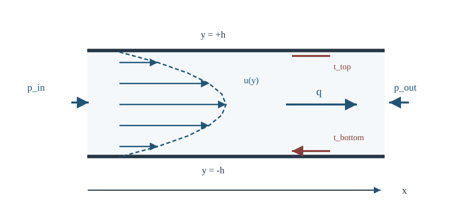

# CTM17 圧力駆動のStokes流を解く

**前提講座（直接）**：[CTM16 無次元化で粘性と慣性のどちらが効くか](../CTM16/index.md)

[CTM16 の平板 Couette 流](../CTM16/index.md#thm-ctm16-couette-profile)では、壁を動かすと速度が高さに比例した。今度は**壁を固定したまま、入口と出口の圧力差だけで流体を動かす**。どの高さで流れが速くなるか、同じ圧力差でどれだけの量を運べるか、圧力が行った仕事はどこへ行くか、を一つの解から確認する。

[CTM16 の条件付き低 Reynolds 数極限](../CTM16/index.md#thm-ctm16-low-re-stokes)は定常 Stokes 式を導いた。ただし、本講の平行・一方向流では移流項が**小さいだけでなく厳密に零**になる。そのため、導いた解析解は指定した流れの形では定常 Navier–Stokes 式の解でもある。一般の三次元流れにこの性質を広げない。

## 0. 模型・記号・仮定

三次元直交座標 $(x,y,z)$ を使い、静止した二枚の無限に広い平板 $y=-h$ と $y=h$ の間を考える。$h>0$ は**半隙間**（全隙間は $2h$）である。密度 $\rho>0$、粘性係数 $\eta>0$ は空間・時間によらず一定、体積力は $b=0$ とする。流体は非圧縮 Newton 流体であり、速度 $v$ は空間 $C^2$、圧力 $p$ は空間 $C^1$ とし、壁面まで速度が連続であると仮定する。

既習の[非圧縮 Navier–Stokes 方程式](../CTM15/index.md#thm-ctm15-incompressible-navier-stokes)と[非圧縮 Newton 応力](../CTM15/index.md#def-ctm15-incompressible-newtonian)は

$$
\rho\{\partial_t v+(v\cdot\nabla)v\}
=-\nabla p+\eta\Delta v,\qquad
\nabla\cdot v=0,\qquad
\sigma=-pI+2\eta D.
$$

ここで $D=(\nabla v+(\nabla v)^T)/2$ は既習の[変形速度テンソル](../CTM4/index.md#def-ctm4-rate-of-deformation-spin)、$\sigma$ は Cauchy 応力である。直交座標基底 $(e_x,e_y,e_z)$ における[速度勾配](../CTM4/index.md#def-ctm4-velocity-gradient)の $(i,j)$ 成分は $\partial_{x_j}v_i$ であり、$D_{xy}=(\partial_yv_x+\partial_xv_y)/2$ と読む。[traction（表面力密度）](../CTM6/index.md#def-ctm6-traction) が $\sigma n$ で表されるのは、[Cauchy の応力定理](../CTM6/index.md#thm-ctm6-cauchy-stress)による。「**壁が流体へ及ぼす力**」を計算する際は、**流体領域の外向き法線**を用いる。

量の単位は $[h]=[x]=\mathrm m$、$[v]=\mathrm{m/s}$、$[p]=\mathrm{Pa}$、$[\eta]=\mathrm{Pa\,s}$、体積流量 $[Q]=\mathrm{m^3/s}$ とする。圧力差は $\Delta p>0$ を入口圧力から出口圧力を引いた値として使う。端面を切り取って力・仕事を数えるときには、入口と出口が同じ速度分布を持つ、十分長い完全発達流の一区間を取る。入口直後の発達領域や有限幅流路の側壁はこの模型に含めない。

## 1. 「完全発達」を速度の条件に翻訳する

入口付近では速度は一般に $x$ にも依存する。二枚の板が十分長く、下流の変化が無視できる区間だけを取り出すと、流れを一変数関数に落とせる。この**解の形の仮定**は、運動量保存から自動で導かれる境界条件ではない。

<!-- formal-statement-start -->
### 定義（定常・完全発達した平板一方向流）

固定壁 $y=\pm h$ の間の**定常・完全発達した一方向流**とは、ある $u\in C^2((-h,h))\cap C([-h,h])$ を用いて

$$
v(x,y,z)=(u(y),0,0)
$$

と表せる流れをいう。静止壁の[無滑り条件](../CTM15/index.md#def-ctm15-no-slip)を採用するときは、さらに $u(-h)=u(h)=0$ を課す。圧力はこの定義だけでは決めず、運動量式から求める。
<!-- formal-statement-end -->

以下、$u'(y)=du/dy$、$u''(y)=d^2u/dy^2$ は高さ $y$ に関する常微分とする。一方、$\partial_t v$ は空間位置 $(x,y,z)$ を固定した時間偏微分、$\partial_x v$ は他の座標と時刻を固定した偏微分である。これらが零になるのは**速度場に課した**定常・完全発達の仮定によるのであって、圧力が $x$ に依存しないという意味ではない。後で圧力が $p=p(x)$ と分かれば、$\partial_xp=dp/dx$ と書ける。

<!-- definition-example-start: def-ctm17-fully-developed -->
### **定義の確認**：放物線を候補として試す

$A>0$ として $u(y)=A(h^2-y^2)$ を選ぶと、速度は $y$ のみの $C^2$ 関数、時間にも $x,z$ にも依存せず、$u(\pm h)=0$ である。非圧縮性は

$$
\nabla\cdot v=\partial_xu(y)+\partial_y0+\partial_z0=0
$$

と直接確かめられる。ただし、**この時点では力の釣合までは確認していない**。圧力をどのように選べばこの候補が解になるかは、次節で微分方程式を立てて決める。
<!-- definition-example-end -->

この形に対して

$$
\partial_t v=0,\qquad (v\cdot\nabla)v=u(y)\partial_xv=0,\qquad
\Delta v=(u''(y),0,0)
$$

である。移流項が消える理由は「Reynolds 数が小さいから」ではなく、**流速の向き $x$ に沿って速度が変化しないから**である。

## 2. 圧力差を固定すると放物線が出る

$x$ 方向の運動量式へ前節の計算を代入すると $0=-\partial_xp+\eta u''(y)$、他の方向から $\partial_yp=\partial_zp=0$ を得る。従って $p$ は $x$ のみの関数であり、

$$
\eta u''(y)=\frac{dp}{dx}(x)
$$

の左辺は $y$ のみ、右辺は $x$ のみである。連結した流路では双方が同じ**定数**でなければならない。入口を $x=0$、出口を $x=\ell>0$ として $p(0)=p_{\mathrm{in}}$、$p(\ell)=p_{\mathrm{out}}$、$p_{\mathrm{in}}>p_{\mathrm{out}}$ とすると

$$
G=\frac{p_{\mathrm{in}}-p_{\mathrm{out}}}{\ell}
=\frac{\Delta p}{\ell}>0,\qquad
\frac{dp}{dx}=-G,\qquad
p(x)=p_{\mathrm{in}}-Gx.
$$

$G$ は長さ当たりの圧力降下で単位は Pa/m、$p$ は $+x$ 方向へ減少する。

<!-- formal-statement-start -->
### 定理（平板 Poiseuille 流の速度と一意性）

$h,\eta,\ell>0$、$\rho>0$ が一定、$b=0$ の非圧縮 Newton 流体を $-h<y<h$ に置く。定常・完全発達した一方向流 $v=(u(y),0,0)$、$u\in C^2((-h,h))\cap C([-h,h])$、静止壁の無滑り条件 $u(\pm h)=0$ と、圧力降下 $p(0)-p(\ell)=\Delta p>0$ を仮定する。この形の Stokes 方程式の解は一意に

$$
\boxed{u(y)=\frac{G}{2\eta}(h^2-y^2),\qquad
p(x)=p_{\mathrm{in}}-Gx,\qquad G=\frac{\Delta p}{\ell}}
$$

である。ただし圧力は $p_{\mathrm{in}}$ を指定しなければ加法定数を除いてのみ定まる。一意性は**指定した一方向流の解クラス内**での主張である。
<!-- formal-statement-end -->

### 証明の見取り図

圧力降下で $u''=-G/\eta$ が決まり、これを二回積分する。二つの積分定数は壁面速度で決定する。放物線形を最初から仮定する必要はない。

<!-- proof-start -->
### 証明

[定常 Stokes 方程式](../CTM16/index.md#thm-ctm16-low-re-stokes)の物理単位表示に $v=(u(y),0,0)$ を代入する。$y,z$ 成分から $\partial_yp=\partial_zp=0$、$x$ 成分から $\eta u''=\partial_xp$ を得る。二つの独立変数に関する同一式は定数であり、入口出口条件から $\partial_xp=-G$ と決まる。

$\eta>0$ により $u''(y)=-G/\eta$。一回積分すると $u'(y)=-Gy/\eta+C_1$、再び積分すると

$$
u(y)=-\frac{G}{2\eta}y^2+C_1y+C_0.
$$

二つの無滑り条件を別々に代入すると

$$
0=-\frac{Gh^2}{2\eta}+C_1h+C_0,\qquad
0=-\frac{Gh^2}{2\eta}-C_1h+C_0.
$$

両式の差は $2C_1h=0$。$h>0$ だから $C_1=0$、どちらかの式から $C_0=Gh^2/(2\eta)$。従って主張の速度分布を得る。二階 ODE の二つの積分定数が一意に決まることから、この解クラス内での速度の一意性も従う。圧力は勾配のみが運動量式に現れるため、定数分の自由度が残る。$\square$
<!-- proof-end -->

中央では $u(0)=Gh^2/(2\eta)$、壁では $u(\pm h)=0$。例えば $y=h/2$ では $u(h/2)=3u(0)/4$ となる。速度が**壁に近いほど小さく、中央で最大**という特徴は境界条件と二階微分の符号から生まれる。

図では、左の高圧側から右の低圧側へ流れ、同じ固定断面から描いた速度矢印の先端が放物線を作る。両壁の水平 traction はともに左向きである。矢印の先端は粒子の位置ではなく、**その高さの速度の大きさ**を表す。

[図を拡大して表示](assets/pressure-driven-slit.svg)

ここでの「流速の大小」は $G>0$ の場合であり、$\Delta p<0$ に反転すれば速度も逆向きになる。また、これを円管の Hagen–Poiseuille 式と混同しない。断面形状と積分領域が異なる。

## 3. 断面全体でどれだけ流れるか

一点の速さだけでは、流路が運べる液体の量は分からない。断面の薄い帯を通る速度に帯の面積を掛けて足し合わせる。そのためにまず流量の定義と単位を確認する。

<!-- formal-statement-start -->
### 定義（体積流量と単位幅流量）

$x$ に垂直な断面で、速度 $v=(u(y),0,0)$ が $z$ に依存しないとき、**単位 $z$ 幅当たりの体積流量**を

$$
q=\int_{-h}^{h}u(y)\,dy
$$

と定義する。面積幅 $w>0$ の区間で $z$ 方向に同じ流れが続く理想化では、**体積流量**は $Q=wq$ とする。$[q]=\mathrm{m^2/s}$、$[Q]=\mathrm{m^3/s}$ である。実際に側壁を持つ有限幅流路では $z$ 依存を無視できる場合だけ、この $Q$ を近似として用いる。
<!-- formal-statement-end -->

<!-- definition-example-start: def-ctm17-volume-flux -->
### **定義の確認**：一定速度と放物型速度

まず無滑り条件を課さない比較用の流れとして $u(y)=U_0$ が全隙間で一定なら、$q=\int_{-h}^hU_0\,dy=2hU_0$、従って $Q=2hwU_0$。速度と断面積を掛ける素朴な公式に戻る。放物型 $u(y)=A(h^2-y^2)$ なら

$$
q=A\left[h^2y-\frac{y^3}{3}\right]_{-h}^{h}
=A\left(2h^3-\frac{2h^3}{3}\right)=\frac{4Ah^3}{3}.
$$

この場合は断面内で速度が異なるので、中央速度に断面積を掛けたものは流量ではない。
<!-- definition-example-end -->

<!-- formal-statement-start -->
### 定理（平板 Poiseuille 流の流量・壁面せん断力）

[平板 Poiseuille 流](#thm-ctm17-plane-poiseuille)の仮定の下、単位幅流量 $q$、平均流速 $\bar u=q/(2h)$、最大流速 $u_{\max}$ は

$$
\boxed{q=\frac{2Gh^3}{3\eta},\qquad
\bar u=\frac{Gh^2}{3\eta},\qquad
u_{\max}=\frac{Gh^2}{2\eta}=\frac32\bar u.}
$$

せん断応力は $\sigma_{xy}=\sigma_{yx}=-Gy$。**壁が流体へ及ぼす** traction の $x$ 成分は、上壁 $n=+e_y$ と下壁 $n=-e_y$ のいずれでも $-Gh$ である。
<!-- formal-statement-end -->

### 証明の見取り図

流量は $u(y)$ を高さ方向に積分する。壁の力は速度の符号から推測せず、[Cauchy の応力定理](../CTM6/index.md#thm-ctm6-cauchy-stress)の $t=\sigma n$ に法線を代入して求める。

<!-- proof-start -->
### 証明

[速度公式](#thm-ctm17-plane-poiseuille)を[流量の定義](#def-ctm17-volume-flux)に代入する。

$$
q=\frac{G}{2\eta}\int_{-h}^h(h^2-y^2)\,dy
=\frac{G}{2\eta}\left(2h^3-\frac{2h^3}{3}\right)
=\frac{2Gh^3}{3\eta}.
$$

断面高さは $2h$ だから $\bar u=q/(2h)=Gh^2/(3\eta)$。$u'(y)=-Gy/\eta$ は中央で零、$u''=-G/\eta<0$ だから最大は $y=0$ にあり、$u_{\max}=Gh^2/(2\eta)$。二式の比は $3/2$。

[非圧縮 Newton 応力](../CTM15/index.md#def-ctm15-incompressible-newtonian)の非対角成分は $2\eta D_{xy}$。直交基底で $v_x=u(y)$、$v_y=0$ だから、$D_{xy}=(\partial_yv_x+\partial_xv_y)/2=(u'(y)+0)/2$、対称性から $D_{yx}=D_{xy}$ である。従って

$$
\sigma_{xy}(y)=\eta u'(y)=-Gy.
$$

上壁の流体外向き法線は $+e_y$ で、[traction の表示](../CTM6/index.md#thm-ctm6-cauchy-stress)から $(\sigma n)_x=\sigma_{xy}(h)=-Gh$。下壁では $n=-e_y$ なので $(\sigma n)_x=-\sigma_{xy}(-h)=-Gh$。両壁とも流れに逆らう方向である。$\square$
<!-- proof-end -->

圧力は壁に垂直な方向の応力にも含まれるが、**壁の水平せん断 traction**は $-Gh$ である。断面幅 $w$、長さ $\ell$ の仮想的な区間では、圧力が押す正味の $x$ 方向の力は $(p_{\mathrm{in}}-p_{\mathrm{out}})2hw=2Gh\ell w$。上下壁の抵抗は合わせて $(-Gh)(2\ell w)=-2Gh\ell w$ で、和が零となる。

### 流体抵抗と三乗則

単位幅流量から圧力差を逆算すると

$$
\boxed{\Delta p=\frac{3\eta\ell}{2h^3}\,q,\qquad
\frac{\Delta p}{Q}=\frac{3\eta\ell}{2wh^3}.}
$$

固定した $q$ を送るのに必要な圧力差は $h^{-3}$ に比例する。**半隙間 $h$ を半分にすると圧力差は8倍**。ただし $w$ は流れが変わらない横幅であり、有限幅管の正確な三次元抵抗式ではない。

## 4. 圧力の仕事は粘性で消費される

壁が静止しているので壁面の速度は零であり、壁面 traction が流体にする**仕事率**は零である。では圧力の仕事はどこへ行くか。[CTM15 の粘性散逸](../CTM15/index.md#thm-ctm15-viscous-dissipation)は単位体積当たり $\Phi=2\eta D:D\ge0$ と表される。一方向流では非零成分が $D_{xy}=D_{yx}=u'/2$ の二つなので

$$
D:D=2\left(\frac{u'}2\right)^2=\frac{(u')^2}{2},\qquad
\Phi=\eta(u')^2=\frac{G^2}{\eta}y^2.
$$

壁で散逸密度が最大、中央で零となる。速度の**最大点**と散逸の**最大点**は一致しない。

<!-- formal-statement-start -->
### 定理（圧力仕事と粘性散逸の一致）

一定の $\rho,\eta>0$、$h,\ell,w>0$、$G=\Delta p/\ell>0$ の平板 Poiseuille 流に対し、$0<x<\ell$、$-h<y<h$ の区間と、$z$ 方向に速度・圧力が変わらない幅 $w$ を取る。入口・出口の速度分布が同じであるとき、入口から流入し出口へ流出する正味の圧力仕事率と、区間内の粘性散逸率は等しく

$$
\boxed{\Delta p\,Q
=w\ell\int_{-h}^{h}\Phi(y)\,dy
=\frac{2w\ell G^2h^3}{3\eta}>0}
$$

である。これは定常・完全発達した解の収支であり、過渡的な運動エネルギーの蓄積を含む一般式ではない。
<!-- formal-statement-end -->

### 証明の見取り図

流入口では圧力が流体を押して正の仕事をし、流出口では逆向きの仕事をする。両断面で**同じ $Q$**が流れるので差は $\Delta p Q$。一方、散逸密度を $y$ で積分すると同じ式が出る。入口と出口の運動エネルギー流束も一致して相殺する。

<!-- proof-start -->
### 証明

断面 $x=0$ の外向き法線は $-e_x$、$x=\ell$ の外向き法線は $+e_x$。面に働く圧力 traction $-pn$ の速度との内積を積分すると、入口は $p_{\mathrm{in}}Q$、出口は $-p_{\mathrm{out}}Q$ である。せん断 traction は切断面で $y$ 方向を向き、速度は $x$ 方向なので仕事に寄与しない。従って正味の圧力仕事率は

$$
p_{\mathrm{in}}Q-p_{\mathrm{out}}Q=\Delta p\,Q
=G\ell\,w\frac{2Gh^3}{3\eta}
=\frac{2w\ell G^2h^3}{3\eta}.
$$

他方、[粘性散逸定理](../CTM15/index.md#thm-ctm15-viscous-dissipation)に上で求めた $u'=-Gy/\eta$ を代入し、

$$
w\ell\int_{-h}^h\Phi\,dy
=\frac{w\ell G^2}{\eta}\int_{-h}^hy^2\,dy
=\frac{w\ell G^2}{\eta}\left[\frac{y^3}{3}\right]_{-h}^h
=\frac{2w\ell G^2h^3}{3\eta}.
$$

入口・出口の速度関数が等しいので、流出する $\rho|v|^2v_x/2$ の断面積分から流入する同じ量を引けば零である。流体壁面では無滑りにより $v=0$、壁仕事は零。従って圧力の仕事と散逸が一致する。単位も $\mathrm{Pa}\cdot\mathrm{m^3/s}=\mathrm W$ と $\mathrm{W/m^3}\cdot\mathrm{m^3}=\mathrm W$ で整合する。$\square$
<!-- proof-end -->

**力と仕事を区別する。** 壁の力は確かに流れを妨げるが、静止した壁の接点では速度が零なので、壁そのものからの仕事率は零。一方、内部の隣接層同士が滑ることで粘性散逸が生じる。圧力差が仕事を供給し、そのエネルギーが内部散逸へ移る。

## 5. Stokes 近似と厳密解、細胞スケールへの橋

[Reynolds 数](../CTM16/index.md#def-ctm16-reynolds)を代表速度 $\bar u$ と長さ $h$ で評価すると

$$
\mathrm{Re}_h=\frac{\rho\bar u h}{\eta}
=\frac{\rho Gh^3}{3\eta^2}.
$$

一般の流れで定常 Stokes 近似を採用するには、定常性のほか、代表速度・速度勾配・圧力勾配の尺度と境界条件を確認し、移流慣性を無視できることが必要である。しかし今の解は別の強い性質を持つ。

<!-- formal-statement-start -->
### 命題（完全発達平板流は Navier–Stokes 式の厳密解）

一定 $\rho,\eta,h>0$、$b=0$ の非圧縮 Newton 流体で、**速度場は時間・$x,z$ に依存せず、圧力は時間・$y,z$ に依存しない**ものとして、それぞれ

$$
v=(u(y),0,0),\qquad p(x)=p_{\mathrm{in}}-Gx,\qquad G\in\mathbb R
$$

とする。このとき

$$
u(y)=\frac{G}{2\eta}(h^2-y^2)
$$

は定常 Navier–Stokes 方程式と両壁無滑り条件を**厳密に満たす**。ただし一般の三次元初期境界値問題の安定性・一意性は主張しない。
<!-- formal-statement-end -->

### 証明の見取り図

Reynolds 数の極限を使わず、非圧縮条件・慣性項・圧力勾配・粘性項を実際に代入して残差を零にする。

<!-- proof-start -->
### 証明

$\nabla\cdot v=0$、$\partial_tv=0$、$(v\cdot\nabla)v=u\partial_xv=0$。また

$$
\nabla p=(-G,0,0),\qquad
\eta\Delta v=(\eta u'',0,0)=(-G,0,0).
$$

従って $-\nabla p+\eta\Delta v=(G,0,0)+(-G,0,0)=0$。$u(\pm h)=0$ も成り立つ。どの等式でも $\rho$ の小ささは必要ない。$\square$
<!-- proof-end -->

ここから「大きな Reynolds 数のどんな入口条件でも同じ放物線になる」とは言えない。入口の流れが完全発達していない場合や、流れが $x$ に依存する場合は $(v\cdot\nabla)v$ が残り得る。

例えば水に近い $\rho=10^3$ kg/m$^3$、$\eta=10^{-3}$ Pa s、半隙間 $h=10^{-5}$ m、平均速度 $\bar u=10^{-4}$ m/s とすると

$$
\mathrm{Re}_h=\frac{10^3\cdot10^{-4}\cdot10^{-5}}{10^{-3}}
=10^{-3},\qquad
G=\frac{3\eta\bar u}{h^2}=3\times10^3\ \mathrm{Pa/m}.
$$

長さ $\ell=10^{-3}$ m の区間では $\Delta p=3$ Pa。これは**連続体・一定粘性・非圧縮・無滑り・定常・完全発達・平行壁**という仮定を置いた模型内の数値である。細胞周囲の流れは低 Reynolds 数でも、壁の滑り、変形する境界、非 Newton 性、微視的輸送、非定常性などを別に吟味する必要がある。

## 6. 演習

指定がなければ本章の一定 $\rho,\eta>0$ の非圧縮 Newton 流体、定常・完全発達した流れ、固定平行壁 $y=\pm h$、$b=0$ とする。圧力降下 $G=\Delta p/\ell>0$、流量は $z$ 単位幅当たり $q$ を基本とする。力と仕事の問題では「流体へ働く」向きを明記せよ。

### Level A

### A1. 曲率から速度を決める

$\eta u''(y)=-G$、$u(-h)=u(h)=0$ を解き、$u(0)$ と $u(h/2)$ の比を求めよ。

- Level: A

<!-- solution-start -->
#### 詳細解答

二度積分して $u(y)=-Gy^2/(2\eta)+C_1y+C_0$。上下壁条件の差から $2C_1h=0$、すなわち $C_1=0$。$C_0=Gh^2/(2\eta)$ なので

$$
u(y)=\frac{G}{2\eta}(h^2-y^2),\qquad
u(h/2)=\frac{3Gh^2}{8\eta},\qquad
\frac{u(h/2)}{u(0)}=\frac34.
$$

解の曲率は $u''=-G/\eta<0$、中央が最大になる。
<!-- solution-end -->

### A2. 中央速度と平均速度の違い

$u(y)=A(h^2-y^2)$、$A>0$ とする。[体積流量](#def-ctm17-volume-flux)の定義から $q$、$\bar u$、$u_{\max}/\bar u$ を求めよ。

- Level: A

<!-- solution-start -->
#### 詳細解答

$$
q=\int_{-h}^hA(h^2-y^2)\,dy
=A\left(2h^3-\frac{2h^3}{3}\right)=\frac{4Ah^3}{3}.
$$

平均は断面高さ $2h$ で割って $\bar u=2Ah^2/3$。最大は $y=0$ で $u_{\max}=Ah^2$。従って $u_{\max}/\bar u=(Ah^2)/(2Ah^2/3)=3/2$。中央速度を平均と同一視しない。
<!-- solution-end -->

### A3. 二枚の壁の traction

$u(y)=G(h^2-y^2)/(2\eta)$、$\sigma_{xy}=\eta u'$ とする。上壁と下壁で流体領域の外向き法線を書き、壁が流体へ及ぼす traction の $x$ 成分と、流路長 $\ell$ の単位幅当たりの合力を求めよ。

- Level: A

<!-- solution-start -->
#### 詳細解答

$u'=-Gy/\eta$ だから $\sigma_{xy}=-Gy$。上壁の法線は $n_{\mathrm{top}}=e_y$、下壁は $n_{\mathrm{bottom}}=-e_y$ である。[Cauchy の応力定理](../CTM6/index.md#thm-ctm6-cauchy-stress)の $t=\sigma n$ から

$$
t_{\mathrm{top},x}=\sigma_{xy}(h)=-Gh,\qquad
t_{\mathrm{bottom},x}=-\sigma_{xy}(-h)=-Gh.
$$

単位幅で各壁の面積は $\ell$。両壁の合計は $(-Gh)\ell+(-Gh)\ell=-2Gh\ell=-2h\Delta p$ N/m であり、入口・出口の圧力合力 $+2h\Delta p$ N/m と相殺する。
<!-- solution-end -->

### A4. 散逸密度の場所と総量

$u'=-Gy/\eta$ に対し $\Phi=\eta(u')^2$ を求め、中央・壁の値を比較し、長さ $\ell$ の単位幅当たりの総散逸率を計算せよ。

- Level: A

<!-- solution-start -->
#### 詳細解答

$$
\Phi(y)=\frac{G^2y^2}{\eta},\qquad
\Phi(0)=0,\qquad
\Phi(\pm h)=\frac{G^2h^2}{\eta}.
$$

散逸は壁付近で大きい。単位幅・流路長 $\ell$ で積分すると

$$
\ell\int_{-h}^h\Phi\,dy
=\frac{\ell G^2}{\eta}\left[\frac{y^3}{3}\right]_{-h}^{h}
=\frac{2\ell G^2h^3}{3\eta}.
$$

[単位幅流量の公式](#thm-ctm17-flux-and-wall-stress)を用いた $\Delta p\,q=G\ell\cdot2Gh^3/(3\eta)$ と一致し、単位は W/m である。
<!-- solution-end -->

### A5. 微小流路の圧力差

$\rho=10^3$ kg/m$^3$、$\eta=10^{-3}$ Pa s、$h=10^{-5}$ m、$\ell=10^{-3}$ m、$\bar u=10^{-4}$ m/s とする。$G$、$\Delta p$、$\mathrm{Re}_h=\rho\bar u h/\eta$、単位幅流量 $q$ を求めよ。

- Level: A

<!-- solution-start -->
#### 詳細解答

[平均速度式](#thm-ctm17-flux-and-wall-stress)から $G=3\eta\bar u/h^2$。数値を順に代入すると

$$
G=\frac{3(10^{-3})(10^{-4})}{(10^{-5})^2}
=3\times10^3\ \mathrm{Pa/m},\qquad
\Delta p=G\ell=3\ \mathrm{Pa}.
$$

$$
\mathrm{Re}_h=\frac{10^3\cdot10^{-4}\cdot10^{-5}}{10^{-3}}
=10^{-3},\qquad q=2h\bar u=2\times10^{-9}\ \mathrm{m^2/s}.
$$

$q$ に幅を掛けない限り単位は m$^3$/s にならない。
<!-- solution-end -->

### Level B

### B1. 固定流量で隙間を変える

$\eta,\ell,q>0$ を一定に保ち、半隙間 $h$ を $h/2$ にした。必要圧力差、平均速度、壁面せん断 traction の大きさ、単位幅当たりの圧力仕事率は元の何倍か。

- Level: B

<!-- solution-start -->
#### 詳細解答

[流量公式](#thm-ctm17-flux-and-wall-stress)を $G$ について解き、

$$
G=\frac{3\eta q}{2h^3},\qquad
\Delta p=G\ell,\qquad
\bar u=\frac{q}{2h},\qquad
|t_x|=Gh=\frac{3\eta q}{2h^2}.
$$

$h$ を $h/2$ にすると、$h^{-3}$ の圧力差は8倍、$h^{-1}$ の平均速度は2倍、$h^{-2}$ の壁面せん断 traction は4倍。仕事率は $\Delta p\,q$ で $q$ 一定だから8倍。比較に用いる幾何量を**全隙間 $2h$ と取り違えない**。
<!-- solution-end -->

### B2. 滑りを許す壁なら何が変わるか

無滑りを外し、長さ次元の定数 $b\ge0$ を用いて両壁に次の別の模型条件を課す。

$$
u(h)=-b\,u'(h),\qquad u(-h)=b\,u'(-h).
$$

$u''=-G/\eta$ は保ったまま $u(y)$ と $q$ を求め、$b=0$ の極限と $b>0$ の壁面速度を確認せよ。

- Level: B

<!-- solution-start -->
#### 詳細解答

一般解は $u=-Gy^2/(2\eta)+C_1y+C_0$、$u'=-Gy/\eta+C_1$。二つの壁条件は

$$
-\frac{Gh^2}{2\eta}+C_1h+C_0
=b\frac{Gh}{\eta}-bC_1,
$$

$$
-\frac{Gh^2}{2\eta}-C_1h+C_0
=b\frac{Gh}{\eta}+bC_1.
$$

差を取ると $2(h+b)C_1=0$。$h+b>0$ なので $C_1=0$、$C_0=Gh^2/(2\eta)+bGh/\eta$。従って

$$
u(y)=\frac{G}{2\eta}(h^2-y^2+2bh),\qquad
q=\frac{2Gh^3}{3\eta}+\frac{2Gbh^2}{\eta}
=\frac{2Gh^3}{3\eta}\left(1+\frac{3b}{h}\right).
$$

壁面速度は両側で $u(\pm h)=Gbh/\eta\ge0$。$b=0$ なら無滑りの[Poiseuille 解](#thm-ctm17-plane-poiseuille)に戻る。滑り模型では一般に壁摩擦の散逸も収支に現れるので、無滑りで証明した**圧力仕事＝流体内部散逸のみ**の恒等式を無条件に再利用できない。
<!-- solution-end -->

### B3. 一様な体積力が加わった場合

単位質量当たりの一定の加速度 $b_x=a\in\mathbb R$ が $x$ 方向に作用する場合を考える。$\partial_xp=-G$、$\rho,\eta$ は一定である。両壁無滑りの $u(y)$、$q$ を求め、流れが右向きになる条件を述べよ。

- Level: B

<!-- solution-start -->
#### 詳細解答

[運動量式](../CTM15/index.md#thm-ctm15-incompressible-navier-stokes)の $x$ 成分は、移流項が零だから

$$
0=-\partial_xp+\eta u''+\rho a
=G+\eta u''+\rho a.
$$

$G_{\mathrm{eff}}=G+\rho a$ とおくと $u''=-G_{\mathrm{eff}}/\eta$。二度積分し、$u(\pm h)=0$ を入れると

$$
u(y)=\frac{G+\rho a}{2\eta}(h^2-y^2),\qquad
q=\frac{2h^3}{3\eta}(G+\rho a).
$$

内部 $|y|<h$ では $h^2-y^2>0$ なので、右向きは $G+\rho a>0$、逆向きは $G+\rho a<0$、零なら静止。このとき散逸へ供給される仕事は**圧力と体積力の合計**なので、$\Delta p\,q$ だけに等しいと決めつけない。
<!-- solution-end -->

### B4. 完全発達の仮定はいつ破れるか

一定 $\rho,\eta>0$、$b=0$ で $v=(u(y),0,0)$ とする。圧力を $p(x)=p_0-G_0x-Kx^2$（$K\ne0$）と指定して、同じ形の完全発達定常解が存在するか判定せよ。どの仮定を緩めれば局所的に圧力勾配を変え得るかも述べよ。

- Level: B

<!-- solution-start -->
#### 詳細解答

一方向流では移流項と時間項はともに零。[運動量式](../CTM15/index.md#thm-ctm15-incompressible-navier-stokes)の $x$ 成分は $\eta u''(y)=\partial_xp(x)$。指定した圧力の微分は

$$
\partial_xp=-G_0-2Kx.
$$

左辺は $y$ のみの関数で $x$ に依存しないのに、右辺は $K\ne0$ なら $x$ に依存する。したがって**同じ完全発達一方向流の解は存在しない**。例えば $u=u(x,y)$ のように $x$ 依存や横方向の速度を許すなら、$x$ ごとの曲率や移流項が変わり得る。ただし、そのような流れが必ず存在するという主張ではない。破れたのは「速度が $x$ に依存しない」という仮定である。
<!-- solution-end -->

### Level C

### C1. 圧力と動く上壁を同時に使う

$-h<y<h$ にて、下壁 $y=-h$ は静止し、上壁 $y=h$ は一定速度 $U\in\mathbb R$ で $+x$ 方向に動く（$U<0$ なら左向き）。$p(x)=p_{\mathrm{in}}-Gx$、$G\in\mathbb R$、一定 $\rho,\eta>0$、$b=0$、定常一方向流 $v=(u(y),0,0)$ を仮定する。

1. $u(y)$、単位幅流量 $q$、両壁が流体へ及ぼす traction の $x$ 成分を求めよ。
2. 上壁が流体へ与える単位面積当たりの仕事率を求め、長さ $\ell$ の単位幅区間で**圧力仕事＋上壁仕事＝内部粘性散逸**を示せ。
3. $G>0$ のとき $q=0$ とする上壁速度を求め、$q=0$ でも散逸が零とは限らないことを説明せよ。

- Level: C

<!-- solution-start -->
#### 詳細解答

**第1問。** [非圧縮 Navier–Stokes 方程式](../CTM15/index.md#thm-ctm15-incompressible-navier-stokes)で $\partial_t v=(v\cdot\nabla)v=0$、$\partial_xp=-G$。従って $u''=-G/\eta$、一般解は $u=-Gy^2/(2\eta)+C_1y+C_0$。壁条件は $u(-h)=0$、$u(h)=U$ だから差から $2hC_1=U$、和から $2C_0-Gh^2/\eta=U$。よって

$$
u(y)=\frac{U(y+h)}{2h}+\frac{G}{2\eta}(h^2-y^2).
$$

第1項は Couette 成分、第2項は Poiseuille 成分であり、これは**方程式と境界条件の線形性**による和である。流量は

$$
q=\int_{-h}^h\frac{U(y+h)}{2h}\,dy
+\int_{-h}^h\frac{G}{2\eta}(h^2-y^2)\,dy
=Uh+\frac{2Gh^3}{3\eta}.
$$

速度勾配は $u'=U/(2h)-Gy/\eta$。上壁では $n=e_y$、下壁では $n=-e_y$ なので

$$
t_{\mathrm{top},x}=\eta u'(h)=\frac{\eta U}{2h}-Gh,\qquad
t_{\mathrm{bottom},x}=-\eta u'(-h)=-\frac{\eta U}{2h}-Gh.
$$

**第2問。** 上壁の接触速度は $U$ だから、上壁が流体にする単位面積当たり仕事率は $Ut_{\mathrm{top},x}=\eta U^2/(2h)-GUh$。下壁は静止して仕事率零。長さ $\ell$ の単位幅で上壁仕事は $\ell(\eta U^2/(2h)-GUh)$、圧力仕事は $\Delta p\,q=G\ell(Uh+2Gh^3/(3\eta))$。足した全投入仕事率を $P_{\mathrm{in}}$ とおくと

$$
P_{\mathrm{in}}=\ell\left(\frac{\eta U^2}{2h}-GUh\right)
+G\ell\left(Uh+\frac{2Gh^3}{3\eta}\right)
=\ell\left(\frac{\eta U^2}{2h}+\frac{2G^2h^3}{3\eta}\right).
$$

[粘性散逸公式](../CTM15/index.md#thm-ctm15-viscous-dissipation)を使い、$u'=U/(2h)-Gy/\eta$ の平方を展開する。

$$
\eta(u')^2
=\frac{\eta U^2}{4h^2}-\frac{UG}{h}y+\frac{G^2}{\eta}y^2.
$$

$y$ の奇関数の項は対称区間で積分すると零となる。区間の総内部散逸率を $P_{\mathrm{diss}}$ とおけば

$$
P_{\mathrm{diss}}
=\ell\int_{-h}^h\eta(u')^2\,dy
=\ell\left(\frac{\eta U^2}{2h}+\frac{2G^2h^3}{3\eta}\right)
=P_{\mathrm{in}}.
$$

$U<0$ なら上壁の仕事率は状況によって負にもなるが、圧力仕事と合わせた収支は変わらない。固定幅の入口・出口で同じ速度分布なので運動エネルギー流束も相殺される。

**第3問。** $q=Uh+2Gh^3/(3\eta)=0$ より

$$
U=-\frac{2Gh^2}{3\eta}.
$$

$G>0$ なら $U<0$、すなわち上壁を圧力駆動の向きに逆らって動かす必要がある。$q=0$ でも $u'(y)$ は全点零ではなく、上で得た

$$
P_{\mathrm{diss}}
=\ell\left(\frac{\eta U^2}{2h}+\frac{2G^2h^3}{3\eta}\right)>0
$$

である。**断面全体の正味流量が零**という条件は、局所速度やせん断が零という意味ではない。
<!-- solution-end -->

## 7. まとめと次への接続

- 静止平板と一定圧力勾配から、速度の放物線分布が二階常微分方程式と二つの壁境界条件で一意に決まる。
- 流量は断面積分で $q=2Gh^3/(3\eta)$。中央速度だけでは流量は分からない。
- 壁の水平 traction は上下とも $-Gh$。圧力の押す力を両壁の抵抗が打ち消す。
- $\Delta p Q$ は正味の圧力仕事率で、静止壁での仕事ではなく内部の粘性散逸に等しい。
- 低 Reynolds 数の Stokes 近似と、完全発達という特別な形で移流項が零になる厳密解は区別する。

次の CTM18 では、粘性のように速度に応答する性質と、ばねのように変形を蓄える性質を組み合わせ、時間をかけた緩和・クリープを考える。
