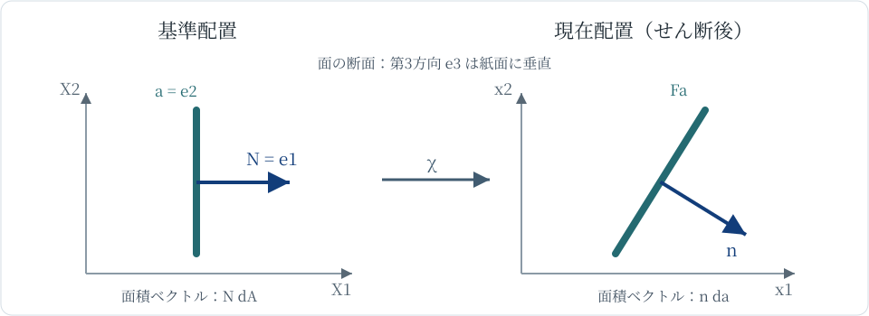

# CTM2 変形勾配は長さ・面積・体積をどう変えるか

[CTM1 の運動写像](../CTM1/index.md#def-ctm1-motion-configuration)は、物質点 $X$ が時刻 $t$ にどこへ移るかを教えてくれた。しかし、ゴム板上で隣り合う二つの印がどれだけ離れるか、微小な面の向きがどう傾くか、体積が何倍になるかは、各点の位置だけを眺めても分かりにくい。

そこで、ある物質点の**すぐ近くの相対位置**がどう変わるかを調べる。これを一つの線形写像で表したものが変形勾配である。体積は行列式で、面積と法線は余因子行列で追えることを、途中式から導こう。

以下、$\Omega_0\subset\mathbb R^3$ は非空開集合、$0\in I\subset\mathbb R$ は開区間、$\chi:\Omega_0\times I\to\mathbb R^3$ は CTM1 の四条件を満たす運動写像とする。位置 $X,x$ と長さは m、時間は s、$F$ と $J$ は無次元量である。面積は m$^2$、体積は m$^3$。特に $C^1$ 級、$\chi(X,0)=X$、各時刻の単射性と正の Jacobian 行列式を仮定する。

## 1. 隣り合う物質点を線形写像で比較する

微小な基準側の差 $h$ に対し、現在側の差は $\chi(X+h,t)-\chi(X,t)$ となる。$h$ が十分小さいとき、その先頭の一次項だけを取り出せれば、長さや角度の変化を計算しやすくなる。[RA6 の Jacobian 行列](../../../基礎科目/RA/RA6/index.md#def-ra6-jacobian)は、標準基底 $e_1,e_2,e_3$ でこの一次項を表す行列である。行列の第 $j$ 列は $X_j$ だけを微小に動かしたときの現在位置の変化方向に対応する。

<!-- formal-statement-start -->
### 定義（変形勾配と体積 Jacobian）

$\Omega_0,I,\chi$ が上記の運動写像の条件を満たすとする。点 $(X,t)\in\Omega_0\times I$ での**変形勾配** $F$ と **体積 Jacobian** $J$ を

$$
F(X,t):=D_X\chi(X,t)
=\left(\frac{\partial\chi_i}{\partial X_j}(X,t)\right)_{i,j=1}^{3},
\qquad J(X,t):=\det F(X,t)>0
$$

で定義する。$F:\mathbb R^3\to\mathbb R^3$ は基準側の微小変位を現在側の微小変位へ送る線形写像であり、$J$ はその向き付き体積倍率である。
<!-- formal-statement-end -->

まず、この式と元の運動をつなぐ。固定した時刻 $t$ での微分可能性は

$$
\chi(X+h,t)=\chi(X,t)+F(X,t)h+r(h),
\qquad \lim_{h\to0}\frac{\|r(h)\|}{\|h\|}=0
$$

を意味する。したがって、基準側の短い線分 $h=\varepsilon a$（$\varepsilon\to0$、$a$ 固定）は一次精度で $\varepsilon Fa$ へ移る。$F$ が無次元なのは、$X$ と $\chi$ の両方が長さの単位を持つからである。

<!-- definition-example-start: def-ctm2-deformation-gradient -->

### **定義の確認**：一様伸長とせん断

$\Omega_0=\mathbb R^3$、無次元化した時刻 $\tau=t/(1\,\mathrm{s})$、$I=(-1\,\mathrm{s},2\,\mathrm{s})$ とする。運動

$$
\chi(X,t)=\bigl(2^\tau X_1+\tau X_2,\ 3^\tau X_2,\ 2^{-\tau}X_3\bigr)
$$

は $(X,t)$ について $C^1$ で、$t=0$ で恒等になる。$x_2=3^\tau X_2$、$x_3=2^{-\tau}X_3$、$x_1=2^\tau X_1+\tau X_2$ の順に解けるので単射である。列は順に $\partial\chi/\partial X_1,\partial\chi/\partial X_2,\partial\chi/\partial X_3$ であり、

$$
F=\begin{pmatrix}
2^\tau&\tau&0\\
0&3^\tau&0\\
0&0&2^{-\tau}
\end{pmatrix},
\qquad J=2^\tau3^\tau2^{-\tau}=3^\tau>0.
$$

これで正の行列式を含む運動の四条件がすべて確かめられた。$\tau=1$ では $Fe_2=(1,3,0)$ である。基準側の $e_2$ 方向の単位線素の長さは $1$、変形後は $\sqrt{10}$ となる。一方、$J=3$ は三次元の体積倍率であり、この線素の伸び $\sqrt{10}$ と同じ値ではない。

<!-- definition-example-end -->

## 2. 線素と微小体積はどう変わるか

長さの変化は、線素の向きを指定しないと一つの倍率にならない。微小線素 $dX=a\,ds$ の像は $dx=F a\,ds$ で、長さの倍率は $\|Fa\|/\|a\|$ である。これに対し、三つの独立な線素で張る微小平行六面体は、三方向の像をまとめて見るため行列式が現れる。

<!-- formal-statement-start -->
### 命題（線素と向き付き微小体積の変換）

$\chi:\Omega_0\times I\to\mathbb R^3$ を $C^1$ 級の運動写像とし、$(X,t)\in\Omega_0\times I$ で $F=D_X\chi$、$J=\det F>0$ とする。非零ベクトル $a$ に沿った微小線素の長さ倍率は

$$
\frac{\|Fa\|}{\|a\|}.
$$

さらに、基準側の三つの線素 $a,b,c$ が張る向き付き微小体積は、現在側で

$$
\det(Fa,Fb,Fc)=J\det(a,b,c)
$$

に変わる。とくに向きが正の微小体積の倍率は $J$ である。
<!-- formal-statement-end -->

### 証明の見取り図

線素の式は微分可能性による一次近似で出る。体積では、三つの線素を列に並べた行列を $[a\ b\ c]$ とすると、変形後は $F[a\ b\ c]$ となる。行列式の積の公式をこの行列に適用すればよい。**有限の曲がった領域全体の体積が、ある一点の $J$ 倍になる**という主張ではないことに注意しよう。

<!-- proof-start -->
### 証明

$\varepsilon>0$ とし、$X+\varepsilon a\in\Omega_0$ となる範囲で、微分可能性から

$$
\chi(X+\varepsilon a,t)-\chi(X,t)
=\varepsilon Fa+r(\varepsilon a),
\qquad \frac{\|r(\varepsilon a)\|}{\varepsilon}\to0.
$$

両辺を $\varepsilon$ で割ると差ベクトルの長さは $\varepsilon\|Fa+o(1)\|$。基準側の長さ $\varepsilon\|a\|$ で割って $\varepsilon\to0$ とすれば倍率が出る。

次に $a,b,c$ を三つの線素方向とし、$A=[a\ b\ c]$ と置く。$F$ の線形性から像の列行列は $FA$ である。行列式の積の公式より

$$
\det(Fa,Fb,Fc)=\det(FA)
=\det F\,\det A=J\det(a,b,c).
$$

$\det A>0$ なら $J>0$ のため変形後も向きが正であり、正の体積比は $J$ になる。一般の $C^1$ 写像の微小な曲がりの効果は、上の一次近似の誤差に含まれる。
<!-- proof-end -->

**例：体積を変えないせん断。** $\chi(X,t)=(X_1+\gamma(t)X_2,X_2,X_3)$、$\gamma(0)=0$ とする。$\gamma$ が $C^1$ なら CTM1 の条件を満たし、

$$
F=\begin{pmatrix}1&\gamma&0\\0&1&0\\0&0&1\end{pmatrix},
\quad Fe_1=e_1,\quad Fe_2=\gamma e_1+e_2,\quad Fe_3=e_3,\quad J=1.
$$

$e_2$ 方向は $\sqrt{1+\gamma^2}$ 倍に伸びるが、$e_1,e_2,e_3$ が張る単位立方体の体積は $1$ のままである。**長さの伸びから体積の伸びを推測できない**ことが具体的に分かる。

## 3. 面積ではなぜ行列式だけでは足りないか

変形前の小さな面には、二つの接線方向と、それらに垂直な向きがある。向きを決めた接線ベクトル $a,b$ の外積 $a\times b$ は、右手系に従って面に垂直に向き、その長さが張られた平行四辺形の面積になる。必要な計算法をここで明示しておく。

$$
a\times b=(a_2b_3-a_3b_2,\ a_3b_1-a_1b_3,\ a_1b_2-a_2b_1).
$$

例えば $e_2\times e_3=e_1$ であり、$a\times b$ の向きは $a,b$ の順序を交換すると反転する。基準側の単位法線 $N$ と面積 $dA>0$ を $N\,dA=a\times b$ と書けば、変形後は $Fa\times Fb$。これを $F$ から直接計算する行列が**余因子行列**である。

<!-- formal-statement-start -->
### 定義（余因子行列と面積ベクトル）

実 $3\times3$ 行列 $F$ の列を $f_1=Fe_1,\ f_2=Fe_2,\ f_3=Fe_3$ とする。**余因子行列** $\operatorname{cof}F$ を、その列が順に二列の外積となる行列

$$
\operatorname{cof}F
:=[\,f_2\times f_3\ \ f_3\times f_1\ \ f_1\times f_2\,]
$$

で定義する。向きを指定した面の **面積ベクトル** は単位法線と面積の積 $N\,dA$ とする。
<!-- formal-statement-end -->

定義から何を計算しているか確認しよう。$F$ の第1列は基準側の $e_1$ 線素の像であり、第2・第3列の外積は、もともと法線 $e_1$ を持つ面の変形後の面積ベクトルである。他の二列も同じ理由で循環している。したがって列を先に求め、**外積をとる**順に計算すれば、抽象的な余因子の暗記を必要としない。

<!-- definition-example-start: def-ctm2-cofactor -->

### **定義の確認**：対角伸長の面積ベクトル

$p,q,r>0$ として $F=\operatorname{diag}(p,q,r)$ を考える。列は $pe_1,qe_2,re_3$ である。たとえば第1列に対応する外積は $(qe_2)\times(re_3)=qr\,e_1$ だから、

$$
\operatorname{cof}F
=[\,qr e_1\ \ rp e_2\ \ pq e_3\,]
=\operatorname{diag}(qr,rp,pq).
$$

基準側で $N=e_1$、$dA=1\,\mathrm{m}^2$ の面は、接線方向 $e_2,e_3$ の長さがそれぞれ $q,r$ 倍になり、変形後の面積は $qr\,\mathrm{m}^2$。第1列の $qr e_1$ が方向・面積の両方を表している。$p,q,r>0$ なので現在側の面の向きも保存される。

<!-- definition-example-end -->

余因子行列の定義は $F$ が特異でも意味を持つ。一方、次に示す逆行列を含む表示には $J>0$ が必要となる。

<!-- formal-statement-start -->
### 命題（余因子行列と逆転置行列）

$F\in\mathbb R^{3\times3}$ が $\det F=J>0$ を満たすとき、$F$ は可逆であり、

$$
\operatorname{cof}F=JF^{-T},
\qquad F^{-T}:=(F^{-1})^T.
$$

ここで転置は基準・現在配置の標準直交基底に関するものである。
<!-- formal-statement-end -->

### 証明の見取り図

$f_i$ と $f_j\times f_k$ の内積は、同じ列を二度含めばゼロ、三列すべてを含めば $J$ になる。よって $F^T\operatorname{cof}F=JI$ である。$J>0$ は逆行列が存在するための決定的な条件となる。

<!-- proof-start -->
### 証明

定義に従い $C=\operatorname{cof}F$ と置く。$F^T C$ の第 $(i,j)$ 成分は $f_i$ と $C$ の第 $j$ 列の内積である。$i\ne j$ のとき、$f_i$ は第 $j$ 列を作る外積の因子の一つなので、内積はゼロ。$i=j=1$ のとき、

$$
f_1\cdot(f_2\times f_3)=\det(f_1,f_2,f_3)=\det F=J.
$$

$i=j=2,3$ でも列を循環置換するため同じ $J$ になる。したがって $F^T C=JI$。$J>0$ より $F^T$ は可逆であるから左から $(F^T)^{-1}$ を掛け、

$$
C=(F^T)^{-1}JI=J(F^{-1})^T=JF^{-T}.
$$

<!-- proof-end -->

## 4. Nanson の公式：向きも面積もまとめて変換する

面の面積だけを計算しても、表面に力が作用する方向は決まらない。基準面の外向き法線 $N$ と現在面の外向き法線 $n$ を比較するには、**面積と向きをまとめたベクトル**を変換する必要がある。

図は、基準面 $X_1=0$ の接線 $e_2,e_3$ がせん断で $Fe_2=\gamma e_1+e_2,\ Fe_3=e_3$ に変わる様子を示す模式図である。面の法線は基準側の $e_1$ から、現在側の $e_1-\gamma e_2$ 方向へ傾く。図の矢印の長さから数値を読むのではなく、直後の外積計算で確かめよう。

<!-- formal-statement-start -->
### 定理（Nanson の面積変換公式）

$\chi:\Omega_0\times I\to\mathbb R^3$ を $C^1$ 級の運動写像とし、$(X,t)\in\Omega_0\times I$ で $F=D_X\chi$、$J=\det F>0$ とする。$X$ を通る向き付き $C^1$ 正則面素の基準側の単位法線・面積を $N,dA$、変形後の対応する単位法線・面積を $n,da$ とする。向きは運動で運ばれる向きに合わせる。このとき

$$
n\,da=(\operatorname{cof}F)N\,dA
=JF^{-T}N\,dA.
$$

特に

$$
\frac{da}{dA}=J\|F^{-T}N\|>0,
\qquad
n=\frac{F^{-T}N}{\|F^{-T}N\|}.
$$
<!-- formal-statement-end -->

### 証明の見取り図

面を二つの局所パラメータで表し、接線 $a,b$ の外積 $a\times b=N\,dA$ を考える。運動の連鎖律で二つの接線は $Fa,Fb$ になる。三重積の等式を使って $Fa\times Fb=JF^{-T}(a\times b)$ を示せば、面積と法線の両方を同時に得られる。

<!-- proof-start -->
### 証明

基準面の局所表示を $X=X(u,v)$ とし、点 $(u_0,v_0)$ で $a=\partial_u X,\ b=\partial_v X$ は一次独立とする。$X\mapsto\chi(X,t)$ を合成した現在面の接線は、固定時刻 $t$ での連鎖律から

$$
\partial_u(\chi\circ X)=F(X,t)a,\qquad
\partial_v(\chi\circ X)=F(X,t)b.
$$

ここで $dA=\|a\times b\|du\,dv$、$N=(a\times b)/\|a\times b\|$ と向きを定める。同様に $n\,da=(Fa\times Fb)du\,dv$。

任意の $w\in\mathbb R^3$ を取る。$J>0$ で $F$ は可逆なので $w=Fz$ と一意に書ける。三重積と行列式の積の公式から

$$
\begin{aligned}
w\cdot(Fa\times Fb)
&=\det(w,Fa,Fb)\\
&=\det(Fz,Fa,Fb)\\
&=J\det(z,a,b)\\
&=Jz\cdot(a\times b)\\
&=w\cdot\bigl(JF^{-T}(a\times b)\bigr).
\end{aligned}
$$

最後の等号は $z=F^{-1}w$ と内積・転置の関係 $(F^{-1}w)\cdot q=w\cdot F^{-T}q$ による。すべての $w$ との内積が等しいため、

$$
Fa\times Fb=JF^{-T}(a\times b).
$$

両辺に $du\,dv$ を掛けると求める面積ベクトルの式が得られる。また $N$ は単位ベクトル、$F^{-T}$ は可逆なので $F^{-T}N\ne0$ である。両辺の長さを取れば $da=J\|F^{-T}N\|dA$、それで面積ベクトルを割れば $n=F^{-T}N/\|F^{-T}N\|$。証明終わり。
<!-- proof-end -->

**例：単純せん断で面が斜めになる。** 先ほどの $F$ と $\gamma$ を使い、基準側の面 $X_1=0$ に $N=e_1$ を選ぶ。接線方向は $a=e_2,b=e_3$ で、$a\times b=e_1$ となる。現在側で

$$
Fa\times Fb
=(\gamma,1,0)\times(0,0,1)
=(1,-\gamma,0).
$$

一方、

$$
F^{-T}=
\begin{pmatrix}1&0&0\\-\gamma&1&0\\0&0&1\end{pmatrix},
\quad JF^{-T}e_1=(1,-\gamma,0).
$$

両方の計算が一致する。つまり $dA=1\,\mathrm{m}^2$ なら $da=\sqrt{1+\gamma^2}\,\mathrm{m}^2$、$n=(1,-\gamma,0)/\sqrt{1+\gamma^2}$ となる。**体積比 $J=1$ でも面積は増える**。逆に $N=e_2$ の面では $JF^{-T}e_2=e_2$ なので面積は変わらない。面の向きを指定せずに面積倍率を述べてはいけない。

## 5. 正の Jacobian が失われると何が壊れるか

$F=\operatorname{diag}(1,1,0)$ なら $\det F=0$ で、$e_3$ 方向の離れた点が一次近似で同じ位置に潰れる。三次元の体積倍率はゼロとなり、$F^{-1}$ も $F^{-T}$ も存在しない。ただし、$e_1,e_2$ で張る面の外積は $Fe_1\times Fe_2=e_3$ で面積が残る。従って、特異な場合に余因子行列だけが計算できても、[Nanson の公式](#thm-ctm2-nanson)の逆転置表示と一意な現在配置をそのまま使えない。

$F=\operatorname{diag}(-1,1,1)$ は可逆で体積の**大きさ**は保存するが、$J=-1$ なので向きを反転する。[CTM1 の運動写像の向き保存条件](../CTM1/index.md#def-ctm1-motion-configuration)には合わない。正の $J$ を仮定すると、体積倍率を $|J|$ と書き換える必要がなく、面積法線の向きも整合する。

一般の非一様変形で有限領域の体積を求める際には、各点で異なる $J(X,t)$ をまとめて扱うことになる。ここで導いたのは**各点での局所変換**であり、有限領域の積分と保存則は次の講義群で扱う。

## 6. 今日の計算を一枚につなぐ

同じ基準点 $X$、同じ時刻 $t$ で、まず $F=D_X\chi$ を求め、$\det F>0$ を確認する。その後に問われている量に応じて使い分ける。

- **線**：方向 $a$ を指定し、$\|Fa\|/\|a\|$。
- **体積**：独立な三方向を指定し、倍率 $J=\det F$。
- **面**：単位法線 $N$ を指定し、$n\,da=JF^{-T}N\,dA$。

次の CTM3 では、これらのうち**長さと角度の変化を一つの量にまとめる**ことで、剛体回転と本当のひずみを区別する。

# 演習

各問の $F$ は基準配置の標準基底で表す。固定時刻の行列だけを指定した問は線形写像の局所計算であり、基準時刻の恒等条件を持つ運動全体を指定したものではない。面積ベクトルは右手系で向きを決める。

## Level A

### A1. 体積を変えずに長さを伸ばす

$\Omega_0=\mathbb R^3$、$t\in(-1\,\mathrm{s},1\,\mathrm{s})$、$\tau=t/(1\,\mathrm{s})$ として $\chi(X,t)=(e^\tau X_1,e^{-\tau}X_2,X_3)$ とする。$F,J$ と $e_1,e_2$ 方向の長さ倍率を求め、CTM1 の運動写像の条件を確かめよ。

- Level: A

<!-- solution-start -->
#### 詳細解答

各成分は $C^1$、$t=0$ で恒等。逆写像は $(e^{-\tau}x_1,e^\tau x_2,x_3)$ と一価に求まる。定義から

$$
F=\operatorname{diag}(e^\tau,e^{-\tau},1),\quad J=e^\tau e^{-\tau}=1>0.
$$

よって単射性と向き保存も成り立ち、[運動写像の定義](../CTM1/index.md#def-ctm1-motion-configuration)の四条件を満たす。[線素と体積の命題](#prop-ctm2-line-volume)を $a=e_1,e_2$ に適用すると、$\|Fe_1\|/\|e_1\|=e^\tau$、$\|Fe_2\|/\|e_2\|=e^{-\tau}$。一方 $J=1$ で体積は保存される。
<!-- solution-end -->

### A2. 単純せん断の伸びと体積

$F=\begin{pmatrix}1&2&0\\0&1&0\\0&0&1\end{pmatrix}$ とする。$Fe_2$ の長さ、$e_1,e_2,e_3$ の張る微小立方体の体積比 $J$ を求めよ。

- Level: A

<!-- solution-start -->
#### 詳細解答

第2列を読むと $Fe_2=(2,1,0)$ なので長さは $\sqrt{2^2+1^2}=\sqrt5$。$F$ は上三角行列で対角成分がすべて $1$、従って $\det F=1$。[線素と体積の命題](#prop-ctm2-line-volume)から、指定方向の長さは $\sqrt5$ 倍、微小体積は $1$ 倍になる。
<!-- solution-end -->

### A3. 三方向の伸長と体積

$F=\operatorname{diag}(2,\tfrac12,3)$ を考える。$e_1,e_2,e_3$ の像を列に書き、向き付き単位立方体の体積倍率を、行列式と三重積の両方で求めよ。

- Level: A

<!-- solution-start -->
#### 詳細解答

$Fe_1=(2,0,0)$、$Fe_2=(0,\tfrac12,0)$、$Fe_3=(0,0,3)$。行列式から $J=2(\tfrac12)3=3>0$。外積を先に計算しても

$$
Fe_2\times Fe_3=(\tfrac32,0,0),\quad
Fe_1\cdot(Fe_2\times Fe_3)=2\cdot\tfrac32=3.
$$

基準側の三重積は $e_1\cdot(e_2\times e_3)=1$ だから、[体積変換式](#prop-ctm2-line-volume)と一致する。
<!-- solution-end -->

### A4. 余因子行列を列の外積から作る

$p,q,r>0$ とし $F=\operatorname{diag}(p,q,r)$ とする。$\operatorname{cof}F$ を定義どおりの外積で求め、$JF^{-T}$ と比較せよ。

- Level: A

<!-- solution-start -->
#### 詳細解答

$F$ の列は $pe_1,qe_2,re_3$。従って[余因子行列の定義](#def-ctm2-cofactor)から

$$
\operatorname{cof}F
=[(qe_2)\times(re_3),\ (re_3)\times(pe_1),\ (pe_1)\times(qe_2)]
=\operatorname{diag}(qr,rp,pq).
$$

$J=pqr>0$ で $F^{-T}=\operatorname{diag}(p^{-1},q^{-1},r^{-1})$ なので

$$
JF^{-T}=\operatorname{diag}(qr,pr,pq)=\operatorname{cof}F.
$$

両方で第2成分は $rp=pr$ と一致する。
<!-- solution-end -->

## Level B

### B1. せん断された面の法線と面積

$F=\begin{pmatrix}1&2&0\\0&1&0\\0&0&1\end{pmatrix}$、基準面 $N=e_1$、$dA=2\,\mathrm{m}^2$ とする。接線 $e_2,e_3$ の外積による計算と Nanson の公式による計算の両方から、$n$ と $da$ を求めよ。

- Level: B

<!-- solution-start -->
#### 詳細解答

$Fe_2=(2,1,0)$、$Fe_3=(0,0,1)$ なので、単位基準面積に対応する外積は

$$
Fe_2\times Fe_3=(1,-2,0).
$$

その大きさは $\sqrt5$、方向は $(1,-2,0)/\sqrt5$。基準面積が $2\,\mathrm{m}^2$ なので $da=2\sqrt5\,\mathrm{m}^2$、$n=(1,-2,0)/\sqrt5$。一方 $J=1$、$F^{-T}e_1=(1,-2,0)$。よって[Nanson の公式](#thm-ctm2-nanson)から $n\,da=2(1,-2,0)\,\mathrm{m}^2$ と同じ結果が出る。
<!-- solution-end -->

### B2. 斜めの面を伸長させる

$F=\operatorname{diag}(2,3,1)$、$N=(e_1+e_2)/\sqrt2$、$dA=1\,\mathrm{m}^2$ とする。基準面の接線 $a=(e_2-e_1)/\sqrt2$、$b=e_3$ が $a\times b=N$ を満たすことを確認し、外積と Nanson の公式で $n$、$da$ を求めよ。

- Level: B

<!-- solution-start -->
#### 詳細解答

$e_2\times e_3=e_1$、$(-e_1)\times e_3=e_2$ から $a\times b=(e_1+e_2)/\sqrt2=N$。現在側では $Fa=(-2e_1+3e_2)/\sqrt2$、$Fb=e_3$ なので

$$
Fa\times Fb=\frac{3e_1+2e_2}{\sqrt2}.
$$

従って $da=\sqrt{(9+4)/2}\,\mathrm{m}^2=\sqrt{13/2}\,\mathrm{m}^2$、$n=(3e_1+2e_2)/\sqrt{13}$。別に $J=6$、$F^{-T}=\operatorname{diag}(1/2,1/3,1)$ だから

$$
JF^{-T}N=\frac{1}{\sqrt2}(3,2,0),
$$

となり[Nanson の公式](#thm-ctm2-nanson)と一致する。斜めの法線では単一軸の伸長率を面積倍率へそのまま代入できない。
<!-- solution-end -->

### B3. 体積消失と向き反転を区別する

$F_0=\operatorname{diag}(1,1,0)$、$F_-=\operatorname{diag}(-1,1,1)$ を固定時刻の局所写像の候補として考える。各行列の $J$ と $\operatorname{cof}F$ を求め、どの条件が失われるか、$N=e_3$ に垂直な面の面積ベクトルはどうなるか説明せよ。

- Level: B

<!-- solution-start -->
#### 詳細解答

[余因子行列の定義](#def-ctm2-cofactor)の外積から、対角行列 $\operatorname{diag}(p,q,r)$ の余因子は $\operatorname{diag}(qr,rp,pq)$ である。従って

$$
J_0=0,\quad \operatorname{cof}F_0=\operatorname{diag}(0,0,1),
$$

$$
J_-=-1,\quad \operatorname{cof}F_-=\operatorname{diag}(1,-1,-1).
$$

$F_0$ は第3方向を潰し、逆行列を持たない。それでも面 $N=e_3$ は接線 $e_1,e_2$ を保つので、面積ベクトルは $e_3$ である。$F_-$ は可逆だが向き保存条件 $J>0$ を失う。接線 $e_1,e_2$ の像の外積は $(-e_1)\times e_2=-e_3$ で、面積の大きさは $1$、向きは反転する。いずれも CTM1 の運動写像として許される行列ではない。
<!-- solution-end -->

### B4. 局所倍率を有限領域へ一括適用できるか

$\Omega_0=(-1,1)^3$、$I=(-\tfrac14\,\mathrm{s},\tfrac14\,\mathrm{s})$、$\tau=t/(1\,\mathrm{s})$ とし、$\chi(X,t)=(X_1+\tau X_1^2,X_2,X_3)$ とする。$F,J$ と運動写像の四条件を確かめ、$J$ が $X_1$ に依存する理由を説明せよ。$t\ne0$ で立方体全体の体積が一点 $X_1=0$ での $J$ 倍だと言えるか。

- Level: B

<!-- solution-start -->
#### 詳細解答

$\chi$ は $C^1$、$\chi(X,0)=X$。$F=\operatorname{diag}(1+2\tau X_1,1,1)$、$J=1+2\tau X_1$ である。$|\tau|<1/4$、$|X_1|<1$ だから $J>1-1/2=1/2$。$s\mapsto s+\tau s^2$ の導関数は $1+2\tau s>0$ なので第1成分は厳密増加し、他成分は不変であり単射。従って四条件を満たす。

$X_1$ が異なる物質点では $J$ も異なる。$X_1=0$ では $J=1$ だが、例えば $X_1=1/2$ では $J=1+\tau$。従って一点の倍率を任意の部分領域全体へ一括適用してはいけない。なお対称な区間 $(-1,1)$ 全体の第1成分の像は端点極限がそれぞれ $-1+\tau,1+\tau$ で、長さは偶然 $2$ のままになる。この偶然は非対称な小領域でも $J$ が一定であることを意味しない。
<!-- solution-end -->

## Level C

### C1. 伸長・せん断・面積法線を一つの運動で検算する

$\Omega_0=\mathbb R^3$、$t\in(-1\,\mathrm{s},2\,\mathrm{s})$、$\tau=t/(1\,\mathrm{s})$ として、次の運動を考える。

$$
\chi(X,t)=(2^\tau X_1+\tau X_2,\ 3^\tau X_2,\ 2^{-\tau}X_3).
$$

1. CTM1 の四条件を確かめ、一般時刻の $F,J$ を求めよ。
2. $\tau=1$ の $F,F^{-1},J,\operatorname{cof}F$ を求め、$\operatorname{cof}F=JF^{-T}$ を照合せよ。
3. $\tau=1$ で $e_2$ 方向の微小線素の長さ倍率を求めよ。
4. 基準面 $N=e_1$、$dA=1\,\mathrm{m}^2$ について、接線 $e_2,e_3$ の外積と Nanson の公式を独立に計算し、$n,da$ を求めよ。
5. 基準面 $N=e_2$、$dA=1\,\mathrm{m}^2$ について同様に面積倍率を求めよ。
6. 一辺 $L$ の基準立方体について、$\tau=1$ の現在体積を直接の平行六面体の三重積で検算し、長さ・面積・体積倍率が一般に一致しないことを説明せよ。

- Level: C

<!-- solution-start -->
#### 詳細解答

**(1) 運動の条件。** 各成分は $C^1$、$\tau=0$ で $2^\tau=3^\tau=1$ かつ $\tau X_2=0$ なので $\chi(X,0)=X$。$x=\chi(X,t)$ に対して順に

$$
X_2=3^{-\tau}x_2,\quad X_3=2^\tau x_3,\quad
X_1=2^{-\tau}(x_1-\tau 3^{-\tau}x_2)
$$

と一意に解けるので単射である。各成分を $X_j$ で偏微分すると

$$
F=\begin{pmatrix}
2^\tau&\tau&0\\
0&3^\tau&0\\
0&0&2^{-\tau}
\end{pmatrix},
\quad
J=2^\tau3^\tau2^{-\tau}=3^\tau>0.
$$

これで[CTM1 の四条件](../CTM1/index.md#def-ctm1-motion-configuration)が確認された。

**(2) 行列と余因子。** $\tau=1$ では

$$
F=\begin{pmatrix}2&1&0\\0&3&0\\0&0&1/2\end{pmatrix},
\quad
F^{-1}=\begin{pmatrix}1/2&-1/6&0\\0&1/3&0\\0&0&2\end{pmatrix},
\quad J=3.
$$

実際 $F F^{-1}=I_3$ は、第 $(1,2)$ 成分が $2(-1/6)+1(1/3)=0$、他の対角成分は $1$ で確認できる。列 $f_1=(2,0,0),f_2=(1,3,0),f_3=(0,0,1/2)$ の外積は

$$
f_2\times f_3=(3/2,-1/2,0),\quad
f_3\times f_1=(0,1,0),\quad
f_1\times f_2=(0,0,6).
$$

従って

$$
\operatorname{cof}F=
\begin{pmatrix}3/2&0&0\\-1/2&1&0\\0&0&6\end{pmatrix}
=3\begin{pmatrix}1/2&0&0\\-1/6&1/3&0\\0&0&2\end{pmatrix}
=JF^{-T}.
$$

**(3) 線素。** [線素の命題](#prop-ctm2-line-volume)を $a=e_2$ に適用する。$Fe_2=(1,3,0)$、$\|e_2\|=1$ より $\|Fe_2\|/\|e_2\|=\sqrt{10}$。

**(4) $N=e_1$ の面。** $e_2\times e_3=e_1$ なので、$Fe_2\times Fe_3=(3/2,-1/2,0)$。その大きさは $\sqrt{(9+1)/4}=\sqrt{10}/2$、従って

$$
da=\frac{\sqrt{10}}2\,\mathrm{m}^2,\qquad
n=\frac{(3,-1,0)}{\sqrt{10}}.
$$

[Nanson の公式](#thm-ctm2-nanson)でも $JF^{-T}e_1=(3/2,-1/2,0)$、$n\,da=(3/2,-1/2,0)\,\mathrm{m}^2$ と同じ値になる。

**(5) $N=e_2$ の面。** 向きが $e_2$ の基準接線には $e_3,e_1$ の順序を選ぶ。像の外積は $Fe_3\times Fe_1=(0,1,0)$ なので $da=1\,\mathrm{m}^2$、$n=e_2$。実際 $JF^{-T}e_2=(0,1,0)$ でもある。

**(6) 体積。** 一辺 $L$ の立方体の辺は $Le_1,Le_2,Le_3$。変形後の辺の三重積は

$$
\begin{aligned}
( LFe_1)\cdot\bigl((LFe_2)\times(LFe_3)\bigr)
&=L^3(2,0,0)\cdot(3/2,-1/2,0)\\
&=3L^3.
\end{aligned}
$$

基準体積 $L^3$ との比は $3=J$。同じ変形でも $e_2$ 線素は $\sqrt{10}$ 倍、$N=e_1$ の面は $\sqrt{10}/2$ 倍、$N=e_2$ の面は $1$ 倍である。問う量と向きを明示しなければ「何倍伸びたか」は一意ではない。
<!-- solution-end -->
