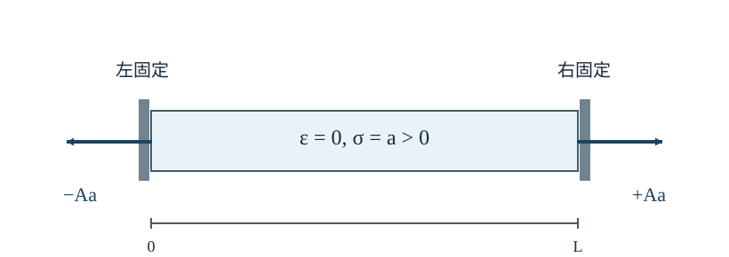

# CTM20 内部エネルギーを消費する能動応力をどう記述するか

[CTM19 の受動粘弾性](../CTM19/index.md#prop-ctm19-energy)では、ばねに蓄えたエネルギーを除くと、ダッシュポットで失われる仕事は非負だった。しかし、細胞が燃料を消費しながら周囲を引き寄せる場合、材料は外部から機械的な仕事を受けるだけでなく、**内部の化学エネルギーを力学的な仕事に変える**。

今回は新たな普遍保存則を作るのではない。[CTM7 の運動量収支](../CTM7/index.md#thm-ctm7-material-momentum)はそのまま使い、応力の**構成則**とエネルギーの帳簿に能動的な項を追加する。一次元の帯状組織で、自由端なら縮み、両端を固定すれば支持体を引くという違いを、応力・境界条件・エネルギーの三つの視点で確かめる。

## 0. 対象・記法・適用限界

長さ $L>0$（m）、断面積 $A>0$（m$^2$）が一定の細い帯を、基準位置 $0\le x\le L$ に置く。長手方向の変位 $u(x,t)$（m）と微小ひずみ $\varepsilon=\partial_xu$（無次元）を考え、$|\partial_xu|\ll1$ の一次近似とする。**引張応力・伸長ひずみを正、圧縮・短縮を負**とする。区間の両端の外向き法線は $n(0)=-1,\ n(L)=+1$ である。

- $\sigma$ は全軸応力、$\sigma_{\mathrm p}$ は受動応力、$\sigma_{\mathrm a}$ は能動応力（いずれも Pa = N/m$^2$）。
- $E>0$ は受動ばねの弾性率（Pa）、$\eta\ge0$ は必要に応じて加える一次元粘性係数（Pa s）。$\eta=0$ では純弾性模型となる。
- $f(x,t)$ は帯の単位体積当たりの外力（N/m$^3$）。正なら $+x$ 向き。慣性を無視する準静的模型とする。
- 以下の $\psi_{\mathrm e}$ と $c$ は**単位基準体積当たり**の弾性・化学エネルギー（J/m$^3$）。$p$ は化学エネルギー消費率（W/m$^3$）。
- 空間的に十分滑らかな $u,\sigma,f$ と、必要箇所で時間について $C^1$ 級の履歴を仮定する。化学物質の拡散・外部供給、発熱の輸送、断面積変化、大ひずみ、慣性はここでは扱わない。

微小変形では基準座標と現在座標の違いを高次項として捨てるため、以下の $x$ は基準軸座標を用いる一次近似である。[CTM3 の微小ひずみ](../CTM3/index.md#def-ctm3-infinitesimal-strain)をこの軸に制限した $\varepsilon=\partial_xu$ を用いる。[CTM6 の traction](../CTM6/index.md#thm-ctm6-cauchy-stress)は、この一次元模型では面が物体に与える力を面積で割った $t(n)=\sigma n$ になる。

## 1. 受動応力だけでは表せない何を加えるか

[CTM19 の標準線形固体](../CTM19/index.md#def-ctm19-sls)は、ひずみとその履歴が指定されれば応力が決まる受動模型だった。ところが、一定の長さに固定した帯が、ひずみを変えずに支持体を引き始めることがある。これは筋収縮などの分子機構を細部まで解くのではなく、燃料で駆動される**追加の応力**を材料法則へ入れる動機となる。

**能動応力**とは、運動量保存とは別に、内部の活動状態によって生じるとモデル化する応力の寄与である。ここでは正の活動量 $a(x,t)$ が引張方向の内部張力を生むと仮定する。引張が正なので、この「収縮性」の張力は **$\sigma_{\mathrm a}=+a$** と書く。正の能動張力は、帯が自由なら縮む方向に働くことと矛盾しない。能動応力を負にする別の流儀もあるが、その場合は構成式と面力の符号を一緒に読み替える必要がある。

<!-- formal-statement-start -->
### 定義（一次元の能動応力模型）

$E>0,\ \eta\ge0$ を一定とし、$a:[0,L]\times I\to\mathbb R$ を与えた活動場とする。ひずみ $\varepsilon=\partial_xu$ を持つ一次元の小変形材料について、受動・能動応力と全応力を

$$
\sigma_{\mathrm p}=E\varepsilon+\eta\dot\varepsilon,\qquad
\sigma_{\mathrm a}=a,\qquad
\sigma=\sigma_{\mathrm p}+\sigma_{\mathrm a}
$$

とする。$a>0$ は収縮性の能動張力、$a<0$ はこの符号規約で伸長性の能動応力を表す。$\dot\varepsilon$ は同じ物質位置を追った時間微分である。活動場 $a$ は運動量保存から決まる量ではなく、別途与えるモデル変数である。
<!-- formal-statement-end -->

<!-- definition-example-start: def-ctm20-active-stress -->
### **定義の確認**：固定した帯の張力はひずみゼロでも残る

$E=40$ kPa、$\eta=0$、$a=0.4$ kPa の一様な帯を考える。両端を固定して $u=0$ とすれば $\varepsilon=\partial_xu=0$、したがって $\sigma_{\mathrm p}=0$、$\sigma_{\mathrm a}=+0.4$ kPa、$\sigma=+0.4$ kPa。受動ばねだけなら零になる応力が残った。

同じ材料を外力のない自由端で釣り合わせるには $\sigma=0$ が必要となる。この条件を構成式に戻せば $E\varepsilon+a=0$、すなわち $\varepsilon=-0.4/40=-0.01$。**能動張力は正なのに、自由な変形は負**になる。ここで $|\varepsilon|=0.01\ll1$ なので微小変形近似とも整合する。
<!-- definition-example-end -->

活動場には例えば $a=a_0>0$（一定）や $a=a_0(1+x/L)>0$ を仮定できる。これだけではATP等の消費速度を決められない。力を作る構成則と、その燃料の収支は区別する。

## 2. 力の釣合は変わらないが、境界反力は変わる

[CTM7 の局所運動量収支](../CTM7/index.md#thm-ctm7-material-momentum)の $\rho D_tv=\operatorname{div}\sigma+\rho b$ を、加速度を無視した細い帯の軸方向に制限する。単位体積当たりの外力を $f=\rho b_x$ とすれば、未知量は変位 $u$ で、材料式により $\sigma=E\partial_xu+\eta\partial_x\dot u+a$ となる。

<!-- formal-statement-start -->
### 定理（能動帯の準静的釣合と境界力）

$0<x<L$ の一様断面帯に上記[能動応力模型](#def-ctm20-active-stress)を採用し、必要な空間微分が存在し、慣性と横方向の効果を無視するとする。任意の内部小区間でも軸方向の力が釣り合うことと、

$$
\partial_x\sigma+f=0,\qquad
\partial_x(E\partial_xu+\eta\partial_x\dot u+a)+f=0
$$

とは同値である。左端・右端で帯が**外部から受ける**面力密度は、それぞれ

$$
t(0)=-\sigma(0),\qquad t(L)=+\sigma(L)
$$

である。断面積 $A$ が一定なら、外部からの端面力は $F_0=-A\sigma(0)$、$F_L=A\sigma(L)$ を満たし、

$$
F_0+F_L+\int_0^LAf(x)\,dx=0
$$

が成立する。
<!-- formal-statement-end -->

### 証明の見取り図

小区間の左右端では外向き法線の符号が逆である。端面の面力差と区間中の分布力を足し、幅を零へ近づければ局所式になる。全長で積分すると端面力と分布力の総和が零になる。

<!-- proof-start -->
### 証明

$0<x_1<x_2<L$ の小区間を取る。右面の法線は $+1$、左面の法線は $-1$ なので、[traction の式](../CTM6/index.md#thm-ctm6-cauchy-stress)を適用した軸方向力の和は

$$
A\sigma(x_2)-A\sigma(x_1)+A\int_{x_1}^{x_2} f(x)\,dx=0.
$$

$A>0$ で割り、積分に関する微積分の基本定理から

$$
\int_{x_1}^{x_2}(\partial_x\sigma+f)\,dx=0.
$$

連続な被積分関数についてこれが任意の内部区間で成立するから、$\partial_x\sigma+f=0$。逆に局所式を積分すれば各小区間の釣合が戻る。構成式を代入すると表示された変位方程式が得られる。

全区間を積分すると $\sigma(L)-\sigma(0)+\int_0^L f\,dx=0$。左端の外向き法線が $-1$、右端が $+1$ であることを用いて $F_0=-A\sigma(0),F_L=A\sigma(L)$ と置き、$A$ を掛ければ総力の式となる。$\square$
<!-- proof-end -->

これは外力ゼロで $\partial_x\sigma=0$ を意味するが、**$\partial_xa=0$ を意味しない**。能動応力が位置で変われば、受動応力の空間勾配がその変化を打ち消せる。

固定した帯の境界力を下図に示す。矢印は**帯が外部支持体から受ける力**（帯が支持体へ及ぼす力は逆向き）である。内部に正の能動張力があることと、支持体を互いに引き寄せることを混同しない。

## 3. 自由にすると縮み、固定すると支持体を引く

[CTM12 の境界条件](../CTM12/index.md#def-ctm12-boundary-data)では、位置を指定する端点と面力を指定する端点とを区別した。今回も、同じ端面に「固定」と「自由端の面力零」の両方は同時に課さない。

<!-- formal-statement-start -->
### 命題（一様能動張力の自由収縮と固定反力）

長さ $L>0$、断面積 $A>0$ の帯に、$E>0$、$\eta=0$、一様で時間に依存しない $a>0$、体積力 $f=0$ を仮定する。

1. 左端を $u(0)=0$ に固定し、右端を自由端 $t(L)=0$ とすると、唯一の一次元平衡変位は $u(x)=-ax/E$。全応力は $\sigma=0$ である。
2. 両端を $u(0)=u(L)=0$ と固定すると、唯一の一次元平衡変位は $u(x)=0$、全応力は $\sigma=a$。帯に作用する端面力は $F_0=-Aa,\ F_L=+Aa$ となる。

いずれも $a/E\ll1$ のとき微小変形近似に整合する。
<!-- formal-statement-end -->

### 証明の見取り図

体積力なしなら全応力は空間一定となる。自由端が一つあれば一定値は零に決まり、両端固定なら変位の**積分条件**がひずみを零に決める。

<!-- proof-start -->
### 証明

[準静的釣合](#thm-ctm20-balance)に $f=0$ を代入すると $\partial_x\sigma=0$ であるから、連結区間上で $\sigma(x)=s$（定数）。構成則 $\sigma=Eu'+a$ より

$$
u'(x)=\frac{s-a}{E},\qquad
u(x)=u(0)+\frac{s-a}{E}x.
$$

自由端の場合は $t(L)=\sigma(L)=s=0$ なので、$u(0)=0$ から $u(x)=-ax/E$ を得る。両端固定の場合は $u(0)=0$ と $u(L)=0$ を上式に入れて $(s-a)L/E=0$。$E,L>0$ より $s=a$、ゆえに $u'=0,u=0$。端面力の符号は[釣合定理](#thm-ctm20-balance)へ $\sigma=a$ を代入したもの。$s$ が境界条件で一意に決まり、続いて $u(0)$ により積分定数も決まる。$\square$
<!-- proof-end -->

**力の向きを読む。** 両端固定では左の支持体が帯を $-x$ 方向に、右の支持体が $+x$ 方向に引き留める。一方、作用・反作用により、帯が左支持体へ及ぼす力は $+Aa$、右支持体へ及ぼす力は $-Aa$。**組織が支持体を内向きに引く**という収縮の言葉と整合する。

例えば $L=10$ mm、$A=2$ mm$^2$、$E=40$ kPa、$a=0.4$ kPa なら、自由時の右端移動は $-(0.4/40)\times10=-0.10$ mm。両端固定時は各支持体に働く力の大きさが $(2\times10^{-6})(400)=8\times10^{-4}$ N = $0.8$ mN となる。

## 4. 活動場が場所で違うとき

一様活動なら全応力の一定値がすぐ求まった。しかし組織の片側だけ活動が強いとき、$\sigma_{\mathrm a}(x)$ 自体は一定ではない。それでも、外力なしの全応力が一定という釣合を用いれば変位を求められる。

<!-- formal-statement-start -->
### 命題（非一様能動応力と拘束反力）

$E>0,\ \eta=0,\ f=0$ とし、$a\in C^1([0,L])$ は与えられた時間非依存の能動張力とする。平衡変位 $u\in C^2([0,L])$ に対し、全応力は一定値 $s$ で、

$$
u'(x)=\frac{s-a(x)}{E}.
$$

左端固定 $u(0)=0$、右端自由 $\sigma(L)=0$ なら

$$
s=0,\qquad u(x)=-\frac1E\int_0^x a(\xi)\,d\xi.
$$

両端固定 $u(0)=u(L)=0$ なら

$$
s=\frac1L\int_0^L a(\xi)\,d\xi,\qquad
u(x)=\frac1E\int_0^x\bigl(s-a(\xi)\bigr)\,d\xi.
$$

これらの解はそれぞれ一意である。
<!-- formal-statement-end -->

### 証明の見取り図

全応力の積分定数 $s$ を先に導入する。自由端ではその値が零、両端固定では全長の伸び $\int_0^L u'\,dx=0$ から平均活動量として決まる。

<!-- proof-start -->
### 証明

[釣合定理](#thm-ctm20-balance)に $f=0$ を代入して $\sigma'=0$。定数 $s$ を用いて $Eu'(x)+a(x)=s$ とする。$E>0$ で割れば $u'=(s-a)/E$。$u(0)=0$ から

$$
u(x)=\int_0^xu'(\xi)\,d\xi
=\frac1E\int_0^x(s-a(\xi))\,d\xi.
$$

右端自由なら $t(L)=s=0$ で第一式。両端固定なら

$$
0=u(L)-u(0)=\frac1E\left(sL-\int_0^La(\xi)\,d\xi\right),
$$

したがって $s=L^{-1}\int_0^La(\xi)\,d\xi$。各場合に $s$ と積分定数が一意である。$a$ の $C^1$ 性により式から $u\in C^2$ も従う。$\square$
<!-- proof-end -->

**直接例。** $a(x)=a_0(1+x/L)$、$a_0>0$ とする。両端固定の応力は $s=(3/2)a_0$。ひずみは

$$
u'(x)=\frac{a_0}{E}\left(\frac12-\frac{x}{L}\right),
\quad
u(x)=\frac{a_0}{E}\left(\frac{x}{2}-\frac{x^2}{2L}\right).
$$

$x=L/2$ では $u'=0$、$u(L/2)=a_0L/(8E)>0$、しかも $u(0)=u(L)=0$。左側は伸び、右側は縮む。**局所的な能動応力の不均一性を、受動応力の勾配が打ち消している**。

## 5. 燃料の収支を入れなければ永久機関に見える

[CTM10 の Clausius–Duhem 型条件](../CTM10/index.md#thm-ctm10-clausius-duhem)は、自由エネルギー変化を差し引いた散逸に対する条件である。[CTM19 の受動エネルギー式](../CTM19/index.md#prop-ctm19-energy)をそのまま能動応力全体へ当てはめると、短縮中の $a\dot\varepsilon<0$ を「第二法則違反」と誤判定してしまう。原因は、材料が消費する**化学的なエネルギー源を帳簿から落としたこと**にある。

ここではエネルギー収支の最小模型として、細胞内に使える化学自由エネルギーの蓄え $c(t)\ge0$ を置く。空間移動する燃料やATP反応速度そのものは解かず、与えた消費率 $p(t)\ge0$ に対して $\dot c=-p$ と仮定する。単位体積当たりの弾性エネルギーは $\psi_{\mathrm e}=E\varepsilon^2/2$ である。

<!-- formal-statement-start -->
### 定義（化学エネルギー蓄積と消費率）

一様な一次元要素で $c(t)\ge0$（J/m$^3$）を、力学的仕事へ転換可能な化学自由エネルギーの蓄積量とする。外部からの化学供給・拡散を無視する時間区間で、

$$
p(t)=-\dot c(t)\ge0
$$

を化学エネルギー消費率（W/m$^3$）とする。$c$ は $\psi_{\mathrm e}=E\varepsilon^2/2$ とは別のエネルギー貯蔵であり、有限な初期値 $c(0)$ のもとで $\int_0^t p(s)\,ds\le c(0)$ を必要とする。
<!-- formal-statement-end -->

<!-- definition-example-start: def-ctm20-chemical-reserve -->
### **定義の確認**：有限燃料は有限時間しか消費できない

$c(0)=100$ J/m$^3$、$p(t)=2$ W/m$^3$ が一定なら、$\dot c=-2$ から $c(t)=100-2t$ J/m$^3$（$t$ を s で測る）。$0\le t\le50$ s の範囲で $c\ge0$、かつ $\int_0^t2\,ds=2t\le100$。$50$ s を超えて同じ消費を続ける計算は、この「供給なし・有限蓄積」模型には適用できない。$p$ の符号・積分と単位を両方確認した。
<!-- definition-example-end -->

<!-- formal-statement-start -->
### 定理（化学エネルギーを含めた非負散逸条件）

$E>0,\ \eta\ge0$、応力 $\sigma=E\varepsilon+\eta\dot\varepsilon+a$ の滑らかな一様一次元要素を考える。弾性貯蔵 $\psi_{\mathrm e}=E\varepsilon^2/2$、化学貯蔵 $c\ge0$、消費率 $p=-\dot c\ge0$ とする。単位体積当たりの機械仕事率を $\sigma\dot\varepsilon$ とし、熱などへ不可逆に移る全散逸率を

$$
\mathcal D
=\sigma\dot\varepsilon-\frac{d}{dt}(\psi_{\mathrm e}+c)
$$

で測ると、

$$
\boxed{\mathcal D=\eta\dot\varepsilon^2+a\dot\varepsilon+p}
$$

である。したがって $\mathcal D\ge0$ の必要十分条件は

$$
p\ge-a\dot\varepsilon-\eta\dot\varepsilon^2.
$$

とくに、受動粘性による散逸と燃料駆動による散逸を**それぞれ非負**に分ける十分条件は

$$
p+a\dot\varepsilon\ge0,\qquad
\mathcal D=\eta\dot\varepsilon^2+(p+a\dot\varepsilon)\ge0.
$$

$a>0,\ \dot\varepsilon<0$ の短縮中にこの十分条件を課す場合、$p\ge a|\dot\varepsilon|$ が必要である。
<!-- formal-statement-end -->

### 証明の見取り図

応力仕事から弾性ばねの時間微分を引くと、粘性項と能動項が残る。化学蓄積は減るので、さらに $-\dot c=p$ が加わる。**能動応力単独の仕事率の符号を制限するのではなく、燃料の減少と合わせた残差**を調べる。

<!-- proof-start -->
### 証明

$\psi_{\mathrm e}=E\varepsilon^2/2$ と $E$ 一定から、積の微分により $\dot\psi_{\mathrm e}=E\varepsilon\dot\varepsilon$。一方、定義から $\dot c=-p$。したがって

$$
\begin{aligned}
\mathcal D
&=(E\varepsilon+\eta\dot\varepsilon+a)\dot\varepsilon
  -E\varepsilon\dot\varepsilon-(-p)\\
&=\eta\dot\varepsilon^2+a\dot\varepsilon+p.
\end{aligned}
$$

両辺から $\eta\dot\varepsilon^2+a\dot\varepsilon$ を引けば必要十分条件を得る。さらに $\eta\ge0$ だから $\eta\dot\varepsilon^2\ge0$ であり、$p+a\dot\varepsilon\ge0$ はその残りの項も非負にする十分条件となる。$a>0,\dot\varepsilon<0$ なら $-a\dot\varepsilon=a|\dot\varepsilon|$。$\square$
<!-- proof-end -->

**重要な区別。** 最初の必要十分条件は全散逸の非負性だけを要求する。二つ目は「粘性散逸」「化学駆動部の残差」をそれぞれ非負にする**より強いモデル仮定**である。この二つを同一視しない。固定した帯で $\dot\varepsilon=0$ なら能動応力が非零でも外部への機械仕事率は零で、$p>0$ があれば $\mathcal D=p$（燃料の消費は熱等に変わる）。$p=0$ の静的活動を数学だけで禁止することもできず、実際の代謝維持費はさらに材料模型で定めなければならない。

## 6. 活動を始めた帯はどの速さで縮むか

粘性抵抗 $\eta>0$ があると、自由端を開放してもひずみは瞬時に最終値へ飛べない。左端固定・右端自由・外部体積力なし・活動の立ち上げが時刻 $0$ の瞬間で、その後は一定という初期値問題を解く。この例は、能動材料を「負の弾性率」と誤解しないためにも役立つ。

<!-- formal-statement-start -->
### 命題（粘性を持つ自由帯の活動ステップ応答）

$E,\eta,a_0,L>0$ を一定とする。$u(0,t)=0$、$\sigma(L,t)=0$、$f=0$ の帯で、$t<0$ は $a=0$、$\varepsilon(x,0)=0$、$t\ge0$ に $a=a_0$ として保持する。ひずみが空間一様な古典解について、$t>0$ の応答は

$$
\tau=\frac{\eta}{E}>0,\qquad
\varepsilon(t)=-\frac{a_0}{E}(1-e^{-t/\tau}),\qquad
u(x,t)=x\varepsilon(t),
$$

$$
\dot\varepsilon(t)=-\frac{a_0}{\eta}e^{-t/\tau},\qquad
\sigma(t)=0.
$$

$\varepsilon(0+)=0$、$\varepsilon(\infty)=-a_0/E$。小変形条件には $a_0/E\ll1$ を課す。
<!-- formal-statement-end -->

### 証明の見取り図

全応力は自由端の条件から零。従って $\eta\dot\varepsilon+E\varepsilon=-a_0$ という一階常微分方程式を初期値零で解く。指数の時定数が応力ではなく**変形の遅れ**に現れる。

<!-- proof-start -->
### 証明

[準静的釣合](#thm-ctm20-balance)は $f=0$ で $\partial_x\sigma=0$。右自由端が $\sigma(L,t)=0$ なので $\sigma=0$。空間一様のひずみを構成式へ代入して

$$
\eta\dot\varepsilon+E\varepsilon+a_0=0,\qquad
\dot\varepsilon+\frac{E}{\eta}\varepsilon=-\frac{a_0}{\eta}.
$$

積分因子 $e^{Et/\eta}$ を掛けると

$$
\frac{d}{dt}\bigl(e^{Et/\eta}\varepsilon(t)\bigr)
=-\frac{a_0}{\eta}e^{Et/\eta}.
$$

$0$ から $t$ まで積分し $\varepsilon(0)=0$ を使えば

$$
e^{Et/\eta}\varepsilon(t)
=-\frac{a_0}{\eta}\frac{\eta}{E}(e^{Et/\eta}-1),
$$

したがって $\varepsilon(t)=-(a_0/E)(1-e^{-Et/\eta})$。これを微分して $\dot\varepsilon=-(a_0/\eta)e^{-Et/\eta}$。$u_x=\varepsilon$ を $x$ で積分して $u(x,t)=x\varepsilon(t)+C(t)$ とし、$u(0,t)=0$ より $C(t)=0$。$\eta,E>0$ なので指数は減衰し、極限を得る。$\square$
<!-- proof-end -->

静的な自由収縮の結果へ滑らかに近づくが、エネルギー供給のない受動模型とは違い、$a_0$ を生む活動の資源は別途必要である。

## 7. 三次元での向きと客観性

一次元の $a$ は軸に沿った張力だった。三次元で繊維がある方向だけ引く場合、その**方向**も状態量に含める必要がある。単位ベクトル $m$（現在配置の繊維方向）を選び、二階テンソル $m\otimes m$ の成分を $(m\otimes m)_{ij}=m_im_j$ とする。これを法線 $n$ に掛けると $ (m\otimes m)n=m(m\cdot n)$ だから、繊維方向の面力だけが生まれる。

<!-- formal-statement-start -->
### 命題（繊維に沿う能動応力の対称性・客観性）

三次元の古典的 Cauchy 連続体で、$a(x,t)$ を座標回転によらないスカラー、$m(x,t)\in\mathbb R^3$ を $|m|=1$ の現在配置での繊維方向とする。能動応力の構成項を

$$
\sigma_{\mathrm a}=a\,m\otimes m
$$

と仮定する。このテンソルは対称で、面法線 $n$ の能動 traction は $t_{\mathrm a}(n)=a(m\cdot n)m$ となる。観測者の直交回転 $Q(t)$（$Q^TQ=I$、$\det Q=1$）で方向が $m^*=Qm$、法線が $n^*=Qn$ に変わるとき、

$$
\sigma_{\mathrm a}^*=Q\sigma_{\mathrm a}Q^T,\qquad
t_{\mathrm a}^*(n^*)=Qt_{\mathrm a}(n)
$$

を満たす。これは[CTM10 の応力の客観性](../CTM10/index.md#def-ctm10-constitutive-objectivity)と整合する。
<!-- formal-statement-end -->

### 証明の見取り図

テンソルの成分を $a m_i m_j$ と書けば添字 $i,j$ の交換で対称性が分かる。回転による変換は外積の両側に $Q$ を掛けて直接確かめる。

<!-- proof-start -->
### 証明

$(\sigma_{\mathrm a})_{ij}=am_im_j=am_jm_i=(\sigma_{\mathrm a})_{ji}$ より対称。traction の第 $i$ 成分は

$$
(\sigma_{\mathrm a}n)_i=\sum_j am_im_jn_j
=am_i(m\cdot n),
$$

なのでベクトル表示も成立する。新座標で

$$
\begin{aligned}
\sigma_{\mathrm a}^*
&=a(Qm)(Qm)^T
=aQmm^TQ^T=Q\sigma_{\mathrm a}Q^T,\\
\sigma_{\mathrm a}^*n^*
&=(Q\sigma_{\mathrm a}Q^T)(Qn)
=Q\sigma_{\mathrm a}(Q^TQ)n
=Q\sigma_{\mathrm a}n.
\end{aligned}
$$

$Q^TQ=I$ を使った。独立の偶応力は導入しておらず、対称性は[CTM7 の角運動量条件](../CTM7/index.md#prop-ctm7-angular-stress)と矛盾しない。$\square$
<!-- proof-end -->

例えば $m=e_1$、$a=2$ kPa、$n=(1/2,\sqrt3/2,0)$ のとき、$m\cdot n=1/2$ だから $t_{\mathrm a}=(1,0,0)$ kPa。$90^\circ$ 回転すれば繊維方向と traction はともに $e_2$ へ回る。逆に、材料の繊維方向を固定座標の $e_1$ と決め打ちし、観測者だけ回しても同じ数値行列を使い続ければ、この変換性は壊れる。

この繊維模型は**追加した一つの構成仮定**であり、すべての生体組織に当てはまる法則ではない。$a$ や $m$ の時間発展方程式、三次元の化学輸送はここからは導かれない。

## 8. 演習

各問は必要な仮定と境界条件を指定している。力の符号は常に「帯が外部から受ける力」を先に求め、帯が支持体へ加える力はその逆として扱う。

### Level A

### A1. 総応力と端面tractionの符号

$E=100$ kPa、$\eta=0$、一様な $\varepsilon=0.01$、$a=2$ kPa の帯について、受動応力・能動応力・全応力と、両端の単位面積当たりの外部からの traction を計算せよ。体積力は零でよい。

- Level: A

<!-- solution-start -->
#### 詳細解答

[能動応力の定義](#def-ctm20-active-stress)に代入すると、$E\varepsilon=100\times0.01=1$ kPa、$a=2$ kPa。したがって $\sigma_{\mathrm p}=1$ kPa、$\sigma_{\mathrm a}=2$ kPa、$\sigma=1+2=3$ kPa。[端面力の式](#thm-ctm20-balance)で $n(0)=-1,n(L)=+1$ だから $t(0)=-3$ kPa、$t(L)=+3$ kPa。$3$ kPa の符号を機械的に両面へ流用せず、法線との積を取った。
<!-- solution-end -->

### A2. 自由端の短縮量

$E=40$ kPa、$a=0.4$ kPa、$L=10$ mm、$\eta=f=0$ の帯で、左端 $u(0)=0$、右端 $\sigma(L)=0$ とする。ひずみと右端の移動量、微小変形条件を求めよ。

- Level: A

<!-- solution-start -->
#### 詳細解答

[一様活動の自由収縮命題](#prop-ctm20-free-clamped)で $a/E=0.4/40=0.01$ なので、$\varepsilon=u'=-0.01$。$u(L)=\varepsilon L=-0.01\times10=-0.10$ mm。全応力は $E(-0.01)+a=-0.4+0.4=0$ kPa で自由境界を満たす。$|\varepsilon|=0.01\ll1$ なので今回の小変形仮定とも整合する。
<!-- solution-end -->

### A3. 両端固定の支持体が受ける力

$E=50$ kPa、$a=2$ kPa、$A=2$ mm$^2$、$\eta=f=0$、$u(0)=u(L)=0$ とする。左右端の**帯に作用する外力**と、**帯が支持体に及ぼす力**をそれぞれ N 単位で求めよ。

- Level: A

<!-- solution-start -->
#### 詳細解答

[両端固定命題](#prop-ctm20-free-clamped)から $\sigma=a=2000$ Pa。$A=2\times10^{-6}$ m$^2$ なので $A\sigma=(2\times10^{-6})(2000)=4\times10^{-3}$ N。帯が受ける左端力は $-0.004$ N、右端力は $+0.004$ N で和は零。作用・反作用により支持体が帯から受ける力は左で $+0.004$ N、右で $-0.004$ N。二つの支持体が内向きに引かれる。
<!-- solution-end -->

### A4. 化学消費と散逸

ある瞬間に $a=500$ Pa、$\dot\varepsilon=-0.02$ s$^{-1}$、$\eta=1000$ Pa s、$p=12$ W/m$^3$ とする。[エネルギー定理](#thm-ctm20-energy)の全散逸 $\mathcal D$ と、受動粘性項・化学駆動部の残差を分けて求めよ。

- Level: A

<!-- solution-start -->
#### 詳細解答

粘性項は $\eta\dot\varepsilon^2=1000(0.02)^2=0.4$ W/m$^3$。能動仕事率は $a\dot\varepsilon=500(-0.02)=-10$ W/m$^3$。化学駆動部の残差は $p+a\dot\varepsilon=12-10=2$ W/m$^3$ と非負。従って $\mathcal D=0.4+2=2.4$ W/m$^3$。能動項の $-10$ だけを取り出して「負の散逸」とは判定できない。
<!-- solution-end -->

### A5. 繊維方向から面力を作る

三次元の $m=(1,0,0)$、$a=2$ kPa、$n=(1/2,\sqrt3/2,0)$ を与える。$|m|=|n|=1$ を確かめ、$\sigma_{\mathrm a}$ の行列と $t_{\mathrm a}(n)$ を求めよ。

- Level: A

<!-- solution-start -->
#### 詳細解答

$|m|^2=1$、$|n|^2=1/4+3/4=1$。[繊維応力命題](#prop-ctm20-objective)の定義から、$m_im_j$ は $(1,1)$ 成分のみ $1$、他は零なので $\sigma_{\mathrm a}=\operatorname{diag}(2,0,0)$ kPa。この行列に $n$ を掛けると $(2\times1/2,0,0)=(1,0,0)$ kPa。一方 $a(m\cdot n)m=2(1/2)(1,0,0)$ kPa でも一致する。これは法線方向のベクトルではなく**繊維方向**の traction である。
<!-- solution-end -->

### Level B

### B1. 非一様活動と自由端

$E>0,\ \eta=f=0$、$a(x)=a_0(1+x/L)$（$a_0>0$）、$u(0)=0$、$\sigma(L)=0$。全応力、受動応力、変位分布、右端移動量を求め、$|\varepsilon|\ll1$ の十分なパラメータ条件を示せ。

- Level: B

<!-- solution-start -->
#### 詳細解答

[非一様活動命題](#prop-ctm20-inhomogeneous)で右自由端のため $s=\sigma=0$。したがって受動応力は $\sigma_{\mathrm p}=-a(x)=-a_0(1+x/L)$。$Eu'(x)=\sigma_{\mathrm p}(x)$ から

$$
u'(x)=-\frac{a_0}{E}\left(1+\frac xL\right).
$$

$u(0)=0$ を使って積分すれば

$$
u(x)=-\frac{a_0}{E}\left(x+\frac{x^2}{2L}\right),\qquad
u(L)=-\frac{3a_0L}{2E}.
$$

ひずみ絶対値は $[0,L]$ 上で最大 $2a_0/E$。例えば $2a_0/E\ll1$ と選べば全域の微小変形条件を満たす。$\partial_x\sigma=0$ であることも確認できる。
<!-- solution-end -->

### B2. 非一様活動を両端固定する

B1 と同じ $a(x)$、$E>0$、$\eta=f=0$ で今度は $u(0)=u(L)=0$ とする。全応力・変位分布・最大変位の位置と値・帯が支持体へ及ぼす左右の力を求めよ。断面積は $A>0$ とする。

- Level: B

<!-- solution-start -->
#### 詳細解答

[非一様活動命題](#prop-ctm20-inhomogeneous)で全応力は平均能動張力

$$
s=\frac1L\int_0^L a_0\left(1+\frac xL\right)dx
=\frac{a_0}{L}\left(L+\frac{L}{2}\right)
=\frac32a_0.
$$

よって受動応力は $\sigma_{\mathrm p}(x)=s-a(x)=a_0(1/2-x/L)$、ひずみはその $E^{-1}$ 倍。左端固定を用いて

$$
u(x)=\frac{a_0}{E}\left(\frac{x}{2}-\frac{x^2}{2L}\right).
$$

$u(0)=u(L)=0$ で、$u'=0$ の点は $x=L/2$ のみ。$u''=-a_0/(EL)<0$ だからそこで最大、$u(L/2)=a_0L/(8E)$。帯が支持体へ及ぼす左端力は $+As=+3Aa_0/2$、右端力は $-As=-3Aa_0/2$。帯が**受ける**外力とは符号が逆である。
<!-- solution-end -->

### B3. 能動部分を受動散逸と取り違えない

$a>0$、$\eta\ge0$ の一様要素が $\dot\varepsilon=-v$（$v>0$）で短縮している。受動粘性散逸と化学駆動部の残差をともに非負にする条件下で、必要な最小の $p$ を求めよ。さらに $\eta v^2>0$ のとき全散逸非負だけの必要十分条件と比較し、何が追加仮定なのか説明せよ。

- Level: B

<!-- solution-start -->
#### 詳細解答

[化学収支の定理](#thm-ctm20-energy)で $\dot\varepsilon=-v$ と置くと

$$
\mathcal D=\eta v^2-av+p.
$$

二つを個別に非負にする十分条件は $p-av\ge0$ と $\eta v^2\ge0$。従って $p_{\min}=av$（W/m$^3$）。一方、全散逸だけなら

$$
p\ge av-\eta v^2
$$

でよく、さらに定義上 $p\ge0$ が必要なので

$$
p\ge\max(0,av-\eta v^2).
$$

$\eta v^2>0$ なら後者の下限は一般に $av$ より小さい。例えば $\eta v^2=av/2$ なら $p=av/2$ でも全散逸は零だが、化学駆動部単独の残差は $-av/2<0$。したがって「各機構の散逸を非負に分離する」は全体の第二法則より強い材料モデル上の仮定である。
<!-- solution-end -->

### B4. 一次元活動と観測者の回転

$a>0$、$m=e_1$、$n=e_1$ とする。$e_1$ を $e_2$ へ移す $z$ 軸まわりの $90^\circ$ 回転

$$
Q=\begin{pmatrix}0&-1&0\\1&0&0\\0&0&1\end{pmatrix}
$$

で $\sigma_{\mathrm a}$、$n$、traction がどう変わるかを計算せよ。回転後に元の $\operatorname{diag}(a,0,0)$ を不変の数値行列として使うと何が壊れるか。

- Level: B

<!-- solution-start -->
#### 詳細解答

$Q^TQ=I$ かつ $\det Q=1$、$Qe_1=e_2$ なので $m^*=n^*=e_2$。[客観性命題](#prop-ctm20-objective)から

$$
\sigma_{\mathrm a}=a\operatorname{diag}(1,0,0),\qquad
\sigma_{\mathrm a}^*=Q\sigma_{\mathrm a}Q^T
=a\operatorname{diag}(0,1,0).
$$

元の traction は $\sigma_{\mathrm a}n=ae_1$、新しい traction は $\sigma_{\mathrm a}^*n^*=ae_2=Q(ae_1)$。もし回転後も $\operatorname{diag}(a,0,0)$ を掛けたなら、$\operatorname{diag}(a,0,0)e_2=0$ となる。実際の面力 $ae_2$ と一致せず、繊維方向を共変に変換しないという**客観性の仮定違反**が原因である。
<!-- solution-end -->

### Level C

### C1. 活動開始後の自由収縮と化学エネルギーの行方

長さ $L$、断面積 $A$ の均一な帯で $E,\eta,a_0>0$、$a_0/E\ll1$。左端固定・右端自由、体積力なし。$t<0$ は活動・ひずみとも零で、$t=0$ から一定能動張力 $a=a_0$ を課す。化学エネルギーの消費率を $p(t)=-a_0\dot\varepsilon(t)$ と仮定する（活動後の $t>0$ で評価する）。

1. ひずみ $\varepsilon(t)$、右端変位 $u(L,t)$、全応力とその境界面力を初期条件から導け。
2. $\psi_{\mathrm e}(t)=E\varepsilon(t)^2/2$ と粘性散逸 $\eta\dot\varepsilon(t)^2$、消費率 $p(t)$ を計算し、[化学収支](#thm-ctm20-energy)の全散逸が負でないことを各時刻で確かめよ。
3. $0$ から $\infty$ までの単位体積当たりの総化学消費、最終弾性エネルギー、積算粘性散逸を別々に積分し、エネルギー収支を検算せよ。初期の化学貯蔵 $c(0)$ にはどんな下限が必要か。
4. $\eta\to0+$ での近似の限界を述べよ。瞬間的な能動応力の付加を、ひずみの瞬間ジャンプと無条件に同一視してよいか。

- Level: C

<!-- solution-start -->
#### 詳細解答

**1. 釣合と初期値。** $f=0$、自由端の $\sigma(L,t)=0$ なので[釣合定理](#thm-ctm20-balance)により全応力は $\sigma=0$。材料法則を戻すと、$t>0$ で

$$
\eta\dot\varepsilon+E\varepsilon=-a_0,\qquad \varepsilon(0)=0.
$$

$\tau=\eta/E$ と置き、積分因子 $e^{t/\tau}$ を使う。積分して

$$
e^{t/\tau}\varepsilon(t)
=-\frac{a_0}{\eta}\int_0^t e^{s/\tau}\,ds
=-\frac{a_0\tau}{\eta}(e^{t/\tau}-1).
$$

$\tau/\eta=1/E$ を代入すると

$$
\varepsilon(t)=-\frac{a_0}{E}(1-e^{-t/\tau}),\quad
u(L,t)=-\frac{a_0L}{E}(1-e^{-t/\tau}).
$$

各端面の traction は $\sigma n=0$、全応力の式に戻せば $E\varepsilon+\eta\dot\varepsilon+a_0=0$ と確かめられる。$t=0+$ ではひずみは零で、粘性応力 $\eta\dot\varepsilon(0+)=-a_0$ が活動応力を相殺する。

**2. 時刻ごとのエネルギー。** $z=e^{-t/\tau}\in(0,1]$ とおくと

$$
\varepsilon=-\frac{a_0}{E}(1-z),\quad
\dot\varepsilon=-\frac{a_0}{\eta}z,
$$

$$
\psi_{\mathrm e}=\frac{a_0^2}{2E}(1-z)^2,\qquad
\eta\dot\varepsilon^2=\frac{a_0^2}{\eta}z^2,\qquad
p=-a_0\dot\varepsilon=\frac{a_0^2}{\eta}z\ge0.
$$

[化学収支定理](#thm-ctm20-energy)へ $p=-a_0\dot\varepsilon$ を代入すれば

$$
\mathcal D
=\eta\dot\varepsilon^2+a_0\dot\varepsilon+p
=\frac{a_0^2}{\eta}z^2\ge0.
$$

また $d\psi_{\mathrm e}/dt=E\varepsilon\dot\varepsilon=(a_0^2/\eta)(1-z)z$。これと $\mathcal D$ を加えると $(a_0^2/\eta)z=p$。全応力零で外部機械仕事がないこととも整合する。

**3. 全期間の積算。** $\int_0^\infty e^{-kt/\tau}dt=\tau/k$（$k>0$）を直接用いる。化学消費の積算は

$$
\int_0^\infty p(t)\,dt
=\frac{a_0^2}{\eta}\tau
=\frac{a_0^2}{E}.
$$

弾性エネルギーは $\psi_{\mathrm e}(0)=0$、$\psi_{\mathrm e}(\infty)=a_0^2/(2E)$。粘性散逸は

$$
\int_0^\infty\eta\dot\varepsilon^2\,dt
=\frac{a_0^2}{\eta}\frac{\tau}{2}
=\frac{a_0^2}{2E}.
$$

ゆえに

$$
\underbrace{\frac{a_0^2}{E}}_{\text{化学消費}}
=\underbrace{\frac{a_0^2}{2E}}_{\text{最終弾性蓄積}}
+\underbrace{\frac{a_0^2}{2E}}_{\text{散逸}}.
$$

どの項も Pa = J/m$^3$。$c$ を供給なし・非負の貯蔵とした[定義](#def-ctm20-chemical-reserve)から $c(0)\ge a_0^2/E$ が必要。帯全体のエネルギーならそれぞれ体積 $AL$ を掛ける。$\int pdt$ は単位体積当たりの積算量であり、消費率 W/m$^3$ のままではない。

**4. 瞬間の極限の意味。** $\tau=\eta/E\to0+$ で固定した $t>0$ については $\varepsilon(t)\to-a_0/E$。しかし任意の $\eta>0$ では $\varepsilon(0+)=0$ のままで、$t=0$ での極限と $\eta\to0+$ は交換できない。粘性を消した純弾性の静的問題では即座に $\varepsilon=-a_0/E$ を満たすが、実際の速い立ち上がりをモデル化するには活動時間や慣性も考える必要がある。$\eta\to0+$ を「全時間で滑らかな応答が同じ」と扱うのは誤りである。
<!-- solution-end -->

## 9. まとめ・次講への橋

- 保存則は受動材料と共通の $\partial_x\sigma+f=0$ で、追加したのは $\sigma=\sigma_{\mathrm p}+\sigma_{\mathrm a}$ という構成仮定である。
- 引張を正とした本講の収縮性張力は $a>0$。**自由なら短縮**し、**固定なら外力への反力**として現れる。境界法線の符号を落とさない。
- 能動部分の仕事率 $a\dot\varepsilon$ は負になり得るが、化学蓄積の減少 $p=-\dot c$ と合わせて全散逸の非負性を判定する。燃料供給・活動速度は保存則からは決まらない。
- 三次元の $a\,m\otimes m$ は向きを持つ客観的な能動応力の一例であり、実組織に普遍的な構成則ではない。

次の **CTM21** では、材料の**自然長・体積そのものが変わる成長**を、今回の「同じ基準配置で活動応力を足す」操作とは区別する。
