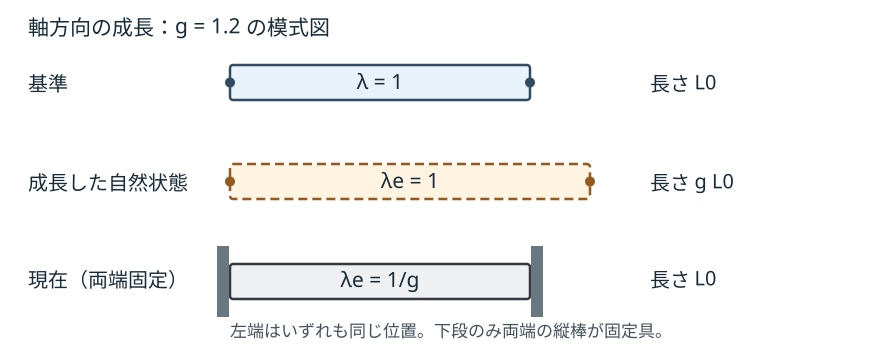

# CTM21 成長を単なる弾性変形と区別するには

[CTM20 の能動応力](../CTM20/index.md#def-ctm20-active-stress)では、もとの材料の自然長を保ったまま、燃料で駆動される張力を構成則へ追加した。ところが、細胞分裂や物質の沈着によって組織の**力を除いたときの自然長そのもの**が変われば、同じ変形でも応力は違う。ここで必要なのは「現在どれだけ伸びたか」に加えて「何を自然な大きさと見なすか」を記録する道具である。

本講では、最初に**質量が増えるなら保存式がどう変わるか**を確かめ、次に**成長と弾性を分ける構成仮定**を導入する。最後に、自由な棒・固定された棒・異なる成長をする結合棒を解く。成長の速さや成長則そのものは、保存則からは導かれない。

## 0. 配置・符号・射程

三次元の基準領域 $\Omega_0\subset\mathbb R^3$ の物質座標を $X$、時刻 $t$ の実際の位置を $x=\chi(X,t)$ とする。[CTM2 の変形勾配](../CTM2/index.md#def-ctm2-deformation-gradient)を $F=D_X\chi$、$J=\det F>0$ と書く。$\chi$ は各時刻で向きを保つ $C^2$ 級の一対一の運動であり、密度 $\rho(x,t)>0$ と速度 $v(x,t)$ は必要な微分を持つとする。

時間微分の上付き点は**固定した物質点 $X$ での微分**である。基準座標で表した量 $h(X,t)$ では $\dot h=\partial_t h$（$X$ 固定）と書く。

一方、現在位置で定義した量 $q(x,t)$ の $\partial_tq$ は **$x$ を固定**する微分であり、同じ物質点を追う微分とは異なる。[VC9 の物質微分](../../../幾何系/VC/VC9/index.md#def-vc9-material-derivative)を運動写像で具体化した関係を、$x=\chi(X,t)$ で書けば

$$
\frac{d}{dt}q(\chi(X,t),t)
=\bigl(\partial_tq+v\cdot\nabla_xq\bigr)(\chi(X,t),t).
$$

例えば第1節の $\partial_t[J(X,t)\rho(\chi(X,t),t)]$ は $X$ を固定しており、括弧内の $\rho$ の時間微分だけを $\partial_t\rho$（$x$ 固定）に置き換えてはならない。

- 密度 $\rho$ の単位は kg/m$^3$、質量源 $s$ は kg/(m$^3$ s) とする。
- $F$ と以下の $F_e,F_g$ は無次元の $3\times3$ 行列で、添字 $e$ は弾性、$g$ は成長を意味する。
- 応力は引張を正とする。[CTM8 の第一 Piola–Kirchhoff 応力](../CTM8/index.md#def-ctm8-first-piola) $P$ は基準面積当たりの力で、単位は Pa である。
- 棒の例では元の長さ $L_0>0$、基準断面積 $A_0>0$、軸伸長 $\lambda>0$、軸方向成長倍率 $g>0$、弾性係数 $E>0$（Pa）を使う。棒の模型は**軸方向だけが変わる一次元の縮約模型**である。

今回の模型は連続体の成長を記述する一つの選択であり、細胞の分裂・物質輸送・異方性・力学と化学の全連成を普遍的に表すものではない。

## 1. 質量が増えると、連続の式のどこが変わるか

[CTM5 の質量保存と連続の式](../CTM5/index.md#thm-ctm5-mass-equivalence)は、どの物質部分にも質量の流入や生成がなく、質量が一定であるという仮定を用いた。成長材料が物質を取り込む場合、その仮定をそのまま使えない。ここでは物質点の運動とともに運ばれる領域 $U_t=\chi_t(U_0)$ へ、局所的に質量が供給される状況を考える。境界を横切る独立した相対拡散流束は、この最小模型では含めない。

<!-- formal-statement-start -->
### 定義（物質領域の質量源）

$U_0\subset\Omega_0$ を滑らかな境界をもつ任意の有界な物質部分領域とする。$\rho>0$ と、現在体積当たりの質量供給率 $s(x,t)$（kg/(m$^3$ s)）が連続で、次の収支が成り立つと仮定する。

$$
\frac{d}{dt}\int_{U_t}\rho(x,t)\,dx
=\int_{U_t}s(x,t)\,dx.
$$

$s>0$ は供給、$s<0$ は除去、$s=0$ は[CTM5 の物質質量保存](../CTM5/index.md#thm-ctm5-mass-equivalence)に戻る。基準体積当たりの供給率を $S_0(X,t)=J(X,t)s(\chi(X,t),t)$ と書く。
<!-- formal-statement-end -->

<!-- definition-example-start: def-ctm21-mass-source -->
### **定義の確認**：同じ体積に物質を加える

体積が一定の $V=2$ mm$^3=2\times10^{-9}$ m$^3$ の領域に、一様な $s=3$ kg/(m$^3$ s) を供給する。$v=0$、$J=1$ とすれば、定義の右辺は $sV=6\times10^{-9}$ kg/s。従って $M(t)=M(0)+6\times10^{-9}t$ kg であり、定義の左辺 $dM/dt$ と一致する。$S_0=s$ で、供給量を基準体積・現在体積のどちらで数えても同じになるのは、今回 $J=1$ だからである。
<!-- definition-example-end -->

<!-- formal-statement-start -->
### 定理（質量源を含む物質・空間局所収支）

第0節の滑らかで向きを保つ運動と、各点で $\rho(x,t)>0$ を満たす質量密度を仮定し、連続な質量源 $s$ を与える。任意の物質部分領域に対する上記[質量源の収支](#def-ctm21-mass-source)と、すべての物質点での式

$$
\frac{\partial}{\partial t}\bigl[J(X,t)\rho(\chi(X,t),t)\bigr]=S_0(X,t)
$$

および、すべての現在位置での式

$$
\boxed{\partial_t\rho+\operatorname{div}_x(\rho v)=s}
$$

は同値である。$s=0$ のときのみ $J\rho\circ\chi$ は時間不変になる。
<!-- formal-statement-end -->

### 証明の見取り図

動く領域の積分を基準領域の積分に戻し、時刻微分を積分の内側へ移す。任意の小領域で成り立つため、局所的に等しい。[CTM4 の体積変化率](../CTM4/index.md#prop-ctm4-volume-rate)を使って積を微分すれば空間形が得られる。

<!-- proof-start -->
### 証明

[CTM5 の変数変換と輸送定理](../CTM5/index.md#thm-ctm5-material-reynolds)を、**質量保存自体は仮定せずに**密度へ適用する。$U_0$ を固定したまま

$$
\begin{aligned}
\frac{d}{dt}\int_{U_t}\rho\,dx
&=\frac{d}{dt}\int_{U_0}J(X,t)\rho(\chi(X,t),t)\,dX\\
&=\int_{U_0}\partial_t[J(\rho\circ\chi)]\,dX,\\
\int_{U_t}s\,dx&=\int_{U_0}J(s\circ\chi)\,dX.
\end{aligned}
$$

両者がすべての $U_0$ に対して等しければ、連続な二つの被積分関数が各点で等しい（差がある点で正または負なら、その近傍の積分も非零となる）。よって $\partial_t[J(\rho\circ\chi)]=J(s\circ\chi)=S_0$。逆に、この点ごとの式を積分すれば元の収支となる。

固定 $X$ で連鎖律を使い、[CTM4 の Jacobian 変化率](../CTM4/index.md#prop-ctm4-volume-rate) $\dot J=J\operatorname{div}_xv\circ\chi$ を代入すると

$$
\begin{aligned}
\partial_t[J(\rho\circ\chi)]
&=\dot J(\rho\circ\chi)+J\bigl(\partial_t\rho+v\cdot\nabla_x\rho\bigr)\circ\chi\\
&=J\bigl[\rho\operatorname{div}_xv+\partial_t\rho+v\cdot\nabla_x\rho\bigr]\circ\chi\\
&=J\bigl[\partial_t\rho+\operatorname{div}_x(\rho v)\bigr]\circ\chi.
\end{aligned}
$$

$J>0$ であり $\chi$ が現在領域を覆うので、$J(s\circ\chi)$ と等しいことは空間局所式と同値である。$\square$
<!-- proof-end -->

**保存則を勝手に置き換えない。** 質量が増える場合、流入する物質の運動量も別途数える必要がある。特に供給物質が材料とは異なる速度をもつなら、質量源だけを加えたこの式から「運動量方程式は完全に不変」とは言えない。以下の棒では、静的な力学模型を**別の追加仮定**として採用し、供給の運動量効果を扱わない。

## 2. 全変形を「弾性」と「成長」にどう分けるか

[CTM14 の超弾性模型](../CTM14/index.md#def-ctm14-hyperelastic-energy)は $F$ に対してエネルギーを与えた。しかし、自然長が変わると、「$F=I$ なら応力なし」という判断はできない。そこで各物質点の**局所的に応力を除いたときの形状・体積倍率**を、内部状態として別に指定する。これは一般に一つの実在する「中間の物体」を構成する主張ではない。

以降、[CTM14 で使った記法](../CTM14/index.md#def-ctm14-hyperelastic-energy)と同じく、$GL^+(3)=\{A\in\mathbb R^{3\times3}:\det A>0\}$ と書く。正の行列式は向きの保持に加えて $A^{-1}$ の存在も保証する。

<!-- formal-statement-start -->
### 定義（乗法的成長分解）

三次元の向きを保つ変形勾配 $F(X,t)\in GL^+(3)$ に対し、材料模型が内部変数 $F_g(X,t)\in GL^+(3)$ を与えると仮定する。$F_g$ は局所的な成長による自然形状の変換を表し、

$$
F_e:=FF_g^{-1},\qquad F=F_eF_g
$$

を弾性部分 $F_e$ と成長部分 $F_g$ の**乗法的成長分解**と呼ぶ。この分解は材料への追加仮定であって、任意の連続体に必然的に備わる分解ではない。$F_g$ は一般にはある大域写像の変形勾配とは限らない。
<!-- formal-statement-end -->

<!-- definition-example-start: def-ctm21-growth-split -->
### **定義の確認**：三つの配置を混同しない

[CTM2 の変形勾配と線素](../CTM2/index.md#def-ctm2-deformation-gradient)では、行列の各列 $Fe_i$ が基準の単位線素 $e_i$ の像を表す。本定義の $F_g$ は実際の運動の勾配とは限らないが、**各物質点で自然な線素をどう選ぶか**を指定する局所線形写像として同じ列の読み方をする。

一様な等方成長 $F_g=gI$、$g=1.05$ と、実際の全変形 $F=1.05I$ を仮定する。各方向で $F_ge_i=1.05e_i$ だから成長は自然長を $1.05$ 倍にし、実際の線素も $Fe_i=1.05e_i$ となる。$g>0$ なので $F_g^{-1}=(1/g)I$ が存在し、

$$
F_e=(1.05I)((1/1.05)I)=I,\qquad
F_eF_g=1.05I=F.
$$

よって全体の長さ・体積は増えても、弾性部分は変形していない。逆に外部で実変形を $F=I$ に固定すれば

$$
F_e=I(1/1.05)I=(1/1.05)I\ne I.
$$

**実際には動かなくても弾性的には圧縮**されている。初めの自由成長例では $\det F=\det F_g=(1.05)^3>0$、$\det F_e=1>0$ であり、固定例では $\det F=1>0$、$\det F_g=(1.05)^3>0$、$\det F_e=(1/1.05)^3>0$ となる。従って、単に行列を掛け合わせただけでなく、定義の向きと可逆性も両方確認できた。
<!-- definition-example-end -->

<!-- formal-statement-start -->
### 命題（成長分解の体積倍率と観測者回転）

[乗法的成長分解](#def-ctm21-growth-split)を採用し、弾性・成長の体積倍率を $J_e=\det F_e>0$、$J_g=\det F_g>0$ と書く。このとき全変形の体積倍率は

$$
J=J_eJ_g
$$

となる。また、[CTM4 の観測者回転](../CTM4/index.md#prop-ctm4-observer-transform) $Q(t)\in SO(3)$（$Q^TQ=I,\ \det Q=1$）に対し、成長内部変数が物質側に属して変化しないことを仮定する。このとき

$$
F_g^*=F_g,\qquad F^*=QF,\qquad F_e^*=QF_e
$$

が成立する。
<!-- formal-statement-end -->

### 証明の見取り図

体積は行列式の積、観測者回転は現在側に左から掛かる。順序を逆にしないことが重要である。

<!-- proof-start -->
### 証明

[LA3C の行列式の乗法性](../../../基礎科目/LA/LA3C/index.md#thm-la3c-det-multiplicative)と可逆性を用いて

$$
J=\det(F_eF_g)=(\det F_e)(\det F_g)=J_eJ_g>0.
$$

回転後は定義により

$$
F_e^*=F^*(F_g^*)^{-1}=(QF)F_g^{-1}
=Q(FF_g^{-1})=QF_e.
$$

$Q$ と $F_g$ は一般に可換ではないため、$F_gF_e$ に順序を交換してはいけない。$\square$
<!-- proof-end -->

一様等方成長 $F_g=gI$ なら $J_g=g^3$ である。ただし**軸方向だけが成長する棒**では $F_g=\operatorname{diag}(g,1,1)$ とし、そのとき $J_g=g$ である。次節以降の棒の $g$ を、三次元等方成長の $g^3$ と取り違えない。

成長は時間で変わる内部変数なので、$F_g$ の決定には成長則が必要となる。$\dot F_g$ は成長速度に関係するが、上の定義だけではその値は求まらない。

## 3. 成長で増える質量と体積は同じものか

質量源 $s$ と成長倍率 $J_g$ は、今のところ**別々の状態量**である。両者を結ぶには「応力を解放した局所成長体積当たりの質量密度が $\rho_g>0$ に保たれる」という、さらに強い構成仮定を置く必要がある。$\rho_g$ は kg/m$^3$、時間・物質点に依存しない定数とする。

<!-- formal-statement-start -->
### 命題（一定自然密度の成長則と質量源）

$F=F_eF_g$、$J=J_eJ_g>0$ を採用する。局所的な成長後の自然体積当たりの密度を正の定数 $\rho_g$ と仮定し、相対物質流束がないとする。基準体積当たりの質量を

$$
m_0(X,t):=J\rho(\chi(X,t),t)=\rho_gJ_g(X,t)
$$

とモデル化すると、質量源は次の関係を満たさなければならない。

$$
S_0=\rho_g\dot J_g,\qquad
s\circ\chi=\frac{\rho_g\dot J_g}{J},\qquad
\rho\circ\chi=\frac{\rho_g}{J_e}.
$$

とくに三次元等方成長 $F_g=g(t)I$（$g(t)>0$、$C^1$ 級）なら

$$
J_g=g^3,\qquad S_0=3\rho_g g^2\dot g.
$$
<!-- formal-statement-end -->

### 証明の見取り図

成長による局所自然体積の倍率 $J_g$ に一定密度を掛ければ基準体積当たり質量が得られる。これを時間微分して、第1節の収支へ当てはめる。

<!-- proof-start -->
### 証明

仮定した質量の関係は $m_0=\rho_gJ_g$。$\rho_g$ 一定なので $\dot m_0=\rho_g\dot J_g$。[質量源を含む局所収支](#thm-ctm21-source-balance)で $\dot m_0=S_0=J(s\circ\chi)$ を使い、$J>0$ で割って

$$
s\circ\chi=\frac{S_0}{J}=\frac{\rho_g\dot J_g}{J}.
$$

また $\rho\circ\chi=m_0/J=\rho_gJ_g/(J_eJ_g)=\rho_g/J_e$ である。等方成長では $\det(gI)=g^3$ なので、積の微分から $\dot J_g=3g^2\dot g$ を得る。$\square$
<!-- proof-end -->

**数値例。** $\rho_g=1000$ kg/m$^3$、$g(0)=1$、$\dot g(0)=0.01$ s$^{-1}$ の三次元等方成長では、時刻 $0$ の $S_0=3(1000)(1)^2(0.01)=30$ kg/(m$^3$ s)。自由成長 $F=F_g$ なら $J_e=1$、$\rho=\rho_g=1000$ kg/m$^3$ のままだが、体積と質量はともに増す。固定 $F=I$ の場合は $J_e=g^{-3}$、$\rho=\rho_g g^3$ となり、密度が増す。**体積が増えたというだけで質量源が必ずあるわけではない**。逆に、体積一定でも質量を加えれば密度は増やせる。

## 4. 成長を応力へ変換する材料エネルギー

[CTM14 の超弾性](../CTM14/index.md#def-ctm14-hyperelastic-energy)は基準体積当たり $W(F)$ を微分して応力 $P$ を作った。成長後の局所自然形状を基準とする弾性エネルギー $W_e(F_e)$ を選ぶなら、元の基準体積へ戻す**体積換算係数**を忘れてはいけない。

ここでは $W_e$ は自然体積当たり J/m$^3$ の $C^1$ 級弾性エネルギーで、$\partial_{F_e}W_e$ は Pa 単位である。$F_g$ は応力を求める仮想変形の間固定しておき、後で別の時間発展を考える。

<!-- formal-statement-start -->
### 定義（成長体積を介する弾性エネルギー）

$F,F_g\in GL^+(3)$、$F_e=FF_g^{-1}$ とし、$W_e:GL^+(3)\to\mathbb R$ を $C^1$ 級の、成長後の局所自然体積当たりの弾性エネルギーとする。**本模型では**元の基準体積当たりのエネルギーを

$$
W_{\mathrm{ref}}(F,F_g)=J_gW_e(FF_g^{-1}),\qquad J_g=\det F_g
$$

と置く。成長変数 $F_g$ を固定した $F$ の方向微分から、第一 Piola–Kirchhoff 応力 $P=\partial_F W_{\mathrm{ref}}$ を定める。
<!-- formal-statement-end -->

<!-- definition-example-start: def-ctm21-growth-energy -->
### **定義の確認**：体積換算係数は応力の前にも残る

[変形勾配が基準線素に作用する意味](../CTM2/index.md#def-ctm2-deformation-gradient)を軸方向の標準基底 $e_1$ に限定する。全変形 $F=\operatorname{diag}(\lambda,1,1)$ と成長変数 $F_g=\operatorname{diag}(g,1,1)$（$\lambda,g>0$）を採用すると、

$$
Fe_1=\lambda e_1,\qquad F_ge_1=ge_1,\qquad
F_e=FF_g^{-1}=\operatorname{diag}(\lambda/g,1,1).
$$

すなわち軸方向の弾性倍率は $\lambda_e=\lambda/g$ であり、他の二方向では $1$ である。また $J_g=\det F_g=g$ だから、基準体積 $dV_0$ に対応する局所自然体積を $g\,dV_0$ と数える。この体積換算を施すために $w_{\mathrm{ref}}=g\,w_e$ とする。一次元の弾性エネルギーを自然体積当たり

$$
w_e(\lambda_e)=\frac{E}{2}(\lambda_e-1)^2,\qquad
\lambda_e=\frac{\lambda}{g}
$$

と**追加選択**する。$J_g=g$ なので、元の基準体積当たりエネルギーは

$$
w_{\mathrm{ref}}(\lambda,g)
=g\frac E2\left(\frac{\lambda}{g}-1\right)^2
=\frac{E}{2g}(\lambda-g)^2.
$$

$g$ を固定して $\lambda$ を微分すると

$$
P=\partial_\lambda w_{\mathrm{ref}}
=\frac{E}{2g}\,2(\lambda-g)
=E\left(\frac{\lambda}{g}-1\right).
$$

$P$ の単位は Pa。$g>0$、$\lambda>0$ なら式は定義され、$\lambda=g$ で $w_{\mathrm{ref}}=P=0$。この一次元縮約模型を、三次元のあらゆる回転・せん断に適用できる等方弾性法則と同一視しない。
<!-- definition-example-end -->

<!-- formal-statement-start -->
### 定理（成長エネルギーの第一 Piola–Kirchhoff 応力）

[成長体積を介する弾性エネルギー](#def-ctm21-growth-energy)を持つ材料について、$F_g$ を固定した仮想変形 $H\in\mathbb R^{3\times3}$ に対し、

$$
DW_{\mathrm{ref}}(F,F_g)[H]
=P:H
$$

を満たす応力は、一意に

$$
\boxed{P=J_g\,\partial_{F_e}W_e(F_e)\,F_g^{-T}}
$$

と表せる。さらに $W_e(QF_e)=W_e(F_e)$ が全 $Q\in SO(3)$ で成り立つなら、$F_g$ を物質側に固定する観測者回転 $F^*=QF$ に対して $P^*=QP$ となる。
<!-- formal-statement-end -->

### 証明の見取り図

$F_e=FF_g^{-1}$ の微分では、**右側の逆行列**が残る。行列内積でその因子を応力側へ移すと転置逆行列になる。

<!-- proof-start -->
### 証明

$F_g$ を固定し $F$ を $F+hH$ へ動かす。積を展開すると

$$
F_e(h)=(F+hH)F_g^{-1}=F_e+hHF_g^{-1},
\qquad \frac{dF_e(h)}{dh}\bigg|_{h=0}=HF_g^{-1}.
$$

$J_g$ は変分中は定数だから、[CTM14 の方向微分による超弾性](../CTM14/index.md#def-ctm14-hyperelastic-energy)を $W_e$ へ適用して

$$
\begin{aligned}
DW_{\mathrm{ref}}[H]
&=J_g\,DW_e(F_e)[HF_g^{-1}]\\
&=J_g\,\partial_{F_e}W_e(F_e):(HF_g^{-1})\\
&=\bigl[J_g\,\partial_{F_e}W_e(F_e)F_g^{-T}\bigr]:H.
\end{aligned}
$$

最後の等号は成分で $A:(HB)=\sum_{i,j,k}A_{ij}H_{ik}B_{kj}=(AB^T):H$ を使った。全ての $H$ に対して成立するため、括弧内が唯一の $P$ である。

客観性については、[成長分解の回転則](#prop-ctm21-volume-split)から $F_e^*=QF_e$。$W_e(QF_e)=W_e(F_e)$ を $F_e$ の方向 $K$ で微分すると

$$
\partial_{F_e}W_e(QF_e):(QK)
=\partial_{F_e}W_e(F_e):K.
$$

任意の $K$ について成り立つため $\partial_{F_e}W_e(QF_e)=Q\,\partial_{F_e}W_e(F_e)$。これを応力式へ入れれば $P^*=QJ_g\partial_{F_e}W_e(F_e)F_g^{-T}=QP$。$\square$
<!-- proof-end -->

**成長を続けるためのエネルギー。** 実際の時間発展では $F_g$ も変わるため、$P:\dot F$ と $\dot W_{\mathrm{ref}}$ は一般に等しくない。連鎖律は

$$
\dot W_{\mathrm{ref}}
=P:\dot F+\partial_{F_g}W_{\mathrm{ref}}:\dot F_g
$$

である。最後の項の符号だけから「自動的に散逸非負」とは言えない。[CTM20 の化学エネルギー収支](../CTM20/index.md#thm-ctm20-energy)と同様、成長で物質を作るための供給・化学的仕事・散逸の構成則を別途指定しなければならない。

## 5. 三つの長さで自由成長と拘束を比べる

一様断面の棒を準静的に引張正で扱う。基準棒の長さが $L_0$、成長により応力なしで好む自然長が $gL_0$、実際の長さが $\lambda L_0$ である。軸方向の $g>0$ を指定し、断面積 $A_0$ は基準値で一定、横方向の変形と体積力は無視する。前節の**一次元縮約構成式** $P=E(\lambda/g-1)$ を採用する。一次元の変位 $u(X)$ に対しては、$X$ での導関数を $u'(X)=du/dX=\partial_Xu$ と略記する。時間依存の演習では $u'(X,t)=\partial_Xu(X,t)$ とし、時刻 $t$ を固定する。上付き点 $\dot g=dg/dt$ とは微分変数が異なる。

下図は $g=1.2$ の**幾何学的模式図**（棒の長さだけ比率に合わせたもの）。中央の成長状態は材料が各点で好む自然長で、下段は外部が棒全体をもとの長さに固定した状態である。図中の位置が似ていても、弾性倍率 $\lambda/g$ が異なることを見比べてほしい。

<!-- formal-statement-start -->
### 命題（軸成長棒の自由伸長と拘束反力）

$L_0,A_0,E,g>0$ を定数とし、$g$ は一様な軸方向成長倍率である。体積力を無視した一次元静的棒で、基準座標 $0\le X\le L_0$ に関する変位 $u(X)$ を考える。軸伸長率と第一 Piola 応力を

$$
\lambda=1+\partial_Xu>0,\qquad P=E(\lambda/g-1)
$$

とし、左端を $u(0)=0$ に固定する。

**右端自由の場合：** $P(L_0)=0$ なら唯一の平衡解は

$$
u(X)=(g-1)X,\qquad \lambda=g,\qquad P=0
$$

である。

**両端固定の場合：** $u(L_0)=0$ なら唯一の平衡解は

$$
u(X)=0,\qquad \lambda=1,\qquad P=E(1/g-1)
$$

である。棒が**外部から受ける**端面力は

$$
F_0=-A_0P,\qquad F_L=+A_0P
$$

となる。成長 $g>1$ では $P<0$（圧縮）である。

両場合とも $|\,\lambda/g-1\,|\ll1$ なら線形弾性の近似としても適切である。
<!-- formal-statement-end -->

### 証明の見取り図

全応力でなく**基準面積当たりの軸力** $A_0P$ を釣り合わせる。無分布力なら $P$ は定数。右端自由なら $P=0$、両端固定なら変位差が零なので $\lambda=1$ になる。

<!-- proof-start -->
### 証明

基準座標の小区間 $[X_1,X_2]$ で、左右の外向き法線が $-1,+1$ なので、[CTM8 の基準面積当たりの端面力](../CTM8/index.md#def-ctm8-first-piola)から軸力の和は $A_0P(X_2)-A_0P(X_1)=0$。よって $P$ は一定、構成式から

$$
\lambda=g\left(1+\frac{P}{E}\right),\qquad u'(X)=\lambda-1.
$$

右端自由なら $P=0$。ゆえに $\lambda=g$、$u'=g-1$、$u(0)=0$ から $u=(g-1)X$。

両端固定では $\int_0^{L_0}u'(X)\,dX=u(L_0)-u(0)=0$。$g,E,P$ が一様なので $u'$ は定数であり、$u'=0$、$\lambda=1$。構成式に戻すと $P=E(1/g-1)$。$u(0)=0$ により $u=0$。両場合に $P$ と積分定数が一意である。

外力は基準側の $PN$ を断面積で積分して $F_0=-A_0P$, $F_L=A_0P$。$g>1$ なら $1/g-1<0$ なので圧縮。端面力の和は零。$\square$
<!-- proof-end -->

**数字で確かめる。** $L_0=20$ mm、$A_0=2$ mm$^2$、$E=60$ kPa、$g=1.05$ とする。自由な棒は $\lambda=g$ で長さ $21$ mm、右端変位 $+1$ mm、$P=0$。固定した棒は長さ $20$ mm のままだが

$$
P=60\left(\frac1{1.05}-1\right)
=-\frac{20}{7}\ {\rm kPa}\approx-2.857\ {\rm kPa},
$$

$$
A_0|P|=(2\times10^{-6})(2857.14)\ {\rm N}
\approx5.714\times10^{-3}\ {\rm N}=5.714\ {\rm mN}.
$$

固定具が棒を押さえる軸力の方向は、圧縮を解消するように**左端が右向き、右端が左向き**である。これは[CTM20 の収縮性能動張力による反力](../CTM20/index.md#prop-ctm20-free-clamped)とは符号が反対になる。同じ「固定された棒」でも、自然長が伸びたいのか縮みたいのかが応力の符号を決める。

## 6. 成長率が場所で違えば、必ず残留応力になるか

単一の一次元棒に非一様な $g(X)>0$ があっても、**端が自由なら各位置をその局所自然長だけ伸ばして応力ゼロにできる**。残留応力を論じるには、形状のつながりや他層との結合によって、全部分が同時に自然形状を取れない事情が必要になる。

<!-- formal-statement-start -->
### 命題（一次元の非一様成長は自由なら無応力にできる）

$g\in C^1([0,L_0])$ は $g(X)>0$、$E>0$ は一定とする。一次元軸棒で $P(X)=E((1+u'(X))/g(X)-1)$、$u(0)=0$、体積力零、右端自由 $P(L_0)=0$ とする。すると唯一の静的平衡は

$$
P(X)=0,\qquad
u(X)=\int_0^X\bigl(g(\xi)-1\bigr)\,d\xi
$$

である。$1+u'(X)=g(X)>0$ より全変形は向きを保つ。
<!-- formal-statement-end -->

### 証明の見取り図

力の釣合は $P'=0$、右端で $P=0$。すると各位置で弾性倍率が $1$ となり、変位は積分で決まる。

<!-- proof-start -->
### 証明

[基準面積当たりの応力による釣合](../CTM8/index.md#def-ctm8-first-piola)を体積力零・一定断面へ適用して $P'=0$。したがって $P(X)=P(L_0)=0$。$E>0$、$g(X)>0$ だから構成式の $P=0$ は

$$
\frac{1+u'(X)}{g(X)}-1=0,\qquad u'(X)=g(X)-1
$$

と同値である。積分して $u(X)-u(0)=\int_0^X(g(\xi)-1)d\xi$、$u(0)=0$ で表示式を得る。$1+u'=g>0$ なので向きを保ち、定まった微分と左端条件から解は一意である。$\square$
<!-- proof-end -->

例えば $g(X)=1+\alpha X/L_0$、$|\alpha|<1$ なら $g>0$ で、

$$
u(X)=\int_0^X\frac{\alpha\xi}{L_0}\,d\xi
=\frac{\alpha X^2}{2L_0},\qquad P=0.
$$

「不均一だから必ず応力が残る」は誤りである。

<!-- formal-statement-start -->
### 命題（結合した二層の自己平衡応力）

同じ基準長 $L_0>0$ の二本の軸棒を、剛な端板で並列に結合する。各棒の断面積 $A_i>0$、弾性係数 $E_i>0$、一様な軸成長倍率 $g_i>0$（$i=1,2$）を与える。両棒の軸伸長 $\lambda>0$ は等しく、各軸応力を $P_i=E_i(\lambda/g_i-1)$ とする。端板には**合力として**外部軸荷重がかからず、慣性・摩擦・分布力はないとする。このとき

$$
\lambda=\frac{A_1E_1+A_2E_2}{A_1E_1/g_1+A_2E_2/g_2}>0,
\qquad A_1P_1+A_2P_2=0.
$$

$g_1\ne g_2$ なら一般に $P_1,P_2$ は互いに逆符号の非零値を取り、合力零でも内部応力が残る。
<!-- formal-statement-end -->

### 証明の見取り図

単体ならそれぞれ $\lambda=g_i$ を望むが、端板でつながれた二本は同じ $\lambda$ しか取れない。外力の合計が零という条件を一つの一次方程式として解く。

<!-- proof-start -->
### 証明

端板に作用する二本の軸力の和が零であるから

$$
0=A_1P_1+A_2P_2
=A_1E_1\left(\frac{\lambda}{g_1}-1\right)
 +A_2E_2\left(\frac{\lambda}{g_2}-1\right).
$$

$\lambda$ を含む項を左へ移すと

$$
\lambda\left(\frac{A_1E_1}{g_1}+\frac{A_2E_2}{g_2}\right)
=A_1E_1+A_2E_2.
$$

括弧内は正なので、正で一意の $\lambda$ が表示式で定まる。もし両応力が零なら $E_i>0$ より $\lambda=g_1=g_2$ となり、$g_1\ne g_2$ と矛盾する。合力は零なので二本の軸力は互いに逆符号である。$\square$
<!-- proof-end -->

**直接計算。** $A_1=A_2=A$、$E_1=E_2=42$ kPa、$g_1=1$、$g_2=1.1$ とすると

$$
\lambda=\frac{2}{1+1/1.1}=\frac{22}{21},
\quad P_1=42\left(\frac{22}{21}-1\right)=2\ {\rm kPa},
$$

$$
P_2=42\left(\frac{22/21}{1.1}-1\right)
=42\left(\frac{20}{21}-1\right)=-2\ {\rm kPa}.
$$

$AP_1+AP_2=0$。短く成長した層は引張、長く成長した層は圧縮される。ここで「荷重なし」は**端板の合力が零**という意味であり、各棒の端面 traction が一つずつ零という意味ではない。端板が二本の力を内部で受け渡している。この例の残留応力は、固定具が外から押すだけの前節とは異なる。

## 7. 三次元で「自然配置」が存在しないこともある

一次元では、正の $g(X)$ を積分して自然な位置写像を作れた。三次元では、行列場 $F_g(X)$ が**ある一つの写像の勾配になれるとは限らない**。例えば二階偏微分が交換できる $C^2$ 級の写像 $\chi_g$ を想定すると、各成分で混合偏微分の一致が必要になる。この条件を破れば、そのような大域的な自然配置を作れない。

<!-- formal-statement-start -->
### 命題（積分できない三次元成長場）

$\Omega_0=(-1,1)^3$ とし、$0<|\alpha|<1$ を満たす定数 $\alpha$ について

$$
F_g(X_1,X_2,X_3)
=\operatorname{diag}(1+\alpha X_2,1,1)
$$

とする。全点で $F_g\in GL^+(3)$ だが、$\Omega_0$ 上に $C^2$ 級写像 $\chi_g:\Omega_0\to\mathbb R^3$ で $D_X\chi_g=F_g$ を満たすものは存在しない。
<!-- formal-statement-end -->

### 証明の見取り図

行列は正の行列式をもつので点ごとの分解には使える。しかし、これをある写像 $\chi_g$ の各成分を物質座標で偏微分して得た行列 $D_X\chi_g$ と見なすと、一つの成分で混合微分が矛盾する。

<!-- proof-start -->
### 証明

$\Omega_0$ では $-1<X_2<1$、$|\alpha|<1$ だから $1+\alpha X_2>1-|\alpha|>0$。よって $\det F_g=1+\alpha X_2>0$。

もし $D_X\chi_g=F_g$ が成り立つなら、第1成分について

$$
\frac{\partial(\chi_g)_1}{\partial X_1}=1+\alpha X_2,
\qquad
\frac{\partial(\chi_g)_1}{\partial X_2}=0.
$$

$C^2$ 性により両辺を微分して

$$
\frac{\partial^2(\chi_g)_1}{\partial X_2\partial X_1}=\alpha,
\qquad
\frac{\partial^2(\chi_g)_1}{\partial X_1\partial X_2}=0
$$

となる。しかし混合偏微分は等しいはずなので $\alpha=0$ が必要であり、仮定 $0<|\alpha|$ と矛盾する。$\square$
<!-- proof-end -->

この例では、局所的な「成長による形状の希望」を空間全体に無ひずみで貼り合わせることができない。ただし、**非整合だけから応力分布や大きさが即座に決まるわけではない**。実際の応力を計算するには弾性エネルギー、領域の幾何、釣合式、境界条件をさらに指定する必要がある。

## 8. 成長に使うエネルギーの帳尻

前節までの $g$ は外から与えられた関数であった。では、拘束したまま自然長を増やすと、弾性エネルギーはどこから来るだろうか。一次元の縮約エネルギー

$$
w_{\mathrm{ref}}(\lambda,g)
=\frac E2\left(\frac{\lambda^2}{g}-2\lambda+g\right)
$$

を用いる。$g$ を固定した微分が $P$ になることは第4節で示した。今度は時間で変わる $g(t)>0$ にも積の微分を適用する。

<!-- formal-statement-start -->
### 命題（一次元成長に伴う蓄積率）

$E>0$ を一定、$\lambda(t),g(t)>0$ を $C^1$ 級とし、前記 $w_{\mathrm{ref}}=E(\lambda-g)^2/(2g)$ を用いる。このとき

$$
\dot w_{\mathrm{ref}}
=P\dot\lambda+\frac E2\left(1-\frac{\lambda^2}{g^2}\right)\dot g,
\qquad P=E\left(\frac{\lambda}{g}-1\right).
$$

特に両端固定 $\lambda=1$、$g>1$、$\dot g>0$ なら $P\dot\lambda=0$ だが $\dot w_{\mathrm{ref}}>0$。この蓄積増分を支える物質・化学エネルギー源が必要である。
<!-- formal-statement-end -->

### 証明の見取り図

$\lambda$ と $g$ を別々に偏微分する。成長中のエネルギー変化は機械仕事だけには還元できない。

<!-- proof-start -->
### 証明

$w_{\mathrm{ref}}=(E/2)(\lambda^2g^{-1}-2\lambda+g)$ から

$$
\partial_\lambda w_{\mathrm{ref}}
=\frac E2(2\lambda/g-2)=E(\lambda/g-1)=P,
$$

$$
\partial_g w_{\mathrm{ref}}
=\frac E2(-\lambda^2/g^2+1).
$$

二変数の連鎖律を $t$ で適用して

$$
\dot w_{\mathrm{ref}}
=(\partial_\lambda w_{\mathrm{ref}})\dot\lambda
+(\partial_g w_{\mathrm{ref}})\dot g
=P\dot\lambda+\frac E2(1-\lambda^2/g^2)\dot g.
$$

固定 $\lambda=1$ では $\dot\lambda=0$ であり、$g>1$ なら $1-1/g^2>0$。$E>0$、$\dot g>0$ から $\dot w_{\mathrm{ref}}>0$。$\square$
<!-- proof-end -->

これは**弾性蓄積に必要な供給の下限**を示すだけで、成長に伴う化学的消費や熱散逸の全てを決める式ではない。質量源があれば物質生成そのもののエネルギーも数える必要がある。[CTM10 の非負散逸条件](../CTM10/index.md#thm-ctm10-clausius-duhem)や[CTM20 の燃料収支](../CTM20/index.md#thm-ctm20-energy)を、追加仮定なしに成長速度の決定式へ変えることはできない。

## 9. 演習

以降、指定しない棒の例では一次元縮約構成式 $P=E(\lambda/g-1)$ を採用し、引張を正、基準断面積を $A_0$、端面の力を $(-A_0P,+A_0P)$ とする。すべての $g,\lambda,E,A_0,L_0$ は正、慣性・体積力は零とする。

### Level A

### A1. 成長分解を行列で確かめる

三次元で $F_g=\operatorname{diag}(1.1,1,1)$、$F=\operatorname{diag}(1.1,0.9,1)$ を与える。$F_e$、$J_g,J_e,J$ を求め、$F_eF_g=F$ を検算せよ。

- Level: A

<!-- solution-start -->
#### 詳細解答

[乗法的成長分解](#def-ctm21-growth-split)では $F_g^{-1}=\operatorname{diag}(1/1.1,1,1)$。ゆえに

$$
F_e=FF_g^{-1}=\operatorname{diag}(1,0.9,1).
$$

対角行列の行列式は対角成分の積なので、$J_g=1.1$、$J_e=0.9$、$J=1.1\times0.9=0.99>0$。実際

$$
F_eF_g=\operatorname{diag}(1\times1.1,0.9\times1,1\times1)=F.
$$

三つの行列式が正であり、逆行列を使った計算が許されることまで確かめた。
<!-- solution-end -->

### A2. 等方成長の質量源

三次元等方成長 $F_g=g(t)I$、$\rho_g=1000$ kg/m$^3$、$g=1.02$、$\dot g=0.005$ s$^{-1}$、自由成長 $F=F_g$ とする。$J_g$、$S_0$、現在密度 $\rho$、現在体積当たりの質量源 $s$ を求めよ。

- Level: A

<!-- solution-start -->
#### 詳細解答

[一定自然密度の質量源](#prop-ctm21-growth-mass)では $J_g=g^3$ である。与えた値を代入すると

$$
J_g=(1.02)^3=1.061208,\qquad
S_0=3\rho_g g^2\dot g
=3(1000)(1.02)^2(0.005)=15.606\ {\rm kg/(m^3\,s)}.
$$

自由成長では $J=J_g$、$J_e=1$ だから、現在密度と供給率は

$$
\rho=\frac{\rho_g}{J_e}=1000\ {\rm kg/m^3},\qquad
s=\frac{S_0}{J}=\frac{15.606}{1.061208}
\approx14.706\ {\rm kg/(m^3\,s)}.
$$

質量密度は一定でも、基準体積と現在体積の一単位当たり供給率は異なる。
<!-- solution-end -->

### A3. 固定した棒の圧縮力

一様軸成長の棒で $g=1.04$、$E=52$ kPa、$A_0=3$ mm$^2$、両端固定とする。$P$ と、棒が左・右の固定具から受ける力を N 単位で求めよ。

- Level: A

<!-- solution-start -->
#### 詳細解答

[軸成長棒の自由伸長と拘束反力](#prop-ctm21-free-clamped)から固定時 $\lambda=1$ なので

$$
P=52\left(\frac1{1.04}-1\right)
=52\left(-\frac{0.04}{1.04}\right)=-2\ {\rm kPa}.
$$

$A_0=3\times10^{-6}$ m$^2$、$|P|=2000$ Pa であるから $A_0P=-0.006$ N。外向き法線の符号に注意すれば、棒が**受ける**左端力は $-A_0P=+0.006$ N、右端力は $A_0P=-0.006$ N。両者の和は零である。
<!-- solution-end -->

### A4. 非一様な成長でも自由なら

$g(X)=1+0.06X/L_0$、$0\le X\le L_0$ とする。$u(0)=0$、右端自由で、$u(X)$、$u(L_0)$、$P(X)$ を求め、$1+u'(X)>0$ を確認せよ。

- Level: A

<!-- solution-start -->
#### 詳細解答

[非一様成長命題](#prop-ctm21-heterogeneous-free)で $P=0$、$u'=g-1=0.06X/L_0$。これを $0$ から $X$ まで積分すると

$$
u(X)=\int_0^X\frac{0.06\xi}{L_0}\,d\xi
=\frac{0.03X^2}{L_0},\qquad u(L_0)=0.03L_0.
$$

$1+u'=1+0.06X/L_0\in[1,1.06]$ は全域で正。局所弾性倍率 $(1+u')/g=1$ なので $P=E(1-1)=0$ が直接確かめられる。
<!-- solution-end -->

### A5. 固定中に増える弾性エネルギー

$E=100$ kPa、$\lambda=1$、$g=1.05$ とする。基準体積当たりの弾性エネルギー $w_{\mathrm{ref}}$ と成長に関する偏微分 $\partial_gw_{\mathrm{ref}}$ を求め、単位を示せ。

- Level: A

<!-- solution-start -->
#### 詳細解答

[成長エネルギー](#def-ctm21-growth-energy)で

$$
w_{\mathrm{ref}}=\frac{E}{2g}(\lambda-g)^2
=\frac{100}{2(1.05)}(0.05)^2
\approx0.11905\ {\rm kPa}.
$$

$1$ Pa = $1$ J/m$^3$ なので $w_{\mathrm{ref}}\approx119.05$ J/m$^3$。[蓄積率](#prop-ctm21-growth-power)から

$$
\partial_gw_{\mathrm{ref}}
=\frac{100}{2}\left(1-\frac1{1.05^2}\right)
\approx4.64853\ {\rm kPa}.
$$

$g$ は無次元だから $\partial_gw_{\mathrm{ref}}$ の単位も J/m$^3$。$\dot g>0$ を掛ければエネルギー率 W/m$^3$ となる。
<!-- solution-end -->

### Level B

### B1. 質量源と密度変化を二つの配置で照合する

一様な三次元等方成長で $g(t)=1+kt$、$k>0$（s$^{-1}$）、$F=I$、$\rho_g$ は一定とする。$t\ge0$ で $m_0(t)$、$\rho(t)$、$S_0(t)$、$s(t)$ を求め、[質量源の局所収支](#thm-ctm21-source-balance)を直接検算せよ。

- Level: B

<!-- solution-start -->
#### 詳細解答

$J=1$、$J_g=g^3$、$J_e=J/J_g=g^{-3}$。[一定自然密度の仮定](#prop-ctm21-growth-mass)より

$$
m_0=\rho_g g^3,\quad
\rho=\rho_g/J_e=\rho_g g^3,\quad
S_0=\rho_g\frac{d}{dt}g^3=3\rho_g g^2 k.
$$

$J=1$ なので $s=S_0/J=3\rho_g g^2 k$。固定配置 $F=I$ の速度 $v=0$ では

$$
\partial_t\rho+\operatorname{div}(\rho v)
=\frac{d}{dt}(\rho_g(1+kt)^3)+0
=3\rho_g(1+kt)^2k=s.
$$

さらに $\partial_t(J\rho)=\partial_t\rho=S_0$。よって空間形と基準形を独立に照合できた。
<!-- solution-end -->

### B2. 二層の成長差が生む応力

剛な端板で結合した二本の棒が、同じ基準長・断面積・弾性係数 $E=42$ kPa を持つ。成長倍率は $g_1=1$、$g_2=1.1$ とし、外部軸荷重の合力は零。共通の $\lambda$、各 $P_i$ と全軸力を求め、なぜ両応力が零にはならないか述べよ。

- Level: B

<!-- solution-start -->
#### 詳細解答

[二層の自己平衡命題](#prop-ctm21-parallel-bars)に $A_1=A_2$、$E_1=E_2$ を代入すると

$$
\lambda=\frac{2}{1+1/1.1}=\frac{22}{21}>0.
$$

各弾性倍率は $\lambda/g_1=22/21$、$\lambda/g_2=(22/21)(10/11)=20/21$。従って

$$
P_1=42(22/21-1)=+2\ {\rm kPa},\qquad
P_2=42(20/21-1)=-2\ {\rm kPa}.
$$

共通断面積を $A$ とすると合力は $AP_1+AP_2=A(2-2)$ kPa $=0$。もし $P_1=P_2=0$ なら同時に $\lambda=g_1$ と $\lambda=g_2$ が必要だが $g_1\ne g_2$。端板が内部で力を受け渡すことが非零の自己平衡応力の機構である。
<!-- solution-end -->

### B3. 非整合な成長行列を見抜く

領域 $\Omega_0=(-1,1)^3$ 上で $F_g=\operatorname{diag}(1+\alpha X_2,1,1)$、$\alpha=0.2$ とする。行列式の最小下限と、$F_g=D_X\chi_g$ が不可能となる混合微分の組を示せ。また「非整合だから数値としての応力が直ちに決まる」という主張の欠点を述べよ。

- Level: B

<!-- solution-start -->
#### 詳細解答

$-1<X_2<1$ なので $\det F_g=1+0.2X_2>0.8>0$。[非整合命題](#prop-ctm21-incompatible-growth)と同じく、もし写像 $\chi_g\in C^2$ があれば

$$
\partial_{X_1}(\chi_g)_1=1+0.2X_2,\qquad
\partial_{X_2}(\chi_g)_1=0.
$$

前者を $X_2$ で微分すれば $0.2$、後者を $X_1$ で微分すれば $0$ で、混合偏微分の一致に反する。したがって自然な配置を一つの写像として作れない。しかし現在の $F$、弾性エネルギー $W_e$、力の釣合と境界条件は指定されていないため、$P$ や Cauchy 応力の値を算出するデータは不足している。
<!-- solution-end -->

### B4. 成長と能動張力の符号を分離する

同じ小さな数 $\delta>0$ を用いる。模型Gは軸成長 $g=1+\delta$ の棒を両端固定したもの、模型Aは成長なしで正の能動張力 $a=E\delta$ を持つ[CTM20 の受動＋能動模型](../CTM20/index.md#def-ctm20-active-stress)を両端固定したものとする。Gでは $P=E(1/g-1)$、Aでは $\sigma=E\varepsilon+a$ とする。応力の符号を比較し、どの仮定が違うか説明せよ。

- Level: B

<!-- solution-start -->
#### 詳細解答

Gは $\lambda=1$ なので[成長棒の命題](#prop-ctm21-free-clamped)より

$$
P_G=E\left(\frac1{1+\delta}-1\right)
=-\frac{E\delta}{1+\delta}<0.
$$

Aは[CTM20 の固定帯](../CTM20/index.md#prop-ctm20-free-clamped)で $\varepsilon=0$、$\sigma_A=E(0)+a=+E\delta>0$。小さい $\delta$ でも符号が逆で、Gは圧縮、Aは引張である。Gは材料が好む自然長が増えたために固定具が圧縮を強制し、Aは自然長を変えず内部活動が張力を作るという**構成仮定**の違いが原因。さらに $P_G$ は第一 Piola 応力、$\sigma_A$ は小変形模型の Cauchy 応力であり、有限変形では両者を数値だけで同一視しない。
<!-- solution-end -->

### Level C

### C1. 質量・拘束反力・成長エネルギーを同時に解く

基準長 $L_0>0$、断面積 $A_0>0$ の軸方向のみ成長する棒を考える。成長倍率は $g(t)=1+kt$（$k>0$、$t\ge0$）、成長後の自然体積当たりの一定密度は $\rho_g>0$、軸弾性係数は $E>0$ とする。横方向の断面変化はなく、全軸伸長を $\lambda(t)>0$、軸応力を $P=E(\lambda/g-1)$、基準体積当たり弾性エネルギーを $w_{\mathrm{ref}}=E(\lambda-g)^2/(2g)$ とする。外力・慣性と相対拡散を無視する。

1. $J_g=g$ に注意し、基準体積当たり質量 $m_0(t)$ と質量源 $S_0(t)$ を求めよ。自由成長と両端固定で、現在密度がそれぞれどうなるかも求めよ。
2. 左端を原点に保持し右端自由な場合と、両端固定した場合の $\lambda,u(X,t),P$、右端の外部から受ける力、弾性エネルギーを求めよ。
3. 固定の場合に $\dot w_{\mathrm{ref}}$ を導き、$t>0$ で正であることを示せ。体積 $A_0L_0$ の棒における弾性蓄積増分を $0$ から時刻 $t$ まで積分で求め、外部機械仕事だけで説明できるか論ぜよ。
4. もし成長材料の生成に別途化学エネルギーが必要なら、上記の結果だけで化学消費率や散逸率を一意に決められるか説明せよ。

- Level: C

<!-- solution-start -->
#### 詳細解答

**1. 質量を数える。** これは三次元等方成長ではなく**軸だけの成長**なので、$F_g=\operatorname{diag}(g,1,1)$、$J_g=g$。[一定自然密度の関係](#prop-ctm21-growth-mass)を適用すると

$$
m_0=\rho_gJ_g=\rho_g(1+kt),\qquad
S_0=\dot m_0=\rho_g k.
$$

自由時は $F=\operatorname{diag}(g,1,1)$ で $J=g$、$J_e=1$、$\rho=\rho_g$。固定時は $F=I$ なので $J=1$、$J_e=1/g$、$\rho=\rho_g/J_e=\rho_gg$。元の体積 $A_0L_0$ に含まれる質量は $M(t)=\rho_gA_0L_0g$、その増加率は $\rho_gA_0L_0k$ で、基準体積当たり源 $S_0$ に体積を掛けた値に一致する。

**2. 変位と境界反力。** [自由・固定の一意性命題](#prop-ctm21-free-clamped)に $g(t)$ を各時刻で適用する。左端 $u(0,t)=0$、右端自由なら

$$
\lambda_{\rm free}=g,\qquad
u_{\rm free}(X,t)=(g-1)X=ktX,\qquad
P_{\rm free}=0.
$$

右端力は $A_0P_{\rm free}=0$、エネルギー $w_{\rm free}=E(g-g)^2/(2g)=0$ である。

両端固定なら

$$
\lambda_{\rm clamp}=1,\quad u_{\rm clamp}=0,\quad
P_{\rm clamp}=E\left(\frac1g-1\right)
=-\frac{Ekt}{1+kt}\le0.
$$

右端に棒が**外部から受ける**力は $F_L=A_0P_{\rm clamp}=-A_0Ekt/(1+kt)$ で左向き、左端の力は逆符号。エネルギーは

$$
w_{\rm clamp}
=\frac{E(1-g)^2}{2g}
=\frac{Ek^2t^2}{2(1+kt)}.
$$

$g>0$ によりいずれも定義できる。弾性近似が妥当であるためには $|(1/g)-1|$ が十分小さい時間範囲に制限する。

**3. 弾性蓄積の供給。** [蓄積率の命題](#prop-ctm21-growth-power)では $\lambda=1$、$\dot\lambda=0$、$\dot g=k$。ゆえに

$$
\dot w_{\rm clamp}
=\frac{Ek}{2}\left(1-\frac1{(1+kt)^2}\right)>0
\quad(t>0).
$$

実際 $w(0)=0$ だから積分を直接行うと

$$
\begin{aligned}
\int_0^t\dot w_{\rm clamp}(s)\,ds
&=\frac E2\int_0^t k\left(1-\frac1{(1+ks)^2}\right)\,ds\\
&=\frac E2\left[ks+\frac{1}{1+ks}\right]_0^t\\
&=\frac E2\left(kt+\frac1{1+kt}-1\right)\\
&=\frac{Ek^2t^2}{2(1+kt)}.
\end{aligned}
$$

これは前項の $w_{\rm clamp}$ と一致する。棒全体では $A_0L_0\,Ek^2t^2/[2(1+kt)]$ J。固定で $\dot\lambda=0$ なので境界での機械仕事率は $A_0L_0P\dot\lambda=0$。正の蓄積は外部機械仕事だけでは説明できず、成長・物質生成を駆動する別の供給が必要である。

**4. 未決定な部分。** 質量源 $S_0=\rho_gk$ は質量の速さを、$w_{\rm clamp}$ はこの**採用した弾性模型**の蓄積を決める。しかし追加物質の化学ポテンシャル、供給のエネルギー密度、熱の出入り、散逸を指定していない。従って質量源の大きさだけから化学消費率や熱散逸率を一意に求めることはできない。[CTM20 の燃料収支](../CTM20/index.md#thm-ctm20-energy)のような独立の収支・構成条件を追加し、正の弾性蓄積を支えたうえで非負散逸を検算する必要がある。
<!-- solution-end -->

## 10. まとめと次講への接続

- [質量源を含む連続の式](#thm-ctm21-source-balance)は、質量保存という前提を外したときに必要な収支である。成長倍率と質量源を結ぶには**一定自然密度**などの追加仮定がいる。
- [乗法的成長分解](#def-ctm21-growth-split)は普遍的な幾何学定理ではない。$F_g$ は内部変数で、三次元では大域的に積分できる保証がない。
- [成長エネルギーからの応力](#thm-ctm21-growth-stress)では、成長後の局所自然体積から基準体積へ戻す $J_g$ と、右側の逆転置 $F_g^{-T}$ が必須である。
- 自由成長では応力が零でも、拘束すれば応力が生まれる。さらに二本の異なる成長棒を結合すると、外部の**合力が零**でも内部で正負の応力が釣り合う。
- 成長で増えた質量や弾性エネルギーを無償と考えず、材料供給・化学的仕事・散逸を必要な模型で明示する。

次の **CTM22** では、[CTM20 の能動応力](../CTM20/index.md#def-ctm20-active-stress)と本講の成長を必要に応じて選び、境界条件とともに**一つの組織模型**を組み立てる。
