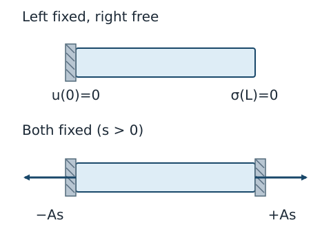

# CTM22 組織連続体の最小模型を自力で組み立てる

[CTM20 の能動応力](../CTM20/index.md#def-ctm20-active-stress)では、自然長を変えずに燃料駆動の張力を追加した。[CTM21 の成長分解](../CTM21/index.md#def-ctm21-growth-split)では、自然長そのものを変える場合を分けた。現実の細長い組織では、その両方が起こり得る。しかし「項を全部足す」だけでは予測にならない。**どの機構を採用するか、何を境界で与え、何を測定するか**まで指定して、初めて解ける模型になる。

本講は三次元の形態形成を万能に解く章ではない。細い組織帯の軸方向に限定し、既習の保存則を使って最小の**閉じた境界値・初期値問題**を組み立て、自由端、拘束端、過渡応答、エネルギー収支を同じ模型で照合する。

## 0. 対象と選択する仮定

基準区間 $0\le X\le L$（$L>0$、m）、一定の基準断面積 $A>0$（m$^2$）を持つ組織帯を考える。未知量は軸変位 $u(X,t)$（m）である。引張りと伸長を正、圧縮と短縮を負とする。

小ひずみと、成長が好む軸ひずみをそれぞれ

$
\varepsilon=\partial_Xu,\qquad \gamma=\gamma(X,t)
$

と書き、両者は無次元とする。**弾性的なずれ**は $e=\varepsilon-\gamma$ である。

正の $a(X,t)$（Pa）は収縮性の能動張力を表す。材料係数 $E>0$（Pa）と $\eta\ge0$（Pa s）は定数とし、$t\ge0$ で必要な微分が存在するとする。上付き点は $X$ を固定した時間微分、

- **運動**：$|\varepsilon|,|\gamma|,|a/E|\ll1$ の小変形・小成長。断面変化と横方向変形は無視し、体積力、慣性、相対拡散は基本模型では零とする。
- **材料**：受動ばね $Ee$、採用時だけ粘性応力 $\eta\dot e$、採用時だけ活動応力 $a$ を加える。$a,\gamma$ は指定された入力であり、釣合式がそれらの時間発展を決めるわけではない。
- **端面**：外向き軸法線は $n(0)=-1,\ n(L)=+1$。端面で帯が支持体から受ける外力は $F_0=-A\sigma(0)$、$F_L=A\sigma(L)$。各端では[CTM12 の Dirichlet・Neumann 境界条件](../CTM12/index.md#def-ctm12-boundary-data)から、変位か面力のいずれかを指定する。
- **時間**：$\eta>0$ のとき初期の弾性ずれ $e(X,0)$ と境界の時間履歴が必要。$\eta=0$ の静的模型には初期値を課さない。

この帯の $X$ は物質座標だが、微小ひずみ一次近似で軸応力を同じ数値の応力として扱う。[CTM21 の軸成長棒](../CTM21/index.md#prop-ctm21-free-clamped)の有限な軸倍率 $\lambda=1+\varepsilon$ と $g=1+\gamma$ に対し、

$$
E\left(\frac{\lambda}{g}-1\right)
=E\frac{\varepsilon-\gamma}{1+\gamma}
=Ee+O\bigl(E|\gamma e|\bigr)
$$

なので $Ee$ は小さい $\gamma,e$ の一次近似であり、**有限成長の厳密式ではない**。特に伸長が大きい場合は CTM21 の第一 Piola 応力と現在配置での応力を単純に混同しない。

## 1. 保存則と材料の選択で模型を閉じる

[CTM7 の局所運動量収支](../CTM7/index.md#thm-ctm7-material-momentum)を慣性零、体積力零の帯に制限すれば全軸応力は $\partial_X\sigma=0$ となる。一方、[CTM18 の Kelvin–Voigt 並列模型](../CTM18/index.md#thm-ctm18-kelvin-law)は弾性応力と粘性応力を足す。成長する場合は、*どのひずみ速度を粘性素子に与えるか* も新たな構成選択である。ここでは成長によって自然長が変わることを受動素子全体の基準として、$\dot e=\partial_X\dot u-\dot\gamma$ を選ぶ。

**最小組織模型**とは、未知量 $u,\sigma$、入力 $a,\gamma$、材料定数、釣合式、構成式、境界条件、および粘性があれば初期条件まで指定した一組の方程式を指す。

<!-- formal-statement-start -->
### 定義（一次元の能動・成長組織模型）

$X\in[0,L]$、$E>0$、$\eta\ge0$、与えた十分滑らかな $a,\gamma$ に対して

$$
e=u'-\gamma,\qquad
\sigma=Ee+\eta\dot e+a,\qquad
\sigma'=0
$$

を満たす $u,\sigma$ を一次元の能動・成長組織模型の解とする。端面力は $F_0=-A\sigma(0),\ F_L=A\sigma(L)$ である。時間依存問題には与えた境界履歴と、$\eta>0$ なら整合する初期変形を課す。$a=0$ は受動材料、$\gamma=0$ は成長なし、$\eta=0$ は速度依存なしを表す。
<!-- formal-statement-end -->

<!-- definition-example-start: def-ctm22-tissue-model -->
### **定義の確認**：同じ材料で活動と成長の符号を試す

$E=40$ kPa、$\eta=0$、$\gamma=0.01$、$a=0.2$ kPa を一様に与える。両端固定で $u=0$ なら $u'=0$、$e=-0.01$、$\sigma=40(-0.01)+0.2=-0.2$ kPa。全応力は空間一定で $\sigma'=0$、端面の外力は $F_0=+0.2A$ kPa、$F_L=-0.2A$ kPa と釣り合う。**正の活動張力があっても、成長による圧縮の方が大きければ全応力は負**になる。自由端の場合は $\sigma=0$ を構成式へ戻せば $u'=\gamma-a/E=0.005$ となり、成長の効果が収縮を上回る。両方の境界設定で定義の各条件を実際に満たした。
<!-- definition-example-end -->

モデル化の手順は、まず未知量 $u$ を決め、入力 $a,\gamma$ と材料式を選び、力の釣合、端面条件、必要なら初期条件を数えるという順序である。例えば「左端固定」と「右端自由」を選べば $u(0,t)=0$、$\sigma(L,t)=0$。一方「両端固定」は $u(0,t)=u(L,t)=0$。同じ端点で変位と応力を両方勝手に指定してはならない。

## 2. 自由と固定では何が観測されるか

外力のない準静的平衡では $\sigma'=0$ だから各時刻の全応力は空間一定 $s(t)$ である。まず $\eta=0$ で、入力 $a(X),\gamma(X)$ が場所によって異なってもよい場合を解く。端の間の指定変位を $U=u(L)-u(0)$ と書く。

<!-- formal-statement-start -->
### 定理（非一様組織帯の静的変位と端面反力）

$L,A,E>0$、$\eta=0$、$a,\gamma$ が $[0,L]$ 上で連続、$f=0$ とする。$\sigma=E(u'-\gamma)+a$、$\sigma'=0$、$u(0)=0$ を課す。

1. 右端の面力零 $\sigma(L)=0$ なら、唯一の解は

$$
\sigma(X)=0,\qquad
u(X)=\int_0^X\left(\gamma(Y)-\frac{a(Y)}E\right)dY.
$$

2. 右端変位を $u(L)=U$ と指定すれば、唯一の解は

$$
s=\frac{EU}{L}-E\overline\gamma+\overline a,\qquad
u(X)=\int_0^X\left(\gamma(Y)+\frac{s-a(Y)}E\right)dY,
$$

$$
\overline\gamma=\frac1L\int_0^L\gamma(Y)dY,\qquad
\overline a=\frac1L\int_0^La(Y)dY.
$$

両端固定は $U=0$。外部が帯に与える端面力は $F_0=-As,\ F_L=As$ で、いずれの境界設定も $F_0+F_L=0$ を満たす。
<!-- formal-statement-end -->

### 証明の見取り図

[CTM20 の準静的釣合](../CTM20/index.md#thm-ctm20-balance)を使うと未知の応力は定数一つになる。材料式から得た $u'$ を積分し、残る定数を端面条件から決める。

<!-- proof-start -->
### 証明

$\sigma'=0$ より、連結な $[0,L]$ で $\sigma(X)=s$。構成式を $u'$ について解くと

$$
u'(X)=\gamma(X)+\frac{s-a(X)}E.
$$

左端 $u(0)=0$ を使って $u(X)=\int_0^X[\gamma(Y)+(s-a(Y))/E]\,dY$。自由端では $s=\sigma(L)=0$ だから結論1を得る。指定変位では $X=L$ を代入し

$$
U=\int_0^L\gamma\,dY+\frac{sL}{E}-\frac1E\int_0^La\,dY
=L\overline\gamma+\frac{L}{E}(s-\overline a).
$$

$L,E>0$ なので $s=EU/L-E\overline\gamma+\overline a$ に一意に解け、代入すると結論2を得る。反対に両解を微分して材料式へ戻せば $\sigma=s$、$\sigma'=0$、左端と指定した右端の条件を満たす。$u(0)$ と $s$ が定まっているから解は一意である。面力は[CTM6 の traction](../CTM6/index.md#thm-ctm6-cauchy-stress)で $n(0)=-1,n(L)=1$ を代入して得る。$\square$
<!-- proof-end -->

この式は「端が自由なら全応力は零」「端が固定なら全ひずみの平均は指定される」の違いを可視化する。同じ材料の自由端／拘束端、端面力と変形を次の図で比較する。図の正の反力は **$s>0$ の例** であり、$s<0$ なら両矢印を逆向きに読む。

**具体例。** $L=10$ mm、$A=2$ mm$^2$、$E=40$ kPa、$\gamma=0.005$、$a=0.4$ kPa の一様帯は、自由なら $u(L)=10(0.005-0.4/40)=-0.05$ mm、$\sigma=0$。固定なら $u=0$、$s=0.4-40(0.005)=+0.2$ kPa。右端が帯に及ぼす力は $As=(2\times10^{-6}\ \mathrm{m}^2)(200\ \mathrm{Pa})=0.0004$ N $=0.4$ mN、左端は $-0.4$ mN。長さと応力だけでなく、力の方向も境界条件で決めた。

### 反例：局所的な活動を平均だけで置き換えてはいけない

両端固定で $\gamma=0$、$a(X)=a_0X/L$ とすると、上の定理で $s=\overline a=a_0/2$ だが

$$
u'(X)=\frac{a_0}{E}\left(\frac12-\frac XL\right),\qquad
u(X)=\frac{a_0}{E}\left(\frac X2-\frac{X^2}{2L}\right).
$$

$u(0)=u(L)=0$ でも内部は $u(L/2)=a_0L/(8E)>0$。平均応力だけから **内部変位まで零** と推論するのは誤りである。失敗の原因は、局所構成式で必要な非一様な $a(X)$ を平均値へ置き換えたことにある。

## 3. 粘性を入れると初期条件が必要になる

今度は $a(t),\gamma(t)$ が空間一様で、$\eta>0$ とし、左端 $u(0,t)=0$、右端は自由 $\sigma(L,t)=0$ とする。全応力は零だから、材料式は $E e+\eta\dot e=-a(t)$ となる。時定数 $\tau=\eta/E>0$（s）を持つ一次の微分方程式である。

<!-- formal-statement-start -->
### 定理（一様組織帯の自由端過渡応答と固定反力）

$E,L,A,\eta>0$、$a,\gamma$ を $t\ge0$ で連続（$\gamma$ は $C^1$ 級）とし、空間一様な初期弾性ひずみ $e(0)=e_0$ を与える。自由端 $\sigma(L,t)=0$、左端 $u(0,t)=0$ のとき、空間一様なひずみを持つ解は

$$
e(t)=e_0e^{-t/\tau}
-\frac1\eta\int_0^t e^{-(t-s)/\tau}a(s)\,ds,\qquad
u(X,t)=[\gamma(t)+e(t)]X,\qquad \tau=\frac\eta E.
$$

さらに $a(t)=a_0>0$、$\gamma(t)=\gamma_0$ が定数で、$e_0=0$ なら

$$
e(t)=-\frac{a_0}{E}(1-e^{-t/\tau}),\qquad
u(L,t)=L\left[\gamma_0-\frac{a_0}{E}(1-e^{-t/\tau})\right].
$$

同じ一様材料を **両端固定** $u(0,t)=u(L,t)=0$ とし、初期変位も零とすれば、唯一の解は $u=0$、

$$
s(t)=a(t)-E\gamma(t)-\eta\dot\gamma(t),\qquad
F_0=-As,\quad F_L=As.
$$

微小変形近似が成立する範囲の入力・時刻に限る。
<!-- formal-statement-end -->

### 証明の見取り図

自由端では $s=0$。[CTM18 の Kelvin–Voigt 構成式](../CTM18/index.md#thm-ctm18-kelvin-law)と同じ一階方程式に活動項が外力として入る。固定端では平均ひずみが零で、空間一様な材料と初期条件からひずみが全点で零になる。

<!-- proof-start -->
### 証明

自由端は $\sigma'=0$ と $\sigma(L)=0$ より $\sigma(X,t)=0$。よって各 $X$ で $\eta\dot e+Ee=-a(t)$。$\tau=\eta/E$ として両辺に $e^{t/\tau}$ を掛けると

$$
\frac d{dt}\bigl(e^{t/\tau}e(t)\bigr)
=-\frac1\eta e^{t/\tau}a(t).
$$

$t=0$ から $t$ まで積分し、初期条件 $e(0)=e_0$ を代入して表示の畳込み積分を得る。空間一様な初期値と入力のため全点で同じ $e(t)$ になり、$u'=\gamma+e$ と $u(0,t)=0$ から $u(X,t)=(\gamma+e)X$。定数活動で $e_0=0$ のときは

$$
-\frac{a_0}\eta\int_0^t e^{-(t-s)/\tau}\,ds
=-\frac{a_0}\eta\,\tau(1-e^{-t/\tau})
=-\frac{a_0}E(1-e^{-t/\tau}).
$$

固定端では $\int_0^L u'\,dX=u(L)-u(0)=0$。$s(t)$ は空間一定であり、各位置の $\varepsilon$ は

$$
\eta\dot\varepsilon+E\varepsilon
=s(t)-a(t)+E\gamma(t)+\eta\dot\gamma(t).
$$

右辺は $X$ に依存しない。各点の初期ひずみが零なので一階線形方程式の解は全点で同じであり、積分値が零だから $\varepsilon=0$。ゆえに $u'=0$ と左端条件より $u=0$、構成式から $s=a-E\gamma-\eta\dot\gamma$。逆代入で全条件を満たす。$\square$
<!-- proof-end -->

ここで「初期変形も零」は **全点で $u(X,0)=0$** を意味する。端点の初期位置だけで任意の非一様内部初期ひずみを排除したことにはならない。また $\eta\to0$ は過渡時間 $\tau$ が零へ近づく特異な極限で、初期時刻の瞬間応答を粘性のない模型で追ってはならない。

## 4. 能動収縮の仕事は誰が支払うか

[CTM10 の Clausius–Duhem 不等式](../CTM10/index.md#thm-ctm10-clausius-duhem)と[CTM20 の化学エネルギー収支](../CTM20/index.md#thm-ctm20-energy)に接続するには、応力を作っただけで満足せず、蓄積と散逸を分ける。ここでは等温で熱流束を無視し、基準体積当たりの弾性エネルギー $w=Ee^2/2$、化学的な利用可能エネルギー $c\ge0$（ともに J/m$^3$）、消費率 $p=-\dot c\ge0$（W/m$^3$）を新たな模型データとして採用する。

**散逸率** $D=\sigma\dot\varepsilon-\dot w-\dot c$ は、外部機械仕事から内部の二種類の蓄積率を引いた残余と定義する。これは完全な熱・物質流出入を含む一般論ではなく、本章の等温・閉じた機械化学帳簿である。

<!-- formal-statement-start -->
### 命題（能動・成長・粘性を含む仕事と散逸）

$E>0,\eta\ge0$、$e=\varepsilon-\gamma$、$\sigma=Ee+\eta\dot e+a$、$w=Ee^2/2$、$\dot c=-p$（$p\ge0$）の下で

$$
D=\sigma\dot\varepsilon-\dot w-\dot c
=\eta\dot e^{\,2}+a\dot\varepsilon
+(Ee+\eta\dot e)\dot\gamma+p.
$$

本模型が非負散逸条件を満たすには、この右辺が各点・各時刻で非負でなければならない。とくに $\dot\gamma=0$ なら、$p\ge-a\dot\varepsilon$ が成り立つ場合は $D\ge0$ が必ず成立する。ただし、$D\ge0$ のためにこの不等式が必ず必要なわけではない。
<!-- formal-statement-end -->

### 証明の見取り図

ひずみを $e+\gamma$ に分けたまま、まずエネルギーを微分する。能動張力や成長を「粘性散逸」と呼んで非負と決めつけず、化学消費と合わせて符号を判定する。

<!-- proof-start -->
### 証明

$E$ は定数だから $\dot w=Ee\dot e$。また $\dot\varepsilon=\dot e+\dot\gamma$ と $\dot c=-p$ を使い、

$$
\begin{aligned}
D&=(Ee+\eta\dot e+a)\dot\varepsilon-Ee\dot e+p\\
&=Ee(\dot\varepsilon-\dot e)+\eta\dot e(\dot e+\dot\gamma)
+a\dot\varepsilon+p\\
&=\eta\dot e^{\,2}+a\dot\varepsilon
+(Ee+\eta\dot e)\dot\gamma+p.
\end{aligned}
$$

$\eta\dot e^2\ge0$。$\dot\gamma=0$、$p+a\dot\varepsilon\ge0$ なら $D\ge0$ だが、例えば $\eta>0$ によりその二項の和が負でも全体が非負となる場合があるため、逆向きの推論は成り立たない。$\square$
<!-- proof-end -->

**積算での検算。** 上の自由端ステップ応答で $\gamma=0$、$a=a_0>0$、$e_0=0$ を取る。$q=e^{-t/\tau}$ と書けば

$$
\dot\varepsilon=\dot e=-\frac{a_0}{\eta}q,\quad
p(t)=-a_0\dot\varepsilon=\frac{a_0^2}{\eta}q,\quad
D=\eta\dot e^{\,2}=\frac{a_0^2}{\eta}q^2.
$$

$t\to\infty$ まで積分すると

$$
\int_0^\infty p\,dt=\frac{a_0^2}E,\qquad
w(\infty)-w(0)=\frac{a_0^2}{2E},\qquad
\int_0^\infty D\,dt=\frac{a_0^2}{2E}.
$$

自由端なので $\sigma=0$、外部仕事は零で、**燃料消費 = 弾性蓄積 + 粘性散逸** が一致する。$c(0)\ge a_0^2/E$ という有限の燃料が要る。活動量を無限時間一定に保つことと燃料供給を永久に仮定することは別である。

### 成長の質量源は勝手には決まらない

成長を実際の物質供給と結び付けるなら、[CTM21 の質量源付き収支](../CTM21/index.md#thm-ctm21-source-balance)を別途採用する必要がある。

例えば、軸方向の成長倍率を $g=1+\gamma(t)>0$ とし、成長後の自然密度 $\rho_g$ を一定と仮定する。[一定自然密度の成長則と質量源](../CTM21/index.md#prop-ctm21-growth-mass)により、基準体積当たりの質量とその供給率は

$
m_0=\rho_g g,\qquad S_0=\rho_g\dot\gamma
$

となる。これは成長の入力 $\gamma(t)$ を**どう実現するかという追加仮定**である。

供給物質の化学エネルギーと流束がある場合、上の閉じた帳簿にその仕事を追加する必要がある。$\gamma$ を与えたことだけで質量供給 $S_0$ や化学消費率 $p$ を確定したと見なさない。

## 5. 模型を適用しない状況

本章の式が予測するのは軸変位 $u$、全応力 $\sigma$、支持反力 $F_0,F_L$ と、**入力した**活動・成長履歴に対する力学応答である。多細胞の移動、増殖分布、曲げ、横方向への座屈、傷の再構築、化学場から $a,\gamma$ を決める反応拡散、有限変形の自己接触は予測しない。例えば $a/E$ が大きいと自由端の計算が $\varepsilon<-1$ に達し得るが、これは組織が負の長さになることを意味せず、**微小変形近似の破綻**である。必要なら[CTM14 の有限ひずみ弾性](../CTM14/index.md#thm-ctm14-neohookean-stresses)や成長を伴うより豊かな模型へ進む。

## 6. 演習と詳細解答

以下、特記しない限り $E,L,A>0$、$a,\gamma$ は指定された入力、外部体積力・慣性は零、引張正とする。各題では $|u'|,|\gamma|,|a/E|\ll1$ となるパラメータ範囲に限る。

### Level A

### A1. 成長ひずみと能動ひずみを見分ける

$E=50$ kPa、$\eta=0$、$\gamma=0.004$、$a=0.1$ kPa の一様な帯について、両端固定と左固定・右自由の $e,\varepsilon,\sigma$ を求めよ。

- Level: A

<!-- solution-start -->
#### 詳細解答

固定なら $\varepsilon=u'=0$、$e=\varepsilon-\gamma=-0.004$、$\sigma=50(-0.004)+0.1=-0.1$ kPa。自由端なら[定理](#thm-ctm22-static-boundary)により $\sigma=0$、$e=(0-a)/E=-0.002$、$\varepsilon=e+\gamma=+0.002$。前者は圧縮、後者は自由伸長であり、$a>0$ だけで変位の符号は決まらない。
<!-- solution-end -->

### A2. 支持体が受ける力

両端固定、$E=30$ kPa、$\gamma=0$、$a=0.3$ kPa、$A=4$ mm$^2$ とする。帯が左右の支持体から受ける力と、帯が支持体へ及ぼす力をそれぞれ N で求めよ。

- Level: A

<!-- solution-start -->
#### 詳細解答

$u=0$ なので $s=a-E\gamma=0.3$ kPa $=300$ Pa。$A=4\times10^{-6}$ m$^2$。帯に働く外力は $F_0=-As=-0.0012$ N、$F_L=+As=+0.0012$ N。作用・反作用より、帯が左支持体に及ぼす力は $+0.0012$ N、右支持体には $-0.0012$ N。帯への力の和も支持体への力の和も零だが、**どちらの物体に作用するか**で向きは反転する。
<!-- solution-end -->

### A3. 境界条件の数え方

静的な $\sigma'=0$、$\sigma=Eu'+a$（$E>0$ 一定）について、$u(0)=0,\ u(L)=U$ を与えたうえで $\sigma(L)=0$ まで指定してよいか。$a$ が定数として成立条件を求めよ。

- Level: A

<!-- solution-start -->
#### 詳細解答

$\sigma=s$ なら $u'=(s-a)/E$、$u(0)=0$ より $u(X)=(s-a)X/E$。右端変位から $s=a+EU/L$。さらに $\sigma(L)=0$ を課すなら $0=a+EU/L$、すなわち $U=-aL/E$ の特殊な値だけが整合する。それ以外は三条件が矛盾して解がない。境界条件を増やせば情報が増えるだけではなく、**過剰指定**になり得る。
<!-- solution-end -->

### A4. 成長と実際の質量供給

軸成長 $g=1+\gamma=1.01$、$\dot\gamma=0.002$ s$^{-1}$、$\rho_g=1000$ kg/m$^3$ を一定自然密度と仮定する。$m_0,S_0$ と単位を求めよ。$\gamma$ のみを与えた場合にも同じ質量源を必ず使うべきか。

- Level: A

<!-- solution-start -->
#### 詳細解答

[一定自然密度の成長則と質量源](../CTM21/index.md#prop-ctm21-growth-mass)の軸成長版で $J_g=g$ だから $m_0=\rho_g g=1010$ kg/m$^3$（基準体積当たり）、$S_0=\rho_g\dot g=1000(0.002)=2$ kg/(m$^3$s)。ここでは一定自然密度と物質供給を**別に仮定**した。成長による自然長だけを入力する別模型なら、この値を質量保存から自動決定することはできない。
<!-- solution-end -->

### A5. 過渡応答の時定数と極限

$E=20$ kPa、$\eta=100$ kPa s、$a_0=0.2$ kPa、$\gamma_0=0$、自由端、$e_0=0$ とする。$\tau$、$e(\tau)$、$e(\infty)$ を求めよ。

- Level: A

<!-- solution-start -->
#### 詳細解答

$\tau=\eta/E=100/20=5$ s。[過渡応答の定理](#thm-ctm22-transient)から $e(t)=-(0.2/20)(1-e^{-t/5})=-0.01(1-e^{-t/5})$。したがって $e(5)=-0.01(1-e^{-1})\approx-0.006321$、$e(\infty)=-0.01$。指数の引数 $t/\tau$ は無次元で、どちらも微小ひずみの範囲にある。
<!-- solution-end -->

### Level B

### B1. 非一様な活動と内部変位

$\eta=0,\gamma=0,\ a(X)=a_0X/L$、両端固定とする。$s$、$u(X)$、最大変位の場所と値、左右の外力を求めよ。

- Level: B

<!-- solution-start -->
#### 詳細解答

[静的境界定理](#thm-ctm22-static-boundary)で $\overline a=(1/L)\int_0^La_0X/L\,dX=a_0/2$ なので $s=a_0/2$。$u'=(s-a)/E=(a_0/E)(1/2-X/L)$。積分定数を $u(0)=0$ で決めれば $u(X)=(a_0/E)(X/2-X^2/(2L))$。微分は $X=L/2$ で零、前半正・後半負だからそこで最大。$u(L/2)=a_0L/(8E)$。端面外力は $F_0=-Aa_0/2$、$F_L=+Aa_0/2$ で合力零。$u(L)=0$ を代入しても確かめられる。
<!-- solution-end -->

### B2. 二種類の入力を変えて同じ長さを保つ

$E=40$ kPa、$A=3$ mm$^2$、一様で静的な両端固定帯を考える。成長ひずみを $\gamma=0.01$ にしたとき、$s=0$ とする能動張力 $a$ を求める。さらに $a$ を半分にしたときの $s$ と右端外力を求めよ。

- Level: B

<!-- solution-start -->
#### 詳細解答

両端固定なら[定理](#thm-ctm22-static-boundary)で $s=a-E\gamma$。$s=0$ にするには $a=40(0.01)=0.4$ kPa。半分にすると $a=0.2$ kPa なので $s=0.2-0.4=-0.2$ kPa $=-200$ Pa。面積 $A=3\times10^{-6}$ m$^2$ から $F_L=As=-0.0006$ N。右支持体は帯を**左向き**に押す。このとき変位は零でも全応力は圧縮である。
<!-- solution-end -->

### B3. 能動収縮の燃料と粘性損失

$\eta,E,a_0>0$、$\gamma=0$、自由端の $e(0)=0$ から活動 $a_0$ を保つ。$p(t)=-a_0\dot e(t)$ とする。$p\ge0$ を示し、$\int_0^\infty p\,dt$、$\int_0^\infty\eta\dot e^2dt$ と最終弾性エネルギーを求めよ。

- Level: B

<!-- solution-start -->
#### 詳細解答

[過渡応答](#thm-ctm22-transient)から $e=-(a_0/E)(1-e^{-t/\tau})$、$\dot e=-(a_0/\eta)e^{-t/\tau}$（$\tau=\eta/E$）。ゆえに $p=(a_0^2/\eta)e^{-t/\tau}\ge0$。積分 $\int_0^\infty e^{-t/\tau}dt=\tau$ なので $\int p\,dt=(a_0^2/\eta)\tau=a_0^2/E$。また $\int_0^\infty e^{-2t/\tau}dt=\tau/2$ から $\int\eta\dot e^2dt=(a_0^2/\eta)(\tau/2)=a_0^2/(2E)$。最終 $e=-a_0/E$ を $w=Ee^2/2$ に入れると $w_\infty=a_0^2/(2E)$。両者の和は消費総量と一致し、単位はすべて J/m$^3$。
<!-- solution-end -->

### B4. 固定帯の成長速度を忘れない

$\eta>0$ の一様固定帯で $a(t)=a_0$、$\gamma(t)=kt$（$k>0$）とする。$0\le t\le T$ で $|kT|\ll1$、初期変位零のときの $\sigma(t)$ を求め、$\eta=0$ と比較せよ。$k$ の単位を示せ。

- Level: B

<!-- solution-start -->
#### 詳細解答

両端固定なので $\varepsilon=\dot\varepsilon=0$、$e=-kt$、$\dot e=-k$。[過渡応答と固定反力](#thm-ctm22-transient)で

$$
\sigma(t)=E(-kt)+\eta(-k)+a_0=a_0-Ekt-\eta k.
$$

$k$ の単位は s$^{-1}$、$Ekt$ も $\eta k$ も Pa。$\eta=0$ の純弾性なら $\sigma=a_0-Ekt$ となり、成長開始時の速度依存の項 $-\eta k$ が欠ける。これは成長速度を粘性素子にも与えるという本章の**構成選択**による。
<!-- solution-end -->

### Level C

### C1. 境界条件・過渡変形・エネルギーを同時に閉じる

一様な細い帯で $L,A,E,\eta>0$、$\tau=\eta/E$、$a=a_0>0$、$\gamma=\gamma_0\ge0$（定数）を採用し、$a_0/E,\gamma_0\ll1$ とする。初期には活動前の自由な自然長をとり $e(0)=0$、$u(X,0)=\gamma_0X$ とする。時刻 $0$ で活動を $a_0$ に切り替え、化学消費率を $p=-a_0\dot\varepsilon$ と定める。

1. 左端固定・右端自由の $u(X,t)$、$\sigma(X,t)$、右端移動量 $u(L,t)-u(L,0)$ を求める。
2. $\gamma_0=0$ の場合について、時刻 $T$ までの燃料消費・弾性蓄積・粘性散逸を積分し、機械仕事との収支を照合する。
3. 別の試験として両端を $u(0,t)=u(L,t)=0$ に固定し、**初期状態も $u(X,0)=0$ に取り直した**場合の応力と外部端面力を求める。$a_0=E\gamma_0$ のとき何が零になるか確認する。
4. この模型だけで成長の速さや、実組織の幅方向の形まで決められるか説明する。

- Level: C

<!-- solution-start -->
#### 詳細解答

**1. 自由端の時間応答。** [一様組織の過渡応答](#thm-ctm22-transient)では $\sigma=0$、$e(0)=0$。定数 $a_0$ だから

$$
e(t)=-\frac{a_0}E(1-e^{-t/\tau}),\quad
u(X,t)=\left[\gamma_0-\frac{a_0}E(1-e^{-t/\tau})\right]X.
$$

したがって $u(L,0)=\gamma_0L$、移動量は $-(La_0/E)(1-e^{-t/\tau})<0$（$t>0$）。$u'$ の絶対値は $\gamma_0+a_0/E$ 以下なので、提示した小ひずみ仮定と整合する。

**2. エネルギーの検算。** $\gamma_0=0$ なら $\dot\varepsilon=-(a_0/\eta)e^{-t/\tau}$。化学消費率は $p=(a_0^2/\eta)e^{-t/\tau}$。$q=e^{-T/\tau}$ と書くと

$$
\int_0^T p\,dt=\frac{a_0^2}{E}(1-q),\quad
w(T)-w(0)=\frac{a_0^2}{2E}(1-q)^2,
$$

$$
\int_0^T\eta\dot e^2\,dt
=\frac{a_0^2}{\eta}\int_0^Te^{-2t/\tau}\,dt
=\frac{a_0^2}{2E}(1-q^2).
$$

後二者を足すと $(a_0^2/2E)[(1-2q+q^2)+(1-q^2)]=(a_0^2/E)(1-q)$ となり化学消費と一致する。自由端の全応力は零なので外部機械仕事 $\int_0^T\sigma\dot\varepsilon dt=0$。[散逸命題](#prop-ctm22-dissipation)で $D=\eta\dot e^2$ となることとも一致する。体積 $AL$ を掛ければ J 単位の総エネルギーになる。

**3. 固定端への変更。** 固定試験は問題1とは**別の初期境界値問題**である。$u=0$ より $\varepsilon=0$、$e=-\gamma_0$、$\dot e=0$。[固定反力](#thm-ctm22-transient)から $s=a_0-E\gamma_0$、$F_0=-A(a_0-E\gamma_0)$、$F_L=+A(a_0-E\gamma_0)$。$a_0=E\gamma_0$ なら全応力・両端力は零だが、弾性ひずみ $e=-\gamma_0$ と弾性蓄積 $w=E\gamma_0^2/2$ は一般に零ではない。応力の成分が相殺されたのであって、内部状態が無くなったわけではない。

**4. 範囲の判定。** 活動 $a_0$ と成長 $\gamma_0$ は入力として与えたので、その生成則は運動量収支から出ない。幅方向の変形を未知量に置いていないため、横方向の形態も予測しない。物質を生成する成長を採用するなら[質量源収支](../CTM21/index.md#thm-ctm21-source-balance)、化学反応や拡散を予測するなら別の発展方程式と境界条件を必要とする。
<!-- solution-end -->

## 7. コースの出口

1. [質量保存](../CTM5/index.md#thm-ctm5-mass-equivalence)は無源の場合の結果、成長時の源は追加条件である。
2. [運動量収支](../CTM7/index.md#thm-ctm7-material-momentum)から $\sigma'=0$、[境界条件](../CTM12/index.md#def-ctm12-boundary-data)から定数応力を決める。
3. [Kelvin–Voigt 模型](../CTM18/index.md#thm-ctm18-kelvin-law)・[能動応力](../CTM20/index.md#def-ctm20-active-stress)・[成長](../CTM21/index.md#def-ctm21-growth-split)は使う目的に応じて**選択**する構成仮定であり、すべてが普遍保存則ではない。
4. 端面反力、自由変位、燃料消費を同時に検算し、入力と予測、近似の限界を分ける。

この22講で、連続体の配置・変形・保存則・構成則を、最小の組織模型として組み立てられるようになった。複雑な形態形成の理論へ進む際にも、何を既知の保存則とし、どの未知量に新しい構成則・発展則が必要かを確認することが出発点になる。
$ は $X$ に関する微分である。

- **運動**：$|\varepsilon|,|\gamma|,|a/E|\ll1$ の小変形・小成長。断面変化と横方向変形は無視し、体積力、慣性、相対拡散は基本模型では零とする。
- **材料**：受動ばね $Ee$、採用時だけ粘性応力 $\eta\dot e$、採用時だけ活動応力 $a$ を加える。$a,\gamma$ は指定された入力であり、釣合式がそれらの時間発展を決めるわけではない。
- **端面**：外向き軸法線は $n(0)=-1,\ n(L)=+1$。端面で帯が支持体から受ける外力は $F_0=-A\sigma(0)$、$F_L=A\sigma(L)$。各端では[CTM12 の Dirichlet・Neumann 境界条件](../CTM12/index.md#def-ctm12-boundary-data)から、変位か面力のいずれかを指定する。
- **時間**：$\eta>0$ のとき初期の弾性ずれ $e(X,0)$ と境界の時間履歴が必要。$\eta=0$ の静的模型には初期値を課さない。

この帯の $X$ は物質座標だが、微小ひずみ一次近似で軸応力を同じ数値の応力として扱う。[CTM21 の軸成長棒](../CTM21/index.md#prop-ctm21-free-clamped)の有限な軸倍率 $\lambda=1+\varepsilon$ と $g=1+\gamma$ に対し、

$$
E\left(\frac{\lambda}{g}-1\right)
=E\frac{\varepsilon-\gamma}{1+\gamma}
=Ee+O\bigl(E|\gamma e|\bigr)
$$

なので $Ee$ は小さい $\gamma,e$ の一次近似であり、**有限成長の厳密式ではない**。特に伸長が大きい場合は CTM21 の第一 Piola 応力と現在配置での応力を単純に混同しない。

## 1. 保存則と材料の選択で模型を閉じる

[CTM7 の局所運動量収支](../CTM7/index.md#thm-ctm7-material-momentum)を慣性零、体積力零の帯に制限すれば全軸応力は $\partial_X\sigma=0$ となる。一方、[CTM18 の Kelvin–Voigt 並列模型](../CTM18/index.md#thm-ctm18-kelvin-law)は弾性応力と粘性応力を足す。成長する場合は、*どのひずみ速度を粘性素子に与えるか* も新たな構成選択である。ここでは成長によって自然長が変わることを受動素子全体の基準として、$\dot e=\partial_X\dot u-\dot\gamma$ を選ぶ。

**最小組織模型**とは、未知量 $u,\sigma$、入力 $a,\gamma$、材料定数、釣合式、構成式、境界条件、および粘性があれば初期条件まで指定した一組の方程式を指す。

<!-- formal-statement-start -->
### 定義（一次元の能動・成長組織模型）

$X\in[0,L]$、$E>0$、$\eta\ge0$、与えた十分滑らかな $a,\gamma$ に対して

$$
e=u'-\gamma,\qquad
\sigma=Ee+\eta\dot e+a,\qquad
\sigma'=0
$$

を満たす $u,\sigma$ を一次元の能動・成長組織模型の解とする。端面力は $F_0=-A\sigma(0),\ F_L=A\sigma(L)$ である。時間依存問題には与えた境界履歴と、$\eta>0$ なら整合する初期変形を課す。$a=0$ は受動材料、$\gamma=0$ は成長なし、$\eta=0$ は速度依存なしを表す。
<!-- formal-statement-end -->

<!-- definition-example-start: def-ctm22-tissue-model -->
### **定義の確認**：同じ材料で活動と成長の符号を試す

$E=40$ kPa、$\eta=0$、$\gamma=0.01$、$a=0.2$ kPa を一様に与える。両端固定で $u=0$ なら $u'=0$、$e=-0.01$、$\sigma=40(-0.01)+0.2=-0.2$ kPa。全応力は空間一定で $\sigma'=0$、端面の外力は $F_0=+0.2A$ kPa、$F_L=-0.2A$ kPa と釣り合う。**正の活動張力があっても、成長による圧縮の方が大きければ全応力は負**になる。自由端の場合は $\sigma=0$ を構成式へ戻せば $u'=\gamma-a/E=0.005$ となり、成長の効果が収縮を上回る。両方の境界設定で定義の各条件を実際に満たした。
<!-- definition-example-end -->

モデル化の手順は、まず未知量 $u$ を決め、入力 $a,\gamma$ と材料式を選び、力の釣合、端面条件、必要なら初期条件を数えるという順序である。例えば「左端固定」と「右端自由」を選べば $u(0,t)=0$、$\sigma(L,t)=0$。一方「両端固定」は $u(0,t)=u(L,t)=0$。同じ端点で変位と応力を両方勝手に指定してはならない。

## 2. 自由と固定では何が観測されるか

外力のない準静的平衡では $\sigma'=0$ だから各時刻の全応力は空間一定 $s(t)$ である。まず $\eta=0$ で、入力 $a(X),\gamma(X)$ が場所によって異なってもよい場合を解く。端の間の指定変位を $U=u(L)-u(0)$ と書く。

<!-- formal-statement-start -->
### 定理（非一様組織帯の静的変位と端面反力）

$L,A,E>0$、$\eta=0$、$a,\gamma$ が $[0,L]$ 上で連続、$f=0$ とする。$\sigma=E(u'-\gamma)+a$、$\sigma'=0$、$u(0)=0$ を課す。

1. 右端の面力零 $\sigma(L)=0$ なら、唯一の解は

$$
\sigma(X)=0,\qquad
u(X)=\int_0^X\left(\gamma(Y)-\frac{a(Y)}E\right)dY.
$$

2. 右端変位を $u(L)=U$ と指定すれば、唯一の解は

$$
s=\frac{EU}{L}-E\overline\gamma+\overline a,\qquad
u(X)=\int_0^X\left(\gamma(Y)+\frac{s-a(Y)}E\right)dY,
$$

$$
\overline\gamma=\frac1L\int_0^L\gamma(Y)dY,\qquad
\overline a=\frac1L\int_0^La(Y)dY.
$$

両端固定は $U=0$。外部が帯に与える端面力は $F_0=-As,\ F_L=As$ で、いずれの境界設定も $F_0+F_L=0$ を満たす。
<!-- formal-statement-end -->

### 証明の見取り図

[CTM20 の準静的釣合](../CTM20/index.md#thm-ctm20-balance)を使うと未知の応力は定数一つになる。材料式から得た $u'$ を積分し、残る定数を端面条件から決める。

<!-- proof-start -->
### 証明

$\sigma'=0$ より、連結な $[0,L]$ で $\sigma(X)=s$。構成式を $u'$ について解くと

$$
u'(X)=\gamma(X)+\frac{s-a(X)}E.
$$

左端 $u(0)=0$ を使って $u(X)=\int_0^X[\gamma(Y)+(s-a(Y))/E]\,dY$。自由端では $s=\sigma(L)=0$ だから結論1を得る。指定変位では $X=L$ を代入し

$$
U=\int_0^L\gamma\,dY+\frac{sL}{E}-\frac1E\int_0^La\,dY
=L\overline\gamma+\frac{L}{E}(s-\overline a).
$$

$L,E>0$ なので $s=EU/L-E\overline\gamma+\overline a$ に一意に解け、代入すると結論2を得る。反対に両解を微分して材料式へ戻せば $\sigma=s$、$\sigma'=0$、左端と指定した右端の条件を満たす。$u(0)$ と $s$ が定まっているから解は一意である。面力は[CTM6 の traction](../CTM6/index.md#thm-ctm6-cauchy-stress)で $n(0)=-1,n(L)=1$ を代入して得る。$\square$
<!-- proof-end -->

この式は「端が自由なら全応力は零」「端が固定なら全ひずみの平均は指定される」の違いを可視化する。同じ材料の自由端／拘束端、端面力と変形を次の図で比較する。図の正の反力は **$s>0$ の例** であり、$s<0$ なら両矢印を逆向きに読む。

**具体例。** $L=10$ mm、$A=2$ mm$^2$、$E=40$ kPa、$\gamma=0.005$、$a=0.4$ kPa の一様帯は、自由なら $u(L)=10(0.005-0.4/40)=-0.05$ mm、$\sigma=0$。固定なら $u=0$、$s=0.4-40(0.005)=+0.2$ kPa。右端が帯に及ぼす力は $As=(2\times10^{-6}\ \mathrm{m}^2)(200\ \mathrm{Pa})=0.0004$ N $=0.4$ mN、左端は $-0.4$ mN。長さと応力だけでなく、力の方向も境界条件で決めた。

### 反例：局所的な活動を平均だけで置き換えてはいけない

両端固定で $\gamma=0$、$a(X)=a_0X/L$ とすると、上の定理で $s=\overline a=a_0/2$ だが

$$
u'(X)=\frac{a_0}{E}\left(\frac12-\frac XL\right),\qquad
u(X)=\frac{a_0}{E}\left(\frac X2-\frac{X^2}{2L}\right).
$$

$u(0)=u(L)=0$ でも内部は $u(L/2)=a_0L/(8E)>0$。平均応力だけから **内部変位まで零** と推論するのは誤りである。失敗の原因は、局所構成式で必要な非一様な $a(X)$ を平均値へ置き換えたことにある。

## 3. 粘性を入れると初期条件が必要になる

今度は $a(t),\gamma(t)$ が空間一様で、$\eta>0$ とし、左端 $u(0,t)=0$、右端は自由 $\sigma(L,t)=0$ とする。全応力は零だから、材料式は $E e+\eta\dot e=-a(t)$ となる。時定数 $\tau=\eta/E>0$（s）を持つ一次の微分方程式である。

<!-- formal-statement-start -->
### 定理（一様組織帯の自由端過渡応答と固定反力）

$E,L,A,\eta>0$、$a,\gamma$ を $t\ge0$ で連続（$\gamma$ は $C^1$ 級）とし、空間一様な初期弾性ひずみ $e(0)=e_0$ を与える。自由端 $\sigma(L,t)=0$、左端 $u(0,t)=0$ のとき、空間一様なひずみを持つ解は

$$
e(t)=e_0e^{-t/\tau}
-\frac1\eta\int_0^t e^{-(t-s)/\tau}a(s)\,ds,\qquad
u(X,t)=[\gamma(t)+e(t)]X,\qquad \tau=\frac\eta E.
$$

さらに $a(t)=a_0>0$、$\gamma(t)=\gamma_0$ が定数で、$e_0=0$ なら

$$
e(t)=-\frac{a_0}{E}(1-e^{-t/\tau}),\qquad
u(L,t)=L\left[\gamma_0-\frac{a_0}{E}(1-e^{-t/\tau})\right].
$$

同じ一様材料を **両端固定** $u(0,t)=u(L,t)=0$ とし、初期変位も零とすれば、唯一の解は $u=0$、

$$
s(t)=a(t)-E\gamma(t)-\eta\dot\gamma(t),\qquad
F_0=-As,\quad F_L=As.
$$

微小変形近似が成立する範囲の入力・時刻に限る。
<!-- formal-statement-end -->

### 証明の見取り図

自由端では $s=0$。[CTM18 の Kelvin–Voigt 構成式](../CTM18/index.md#thm-ctm18-kelvin-law)と同じ一階方程式に活動項が外力として入る。固定端では平均ひずみが零で、空間一様な材料と初期条件からひずみが全点で零になる。

<!-- proof-start -->
### 証明

自由端は $\sigma'=0$ と $\sigma(L)=0$ より $\sigma(X,t)=0$。よって各 $X$ で $\eta\dot e+Ee=-a(t)$。$\tau=\eta/E$ として両辺に $e^{t/\tau}$ を掛けると

$$
\frac d{dt}\bigl(e^{t/\tau}e(t)\bigr)
=-\frac1\eta e^{t/\tau}a(t).
$$

$t=0$ から $t$ まで積分し、初期条件 $e(0)=e_0$ を代入して表示の畳込み積分を得る。空間一様な初期値と入力のため全点で同じ $e(t)$ になり、$u'=\gamma+e$ と $u(0,t)=0$ から $u(X,t)=(\gamma+e)X$。定数活動で $e_0=0$ のときは

$$
-\frac{a_0}\eta\int_0^t e^{-(t-s)/\tau}\,ds
=-\frac{a_0}\eta\,\tau(1-e^{-t/\tau})
=-\frac{a_0}E(1-e^{-t/\tau}).
$$

固定端では $\int_0^L u'\,dX=u(L)-u(0)=0$。$s(t)$ は空間一定であり、各位置の $\varepsilon$ は

$$
\eta\dot\varepsilon+E\varepsilon
=s(t)-a(t)+E\gamma(t)+\eta\dot\gamma(t).
$$

右辺は $X$ に依存しない。各点の初期ひずみが零なので一階線形方程式の解は全点で同じであり、積分値が零だから $\varepsilon=0$。ゆえに $u'=0$ と左端条件より $u=0$、構成式から $s=a-E\gamma-\eta\dot\gamma$。逆代入で全条件を満たす。$\square$
<!-- proof-end -->

ここで「初期変形も零」は **全点で $u(X,0)=0$** を意味する。端点の初期位置だけで任意の非一様内部初期ひずみを排除したことにはならない。また $\eta\to0$ は過渡時間 $\tau$ が零へ近づく特異な極限で、初期時刻の瞬間応答を粘性のない模型で追ってはならない。

## 4. 能動収縮の仕事は誰が支払うか

[CTM10 の Clausius–Duhem 不等式](../CTM10/index.md#thm-ctm10-clausius-duhem)と[CTM20 の化学エネルギー収支](../CTM20/index.md#thm-ctm20-energy)に接続するには、応力を作っただけで満足せず、蓄積と散逸を分ける。ここでは等温で熱流束を無視し、基準体積当たりの弾性エネルギー $w=Ee^2/2$、化学的な利用可能エネルギー $c\ge0$（ともに J/m$^3$）、消費率 $p=-\dot c\ge0$（W/m$^3$）を新たな模型データとして採用する。

**散逸率** $D=\sigma\dot\varepsilon-\dot w-\dot c$ は、外部機械仕事から内部の二種類の蓄積率を引いた残余と定義する。これは完全な熱・物質流出入を含む一般論ではなく、本章の等温・閉じた機械化学帳簿である。

<!-- formal-statement-start -->
### 命題（能動・成長・粘性を含む仕事と散逸）

$E>0,\eta\ge0$、$e=\varepsilon-\gamma$、$\sigma=Ee+\eta\dot e+a$、$w=Ee^2/2$、$\dot c=-p$（$p\ge0$）の下で

$$
D=\sigma\dot\varepsilon-\dot w-\dot c
=\eta\dot e^{\,2}+a\dot\varepsilon
+(Ee+\eta\dot e)\dot\gamma+p.
$$

本模型が非負散逸条件を満たすには、この右辺が各点・各時刻で非負でなければならない。とくに $\dot\gamma=0$ なら $p\ge-a\dot\varepsilon$ は $D\ge0$ の**十分条件**である（必要条件ではない）。
<!-- formal-statement-end -->

### 証明の見取り図

ひずみを $e+\gamma$ に分けたまま、まずエネルギーを微分する。能動張力や成長を「粘性散逸」と呼んで非負と決めつけず、化学消費と合わせて符号を判定する。

<!-- proof-start -->
### 証明

$E$ は定数だから $\dot w=Ee\dot e$。また $\dot\varepsilon=\dot e+\dot\gamma$ と $\dot c=-p$ を使い、

$$
\begin{aligned}
D&=(Ee+\eta\dot e+a)\dot\varepsilon-Ee\dot e+p\\
&=Ee(\dot\varepsilon-\dot e)+\eta\dot e(\dot e+\dot\gamma)
+a\dot\varepsilon+p\\
&=\eta\dot e^{\,2}+a\dot\varepsilon
+(Ee+\eta\dot e)\dot\gamma+p.
\end{aligned}
$$

$\eta\dot e^2\ge0$。$\dot\gamma=0$、$p+a\dot\varepsilon\ge0$ なら $D\ge0$ だが、例えば $\eta>0$ によりその二項の和が負でも全体が非負となる場合があるため十分条件としか言えない。$\square$
<!-- proof-end -->

**積算での検算。** 上の自由端ステップ応答で $\gamma=0$、$a=a_0>0$、$e_0=0$ を取る。$q=e^{-t/\tau}$ と書けば

$$
\dot\varepsilon=\dot e=-\frac{a_0}{\eta}q,\quad
p(t)=-a_0\dot\varepsilon=\frac{a_0^2}{\eta}q,\quad
D=\eta\dot e^{\,2}=\frac{a_0^2}{\eta}q^2.
$$

$t\to\infty$ まで積分すると

$$
\int_0^\infty p\,dt=\frac{a_0^2}E,\qquad
w(\infty)-w(0)=\frac{a_0^2}{2E},\qquad
\int_0^\infty D\,dt=\frac{a_0^2}{2E}.
$$

自由端なので $\sigma=0$、外部仕事は零で、**燃料消費 = 弾性蓄積 + 粘性散逸** が一致する。$c(0)\ge a_0^2/E$ という有限の燃料が要る。活動量を無限時間一定に保つことと燃料供給を永久に仮定することは別である。

### 成長の質量源は勝手には決まらない

成長を実際の物質供給と結び付けるなら、[CTM21 の質量源付き収支](../CTM21/index.md#thm-ctm21-source-balance)を別途採用する必要がある。例えば軸だけの $g=1+\gamma(t)>0$、一定の成長後自然密度 $\rho_g$ を仮定して初めて、[CTM21 の一定自然密度の命題](../CTM21/index.md#prop-ctm21-growth-mass)より基準体積当たり質量 $m_0=\rho_g g$、供給 $S_0=\rho_g\dot\gamma$ が決まる。これは成長の入力 $\gamma(t)$ を**どう実現するかという追加仮定**である。供給物質の化学エネルギーと流束がある場合、上の閉じた帳簿にその仕事を追加する必要がある。$\gamma$ を与えたことだけで $S_0$ や $p$ を確定したと見なさない。

## 5. 模型を適用しない状況

本章の式が予測するのは軸変位 $u$、全応力 $\sigma$、支持反力 $F_0,F_L$ と、**入力した**活動・成長履歴に対する力学応答である。多細胞の移動、増殖分布、曲げ、横方向への座屈、傷の再構築、化学場から $a,\gamma$ を決める反応拡散、有限変形の自己接触は予測しない。例えば $a/E$ が大きいと自由端の計算が $\varepsilon<-1$ に達し得るが、これは組織が負の長さになることを意味せず、**微小変形近似の破綻**である。必要なら[CTM14 の有限ひずみ弾性](../CTM14/index.md#thm-ctm14-neohookean-stresses)や成長を伴うより豊かな模型へ進む。

## 6. 演習と詳細解答

以下、特記しない限り $E,L,A>0$、$a,\gamma$ は指定された入力、外部体積力・慣性は零、引張正とする。各題では $|u'|,|\gamma|,|a/E|\ll1$ となるパラメータ範囲に限る。

### Level A

### A1. 成長ひずみと能動ひずみを見分ける

$E=50$ kPa、$\eta=0$、$\gamma=0.004$、$a=0.1$ kPa の一様な帯について、両端固定と左固定・右自由の $e,\varepsilon,\sigma$ を求めよ。

- Level: A

<!-- solution-start -->
#### 詳細解答

固定なら $\varepsilon=u'=0$、$e=\varepsilon-\gamma=-0.004$、$\sigma=50(-0.004)+0.1=-0.1$ kPa。自由端なら[定理](#thm-ctm22-static-boundary)により $\sigma=0$、$e=(0-a)/E=-0.002$、$\varepsilon=e+\gamma=+0.002$。前者は圧縮、後者は自由伸長であり、$a>0$ だけで変位の符号は決まらない。
<!-- solution-end -->

### A2. 支持体が受ける力

両端固定、$E=30$ kPa、$\gamma=0$、$a=0.3$ kPa、$A=4$ mm$^2$ とする。帯が左右の支持体から受ける力と、帯が支持体へ及ぼす力をそれぞれ N で求めよ。

- Level: A

<!-- solution-start -->
#### 詳細解答

$u=0$ なので $s=a-E\gamma=0.3$ kPa $=300$ Pa。$A=4\times10^{-6}$ m$^2$。帯に働く外力は $F_0=-As=-0.0012$ N、$F_L=+As=+0.0012$ N。作用・反作用より、帯が左支持体に及ぼす力は $+0.0012$ N、右支持体には $-0.0012$ N。帯への力の和も支持体への力の和も零だが、**どちらの物体に作用するか**で向きは反転する。
<!-- solution-end -->

### A3. 境界条件の数え方

静的な $\sigma'=0$、$\sigma=Eu'+a$（$E>0$ 一定）について、$u(0)=0,\ u(L)=U$ を与えたうえで $\sigma(L)=0$ まで指定してよいか。$a$ が定数として成立条件を求めよ。

- Level: A

<!-- solution-start -->
#### 詳細解答

$\sigma=s$ なら $u'=(s-a)/E$、$u(0)=0$ より $u(X)=(s-a)X/E$。右端変位から $s=a+EU/L$。さらに $\sigma(L)=0$ を課すなら $0=a+EU/L$、すなわち $U=-aL/E$ の特殊な値だけが整合する。それ以外は三条件が矛盾して解がない。境界条件を増やせば情報が増えるだけではなく、**過剰指定**になり得る。
<!-- solution-end -->

### A4. 成長と実際の質量供給

軸成長 $g=1+\gamma=1.01$、$\dot\gamma=0.002$ s$^{-1}$、$\rho_g=1000$ kg/m$^3$ を一定自然密度と仮定する。$m_0,S_0$ と単位を求めよ。$\gamma$ のみを与えた場合にも同じ質量源を必ず使うべきか。

- Level: A

<!-- solution-start -->
#### 詳細解答

[CTM21 の一定自然密度の命題](../CTM21/index.md#prop-ctm21-growth-mass)の軸成長版で $J_g=g$ だから $m_0=\rho_g g=1010$ kg/m$^3$（基準体積当たり）、$S_0=\rho_g\dot g=1000(0.002)=2$ kg/(m$^3$s)。ここでは一定自然密度と物質供給を**別に仮定**した。成長による自然長だけを入力する別模型なら、この値を質量保存から自動決定することはできない。
<!-- solution-end -->

### A5. 過渡応答の時定数と極限

$E=20$ kPa、$\eta=100$ kPa s、$a_0=0.2$ kPa、$\gamma_0=0$、自由端、$e_0=0$ とする。$\tau$、$e(\tau)$、$e(\infty)$ を求めよ。

- Level: A

<!-- solution-start -->
#### 詳細解答

$\tau=\eta/E=100/20=5$ s。[過渡応答の定理](#thm-ctm22-transient)から $e(t)=-(0.2/20)(1-e^{-t/5})=-0.01(1-e^{-t/5})$。したがって $e(5)=-0.01(1-e^{-1})\approx-0.006321$、$e(\infty)=-0.01$。指数の引数 $t/\tau$ は無次元で、どちらも微小ひずみの範囲にある。
<!-- solution-end -->

### Level B

### B1. 非一様な活動と内部変位

$\eta=0,\gamma=0,\ a(X)=a_0X/L$、両端固定とする。$s$、$u(X)$、最大変位の場所と値、左右の外力を求めよ。

- Level: B

<!-- solution-start -->
#### 詳細解答

[静的境界定理](#thm-ctm22-static-boundary)で $\overline a=(1/L)\int_0^La_0X/L\,dX=a_0/2$ なので $s=a_0/2$。$u'=(s-a)/E=(a_0/E)(1/2-X/L)$。積分定数を $u(0)=0$ で決めれば $u(X)=(a_0/E)(X/2-X^2/(2L))$。微分は $X=L/2$ で零、前半正・後半負だからそこで最大。$u(L/2)=a_0L/(8E)$。端面外力は $F_0=-Aa_0/2$、$F_L=+Aa_0/2$ で合力零。$u(L)=0$ を代入しても確かめられる。
<!-- solution-end -->

### B2. 二種類の入力を変えて同じ長さを保つ

$E=40$ kPa、$A=3$ mm$^2$、一様で静的な両端固定帯を考える。成長ひずみを $\gamma=0.01$ にしたとき、$s=0$ とする能動張力 $a$ を求める。さらに $a$ を半分にしたときの $s$ と右端外力を求めよ。

- Level: B

<!-- solution-start -->
#### 詳細解答

両端固定なら[定理](#thm-ctm22-static-boundary)で $s=a-E\gamma$。$s=0$ にするには $a=40(0.01)=0.4$ kPa。半分にすると $a=0.2$ kPa なので $s=0.2-0.4=-0.2$ kPa $=-200$ Pa。面積 $A=3\times10^{-6}$ m$^2$ から $F_L=As=-0.0006$ N。右支持体は帯を**左向き**に押す。このとき変位は零でも全応力は圧縮である。
<!-- solution-end -->

### B3. 能動収縮の燃料と粘性損失

$\eta,E,a_0>0$、$\gamma=0$、自由端の $e(0)=0$ から活動 $a_0$ を保つ。$p(t)=-a_0\dot e(t)$ とする。$p\ge0$ を示し、$\int_0^\infty p\,dt$、$\int_0^\infty\eta\dot e^2dt$ と最終弾性エネルギーを求めよ。

- Level: B

<!-- solution-start -->
#### 詳細解答

[過渡応答](#thm-ctm22-transient)から $e=-(a_0/E)(1-e^{-t/\tau})$、$\dot e=-(a_0/\eta)e^{-t/\tau}$（$\tau=\eta/E$）。ゆえに $p=(a_0^2/\eta)e^{-t/\tau}\ge0$。積分 $\int_0^\infty e^{-t/\tau}dt=\tau$ なので $\int p\,dt=(a_0^2/\eta)\tau=a_0^2/E$。また $\int_0^\infty e^{-2t/\tau}dt=\tau/2$ から $\int\eta\dot e^2dt=(a_0^2/\eta)(\tau/2)=a_0^2/(2E)$。最終 $e=-a_0/E$ を $w=Ee^2/2$ に入れると $w_\infty=a_0^2/(2E)$。両者の和は消費総量と一致し、単位はすべて J/m$^3$。
<!-- solution-end -->

### B4. 固定帯の成長速度を忘れない

$\eta>0$ の一様固定帯で $a(t)=a_0$、$\gamma(t)=kt$（$k>0$）とする。$0\le t\le T$ で $|kT|\ll1$、初期変位零のときの $\sigma(t)$ を求め、$\eta=0$ と比較せよ。$k$ の単位を示せ。

- Level: B

<!-- solution-start -->
#### 詳細解答

両端固定なので $\varepsilon=\dot\varepsilon=0$、$e=-kt$、$\dot e=-k$。[過渡応答と固定反力](#thm-ctm22-transient)で

$$
\sigma(t)=E(-kt)+\eta(-k)+a_0=a_0-Ekt-\eta k.
$$

$k$ の単位は s$^{-1}$、$Ekt$ も $\eta k$ も Pa。$\eta=0$ の純弾性なら $\sigma=a_0-Ekt$ となり、成長開始時の速度依存の項 $-\eta k$ が欠ける。これは成長速度を粘性素子にも与えるという本章の**構成選択**による。
<!-- solution-end -->

### Level C

### C1. 境界条件・過渡変形・エネルギーを同時に閉じる

一様な細い帯で $L,A,E,\eta>0$、$\tau=\eta/E$、$a=a_0>0$、$\gamma=\gamma_0\ge0$（定数）を採用し、$a_0/E,\gamma_0\ll1$ とする。初期には活動前の自由な自然長をとり $e(0)=0$、$u(X,0)=\gamma_0X$ とする。時刻 $0$ で活動を $a_0$ に切り替え、化学消費率を $p=-a_0\dot\varepsilon$ と定める。

1. 左端固定・右端自由の $u(X,t)$、$\sigma(X,t)$、右端移動量 $u(L,t)-u(L,0)$ を求める。
2. $\gamma_0=0$ の場合について、時刻 $T$ までの燃料消費・弾性蓄積・粘性散逸を積分し、機械仕事との収支を照合する。
3. 別の試験として両端を $u(0,t)=u(L,t)=0$ に固定し、**初期状態も $u(X,0)=0$ に取り直した**場合の応力と外部端面力を求める。$a_0=E\gamma_0$ のとき何が零になるか確認する。
4. この模型だけで成長の速さや、実組織の幅方向の形まで決められるか説明する。

- Level: C

<!-- solution-start -->
#### 詳細解答

**1. 自由端の時間応答。** [一様組織の過渡応答](#thm-ctm22-transient)では $\sigma=0$、$e(0)=0$。定数 $a_0$ だから

$$
e(t)=-\frac{a_0}E(1-e^{-t/\tau}),\quad
u(X,t)=\left[\gamma_0-\frac{a_0}E(1-e^{-t/\tau})\right]X.
$$

したがって $u(L,0)=\gamma_0L$、移動量は $-(La_0/E)(1-e^{-t/\tau})<0$（$t>0$）。$u'$ の絶対値は $\gamma_0+a_0/E$ 以下なので、提示した小ひずみ仮定と整合する。

**2. エネルギーの検算。** $\gamma_0=0$ なら $\dot\varepsilon=-(a_0/\eta)e^{-t/\tau}$。化学消費率は $p=(a_0^2/\eta)e^{-t/\tau}$。$q=e^{-T/\tau}$ と書くと

$$
\int_0^T p\,dt=\frac{a_0^2}{E}(1-q),\quad
w(T)-w(0)=\frac{a_0^2}{2E}(1-q)^2,
$$

$$
\int_0^T\eta\dot e^2\,dt
=\frac{a_0^2}{\eta}\int_0^Te^{-2t/\tau}\,dt
=\frac{a_0^2}{2E}(1-q^2).
$$

後二者を足すと $(a_0^2/2E)[(1-2q+q^2)+(1-q^2)]=(a_0^2/E)(1-q)$ となり化学消費と一致する。自由端の全応力は零なので外部機械仕事 $\int_0^T\sigma\dot\varepsilon dt=0$。[散逸命題](#prop-ctm22-dissipation)で $D=\eta\dot e^2$ となることとも一致する。体積 $AL$ を掛ければ J 単位の総エネルギーになる。

**3. 固定端への変更。** 固定試験は問題1とは**別の初期境界値問題**である。$u=0$ より $\varepsilon=0$、$e=-\gamma_0$、$\dot e=0$。[固定反力](#thm-ctm22-transient)から $s=a_0-E\gamma_0$、$F_0=-A(a_0-E\gamma_0)$、$F_L=+A(a_0-E\gamma_0)$。$a_0=E\gamma_0$ なら全応力・両端力は零だが、弾性ひずみ $e=-\gamma_0$ と弾性蓄積 $w=E\gamma_0^2/2$ は一般に零ではない。応力の成分が相殺されたのであって、内部状態が無くなったわけではない。

**4. 範囲の判定。** 活動 $a_0$ と成長 $\gamma_0$ は入力として与えたので、その生成則は運動量収支から出ない。幅方向の変形を未知量に置いていないため、横方向の形態も予測しない。物質を生成する成長を採用するなら[質量源収支](../CTM21/index.md#thm-ctm21-source-balance)、化学反応や拡散を予測するなら別の発展方程式と境界条件を必要とする。
<!-- solution-end -->

## 7. コースの出口

1. [質量保存](../CTM5/index.md#thm-ctm5-mass-equivalence)は無源の場合の結果、成長時の源は追加条件である。
2. [運動量収支](../CTM7/index.md#thm-ctm7-material-momentum)から $\sigma'=0$、[境界条件](../CTM12/index.md#def-ctm12-boundary-data)から定数応力を決める。
3. [Kelvin–Voigt 模型](../CTM18/index.md#thm-ctm18-kelvin-law)・[能動応力](../CTM20/index.md#def-ctm20-active-stress)・[成長](../CTM21/index.md#def-ctm21-growth-split)は使う目的に応じて**選択**する構成仮定であり、すべてが普遍保存則ではない。
4. 端面反力、自由変位、燃料消費を同時に検算し、入力と予測、近似の限界を分ける。

この22講で、連続体の配置・変形・保存則・構成則を、最小の組織模型として組み立てられるようになった。複雑な形態形成の理論へ進む際にも、何を既知の保存則とし、どの未知量に新しい構成則・発展則が必要かを確認することが出発点になる。
