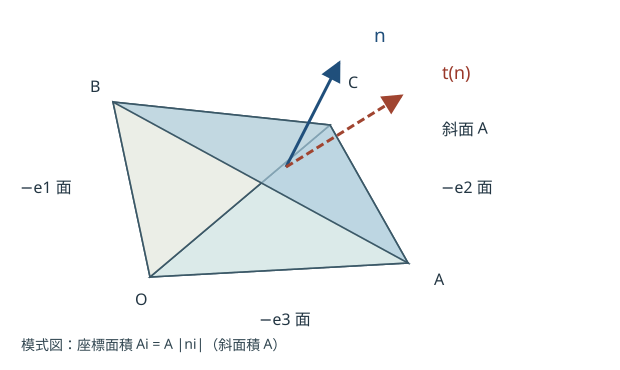
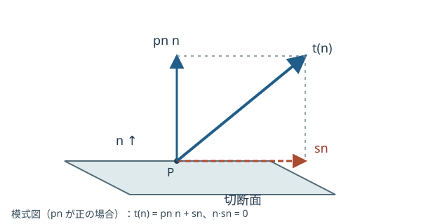

# CTM6 面に作用する力はなぜ二階テンソルで書けるか

[CTM5 の質量保存](../CTM5/index.md#thm-ctm5-mass-equivalence)では、同じ物質を追うと質量が保存されることを示した。では物体を仮想的に切断すると、切断面を通じて隣の物質が及ぼす力はどう記述できるだろう。力はベクトルだが、**面の向きを変えると力の向きも大きさも変わる**。一つの力ベクトルだけでは足りない。

本講は、法線が異なるすべての微小面の力を一つの行列で表す方法を導く。[CTM2 の面積ベクトル](../CTM2/index.md#def-ctm2-cofactor)で使った「単位法線と面積」の区別を、今度は力に適用する。小四面体の力の釣合から Cauchy の応力定理を証明し、法線応力・せん断応力・主応力へ進む。**応力行列が対称であることの一般的な証明は次講 CTM7 の角運動量収支で行う**。

## 0. 対象・符号・単位

固定した時刻 $t$ の現在配置 $\Omega_t\subset\mathbb R^3$ の内部点 $x$ を考える。各微小切断面に指定する単位法線 $n$ は「力を受ける側の部分物体から外へ向かう法線」とし、$t(x,n)$ は**法線 $n$ を持つ面を通じ、外側の物質が内側の物質へ及ぼす力の面積密度**とする。法線を裏返すと力を受ける部分物体も入れ替わる。

長さ m、面積 m$^2$、体積 m$^3$、力 N であり、表面力密度と応力成分の単位は N/m$^2$ = Pa。質量密度 $\rho$ の単位は kg/m$^3$、加速度 $a$ の単位は m/s$^2$、単位質量当たりの体積力 $b$ は N/kg で、$\rho b$ と $\rho a$ は N/m$^3$ である。$e_1,e_2,e_3$ は現在配置の正規直交基底、列ベクトルの添字 $i$ は力の成分、$j$ は面法線の成分を表す。

ここでは**通常の Cauchy 連続体**を扱う。接触による力は表面積分で、重力などの体積力と慣性力は体積積分で表せると仮定する。集中表面偶力・線に集中する力・特異な面力は扱わない。次節以降で極限を取る際の正則性と有界性は、その箇所で明記する。

## 1. なぜ面ごとに「単位面積当たりの力」が要るか

一つの切断面を通る全接触力を $T(S)$ とすれば、面積を半分にしたとき同じ大きさの力が働くとは限らない。面の点 $y$ と向き $n(y)$ ごとに力の密度を指定するなら

$$
T(S)=\int_S t(y,n(y))\,dS
$$

と書ける。ここで積分はベクトルの各成分に対して行う。$t$ は単位法線に依存し、面積要素 $dS$ 自身に依存しない密度である。面を反転したときの関係は、まだ**仮定せず**次節で釣合から導く。

<!-- formal-statement-start -->
### 定義（表面力密度・traction）

$\Omega_t$ を現在配置とし、任意の $x\in\Omega_t$ と単位ベクトル $n\in S^2=\{z\in\mathbb R^3:\|z\|=1\}$ に対し、$t(x,n)\in\mathbb R^3$ を、その点を通る法線 $n$ の向き付き微小面で**外側が内側へ及ぼす単位面積当たりの接触力**とする。これを表面力密度（traction）という。面上の合力は $T(S)=\int_S t(y,n(y))\,dS$ とする。
<!-- formal-statement-end -->

<!-- definition-example-start: def-ctm6-traction -->
### **定義の確認**：一様に押す平板

面積 $A=2\,\mathrm{m^2}$ の平らな切断面で、外向き法線が $n=e_3$、隣の物質が内側へ $-8e_3\,\mathrm N$ の合力を及ぼすとする。一様な表面力密度は $t(x,e_3)=-4e_3\,\mathrm{Pa}$ である。実際に

$$
\int_S t(x,e_3)\,dS=(-4e_3)(2)=-8e_3\,\mathrm N.
$$

単位も $\mathrm{N/m^2}\times\mathrm{m^2}=\mathrm N$。法線と逆向きなので圧縮であり、面積当たりの値と全力は別物である。この例は**この面の値だけ**を規定し、任意方向への規則をまだ仮定していない。
<!-- definition-example-end -->

## 2. 薄い箱で法線の反転を調べる

接触面の両側から同じ面を見たとき、相互作用する力は逆向きになるはずである。ただしこれを無条件の図形的直感にせず、面積・体積スケールの違いから確かめる。

小さな直円柱（高さ $h$、底面半径 $r$）を点 $x$ の近くに置き、上下面の外向き法線を $n,-n$ とする。上下の面積は $A_r=\pi r^2$、側面積は $2\pi rh$、体積は $\pi r^2h$。領域を縮めるとき $h=r^2/L$（固定長さ $L>0$）と選べば、側面積/$A_r$ は $2r/L\to0$、体積/$A_r$ は $r^2/L\to0$ である。

<!-- formal-statement-start -->
### 命題（反対向きの面の表面力密度）

$\Omega_t$ の内部点 $x$ で、$t(y,n)$ は $(y,n)$ に関して連続で局所的に有界とする。十分小さい任意の部分物体 $V$ について

$$
\int_{\partial V}t(y,n_V(y))\,dS
+\int_V\rho(y)b(y)\,dy
=\int_V\rho(y)a(y)\,dy
$$

という**瞬間の力の釣合**を仮定し、$\rho b,\rho a$ は $x$ の近くで有界とする。このとき任意の単位法線 $n$ について

$$
\boxed{t(x,-n)=-t(x,n)}
$$

が成り立つ。
<!-- formal-statement-end -->

### 証明の見取り図

非常に薄い箱では、上下の面力が面積のオーダー $r^2$、側面力と体積力・慣性力がそれより小さい。釣合式を上下の面積で割り、$r\to0$ とする。

<!-- proof-start -->
### 証明

上記の底面積 $A_r$、高さ $h=r^2/L$ の円柱を考える。局所的有界性より、側面力のノルムは $C_1(2\pi rh)$ 以下、体積力と慣性力の差のノルムは $C_2\pi r^2h$ 以下である。上下面での $t$ の平均値を $\bar t_+(r),\bar t_-(r)$ と書けば、釣合から

$$
\left\|\bar t_+(r)+\bar t_-(r)\right\|
\le C_1\frac{2\pi rh}{\pi r^2}+C_2h
=\frac{2C_1r}{L}+\frac{C_2r^2}{L}.
$$

上下面上の点はともに $x$ に近づくので、連続性から $\bar t_+(r)\to t(x,n)$、$\bar t_-(r)\to t(x,-n)$。右辺はゼロへ収束するため両者の和はゼロとなる。
<!-- proof-end -->

**どの仮定が効いたか。** 表面力が面積に比例する程度に有界であることが鍵である。たとえば側面に $1/h$ のように発散する力密度を許せば、側面力を無視できず、この証明は成立しない。集中力のある面でも同じ注意が必要だ。

## 3. 小四面体から Cauchy の応力定理を導く

ここから一番大切な問いに入る。法線が $e_1,e_2,e_3$ の三つの面での力が分かれば、斜めの切断面での力を予測できるだろうか。

図は $n_i>0$ の場合である。斜面積を $A$、単位法線を $n=(n_1,n_2,n_3)$ とすると、法線 $-e_i$ の座標面の面積は $A_i=An_i$。例えば斜面を $x_i$ に垂直な面へ正射影すると、面積が $n_i=\cos\theta_i$ 倍になるためである。$n_i=0$ の面は縮退し、その方向の項はゼロになる。

まず $n_i>0$ とし、頂点を $x$ へ近づける**相似な四面体**を考える。代表長さを $\ell$ とすると各面積は $O(\ell^2)$、体積は $O(\ell^3)$。面力密度が連続で、体積力密度と加速度による慣性項が有界なら、面積で割った後に体積項は $O(\ell)$ となり消える。

<!-- formal-statement-start -->
### 定理（Cauchy の応力定理）

開領域 $\Omega_t\subset\mathbb R^3$ の各内部点 $x$ と単位法線 $n$ に表面力密度 $t(x,n)$ が定義され、$(x,n)$ に関して連続で局所有界とする。任意の十分小さい区分的 $C^1$ 境界を持つ部分物体 $V\Subset\Omega_t$ について、表面力・体積力・慣性力が [命題の釣合式](#prop-ctm6-action-reaction)を満たし、$\rho b,\rho a$ は局所有界とする。このとき各 $x$ でただ一つの実 $3\times3$ 行列 $\sigma(x)$ が存在し、任意の単位法線 $n$ に対し

$$
\boxed{t(x,n)=\sigma(x)n}
$$

が成り立つ。列は $\sigma(x)e_j=t(x,e_j)$ で定まる。この $\sigma$ を **Cauchy 応力テンソル**と呼ぶ。定理は一般には $\sigma=\sigma^T$ を主張しない。
<!-- formal-statement-end -->

### 証明の見取り図

まず正の成分を持つ法線で斜面と三つの座標面の釣合をとり、反作用の命題で $t(x,-e_i)$ を置き換える。符号が混在する法線では、座標面を法線 $-\operatorname{sgn}(n_i)e_i$ に選んで同じ四面体を作る。

<!-- proof-start -->
### 証明

$A$ を斜面積、各座標面の面積を $A_i=An_i$（$n_i>0$）とする。面力の平均値には各面上の値から $x$ の値への $o(1)$ の差しかない。したがって釣合式は

$$
A\,t(x,n)+\sum_{i=1}^3A_i\,t(x,-e_i)
+o(A)+O(\ell^3)=0.
$$

$A$ は $\ell^2$ に比例するので、$A$ で割って $\ell\to0$ とすると

$$
t(x,n)+\sum_{i=1}^3n_i t(x,-e_i)=0.
$$

[反対向きの面の命題](#prop-ctm6-action-reaction)から $t(x,-e_i)=-t(x,e_i)$。よって

$$
t(x,n)=\sum_{i=1}^3n_it(x,e_i).
$$

一般の単位法線 $n$ では $n_i\ne0$ の座標面の外向き法線を $-\operatorname{sgn}(n_i)e_i$、その面積を $A|n_i|$ として上の操作を繰り返す。反作用を代入するとその寄与は $-|n_i|\operatorname{sgn}(n_i)t(x,e_i)=-n_it(x,e_i)$ であり、同じ式を得る。$n_i=0$ の項は不要である。

列ベクトル $t(x,e_1),t(x,e_2),t(x,e_3)$ を並べた行列を

$$
\sigma(x):=\bigl[\,t(x,e_1)\ \ t(x,e_2)\ \ t(x,e_3)\,\bigr]
$$

と定義すれば、行列と列ベクトルの積の定義から $\sigma n=\sum_jn_jt(x,e_j)=t(x,n)$。他の行列 $\widetilde\sigma$ も全方向で同じ関係を満たすなら、$n=e_j$ を代入すると各列が一致し、$\widetilde\sigma=\sigma$。存在と一意性が示された。
<!-- proof-end -->

したがって成分では

$$
t_i(x,n)=\sum_{j=1}^3\sigma_{ij}(x)n_j.
$$

**第 $j$ 列は法線 $e_j$ の面で働く力の三成分**である。応力は単なる9個の数字ではなく、面の向きから力密度への線形写像を表す。特に [反作用の命題](#prop-ctm6-action-reaction)は $t(-n)=\sigma(-n)=-\sigma n$ とも整合する。

**定理の適用範囲。** 点力・線力、特異な応力、微細構造に起因する独立の面偶力などを許す模型では、上の面積/体積スケールと小部分物体の釣合が同じ形で成立するとは限らない。次講ではこの釣合を一般の物質領域に広げ、角運動量収支を併用する。応力の対称性はその追加の収支と仮定から得る。

<!-- definition-example-start: thm-ctm6-cauchy-stress -->
### **定理の検算**：三つの列から斜面へ

一つの点で $t(e_1)=(3,1,0)^T$、$t(e_2)=(1,3,0)^T$、$t(e_3)=(0,0,1)^T$ Pa と測定したとする。列を順に並べ

$$
\sigma=\begin{pmatrix}3&1&0\\1&3&0\\0&0&1\end{pmatrix}\,\mathrm{Pa}.
$$

斜面の $n=(3/5,4/5,0)^T$ は長さ $1$ であり、$\sigma n=(13/5,3,0)^T$ Pa。法線を $-n$ に替えると $(-13/5,-3,0)^T$ Pa となる。**面積 $A$ の実際の合力**は、面力密度を $A$ 倍したものになる。
<!-- definition-example-end -->

## 4. 斜面の力を法線成分と接線成分に分ける

$\sigma n$ は一般には $n$ と平行ではない。面に垂直な部分は押し合い・引き合い、面に沿う部分は滑らせるような作用を表す。単位法線 $n$ への直交射影を使えば、力を過不足なく二成分に分けられる。

<!-- formal-statement-start -->
### 定義（法線応力とせん断表面力密度）

$\sigma\in\mathbb R^{3\times3}$ を Cauchy 応力、$n\in S^2$ を単位法線とし、$t=\sigma n$ と置く。符号付き**法線応力**と、接線方向の**せん断表面力密度**を

$$
p_n:=n\cdot t=n^T\sigma n,\qquad
s_n:=t-p_nn=(I_3-nn^T)\sigma n
$$

で定義する。$p_n>0$ は引張り向き、$p_n<0$ は圧縮向きで、$n\cdot s_n=0$。せん断の大きさは $\tau_n:=\|s_n\|$ とする。
<!-- formal-statement-end -->

式中の $nn^T$ は $z\mapsto(n\cdot z)n$ を表す行列である。$n$ が単位だから $n\cdot s_n=n\cdot t-(n\cdot t)\|n\|^2=0$。これが行列から**もとの法線・接線の条件を判定する橋渡し**である。

<!-- definition-example-start: def-ctm6-normal-shear -->
### **定義の確認**：斜面での二方向への分解

直前の $\sigma$、$n=(3/5,4/5,0)^T$ を使う。$t=(13/5,3,0)^T$ Pa なので

$$
p_n=\frac35\frac{13}{5}+\frac45\,3=\frac{99}{25}\,\mathrm{Pa},
\qquad
p_nn=\left(\frac{297}{125},\frac{396}{125},0\right)^T\mathrm{Pa}.
$$

したがって

$$
s_n=\left(\frac{28}{125},-\frac{21}{125},0\right)^T\mathrm{Pa},
\quad n\cdot s_n=\frac{84-84}{625}=0,
\quad \tau_n=\frac{7}{25}\,\mathrm{Pa}.
$$

確かに $t=p_nn+s_n$。法線の符号だけを変えても $p_{-n}=p_n$ だが、表面力ベクトルは $t(-n)=-t(n)$ となる。圧力 $p>0$ の静水圧状態 $\sigma=-pI_3$ では $p_n=-p$、$s_n=0$ を全方向で満たす。
<!-- definition-example-end -->

図の矢印は同じ面の同じ作用点から描く。法線応力 $p_n$ は符号を持つスカラー、せん断 $s_n$ は面内のベクトルであり、両者をともに「力の大きさ」として扱わない。

## 5. 主応力はどの法線でせん断が消えるか

面の向きを探して $s_n=0$ になったとする。この条件は $t=p_nn$ であり、[応力定理](#thm-ctm6-cauchy-stress)を使うと $\sigma n=p_nn$ となる。つまり**固有ベクトルが法線、固有値がその面の法線応力**である。

ただし一般の実行列には実固有ベクトルが十分に存在するとは限らない。ここではまず、実対称な応力行列に限って主応力を整理する。実対称行列の直交固有基底は [LA5 の正規作用素のスペクトル定理](../../../基礎科目/LA/LA5/index.md#thm-la5-normal-spectral)を実行列に適用して得られる。**$\sigma$ が対称になる物理的理由は本章では仮定し、CTM7 で導く。**

<!-- formal-statement-start -->
### 定義（対称応力の主応力と主方向）

$\sigma\in\mathbb R^{3\times3}$ が実対称、$\sigma^T=\sigma$ であるとき、単位固有ベクトル $q_i$ と実固有値 $\lambda_i$ を $\sigma q_i=\lambda_iq_i$ と定め、$\lambda_i$ を**主応力**、$q_i$ の方向を**主方向**と呼ぶ。直交固有基底を列に持つ行列 $Q$ に対し

$$
Q^TQ=I_3,\qquad
Q^T\sigma Q=\operatorname{diag}(\lambda_1,\lambda_2,\lambda_3)
$$

が成り立つ。重複固有値ではその固有空間内の方向の選択は一意でない。
<!-- formal-statement-end -->

<!-- definition-example-start: def-ctm6-principal-stress -->
### **定義の確認**：対称行列の固有方向と面力

$\sigma=\begin{pmatrix}3&1&0\\1&3&0\\0&0&1\end{pmatrix}$ Pa は $\sigma^T=\sigma$ を満たす。$q_1=(1,1,0)^T/\sqrt2$、$q_2=(1,-1,0)^T/\sqrt2$、$q_3=e_3$ は相互に直交し長さが1で、

$$
\sigma q_1=4q_1,\qquad \sigma q_2=2q_2,\qquad \sigma q_3=q_3.
$$

従って主応力は $4,2,1$ Pa。どの $i$ でも $t(q_i)=\sigma q_i=\lambda_iq_i$、$p_{q_i}=\lambda_i$、$s_{q_i}=0$ と直接確かめられる。3方向が直交するので列行列 $Q$ は可逆、$Q^T\sigma Q$ は示した対角行列になる。
<!-- definition-example-end -->

**対称性を落とした反例。** $\sigma=\begin{pmatrix}0&1&0\\-1&0&0\\0&0&0\end{pmatrix}$ は $t(n)=\sigma n$ を満たす線形な面力規則を定め、$t(-n)=-t(n)$ も満たす。しかし $n=(\cos\theta,\sin\theta,0)$ では $n\cdot\sigma n=0$、$s_n=\sigma n\ne0$ であり、面内のどの方向にもせん断が残る。二次元部分の固有値は $\pm i$ で実数でない。このため、**Cauchy の応力定理だけから三つの実主応力を一般に結論できない**。失われた仮定は $\sigma^T=\sigma$ であり、実対称行列の直交対角化という証明機構が使えない。

## 6. 演習

各問は法線の長さ、面積と面力密度の単位、力を受ける側から見た外向き法線を明記して解こう。

## Level A

### A1. 面積と表面力密度

法線 $e_1$ の平面で $t(e_1)=(6,-2,0)^T$ Pa が一様である。面積 $0.5\,\mathrm{m^2}$ に作用する合力と、反対向きの面の合力を求めよ。

- Level: A

<!-- solution-start -->
#### 詳細解答

[表面力密度の定義](#def-ctm6-traction)により $T=(0.5)t(e_1)=(3,-1,0)^T$ N。[反作用の命題](#prop-ctm6-action-reaction)で $t(-e_1)=(-6,2,0)^T$ Pa。面積が同じ反対向きの面の合力は $(-3,1,0)^T$ N で、両合力の和はゼロである。
<!-- solution-end -->

### A2. 応力行列の列と添字

$t(e_1)=(2,3,0)^T$、$t(e_2)=(-1,4,0)^T$、$t(e_3)=(0,0,5)^T$ Pa から $\sigma$ を作り、$\sigma_{12}$ の意味と $t((e_1+e_2)/\sqrt2)$ を求めよ。

- Level: A

<!-- solution-start -->
#### 詳細解答

[応力定理](#thm-ctm6-cauchy-stress)により各測定ベクトルが列なので

$$
\sigma=\begin{pmatrix}2&-1&0\\3&4&0\\0&0&5\end{pmatrix}\,\mathrm{Pa}.
$$

$\sigma_{12}=-1$ Pa は法線 $e_2$ の面に働く力の $e_1$ 成分であり、逆の添字ではない。$n=(1,1,0)^T/\sqrt2$ は単位長なので

$$
t(n)=\frac1{\sqrt2}\bigl(t(e_1)+t(e_2)\bigr)
=\frac1{\sqrt2}(1,7,0)^T\,\mathrm{Pa}.
$$
<!-- solution-end -->

### A3. 圧縮とせん断

$\sigma=-5I_3$ Pa のとき任意の単位法線 $n$ における $t,p_n,s_n$ を求めよ。

- Level: A

<!-- solution-start -->
#### 詳細解答

$\sigma n=-5n$ Pa で、$p_n=n^T(-5I_3)n=-5\|n\|^2=-5$ Pa。[法線・せん断の定義](#def-ctm6-normal-shear)から $s_n=-5n-(-5)n=0$、$\tau_n=0$。負の $p_n$ は圧縮を表し、すべての方向にせん断はない。
<!-- solution-end -->

### A4. 相似四面体のスケール

辺の代表長さを $\ell$ とし、面積が $c_A\ell^2$、体積が $c_V\ell^3$ の四面体を考える。面力・体積力・慣性力の各密度が局所的に有界なら、釣合式を斜面積で割ったとき、体積項が消える理由を式で説明せよ。

- Level: A

<!-- solution-start -->
#### 詳細解答

$|\rho b|\le M_b$、$|\rho a|\le M_a$ とする。面積で割った体積項のノルムは三角不等式と積分評価から

$$
\frac1{c_A\ell^2}\left\|\int_V\rho(b-a)\,dy\right\|
\le\frac{(M_b+M_a)c_V\ell^3}{c_A\ell^2}
=\frac{c_V}{c_A}(M_b+M_a)\ell\to0.
$$

面力項は面積と同じ $\ell^2$ の次数なので残る。有界性を失う集中力ではこの評価が使えない。
<!-- solution-end -->

## Level B

### B1. 斜面の法線成分とせん断

$\sigma=\begin{pmatrix}3&1&0\\1&3&0\\0&0&1\end{pmatrix}$ Pa、$n=(3/5,4/5,0)^T$ について $p_n,s_n,\tau_n$ を定義から求め、直交性を検算せよ。

- Level: B

<!-- solution-start -->
#### 詳細解答

$\|n\|^2=(9+16)/25=1$。[応力定理](#thm-ctm6-cauchy-stress)より $t=\sigma n=(13/5,3,0)^T$ Pa。そこで

$$
p_n=n^Tt=\frac{39}{25}+\frac{12}{5}=\frac{99}{25}\,\mathrm{Pa},
$$

$$
s_n=t-p_nn=
\left(\frac{325-297}{125},\frac{375-396}{125},0\right)^T
=\frac1{125}(28,-21,0)^T\,\mathrm{Pa}.
$$

$n\cdot s_n=(3\cdot28+4\cdot(-21))/625=0$。せん断の大きさは $\tau_n=\sqrt{28^2+21^2}/125=35/125=7/25$ Pa。法線成分と接線成分を足すと元の $t$ に戻る。
<!-- solution-end -->

### B2. 符号のある斜面法線

$t(e_1)=(2,1,0)^T$、$t(e_2)=(0,3,0)^T$、$t(e_3)=(0,0,4)^T$ Pa、$n=(-2,1,2)^T/3$ とする。四面体の座標面の外向き法線と面積比を列挙し、$t(n)$ を求めよ。

- Level: B

<!-- solution-start -->
#### 詳細解答

$\|n\|^2=(4+1+4)/9=1$。斜面積を $A$ とすると、$i=1$ では $n_1<0$ なので座標面法線は $+e_1$、面積は $2A/3$。$i=2,3$ ではそれぞれ $-e_2,-e_3$、面積は $A/3,2A/3$ である。力の釣合は

$$
A\,t(n)+\frac{2A}{3}t(e_1)
+\frac A3t(-e_2)+\frac{2A}{3}t(-e_3)+o(A)=0.
$$

[反作用の命題](#prop-ctm6-action-reaction)と [応力定理](#thm-ctm6-cauchy-stress)の極限を使うと

$$
t(n)=-\frac23t(e_1)+\frac13t(e_2)+\frac23t(e_3)
=(-4/3,1/3,8/3)^T\,\mathrm{Pa}.
$$

第二成分は $-2/3+1=1/3$。符号を無視して面積比だけを足すと違う答えになる。
<!-- solution-end -->

### B3. せん断が消える方向

実対称行列 $\sigma=\begin{pmatrix}5&2&0\\2&5&0\\0&0&1\end{pmatrix}$ Pa について主応力・正規直交主方向を求め、それぞれで $s_n=0$ を確認せよ。

- Level: B

<!-- solution-start -->
#### 詳細解答

$e_1,e_2$ 平面上の固有方程式は $(5-\lambda)^2-4=0$ より $\lambda=7,3$。対応する単位固有ベクトルは $q_1=(1,1,0)^T/\sqrt2$、$q_2=(1,-1,0)^T/\sqrt2$。第三方向は $\sigma e_3=e_3$ なので $q_3=e_3$、$\lambda_3=1$。互いの内積はゼロ、各長さは1である。[主応力の定義](#def-ctm6-principal-stress)に従い各方向で

$$
t(q_i)=\sigma q_i=\lambda_iq_i,\quad
p_{q_i}=q_i^Tt(q_i)=\lambda_i,\quad
s_{q_i}=t(q_i)-p_{q_i}q_i=0.
$$

これで固有値だけでなく、**面上のせん断が消える**という物理的条件も検証できた。
<!-- solution-end -->

### B4. 有界な一様応力の内部面

二つの隣接する立方体が面積 $A$、法線 $e_1$ の内部面を共有し、$\sigma$ が両側で同じ定数行列とする。内部面の力を両物体について書き、和がゼロであることを示せ。また $\sigma$ が対称である必要があるか答えよ。

- Level: B

<!-- solution-start -->
#### 詳細解答

左の物体の内部面の外向き法線は $e_1$、右の物体では $-e_1$。したがって

$$
T_L=A\sigma e_1,\qquad
T_R=A\sigma(-e_1)=-A\sigma e_1,\qquad
T_L+T_R=0.
$$

使用したのは [Cauchy の応力定理](#thm-ctm6-cauchy-stress)の線形性と法線の反転だけである。$\sigma=\sigma^T$ は不要。内部面の力の相殺と、角運動量収支から生じる応力の対称性は別の主張である。
<!-- solution-end -->

## Level C

### C1. 主方向と斜面、反作用をまとめて確かめる

対称応力 $\sigma=\begin{pmatrix}3&1&0\\1&3&0\\0&0&1\end{pmatrix}$ Pa と、面積 $A=5\,\mathrm{m^2}$、単位法線 $n=(3/5,4/5,0)^T$ の切断面を考える。（i）正規直交主方向と主応力を求める。（ii）$n$ 面の合力と法線・せん断分解を求める。（iii）反対向きの面の合力と法線応力がどう変わるか述べる。（iv）この数値例だけで任意の Cauchy 応力が対称といえるか論じよ。

- Level: C

<!-- solution-start -->
#### 詳細解答

（i）第一二成分の小行列の固有方程式は $(3-\lambda)^2-1=0$。したがって固有値 $4,2$ に対し $q_1=(1,1,0)^T/\sqrt2$、$q_2=(1,-1,0)^T/\sqrt2$。第三成分は $\lambda_3=1$ と $q_3=e_3$。$q_i\cdot q_j=\delta_{ij}$、$\sigma q_i=\lambda_iq_i$ を代入して確認する。

（ii）$\|n\|=1$ であり、[応力定理](#thm-ctm6-cauchy-stress)から $t(n)=(13/5,3,0)^T$ Pa。よって全力は

$$
T=A\,t(n)=(13,15,0)^T\,\mathrm N.
$$

法線応力とせん断は [分解の定義](#def-ctm6-normal-shear)から

$$
p_n=\frac{99}{25}\,\mathrm{Pa},\quad
s_n=\frac1{125}(28,-21,0)^T\,\mathrm{Pa},\quad
\tau_n=\frac7{25}\,\mathrm{Pa}.
$$

$A p_n n+A s_n$ を計算すると $(13,15,0)^T$ N に戻る。

（iii）$t(-n)=-t(n)$ なので逆向きの面の合力は $(-13,-15,0)^T$ N。一方 $p_{-n}=(-n)\cdot(-t(n))=p_n=99/25$ Pa で、法線応力の符号は変わらない。接線ベクトルは $s_{-n}=-s_n$。

（iv）今回の対称性は入力行列の仮定である。[Cauchy 応力定理](#thm-ctm6-cauchy-stress)だけでは反対称部分を排除しない。一般的な $\sigma=\sigma^T$ の導出には CTM7 の角運動量収支と独立偶力がないことが必要であり、今回の一例から一般化できない。
<!-- solution-end -->

---

この講義で確かめたのは、**面を指定する単位法線 $n$ から表面力密度 $t(n)$ を作る線形写像 $\sigma$ が存在する**ということだった。次の CTM7 では、任意の物質領域で運動量・角運動量を収支させ、応力の発散と対称性を導く。
