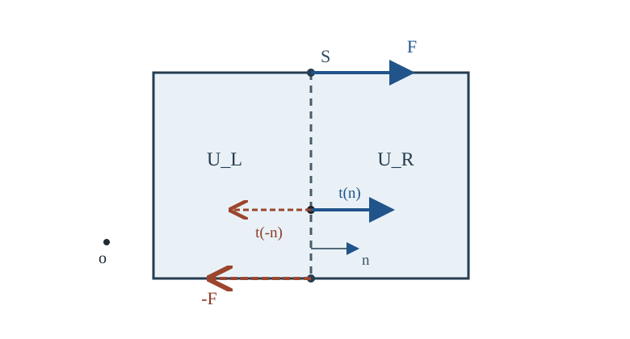

# CTM7 運動量・角運動量保存は応力に何を課すか

[CTM6 の Cauchy 応力定理](../CTM6/index.md#thm-ctm6-cauchy-stress)で、面の単位法線 $n$ に作用する力の面積密度は $t(n)=\sigma n$ と書けるようになった。しかし、面の力を記述することと、その力の下で物質が**どのように加速するか**は別問題である。さらに、力の総和だけを合わせても、物体を回そうとする効果が取り残される。

本講では同じ物質を追う領域に Newton の運動法則を課し、運動量の積分形から局所式を得る。その後、力の作用位置まで考える角運動量収支を使い、古典的な連続体で応力が対称になる理由を理解する。固定検査体積から同じ式へ進む [VC9 の局所運動量収支](../../../幾何系/VC/VC9/index.md#thm-vc9-momentum-local)と [応力対称性の命題](../../../幾何系/VC/VC9/index.md#prop-vc9-stress-symmetry)も既習の結果として参照し、ここでは物質領域で各項が何を表すかを追い直す。

## 0. 対象、単位と仮定

[CTM1 の運動写像](../CTM1/index.md#def-ctm1-motion-configuration) $\chi(X,t)$ は各時刻で向きを保つ $C^2$ 級の単射とし、[CTM2 の変形勾配](../CTM2/index.md#def-ctm2-deformation-gradient) $F=D_X\chi$ とその行列式 $J=\det F>0$、現在配置 $\Omega_t=\chi_t(\Omega_0)$ を考える。

[CTM5 の密度](../CTM5/index.md#def-ctm5-mass-densities) $\rho(x,t)>0$ は質量保存を満たす。現在位置 $x$ での速度を

$$
v(x,t)=\partial_t\chi(\chi_t^{-1}(x),t)
$$

とする。ここで $\partial_t\chi(X,t)$ は物質座標 $X$ を固定した時間微分、$\partial_t v(x,t)$ は現在座標 $x$ を固定した偏微分である。同じ物質点を追う加速度は [VC9 の物質微分](../../../幾何系/VC/VC9/index.md#def-vc9-material-derivative)を速度成分に適用し、連鎖律によって

$$
\begin{aligned}
a(\chi(X,t),t)
&=\frac{d}{dt}v(\chi(X,t),t)\\
&=\partial_t v(\chi(X,t),t)
  +D_xv(\chi(X,t),t)\,\partial_t\chi(X,t),\\
 a(x,t)&=D_tv(x,t)=\partial_t v(x,t)+(v(x,t)\cdot\nabla_x)v(x,t)
\end{aligned}
$$

となる。$d/dt$ は物質点 $X$ を固定した軌道上の全微分、$D_t$ はその全微分を現在座標で表す演算子である。

時刻区間内の任意の有界な物質領域 $U_t=\chi_t(U_0)$ を用いる。$U_0\Subset\Omega_0$ の境界は区分的 $C^1$ とする。密度・速度・体積力は時間と空間について必要な連続微分をもち、応力 $\sigma(x,t)$ は空間 $C^1$ 級、すべての場は扱う領域の閉包近くで有界とする。積分と微分の交換を正当化するための条件である。

- $\rho$ は kg/m$^3$、$v$ は m/s、$a$ と単位質量当たりの体積力 $b$ は m/s$^2$ = N/kg。
- $\rho b$ は体積当たりの力 N/m$^3$、$\sigma$ は Pa = N/m$^2$、$\operatorname{div}\sigma$ は N/m$^3$。
- 右手系の直交デカルト基底を $e_1,e_2,e_3$ とする。応力の添字 $\sigma_{ij}$ の第 $i$ は**力**、第 $j$ は**面法線**の成分を表す。

[CTM6 の Cauchy 応力定理](../CTM6/index.md#thm-ctm6-cauchy-stress)で得た線形性を法線ベクトルの基底展開へ適用すると

$$
\begin{aligned}
n&=\sum_jn_j e_j,\\
t(n)&=\sum_jn_jt(e_j)=\sum_{i,j}\sigma_{ij}n_j e_i
\end{aligned}
$$

となる。これが応力行列の列を面法線に掛ける理由である。$\partial_j=\partial/\partial x_j$ と書けば

$$
(\operatorname{div}\sigma)_i=\sum_j\partial_j\sigma_{ij}
$$

である。以後、同じ項で反復する添字は $1,2,3$ の和を表す。
- $n$ はいつでも**力を受ける物質領域から外へ向く**単位法線である。

さらに、接触作用は面上の**力** $\sigma n$ だけ、遠隔作用は体積当たりの力 $\rho b$ だけと仮定する。境界に独立に与えられる面偶力（単位面積当たりのトルク）や体積偶力（単位体積当たりのトルク）、点・線に集中する力は含めない。内部に独立の回転自由度を持つ物質もここでは扱わない。これらの仮定が特に角運動量収支の結論を制限する。

## 1. 物質の塊に働く合力から出発する

小さく区切った物質領域であっても、質量と速度の積を全体に加算すれば運動量が得られる。ここで **線形運動量**は各粒子の $\rho v$ を体積で積分したベクトル、**角運動量**は固定した基準点 $o\in\mathbb R^3$ からの位置 $r=x-o$ と運動量とのベクトル積 $r\times\rho v$ を積分したベクトルである。前者の単位は kg m/s、後者は kg m$^2$/s。

表面力の合計は [CTM6 の traction](../CTM6/index.md#def-ctm6-traction)と [Cauchy の応力定理](../CTM6/index.md#thm-ctm6-cauchy-stress)から $\int_{\partial U_t}\sigma n\,dS$。体積力の合計は $\int_{U_t}\rho b\,dV$ となる。一方、位置 $r$ で働く力 $f$ の**基準点 $o$ まわりのトルク**は $r\times f$。力の単位を N、長さを m とするとトルクの単位は N m である。

<!-- formal-statement-start -->
### 原理（物質領域の線形運動量・角運動量収支）

時刻 $t$ の古典的 Cauchy 連続体について、任意の区分的 $C^1$ 境界をもつ物質領域 $U_t$ と、固定した任意の点 $o\in\mathbb R^3$ に対し、$\rho>0$、$v$、$\sigma$、$b$ が上記の正則性を持ち、接触力が $t(x,n)=\sigma(x,t)n$、体積力が $\rho b$ で与えられ、独立の面偶力・体積偶力・内部回転自由度がないとする。**線形運動量収支**と**角運動量収支**をそれぞれ次の物理原理として課す。

$$
\boxed{\frac{d}{dt}\int_{U_t}\rho v\,dV
=\int_{\partial U_t}\sigma n\,dS+\int_{U_t}\rho b\,dV}
$$

$$
\boxed{\frac{d}{dt}\int_{U_t}r\times\rho v\,dV
=\int_{\partial U_t}r\times(\sigma n)\,dS+\int_{U_t}r\times\rho b\,dV,\quad r=x-o.}
$$

どちらの時間微分も**同じ物質点を追う領域**で取る。角運動量は固定点 $o$ まわりの量である。
<!-- formal-statement-end -->

原理そのものは微積分の定理ではない。積分式から局所式を導く部分が、これから行う数学である。

### **原理の確認**：一様並進する塊を加速する

質量 $M$ が一定、すべての物質点が $v(t)=ct\,e_1$（$c$ は m/s$^2$ の定数）で動くとする。合外力を $Mc\,e_1$ とすれば、線形運動量は $P(t)=Mct\,e_1$ で $dP/dt=Mc\,e_1$。基準点を時刻 $0$ の重心 $o$ とすれば、各粒子の $r(t)=r(0)+ct^2e_1/2$。角運動量の時間微分は

$$
\frac{d}{dt}\int_{U_t}r\times\rho v\,dV
=\int_{U_t}v\times\rho v\,dV+\int_{U_t}r\times\rho c e_1\,dV=0
$$

となる。前者は $v\times v=0$、後者は $\int_{U_t}r\rho\,dV=(Mct^2/2)e_1$ が $e_1$ と平行だからである。力が各物質点へ同じ加速度を与える（$\rho b=\rho c e_1$、$\sigma=0$）場合、外力のトルクもゼロで、**二つの収支をともに**満たす。

## 2. 動く領域から局所運動方程式を取り出す

固定領域での積分と違い、$U_t$ 自体が移動する。[CTM5 の物質領域 Reynolds 輸送定理](../CTM5/index.md#thm-ctm5-material-reynolds)を**各速度成分に掛けた質量密度**へ使う。質量保存の条件は [CTM5 の連続の式](../CTM5/index.md#thm-ctm5-mass-equivalence)から

$$
D_t\rho+\rho\operatorname{div}v=0
$$

と書ける。ベクトル積分の微分は成分ごとに行うので、積の微分を途中で省略しない。

<!-- formal-statement-start -->
### 定理（物質領域の運動量収支と局所運動方程式）

$\chi,\rho,v,\sigma,b$ が第0節の正則性・質量保存・$t(x,n)=\sigma n$ を満たし、原理の線形運動量収支が任意の物質部分領域 $U_t\Subset\Omega_t$ に成り立つとする。このとき各 $x\in\Omega_t$ において

$$
\boxed{\rho D_tv=\operatorname{div}\sigma+\rho b}
$$

が成り立つ。逆に、同じ正則性の下でこの局所式が成り立てば、すべての上記物質領域で積分収支が成り立つ。
<!-- formal-statement-end -->

### 証明の見取り図

[物質領域 Reynolds 輸送定理](../CTM5/index.md#thm-ctm5-material-reynolds)で時間微分を体積積分へ戻し、連続の式で速度に掛かった余分な項を消す。面積分には [二階テンソル版 Gauss--Ostrogradsky の発散定理](../../../幾何系/VC/VC7/index.md#thm-vc7-tensor-divergence)を $\sigma$ の行ごとに適用する。任意領域で積分がゼロなら連続な被積分関数は各点でゼロとなる。

<!-- proof-start -->
### 証明

第 $i$ 成分の運動量に [物質領域の Reynolds 輸送定理](../CTM5/index.md#thm-ctm5-material-reynolds)を適用すると、

$$
\frac{d}{dt}\int_{U_t}\rho v_i\,dV
=\int_{U_t}\left[D_t(\rho v_i)+\rho v_i\operatorname{div}v\right]dV.
$$

積の微分を開いて [質量保存](../CTM5/index.md#thm-ctm5-mass-equivalence)を代入する。

$$
\begin{aligned}
D_t(\rho v_i)+\rho v_i\operatorname{div}v
&=\rho D_tv_i+v_iD_t\rho+\rho v_i\operatorname{div}v\\
&=\rho D_tv_i+v_i(D_t\rho+\rho\operatorname{div}v)\\
&=\rho D_tv_i.
\end{aligned}
$$

一方、境界の第 $i$ 成分は $\sigma_{ij}n_j$（重複添字 $j$ について和）である。[二階テンソル版 Gauss--Ostrogradsky の発散定理](../../../幾何系/VC/VC7/index.md#thm-vc7-tensor-divergence)において各行 $(\sigma_{i1},\sigma_{i2},\sigma_{i3})$ をベクトル場とすれば

$$
\int_{\partial U_t}\sigma_{ij}n_j\,dS
=\int_{U_t}\partial_j\sigma_{ij}\,dV.
$$

従って原理の両辺を合わせると

$$
\int_{U_t}\bigl[\rho D_tv_i-\partial_j\sigma_{ij}-\rho b_i\bigr]\,dV=0
\qquad(i=1,2,3).
$$

各被積分関数は連続で、任意の小球を含む領域で積分がゼロである。ある点で非ゼロなら連続性によりその近傍で同じ符号の領域を取れ、積分がゼロにできない。[VC4 の局所化の命題](../../../幾何系/VC/VC4/index.md#prop-vc4-integral-to-local)と同じ議論により被積分関数は恒等的にゼロで、結論が従う。

逆向きは局所式の各成分を $U_t$ で積分し、発散定理を逆に用い、上の Reynolds 輸送定理と質量保存の等式を逆にたどればよい。具体的には $\int_{U_t}\rho D_tv_i\,dV=d(\int_{U_t}\rho v_i\,dV)/dt$ である。
<!-- proof-end -->

### 例：空間的に変わる応力が静止物体を支える

静止した直方体内で $v=0$、密度 $\rho_*>0$ を定数、$k$ を単位 Pa/m の定数として

$$
\sigma(x)=\begin{pmatrix}kx_1&0&0\\0&0&0\\0&0&0\end{pmatrix},
\qquad b=-\frac{k}{\rho_*}e_1
$$

とする。このとき $\operatorname{div}\sigma=(k,0,0)^T$ N/m$^3$、$\rho_* b=(-k,0,0)^T$ N/m$^3$ で、$\rho_*D_tv=0$ と一致する。**静止していても応力がゼロである必要はない**。境界の面力が、物質全体に働く体積力と釣り合っている。

固定した検査体積 $W$ から見た別表現では、流出する運動量があるため $\int_{\partial W}\rho v(v\cdot n)$ の移流項が必要となる。[VC9 の固定検査体積の運動量収支](../../../幾何系/VC/VC9/index.md#principle-vc9-momentum-integral)を使うと、

$$
\partial_t(\rho v)+\operatorname{div}(\rho v\otimes v)=\operatorname{div}\sigma+\rho b.
$$

第 $i$ 成分で左辺を展開すれば $\rho D_tv_i+v_i[\partial_t\rho+\partial_j(\rho v_j)]$ となり、質量保存により同じ局所式へ戻る。物質領域と固定領域を混ぜて、移流項を二度足してはいけない。

## 3. 力の合計がゼロでも回転させる作用は残る

左右の面に等しく反対向きの力が働けば合力はゼロだが、作用位置が異なれば二つの力が同じ向きの回転を起こす場合がある。そこで固定点 $o$ からの腕 $r=x-o$ と力とのベクトル積を取る。面には独立偶力がないため、境界のトルクは**面力の作用位置**から作る $r\times(\sigma n)$ だけである。

特に、隣り合う部分物体の共有面では外向き法線が逆であり、[反対向きの面の表面力密度の命題](../CTM6/index.md#prop-ctm6-action-reaction)により traction が相殺する。両側が同じ位置で作用するので、共有面のトルクも相殺する。これは**内部境界を消す**理由であって、個々の物体内部の応力が対称になる理由ではない。

図の破線 $S$ は左右の物質領域の共通面であり、同じ点で $t(n)$ と $t(-n)$ が逆向きに働く。上下面の $F,-F$ はそれぞれ分布する表面力の**合力の模式表示**で、点に集中する別種の力ではない。上面と下面の作用位置が違えば、合力の和がゼロでもトルクが残る。図の $n$ は左側領域から右へ向く面法線である。

角運動量収支を式へ戻す前に、記号を整理する。[VC7 の Levi–Civita 記号](../../../幾何系/VC/VC7/index.md#def-vc7-epsilon) $\varepsilon_{ijk}$ は $\varepsilon_{123}=1$ の完全反対称記号であり、外積を成分で書くと

$$
(r\times f)_i=\varepsilon_{ijk}r_jf_k
$$

となる。反復する添字については $1,2,3$ の和を取る。

Kronecker のデルタ $\delta_{j\ell}$ は $j=\ell$ なら $1$、それ以外なら $0$ である。基準点 $o$ は固定しているから、$r_j=x_j-o_j$ の空間微分は

$$
\partial_\ell r_j=\delta_{j\ell}
$$

となる。これが次の積の微分の鍵になる。

<!-- formal-statement-start -->
### 命題（角運動量収支からの応力の対称性）

三次元の古典的 Cauchy 連続体で、$\rho>0$、$v$、$\sigma$、$b$ は第0節の正則性を満たし、質量保存と任意の物質領域に対する線形運動量・角運動量収支が成立するとする。境界作用は $\sigma n$ の力のみであり、独立の面偶力・体積偶力・内部回転自由度が存在しないとする。このとき各点における Cauchy 応力は対称である。

$$
\boxed{\sigma_{ij}=\sigma_{ji}\quad (i,j=1,2,3),\qquad \sigma=\sigma^T.}
$$

これは [VC9 の既出の応力対称性命題](../../../幾何系/VC/VC9/index.md#prop-vc9-stress-symmetry)を、物質領域の収支から示し直した形である。
<!-- formal-statement-end -->

### 証明の見取り図

角運動量密度へ [物質領域 Reynolds 輸送定理](../CTM5/index.md#thm-ctm5-material-reynolds)を適用し、$D_tr=v$ と $v\times v=0$ で左辺を $\int r\times\rho a$ にする。右辺に [二階テンソル版 Gauss--Ostrogradsky の発散定理](../../../幾何系/VC/VC7/index.md#thm-vc7-tensor-divergence)を用いると、$\operatorname{div}\sigma$ に位置を掛けた項のほか、$\varepsilon_{ijk}\sigma_{kj}$ が残る。前節の局所運動量式を差し引けば、残りは応力の反対称成分だけとなる。

<!-- proof-start -->
### 証明

各成分の角運動量密度を $h_i=\varepsilon_{ijk}r_j\rho v_k$ とおく。[物質領域の Reynolds 輸送定理](../CTM5/index.md#thm-ctm5-material-reynolds)から

$$
\frac{d}{dt}\int_{U_t}h_i\,dV
=\int_{U_t}\left[D_th_i+h_i\operatorname{div}v\right]dV.
$$

$r=x-o$ で $o$ は固定点なので $D_tr_j=v_j$。積の微分、[連続の式](../CTM5/index.md#thm-ctm5-mass-equivalence)を順に使うと、

$$
\begin{aligned}
D_th_i+h_i\operatorname{div}v
&=\varepsilon_{ijk}\left[v_j\rho v_k+r_j\rho D_tv_k
+r_jv_k(D_t\rho+\rho\operatorname{div}v)\right]\\
&=\varepsilon_{ijk}r_j\rho a_k.
\end{aligned}
$$

第一項は $v\times v=0$、第三項は質量保存で消える。従って角運動量収支の左辺は $\int_{U_t}\varepsilon_{ijk}r_j\rho a_k\,dV$。

右辺の第 $i$ 成分では $N_{i\ell}=\varepsilon_{ijk}r_j\sigma_{k\ell}$ というベクトル場（$i$ を固定し、$\ell$ を走らせる）を作る。[二階テンソル版 Gauss--Ostrogradsky の発散定理](../../../幾何系/VC/VC7/index.md#thm-vc7-tensor-divergence)を行ごとに用い、積の微分を計算する。

$$
\begin{aligned}
\partial_\ell N_{i\ell}
&=\varepsilon_{ijk}(\partial_\ell r_j)\sigma_{k\ell}
+\varepsilon_{ijk}r_j\partial_\ell\sigma_{k\ell}\\
&=\varepsilon_{ijk}\sigma_{kj}
+\varepsilon_{ijk}r_j(\operatorname{div}\sigma)_k.
\end{aligned}
$$

これを角運動量収支の右辺へ代入すると、任意の $U_t$ で

$$
\int_{U_t}\varepsilon_{ijk}r_j\rho a_k\,dV
=\int_{U_t}\left[
\varepsilon_{ijk}\sigma_{kj}
+\varepsilon_{ijk}r_j(\operatorname{div}\sigma)_k
+\varepsilon_{ijk}r_j\rho b_k\right]dV.
$$

[局所運動量方程式](#thm-ctm7-material-momentum)によって $\rho a_k=(\operatorname{div}\sigma)_k+\rho b_k$ である。位置 $r_j$ を掛けた両側の項は打ち消し合う。ゆえに

$$
\int_{U_t}\varepsilon_{ijk}\sigma_{kj}\,dV=0.
$$

任意領域の局所化（各成分は連続）から $\varepsilon_{ijk}\sigma_{kj}=0$ が各点で成立する。$i=1,2,3$ を順に代入すると

$$
\begin{aligned}
i=1:\quad&\sigma_{32}-\sigma_{23}=0,\\
i=2:\quad&\sigma_{13}-\sigma_{31}=0,\\
i=3:\quad&\sigma_{21}-\sigma_{12}=0.
\end{aligned}
$$

対角成分は転置で変わらないため、全成分について $\sigma=\sigma^T$ を得る。
<!-- proof-end -->

### 対称性の直接確認：静止していてもせん断を支える

静止状態 $v=0$、一定密度 $\rho_*$、$b=0$ において、一定の $s\ne0$ Pa を用い

$$
\sigma=\begin{pmatrix}0&s&0\\s&0&0\\0&0&0\end{pmatrix}
$$

とする。行ごとに成分を微分すると応力の発散はゼロであり、この行列は対称である。

$$
\operatorname{div}\sigma=0,\qquad\sigma=\sigma^T.
$$

したがって [局所運動量式](#thm-ctm7-material-momentum)の両辺はゼロになる。また、[角運動量収支の証明](#prop-ctm7-angular-stress)で求めた境界トルクと慣性項の差は

$$
\int_{U_t}\varepsilon_{ijk}\sigma_{kj}\,dV=0
\qquad(i=1,2,3)
$$

なので、任意の物質領域で両方の収支を満たす。実際、法線 $e_2$ の面には $s e_1$ Pa、法線 $e_1$ の面には $s e_2$ Pa の表面力が作用する。**力はゼロではない**。したがって静止しているというだけでは内部応力をゼロと結論できない。

## 4. 角運動量がないと破れる例

一定の $s\ne0$ Pa を用い、前節の対称行列を一か所だけ符号反転した

$$
\sigma_{\mathrm{skew}}
=\begin{pmatrix}0&s&0\\-s&0&0\\0&0&0\end{pmatrix}
$$

を考える。$\operatorname{div}\sigma_{\mathrm{skew}}=0$ なので、$v=0$、$b=0$ とすれば**線形**運動量の局所式は満たす。任意の領域で $\int_{\partial U}\sigma_{\mathrm{skew}}n\,dS=0$ でもある。

しかし、角運動量証明の残差の第3成分は

$$
\varepsilon_{3jk}(\sigma_{\mathrm{skew}})_{kj}
=(\sigma_{\mathrm{skew}})_{21}-(\sigma_{\mathrm{skew}})_{12}=-2s.
$$

よって体積 $|U|$ の領域に作用する**表面力の総トルク**は、基準点を問わず $-2s|U|e_3$ である。静止しているから角運動量の時間変化はゼロだが、右辺がゼロでない。欠けているのは角運動量収支である。

さらに、独立の体積偶力 $c(x)$（単位 N/m$^2$）があれば、角運動量原理の右辺へ $\int_U c\,dV$ が追加され、上の消去では

$$
\varepsilon_{ijk}\sigma_{kj}+c_i=0
$$

が残る。例えば $c=2s e_3$ を加えると、この定数の非対称応力でもトルク残差を打ち消せる。これは一般の偶応力連続体の完全なモデルではなく、**仮定を外したとき対称性の証明が壊れる箇所**の確認である。対称性は [Cauchy の応力定理](../CTM6/index.md#thm-ctm6-cauchy-stress)の線形性だけからは出ない。

## 5. 演習

各問で応力の行・列の意味、作用する面の法線、力とトルクの単位を区別する。

## Level A

### A1. 面力・体積力・加速度の単位

体積 $V=0.5\,\mathrm{m^3}$ の物質領域で密度 $\rho=4\,\mathrm{kg/m^3}$ が一様、加速度 $a=3e_1\,\mathrm{m/s^2}$ とする。単位質量当たりの体積力 $b$ も領域内で一様と仮定する。面力の合力が $2e_1$ N のとき、体積力の合力と $b$ を求めよ。

- Level: A

<!-- solution-start -->
#### 詳細解答

質量は $M=\rho V=2$ kg、運動量時間変化は $Ma=6e_1$ N。[物質領域の線形運動量・角運動量収支](#principle-ctm7-material-balances)により $6e_1=2e_1+F_b$、よって $F_b=4e_1$ N。仮定した一様な $b$ について $F_b=\int_U\rho b\,dV=Mb$ だから $b=2e_1$ N/kg = m/s$^2$。面力 N と $\rho b$ の N/m$^3$ を直接加算してはいけない。
<!-- solution-end -->

### A2. 発散の添字

直交座標で $\sigma(x)=\operatorname{diag}(2x_1,3x_2,-x_3)$ Pa とする。ただし $x_i$ は長さの単位 m を持つ位置座標とし、$2,3,-1$ に対応する係数の単位は Pa/m とする。$(\operatorname{div}\sigma)_i=\partial_j\sigma_{ij}$ を計算せよ。

- Level: A

<!-- solution-start -->
#### 詳細解答

$\sigma_{11}=2x_1$、$\sigma_{22}=3x_2$、$\sigma_{33}=-x_3$ 以外はゼロなので、

$$
(\operatorname{div}\sigma)_1=\partial_1(2x_1)=2,\quad
(\operatorname{div}\sigma)_2=\partial_2(3x_2)=3,\quad
(\operatorname{div}\sigma)_3=\partial_3(-x_3)=-1.
$$

従って $\operatorname{div}\sigma=(2,3,-1)^T$ N/m$^3$。$\sigma_{ij}$ の $i$ が力成分であることは [CTM6 の応力定理](../CTM6/index.md#thm-ctm6-cauchy-stress)の列の取り方と一致する。
<!-- solution-end -->

### A3. 連続の式で消える項

$\rho,v$ が $D_t\rho+\rho\operatorname{div}v=0$ を満たすとき、$D_t(\rho v_i)+\rho v_i\operatorname{div}v=\rho D_tv_i$ を積の微分から証明せよ。

- Level: A

<!-- solution-start -->
#### 詳細解答

[物質微分](../../../幾何系/VC/VC9/index.md#def-vc9-material-derivative)も積の微分則を満たすから、

$$
D_t(\rho v_i)=v_iD_t\rho+\rho D_tv_i.
$$

両辺に $\rho v_i\operatorname{div}v$ を足すと $\rho D_tv_i+v_i(D_t\rho+\rho\operatorname{div}v)$。最後の括弧は [連続の式](../CTM5/index.md#thm-ctm5-mass-equivalence)でゼロとなる。
<!-- solution-end -->

### A4. 角運動量の添字差

$\sigma=\begin{pmatrix}1&2&0\\2&3&0\\0&0&4\end{pmatrix}$ Pa と $\widehat\sigma=\begin{pmatrix}1&2&0\\-2&3&0\\0&0&4\end{pmatrix}$ Pa について、$\varepsilon_{3jk}\sigma_{kj}$ と $\varepsilon_{3jk}\widehat\sigma_{kj}$ をそれぞれ求めよ。

- Level: A

<!-- solution-start -->
#### 詳細解答

[Levi–Civita 記号](../../../幾何系/VC/VC7/index.md#def-vc7-epsilon)のうち $\varepsilon_{312}=1,\varepsilon_{321}=-1$ だけが非ゼロなので、式は第2行第1列から第1行第2列を引いたもの、すなわち $\sigma_{21}-\sigma_{12}$ になる。対称行列は $2-2=0$ Pa、$\widehat\sigma$ は $-2-2=-4$ Pa である。応力の Pa はトルク密度 N m/m$^3$ と等しい。
<!-- solution-end -->

## Level B

### B1. 加速する塊の非一様応力

一定密度 $\rho_*=2\,\mathrm{kg/m^3}$、一様加速度 $a=3e_1\,\mathrm{m/s^2}$、単位質量当たりの体積力 $b=e_1\,\mathrm{m/s^2}$ の瞬間を考える。応力を $\sigma=\operatorname{diag}(kx_1,0,0)$ と仮定し、局所運動量式を満たす $k$ と境界面 $x_1=L$ における traction を求めよ。

- Level: B

<!-- solution-start -->
#### 詳細解答

[局所運動量方程式](#thm-ctm7-material-momentum)の左辺は $\rho_*a=6e_1$ N/m$^3$、体積力は $\rho_*b=2e_1$ N/m$^3$ である。応力の発散は $\operatorname{div}\sigma=ke_1$ なので、

$$
6=k+2,\qquad k=4\ \mathrm{Pa/m}.
$$

面 $x_1=L$ の外向き法線が $e_1$ なら、[Cauchy の応力定理](../CTM6/index.md#thm-ctm6-cauchy-stress)から、その面の表面力密度は

$$
t=\sigma e_1=4L\,e_1\ \mathrm{Pa}.
$$

ここで $L$ は m 単位の座標値である。反対の法線なら力密度は符号反転する。
<!-- solution-end -->

### B2. 内部面で力とトルクを相殺する

二つの隣接する部分物体が面 $S$ を共有し、同じ点 $x$ で双方に同じ応力 $\sigma(x)$ が作用する。左側の外向き法線を $n$、右側を $-n$ とし、任意の固定点 $o$ をとる。共有面を通る二物体の合力と合トルクがゼロになることを示せ。応力の対称性は必要か。

- Level: B

<!-- solution-start -->
#### 詳細解答

[traction の反作用](../CTM6/index.md#prop-ctm6-action-reaction)から両側の面力密度は $\sigma n$ と $\sigma(-n)=-\sigma n$ である。従って合力は $\int_S[\sigma n+\sigma(-n)]dS=0$。各点の腕は両物体で共通の $r=x-o$ なので、合トルクは

$$
\int_S\left[r\times(\sigma n)+r\times(\sigma(-n))\right]dS
=\int_S r\times0\,dS=0.
$$

ここで $\sigma^T=\sigma$ は用いていない。共有面上の**作用点が一致すること**がトルク相殺にも必要である。独立の面偶力があれば別に収支へ含める必要がある。
<!-- solution-end -->

### B3. 定数応力の総トルク

一様な一定応力 $\sigma=\begin{pmatrix}0&s&0\\-s&0&0\\0&0&0\end{pmatrix}$（$s$ の単位 Pa）を、体積 $V$ の有界な滑らかな領域に仮定する。境界の合力と、原点まわりの総トルクを求め、静止状態 $v=0,b=0$ の可否を判定せよ。

- Level: B

<!-- solution-start -->
#### 詳細解答

定数行列だから各成分 $\partial_j\sigma_{ij}=0$。[二階テンソル版 Gauss--Ostrogradsky の発散定理](../../../幾何系/VC/VC7/index.md#thm-vc7-tensor-divergence)より合力は $\int_{\partial U}\sigma n\,dS=\int_U\operatorname{div}\sigma\,dV=0$。

トルク第 $3$ 成分に証明中の積の微分を使うと

$$
\int_{\partial U}[x\times(\sigma n)]_3\,dS
=\int_U\left[x\times(\operatorname{div}\sigma)\right]_3\,dV
+\int_U(\sigma_{21}-\sigma_{12})\,dV.
$$

第一項はゼロ、第二項は $\int_U(-s-s)\,dV=-2sV$ N m。第1・2成分はゼロ。静止なら角運動量時間微分はゼロで、独立偶力がない場合の [角運動量収支](#principle-ctm7-material-balances)に反する。線形収支だけではこの反例を排除できない。
<!-- solution-end -->

### B4. 静止した物体の応力と境界力

直方体 $U=[0,L]\times[0,H]\times[0,K]$ の内部で $v=0,\rho=\rho_*>0$、$b=-ge_1$（$g>0$）、$\sigma=\operatorname{diag}(\rho_*g x_1,0,0)$ とする。局所運動量・角運動量式と、二つの $x_1$ 面それぞれにおける合力を照合せよ。

- Level: B

<!-- solution-start -->
#### 詳細解答

応力の発散は $\operatorname{div}\sigma=\rho_*g e_1$、体積力密度は $\rho_*b=-\rho_*g e_1$ である。従って [局所運動量方程式](#thm-ctm7-material-momentum)の右辺はゼロ。また $\sigma^T=\sigma$ である。角運動量収支の成立は対称性という必要条件だけで済ませず、[角運動量収支の証明](#prop-ctm7-angular-stress)で得た発散計算を逆に使って確認する。任意の固定点 $o$ に対する $r=x-o$ と外向き法線 $n$ について、

$$
\begin{aligned}
&\left[\int_{\partial U}r\times(\sigma n)\,dS
+\int_U r\times\rho_* b\,dV\right]_i\\
&\quad=\int_U\varepsilon_{ijk}r_j\bigl[(\operatorname{div}\sigma)_k+\rho_*b_k\bigr]dV
+\int_U\varepsilon_{ijk}\sigma_{kj}\,dV=0.
\end{aligned}
$$

第一積分は局所運動量の釣合により、第二積分は $\sigma_{kj}=\sigma_{jk}$ によりゼロである。静止しているため角運動量の時間微分もゼロとなり、任意の物質部分領域で両方の収支が成立する。

$x_1=0$ の外向き法線は $-e_1$ だが、その面では $\sigma=0$ なので合力はゼロ。$x_1=L$ の面積は $HK$ であり、[表面力密度の定義](../CTM6/index.md#def-ctm6-traction)により

$$
T_{x_1=L}=(\rho_*g L e_1)\,HK=\rho_*gLHK\,e_1\ \mathrm N.
$$

体積力の合力は $-\rho_*g LHK\,e_1$ N で相殺する。境界力をなくしてよいのではなく、物体が**静止できるよう境界面が力を支える**ことを表す。
<!-- solution-end -->

## Level C

### C1. 非圧縮な非定常配置・応力・二つの収支

時刻 $t$、物質座標 $X\in\mathbb R^3$ に対し、運動

$$
\chi(X,t)=(e^{\alpha t}X_1,e^{-\alpha t}X_2,X_3)
$$

を与える。$\alpha>0$ は s$^{-1}$、初期密度 $\rho_0>0$ は定数、体積力 $b=0$ とする。$s$ は一定の応力（Pa）で、現在位置 $x$ における応力は

$$
\sigma(x,t)=
\begin{pmatrix}
\rho_0\alpha^2x_1^2/2&s&0\\
s&\rho_0\alpha^2x_2^2/2&0\\
0&0&0
\end{pmatrix}
$$

と与えられる。次を順に確かめよ。

1. $F,J,\rho,v,a$ を求めよ。
2. 局所線形運動量と角運動量がともに成り立つことを全成分で確認せよ。
3. 法線 $n=(e_1+e_2)/\sqrt2$ を持つ現在配置の面で traction を計算せよ。
4. $s$ を第2行第1列だけ $-s$ に変えたとき、どの収支が破れるかを示せ。

- Level: C

<!-- solution-start -->
#### 詳細解答

（i）[変形勾配](../CTM2/index.md#def-ctm2-deformation-gradient)の定義から $F=\operatorname{diag}(e^{\alpha t},e^{-\alpha t},1)$、$J=e^{\alpha t}e^{-\alpha t}=1>0$。[密度変換](../CTM5/index.md#prop-ctm5-density-jacobian)は $\rho(\chi(X,t),t)J=\rho_0$ なので $\rho=\rho_0$。

$\partial_t\chi=(\alpha e^{\alpha t}X_1,-\alpha e^{-\alpha t}X_2,0)$。現在座標 $x_1=e^{\alpha t}X_1$、$x_2=e^{-\alpha t}X_2$ に直すと $v(x,t)=(\alpha x_1,-\alpha x_2,0)$。[物質微分](../../../幾何系/VC/VC9/index.md#def-vc9-material-derivative)から $\partial_tv(x,t)=0$ である一方、

$$
(v\cdot\nabla)v=(\alpha x_1\partial_1-\alpha x_2\partial_2)
(\alpha x_1,-\alpha x_2,0)
=(\alpha^2x_1,\alpha^2x_2,0).
$$

従って $a=(\alpha^2x_1,\alpha^2x_2,0)$。$\operatorname{div}v=\alpha-\alpha=0$ で、$\rho$ 一定と [連続の式](../CTM5/index.md#thm-ctm5-mass-equivalence)も一致する。

（ii）応力の発散は力成分ごとに

$$
\begin{aligned}
(\operatorname{div}\sigma)_1
&=\partial_1(\rho_0\alpha^2x_1^2/2)+\partial_2s
=\rho_0\alpha^2x_1,\\
(\operatorname{div}\sigma)_2
&=\partial_1s+\partial_2(\rho_0\alpha^2x_2^2/2)
=\rho_0\alpha^2x_2,\\
(\operatorname{div}\sigma)_3&=0.
\end{aligned}
$$

[局所運動量方程式](#thm-ctm7-material-momentum)へ各成分を代入すると

$$
\operatorname{div}\sigma=\rho_0 a
$$

となり、三成分とも満たす。非対角成分は $\sigma_{12}=\sigma_{21}=s$ のほかはゼロだから、応力は対称である。すなわち $\varepsilon_{ijk}\sigma_{kj}=0$ が各 $i=1,2,3$ で成り立つ。

任意の物質部分領域 $U_t$ と固定点 $o$ に対し、[角運動量収支の証明](#prop-ctm7-angular-stress)の積の微分を使えば、角運動量収支の右辺と左辺の差の第 $i$ 成分は

$$
\begin{aligned}
&\int_{U_t}\varepsilon_{ijk}\left[\sigma_{kj}
+r_j\bigl((\operatorname{div}\sigma)_k+\rho b_k-\rho a_k\bigr)\right]dV\\
&\quad=\int_{U_t}\varepsilon_{ijk}\sigma_{kj}\,dV=0
\end{aligned}
$$

となる。最初の等号では Reynolds 輸送定理とテンソル発散定理を用い、次の等号では局所運動量式を代入した。従って線形運動量と角運動量の両積分収支が成立する。

（iii）$\|n\|=1$ を確認し、[Cauchy の応力定理](../CTM6/index.md#thm-ctm6-cauchy-stress)により

$$
t(x,n)=\sigma n=\frac1{\sqrt2}
\left(
\frac12\rho_0\alpha^2x_1^2+s,\;
s+\frac12\rho_0\alpha^2x_2^2,\;
0
\right)^T.
$$

括弧内の各項は Pa であり、合力を求めるには面上で積分する必要がある。

（iv）非対角の第2行第1列を $-s$ に変えても両方の定数成分は微分するとゼロなので、$\operatorname{div}\sigma$ は変わらず線形運動量収支は保たれる。しかし第3成分の角運動量残差は $\sigma_{21}-\sigma_{12}=-2s$ Pa となる。$s\ne0$ なら角運動量収支は破れる。物質領域の体積 $V$ に対して、この項の寄与は $-2sV$ N m である。
<!-- solution-end -->

---

この講で得た局所式は**材料を指定する前**の力学的制約である。$\sigma$ が変形からどのように決まるかはまだ述べていない。次の CTM8 では、同じ面力と運動量収支を基準配置の応力に書き換え、現在面積と基準面積の違いを扱う。
