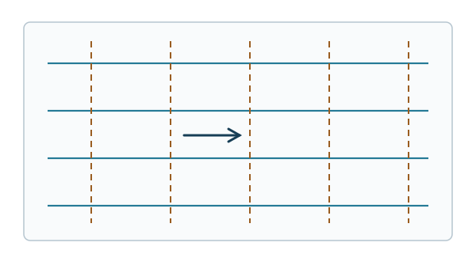

# FLUID11 流れ関数と速度ポテンシャルはいつ存在するか

[FLUID10 の渦度輸送式](../FLUID10/index.md#thm-fluid10-vorticity-transport)では、渦度がどのように変化するかを速度場から調べた。逆に、**発散が零**または**渦度が零**という条件を利用して、速度の2成分を一つの関数から作れないだろうか。[VC9 の流れ関数](../../../幾何系/VC/VC9/index.md#def-vc9-stream-function)はその第一の答えである。しかし、式を局所的に解けることと、穴を取り囲む領域全体で同じ一価関数を使えることは異なる。

この講義では平面流を表す二つのスカラー関数 $\psi,\phi$ を区別し、局所構成、閉曲線積分による大域的判定、穴あき領域の反例、両者が存在する場合の直交性を順に導く。**渦度が零であればどこでも大域的なポテンシャルがある**という誤解を、線積分で検査できるようにする。

## 0. 速度場・領域・向き

$D\subset\mathbb R^2$ は空でない連結な開集合とし、平面の速度場を $u=(u_1(x,y),u_2(x,y))\in C^1(D;\mathbb R^2)$ とする。議論は各時刻で行うため、時刻依存がある場合も時刻 $t$ を固定する。$x,y$ の単位は m、$u$ は m/s、これから導入する $\phi,\psi$ は m$^2$/s とする。

[VC9 の非圧縮速度場の定義](../../../幾何系/VC/VC9/index.md#def-vc9-incompressible)に従い

$$
\delta:=\partial_xu_1+\partial_yu_2=\nabla\cdot u
$$

を発散とし、[VC9 の渦度の定義](../../../幾何系/VC/VC9/index.md#def-vc9-vorticity)の鉛直成分を

$$
\zeta:=\partial_xu_2-\partial_yu_1
$$

とする。平面の閉曲線 $C$ は区分的 $C^1$ とし、反時計回りを正向きとする。線積分と外法線の約束は[VC4 の Green の定理](../../../幾何系/VC/VC4/index.md#thm-vc4-green-circulation)および[流束形](../../../幾何系/VC/VC4/index.md#cor-vc4-green-flux)に従う。以下の存在定理は**運動方程式を満たすことを仮定しない**運動学的結果である。

## 1. 非圧縮性から流れ関数へ：局所的には必ず作れる

[VC9 の流れ関数の定義](../../../幾何系/VC/VC9/index.md#def-vc9-stream-function)を再利用する。すなわち、一つの実数値関数 $\psi\in C^2$ から

$$
u_1=\partial_y\psi,\qquad u_2=-\partial_x\psi
$$

を作る。$\partial_xu_1+\partial_yu_2=\psi_{xy}-\psi_{yx}=0$ となるので、この表示は非圧縮性を**自動で**満たす。逆方向が問題である。

流れ関数が速度に沿って一定になることをまず確認しよう。

$$
u\cdot\nabla\psi
=u_1\psi_x+u_2\psi_y
=\psi_y\psi_x-\psi_x\psi_y=0.
$$

よって速度が非零の場所では、$\psi$ の等高線は瞬間的な流線に接する。これは[FLUID4 の流線の定義](../FLUID4/index.md#def-fluid4-streamline)と整合する。零速度点では接線方向が定まらないので、「必ず直交する二つの曲線が交わる」とは述べない。

<!-- formal-statement-start -->
### 命題（平面非圧縮場の局所流れ関数）

$D\subset\mathbb R^2$ を開集合、$u=(u_1,u_2)\in C^1(D;\mathbb R^2)$ とし、$D$ で発散が零とする。

$
\partial_xu_1+\partial_yu_2=0.
$

任意の $a\in D$ の近傍に開長方形 $R\subset D$ と $\psi\in C^2(R)$ が存在し、

$
u_1=\partial_y\psi,\qquad u_2=-\partial_x\psi
$

を $R$ 上で満たす。$R$ は連結なので、この $\psi$ は加法定数を除いて一意である。
<!-- formal-statement-end -->

### 証明の見取り図

$F=(-u_2,u_1)$ と90度回転すると、その平面回転は $\partial_xu_1+\partial_yu_2=0$ になる。[VC9 の既習の流れ関数存在定理](../../../幾何系/VC/VC9/index.md#thm-vc9-stream-function)を長方形に適用してもよいが、ここでは経路積分を二つの座標区間へ分け、微分して直接構成する。

<!-- proof-start -->
### 証明

$a=(x_0,y_0)$ を含み閉包が $D$ に入る小さい開長方形 $R$ を選ぶ。$R$ に含まれる点 $(x,y)$ に対して

$$
\psi(x,y)=-\int_{x_0}^x u_2(s,y_0)\,ds
+\int_{y_0}^y u_1(x,t)\,dt
$$

と置く。[微積分学の基本定理II](../../../基礎科目/RA/RA4/index.md#thm-ra4-ftc2)を積分の上端 $y$ に適用して $\psi_y=u_1(x,y)$ を得る。一方、$x$ による積分の微分から

$$
\psi_x=-u_2(x,y_0)+\int_{y_0}^y\partial_xu_1(x,t)\,dt.
$$

仮定 $\partial_xu_1=-\partial_yu_2$ を代入すると

$$
\psi_x=-u_2(x,y_0)-[u_2(x,y)-u_2(x,y_0)]=-u_2(x,y).
$$

$u\in C^1$ から $\psi$ の一階偏導関数は $C^1$、よって $\psi\in C^2$ である。二つの解 $\psi,\widetilde\psi$ の勾配差は零なので、長方形内の線分に沿って差を積分すれば $\widetilde\psi-\psi$ は定数である。
<!-- proof-end -->

**直接例**：一様流 $u=(U,0)$（$U\in\mathbb R$ は定数）なら $\psi=Uy$ と置けば $\psi_y=U,\ -\psi_x=0$。同時に $\partial_xU+\partial_y0=0$。この流れ関数は平面全体で使えるが、すべての非圧縮場についてそうとは限らない。

## 2. 渦度が零なら流速の勾配表示は局所的に存在する

[VC2 の保存場・ポテンシャル](../../../幾何系/VC/VC2/index.md#def-vc2-conservative)では、勾配として書けるベクトル場の線積分は端点だけで決まった。流速にこの構造を使うと、渦度が零であることが自然な条件となる。

<!-- formal-statement-start -->
### 定義（速度ポテンシャル）

開集合 $D\subset\mathbb R^2$ 上の $C^1$ 速度場 $u=(u_1,u_2)$ に対して、実数値関数 $\phi\in C^2(D)$ が

$$
u=\nabla\phi,\qquad u_1=\partial_x\phi,\quad u_2=\partial_y\phi
$$

を満たすとき、$\phi$ を $D$ 上の**速度ポテンシャル**という。$\phi$ は連結な $D$ 上で加法定数を除いて一意である。
<!-- formal-statement-end -->

<!-- definition-example-start: def-fluid11-velocity-potential -->
**定義の確認**：一様流 $u=(U,0)$ に対し $\phi=Ux$ と置けば $\phi_x=U,\phi_y=0$。また $\zeta=\partial_x0-\partial_yU=0$ である。$\phi$ の加法定数を変えても速度は変わらない。
<!-- definition-example-end -->

$\phi$ が存在すれば $\zeta=\phi_{yx}-\phi_{xy}=0$。この逆が局所的には成立する。

<!-- formal-statement-start -->
### 命題（無渦場の局所速度ポテンシャル）

$D\subset\mathbb R^2$ を開集合、$u\in C^1(D;\mathbb R^2)$ とする。$\zeta=0$ なら任意の $a\in D$ を含む小長方形 $R\subset D$ 上に速度ポテンシャル $\phi\in C^2(R)$ が存在する。
<!-- formal-statement-end -->

### 証明の見取り図

流速そのものの平面回転 $\partial_xu_2-\partial_yu_1$ が零なので、[VC2 の初等 Poincaré の補題](../../../幾何系/VC/VC2/index.md#thm-vc2-poincare-star)が適用できる。長方形上の構成式も計算して確かめる。

<!-- proof-start -->
### 証明

点 $(x_0,y_0)$ を含む小長方形 $R$ において

$$
\phi(x,y)=\int_{x_0}^{x}u_1(s,y_0)\,ds
+\int_{y_0}^{y}u_2(x,t)\,dt
$$

と置く。$\phi_y=u_2(x,y)$ であり、もう一方は

$$
\begin{aligned}
\phi_x&=u_1(x,y_0)+\int_{y_0}^{y}\partial_xu_2(x,t)\,dt\\
&=u_1(x,y_0)+\int_{y_0}^{y}\partial_yu_1(x,t)\,dt
=u_1(x,y).
\end{aligned}
$$

2番目の等号に $\zeta=0$ を使った。これで $u=\nabla\phi$、$u\in C^1$ より $\phi\in C^2$。二つのポテンシャルの差は連結長方形上で勾配零だから定数である。
<!-- proof-end -->

**非例**：剛体回転 $u=(-\Omega y,\Omega x)$ は $\delta=0$ だが $\zeta=2\Omega$。$\Omega\ne0$ なら任意の開円板でも $\phi$ は存在しない。一方、[流れ関数の定義](../../../幾何系/VC/VC9/index.md#def-vc9-stream-function)は $\psi=-\Omega(x^2+y^2)/2$ によって満たされる。**非圧縮と無渦を同一視しない**。

## 3. 穴のある領域では閉曲線積分が成否を決める

局所的な関数を貼り合わせて一つの関数にできるかを考える。閉曲線に沿って微小な変化を足したとき、元の点へ戻って同じ関数値になる必要がある。そこで二種類の閉曲線積分を区別する。

以下では**単連結**を「領域内のあらゆる閉曲線を領域内で一点へ連続的に縮められる」という意味で使う。これは[単連結の一般的な定義](../../../幾何系/GEO/GEO18/index.md#def-geo18-simply-connected)の平面版であり、一般の多様体論を仮定せず、ここに書いた曲線の性質だけを用いる。

<!-- formal-statement-start -->
### 定義（閉曲線の速度流束）

$D$ 内の向き付き区分的 $C^1$ 閉曲線 $C$ に対し、各正則な弧上で接線の右側を向く単位法線 $n=(n_x,n_y)$ を選ぶ。自己交差していても線積分の向きに従って定義できる。速度の**閉曲線流束**を

$$
Q_C:=\oint_Cu\cdot n\,ds
=\oint_C(u_1\,dy-u_2\,dx)
$$

と定める。閉曲線の向きを逆にすると、右側法線も反転するので $Q_C$ の符号も反転する。
<!-- formal-statement-end -->

<!-- definition-example-start: def-fluid11-loop-flux -->
**定義の確認**：$C$ が半径 $R$ の反時計回り円周で、$u=(q x/r^2,q y/r^2)$、$r=\sqrt{x^2+y^2}>0$ とする。円周上では $u=(q/R)e_r$、外向き法線 $n=e_r$、$ds=R\,d\theta$ だから

$$
Q_C=\int_0^{2\pi}(q/R)R\,d\theta=2\pi q.
$$

$u$ が円周に沿って流れているのではなく、**円を横切る**量を測っている。
<!-- definition-example-end -->

一方、[FLUID9 の循環](../FLUID9/index.md#def-fluid9-material-circulation)と同じ向きの線積分を、ここでは動かない閉曲線について

$$
\Gamma_C:=\oint_C(u_1\,dx+u_2\,dy)
$$

と書く。こちらは接線方向の流れを測り、$Q_C$ とは別の量である。

<!-- formal-statement-start -->
### 定理（速度ポテンシャル・流れ関数の大域的存在判定）

$D\subset\mathbb R^2$ を連結開集合、$u\in C^1(D;\mathbb R^2)$ とし、すべての閉曲線は区分的 $C^1$ とする。

1. $\zeta=0$ のとき、$D$ 全体の一価速度ポテンシャルが存在することと、$D$ 内の**すべての**閉曲線 $C$ で $\Gamma_C=0$ であることは同値である。
2. $\delta=0$ のとき、$D$ 全体の一価流れ関数が存在することと、$D$ 内の**すべての**閉曲線 $C$ で $Q_C=0$ であることは同値である。

特に $D$ が単連結（$D$ 内のすべての閉曲線が $D$ 内で一点へ連続的に縮められる）なら、各々の局所条件 $\zeta=0$、$\delta=0$ だけで大域的存在が従う。単連結は十分条件であり、必要条件ではない。
<!-- formal-statement-end -->

### 証明の見取り図

$\phi$ には1形式に相当する線積分 $u_1dx+u_2dy$、$\psi$ には $-u_2dx+u_1dy$ を使う。「すべての閉曲線積分が零」のとき始点からの積分が経路独立になることは[VC2 の保存場・経路独立の同値定理](../../../幾何系/VC/VC2/index.md#thm-vc2-conservative-equivalence)で確認できる。単連結の場合、閉曲線を縮める間に平面回転零が積分値を保存する。

<!-- proof-start -->
### 証明

(1) $\phi$ が存在すれば、[VC2 の線積分の基本定理](../../../幾何系/VC/VC2/index.md#thm-vc2-line-ftc)により閉曲線で $\oint_C\nabla\phi\cdot dr=0$。逆にすべての閉曲線で $\Gamma_C=0$ なら、$a\in D$ を固定して

$$
\phi(x)=\int_{a}^{x}(u_1\,dx+u_2\,dy)
$$

と経路積分で定義する。$D$ は連結開集合だから道で結べ、経路を変えても二つを繋いだ閉曲線の積分が零であるため値は同じ。端点を $x$ 方向に $h$ だけ動かした短い線分を加えれば

$$
\frac{\phi(x+he_1)-\phi(x)}h
=\frac1h\int_0^h u_1(x+se_1)\,ds\longrightarrow u_1(x)
$$

である。$y$ 方向も同様に $\phi_y=u_2$。$u\in C^1$ だから $\phi\in C^2$ である。

(2) [流れ関数の定義](../../../幾何系/VC/VC9/index.md#def-vc9-stream-function)より $d\psi=-u_2dx+u_1dy$。存在すれば閉曲線積分 $Q_C$ は零である。逆にすべての $Q_C$ が零なら

$$
\psi(x)=\int_a^x(-u_2\,dx+u_1\,dy)
$$

は経路独立である。上と同じ短線分の極限で $\psi_x=-u_2,\ \psi_y=u_1$ を得る。

最後に単連結の十分性を確認する。一般の $C^1$ ベクトル場 $F=(P,Q)$ が $Q_x-P_y=0$ を満たすとする。閉曲線を滑らかに変形する $\gamma(s,t)$（$0\le s,t\le1$、各 $s$ で $t$ に関し閉曲線）に対し $I(s)=\int_0^1[P(\gamma)x_t+Q(\gamma)y_t]\,dt$ と置く。積の微分と部分積分を行い、$t=0,1$ の端点項を閉曲線条件で消すと

$$
\frac{dI}{ds}
=\int_0^1(Q_x-P_y)(x_sy_t-y_sx_t)\,dt=0.
$$

したがって曲線を一点まで縮めるとき積分値は一定で、定点曲線の積分値0に等しい。区分的に滑らかな曲線や連続ホモトピーは、局所的な長方形へ分割して同じ結論を得られる。$F=u$ では $Q_x-P_y=\zeta$、$F=(-u_2,u_1)$ では $Q_x-P_y=\delta$。よって単連結上でそれぞれの閉曲線積分は零になる。
<!-- proof-end -->

**なぜ Green の定理だけでは足りないか**：穴を囲む $C$ の内部に $u$ が定義されない点があると、[Green の定理](../../../幾何系/VC/VC4/index.md#thm-vc4-green-circulation)を内部円板へ適用できない。穴を避けた環状領域では**内側境界の積分が残る**。ここが大域的障害であり、局所微分だけでは見えない。

## 4. 穴あき平面の二つの厳密な反例

$D=\mathbb R^2\setminus\{(0,0)\}$、$r^2=x^2+y^2$ とし、定数 $\kappa,q\in\mathbb R$ は m$^2$/s の単位を持つものとする。$r=0$ は領域に含めない。対数の引数は無次元にするため、基準長 $r_0=1\,\mathrm m$ を固定し、以後の $\log r$ は $\log(r/r_0)$ の略記とする。基準長を変更してもポテンシャルには加法定数が加わるだけで、速度は変わらない。

### 周回流：流れ関数はあるが速度ポテンシャルはない

$$
u^{(v)}=\left(-\frac{\kappa y}{r^2},\frac{\kappa x}{r^2}\right)
=\frac{\kappa}{r}e_\theta.
$$

積の微分を両成分に適用すると

$$
\begin{aligned}
\partial_xu^{(v)}_1&=\frac{2\kappa xy}{r^4},
&\partial_yu^{(v)}_2&=-\frac{2\kappa xy}{r^4},\\
\partial_xu^{(v)}_2&=\frac{\kappa(y^2-x^2)}{r^4},
&\partial_yu^{(v)}_1&=\frac{\kappa(y^2-x^2)}{r^4}.
\end{aligned}
$$

したがって $\delta=\zeta=0$（$r>0$）。一方で

$$
\psi_v=-\kappa\log r,\qquad
(\partial_y\psi_v,-\partial_x\psi_v)
=\left(-\frac{\kappa y}{r^2},\frac{\kappa x}{r^2}\right)
$$

は $D$ 全体で一価である。半径 $R>0$ の円を $\theta:0\to2\pi$ で回れば $u^{(v)}\cdot dr=\kappa\,d\theta$ なので

$$
\Gamma_C=2\pi\kappa,\qquad Q_C=0.
$$

$\kappa\ne0$ なら[大域判定](#thm-fluid11-global-period)により $\phi$ は存在しない。極角を連続に選べる局所範囲では $\phi_v=\kappa\theta$ が使えるが、一周後に $2\pi\kappa$ だけずれる。**渦度ゼロなのに循環が非零**なのは、原点が欠けているためである。

### 放射流：速度ポテンシャルはあるが流れ関数はない

$$
u^{(s)}=\left(\frac{qx}{r^2},\frac{qy}{r^2}\right)
=\frac{q}{r}e_r.
$$

ここでも直接計算すると

$$
\partial_xu^{(s)}_1=\frac{q(y^2-x^2)}{r^4},\quad
\partial_yu^{(s)}_2=\frac{q(x^2-y^2)}{r^4},\quad
\partial_xu^{(s)}_2=\partial_yu^{(s)}_1=-\frac{2qxy}{r^4},
$$

よって $\delta=\zeta=0$ である。しかも $\phi_s=q\log r$ なら $\nabla\phi_s=u^{(s)}$。しかし円周上で

$$
Q_C=2\pi q,\qquad \Gamma_C=0.
$$

$q\ne0$ なら大域的 $\psi$ は存在しない。局所的には $\psi_s=q\theta$ だが、原点の周りで一周すると値が $2\pi q$ 変わる。原点は領域外なので、$D$ 上での $\delta=0$ と矛盾しない。

これらはどちらも**同じ局所条件 $\delta=\zeta=0$**を満たすが、閉曲線に対する接線積分と法線積分が異なる。$\kappa=0$ または $q=0$ なら該当する障害は消える。穴があること自体は存在を自動的に否定しない。

## 5. 両方あると何ができるか：直交線と Cauchy–Riemann 関係

二次元の非圧縮・無渦流では、二つのスカラー関数が局所的にそろう。[VC9 の流れ関数](../../../幾何系/VC/VC9/index.md#def-vc9-stream-function)と本講の[速度ポテンシャル](#def-fluid11-velocity-potential)の表示を重ねると、両者の偏微分に特別な関係が現れる。

<!-- formal-statement-start -->
### 命題（流れ関数と速度ポテンシャルの関係）

連結開集合 $G\subset\mathbb R^2$ 上に $u\in C^1(G;\mathbb R^2)$、$\phi,\psi\in C^2(G)$ があり、$u=\nabla\phi=(\psi_y,-\psi_x)$ とする。このとき

$$
\phi_x=\psi_y,\qquad\phi_y=-\psi_x
$$

という Cauchy–Riemann 関係が成立し、$\Delta\phi=\Delta\psi=0$ である。また $\nabla\phi\cdot\nabla\psi=0$、$|\nabla\phi|=|\nabla\psi|=|u|$。$u\ne0$ の点では両等高線が直交する。
<!-- formal-statement-end -->

### 証明の見取り図

二つの速度表示を成分ごとに等置する。調和性は「発散ゼロ $\Rightarrow\Delta\phi=0$」「渦度ゼロ $\Rightarrow-\Delta\psi=0$」で確認し、直交性を内積から求める。これらは**同じ領域で二つの一価関数が存在する**ことを仮定した主張である。

<!-- proof-start -->
### 証明

$u_1=\phi_x=\psi_y$ および $u_2=\phi_y=-\psi_x$ が Cauchy–Riemann 関係である。発散と渦度を個別に書けば

$$
\Delta\phi=\partial_xu_1+\partial_yu_2=\delta=0,\qquad
-\Delta\psi=\partial_xu_2-\partial_yu_1=\zeta=0.
$$

ここで $\delta=\psi_{yx}-\psi_{xy}=0$、$\zeta=\phi_{yx}-\phi_{xy}=0$ にも注意する。さらに

$$
\begin{aligned}
\nabla\phi\cdot\nabla\psi
&=(u_1,u_2)\cdot(-u_2,u_1)=0,\\
|\nabla\phi|^2&=u_1^2+u_2^2=|\nabla\psi|^2.
\end{aligned}
$$

$u\ne0$ なら両勾配は非零で、等高線の法線が直交するため、その接線も直交する。$u=0$ では勾配が零となり正則な等高線の接線が定まるとは限らない。
<!-- proof-end -->

**具体例**：$a>0$ [s$^{-1}$] のよどみ点流 $u=(ax,-ay)$ を考える。

$$
\phi=\frac a2(x^2-y^2),\qquad \psi=axy.
$$

$\nabla\phi=(ax,-ay)$、$(\psi_y,-\psi_x)=(ax,-ay)$ なので両定義を直接満たす。さらに $\delta=a-a=0$、$\zeta=0-0=0$。$\phi_x=ax=\psi_y,\ \phi_y=-ay=-\psi_x$ も成立する。$\phi=\text{定数}$ は双曲線、$\psi=\text{定数}$ も双曲線であり、原点の $u=0$ を除く交点では直角に交わる。

図は $U>0$ の一様流 $\phi=Ux,\psi=Uy$ の等高線を実線（$\psi$）と破線（$\phi$）で区別した模式図。実線に沿う速度矢印が水平になり、二つの等高線が交わる向きを確認しよう。この図は一様流の例であり、前段のよどみ点流の双曲線ではない。

## 6. ブラウザ Python で条件と等高線の数値検算

[contour_check.py](contour_check.py) は標準ライブラリのみを用い、よどみ点流 $\phi=a(x^2-y^2)/2,\ \psi=axy$ の格子を作る。簡易 marching-squares によって等高線を格子辺との交点で近似し、各等高線の線分数を数える。また中心差分で $\delta,\zeta$ と Cauchy–Riemann 関係の残差を独立に確認する。**等高線線分の数は保存則の証明でも、連続曲線の本数でもない**。

~~~python-file-lab
# lab-id: FLUID11-CONTOURS-FILE
# lab-title: 流れ関数・速度ポテンシャルの等高線と微分残差
# lab-file: textbook/volumes/dream_thater/物理系/FLUID/FLUID11/contour_check.py
# timeout-ms: 10000
# lab-preset: 標準格子 | --a 1 --step 0.2
# lab-preset: 細かい格子 | --a 1 --step 0.1
~~~

出力の potential_segments、stream_segments はそれぞれ指定値の等高線を近似する線分数、max_div、max_curl、max_cr は中央差分の最大絶対残差である。線分数が変化しても、厳密式から $\delta=\zeta=0$ が成り立つ事実は変わらない。刻み幅を細かくしたときに、表示の解像度と偏微分残差を別に評価する。

## 7. 演習

各問で領域 $D$、微分可能性、局所と大域、閉曲線の向きを明示すること。

### Level A

### A1. 流れ関数から発散と渦度

$u=(2y,-2x)$（m/s、座標は m）について、$\psi$ と $\delta,\zeta$ を求めよ。なぜ速度ポテンシャルが局所的にもないか述べよ。

- Level: A

<!-- solution-start -->
#### 詳細解答

$\psi_y=2y$ だから $\psi=y^2+f(x)$ と置く。$-\psi_x=-f'(x)=-2x$ より $f'(x)=2x$、したがって $\psi=x^2+y^2+C$。$\delta=\partial_x(2y)+\partial_y(-2x)=0$、$\zeta=\partial_x(-2x)-\partial_y(2y)=-2-2=-4$ s$^{-1}$。$\zeta\ne0$ は $\nabla\phi$ の混合偏微分交換と両立せず、[局所速度ポテンシャル命題](#prop-fluid11-local-potential)の必要条件を満たさない。
<!-- solution-end -->

### A2. 一様流の二つの関数

$u=(3,0)$ m/s が $\mathbb R^2$ で作る $\phi,\psi$ を求め、二つの等高線の向きを答えよ。

- Level: A

<!-- solution-start -->
#### 詳細解答

$\phi_x=3,\ \phi_y=0$ から $\phi=3x+C_1$（m$^2$/s）。$\psi_y=3,\ -\psi_x=0$ から $\psi=3y+C_2$。$\phi=c$ は $x$ 一定の鉛直線、$\psi=c$ は $y$ 一定の水平線で、速度 $(3,0)$ は水平な $\psi$ 等高線に接する。二つの線は直角に交わる。
<!-- solution-end -->

### A3. 循環と流束を区別する

$u=(-y,x)$ m/s、円周 $C_R:(x,y)=(R\cos\theta,R\sin\theta)$、$0\le\theta\le2\pi$（$R>0$）に対し、$\Gamma_{C_R},Q_{C_R}$ を求めよ。

- Level: A

<!-- solution-start -->
#### 詳細解答

$dr=(-R\sin\theta,R\cos\theta)\,d\theta$、$u=(-R\sin\theta,R\cos\theta)$ なので $u\cdot dr=R^2d\theta$、$\Gamma_{C_R}=2\pi R^2$ m$^2$/s。外向き法線 $n=(\cos\theta,\sin\theta)$ は $u$ に直交するため $u\cdot n=0$、$Q_{C_R}=0$。循環が非零でも流束は零になり得る。
<!-- solution-end -->

### A4. 速度ポテンシャルの加法定数

連結領域 $D$ で $\nabla\phi=\nabla\widetilde\phi=u$ とする。$\widetilde\phi-\phi$ が定数となる理由を説明し、$\phi$ の単位を確認せよ。

- Level: A

<!-- solution-start -->
#### 詳細解答

$h=\widetilde\phi-\phi$ とすれば $\nabla h=0$。連結開集合の任意の二点は区分的 $C^1$ 曲線 $\gamma$ で結べる。[VC2 の線積分の基本定理](../../../幾何系/VC/VC2/index.md#thm-vc2-line-ftc)より $h(b)-h(a)=\int_\gamma\nabla h\cdot dr=0$。したがって一定。$[\nabla\phi]=[\phi]/\mathrm m=[u]=\mathrm m/\mathrm s$ より $[\phi]=\mathrm m^2/\mathrm s$。
<!-- solution-end -->

### Level B

### B1. 穴あき平面の周回流を検査する

$D=\mathbb R^2\setminus\{0\}$、$u=(-ky/r^2,kx/r^2)$、$k\ne0$ とする。$\delta,\zeta$ を求め、一価な $\psi$ と局所的 $\phi$ を与え、大域的 $\phi$ が存在しないことを証明せよ。

- Level: B

<!-- solution-start -->
#### 詳細解答

$r^2=x^2+y^2$ とすると積の微分から $u_{1,x}=2kxy/r^4$、$u_{2,y}=-2kxy/r^4$ で $\delta=0$。また $u_{2,x}=k(y^2-x^2)/r^4$、$u_{1,y}=k(y^2-x^2)/r^4$ だから $\zeta=0$。$\psi=-k\log r$ は $\psi_y=-ky/r^2=u_1$、$-\psi_x=kx/r^2=u_2$ を満たす。原点を回らない局所扇形で角度 $\theta$ を連続に選べば $\nabla(k\theta)=u$。半径 $R$ の円では $u\cdot dr=k\,d\theta$、$\Gamma_C=2\pi k\ne0$。したがって[速度ポテンシャル・流れ関数の大域的存在判定](#thm-fluid11-global-period)から一価な全域 $\phi$ は存在しない。壊れるのは $\zeta=0$ の微分計算ではなく、角度を一周して一価に戻す段階である。
<!-- solution-end -->

### B2. 放射流と閉曲線流束

$D=\mathbb R^2\setminus\{0\}$、$u=(qx/r^2,qy/r^2)$、$q\ne0$ とする。$\phi,\delta,\zeta,Q_{C_R}$ を求め、一価な $\psi$ の大域的存在を判定せよ。

- Level: B

<!-- solution-start -->
#### 詳細解答

$\phi=q\log r$ の勾配は $(qx/r^2,qy/r^2)$。また $u_{1,x}=q(y^2-x^2)/r^4$、$u_{2,y}=q(x^2-y^2)/r^4$ だから $\delta=0$。$u_{2,x}=u_{1,y}=-2qxy/r^4$ だから $\zeta=0$。反時計回りの円で $u\cdot n=q/R$、$ds=R\,d\theta$ なので $Q_{C_R}=2\pi q\ne0$。[大域判定定理](#thm-fluid11-global-period)に反してしまうので $\psi$ は全域で一価には存在しない。局所的には $\psi=q\theta$ だが、角度の $2\pi$ の跳びが障害となる。
<!-- solution-end -->

### B3. よどみ点流の Cauchy–Riemann 関係

$a>0$ として $\phi=a(x^2-y^2)/2$ と置く。$u$、$\psi$、$\delta$、$\zeta$、$\nabla\phi\cdot\nabla\psi$ を計算せよ。原点での等高線の扱いにも触れよ。

- Level: B

<!-- solution-start -->
#### 詳細解答

$u=\nabla\phi=(ax,-ay)$。$\psi_y=u_1=ax$ を $y$ で積分して $\psi=axy+f(x)$、$-\psi_x=-ay-f'(x)=u_2=-ay$ より $f'=0$、したがって $\psi=axy+C$。$\delta=\partial_x(ax)+\partial_y(-ay)=a-a=0$、$\zeta=\partial_x(-ay)-\partial_y(ax)=0$。$\nabla\phi=(ax,-ay)$、$\nabla\psi=(ay,ax)$ なので内積は $a^2xy-a^2yx=0$。原点は $u=\nabla\phi=\nabla\psi=0$ であり、等高線が正則な曲線として一意の接線を持つとは限らない。[直交性命題](#prop-fluid11-cr-harmonic)は $u\ne0$ の点だけに接線の直交を主張する。
<!-- solution-end -->

### B4. 単連結は必要条件か

環状領域 $1<r<3$ における一様流 $u=(U,0)$ について、$\delta,\zeta$、全域の $\phi,\psi$ と任意の閉曲線の $\Gamma_C,Q_C$ を示し、領域の形だけから存在を否定できない理由を述べよ。

- Level: B

<!-- solution-start -->
#### 詳細解答

$U$ 定数より $\delta=\partial_xU+\partial_y0=0$、$\zeta=\partial_x0-\partial_yU=0$。環状領域にも $\phi=Ux,\psi=Uy$ を制限でき、$\nabla\phi=u$、$(\psi_y,-\psi_x)=u$。任意の閉曲線 $C$ について $\Gamma_C=\oint_Cd\phi=0$、$Q_C=\oint_Cd\psi=0$ は[VC2 の線積分の基本定理](../../../幾何系/VC/VC2/index.md#thm-vc2-line-ftc)から従う。環状領域は穴があり単連結ではないが、**閉曲線の積分値が零**なら[大域判定定理](#thm-fluid11-global-period)の条件を満たす。
<!-- solution-end -->

### Level C

### C1. 周回流と放射流の重ね合わせを全域で判定する

$D=\mathbb R^2\setminus\{0\}$、$q,\kappa\in\mathbb R$ に対して

$$
u=\frac1{r^2}(qx-\kappa y,\ qy+\kappa x)
$$

とする。

1. $D$ 上の $\delta,\zeta$ を計算し、局所的な $\phi,\psi$ を作れ。
2. 反時計回り円周 $C_R$ で $\Gamma_{C_R},Q_{C_R}$ を求め、$\phi,\psi$ それぞれの一価な大域的存在条件を必要十分で示せ。
3. $q=\kappa=0$ 以外で、両方の大域的関数が同時に存在することはあるか。また $D$ を $x>0$ に制限すると何が変わるか。
4. $\phi,\psi$ が局所的に共存する箇所で Cauchy–Riemann 関係を確認せよ。

- Level: C

<!-- solution-start -->
#### 詳細解答

**1.** 周回流と放射流それぞれの偏導関数は第4節に計算した。発散と渦度は微分に関して線形なので、$D$ のすべての点で $\delta=\zeta=0$ となる。原点を跨がない角度枝 $\theta$ を選んだ領域で

$$
\phi=q\log r+\kappa\theta,\qquad
\psi=q\theta-\kappa\log r
$$

と置く。$\partial_x\log r=x/r^2,\ \partial_y\log r=y/r^2$、$\theta_x=-y/r^2,\ \theta_y=x/r^2$ を用いれば

$$
\begin{aligned}
\phi_x&=(qx-\kappa y)/r^2=u_1,\\
\phi_y&=(qy+\kappa x)/r^2=u_2,\\
\psi_y&=(qx-\kappa y)/r^2=u_1,\\
-\psi_x&=(qy+\kappa x)/r^2=u_2.
\end{aligned}
$$

**2.** 円周上は $u=(q/R)e_r+(\kappa/R)e_\theta$、$dr=Re_\theta\,d\theta$、$n=e_r$、$ds=R\,d\theta$。よって

$$
\Gamma_{C_R}=\int_0^{2\pi}\kappa\,d\theta=2\pi\kappa,\qquad
Q_{C_R}=\int_0^{2\pi}q\,d\theta=2\pi q.
$$

$\kappa\ne0$ なら一価な $\phi$ が存在せず、$q\ne0$ なら一価な $\psi$ が存在しない。逆に $\kappa=0$ なら $\phi=q\log r$ は全域で定義され、$q=0$ なら $\psi=-\kappa\log r$ は全域で定義される。したがって必要十分条件は $\phi$ について $\kappa=0$、$\psi$ について $q=0$ である。

**3.** 両方を同時に全域で持つのは $q=\kappa=0$ の場合だけ。$x>0$ は凸で単連結であり、$\theta=\arctan(y/x)$ が連続な一価関数となる。従って任意の $q,\kappa$ で第1問の $\phi,\psi$ がこの半平面全体で使える。$\delta=\zeta=0$ という局所計算は変更されない。

**4.** 第1問の微分式を比べて $\phi_x=\psi_y=u_1$、$\phi_y=-\psi_x=u_2$ が成立する。これは[両関数の関係命題](#prop-fluid11-cr-harmonic)の Cauchy–Riemann 関係と同じである。半平面では大域的にも成立し、穴あき平面では枝を選んだ局所範囲で成立する。
<!-- solution-end -->

## 8. まとめと次への接続

- $\delta=0$ は**流れ関数**、$\zeta=0$ は**速度ポテンシャル**を局所的に構成できる条件である。両条件は同値ではない。
- 大域的には、流れ関数には閉曲線**流束**の消失、速度ポテンシャルには閉曲線**循環**の消失が必要十分となる。単連結性は十分条件だが必要条件ではない。
- 両方が存在すると $u=\nabla\phi=(\psi_y,-\psi_x)$、$\Delta\phi=\Delta\psi=0$、速度非零の点で両等高線は直交する。

次の FLUID12 では、実際の一様流・湧出・二重湧出・円柱まわりを重ね合わせて境界条件と圧力を計算する。
