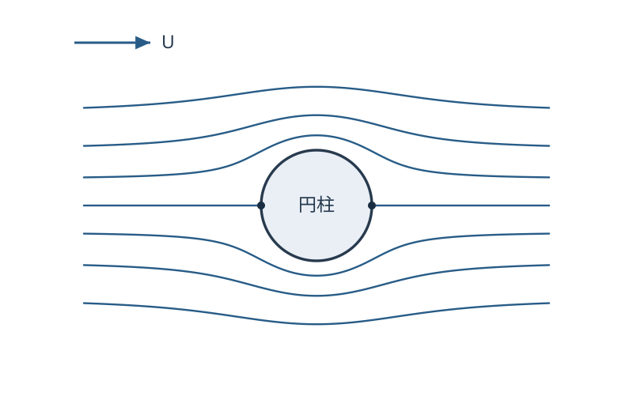

# FLUID12 単純なポテンシャル流を重ね合わせられるか

[FLUID11 の速度ポテンシャル](../FLUID11/index.md#def-fluid11-velocity-potential)を使うと、速度の2成分を一つの関数の微分から作れる。では、簡単な流れを足して「円柱に流体が入り込まない流れ」を作り、円柱のどこで速くなり、圧力がどれだけ変わるかまで予測できるだろうか。

鍵は **速度が満たす発散・渦度の微分条件**と**圧力に現れる速度の二乗** を区別することにある。ポテンシャル・流れ関数と速度は足せるが、圧力そのものを各流れの圧力から足すことはできない。

本講では平面の一様流、点湧出・点吸込、二重湧出を作り、一様流と二重湧出の重ね合わせで円柱周りの非粘性・非圧縮・無渦流を求める。円柱上の非貫通条件、よどみ点、圧力分布を計算し、どこまでが理想流体の予測なのか確認する。

## 0. 模型・単位・前提条件

座標 $(x,y)$ は m、$r=\sqrt{x^2+y^2}$ は原点からの距離、極角 $\theta$ は正の $x$ 軸から反時計回りに測る。$r>0$ で $e_r=(\cos\theta,\sin\theta)$、$e_\theta=(-\sin\theta,\cos\theta)$ とする。$u=u_re_r+u_\theta e_\theta$ の単位は m/s、速度ポテンシャル $\phi$ と[流れ関数](../../../幾何系/VC/VC9/index.md#def-vc9-stream-function) $\psi$ の単位は m$^2$/s である。

平面の開領域 $D$ で $C^2$ 級のポテンシャルを考える。流速と流れ関数の関係は[FLUID11 の命題](../FLUID11/index.md#prop-fluid11-cr-harmonic)に従い、

$$
u=\nabla\phi,\qquad
u_r=\partial_r\phi,\quad u_\theta=\frac1r\partial_\theta\phi,\qquad
u_r=\frac1r\partial_\theta\psi,\quad u_\theta=-\partial_r\psi.
$$

極座標での偏微分は、$x=r\cos\theta,\ y=r\sin\theta$ を使い、$r$ で微分するときは $\theta$ を、$\theta$ で微分するときは $r$ を固定する。$\partial_r(x,y)=e_r,\ \partial_\theta(x,y)=re_\theta$ なので、連鎖律から

$$
\partial_r\phi=\nabla\phi\cdot e_r=u_r,\qquad
\partial_\theta\phi=\nabla\phi\cdot(re_\theta)=ru_\theta.
$$

最後の二式も、$\psi_x=-u_y,\ \psi_y=u_x$ を同じ座標変換で微分したものである。例えば

$$
\frac{\partial\psi}{\partial\theta}
=\psi_x(-r\sin\theta)+\psi_y(r\cos\theta)
=r(u_y\sin\theta+u_x\cos\theta)=ru_r.
$$

残りの式も $\partial_r\psi=\psi_x\cos\theta+\psi_y\sin\theta=-u_\theta$ で確かめられる。

[非圧縮条件](../../../幾何系/VC/VC9/index.md#def-vc9-incompressible) $\nabla\cdot u=0$ と[無渦条件](../../../幾何系/VC/VC9/index.md#def-vc9-vorticity) $\nabla\times u=0$ をともに課すと、$\nabla\cdot\nabla\phi=\Delta\phi=0$ となる。ここで $\Delta=\partial_x^2+\partial_y^2$ を平面 Laplace 作用素とする。この $\Delta\phi=0$ を満たすかどうかを、以下の具体例ごとに微分で確認する。原点で発散する関数は、原点を除いた領域でだけこの模型を満たす。

最後の圧力計算では、密度 $\rho>0$ [kg/m$^3$] が一定、粘性なし、定常、水平面内、体積力のポテンシャルが一定という模型を追加する。圧力 $p$ は Pa、遠方一様流の速さ $U>0$ と圧力 $p_\infty$ を指定する。重力がある場合も同一高さで比較する。

## 1. 足せるものと足せないもの

一つのポテンシャルから流れを作れたなら、二つの解を重ねるのが自然である。微分と Laplace 作用素は線形だから、その操作は非圧縮性・無渦性を保つ。

<!-- formal-statement-start -->
### 命題（ポテンシャル流の重ね合わせ）

開集合 $D\subset\mathbb R^2$ 上の実数値関数 $\phi_1,\phi_2\in C^2(D)$ が $\Delta\phi_1=\Delta\phi_2=0$ を満たすとする。任意の実数 $c_1,c_2$ に対し

$$
\phi=c_1\phi_1+c_2\phi_2,\qquad u=\nabla\phi
$$

は $D$ 上で発散零・渦度零の流れである。さらに同じ領域上で $\psi_1,\psi_2$ がそれぞれの流れ関数なら $\psi=c_1\psi_1+c_2\psi_2$ も $u$ の流れ関数となる。
<!-- formal-statement-end -->

### 証明の見取り図

速度の足し算と Laplace 作用素の線形性を成分で確かめる。圧力は速度の二乗に依存するので、同じ足し算の規則には従わない。

<!-- proof-start -->
### 証明

偏微分を各項に施すと

$$
u=c_1\nabla\phi_1+c_2\nabla\phi_2,\qquad
\nabla\cdot u=c_1\Delta\phi_1+c_2\Delta\phi_2=0.
$$

渦度の鉛直成分は

$$
\partial_xu_y-\partial_yu_x
=\partial_x\partial_y\phi-\partial_y\partial_x\phi=0
$$

である（$\phi\in C^2$ なので混合偏微分が交換できる）。また $j=1,2$ について、$u_{j,x},u_{j,y}$ は $u_j=\nabla\phi_j$ のそれぞれ $x,y$ 方向の**速度成分**を表す（偏微分ではない）。$u_{j,x}=\partial_y\psi_j,\ u_{j,y}=-\partial_x\psi_j$ を線形結合すると $u_x=\partial_y\psi,\ u_y=-\partial_x\psi$。よって主張が従う。
<!-- proof-end -->

**直接確認**：$\phi_1=Ux$ と $\phi_2=Vy$（$U,V$ は m/s）なら $u_1=(U,0)$、$u_2=(0,V)$ であり、$\phi=\phi_1+\phi_2$ は $u=(U,V)$ を与える。$\psi_1=Uy,\ \psi_2=-Vx$ も足せる。一方、$|u|^2=U^2+V^2$ であり、速度の和の二乗は一般には交差項 $2u_1\cdot u_2$ を含む。

**注意**：壁面での条件も線形なら、各流れが別々に壁面条件を満たす必要はない。**合計の法線速度**が零になるよう係数を選べばよい。

## 2. 最も簡単な流れ：一様流と点湧出

### 2.1 一様流はどちらの関数も全域で持つ

$x$ 方向へ速さ $U$ [m/s] で流れる場 $u=(U,0)$ では

$$
\phi_U=Ux=Ur\cos\theta,\qquad
\psi_U=Uy=Ur\sin\theta.
$$

$\nabla\phi_U=(U,0)$、$(\psi_{U,y},-\psi_{U,x})=(U,0)$ を直接確認できる。$\phi_U,\psi_U$ は平面全体で一価であり、$\Delta\phi_U=0$。流線は $\psi_U$ 一定、すなわち水平直線である。

### 2.2 点湧出・点吸込とは何か

原点からすべての方向へ等しく流体が出てくる理想化を考える。半径 $R$ の円を毎秒横切る**単位奥行き当たりの体積流量**を $Q$ [m$^2$/s] とする。$Q>0$ は湧出、$Q<0$ は吸込である。これは原点に特異点を持つ平面模型であり、原点に有限な速度を持つ流体場を主張していない。

この速度は円周上で半径方向を向き、その大きさ $u_r(R)$ は角度によらないとする。[閉曲線の速度流束の定義](../FLUID11/index.md#def-fluid11-loop-flux)で円周上の外向き法線 $n=e_r$ と $ds=R\,d\theta$ を代入すれば

$$
Q=\int_0^{2\pi}u_r(R)R\,d\theta
=2\pi R\,u_r(R),\qquad
u_r(r)=\frac{Q}{2\pi r},\quad u_\theta=0.
$$

速度ポテンシャルは $u_r=\partial_r\phi$、$u_\theta=r^{-1}\partial_\theta\phi$ を満たすので、$r>0$ で半径方向に積分すると $\phi=(Q/(2\pi))\log(r/r_0)$ を得る。$r_0>0$ は対数の中身を無次元にする基準長であり、加法定数を固定するために選ぶ。

<!-- formal-statement-start -->
### 定義（平面の点湧出・点吸込）

$D=\mathbb R^2\setminus\{0\}$、$Q\in\mathbb R$、基準長 $r_0>0$ とする。$Q$ を強さとする原点の点湧出（$Q>0$）・点吸込（$Q<0$）の速度ポテンシャルと速度場を

$$
\phi_Q=\frac{Q}{2\pi}\log\frac r{r_0},\qquad
u_Q=\nabla\phi_Q=\frac{Q}{2\pi r}e_r
$$

で定義する。$Q=0$ は静止流とする。
<!-- formal-statement-end -->

<!-- definition-example-start: def-fluid12-point-source -->
**定義の確認**：$Q=2\pi\,\mathrm{m^2/s}$、$r_0=1\,\mathrm m$ の場合、$r=2\,\mathrm m$ で外向き速度は $0.5\,\mathrm{m/s}$。$\partial_r\phi_Q=Q/(2\pi r)$、$\partial_\theta\phi_Q=0$ なので指定した速度を持つ。原点以外で $\Delta\phi_Q=0$ であることは次の命題で直接確かめる。
<!-- definition-example-end -->

<!-- formal-statement-start -->
### 命題（点湧出の流束と大域的流れ関数の障害）

$D=\mathbb R^2\setminus\{0\}$、$Q\in\mathbb R$ とし、上の点湧出・吸込速度 $u_Q=(Q/(2\pi r))e_r$ を考える。この場は $D$ 上で発散・渦度とも零である。反時計回りの任意の原点中心円 $C_R$（$R>0$）について、円周に沿う向き付きの**ベクトル**変位を $\mathrm d\boldsymbol{\ell}$ と書けば

$$
\oint_{C_R}u_Q\cdot n\,ds=Q,\qquad
\oint_{C_R}u_Q\cdot\mathrm d\boldsymbol{\ell}=0.
$$

局所的な流れ関数は $\psi_Q=(Q/(2\pi))\theta$ と書けるが、$Q\ne0$ なら $D$ 全域で一価な流れ関数はない。
<!-- formal-statement-end -->

### 証明の見取り図

円周上では $u_r$ が $1/R$ に比例し、長さ要素は $R\,d\theta$ に比例するため、どの半径でも流束は同じになる。角度の枝を一周すると流れ関数の値が変化する。

<!-- proof-start -->
### 証明

極座標で $\nabla\cdot u=(1/r)\partial_r(ru_r)+(1/r)\partial_\theta u_\theta$ を用いれば、$ru_r=Q/(2\pi)$ は一定、$u_\theta=0$ なので発散零。直交座標で $u_Q=\nabla\phi_Q$ かつ $\phi_Q\in C^2(D)$ だから、混合微分の交換で渦度零である。あるいは

$$
\Delta\log r
=\partial_r^2\log r+\frac1r\partial_r\log r
=-\frac1{r^2}+\frac1{r^2}=0 \quad(r>0)
$$

と計算してもよい。円周では $n=e_r,\ ds=R\,d\theta$ だから

$$
\oint_{C_R}u_Q\cdot n\,ds
=\int_0^{2\pi}\frac{Q}{2\pi R}R\,d\theta=Q.
$$

一方、円周上の位置ベクトルを $\boldsymbol{\ell}(\theta)=(R\cos\theta,R\sin\theta)$ と置く。$\theta$ で微分すると向き付き接線変位は

$$
\mathrm d\boldsymbol{\ell}
=\frac{\mathrm d\boldsymbol{\ell}}{\mathrm d\theta}\,\mathrm d\theta
=Re_\theta\,\mathrm d\theta.
$$

$u_Q\cdot e_\theta=0$ だから循環は零。角度を連続に選んだ小領域では $\psi_Q=(Q/(2\pi))\theta$ と置けば、

$$
\frac1r\partial_\theta\psi_Q=\frac{Q}{2\pi r}=u_r,
\qquad -\partial_r\psi_Q=0=u_\theta
$$

となる。$Q\ne0$ のとき $\theta$ を $2\pi$ 増やすと $\psi_Q$ は $Q$ 変わり、[FLUID11 の大域判定定理](../FLUID11/index.md#thm-fluid11-global-period)とも一致する。
<!-- proof-end -->

ここでの「湧出」は、領域 $D$ の**外にある原点**を通して流体を供給する数学的な境界条件である。$r=0$ を含めて「発散零だから流体は生まれていない」と推論するのは誤りである。基準長 $r_0$ は $\phi_Q$ の加法定数を変えるだけで速度・流束を変えない。

## 3. 点湧出と点吸込を近づけて二重湧出を作る

点湧出と点吸込を近づけると、正味の流束を零に保ったまま流れの方向性を作れる。これを **二重湧出（doublet）** と呼ぶ。有限距離を隔てた二点ではなく、距離を零へ送ると同時に強さを増やす極限である。以下の $\phi_D,u_D,\psi_D$ の添字 $D$ は doublet の略で、領域を表す $D$ とは区別する。

原点を挟んで $(-h,0)$ に強さ $Q_h>0$ の湧出、$(h,0)$ に強さ $-Q_h$ の吸込を置く（$h>0$）。ポテンシャルの和は、両方の特異点を除いて

$$
\phi_h(x,y)
=\frac{Q_h}{2\pi}
\left\{\log\sqrt{(x+h)^2+y^2}
-\log\sqrt{(x-h)^2+y^2}\right\}.
$$

対数の各引数には同じ基準長 $r_0$ を割ったと解釈する。差ではその基準長が相殺される。

<!-- formal-statement-start -->
### 定義（x軸向き二重湧出）

$D=\mathbb R^2\setminus\{0\}$、$\mu\in\mathbb R$ [m$^3$/s] とする。$x$ 軸向き二重湧出の速度ポテンシャルを

$$
\phi_D(x,y)=\mu\frac{x}{x^2+y^2}
=\frac{\mu\cos\theta}{r}
$$

と定める。対応する速度は $u_D=\nabla\phi_D$ である。$\mu>0$ の場合は、左側の湧出と右側の吸込を強めながら近づけた極限に対応する。
<!-- formal-statement-end -->

<!-- definition-example-start: def-fluid12-doublet -->
**定義の確認**：$u_{D,x},u_{D,y}$ は速度 $u_D$ の $x,y$ 成分を表し、$u_D$ の偏微分ではない。定義にある $u_D=\nabla\phi_D$ を判定するには、$r^2=x^2+y^2$ を用いて $\phi_D=\mu x/r^2$ の $x,y$ 偏微分をそれぞれ求める。$r>0$ で商の微分則から

$$
\partial_x\frac{x}{r^2}=\frac{r^2-2x^2}{r^4}
=\frac{y^2-x^2}{r^4},\qquad
\partial_y\frac{x}{r^2}=-\frac{2xy}{r^4}.
$$

よって直交座標での速度は

$$
u_D=\left(\frac{\mu(y^2-x^2)}{r^4},-\frac{2\mu xy}{r^4}\right).
$$

特に $x\ne0,\ y=0$ 上では $\phi_D=\mu/x$、$u_{D,x}=-\mu/x^2$、$u_{D,y}=0$。また分母 $r^4$ は定義域 $D$ 上で零にならず、$\phi_D$ と $u_D$ はその全域で滑らかである。調和性は次の命題の証明で確認する。

例えば $(x,y)=(a,0)$（$a>0$）で $u_D=(-\mu/a^2,0)$ となる。両軸に沿う速度が同一符号とは限らない点に注意する。
<!-- definition-example-end -->

<!-- formal-statement-start -->
### 命題（二点の湧出・吸込から二重湧出への極限）

$h>0$ に対し、$(-h,0)$ に強さ $Q_h$ の湧出、$(h,0)$ に強さ $-Q_h$ の吸込を置き、$Q_hh/\pi=\mu>0$ を固定する。そのポテンシャル $\phi_h$ は、原点を含まない任意のコンパクト集合上で $h\downarrow0$ のとき

$$
\phi_h(x,y)\longrightarrow\phi_D(x,y)=\frac{\mu x}{x^2+y^2}
$$

となり、速度場も同じ集合上で $u_h=\nabla\phi_h\longrightarrow\nabla\phi_D$ となる。この $\phi_D$ は原点以外で $\Delta\phi_D=0$ を満たす。
<!-- formal-statement-end -->

### 証明の見取り図

対数の差を $h$ に関して原点で微分する。原点から距離を取った領域では分母が零にならないため、誤差とその座標微分を一様に抑えられる。

<!-- proof-start -->
### 証明

固定した $(x,y)\ne(0,0)$ に対し $f(s)=\frac12\log((x+s)^2+y^2)$ と置く。$f'(s)=(x+s)/((x+s)^2+y^2)$ であるから、対称差の極限を用いて

$$
\frac{f(h)-f(-h)}{2h}\longrightarrow f'(0)=\frac{x}{r^2}.
$$

$Q_hh/\pi=\mu$ より $Q_h/(2\pi)=\mu/(2h)$ なので

$$
\phi_h=\mu\frac{f(h)-f(-h)}{2h}\longrightarrow\mu\frac{x}{r^2}.
$$

原点から距離 $\varepsilon>0$ 以上離れたコンパクト集合では、$0<h<\varepsilon/2$ とすれば $f$ の $s$・$x$・$y$ の必要な微分の分母は零にならず、一様有界で連続である。平均値型の積分表示

$$
\frac{f(h)-f(-h)}{2h}=\frac12\int_{-1}^1 f'(ht)\,dt
$$

を用い、被積分関数と座標微分の一様連続性からポテンシャルとその勾配の一様収束を得る。

また $\partial_x\log r=x/r^2$ で $\Delta\log r=0$（$r>0$）だから

$$
\Delta\phi_D=\mu\Delta(\partial_x\log r)
=\mu\partial_x(\Delta\log r)=0.
$$

微分の交換は $r>0$ での滑らかさによる。
<!-- proof-end -->

極座標表示を微分すると

$$
u_{D,r}=-\frac{\mu\cos\theta}{r^2},\qquad
u_{D,\theta}=-\frac{\mu\sin\theta}{r^2}.
$$

一方、[流れ関数の定義](../../../幾何系/VC/VC9/index.md#def-vc9-stream-function)は $\partial_\theta\psi_D=ru_{D,r}$ と $-\partial_r\psi_D=u_{D,\theta}$ に対応する。まず $r$ を固定して $\theta$ で積分すると

$$
\partial_\theta\psi_D=-\frac{\mu\cos\theta}{r}
\quad\Longrightarrow\quad
\psi_D=-\frac{\mu\sin\theta}{r}+f(r).
$$

この式を $r$ で微分すると

$$
-\partial_r\psi_D=-\frac{\mu\sin\theta}{r^2}-f'(r).
$$

先に求めた $u_{D,\theta}=-\mu\sin\theta/r^2$ と一致するには $f'(r)=0$ が必要である。加法定数を零に選び、

$$
\psi_D=-\frac{\mu\sin\theta}{r}
=-\frac{\mu y}{r^2}
$$

を得る。したがって $(1/r)\psi_{D,\theta}=u_{D,r}$、$-\psi_{D,r}=u_{D,\theta}$ がともに成立する。$\psi_D$ は原点以外で一価であり、原点中心の円を貫く総流束は $\int_0^{2\pi}u_{D,r}r\,d\theta=0$ となる。**湧出と吸込の正味流束が打ち消された**ことが、点湧出との本質的な違いである。

## 4. 一様流と二重湧出から円柱まわりを作る

半径 $a>0$ の円柱の軸を紙面垂直方向に取り、断面が $r=a$ の固定した円であるとする。流体領域は **外側** $\Omega_a=\{(x,y):r>a\}$。壁は流体を通さないが、理想流体では壁に沿う滑りを許す。固体表面から外側（流体側）を向く法線は $e_r$ である。

**非貫通条件**とは、固定壁を横切る流体速度の法線成分が零である条件 $u\cdot e_r=0$、すなわち $u_r(a,\theta)=0$ をいう。これは壁全体で $u=0$ とする粘性流体の無滑り条件とは異なる。ここでは $u$ が $r=a$ へ連続に延長できると仮定する。

まず $x$ 方向への一様流 $\phi_U=Ur\cos\theta$ に、$\mu\cos\theta/r$ の二重湧出を足す。未知係数 $\mu$ を壁条件から決める。

<!-- formal-statement-start -->
### 定理（円柱まわりの循環なしポテンシャル流）

$a>0,\ U>0$ とし、固定円柱外部 $\Omega_a=\{r>a\}$ で、無限遠にて速度が $(U,0)$ に近づく定常二次元の非圧縮・無渦流を考える。一様流と $x$ 軸向き二重湧出の和

$$
\phi=Ur\cos\theta+\frac{\mu\cos\theta}{r}
$$

を仮定すると、円柱表面での非貫通条件 $u_r(a,\theta)=0$ をすべての $\theta$ に対して満たす係数はただ一つ $\mu=Ua^2$ である。このとき

$$
\begin{aligned}
\phi&=U\left(r+\frac{a^2}{r}\right)\cos\theta,\\
\psi&=U\left(r-\frac{a^2}{r}\right)\sin\theta,\\
u_r&=U\left(1-\frac{a^2}{r^2}\right)\cos\theta,\\
u_\theta&=-U\left(1+\frac{a^2}{r^2}\right)\sin\theta .
\end{aligned}
$$

$\phi,\psi$ はともに $\Omega_a$ で一価かつ滑らかであり、速度のよどみ点は表面上の $(a,0)$ と $(-a,0)$ の二点である（速度場を表面まで延長して判定する）。
<!-- formal-statement-end -->

### 証明の見取り図

一様流だけでは円の正面・背面から流体が入り込む。二重湧出の半径方向速度は符号が逆なので、$\mu=Ua^2$ とすると表面でちょうど打ち消される。円柱表面の流れ関数 $\psi=0$ は、流れが表面に接することを表す。

<!-- proof-start -->
### 証明

前節の二重湧出と一様流は $\Omega_a$ 上で調和であるから、[重ね合わせ命題](#prop-fluid12-superposition)によって合計の $\phi$ も調和であり、$u=\nabla\phi$ は発散零・渦度零となる。

まず $\phi=Ur\cos\theta+\mu r^{-1}\cos\theta$ を極座標で微分する。

$$
\begin{aligned}
u_r&=\partial_r\phi
=\left(U-\frac{\mu}{r^2}\right)\cos\theta,\\
u_\theta&=\frac1r\partial_\theta\phi
=-\left(U+\frac{\mu}{r^2}\right)\sin\theta .
\end{aligned}
$$

$r=a$ に代入すると $u_r(a,\theta)=(U-\mu/a^2)\cos\theta$。すべての角度で零になるには、例えば $\theta=0$ を入れて $U-\mu/a^2=0$ が必要で、$\mu=Ua^2$ なら確かにすべての角度で零になる。これは指定した一様流＋二重湧出という形の中で係数が一意だという主張であり、任意の外部流の一般的な一意性定理ではない。

流れ関数は各基本流の和

$$
\psi=Ur\sin\theta-\frac{\mu}{r}\sin\theta
=U\left(r-\frac{a^2}{r}\right)\sin\theta
$$

である。$\psi_r=U(1+a^2/r^2)\sin\theta$、$\psi_\theta=U(r+a^2/r)\cos\theta$ から $u_\theta=-\psi_r$、$u_r=\psi_\theta/r$ を直接確認する。$r=a$ では $\psi=0$ なので円周は流線である。

$r\to\infty$ のとき $u_r\to U\cos\theta$、$u_\theta\to-U\sin\theta$、すなわち $(U,0)$ に近づく。表面では $u_r=0$、$u_\theta=-2U\sin\theta$。$U>0$ なので速度が零となるのは $\sin\theta=0$、すなわち $\theta=0,\pi$ の二点のみである。
<!-- proof-end -->

この図の流線は、上の $\psi=U(r-a^2/r)\sin\theta$ の等高線から作ったもの。水平な流線は無限遠で一様流に近づき、円柱表面は $\psi=0$ という流線になる。左右の印はよどみ点である。図の曲線と表面が交わって流体が壁へ入り込むと解釈しない。

**具体的な境界値**：$\theta=\pi/2$ の円柱上面では $u_r=0,\ u_\theta=-2U$、速さは $2U$。$\theta=0$ の前方よどみ点では速さ0。壁面に沿う速さが零でないことこそ、非貫通条件と無滑り条件の違いを示す。

## 5. 圧力はなぜ速度と同じように重ね合わせられないか

ここからは流れが、一定密度 $\rho$、非粘性、定常、水平面で一定体積力ポテンシャルの [FLUID6 の Euler 方程式](../FLUID6/index.md#thm-fluid6-euler-equation) を満たすと仮定する。

[FLUID6 の全域 Bernoulli 定数](../FLUID6/index.md#cor-fluid6-global-bernoulli)は三次元の連結開領域で述べられている。そこで円柱外部の平面流を、鉛直座標 $z$ に依存しない三次元場へ延長する。具体的に

$$
\begin{aligned}
\widetilde\Omega&=\Omega_a\times(-1,1)\subset\mathbb R^3,\\
\widetilde u(x,y,z)&=(u_x(x,y),u_y(x,y),0),\\
\widetilde p(x,y,z)&=p(x,y)
\end{aligned}
$$

と置く。領域 $\widetilde\Omega$ は連結であり、速度と圧力はその内部で滑らかである。平面流の渦度が零なので、延長場の渦度も零となる。仮定した定常 Euler 方程式は鉛直成分も満たし、密度と体積力ポテンシャルは一定のままである。

したがって上記の Bernoulli の系を三次元場に適用し、水平面へ制限できる。遠方に $u\to(U,0)$、$p\to p_\infty$ という基準を与えると

$$
p+\frac12\rho|u|^2=p_\infty+\frac12\rho U^2.
$$

ここでは一定高さなので重力ポテンシャルの差を省いた。圧力は **合計速度の二乗**を計算したあとに求める。

次に、圧力を遠方の動圧 $\rho U^2/2$ で規格化する量を導入する。

<!-- formal-statement-start -->
### 定義（圧力係数）

$\rho>0$ が一定、遠方一様流速 $U>0$ とその圧力 $p_\infty$ を持つ定常非粘性流に対し、位置 $(r,\theta)$ の圧力 $p(r,\theta)$ の**圧力係数**を

$$
C_p(r,\theta):=\frac{p(r,\theta)-p_\infty}{\frac12\rho U^2}
$$

と定義する。分母は正であり、$C_p$ は無次元量である。
<!-- formal-statement-end -->

<!-- definition-example-start: def-fluid12-pressure-coefficient -->
**定義の確認**：$\rho=1000\,\mathrm{kg/m^3}$、$U=2\,\mathrm{m/s}$、$p-p_\infty=-2000\,\mathrm{Pa}$ なら、$\rho U^2/2=2000\,\mathrm{Pa}$ なので $C_p=-1$。圧力差と動圧がともに Pa であり、値に単位は付かない。
<!-- definition-example-end -->

<!-- formal-statement-start -->
### 命題（円柱まわりの速度と圧力係数）

$a>0,\ U>0,\ \rho>0$ とし、円柱外部 $\Omega_a=\{r>a\}$ で[円柱まわりのポテンシャル流](#thm-fluid12-cylinder)が定常・一定密度・非粘性の Euler 方程式に従い、水平な遠方で $p\to p_\infty$ とする。$\lambda=a^2/r^2$ と置けば

$$
\frac{|u|^2}{U^2}
=1+\lambda^2-2\lambda\cos(2\theta),\qquad
C_p(r,\theta)=2\lambda\cos(2\theta)-\lambda^2.
$$

とくに表面への極限 $r\downarrow a$ で

$$
C_p(a,\theta)=1-4\sin^2\theta.
$$

よどみ点 $\theta=0,\pi$ の圧力は $p_\infty+\rho U^2/2$、上下 $\theta=\pi/2,3\pi/2$ では $p_\infty-3\rho U^2/2$ である。
<!-- formal-statement-end -->

### 証明の見取り図

円柱まわりの二つの速度成分をそれぞれ二乗して足す。非線形な交差項を残したまま Bernoulli の式に入れ、壁面では $\lambda=1$ を最後に代入する。

<!-- proof-start -->
### 証明

速度の極座標成分は $u_r=U(1-\lambda)\cos\theta$、$u_\theta=-U(1+\lambda)\sin\theta$ なので

$$
\begin{aligned}
\frac{|u|^2}{U^2}
&=(1-\lambda)^2\cos^2\theta+(1+\lambda)^2\sin^2\theta\\
&=(1+\lambda^2)(\cos^2\theta+\sin^2\theta)
+2\lambda(\sin^2\theta-\cos^2\theta)\\
&=1+\lambda^2-2\lambda\cos(2\theta).
\end{aligned}
$$

[全域 Bernoulli 積分](../FLUID6/index.md#cor-fluid6-global-bernoulli)へこの式を代入すると

$$
\begin{aligned}
p-p_\infty
&=\frac12\rho(U^2-|u|^2)\\
&=\frac12\rho U^2[2\lambda\cos(2\theta)-\lambda^2].
\end{aligned}
$$

[圧力係数の定義](#def-fluid12-pressure-coefficient)の正の分母で割ると $C_p$ を得る。$r\downarrow a$ では $\lambda\to1$ なので

$$
C_p(a,\theta)=2\cos(2\theta)-1
=2(1-2\sin^2\theta)-1=1-4\sin^2\theta.
$$

$\sin\theta=0$ では $C_p=1$、$\sin^2\theta=1$ では $C_p=-3$。定義に戻して圧力の数値式を得る。
<!-- proof-end -->

**モデルの限界**：この解では $\theta=\pi/2$ で壁に沿って $2U$ の速度を持つ。粘性流体の無滑り境界を満たさない。したがって、実際の円柱後流の剥離や粘性抵抗をこの解だけで予測することはできない。また点湧出や二重湧出の特異点を流体領域に戻して、同じ滑らかな Euler 解として扱うこともできない。

## 6. 演習

すべての問題で $r=\sqrt{x^2+y^2}$、$\theta$ は反時計回りの極角、$e_r,e_\theta$ は第0節の単位ベクトルとする。必要なら $\Delta\log r=0$（$r>0$）および[FLUID11 のポテンシャル・流れ関数の対応](../FLUID11/index.md#prop-fluid11-cr-harmonic)を使ってよい。以下の数値は単位奥行き当たりで扱う。

### Level A

### A1. 斜めの一様流

$U>0$ [m/s]、$\beta\in\mathbb R$ とし、平面全体の一様速度場 $u=(U\cos\beta,U\sin\beta)$ の $\phi,\psi$ をそれぞれ加法定数を除いて求め、発散と渦度を検査せよ。

- Level: A

<!-- solution-start -->
#### 詳細解答

$\phi_x=U\cos\beta,\ \phi_y=U\sin\beta$ を座標ごとに積分すると

$$
\phi=U(x\cos\beta+y\sin\beta)+C_1.
$$

$\psi_y=u_x=U\cos\beta,\ -\psi_x=u_y=U\sin\beta$ だから

$$
\psi=U(y\cos\beta-x\sin\beta)+C_2.
$$

どちらも二階偏導関数がすべて零なので $\nabla\cdot u=0$、$\partial_xu_y-\partial_yu_x=0$。$u$ は空間一定なので両関数は全平面で一価となる。
<!-- solution-end -->

### A2. 点湧出の半径と流束

$Q=4\pi\,\mathrm{m^2/s}>0$ の原点の点湧出について、$r=2\,\mathrm m$ での速さ、半径 $R$ [m] の反時計回り円周の流束と循環を求め、全域の流れ関数の有無を判定せよ。

- Level: A

<!-- solution-start -->
#### 詳細解答

$r=2\,\mathrm m$ における速さは

$$
|u|=\frac Q{2\pi r}
=\frac{4\pi\,\mathrm{m^2/s}}{2\pi(2\,\mathrm m)}
=1\,\mathrm{m/s}.
$$

円周では $u_r=Q/(2\pi R)$、$u_\theta=0$、$ds=R\,d\theta$ なので

$$
Q_{C_R}=\int_0^{2\pi}\frac{Q}{2\pi R}R\,d\theta=4\pi\,\mathrm{m^2/s},
\qquad \Gamma_{C_R}=0.
$$

$Q_{C_R}\ne0$ より[大域存在判定](../FLUID11/index.md#thm-fluid11-global-period)により穴あき平面全体では一価な $\psi$ はない。$\phi=(Q/2\pi)\log(r/r_0)$ は一価である。
<!-- solution-end -->

### A3. 二重湧出の流れ関数

$\mu>0$ [m$^3$/s]、$D=\mathbb R^2\setminus\{0\}$ 上の $\phi=\mu x/r^2$ の速度成分を計算し、$\psi=-\mu y/r^2$ が流れ関数であることを二成分とも確かめよ。

- Level: A

<!-- solution-start -->
#### 詳細解答

$r^2=x^2+y^2$ の微分から

$$
\begin{aligned}
u_x=\phi_x
&=\mu\frac{r^2-2x^2}{r^4}
=\frac{\mu(y^2-x^2)}{r^4},\\
u_y=\phi_y
&=-\frac{2\mu xy}{r^4}.
\end{aligned}
$$

一方 $\psi=-\mu y/r^2$ の偏微分は

$$
\psi_y=-\mu\frac{r^2-2y^2}{r^4}
=\frac{\mu(y^2-x^2)}{r^4}=u_x,\qquad
-\psi_x=-\frac{2\mu xy}{r^4}=u_y.
$$

したがって両成分について[流れ関数の定義](../../../幾何系/VC/VC9/index.md#def-vc9-stream-function)を満たす。原点は定義域外である。
<!-- solution-end -->

### A4. 円柱表面の速度と圧力

$U=2\,\mathrm{m/s}$、$\rho=1000\,\mathrm{kg/m^3}$ の循環なし円柱ポテンシャル流について、前方 $\theta=\pi$、上端 $\theta=\pi/2$ の表面での速さと $p-p_\infty$ を求めよ。

- Level: A

<!-- solution-start -->
#### 詳細解答

[円柱速度](#thm-fluid12-cylinder)の表面値は $u_r=0,\ u_\theta=-2U\sin\theta$ である。$\theta=\pi$ では $\sin\pi=0$ より $|u|=0$。動圧は $\rho U^2/2=1000\cdot4/2=2000\,\mathrm{Pa}$ だから[全域 Bernoulli 定数](../FLUID6/index.md#cor-fluid6-global-bernoulli)より $p-p_\infty=2000\,\mathrm{Pa}$。

$\theta=\pi/2$ では $u_\theta=-4\,\mathrm{m/s}$、速さは $4\,\mathrm{m/s}$。よって

$$
p-p_\infty=\frac12\rho(U^2-|u|^2)
=\frac{1000}{2}(4-16)=-6000\,\mathrm{Pa}.
$$

圧力係数でも前方は $1$、上端は $-3$ となり一致する。
<!-- solution-end -->

### Level B

### B1. 一様流に点湧出を足すとよどみ点はどこか

$U>0$、$q>0$ をそれぞれ m/s、m$^2$/s の定数とし、$D=\mathbb R^2\setminus\{0\}$ 上のポテンシャル $\phi=Ux+q\log(r/r_0)$ を考える。速度成分、よどみ点の位置、原点中心円の全流束を求めよ。また一価な流れ関数が $D$ 全体で存在するか述べよ。

- Level: B

<!-- solution-start -->
#### 詳細解答

各項を微分すると

$$
u_x=U+\frac{qx}{r^2},\qquad u_y=\frac{qy}{r^2}.
$$

$q>0$ なので $u_y=0$ は $y=0$ を意味する。$x\ne0$ で $r^2=x^2$ だから $u_x=U+q/x=0$、よってよどみ点は $(-q/U,0)$ のただ一つである。原点中心円で一様流の流束は

$$
\int_0^{2\pi}U\cos\theta\,R\,d\theta=0,
$$

湧出項は $2\pi q$ なので全流束は $2\pi q\ne0$。[FLUID11 の大域判定](../FLUID11/index.md#thm-fluid11-global-period)により $D$ 全体の一価な $\psi$ は存在しない。局所的には $\psi=Uy+q\theta$ と書ける。
<!-- solution-end -->

### B2. 壁面条件だけから二重湧出を決める

$a>0,\ U>0$ とし、$r>a$ で $\phi=(Ur+A/r)\cos\theta$ を考える。$A$ の単位を求め、$r=a$ で $u\cdot e_r=0$ となる $A$、壁面接線速度と流れ関数を求めよ。

- Level: B

<!-- solution-start -->
#### 詳細解答

$[\phi]=\mathrm{m^2/s}$、$[A/r]=\mathrm{m^2/s}$ なので $[A]=\mathrm{m^3/s}$。極座標で

$$
u_r=(U-A/r^2)\cos\theta,\qquad
u_\theta=-(U+A/r^2)\sin\theta.
$$

$r=a$ で $u_r=0$ を全角度に課すと $U-A/a^2=0$、従って $A=Ua^2$。接線速度は $u_\theta(a,\theta)=-2U\sin\theta$。$\psi=(Ur-A/r)\sin\theta$ と置けば

$$
\frac1r\psi_\theta=(U-A/r^2)\cos\theta=u_r,\quad
-\psi_r=-(U+A/r^2)\sin\theta=u_\theta.
$$

壁面では $\psi(a,\theta)=0$。壁は流線であるが、$u_\theta$ は一般に零ではない。
<!-- solution-end -->

### B3. 円柱から離れた場所の圧力係数

$a>0,\ U>0$ の循環なし円柱まわりの定常理想流について、$r=2a$ で $\theta=0$ と $\theta=\pi/2$ の圧力係数を計算し、遠方極限を確認せよ。

- Level: B

<!-- solution-start -->
#### 詳細解答

$\lambda=a^2/r^2$ と置くと $r=2a$ では $\lambda=1/4$。[圧力係数命題](#prop-fluid12-cylinder-pressure)の式

$$
C_p=2\lambda\cos(2\theta)-\lambda^2
$$

から、$\theta=0$ では $\cos0=1$、$\theta=\pi/2$ では $\cos\pi=-1$ なので

$$
C_p(2a,0)=\frac12-\frac1{16}=\frac7{16},\qquad
C_p(2a,\pi/2)=-\frac12-\frac1{16}=-\frac9{16}.
$$

$r\to\infty$ なら $\lambda\to0$ なのでどの固定角度でも $C_p\to0$、つまり $p\to p_\infty$。$\theta=0$ でも $r=2a$ はよどみ点ではないため $C_p=1$ と誤って代入してはならない。
<!-- solution-end -->

### B4. 点湧出と一様流が作る境界流線

$U,q>0$、$D=\mathbb R^2\setminus\{0\}$ で B1 の速度場を考える。領域 $y>0$ では $\theta\in(0,\pi)$ とする。よどみ点 $(-q/U,0)$ を通る流線の上側枝を極座標で求め、下流 $x\to+\infty$ の高さを計算せよ。この曲線が物体の壁面と同じ物理的条件を満たすと言えるか。

- Level: B

<!-- solution-start -->
#### 詳細解答

B1で求めた小領域上の流れ関数は $\psi=Uy+q\theta$。よどみ点は負の $x$ 軸上にあり、$y>0$ 側から $\theta\to\pi,\ y\to0$ と近づくので流れ関数値は $q\pi$。したがって上側枝は

$$
Uy+q\theta=q\pi,\qquad
y=\frac qU(\pi-\theta).
$$

$r\sin\theta=y$ であるから $0<\theta<\pi$ で

$$
r=\frac qU\frac{\pi-\theta}{\sin\theta},\qquad
x=\frac qU(\pi-\theta)\cot\theta.
$$

$\theta\uparrow\pi$ では $r\to q/U,\ x\to-q/U$ でよどみ点へ到達する。$\theta\downarrow0$ では $y\to\pi q/U$、$x\to+\infty$。したがって下流の上側高さは $\pi q/U$。流線を横切る速度は零だが、これは速度場の中で選んだ**仮想的な分離線**であり、固体円柱の無滑り壁を意味しない。原点の湧出を流体領域へ含めない点にも注意する。
<!-- solution-end -->

### Level C

### C1. 境界・流線・圧力を一つの模型でつなぐ

半径 $a>0$ の固定円柱の外部 $\Omega_a=\{r>a\}$ に、遠方速度 $(U,0)$、$U>0$ の非圧縮・無渦流を考える。密度 $\rho>0$ は一定、粘性と水平面内の体積力は無視し、定常 Euler 方程式を仮定する。候補は $\phi=Ux+A x/r^2$、$A$ は未知の実数 [m$^3$/s] である。

1. $\phi$ が外部領域で $\Delta\phi=0$ であることを微分で示し、極座標の $u_r,u_\theta$ を求めよ。
2. 円柱表面での非貫通条件から $A$ を決め、外部領域全体の一価な流れ関数 $\psi$ を作れ。壁面での値と遠方速度を確認せよ。
3. よどみ点と表面速さを求め、遠方の圧力 $p_\infty$ を使って圧力係数 $C_p(a,\theta)$ を導け。
4. 上端の圧力を $p_\infty,\rho,U$ で表し、非貫通条件だけでは無滑り条件が満たされないことを具体的に示せ。
5. この構成で圧力を「一様流の圧力」と「二重湧出の圧力」の単純和にできない理由を、速度二乗の交差項から説明せよ。

- Level: C

<!-- solution-start -->
#### 詳細解答

**1.** $Ux$ は一次式だから $\Delta(Ux)=0$。また $x/r^2=\partial_x\log r$ で、$r>0$ では $\Delta\log r=0$ なので微分の交換から $\Delta(x/r^2)=\partial_x\Delta\log r=0$。よって外部領域で $\Delta\phi=0$。極座標に直すと

$$
\phi=(Ur+A/r)\cos\theta.
$$

これをそれぞれ $r,\theta$ で偏微分して

$$
u_r=(U-A/r^2)\cos\theta,\qquad
u_\theta=-(U+A/r^2)\sin\theta
$$

を得る。

**2.** 壁では $u_r(a,\theta)=(U-A/a^2)\cos\theta$ であり、全角度で零となる必要十分条件は $A=Ua^2$。ここで

$$
\psi=(Ur-A/r)\sin\theta
=U(r-a^2/r)\sin\theta
$$

と置く。$\psi_\theta/r=(U-A/r^2)\cos\theta=u_r$、$-\psi_r=-(U+A/r^2)\sin\theta=u_\theta$ なので流れ関数である。$\psi$ は $r>a$ の全域で一価、$\psi(a,\theta)=0$。$r\to\infty$ で $u_r\to U\cos\theta,\ u_\theta\to-U\sin\theta$ だから直交座標では $(U,0)$ へ近づく。

**3.** 壁面では $u_r=0,\ u_\theta=-2U\sin\theta$。よどみ点は $\sin\theta=0$ の $\theta=0,\pi$（速度を壁へ連続に延長した点）。壁面の速さは $|u|=2U|\sin\theta|$。定常・非粘性・無渦・一定密度で、連結な外部領域の平面流を $z$ に依存しない三次元場へ滑らかに延長すれば、[FLUID6 の全域 Bernoulli 定数](../FLUID6/index.md#cor-fluid6-global-bernoulli)を適用できる。

$$
p+\frac12\rho|u|^2
=p_\infty+\frac12\rho U^2.
$$

$p-p_\infty=\frac12\rho(U^2-4U^2\sin^2\theta)$ を[圧力係数](#def-fluid12-pressure-coefficient)の分母 $\rho U^2/2$ で割れば

$$
C_p(a,\theta)=1-4\sin^2\theta.
$$

**4.** $\theta=\pi/2$ では $|u|=2U$、よって

$$
p(a,\pi/2)=p_\infty+\frac12\rho(U^2-4U^2)
=p_\infty-\frac32\rho U^2.
$$

同じ点で $u_\theta(a,\pi/2)=-2U\ne0$。壁を貫く速度 $u_r=0$ は成立するが、壁に接する速度を零とする無滑り条件は満たさない。

**5.** $u=u_U+u_D$ とすると

$$
|u|^2=|u_U|^2+|u_D|^2+2u_U\cdot u_D.
$$

その交差項は、$u_U=Ue_x$ と $u_D=\nabla(Ax/r^2)$ を用いると

$$
2u_U\cdot u_D
=2Uu_{D,x}
=2UA\frac{y^2-x^2}{r^4}
=-\frac{2UA}{r^2}\cos(2\theta).
$$

$A=Ua^2>0$ なら一般の点で零ではない。Bernoulli の圧力は速度二乗全体を含むから、個別圧力を独立に足すとこの項が欠落する。遠方圧力の基準も同一でなければならない。
<!-- solution-end -->

## 7. まとめと次の講義

- 調和ポテンシャルの線形結合は、**特異点を除いた共通領域**で非圧縮・無渦の流れを与える。
- 点湧出の正味流束は $Q$。二重湧出は湧出・吸込を近づける極限であり、原点以外で正味流束が零になる。
- 一様流と二重湧出の和に対して非貫通条件を課すと、係数は $\mu=Ua^2$ と決まる。円柱表面で $u_r=0$ でも接線速度は一般に零でない。
- 円柱上で $C_p=1-4\sin^2\theta$。圧力は合計速度の二乗から求め、各基本流の圧力を足さない。

次の FLUID13 では、速度ポテンシャルと流れ関数を複素数でまとめ、等角写像を通じて円柱以外の境界形状へ発展させる。
