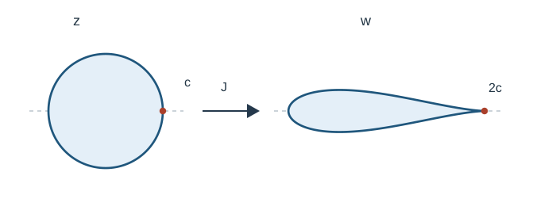

# FLUID13 複素ポテンシャルと等角写像は何に効くか

[FLUID11 の流れ関数と速度ポテンシャルの関係](../FLUID11/index.md#prop-fluid11-cr-harmonic)を使うと、平面の非圧縮・無渦流を二つの実関数 $\phi,\psi$ で表せる。[FLUID12 の円柱まわりの解](../FLUID12/index.md#thm-fluid12-cylinder)はその具体例だった。しかし円柱の形を翼型へ変えたら、すべての境界値問題を最初から解き直す必要があるだろうか。

この講義では、二つの実関数を一つの複素関数にまとめ、**円の外部の解を境界の形とともに写す**。その際、複素微分が零になる場所では速度を単純に変換できない。滑らかな楕円と、尖った後縁を持つ翼型状の輪郭を比べ、何が成立し何が破れるかを確認する。力や揚力の積分は次の FLUID14 で扱う。

## 0. 使用する領域・物理モデル・複素数の約束

$z=x+iy$ を元の平面の点、$w=X+iY$ を写像先の点とする。$x,y,X,Y$ は長さ [m] である。開領域 $D\subset\mathbb C$ で速度 $u=(u_x,u_y)$ [m/s] を $C^1$ とし、定常、非圧縮、無渦、一定密度の理想流体という条件を必要な箇所で用いる。境界を含む計算は、関数が境界まで連続または滑らかに延長する場合に限る。

[FLUID11 の速度ポテンシャル](../FLUID11/index.md#def-fluid11-velocity-potential)と[VC9 の流れ関数](../../../幾何系/VC/VC9/index.md#def-vc9-stream-function)の符号規約は

$$
u_x=\phi_x=\psi_y,\qquad
u_y=\phi_y=-\psi_x
$$

である。$\phi,\psi$ はどちらも [m$^2$/s]。複素微分、正則性と導関数の演算法則は [CA1 の正則関数の定義](../../../解析系/CA/CA1/index.md#def-ca1-holomorphic)および[複素微分法則](../../../解析系/CA/CA1/index.md#thm-ca1-derivative-rules)を使用する。以下では速度の二成分を $u_x-iu_y$ と一つの複素数に組み合わせる（$u_x+iu_y$ ではない）。

## 1. 二つのポテンシャルから複素速度を読む

既知の円柱解では $\phi$ と $\psi$ を別々に持っていた。まとめた関数の導関数だけで速度を復元したいので、まず次を導入する。

<!-- formal-statement-start -->
### 定義（複素ポテンシャルと複素速度）

連結開領域 $D\subset\mathbb C$ の平面速度場 $u\in C^1(D;\mathbb R^2)$ に対し、$\phi,\psi\in C^2(D;\mathbb R)$ が

$$
u_x=\phi_x=\psi_y,\qquad u_y=\phi_y=-\psi_x
$$

を満たすとき、正則関数 $F=\phi+i\psi$ を $D$ 上の**複素ポテンシャル**と呼ぶ。関数 $q(z):=u_x(z)-iu_y(z)$ を**複素速度**と呼ぶ。$\phi,\psi$ と $F$ はそれぞれ加法定数の自由度を持つ。
<!-- formal-statement-end -->

ここでは $\phi,\psi$ が $D$ 全体で一価という仮定が重要である。穴を囲む循環が非零なら、[FLUID11 の大域存在判定](../FLUID11/index.md#thm-fluid11-global-period)によって全域で一価な $\phi$ が存在しない場合がある。そのとき $\log z$ の局所的な枝を使うことはできても、全域の一価な $F$ があるとは主張しない。

<!-- definition-example-start: def-fluid13-complex-potential -->
**定義の確認**：$D=\mathbb C$、$U>0$ の右向き一様流をとる。$F(z)=Uz=Ux+iUy$ と置けば $\phi=Ux,\ \psi=Uy$ はともに $C^2(D)$ で一価である。$\phi_x=U=\psi_y$、$\phi_y=0=-\psi_x$ を直接検査できる。したがって $u=(U,0)$、複素速度は $q=U$ [m/s] となる。
<!-- definition-example-end -->

<!-- formal-statement-start -->
### 命題（複素ポテンシャルの微分と実速度）

$D\subset\mathbb C$ を連結開領域とし、$F=\phi+i\psi$ は上の意味で $D$ 上の複素ポテンシャルとする。そのとき $F$ は正則で、

$$
F'(z)=u_x-iu_y=q(z).
$$

逆に $D$ 上の正則関数 $F$ の実部と虚部は、$u_x=\partial_x\operatorname{Re}F$、$u_y=\partial_y\operatorname{Re}F$ で定めた速度場の速度ポテンシャルと流れ関数になる。速度場は非圧縮かつ無渦である。
<!-- formal-statement-end -->

### 証明の見取り図

$\phi_x=\psi_y$、$\phi_y=-\psi_x$ は[CA1 の Cauchy–Riemann 必要条件](../../../解析系/CA/CA1/index.md#thm-ca1-cr-necessary)で現れる方程式そのものである。**実方向に微分**してから $u_y$ の符号を確定する。逆方向は、正則関数の Cauchy–Riemann 方程式から二つの速度表示を復元する。

<!-- proof-start -->
### 証明

$\phi,\psi\in C^2$ で、$\phi_x=\psi_y$ と $\phi_y=-\psi_x$ が成立する。[CA1 の Cauchy–Riemann 十分条件](../../../解析系/CA/CA1/index.md#thm-ca1-cr-sufficient)によって $F$ は正則である。実方向 $h\in\mathbb R$ の差商を取ると

$$
F'(z)=\partial_xF=\phi_x+i\psi_x
=u_x-i u_y.
$$

逆に正則な $F=\phi+i\psi$ の $\phi,\psi$ は滑らかで、[CA1 の Cauchy–Riemann 必要条件](../../../解析系/CA/CA1/index.md#thm-ca1-cr-necessary)より $\phi_x=\psi_y,\ \phi_y=-\psi_x$ である。$u=\nabla\phi$ とすると

$$
\begin{aligned}
\nabla\cdot u
&=\phi_{xx}+\phi_{yy}
=\partial_x\psi_y-\partial_y\psi_x=0,\\
\partial_xu_y-\partial_yu_x
&=\phi_{yx}-\phi_{xy}=0.
\end{aligned}
$$

混合偏導関数の交換は正則関数の滑らかさにより正当化される。ゆえに速度は非圧縮かつ無渦で、$\psi$ も流れ関数である。
<!-- proof-end -->

**基本流を複素数で再確認**：[FLUID12 の円柱ポテンシャル](../FLUID12/index.md#thm-fluid12-cylinder)と流れ関数を合わせると、半径 $a>0$、右向き遠方流速 $U>0$ に対し

$$
F(z)=U\left(z+\frac{a^2}{z}\right),\qquad |z|>a.
$$

$z=re^{i\theta}$ のとき、実部は $U(r+a^2/r)\cos\theta$、虚部は $U(r-a^2/r)\sin\theta$。微分すれば

$$
q(z)=U\left(1-\frac{a^2}{z^2}\right)
$$

であり、$|z|=a$ では $F(ae^{i\theta})=2Ua\cos\theta$ は実数、すなわち境界が流線 $\psi=0$ になる。分母の特異点 $z=0$ は物体の内部にあり、流体の領域には含まれない。

## 2. 複素微分で形を変えても流線を保てるか

境界を形の異なる曲線へ移すには、位置を $w=J(z)$ と変換する。もし $J$ が局所的に回転と正の倍率の積として働くなら、二つの交差曲線の角度を保つ。これがこの講義で使う**等角**という意味である。ただし複素微分が零なら、一次近似が潰れて角度保存を保証できない。

<!-- formal-statement-start -->
### 定義（Joukowski写像の臨界点）

$c>0$ [m] に対し、$z\in\mathbb C\setminus\{0\}$ 上で

$$
J_c(z):=z+\frac{c^2}{z}
$$

を**Joukowski写像**という。この写像 $J_c$ の導関数 $J_c'(z_0)$ が零となる点 $z_0$ を、**Joukowski写像の臨界点**という。$J'(z_0)\ne0$ の点を、この章では局所的な等角点として扱う。
<!-- formal-statement-end -->

<!-- definition-example-start: def-fluid13-joukowski -->
**定義の確認**：$z=2c$ を代入すると $J_c(2c)=2c+c/2=5c/2$、$J_c'(z)=1-c^2/z^2$ より $J_c'(2c)=3/4\ne0$。この点の微小変位は一次近似で $3/4$ 倍となり、角度は保たれる。一方 $z=c$ では $J_c'(c)=0$、したがって等角点ではなく写像微分の零点である。$z=0$ はそもそも定義域に入らない。
<!-- definition-example-end -->

<!-- formal-statement-start -->
### 命題（Joukowski写像の局所可逆性と複素速度変換）

$c>0$、$z_0\ne0,\pm c$ とし、$J_c$ を $z_0$ の近傍で考える。この近傍を十分小さく取れば $w=J_c(z)$ は一対一で、局所逆写像 $z=z(w)$ が存在する。$z_0$ の近傍で正則な複素ポテンシャル $F$ に対し、写像先の複素ポテンシャルを $\widetilde F(w)=F(z(w))$ とすると

$$
\widetilde q(w)
=\frac{d\widetilde F}{dw}
=\frac{F'(z)}{J_c'(z)}
=\frac{q(z)}{1-c^2/z^2}.
$$

$J_c$ の導関数の零点は $z=\pm c$、その像は $w=\pm2c$ である。$w$ から $z$ を求める二次方程式は

$$
z^2-wz+c^2=0
$$

で、その二つの解が合流する分岐値は $w=\pm2c$ である。
<!-- formal-statement-end -->

### 証明の見取り図

$J_c(z_1)=J_c(z_2)$ から二解の関係を直接出す。逆関数を複素微分する際には、**速度もそのままの値ではなく微分の比で変換**する。分母が零なら公式を形式的に当てはめない。

<!-- proof-start -->
### 証明

$z_1,z_2\ne0$ とし、写像値の差を因数分解する。

$$
\begin{aligned}
J_c(z_1)-J_c(z_2)
&=(z_1-z_2)+c^2\left(\frac1{z_1}-\frac1{z_2}\right)\\
&=(z_1-z_2)\left(1-\frac{c^2}{z_1z_2}\right).
\end{aligned}
$$

したがって二点の像が等しいとき、$z_1=z_2$ または $z_1z_2=c^2$ である。$z_0^2\ne c^2$ だから、$z_0$ の近傍を十分小さくすれば二点の積は $c^2$ にならず、$J_c$ はそこで一対一となる。さらに

$$
J_c'(z)=1-\frac{c^2}{z^2},\qquad
J_c''(z)=\frac{2c^2}{z^3}.
$$

$z_0\ne\pm c$ より $J_c'(z_0)\ne0$ で、一次近似 $J_c(z_0+h)=J_c(z_0)+J_c'(z_0)h+o(|h|)$ は正の倍率と回転を表す。局所逆写像が存在する点で、差商を変数 $z$ へ戻すと

$$
\begin{aligned}
\widetilde F'(J_c(z))
&=\lim_{\zeta\to z}
\frac{F(\zeta)-F(z)}{J_c(\zeta)-J_c(z)}\\
&=\lim_{\zeta\to z}
\frac{[F(\zeta)-F(z)]/(\zeta-z)}
{[J_c(\zeta)-J_c(z)]/(\zeta-z)}
=\frac{F'(z)}{J_c'(z)}.
\end{aligned}
$$

分母の極限は零でないので商の極限を取れる。最後に $w=z+c^2/z$ の両辺へ $z$ を掛けると $z^2-wz+c^2=0$。判別式 $w^2-4c^2=0$ から $w=\pm2c$、対応する根はそれぞれ $z=\pm c$ である。
<!-- proof-end -->

分岐値があることと、その点が**流体の領域内にあること**は別問題である。写像する外部領域から導関数の零点を取り除ければ、流体内では速度変換が正則に使える場合がある。実例を次に作る。

## 3. 円柱外部を楕円外部へ：非退化な写像

まず $a>c>0$ の同心円柱を選ぶ。この条件は単なる式の都合ではなく、導関数の零点 $\pm c$ を円柱の**内部**へ閉じ込めるためである。

<!-- formal-statement-start -->
### 定理（円柱外部から楕円外部へのJoukowski写像）

$a>c>0$ とし、$D_a=\{z\in\mathbb C:|z|>a\}$、$J_c(z)=z+c^2/z$ とする。$J_c$ は $D_a$ 上で一対一かつ $J_c'(z)\ne0$ であり、円周 $|z|=a$ を楕円

$$
\frac{X^2}{A^2}+\frac{Y^2}{B^2}=1,\qquad
A=a+\frac{c^2}{a},\quad B=a-\frac{c^2}{a}>0
$$

へ写す。$D_a$ の像はこの楕円の外部である。

$U>0$ で円柱流 $F(z)=U(z+a^2/z)$ を用いると、写像先の一価な複素ポテンシャル $\widetilde F=F\circ J_c^{-1}$ は楕円外部で非圧縮・無渦流を与え、その複素速度は

$$
\widetilde q(J_c(z))=
U\frac{1-a^2/z^2}{1-c^2/z^2}.
$$

楕円表面の法線速度は零であり、無限遠で $\widetilde q\to U$ となる。
<!-- formal-statement-end -->

### 証明の見取り図

二点が同じ像を持つなら積が $c^2$ となる。しかし $|z_1|,|z_2|>a>c$ ではその積の絶対値が $c^2$ より大きく、衝突できない。円周の像は実部・虚部を計算すると楕円になる。**写像された境界でも流れ関数の値が一定**だから、非貫通条件が移る。

<!-- proof-start -->
### 証明

[二点の像が等しい条件](#prop-fluid13-map-and-velocity)より、異なる $z_1,z_2\in D_a$ で同じ像を持つなら $z_1z_2=c^2$ が必要である。しかし $|z_1z_2|>a^2>c^2$ なので不可能。よって単射である。$J_c'(z)=1-c^2/z^2$ の零点は $\pm c$ のみで、両方とも $|z|<a$ にある。境界上でも $a>c$ だから微分は零にならない。

$z=ae^{i\theta}$ とおくと、$1/z=e^{-i\theta}/a$ であり

$$
\begin{aligned}
w&=ae^{i\theta}+\frac{c^2}{a}e^{-i\theta}\\
&=\left(a+\frac{c^2}{a}\right)\cos\theta
+i\left(a-\frac{c^2}{a}\right)\sin\theta\\
&=A\cos\theta+iB\sin\theta.
\end{aligned}
$$

$B>0$ だから単純な楕円を一周する。$J_c$ は境界を含む外部で連続かつ単射、$|z|\to\infty$ で $|J_c(z)|\to\infty$ である。楕円の外の任意の点へ逆を延長するとき、逆像が途中で消えるには有限境界へ近づくか無限遠へ逃げる必要があるが、前者の像は楕円上、後者の像は無限遠となり、ともに不可能である。したがって連結な楕円外部はすべて像に入る。これは境界の像が楕円であることと、単射性・無限遠での振舞いを合わせた結論である。

[円柱流の複素ポテンシャル](#prop-fluid13-complex-velocity)は $D_a$ 全体で一価、境界上で $\operatorname{Im}F(ae^{i\theta})=0$ である。ゆえに $\operatorname{Im}\widetilde F=0$ が楕円の境界全体で成り立つ。[流れ関数の等高線が流線となる関係](../FLUID11/index.md#prop-fluid11-cr-harmonic)より境界へ接する流れである。速度は[変換公式](#prop-fluid13-map-and-velocity)に $F'(z)=U(1-a^2/z^2)$ を代入した式となる。$|z|\to\infty$ で分子と分母はともに1に近づくので $\widetilde q\to U$。
<!-- proof-end -->

**直接計算**：$a=2c$ とすれば、半長軸 $A=5c/2$、半短軸 $B=3c/2$ である。$A^2-B^2=(25-9)c^2/4=4c^2$。たとえば円周の上端 $z=ia$ の写像は $w=iB$。流線の接線速度は変わるが、流線という**境界条件そのもの**は写像後も保たれる。

$J_c$ が等角でも、長さと速さの倍率は一般に1ではない。楕円の上端 $z=ia$ では

$$
\widetilde q(iB)
=U\frac{1+a^2/a^2}{1+c^2/a^2}
=\frac{2U}{1+c^2/a^2}.
$$

この値は円柱の上端速度 $2U$ と等しいとは限らない。圧力を求めるときは、[FLUID6 の全域 Bernoulli 積分](../FLUID6/index.md#cor-fluid6-global-bernoulli)が成立する追加の定常・非粘性・一定密度条件で、**写像後の速度の絶対値**を使う。

## 4. 翼型状の輪郭を作ると後縁で何が起きるか

楕円では後端も滑らかである。尖った後縁を作るには、円を $J_c'$ の零点 $z=c$ にちょうど接するように動かす。ここで「翼型状」は二次元の理想化した境界形状を意味し、現実の粘性境界層や揚力を自動的に予測するものではない。

$c>0,\ d>0$ [m] とし、円の中心を $z=-d$、半径を $R=c+d$ と置く。円は $z=c$ を通り、$z=-c$ は内部にある。流体はその外部 $D_{d,R}=\{z:|z+d|>R\}$ とする。

左の円周の右端 $z=c$ が右の尖点 $w=2c$ へ移る。線の太さや色ではなく、円の滑らかな接線が写像後に**同じ点へ上下から合流する**ことに注目する。図は $c=1,\ d=0.2$ の境界を同じ座標尺度で作図したもの（単位は任意の長さ尺度）である。

<!-- formal-statement-start -->
### 命題（翼型状境界の尖点と有限速度条件）

$c,d,U>0$、$R=c+d$ とし、$D_{d,R}=\{z:|z+d|>R\}$ に $J_c(z)=z+c^2/z$ を適用する。この領域で $J_c$ は一対一かつ $J_c'\ne0$ である。境界の $z=c$ は $w=2c$ へ写り、写像された境界はここで尖点を持つ。

$\zeta=z+d$ とおき、円の非貫通境界条件を満たす複素ポテンシャル

$$
F(z)=U\left(\zeta+\frac{R^2}{\zeta}\right)
$$

を与えると、写像後の複素速度は $w=2c$ へ流体側から近づくとき有限な極限を持ち、

$$
\lim_{z\to c,\ z\in D_{d,R}}
\frac{F'(z)}{J_c'(z)}=\frac{Uc}{R}.
$$

一般に尖点で $F'(c)\ne0$ なら、この商の絶対値は尖点へ近づくにつれて発散する。分子・分母がともに零になるかの吟味なしに変換公式を代入してはならない。
<!-- formal-statement-end -->

### 証明の見取り図

$\lvert z\rvert\le c$ の円板は $\lvert z+d\rvert\le c+d=R$ に含まれる。したがって流体側では $\lvert z\rvert>c$ となり、$\pm c$ は領域内にない。尖点では $J_c'(c)=0$、円柱流のよどみ点が同じ $z=c$ に来るため $F'(c)=0$ でもある。零点の次数を**一つずつ**打ち消すと有限な速度が得られる。

<!-- proof-start -->
### 証明

任意の $|z|\le c$ に対し、三角不等式から $|z+d|\le|z|+d\le c+d=R$。よって外部 $D_{d,R}$ の点は $|z|>c$ を満たす。[写像の二点等値条件](#prop-fluid13-map-and-velocity)で、もし異なる $z_1,z_2$ が同じ像なら $z_1z_2=c^2$ となるが、$|z_1z_2|>c^2$ に矛盾する。よって単射で、$J_c'$ の零点 $\pm c$ は流体領域外である。

境界を $z(\theta)=-d+Re^{i\theta}$ と置けば $z(0)=c$。$J_c(c)=2c$ である。恒等式

$$
J_c(z)-2c=\frac{(z-c)^2}{z}
$$

へ $z(\theta)$ を代入する。$e^{i\theta}=1+i\theta-\theta^2/2-i\theta^3/6+O(\theta^4)$ を使うと

$$
z(\theta)-c=iR\theta-\frac R2\theta^2+O(\theta^3),
$$

$$
\begin{aligned}
\operatorname{Re}(J_c(z(\theta))-2c)
&=-\frac{R^2}{c}\theta^2+O(\theta^4),\\
\operatorname{Im}(J_c(z(\theta))-2c)
&=\frac{R^2d}{c^2}\theta^3+O(\theta^5).
\end{aligned}
$$

$R>0,d>0$ なので、$\theta>0$ と $\theta<0$ の像は同じ実方向へ二次で近づき、虚方向では異なる符号の三次で離れる。これが尖点である。

次に $F$ は $\zeta\ne0$ で正則であり、円周上 $\zeta=Re^{i\theta}$ にて $F=2UR\cos\theta$ は実数だから非貫通条件を満たす。微分して

$$
F'(z)=U\left(1-\frac{R^2}{(z+d)^2}\right),\qquad
J_c'(z)=1-\frac{c^2}{z^2}.
$$

$z=c$ では $c+d=R$ より両方零である。分子・分母をそれぞれ因数分解すれば

$$
\begin{aligned}
F'(z)
&=U\frac{(z+d-R)(z+d+R)}{(z+d)^2}
=U\frac{(z-c)(z+c+2d)}{(z+d)^2},\\
J_c'(z)&=\frac{(z-c)(z+c)}{z^2}.
\end{aligned}
$$

流体側 $z\ne c$ で約分したあとに $z\to c$ とすると

$$
\frac{F'(z)}{J_c'(z)}
=U\frac{z^2(z+c+2d)}{(z+d)^2(z+c)}
\longrightarrow U\frac{c^2(2R)}{R^2(2c)}
=\frac{Uc}{R}.
$$

一方、$F'(c)\ne0$ なら分子は非零の定数へ、分母は $J_c'(z)\sim2(z-c)/c$ で零へ近づくので、商の絶対値は発散する。変換先では $w-2c=(z-c)^2/z$ なので、発散はおよそ $|w-2c|^{-1/2}$ の次数になる。
<!-- proof-end -->

**有限速度になる理由と限界**：これは上流が実軸方向の、循環なしの特別な流れで、円柱上のよどみ点が写像微分の零点と重なったからである。たとえば遠方流れの方向を角度 $\alpha$ だけ回して

$$
F_\alpha(z)
=U\left(e^{-i\alpha}\zeta+\frac{R^2e^{i\alpha}}{\zeta}\right)
$$

とすれば、境界では依然として $F_\alpha=2UR\cos(\theta-\alpha)$ は実数だが、

$$
F_\alpha'(c)=U(e^{-i\alpha}-e^{i\alpha})=-2iU\sin\alpha.
$$

$\sin\alpha\ne0$ では尖点速度は発散する。ここに循環を調整して後縁で有限速度を課すという、次講義の Kutta 条件への動機が現れる。ただし有限速度だけでは実在の翼の流れが一意に決まるわけではなく、粘性・剥離などの物理過程はこの理想模型の外にある。

## 5. 演習

本節の $c,a,d,R,U$ は断りがなければ正の実数であり、長さは m、速度は m/s とする。$F$ は一価な複素ポテンシャル、$q=F'=u_x-iu_y$。使用する根拠は[複素速度命題](#prop-fluid13-complex-velocity)、[写像速度の変換命題](#prop-fluid13-map-and-velocity)と、必要に応じ[FLUID11 の大域存在定理](../FLUID11/index.md#thm-fluid11-global-period)である。

### Level A

### A1. 複素速度の虚部の符号

$U>0,\ \beta\in\mathbb R$、$F(z)=Ue^{-i\beta}z$ とする。$\phi,\psi$ と $(u_x,u_y)$ を計算し、Cauchy–Riemann 関係を二つとも検査せよ。

- Level: A

<!-- solution-start -->
#### 詳細解答

$e^{-i\beta}=\cos\beta-i\sin\beta$ と $z=x+iy$ を掛けると

$$
F=U(x\cos\beta+y\sin\beta)
+iU(y\cos\beta-x\sin\beta).
$$

したがって $\phi=U(x\cos\beta+y\sin\beta)$、$\psi=U(y\cos\beta-x\sin\beta)$。偏微分により

$$
\phi_x=U\cos\beta=\psi_y,\qquad
\phi_y=U\sin\beta=-\psi_x.
$$

$F'=Ue^{-i\beta}=U\cos\beta-iU\sin\beta$ だから、定義上の速度は $(U\cos\beta,U\sin\beta)$。虚部の符号を逆にすると流れの $y$ 成分が反転する。
<!-- solution-end -->

### A2. 円柱の複素速度とよどみ点

$F(z)=U(z+a^2/z)$、$|z|>a$ とする。$F'$ を求め、境界への連続延長でよどみ点が $z=\pm a$ であること、および $z=ia$ における複素速度を確かめよ。

- Level: A

<!-- solution-start -->
#### 詳細解答

$F'(z)=U(1-a^2/z^2)$ である。$F'(z)=0$ は $z^2=a^2$ と同値なので $z=\pm a$。いずれも開領域 $|z|>a$ の内部でなく境界上の点である。$z=ia$ では $z^2=-a^2$ より

$$
q(ia)=U\left(1-\frac{a^2}{-a^2}\right)=2U.
$$

これは写像前の $z$ 平面の複素速度であり、$w$ 平面の速度と混同しない。
<!-- solution-end -->

### A3. 写像微分が零になる点

$J_c(z)=z+c^2/z$ の導関数と二階導関数、$z=\pm c,2c$ の写像値と一階導関数の値を求めよ。

- Level: A

<!-- solution-start -->
#### 詳細解答

$$
J_c'(z)=1-\frac{c^2}{z^2},\qquad
J_c''(z)=\frac{2c^2}{z^3}.
$$

$J_c(c)=2c$、$J_c(-c)=-2c$、$J_c(2c)=5c/2$ である。また

$$
J_c'(c)=0,\quad J_c'(-c)=0,\quad
J_c'(2c)=1-\frac14=\frac34.
$$

$\pm c$ は定義域 $z\ne0$ に属する Joukowski写像の臨界点である。一方 $2c$ では一階微分が零でなく局所的に等角である。
<!-- solution-end -->

### A4. 円から楕円の軸を求める

$a=2c$ として $z=ae^{i\theta}$ を $J_c$ で写す。半長軸 $A$ と半短軸 $B$、ならびに $A^2-B^2$ を計算せよ。

- Level: A

<!-- solution-start -->
#### 詳細解答

[楕円写像定理](#thm-fluid13-ellipse)の導出を $a=2c$ へ代入すると

$$
\begin{aligned}
J_c(ae^{i\theta})
&=\left(a+\frac{c^2}{a}\right)\cos\theta
+i\left(a-\frac{c^2}{a}\right)\sin\theta\\
&=\frac{5c}{2}\cos\theta+i\frac{3c}{2}\sin\theta.
\end{aligned}
$$

従って $A=5c/2$、$B=3c/2>0$ で、$A^2-B^2=(25-9)c^2/4=4c^2$。$a=c$ と誤設定すれば $B=0$ となり、楕円でなく退化線分になる。
<!-- solution-end -->

### Level B

### B1. 外部領域で写像が一対一である理由

$a>c>0$ とする。$D_a=\{|z|>a\}$ の相異なる二点が $J_c$ で同じ像になると仮定し、矛盾を導け。また $J_c$ の逆写像が $\pm2c$ を分岐値に持つ理由を二次方程式で説明せよ。

- Level: B

<!-- solution-start -->
#### 詳細解答

相異なる $z_1,z_2\in D_a$ について

$$
0=J_c(z_1)-J_c(z_2)
=(z_1-z_2)\left(1-\frac{c^2}{z_1z_2}\right).
$$

第一因子は非零なので $z_1z_2=c^2$。一方 $|z_1z_2|=|z_1||z_2|>a^2>c^2$ に矛盾する。$w=J_c(z)$ を $z$ について整理すると $z^2-wz+c^2=0$、解は

$$
z=\frac{w\pm\sqrt{w^2-4c^2}}2.
$$

判別式が零になる $w=\pm2c$ で二解が合流し、逆関数の分岐値になる。ただし対応する $z=\pm c$ は $D_a$ 内にない。外部の流体領域に分岐点があると誤読しない。
<!-- solution-end -->

### B2. 楕円の速さと圧力係数

$a=2c$、$U>0$ の定理の楕円流を考える。上端の速度の大きさ、よどみ点の像、上端の圧力係数を求めよ。圧力は水平面内の定常・一定密度・非粘性 Euler 流で、無限遠の速度 $U$、圧力 $p_\infty$ を持つものとする。

- Level: B

<!-- solution-start -->
#### 詳細解答

上端は $z=ia$ に対応し、分子 $1-a^2/z^2=2$、分母 $1-c^2/z^2=1+c^2/a^2=5/4$。よって

$$
|\widetilde q(iB)|=\frac{2U}{5/4}=\frac85U.
$$

写像前のよどみ点 $z=\pm a$ は $F'(\pm a)=0$ であり、写像微分は $1-c^2/a^2=3/4\ne0$。したがって像 $w=\pm(a+c^2/a)=\pm5c/2$ がよどみ点となる。速度の全域無渦性と定常・非粘性・一定密度より[全域 Bernoulli 積分](../FLUID6/index.md#cor-fluid6-global-bernoulli)が成立し、[圧力係数の定義](../FLUID12/index.md#def-fluid12-pressure-coefficient)で

$$
C_p(iB)=1-\frac{|\widetilde q(iB)|^2}{U^2}
=1-\frac{64}{25}=-\frac{39}{25}.
$$

円柱上端の $C_p=-3$ をそのまま流用してはならない。
<!-- solution-end -->

### B3. 尖点で速度が有限となる条件

$c,d,U>0,\ R=c+d,\ \zeta=z+d$ とする。$F_\alpha=U(e^{-i\alpha}\zeta+R^2e^{i\alpha}/\zeta)$ の境界 $|\zeta|=R$ が流線であることを検査し、尖点 $z=c$ での $F_\alpha'(c)$ を計算せよ。$\alpha=0$ の極限速度と $\sin\alpha\ne0$ の挙動を比較せよ。

- Level: B

<!-- solution-start -->
#### 詳細解答

境界上 $\zeta=Re^{i\theta}$ では

$$
F_\alpha
=UR\left(e^{i(\theta-\alpha)}+e^{-i(\theta-\alpha)}\right)
=2UR\cos(\theta-\alpha)\in\mathbb R.
$$

したがって $\psi=\operatorname{Im}F_\alpha=0$ が境界で一定なので非貫通である。微分して

$$
F_\alpha'(z)=U\left(e^{-i\alpha}
-\frac{R^2e^{i\alpha}}{(z+d)^2}\right).
$$

$z=c$ では $z+d=R$ より $F_\alpha'(c)=U(e^{-i\alpha}-e^{i\alpha})=-2iU\sin\alpha$。$\alpha=0$ なら $F_0'(c)=0$ で、[翼型状境界の尖点と有限速度条件](#prop-fluid13-cusp)の因数分解より $\widetilde q\to Uc/R$。$\sin\alpha\ne0$ なら分子は非零、分母 $J_c'(z)\to0$ なので $|\widetilde q|\to\infty$。境界が流線であるだけでは有限速度を保証しない。
<!-- solution-end -->

### B4. 失われない循環と流束

$a>c>0$ の楕円流について、境界を囲む閉曲線上の循環と外向き速度流束を求めよ。複素ポテンシャルが楕円外部で一価であることを利用し、流線条件だけで循環まで決まると早合点しないよう説明せよ。

- Level: B

<!-- solution-start -->
#### 詳細解答

円の外部で $F=U(z+a^2/z)$ は一価で正則、$J_c$ は楕円外部への一対一の写像だから $\widetilde F=\widetilde\phi+i\widetilde\psi$ も楕円外部で一価である。任意の区分的 $C^1$ 閉曲線 $C$ に沿って

$$
\Gamma_C=\oint_C (u_x\,dX+u_y\,dY)
=\oint_Cd\widetilde\phi=0,
$$

$$
Q_C=\oint_C(u_x\,dY-u_y\,dX)
=\oint_Cd\widetilde\psi=0
$$

を得る。最後の符号は $\widetilde\psi_X=-u_y,\ \widetilde\psi_Y=u_x$ を使った。[FLUID11 の大域的存在判定](../FLUID11/index.md#thm-fluid11-global-period)とも一致する。ただし境界の $\widetilde\psi$ が一定という事実のみで、一般の穴あき領域の循環が零とは結論できない。一価な $\widetilde\phi$ もあることを使った。
<!-- solution-end -->

### Level C

### C1. 尖った輪郭へ写す構成を再現する

$c,d,U>0$、$R=c+d$、$D=\{|z+d|>R\}$ とし、$J_c(z)=z+c^2/z$ と $F(z)=U(z+d+R^2/(z+d))$ を考える。

1. $D$ 上の $J_c$ の一対一性と導関数の非零性を証明し、$z=c$ が境界にあることを確認せよ。
2. 元の円の境界をパラメータ化し、写像した輪郭が $w=2c$ に尖点を持つことを、実部の二次項・虚部の三次項を用いて示せ。
3. 元の境界と写像後の境界で非貫通条件が成立する理由を示せ。
4. 写像後の複素速度を $z$ で書き、尖点への極限を求めよ。
5. 追加で定常・一定密度・非粘性・一定高さの Euler 流と仮定する。無限遠で速度 $U$、圧力 $p_\infty$ のとき、尖点へ流体側から近づく圧力係数の極限を計算し、この結果から実在翼の揚力を直接結論してはいけない理由を述べよ。

- Level: C

<!-- solution-start -->
#### 詳細解答

**1.** $|z|\le c$ なら $|z+d|\le|z|+d\le c+d=R$。その対偶より $z\in D$ なら $|z|>c$。$J_c(z_1)=J_c(z_2)$ で $z_1\ne z_2$ とすると[二点の因数分解](#prop-fluid13-map-and-velocity)から $z_1z_2=c^2$、しかし $|z_1z_2|>c^2$ に矛盾する。$J_c'(z)=1-c^2/z^2$ は $z=\pm c$ のみで零なので、$D$ では非零である。$|c+d|=R$ だから $z=c$ は境界上にある。

**2.** 境界を $z(\theta)=-d+Re^{i\theta}$ と置く。$\theta=0$ で $z=c$、$w=J_c(c)=2c$。[尖点命題の恒等式](#prop-fluid13-cusp)を用いると

$$
w-2c=\frac{(z-c)^2}{z},\qquad
z-c=iR\theta-\frac R2\theta^2+O(\theta^3).
$$

分母を $1/z=1/c-iR\theta/c^2+O(\theta^2)$ と展開し、二乗の項 $-R^2\theta^2-iR^2\theta^3+O(\theta^4)$ を掛けると

$$
\operatorname{Re}(w-2c)=-\frac{R^2}{c}\theta^2+O(\theta^4),
\quad
\operatorname{Im}(w-2c)=\frac{R^2d}{c^2}\theta^3+O(\theta^5).
$$

実部は両側から負の二次で接近し、虚部は符号を変える三次で開くので尖点である。

**3.** $\zeta=z+d=Re^{i\theta}$ では

$$
F=U\left(Re^{i\theta}+Re^{-i\theta}\right)
=2UR\cos\theta\in\mathbb R.
$$

よって元の円の表面では $\psi=0$。$D$ 上で $J_c$ は局所等角かつ一対一なので、写像後も $\widetilde\psi=\operatorname{Im}(F\circ J_c^{-1})=0$ が境界で成立する（尖点では境界の接線が通常の意味で定義されないため、両側の流線値と流体側の極限として読む）。

**4.** $F'=U(1-R^2/(z+d)^2)$、$J_c'=1-c^2/z^2$。各因子を解くと

$$
\widetilde q(J_c(z))
=\frac{F'}{J_c'}
=U\frac{z^2(z-c)(z+c+2d)}{(z+d)^2(z-c)(z+c)}
=U\frac{z^2(z+c+2d)}{(z+d)^2(z+c)}
$$

であり、$z\in D$ なので $z\ne c$ として約分できる。$z\to c$ で $z+c+2d=2R$、$z+d=R$ より $\widetilde q\to Uc/R$。この計算は $0/0$ を直接代入していない。

**5.** [FLUID6 の全域 Bernoulli 積分](../FLUID6/index.md#cor-fluid6-global-bernoulli)の適用条件を満たし、無限遠で $J_c(z)=z+O(1/z)$、$\widetilde q\to U$ だから

$$
p+\frac{\rho}{2}|\widetilde q|^2
=p_\infty+\frac{\rho}{2}U^2.
$$

[圧力係数](../FLUID12/index.md#def-fluid12-pressure-coefficient)により、尖点側の極限は

$$
\lim_{w\to2c}C_p(w)
=1-\frac{(Uc/R)^2}{U^2}
=1-\frac{c^2}{(c+d)^2}.
$$

正の有限値だが、これは循環を加えない特別な理想流での局所圧力である。粘性の後縁選択、圧力の境界全体の積分、循環による揚力を扱っていないため、実在翼の揚力・抗力はこの値だけから決定できない。
<!-- solution-end -->

## 6. まとめと次の講義

- $\phi+i\psi$ が一価に作れるとき、その導関数 $F'=u_x-iu_y$ が速度の二成分を同時に表す。
- $J_c(z)=z+c^2/z$ の導関数が非零で、逆写像を取れる流体領域では、写像後の速度は $F'(z)/J_c'(z)$。**写像が形を変えても、速度の大きさまでそのままとは限らない**。
- $a>c$ の円柱外部は楕円外部へ一対一に写り、境界の非貫通条件と遠方一様流を保てる。
- 円を $z=c$ に接させると $w=2c$ に尖点が現れる。分母 $J_c'(c)=0$ と同時に分子 $F'(c)=0$ かを確かめなければ、有限速度とは言えない。

次の FLUID14 では、循環を加えた円柱・翼の流れから揚力を積分し、理想流における抗力零の条件と、後縁の有限速度条件との関係を扱う。
