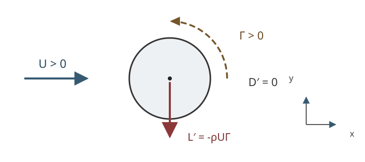

# FLUID14 理想流で揚力と抗力はどう異なるか

[FLUID12 の循環なし円柱流](../FLUID12/index.md#thm-fluid12-cylinder)には前後対称な圧力分布があった。[FLUID13 の複素ポテンシャルと写像](../FLUID13/index.md#prop-fluid13-map-and-velocity)を使えば翼型の外部でも速度を計算できる。しかし**速度が分かること**と、物体に働く**力を求めること**は別の段階である。非粘性の模型で圧力を積分すると、循環による横力は生まれるのに抗力は消える。なぜそのような非対称な結論になるのかを順に確かめる。

この講義では、まず円柱で圧力を直接積分し、次に複素積分で一般の断面へ拡張する。最後に、尖った後縁で速度が発散しないという Kutta 条件が循環を選ぶ仕組みと、その条件だけでは現実の揚抗力を予測しきれない理由を考える。

## 0. 模型・符号・力の定義

運動は水平な二次元 $xy$ 平面内、$x$ は右、$y$ は上、$z=x+iy$ とする。密度 $\rho>0$ [kg/m$^3$] は一定、速度は定常・非圧縮・非粘性で、物体外部では $C^1$、無渦とする。遠方速度を最初は $(U,0)$、$U>0$ [m/s]、遠方圧力を $p_\infty$ [Pa] とする。重力の水平面内成分はない。物体は不動で、滑らかな境界で非貫通 $u\cdot n=0$ が成立する。後で尖点を扱うときは別に速度の有界性を確認する。

[FLUID9 の循環の定義と正の向き](../FLUID9/index.md#def-fluid9-material-circulation)に合わせ、物体の境界を**反時計回り**にたどるとき

$$
\Gamma=\oint_{\partial B}u\cdot t\,ds
=\oint_{\partial B}(u_x\,dx+u_y\,dy)
$$

を正とする。$\Gamma$ の単位は m$^2$/s。これは円柱表面をたどる閉曲線の線積分であり、必ずしも物質閉曲線を追跡する話ではない。流体内部が無渦でも穴の中に循環を保持できるのは、[FLUID11 の大域存在判定](../FLUID11/index.md#thm-fluid11-global-period)から既に分かる。

圧力は物体表面の外向き単位法線 $n$ に対して **物体へは内向き**に作用する。この向きと、遠方速度に平行な力・垂直な力を区別するため、次を導入する。

<!-- formal-statement-start -->
### 定義（単位スパン当たりの抗力・揚力）

二次元物体断面 $B$ の区分的 $C^1$ 境界を反時計回りにたどり、$n=(n_x,n_y)$ を物体から流体へ向く外向き法線とする。圧力 $p$ が境界で可積分なら、**単位スパン当たりの圧力合力**を

$$
(F_x,F_y)=-\int_{\partial B}p\,n\,ds
$$

と定める。遠方流れが $(U,0)$ のとき、$D'=F_x$ を符号付きの**抗力**、$L'=F_y$ を符号付きの**揚力**と呼ぶ。正の抗力は右向き、正の揚力は上向きであり、負値も許す。単位は N/m である。
<!-- formal-statement-end -->

<!-- definition-example-start: def-fluid14-lift-drag -->
**定義の確認**：半径 $a$ の円では $n=(\cos\theta,\sin\theta)$、$ds=a\,d\theta$。一定圧力 $p_0$ だけなら

$$
(F_x,F_y)=-ap_0\left(\int_0^{2\pi}\cos\theta\,d\theta,\
\int_0^{2\pi}\sin\theta\,d\theta\right)=(0,0).
$$

一様な圧力は全周で相殺され、圧力の基準を一様に変更しても合力は変わらない。ここでの N/m は、面力 [N/m$^2$] に断面の長さ [m] を掛けた結果である。
<!-- definition-example-end -->

図の反時計回り $\Gamma>0$ に対しては、上向きではなく**下向き**の揚力が得られる。航空力学で時計回りを正の循環と呼ぶ流儀なら公式の見かけの符号が逆になる。図の矢印は物体への合力を表し、局所圧力分布の矢印ではない。

## 1. 円柱に循環を足すと表面速度はどう変わるか

[FLUID13 の複素速度 $q=F'=u_x-iu_y$](../FLUID13/index.md#prop-fluid13-complex-velocity)を利用する。非零循環では速度ポテンシャルが穴の周りで多価となるが、$\log z$ の**局所枝**を微分した $1/z$ は外部全体で一価である。$F$ の枝を変えても速度は変化しない。

<!-- formal-statement-start -->
### 命題（循環のある円柱流と表面接線速度）

$a,U>0$、$\Gamma\in\mathbb R$ とし、流体領域を $D_a=\{z\in\mathbb C:|z|>a\}$ とする。円柱外部の複素速度を

$$
q(z)=U\left(1-\frac{a^2}{z^2}\right)-\frac{i\Gamma}{2\pi z}
$$

で与えると、流れは $D_a$ 上で定常・非圧縮・無渦であり、無限遠で $(U,0)$ に近づき、円周では非貫通である。反時計回りの循環は $\Gamma$ となる。$z=ae^{i\theta}$ における極座標速度は

$$
u_r(a,\theta)=0,\qquad
u_\theta(a,\theta)=-2U\sin\theta+\frac{\Gamma}{2\pi a}.
$$

円周上のよどみ点は $u_\theta=0$ を満たす角度であり、$|\Gamma|\le4\pi aU$ で存在する（等号では一つに合流する）。
<!-- formal-statement-end -->

### 証明の見取り図

循環なしの[円柱複素ポテンシャル](../FLUID13/index.md#prop-fluid13-complex-velocity)に、$F_{\rm v}(z)=\Gamma\log(z/a)/(2\pi i)$ を局所的に加える。極座標で接線成分を読むには、$q e^{i\theta}=u_r-i u_\theta$ という対応を先に導く。循環は境界で $u_\theta a\,d\theta$ を積分して確かめる。

<!-- proof-start -->
### 証明

局所枝を固定すると

$$
F(z)=U\left(z+\frac{a^2}{z}\right)+\frac{\Gamma}{2\pi i}\log\frac za,
\qquad
F'(z)=U\left(1-\frac{a^2}{z^2}\right)-\frac{i\Gamma}{2\pi z}.
$$

$z=re^{i\theta}$ と書けば $\log(z/a)=\log(r/a)+i\theta$ であり、渦の流れ関数は $\operatorname{Im}F_{\rm v}=-\Gamma\log(r/a)/(2\pi)$。円周 $r=a$ ではこれが零、循環なしの項の流れ関数も $U(r-a^2/r)\sin\theta=0$ だから、円周は流線となる。

速度ベクトル $(u_x,u_y)$ を極座標へ回転すると

$$
\begin{aligned}
q e^{i\theta}
&=(u_x-iu_y)(\cos\theta+i\sin\theta)\\
&=(u_x\cos\theta+u_y\sin\theta)
-i(-u_x\sin\theta+u_y\cos\theta)
=u_r-i u_\theta.
\end{aligned}
$$

$r=a$ を代入すると

$$
\begin{aligned}
q(ae^{i\theta})e^{i\theta}
&=U(e^{i\theta}-e^{-i\theta})-\frac{i\Gamma}{2\pi a}\\
&=i\left(2U\sin\theta-\frac{\Gamma}{2\pi a}\right).
\end{aligned}
$$

実部が零で、虚部の負が上記 $u_\theta$ となる。円周の循環は

$$
\oint u\cdot t\,ds
=\int_0^{2\pi}\left(-2U\sin\theta+\frac{\Gamma}{2\pi a}\right)a\,d\theta
=0+\Gamma.
$$

$q$ は $D_a$ で正則なので [FLUID13 の正則複素速度と非圧縮・無渦性](../FLUID13/index.md#prop-fluid13-complex-velocity)から流体内の発散と渦度は零である。$r\to\infty$ では $q\to U$。最後によどみ点の式は $\sin\theta=\Gamma/(4\pi aU)$ であり、正弦の値域を調べれば存在条件を得る。
<!-- proof-end -->

**直接例**：$\Gamma=2\pi aU$ とすると、円柱の上端 $\theta=\pi/2$ で $u_\theta=-U$、下端 $\theta=3\pi/2$ で $u_\theta=3U$。反時計回りの循環は下側の速さを増し、下側の圧力を下げる方向に働く。ただし「速いから低圧」は単なる口頭の経験則ではなく、次に成立条件を確認して Bernoulli 積分へ代入する。

## 2. 圧力を全周で積分して揚力と抗力を求める

定常、非粘性、一定密度で、円柱外の渦度は零である。したがって[FLUID6 の領域全体の Bernoulli 積分](../FLUID6/index.md#cor-fluid6-global-bernoulli)を、無限遠と円柱表面へ適用できる。ポテンシャルが多価でも、これは速度と Euler 方程式から導かれる局所的な一定値の主張を連結領域でつないだもので、$\phi$ の一価性を必要としない。

<!-- formal-statement-start -->
### 定理（循環円柱の Kutta–Joukowski 揚力と零抗力）

上の円柱流に、密度 $\rho>0$ の定常・非粘性・一定密度の Euler 流れと、遠方圧力 $p_\infty$ を仮定する。円周に働く圧力合力の単位スパン当たりの成分は

$$
D'=F_x=0,\qquad L'=F_y=-\rho U\Gamma.
$$

$\Gamma>0$ は反時計回り、$y>0$ は上という符号規約である。$\Gamma=0$ では揚力も零であり、抗力零は循環の有無によらない。揚力の絶対値は $\rho U|\Gamma|$ である。
<!-- formal-statement-end -->

### 証明の見取り図

[表面速度命題](#prop-fluid14-cylinder-circulation)と Bernoulli 積分で圧力を $\sin\theta$ の多項式にする。$F_x$ では $\cos\theta$ を、$F_y$ では $\sin\theta$ を掛けて積分する。交差項の $\sin\theta$ だけが揚力に残るので、二乗の展開で符号を飛ばさない。

<!-- proof-start -->
### 証明

表面は非貫通なので速度の大きさは $|u_\theta|$。[Bernoulli の全域定数](../FLUID6/index.md#cor-fluid6-global-bernoulli)から $p+\rho |u|^2/2=p_\infty+\rho U^2/2$ となる。[表面速度](#prop-fluid14-cylinder-circulation)を代入し、$V=\Gamma/(2\pi a)$ [m/s] と置くと

$$
\begin{aligned}
p(\theta)
&=p_\infty+\frac{\rho}{2}\left\{U^2-(-2U\sin\theta+V)^2\right\}\\
&=p_\infty+\frac{\rho}{2}
\left(U^2-4U^2\sin^2\theta+4UV\sin\theta-V^2\right).
\end{aligned}
$$

物体への圧力合力は[定義](#def-fluid14-lift-drag)より

$$
F_x=-a\int_0^{2\pi}p(\theta)\cos\theta\,d\theta,\qquad
F_y=-a\int_0^{2\pi}p(\theta)\sin\theta\,d\theta.
$$

$F_x$ の各項には $\cos\theta$、$\sin\theta\cos\theta$ または $\sin^2\theta\cos\theta$ が現れる。$\sin\theta$ を微分変数とする原始関数で評価するといずれも $0$ から $2\pi$ の差は零なので $F_x=0$。

$F_y$ では定数項と $\sin^2\theta$ 項を掛けた $\sin\theta$、$\sin^3\theta$ の積分は零。$4UV\sin\theta$ の項のみが残る：

$$
\begin{aligned}
F_y
&=-a\frac{\rho}{2}(4UV)\int_0^{2\pi}\sin^2\theta\,d\theta\\
&=-a\frac{\rho}{2}(4UV)\pi
=-2\pi a\rho UV
=-\rho U\Gamma.
\end{aligned}
$$

ここで $\int_0^{2\pi}\sin^2\theta\,d\theta=\pi$ と $V=\Gamma/(2\pi a)$ を用いた。
<!-- proof-end -->

**単位の検算**：$\rho U\Gamma$ は (kg/m$^3$)(m/s)(m$^2$/s) = kg/s$^2$ = N/m。ここで計算した力は円柱の単位長さ当たりであり、端部のある有限長の三次元翼にそのまま適用する式ではない。

**循環が決まらない理由**：$\Gamma$ の任意の値で非貫通境界条件を満たし、外部の Euler 方程式も満たす。従って、滑らかな円柱の理想流模型だけでは揚力の大きさを指定できない。これは[Kelvin の循環保存定理](../FLUID9/index.md#thm-fluid9-kelvin)とも矛盾しない。Kelvin の定理は**既に選んだ物質閉曲線の循環の時間変化**を述べるのであり、定常外部境界値問題へ任意の $\Gamma$ を初期条件なしに一意指定する定理ではない。

## 3. 円柱だけの偶然か：一般断面の力を複素積分へ

円柱以外では表面圧力を角度で積分するのが面倒である。一方、境界上で速度が接線方向という事実は形に依存しない。ここから **Blasius の力公式**を導く。これは二次元複素解析の公式であり、FLUID22 の Blasius 境界層問題とは異なる。

<!-- formal-statement-start -->
### 定理（Blasius の力公式と一般断面の Kutta–Joukowski 関係）

有界で単連結な物体断面 $B\subset\mathbb C$ の境界を滑らかな単純閉曲線とし、その外側に定常・非圧縮・一定密度 $\rho>0$・非粘性・無渦の流れを考える。境界上で速度は有限で接線方向、複素速度 $q=u_x-iu_y$ は境界まで連続、外部で正則とする。物体外部に渦源・湧出などの特異点は置かない。境界は物体を反時計回りに回る向きに積分する。

このとき圧力合力は

$$
F_x-iF_y=\frac{i\rho}{2}\oint_{\partial B}q(z)^2\,dz.
$$

さらに無限遠で遠方速度が $(U,0)$、$U>0$、循環が $\Gamma\in\mathbb R$ で、複素速度に

$$
q(z)=U-\frac{i\Gamma}{2\pi z}+O(z^{-2})
\qquad(|z|\to\infty)
$$

という展開が成り立つなら、

$$
F_x=0,\qquad F_y=-\rho U\Gamma.
$$

特に滑らかな二次元理想流の**圧力抗力は零**である。この抗力零と現実の粘性流の抗力が異なる事実を d'Alembert の抗力逆説という。
<!-- formal-statement-end -->

### 証明の見取り図

境界の単位接線 $t=dz/ds$ は $|t|=1$、複素速度との積 $qt$ は実数（接線速度）となる。これで圧力力の積分を $q^2dz$ に置き換えられる。次に外側の大円へ積分路を移し、$q^2$ の $1/z$ 係数だけを拾う。**法線と輪郭の向き**および **複素力 $F_x-iF_y$** の二箇所で符号を確認する。

<!-- proof-start -->
### 証明

物体境界の正の向きを反時計回りとする。このとき外向き単位法線の複素表示 $n_x+in_y$ は $-it$ であり、共役は $n_x-in_y=i\overline t$。従って

$$
F_x-iF_y
=-\oint p(n_x-in_y)\,ds
=-i\oint p\,d\overline z.
$$

接線速度を実数 $v_t=u\cdot t$ とすれば、境界上で $q t=v_t$、$q=v_t\overline t$、$\lvert q\rvert^2=v_t^2$。ゆえに

$$
q^2\,dz
=(v_t\overline t)^2t\,ds
=v_t^2\overline t\,ds
=|q|^2\,d\overline z.
$$

[Bernoulli の全域定数](../FLUID6/index.md#cor-fluid6-global-bernoulli)から $p=p_\infty+\rho(U^2-|q|^2)/2$。定数圧力の項は閉曲線上で $\oint d\overline z=0$ により消え、

$$
F_x-iF_y
=-i\oint\left(p_\infty+\frac{\rho U^2}{2}
-\frac{\rho|q|^2}{2}\right)d\overline z
=\frac{i\rho}{2}\oint q^2\,dz.
$$

これで第一式が示された。次に十分大きい円 $C_R=\{|z|=R\}$ を反時計回りにとる。$q^2$ は $B$ と $C_R$ の間で正則なので、領域外周と内周の向きを合わせた Cauchy の積分定理から $\oint_{\partial B}q^2dz=\oint_{C_R}q^2dz$。与えられた遠方展開を二乗すると

$$
q(z)^2=U^2-\frac{iU\Gamma}{\pi z}+O(z^{-2}).
$$

$C_R$ では $\oint dz=0$、$\oint dz/z=2\pi i$、$O(z^{-2})$ の積分は $R\to\infty$ で零である。従って

$$
\begin{aligned}
F_x-iF_y
&=\frac{i\rho}{2}\lim_{R\to\infty}
\left(-\frac{iU\Gamma}{\pi}\int_{C_R}\frac{dz}{z}\right)\\
&=\frac{i\rho}{2}
\left(-\frac{iU\Gamma}{\pi}\cdot2\pi i\right)
=i\rho U\Gamma.
\end{aligned}
$$

実部・虚部を比較して $F_x=0$ と $F_y=-\rho U\Gamma$ を得る。
<!-- proof-end -->

**遠方展開の意味**：一般の外部正則速度は $q(z)=U+b_1/z+b_2/z^2+\cdots$ と Laurent 展開できる。$b_1$ の実部は正味の湧出流量に対応する。物体の非貫通条件と流体内に湧出がないことにより大円の正味流量は零だから $\operatorname{Re}b_1=0$。一方、大円での循環は $\oint(u_xdx+u_ydy)=\operatorname{Re}\oint q\,dz=\operatorname{Re}(2\pi i b_1)=\Gamma$ であり、$b_1=-i\Gamma/(2\pi)$ が確定する。したがって表示した遠方展開は勝手な形状仮定ではなく、湧出ゼロ・循環 $\Gamma$ の外部流から生じる。

**どの抗力が零か**：この定理が消すのは「滑らかな形状に、剥離も後流もない定常非粘性・無渦の二次元モデルでの圧力抗力」である。物体表面に粘性剪断が働く現実流れ、境界層剥離で後流に運動量欠損ができる流れ、三次元翼の誘導抗力、非定常流・衝撃波を含む流れには、この証明を適用できない。実在流の抗力が零になるという予測ではない。具体的な粘性抵抗と後流は FLUID16 以降で扱う。

## 4. 尖った後縁は循環をどう選ぶか

円柱は滑らかなため、その理想的境界条件だけで $\Gamma$ が自由だった。FLUID13 の[尖点をもつ Joukowski 写像](../FLUID13/index.md#prop-fluid13-cusp)では、写像微分が後縁で零になる。したがって元の複素速度もそこに零点を持たなければ、写像後の速度は発散する。

この有限速度の要請を Kutta 条件と呼ぶ。ただしこれは Euler 方程式と非貫通条件**のみから**自然に導出される条件ではなく、尖った後縁を持つ翼の粘性流の挙動を理想流模型へ取り込む追加条件である。

<!-- formal-statement-start -->
### 定義（尖った後縁の Kutta 条件）

流体領域の境界の点 $z_*=c>0$ が Joukowski 写像 $J_c(z)=z+c^2/z$ の臨界点であり、写像した翼型状境界の後縁 $w_*=2c$ に対応するとする。複素速度 $\widetilde q(J_c(z))=F'(z)/J_c'(z)$ が $z\to c$ の流体側極限で有限となるように循環を選ぶという追加条件を、ここでは**Kutta 条件**と呼ぶ。$J_c'$ が $c$ で一位の零点を持ち、$F'$ が近傍で正則なら $F'(c)=0$ がその必要十分条件である。
<!-- formal-statement-end -->

<!-- definition-example-start: def-fluid14-kutta-condition -->
**定義の確認**：$\alpha=0$、循環なしの[FLUID13 の偏心円の複素ポテンシャル](../FLUID13/index.md#prop-fluid13-cusp)では $F'(c)=0$。$J_c'(z)=(z-c)(z+c)/z^2$ と、$F'(z)=U(z-c)(z+c+2d)/(z+d)^2$ を約分してから $z\to c$ とすると、$\widetilde q\to Uc/(c+d)$ と有限になる。**一位の零点同士**を相殺したからであり、単に両方零へ近づくというだけでは結論できない。
<!-- definition-example-end -->

<!-- formal-statement-start -->
### 命題（Joukowski 尖点で選ばれる循環）

$c,d,U>0$、$R=c+d$ とし、円 $\lvert z+d\rvert=R$ の外部を $w=J_c(z)$ で写して翼型状の断面を作る。$\zeta=z+d$ とし、遠方流れの角度を $\alpha\in\mathbb R$、循環を反時計回り正の $\Gamma$ として、局所複素ポテンシャルを

$$
F(z)=U\left(e^{-i\alpha}\zeta+\frac{R^2e^{i\alpha}}{\zeta}\right)
+\frac{\Gamma}{2\pi i}\log\frac{\zeta}{R}
$$

で定義する。これは円周の非貫通条件を満たす。写像後の後縁 $w=2c$ で Kutta 条件を満たす循環は一意に

$$
\Gamma_{\rm K}=-4\pi R U\sin\alpha
$$

である。$\alpha=0$ なら $\Gamma_{\rm K}=0$。$\alpha>0$ が小さく正なら選ばれる循環は時計回りで、遠方流れに対して左向き法線側の揚力を生む。
<!-- formal-statement-end -->

### 証明の見取り図

円周 $\zeta=Re^{i\theta}$ で流れ関数が一定か確かめる。次に $z=c$、すなわち $\zeta=R$ で分子 $F'(c)$ を計算する。$J_c'(c)=0$ に合わせて分子の一位零点を作ることが Kutta 条件になる。

<!-- proof-start -->
### 証明

円周で最初の二項は

$$
U\left(e^{-i\alpha}Re^{i\theta}
+R^2e^{i\alpha}/(Re^{i\theta})\right)
=2UR\cos(\theta-\alpha)
$$

と実数になる。対数項は局所枝ごとに $\log(\zeta/R)=i\theta$ なので $\Gamma\theta/(2\pi)$ と実数になり、流れ関数は円周で一定である（枝をまたぐ実数部分の跳びは流れ関数に影響しない）。従って非貫通条件を満たす。微分して

$$
F'(z)
=U\left(e^{-i\alpha}-\frac{R^2e^{i\alpha}}{\zeta^2}\right)
-\frac{i\Gamma}{2\pi\zeta}.
$$

$z=c$ で $\zeta=c+d=R$ だから

$$
\begin{aligned}
F'(c)
&=U(e^{-i\alpha}-e^{i\alpha})-\frac{i\Gamma}{2\pi R}\\
&=-i\left(2U\sin\alpha+\frac{\Gamma}{2\pi R}\right).
\end{aligned}
$$

[定義](#def-fluid14-kutta-condition)の有限速度条件は $F'(c)=0$ と同値であるから、$2U\sin\alpha+\Gamma/(2\pi R)=0$ を解いて $\Gamma=-4\pi R U\sin\alpha$ と決まる。逆にこの $\Gamma$ なら $F'(c)=0$ である。$F'$ は $c$ の近傍で正則で $J_c'(z)$ は一位零点だから、$F'/J_c'$ は有限極限を持つ。

遠方速度は $q\to Ue^{-i\alpha}$、すなわち $(U\cos\alpha,U\sin\alpha)$。座標を $\alpha$ だけ回し、流れに沿う軸を取り直すと、[一般断面の揚力定理](#thm-fluid14-blasius)は流れに左垂直な単位ベクトル $(-\sin\alpha,\cos\alpha)$ 方向の力 $-\rho U\Gamma$ を与える。$\alpha>0$ の小角では $\Gamma<0$ より、流れの左側へ正の揚力を生む。
<!-- proof-end -->

**尖点の条件は物理法則の代わりではない**：速度の有界性は、円からの写像で後縁の圧力発散を避けるための数理条件である。実在翼の出発時には粘性と後縁からの渦放出が循環の形成に関わる。さらに有限長、失速や剥離、レイノルズ数への依存まで Kutta 条件だけで保証することはできない。$\sin\alpha$ が大きい場合でも式を形式的に適用できることと、現実の翼にその値が妥当することは別である。

## 5. 演習

すべて二次元・単位スパン当たりで考える。断りなければ $\rho,a,U>0$、反時計回り循環を正とし、力の $x,y$ は右・上を正とする。

### Level A

### A1. 圧力力の符号と次元

半径 $a$ の円柱で $p(\theta)=p_0+P\sin\theta$ とする。$F_x,F_y$ を積分せよ。$P$ は圧力単位でよい。

- Level: A

<!-- solution-start -->
#### 詳細解答

[圧力合力の定義](#def-fluid14-lift-drag)より $F_x=-a\int_0^{2\pi}(p_0+P\sin\theta)\cos\theta\,d\theta$。$\int\cos\theta\,d\theta$ と $\int\sin\theta\cos\theta\,d\theta$ の周期積分はいずれも零だから $F_x=0$。一方

$$
F_y=-a\int_0^{2\pi}(p_0+P\sin\theta)\sin\theta\,d\theta
=-aP\pi.
$$

$P>0$ は上側の圧力を高くし、物体を下向きに押す。単位は $aP$ = m·N/m$^2$ = N/m。
<!-- solution-end -->

### A2. 円柱の循環を一周して検算

$u_\theta(a,\theta)=-2U\sin\theta+\Gamma/(2\pi a)$ とする。$\oint u\cdot t\,ds$ と $\theta=0$ の接線速度を求めよ。

- Level: A

<!-- solution-start -->
#### 詳細解答

反時計回りには $t=e_\theta$、$ds=a\,d\theta$。よって

$$
\oint u\cdot t\,ds
=a\int_0^{2\pi}\left(-2U\sin\theta+\frac{\Gamma}{2\pi a}\right)d\theta
=-2aU[-\cos\theta]_0^{2\pi}+\Gamma=\Gamma.
$$

$\theta=0$ では $\sin0=0$ なので $u_\theta(a,0)=\Gamma/(2\pi a)$。速度の値から循環の符号を変更してはいけない。
<!-- solution-end -->

### A3. 表面速度と圧力係数

$\Gamma=2\pi aU$ とする。上端と下端の接線速度、速度の大きさと圧力係数 $C_p=(p-p_\infty)/(\rho U^2/2)$ を求めよ。

- Level: A

<!-- solution-start -->
#### 詳細解答

$V=\Gamma/(2\pi a)=U$ だから[表面速度命題](#prop-fluid14-cylinder-circulation)より、上端は $-2U+U=-U$、下端は $2U+U=3U$。絶対値は順に $U,3U$。[圧力係数の定義](../FLUID12/index.md#def-fluid12-pressure-coefficient)と Bernoulli 積分から $C_p=1-u_\theta^2/U^2$。従って上端 $C_p=1-1=0$、下端 $C_p=1-9=-8$。下端の圧力が低く、上端から下向きへの圧力合力と整合する。
<!-- solution-end -->

### A4. 揚力の大きさと向き

水 $\rho=1000$ kg/m$^3$、$U=2$ m/s、$\Gamma=-0.3$ m$^2$/s の二次元模型で、$D'$ と $L'$ を求め、N/m の単位を示せ。

- Level: A

<!-- solution-start -->
#### 詳細解答

[円柱の力の定理](#thm-fluid14-cylinder-force)より $D'=0$。$\Gamma<0$ は時計回りなので $L'=-1000\cdot2\cdot(-0.3)=600$ N/m と上向き。単位は $(\mathrm{kg/m^3})(\mathrm{m/s})(\mathrm{m^2/s})=\mathrm{N/m}$。この数値を有限長翼の総揚力と混同しない。
<!-- solution-end -->

### Level B

### B1. よどみ点の存在条件と合流

円柱に $\Gamma=4\pi aU$ を与え、表面のよどみ点の位置を求めよ。さらに $\Gamma=5\pi aU$ にすると、なぜ円周によどみ点がないか説明せよ。

- Level: B

<!-- solution-start -->
#### 詳細解答

[表面速度命題](#prop-fluid14-cylinder-circulation)から $u_\theta=0$ は $\sin\theta=\Gamma/(4\pi aU)$。$\Gamma=4\pi aU$ では $\sin\theta=1$ なので $\theta=\pi/2$ の一つだけに合流する。$\Gamma=5\pi aU$ では $\sin\theta=5/4>1$ が必要となり、実数の角度は存在しない。流れ場そのものは円柱の外部で存在し、よどみ点が境界から消えることと解の不存在は別である。
<!-- solution-end -->

### B2. 圧力積分を式のまま再計算

円柱に $\Gamma=-2\pi aU$ を与える。$V=-U$ を使って $p(\theta)$ を展開し、三角関数の積分だけで $F_x,F_y$ を導け。

- Level: B

<!-- solution-start -->
#### 詳細解答

$u_\theta=-2U\sin\theta-U$ より

$$
\begin{aligned}
p(\theta)&=p_\infty+\frac{\rho}{2}
\left[U^2-(-2U\sin\theta-U)^2\right]\\
&=p_\infty+\frac{\rho U^2}{2}
\left[-4\sin^2\theta-4\sin\theta\right].
\end{aligned}
$$

[力の定義](#def-fluid14-lift-drag)で $\cos\theta$ を掛けると両項の一周積分は零だから $F_x=0$。$\sin\theta$ を掛けると $\int\sin^3\theta=0$、$\int\sin^2\theta=\pi$ より

$$
F_y=-a\frac{\rho U^2}{2}(-4\pi)=2\pi a\rho U^2.
$$

直接公式に代入しても $-\rho U\Gamma=2\pi a\rho U^2$ と一致する。循環負のため上向きである。
<!-- solution-end -->

### B3. 遠方展開から形に依らない抗力零を導く

外部正則な複素速度が $q(z)=U-i\Gamma/(2\pi z)+b_2/z^2+O(z^{-3})$ と展開できるとする。$q^2$ の $1/z$ 係数と $F_x-iF_y$ を計算し、$b_2$ が揚力・抗力を変えない理由を説明せよ。

- Level: B

<!-- solution-start -->
#### 詳細解答

二乗を項ごとに展開して

$$
q^2
=U^2+2U\left(-\frac{i\Gamma}{2\pi z}\right)
+\left(\frac{-\Gamma^2}{4\pi^2}+2Ub_2\right)\frac1{z^2}
+O(z^{-3}).
$$

$1/z$ 係数は $-iU\Gamma/\pi$ で $b_2$ を含まない。[Blasius の力公式](#thm-fluid14-blasius)において十分大きい円では $1/z$ の積分だけが $2\pi i$ を残す。ゆえに

$$
F_x-iF_y
=\frac{i\rho}{2}\left(2\pi i\cdot\frac{-iU\Gamma}{\pi}\right)
=i\rho U\Gamma,
$$

従って $F_x=0,F_y=-\rho U\Gamma$。$b_2$ は流れの局所形状や圧力分布に作用しても、無限遠の $1/z$ 係数を変えない限り合力を変えない。
<!-- solution-end -->

### B4. 後縁の循環と有限速度を確認

$c,d,U>0$、$R=c+d$、$\alpha=\pi/6$ とする。偏心円の複素ポテンシャルを[本章の Kutta 循環命題](#prop-fluid14-kutta-selected)で定めるとき、$\Gamma_{\rm K}$ と $F'(c)$ を計算せよ。$\Gamma=0$ の場合の $\widetilde q$ と比較せよ。

- Level: B

<!-- solution-start -->
#### 詳細解答

$\sin(\pi/6)=1/2$ より $\Gamma_{\rm K}=-4\pi RU(1/2)=-2\pi RU$。[尖点での導関数の式](#prop-fluid14-kutta-selected)から

$$
F'(c)=-i\left(2U\cdot\frac12+\frac{-2\pi RU}{2\pi R}\right)
=-i(U-U)=0.
$$

$\Gamma=0$ なら $F'(c)=-iU\ne0$、一方 $J_c'(c)=0$ だから $F'/J_c'$ は発散する。$\Gamma_{\rm K}$ の場合は $F'$ に少なくとも一位の零点ができ、$J_c'$ との商は有限になる。無限大になるのは圧力を求める前の速度であり、失われた条件は Kutta 条件である。
<!-- solution-end -->

### Level C

### C1. 円柱の圧力、一般断面の力、尖点選択をつなぐ

次のすべてで $\rho,U>0$ とし、正の循環は反時計回りとする。

1. 半径 $a$ の円柱の $q=U(1-a^2/z^2)-i\Gamma/(2\pi z)$ から、境界で $u_r,u_\theta$ を計算し、循環を線積分で確認せよ。
2. Bernoulli 積分を用いて表面圧力を計算し、$D'=0,\ L'=-\rho U\Gamma$ を直接積分で示せ。
3. 一般断面で $q=U-i\Gamma/(2\pi z)+O(z^{-2})$ のとき、Blasius 公式の積分を大円で評価し、2の式と一致させよ。公式に必要な境界条件を明示せよ。
4. $c,d>0,\ R=c+d$ の Joukowski 翼型へ遠方流角 $\alpha=\pi/6$ を当て、Kutta 条件を用いて循環と、流れに垂直な符号付き揚力を計算せよ。なぜこの理想模型の抗力零を実在翼の抗力零と同一視できないか説明せよ。

- Level: C

<!-- solution-start -->
#### 詳細解答

**1.** 極座標では $qe^{i\theta}=u_r-iu_\theta$。$z=ae^{i\theta}$ を代入して

$$
qe^{i\theta}
=U(e^{i\theta}-e^{-i\theta})-\frac{i\Gamma}{2\pi a}
=i\left(2U\sin\theta-\frac{\Gamma}{2\pi a}\right).
$$

従って $u_r=0$、$u_\theta=-2U\sin\theta+\Gamma/(2\pi a)$。円周の反時計回り線積分は $a\int_0^{2\pi}u_\theta\,d\theta=\Gamma$ である。

**2.** 外部では $q$ が正則、流れは定常・無渦・非粘性・一定密度である。[全域 Bernoulli 積分](../FLUID6/index.md#cor-fluid6-global-bernoulli)と無限遠の条件から $p=p_\infty+\rho(U^2-u_\theta^2)/2$。$V=\Gamma/(2\pi a)$ と置けば

$$
p=p_\infty+\frac{\rho}{2}
(U^2-4U^2\sin^2\theta+4UV\sin\theta-V^2).
$$

[力の定義](#def-fluid14-lift-drag)より $F_x=-a\int p\cos\theta\,d\theta$ は全項の周期積分が消えて零。一方 $F_y=-a\int p\sin\theta\,d\theta$ では $4UV\sin^2\theta$ のみ残るから

$$
F_y=-a(\rho/2)(4UV)\pi=-2\pi a\rho UV=-\rho U\Gamma.
$$

**3.** 一般断面では境界の正の向きが反時計回り、接線で $u\cdot n=0$、境界の圧力が有限、$q$ が外部正則かつ境界へ連続、無限遠で指定の展開を満たし、流れが定常理想流であることが必要。[Blasius の力公式](#thm-fluid14-blasius)では $F_x-iF_y=(i\rho/2)\oint q^2dz$ である。大円で

$$
q^2=U^2-\frac{iU\Gamma}{\pi z}+O(z^{-2}),\quad
\oint q^2dz=(-iU\Gamma/\pi)(2\pi i)=2U\Gamma.
$$

従って $F_x-iF_y=i\rho U\Gamma$ となり、2 と一致する。

**4.** $\sin(\pi/6)=1/2$ だから、[Kutta 条件による選択](#prop-fluid14-kutta-selected)で $\Gamma_{\rm K}=-4\pi RU(1/2)=-2\pi RU$。遠方流方向へ垂直な左法線を正とすると、[揚力の一般式](#thm-fluid14-blasius)を回転した値は

$$
L'_{\perp}=-\rho U\Gamma_{\rm K}=2\pi\rho R U^2>0.
$$

圧力抗力零は、無渦・非粘性・非剥離で外部が正則という仮定から導かれた。現実の翼では粘性剪断、境界層剥離、後流の運動量欠損、三次元性などがこの仮定を破る。したがって抗力零を現実へ転用できず、Kutta 条件自体も粘性の効果を理想化した追加条件である。
<!-- solution-end -->

## 6. まとめと次の講義

- 圧力が物体に及ぼす力は $-\int_{\partial B}pn\,ds$。法線の向きと循環の向きを固定してから揚力を判定する。
- 円柱の非貫通条件は循環 $\Gamma$ を固定しない。反時計回りを正とすると $D'=0,\ L'=-\rho U\Gamma$。
- Blasius の力公式は、滑らかな二次元理想流の一般断面でも循環による横力と抗力零を示す。これが d'Alembert の逆説の数学的内容である。
- Kutta 条件は尖点後縁での有限速度から循環を選ぶが、粘性・剥離・三次元効果まで消せるわけではない。

次の FLUID15 では、三次元の球まわりのポテンシャル流に進み、非定常運動に伴う**付加質量**を扱う。
