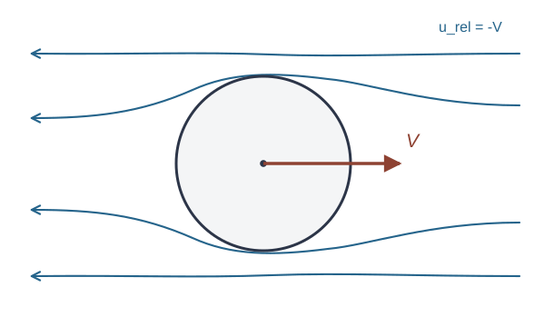

# FLUID15 三次元ポテンシャル流と付加質量は何を予測するか

二次元の[円柱まわりのポテンシャル流](../FLUID12/index.md#thm-fluid12-cylinder)と[圧力合力](../FLUID14/index.md#def-fluid14-lift-drag)を扱った。では、円柱を**球**に置き換えると速度と圧力はどう変わるか。さらに、静止流体の中で球を加速すると、球自身の質量だけを加速すればよいだろうか。

球の外側の液体も動き出すため、答えは否である。本講義では三次元の調和関数、球面の非貫通条件、非定常圧力を順に計算し、加速度に比例する流体反力を求める。現実の粘性抵抗の式とは区別する。

## 0. 対象、座標と符号

流体は密度 $\rho>0$ が一定の**非圧縮・非粘性・無渦流体**であり、体積力はないとする。剛体の球の半径は $a>0$、中心は $X(t)\in\mathbb R^3$、並進速度は $V(t)=\dot X(t)$、加速度は $A(t)=\dot V(t)$ とする。運動とポテンシャルは必要なだけ滑らかとし、流体は球の外側の無限領域

$$
\Omega(t)=\{x\in\mathbb R^3:|x-X(t)|>a\}
$$

を占める。流体の速度を $u(x,t)$、圧力を $p(x,t)$、遠方の一定圧力を $p_\infty$ と書く。球が**動く問題**では実験室座標で遠方流体は静止し、$u\to0$、$p\to p_\infty$ とする。

球中心からの位置ベクトル $y=x-X(t)$、距離 $r=|y|$、半径方向単位ベクトル $n=y/r$ を用いる。$n$ は**球から流体へ向く法線**であり、外部流体領域 $\Omega$ の内側境界での外向き法線は $-n$ である。必要な場合には極軸を $z$ 方向にとり、$\cos\theta=n\cdot e_z$ とする。球面素は $dS=a^2\sin\theta\,d\theta\,d\varphi$（$0\leq\theta\leq\pi$、$0\leq\varphi<2\pi$）である。

既習の[速度ポテンシャル](../FLUID11/index.md#def-fluid11-velocity-potential)を三次元にも用い、$u=\nabla\phi$ とする。非圧縮条件 $\nabla\cdot u=0$ は、球の外で

$$
\Delta\phi=0
$$

を意味する。二次元の複素ポテンシャルではなく、**三次元の調和ポテンシャル**を直接求める。

球に密着した流体は表面を横切れない。ただし非粘性模型では接線速度まで球の接線速度と等しいとは要求しない。この法線方向だけの条件を明確にする。

<!-- formal-statement-start -->
> **定義（並進球の非貫通条件）**  
> 半径 $a>0$、中心 $X(t)$ の剛体球が速度 $V(t)=\dot X(t)$ で並進するとき、流体速度場 $u$ が球面 $|x-X(t)|=a$ において、球から流体へ向く単位法線 $n=(x-X(t))/a$ に対し

$$
(u-V)\cdot n=0
$$

> を満たすことを、球面の非貫通条件という。速度ポテンシャル $u=\nabla\phi$ を持つ場合は $\partial_r\phi|_{r=a}=V\cdot n$ と同値である。
<!-- formal-statement-end -->

直接例として、球が静止していれば $V=0$ だから $\partial_r\phi(a,\theta)=0$ が必要である。球が $V e_z$ で動く場合、北極 $\theta=0$ では $\partial_r\phi=V$、赤道 $\theta=\pi/2$ では $\partial_r\phi=0$、南極 $\theta=\pi$ では $\partial_r\phi=-V$ となる。赤道で半径方向の速度が零でも、接線方向に流れがあってよいことに注意する。

## 1. 球の外で減衰する調和ポテンシャルを作る

二次元の二重湧出は遠方で距離の逆数程度に減衰した。三次元で球を流れから避ける効果を表すには、どのべき乗が調和条件を満たすかを調べる。

極軸 $e_z$ に対称な候補を $f(r)\cos\theta$ とする。球面座標で角度方向と半径方向の微分を分けると

$$
\Delta\{f(r)\cos\theta\}
=\left(f''(r)+\frac{2}{r}f'(r)-\frac{2}{r^2}f(r)\right)\cos\theta.
$$

ここで角度項は $\partial_\theta(\sin\theta\,\partial_\theta\cos\theta)=-2\sin\theta\cos\theta$ から生じる。$f(r)=r^k$ を代入すると角括弧の係数は $[k(k-1)+2k-2]r^{k-2}=[k(k+1)-2]r^{k-2}$ となる。したがって $k=1,-2$ の二つが得られる。

<!-- formal-statement-start -->
> **命題（軸対称一次角モードの調和性）**  
> 原点以外の三次元領域で、$r=|x|>0$、$\cos\theta=x_3/r$ とすると、$r\cos\theta=x_3$ と $r^{-2}\cos\theta=x_3/r^3$ はいずれも調和関数である。これらの線形結合

$$
\phi(r,\theta)=\left(Ar+\frac{B}{r^2}\right)\cos\theta
$$

> も $r>0$ で調和であり、$r^{-2}\cos\theta$ の項は無限遠で零へ減衰する。
<!-- formal-statement-end -->

### 証明の見取り図

調和性は上のラプラシアンの形で $f=r$ と $f=r^{-2}$ をそれぞれ代入して確認する。[ポテンシャル流の重ね合わせ](../FLUID12/index.md#prop-fluid12-superposition)と同様に、ラプラシアンの線形性が最後の主張を支える。ただし三次元では減衰の次数が二次元と異なる。

<!-- proof-start -->
### 証明

$r>0$ で $f=r$ なら $f'=1$、$f''=0$ であり

$$
f''+\frac{2f'}r-\frac{2f}{r^2}
=0+\frac2r-\frac2r=0.
$$

$f=r^{-2}$ なら $f'=-2r^{-3}$、$f''=6r^{-4}$ であり

$$
f''+\frac{2f'}r-\frac{2f}{r^2}
=(6-4-2)r^{-4}=0.
$$

ゆえに二関数とも調和である。$\Delta(Af+Bg)=A\Delta f+B\Delta g$ より線形結合も調和であり、$|\cos\theta|\leq1$ なので $|r^{-2}\cos\theta|\leq r^{-2}\to0$ となる。
<!-- proof-end -->

**直接確認**：$r^{-2}\cos\theta=z/r^3$ は原点では特異であるが、球の外部領域 $r\geq a>0$ では特異点を含まない。この点を省いて「空間全体の調和関数」とは呼べない。

## 2. 静止球を通過する一様流

まず球を固定し、遠方で $Ue_z$（$U>0$）の定常一様流を流す。遠方ポテンシャルは $Ur\cos\theta=Uz$ である。球面で非貫通を満たすために、減衰項 $B r^{-2}\cos\theta$ を加える。

<!-- formal-statement-start -->
> **定理（静止球まわりの一様ポテンシャル流）**  
> 半径 $a>0$ の球を原点に固定し、外部流体 $r>a$ を一定密度の非圧縮・非粘性・無渦の定常流とする。遠方で速度は $Ue_z$（$U>0$）に近づき、球面で $u\cdot n=0$ とする。すると次の調和ポテンシャルはこれらの条件を満たす。

$$
\Phi_U(r,\theta)
=U\left(r+\frac{a^3}{2r^2}\right)\cos\theta.
$$

> 半径方向速度と極角方向速度はそれぞれ

$$
u_r=U\left(1-\frac{a^3}{r^3}\right)\cos\theta,\qquad
u_\theta=-U\left(1+\frac{a^3}{2r^3}\right)\sin\theta.
$$

> 球面の速度は $u_r(a,\theta)=0$、$u_\theta(a,\theta)=-3U\sin\theta/2$ となる。
<!-- formal-statement-end -->

### 証明の見取り図

[調和モード](#prop-fluid15-harmonic-modes)から一様流と減衰項を選び、[非貫通条件](#def-fluid15-no-penetration)へ半径微分を代入して未知係数を定める。角度方向速度は極座標の勾配の接線成分 $u_\theta=r^{-1}\partial_\theta\Phi_U$ で求まる。

<!-- proof-start -->
### 証明

$\Phi=Ur\cos\theta+Br^{-2}\cos\theta$ と置く。$B$ は単位が m$^4$/s の定数である。[調和モード](#prop-fluid15-harmonic-modes)から $\Delta\Phi=0$、また減衰項の勾配は $O(r^{-3})$ なので遠方で $\nabla\Phi\to Ue_z$ となる。

半径方向速度は

$$
u_r=\partial_r\Phi=(U-2Br^{-3})\cos\theta.
$$

球は固定され $V=0$ なので、[非貫通条件](#def-fluid15-no-penetration)はすべての $\theta$ について $(U-2B/a^3)\cos\theta=0$ である。例えば $\theta=0$ で評価すると $B=Ua^3/2$ と決まる。次に角度方向の単位接ベクトルへ勾配を投影すると

$$
u_\theta=\frac{1}{r}\partial_\theta\Phi
=-\left(U+\frac{B}{r^3}\right)\sin\theta
=-U\left(1+\frac{a^3}{2r^3}\right)\sin\theta.
$$

$r=a$ を代入して結論の表面速度を得る。
<!-- proof-end -->

赤道で表面速度の大きさは $3U/2$ に増す。二次元円柱での最大 $2U$ と同じ値にはならない。これは球を回り込める方向が三次元では一つ増えるためである。

<!-- formal-statement-start -->
> **命題（静止球の圧力係数と零合力）**  
> [静止球まわりの一様ポテンシャル流](#thm-fluid15-fixed-sphere)で遠方圧力を $p_\infty$ とする。球面の圧力係数を $C_p=(p-p_\infty)/(\rho U^2/2)$ とすると

$$
C_p(\theta)=1-\frac94\sin^2\theta.
$$

> 球が流体から受ける圧力合力 $F=-\int_{r=a}p\,n\,dS$ は零である。
<!-- formal-statement-end -->

### 証明の見取り図

この流れは定常かつ無渦なので[領域全体の Bernoulli 定数](../FLUID6/index.md#cor-fluid6-global-bernoulli)を適用できる。圧力は前後の反射 $\theta\mapsto\pi-\theta$ で不変だが、法線の $z$ 成分は符号が反転するため、前後の圧力力が打ち消し合う。

<!-- proof-start -->
### 証明

[定常無渦流の Bernoulli 定数](../FLUID6/index.md#cor-fluid6-global-bernoulli)の遠方点で $|u|\to U$、$p\to p_\infty$ を代入して

$$
p+\frac{\rho}{2}|u|^2
=p_\infty+\frac{\rho}{2}U^2.
$$

[定理の表面速度](#thm-fluid15-fixed-sphere)は $u_r=0$、$u_\theta=-3U\sin\theta/2$ であり、速度二乗は $|u|^2=9U^2\sin^2\theta/4$。したがって $C_p=1-9\sin^2\theta/4$。

圧力合力は $F=-\int p n\,dS$。$p$ は $\varphi$ に依らないから、$x,y$ 方向の積分は $\int_0^{2\pi}\cos\varphi\,d\varphi=\int_0^{2\pi}\sin\varphi\,d\varphi=0$ により零。$z$ 方向は

$$
F_z=-2\pi a^2\int_0^\pi p(\theta)\cos\theta\sin\theta\,d\theta.
$$

$\theta\mapsto\pi-\theta$ で $p$ と $\sin\theta$ は変わらず $\cos\theta$ だけ符号が変わるので積分は零である。ゆえに $F=0$。
<!-- proof-end -->

これは三次元でも成り立つ理想流の**零抗力**であり、粘性・剥離・後流を持つ実在球の抗力が零という主張ではない。

## 3. 静止流体の中を動く球

実験室では流体は無限遠で静止し、球だけが並進する。球とともに移る座標では遠方流れは $-V$ となる。二つの観測座標の速度は $u_{\mathrm{lab}}=u_{\mathrm{rel}}+V$ だから、[静止球の解](#thm-fluid15-fixed-sphere)の一様流を $-V$ と置き、球と一緒に動く座標で一様流のポテンシャルを打ち消すと、減衰項だけが実験室で残る。

<!-- formal-statement-start -->
> **定理（並進球の外部ポテンシャル）**  
> 一定半径 $a>0$ の球の中心 $X(t)$ が速度 $V(t)$ で並進し、非圧縮・非粘性・無渦流体は無限遠で静止しているとする。$y=x-X(t)$、$r=|y|>a$、$n=y/r$ と置く。このとき

$$
\phi(x,t)=-\frac{a^3}{2}\frac{V(t)\cdot y}{r^3}
$$

> は $\Delta\phi=0$、$\nabla\phi\to0$（$r\to\infty$）、および球面の非貫通条件 $(\nabla\phi-V)\cdot n=0$ を満たす。速度場は

$$
u(x,t)=\frac{a^3}{2r^3}\{3(V\cdot n)n-V\}.
$$
<!-- formal-statement-end -->

### 証明の見取り図

一様流成分がなくなり、球が押しのける流体の運動だけが残る。**球面の法線方向は $V\cdot n$**、遠方の速度は $r^{-3}$ で減衰する。$V$ の方向を固定する必要はない。ポテンシャルは各直交成分の調和モードの和として構成する。

<!-- proof-start -->
### 証明

固定した時刻では $y$ を変数とし、$V$ の各成分は定数として扱う。[調和モード](#prop-fluid15-harmonic-modes)を各軸へ回転した $y_j/r^3$ は調和であり、その線形結合 $V\cdot y/r^3$ も調和である。$V\cdot y/r^3=O(r^{-2})$ なので $\phi\to0$。

偏微分の中間式は

$$
\nabla_y(V\cdot y)=V,\qquad
\nabla_y(r^{-3})=-3r^{-4}n
$$

であり、積の微分により

$$
\begin{aligned}
\nabla_x\phi
&=-\frac{a^3}{2}\left(r^{-3}V-3r^{-4}(V\cdot y)n\right)\\
&=\frac{a^3}{2r^3}\{3(V\cdot n)n-V\}.
\end{aligned}
$$

$r=a$ で法線との内積を取ると

$$
u\cdot n=\frac12\{3(V\cdot n)-(V\cdot n)\}=V\cdot n.
$$

これが[非貫通条件](#def-fluid15-no-penetration)である。遠方で $|u|=O(r^{-3})\to0$ も成立する。
<!-- proof-end -->

球が $+z$ 方向に進むとき、北極の流体は球と同じ $+z$ 速度、赤道では接線方向へ $-V/2$ の速度を持つ。ここに**無滑り条件は課していない**。また $r=a$ の流体速度全体が球速度 $V$ と一致する必要もない。

この模式図の流線は球と一緒に動く座標での定性的な形を表す。$V$ は実験室での球の並進速度であり、曲線上の矢印は球固定座標で観察した相対流れを表す。同じ流れでも**座標系を区別**して読む必要がある。

## 4. 非定常圧力から流体反力を積分する

球を一定速度で動かす場合、前後対称な圧力分布により正味の圧力合力は零である。しかし**加速すると**流体速度場自体が時間変化し、圧力に加速度依存の項が生じる。

[一定密度の Euler 方程式](../FLUID6/index.md#thm-fluid6-euler-equation)は、体積力がないとき $\partial_t u+(u\cdot\nabla)u=-\nabla(p/\rho)$ である。$u=\nabla\phi$ かつ $\nabla\times u=0$ なら、成分ごとの積の微分で $(u\cdot\nabla)u=\nabla(|u|^2/2)$ となる。したがって

$$
\nabla\left(\partial_t\phi+\frac12|\nabla\phi|^2+\frac p\rho\right)=0.
$$

連結な外部領域で括弧内は時間だけの関数である。無限遠では $\phi,\partial_t\phi,u$ が零に近づくようポテンシャルの定数を選んだので、その関数は $p_\infty/\rho$ になる。すなわち**非定常 Bernoulli 関係**は

$$
p=p_\infty-\rho\left(\partial_t\phi+\frac12|u|^2\right).
$$

この関係は定常の Bernoulli 定数をそのまま流用したのではなく、Euler 方程式から導いた。時間微分は**位置 $x$ を固定した偏微分**であり、球とともに移動する $y$ を固定してはならない。

<!-- formal-statement-start -->
> **定義（並進球の付加質量）**  
> 一定半径の剛体球が、密度 $\rho>0$ の無限に広い非圧縮・非粘性・無渦流体の中を並進し、球面で非貫通条件が成り立つとする。圧力による流体から球への力のうち加速度 $A=\dot V$ に比例して逆向きに作用する項が $-m_{\mathrm a}A$ と書けるとき、その正の係数 $m_{\mathrm a}$ を**付加質量**という。次元は質量 $\mathrm{kg}$ である。
<!-- formal-statement-end -->

定義の直接例として、単位加速度 $A=e_z$ を与えたとき圧力の加速度項が北極と南極で反対符号なら、圧力力は $-e_z$ 方向に生じ得る。以下で球面全体を積分し、係数が実際に正であることを確かめる。

<!-- formal-statement-start -->
> **定理（加速球の圧力合力と付加質量）**  
> [並進球の外部ポテンシャル](#thm-fluid15-moving-sphere)の流れで、球の半径を $a>0$、密度を $\rho>0$、並進速度を $V(t)$、加速度を $A(t)$ とする。無限遠は静止、圧力は $p_\infty$ で、体積力・粘性・自由表面はないものとする。球面上の圧力は

$$
p=p_\infty+\frac{\rho a}{2}A\cdot n
-\frac{\rho}{8}\{5|V|^2-9(V\cdot n)^2\}.
$$

> 球が流体から受ける圧力合力は

$$
F_{\mathrm{fluid}}=-m_{\mathrm a}A,\qquad
m_{\mathrm a}=\frac{2\pi}{3}\rho a^3
=\frac12\rho\frac{4\pi a^3}{3}.
$$

> すなわち球が押しのける流体の質量のちょうど半分が付加質量であり、一定速度の並進では $F_{\mathrm{fluid}}=0$ である。
<!-- formal-statement-end -->

### 証明の見取り図

核心は二点。第一に、球中心が動くため、実験室座標での $\partial_t\phi$ には $A$ だけでなく $V^2$ の項も現れる。第二に、$V$ の二次項は球面の反対側で同じ大きさを持ち、$-\int p n\,dS$ で消える。一方、加速度項には $A\cdot n$ が残り、$\int n_i n_j\,dS=(4\pi a^2/3)\delta_{ij}$ から係数が出る。

<!-- proof-start -->
### 証明

$y=x-X(t)$ とし、$x$ を固定して時間微分する。$\partial_t y=-V$、$\partial_t r^{-3}=(-3r^{-4})\partial_t r$ であり、$\partial_t r=n\cdot(-V)=-V\cdot n$。ゆえに

$$
\partial_t(r^{-3})=3r^{-4}(V\cdot n).
$$

さらに $\partial_t(V\cdot y)=A\cdot y-|V|^2$。従って[並進球のポテンシャル](#thm-fluid15-moving-sphere)を微分すると

$$
\begin{aligned}
\partial_t\phi
&=-\frac{a^3}{2}\left[
\frac{A\cdot y-|V|^2}{r^3}
+\frac{3(V\cdot y)(V\cdot n)}{r^4}
\right]\\
&=-\frac{a^3}{2r^2}A\cdot n
+\frac{a^3}{2r^3}\{|V|^2-3(V\cdot n)^2\}.
\end{aligned}
$$

$r=a$ では

$$
\left.\partial_t\phi\right|_{r=a}
=-\frac a2 A\cdot n+\frac12\{|V|^2-3(V\cdot n)^2\}.
$$

また[表面速度](#thm-fluid15-moving-sphere)は $u=\{3(V\cdot n)n-V\}/2$。これを二乗し

$$
\begin{aligned}
|u|^2
&=\frac14\left\{9(V\cdot n)^2-6(V\cdot n)^2+|V|^2\right\}\\
&=\frac14\{|V|^2+3(V\cdot n)^2\}.
\end{aligned}
$$

[Euler 方程式から導いた非定常 Bernoulli 関係](../FLUID6/index.md#thm-fluid6-euler-equation)により $p=p_\infty-\rho(\partial_t\phi+|u|^2/2)$ だから、球面では

$$
\begin{aligned}
p-p_\infty
&=\frac{\rho a}{2}A\cdot n
-\frac{\rho}{2}\{|V|^2-3(V\cdot n)^2\}\\
&\hspace{1em}-\frac{\rho}{8}\{|V|^2+3(V\cdot n)^2\}\\
&=\frac{\rho a}{2}A\cdot n-\frac{\rho}{8}\{5|V|^2-9(V\cdot n)^2\}.
\end{aligned}
$$

球に働く圧力力は、球から流体へ向く $n$ を使って $F=-\int_{r=a}pn\,dS$。球面の反転 $n\mapsto-n$ で定数項、$|V|^2$ と $(V\cdot n)^2$ は変化せず、$n$ だけ符号を変えるので、それらの合力は零である。残る加速度項は成分ごとに

$$
(F_{\mathrm{fluid}})_i=-\frac{\rho a}{2}\sum_{j=1}^3
A_j\int_{r=a}n_i n_j\,dS.
$$

$i\neq j$ では例えば $n_i\mapsto-n_i$ の反射により積分は零。$i=j$ について三成分は球対称で同じ値を取り、その和は $\int(n_1^2+n_2^2+n_3^2)\,dS=4\pi a^2$ だから、それぞれ $4\pi a^2/3$。したがって

$$
(F_{\mathrm{fluid}})_i
=-\frac{\rho a}{2}\frac{4\pi a^2}{3}A_i
=-\frac{2\pi}{3}\rho a^3 A_i.
$$

これは各 $i$ で成立し、ベクトル形式の結論を得る。
<!-- proof-end -->

**数値と次元の直接確認**：例えば水の密度を $\rho=1000\ \mathrm{kg/m^3}$、半径を $a=0.10\ \mathrm m$ とすると、排除した水の質量は $(4\pi/3)\rho a^3\approx4.189$ kg、付加質量は約 $2.094$ kg である。$A=2\ \mathrm{m/s^2}$ のとき加速度に抗する流体力は約 $4.189$ N。$\rho a^3$ の次元が kg、$m_{\mathrm a}A$ の次元が N であることも確認できる。

## 5. 流体の運動エネルギーと付加質量

圧力積分で出た質量は、流体を動かすための**運動エネルギー**からも求められる。これは別の検算になる。

<!-- formal-statement-start -->
> **命題（並進球が誘起する流体の運動エネルギー）**  
> [並進球の外部ポテンシャル](#thm-fluid15-moving-sphere)により、密度 $\rho>0$ の無限流体中で半径 $a>0$ の球が速度 $V$ で並進するとき、無限領域の流体運動エネルギーは有限であり

$$
T_{\mathrm{fluid}}=
\frac{\rho}{2}\int_{|x-X|>a}|u|^2\,d^3x
=\frac12 m_{\mathrm a}|V|^2,
\qquad m_{\mathrm a}=\frac{2\pi}{3}\rho a^3.
$$
<!-- formal-statement-end -->

### 証明の見取り図

$\Delta\phi=0$ だから $\nabla\cdot(\phi\nabla\phi)=|\nabla\phi|^2$ である。半径 $R$ で切った外部領域に[Gauss--Ostrogradsky の発散定理](../../../幾何系/VC/VC4/index.md#thm-vc4-gauss-divergence)を使うと、**球面の領域外向き法線は $-n$**、遠方球面からの寄与は消える。球面のポテンシャル値と法線微分だけで全エネルギーが決まる。

<!-- proof-start -->
### 証明

球の外側 $a<r<R$ に[Gauss--Ostrogradsky の発散定理](../../../幾何系/VC/VC4/index.md#thm-vc4-gauss-divergence)を適用する。$\Delta\phi=0$ を[調和モード](#prop-fluid15-harmonic-modes)と[並進球の解](#thm-fluid15-moving-sphere)から確認済みなので、

$$
\int_{a<r<R}|\nabla\phi|^2\,d^3x
=\int_{r=R}\phi\,\partial_r\phi\,dS
+\int_{r=a}\phi\,(-\partial_r\phi)\,dS.
$$

遠方では $\phi=O(r^{-2})$、$\partial_r\phi=O(r^{-3})$、面積は $O(R^2)$ だから第1項は $O(R^{-3})\to0$。球面では $\phi=-a(V\cdot n)/2$、$\partial_r\phi=V\cdot n$ である。したがって

$$
\int_{r>a}|u|^2\,d^3x
=\frac a2\int_{r=a}(V\cdot n)^2\,dS.
$$

球面の回転対称性から $\int n_i n_j\,dS=(4\pi a^2/3)\delta_{ij}$ である。これを用いると

$$
\int_{r>a}|u|^2\,d^3x
=\frac a2\frac{4\pi a^2}{3}|V|^2
=\frac{2\pi}{3}a^3|V|^2.
$$

両辺に $\rho/2$ を掛け、[付加質量](#thm-fluid15-added-mass)の値を代入して結論を得る。
<!-- proof-end -->

球本体の質量が $m_{\mathrm b}>0$ で、球に外力 $F_{\mathrm{ext}}$ だけが働くなら、Newton の運動方程式 $m_{\mathrm b}A=F_{\mathrm{ext}}+F_{\mathrm{fluid}}$ は

$$
(m_{\mathrm b}+m_{\mathrm a})A=F_{\mathrm{ext}}
$$

となる。球の慣性が実効的に増えるのであって、球に物理的な流体の塊が貼り付いて一緒に並進しているわけではない。球が停止すると、理想模型では付随する流体の速度場も零に戻る。

## 6. 球以外では付加質量は方向によって変わる

球はすべての方向が対等なので、付加質量は単一の数 $m_{\mathrm a}$ でよい。細長い剛体では横方向と長軸方向で押しのける流れが異なる。そこで方向依存性を行列で整理する。

滑らかな有界剛体 $B\subset\mathbb R^3$ の外部領域 $\Omega=\mathbb R^3\setminus\overline B$ を考え、剛体から流体へ向く単位法線を $n$ とする。剛体を単位速度 $e_j$ で動かす際の、無限遠で零に減衰する調和ポテンシャル $\psi_j$ が存在すると仮定する。その球面でない一般の表面に対しても境界条件は $\partial_n\psi_j=n_j$ である。ここで $n_j=e_j\cdot n$。$u=\sum_j V_j\nabla\psi_j$ は法線方向で $V\cdot n$ に等しい。

<!-- formal-statement-start -->
> **定義（並進の付加質量行列）**  
> 滑らかな有界剛体 $B$ とその外部の一定密度 $\rho>0$ の非圧縮・非粘性・無渦流体を考える。$j=1,2,3$ に対し $\Delta\psi_j=0$（$\Omega$ 内）、$\partial_n\psi_j=n_j$（$\partial B$ 上）、$\psi_j\to0$（無限遠）を満たし、$\nabla\psi_j$ が平方可積分なポテンシャルを選ぶ。**並進の付加質量行列**を次の $3\times3$ 実行列と定める。

$$
M_{ij}=-\rho\int_{\partial B}\psi_j n_i\,dS.
$$

> $V\in\mathbb R^3$ に対する誘起流体の運動エネルギーは $T_{\mathrm{fluid}}=\frac12 V^\mathsf{T}MV$ である。
<!-- formal-statement-end -->

定義から判定までの橋渡しを確認しよう。流速は $\nabla\phi=\sum_j V_j\nabla\psi_j$ なので、エネルギーを二乗展開すると $\frac{\rho}{2}\sum_{ij}V_iV_j\int_\Omega\nabla\psi_i\cdot\nabla\psi_j\,d^3x$ となる。次の命題で体積積分と定義の表面積分が一致することを示す。行列を突然置いたのではなく、**流体の運動エネルギーの二次形式**の係数として自然に現れる。

<!-- formal-statement-start -->
> **命題（付加質量行列の対称性と正値性）**  
> [付加質量行列](#def-fluid15-added-mass-matrix)の仮定に加え、各 $\psi_j$ が十分滑らかで、無限遠の境界項が消える程度に減衰するとする。このとき

$$
M_{ij}=\rho\int_\Omega\nabla\psi_i\cdot\nabla\psi_j\,d^3x=M_{ji},
\qquad V^\mathsf{T}MV\geq0.
$$

> したがって $M$ は対称・半正定値であり、半径 $a$ の球なら $M=m_{\mathrm a}I_3$ となる。
<!-- formal-statement-end -->

### 証明の見取り図

[流体エネルギー](#prop-fluid15-fluid-energy)と同じ [Gauss--Ostrogradsky の発散定理](../../../幾何系/VC/VC4/index.md#thm-vc4-gauss-divergence)を $\psi_i\nabla\psi_j$ に適用する。球では $\psi_j=-a n_j/2$ なので定義の積分を直接計算でき、どの方向も同じ係数を持つ。

<!-- proof-start -->
### 証明

$\nabla\cdot(\psi_i\nabla\psi_j)=\nabla\psi_i\cdot\nabla\psi_j+\psi_i\Delta\psi_j$ かつ $\Delta\psi_j=0$。無限遠の項は仮定で零、剛体表面では流体領域の外向き法線が $-n$ なので

$$
\begin{aligned}
\int_\Omega\nabla\psi_i\cdot\nabla\psi_j\,d^3x
&=-\int_{\partial B}\psi_i\,\partial_n\psi_j\,dS\\
&=-\int_{\partial B}\psi_i n_j\,dS
=\frac{M_{ji}}{\rho}.
\end{aligned}
$$

内積は $i,j$ で対称なので $M_{ij}=M_{ji}$ となり、同じ式で

$$
V^\mathsf{T}MV=\rho\int_\Omega
\left|\sum_j V_j\nabla\psi_j\right|^2\,d^3x\geq0.
$$

球のとき[並進球のポテンシャル](#thm-fluid15-moving-sphere)から $\psi_j=-a^3y_j/(2r^3)$ であり、球面では $\psi_j=-an_j/2$。よって

$$
M_{ij}=\frac{\rho a}{2}\int_{r=a}n_i n_j\,dS
=\frac{2\pi}{3}\rho a^3\delta_{ij}=m_{\mathrm a}\delta_{ij}.
$$

これで定義の各条件を実例で確認した。球の $\psi_j$ は外部で調和、球面で $\partial_n\psi_j=n_j$、無限遠で $O(r^{-2})$ に減衰し、勾配は $O(r^{-3})$ なので平方可積分でもある。
<!-- proof-end -->

この行列は、静止した形状と向きについての**並進**に限った定義である。剛体が回転すれば姿勢による $M$ の変化や角速度との結合も考える必要がある。有限容器や水面、圧縮性、粘性によっても値と適用範囲は変わる。

## 7. 球面積分の数値検算と模型の限界

球面積分の要点は、$\int_0^\pi\cos^2\theta\sin\theta\,d\theta=2/3$ である。$s=\cos\theta$ と置けば積分区間は $s:1\to-1$、$ds=-\sin\theta\,d\theta$ だから

$$
\int_0^\pi\cos^2\theta\sin\theta\,d\theta
=\int_{-1}^1s^2\,ds=\left[\frac{s^3}{3}\right]_{-1}^{1}=\frac23.
$$

[球面積分の検算コード](sphere_check.py)では、$\theta$ に関する Simpson 則を用いて $m_{\mathrm a}$ の係数と対称性を計算できる。これは証明の代わりではなく、$2\pi$、$a^2$、符号の入力ミスを独立に検出する補助である。実行時には刻み数を増やし、解析値 $2/3$ と誤差を比較する。

この講義の模型では、球は非粘性流体の表面を滑り、流れは全域で無渦で、球の周囲の流体は無限に広い。粘性境界層・剥離がある実在球の抗力、容器壁の影響、加速直後に生じる渦などはこの模型からは予測できない。**付加質量と粘性抵抗を同一視しない**ことが重要である。

## 8. 演習

断りがなければ $\rho,a>0$、流体は無限に広い非圧縮・非粘性・無渦流体、球面では非貫通とする。$n$ は球から流体へ向く法線で、圧力合力は $F=-\int p n\,dS$ である。

### Level A

### A1. 調和性と減衰次数

三次元球面座標で $\Delta(f(r)\cos\theta)=[f''+2f'/r-2f/r^2]\cos\theta$ を与える。$r>0$ で $f(r)=r^{-2}$ が調和であること、ポテンシャルと速度の減衰次数を求めよ。

- Level: A

<!-- solution-start -->
#### 詳細解答

$f'= -2r^{-3}$、$f''=6r^{-4}$ を代入すると $f''+2f'/r-2f/r^2=(6-4-2)r^{-4}=0$。$\cos\theta$ は有界なのでポテンシャルは $O(r^{-2})$。半径微分は $-2r^{-3}\cos\theta$、極角方向の速度は $r^{-1}\partial_\theta(r^{-2}\cos\theta)=-r^{-3}\sin\theta$ である。いずれも $O(r^{-3})$ なので速度は三乗で減衰する。原点 $r=0$ は除外する。
<!-- solution-end -->

### A2. 球面を横切らない速度

半径 $a$ の静止球に対して $\Phi=(Ur+Br^{-2})\cos\theta$（$U>0$）とする。$\partial_r\Phi(a,\theta)=0$ となる $B$ を導き、赤道の接線速度を求めよ。

- Level: A

<!-- solution-start -->
#### 詳細解答

$\partial_r\Phi=(U-2B/r^3)\cos\theta$ である。[非貫通条件](#def-fluid15-no-penetration)の $\partial_r\Phi(a,0)=0$ を使うと $U-2B/a^3=0$、従って $B=Ua^3/2$。角度速度は $u_\theta=r^{-1}\partial_\theta\Phi=-(U+B/r^3)\sin\theta$。赤道の $r=a$、$\theta=\pi/2$ を代入し $u_\theta=-U-U/2=-3U/2$。赤道の法線成分は零、接線成分は零でなくてよい。
<!-- solution-end -->

### A3. 球表面の圧力係数

半径 $a$ の固定球の外側に遠方速度 $Ue_z$、遠方圧力 $p_\infty$ の定常ポテンシャル流を考える。表面速度が $u_\theta=-3U\sin\theta/2$、$u_r=0$ と分かっている。極 $\theta=0,\pi$ と赤道 $\theta=\pi/2$ の圧力係数を求め、低圧がどこにあるか述べよ。

- Level: A

<!-- solution-start -->
#### 詳細解答

定常・無渦なので[全域 Bernoulli 積分](../FLUID6/index.md#cor-fluid6-global-bernoulli)が使え、$p-p_\infty=\rho(U^2-|u|^2)/2$。従って $C_p=1-|u|^2/U^2=1-9\sin^2\theta/4$。両極では $\sin\theta=0$ より $C_p=1$、赤道では $\sin^2\theta=1$ より $C_p=-5/4$。赤道で圧力が低くても、前後対称性により全圧力合力は零となる。
<!-- solution-end -->

### A4. 偶関数と奇関数による球面積分

半径 $a$ の球面で $V=Ve_z$（$V>0$）とする。$\int_S(V\cdot n)^2n\,dS$ が零であり、$\int_S(V\cdot n)n\,dS=(4\pi a^2/3)V e_z$ となることを示せ。

- Level: A

<!-- solution-start -->
#### 詳細解答

反転 $n\mapsto-n$ は球面積分を保つ。$(V\cdot n)^2$ は反転で変わらず $n$ は符号が逆なので、第一の積分は零。第二は $x,y$ 成分が $\varphi$ の周期積分により零で、$z$ 成分は

$$
Va^2\int_0^{2\pi}d\varphi\int_0^\pi\cos^2\theta\sin\theta\,d\theta
=2\pi Va^2\int_{-1}^1s^2\,ds
=\frac{4\pi a^2}{3}V.
$$

この差が圧力の速度二乗項と加速度一次項の合力の違いを決める。
<!-- solution-end -->

### Level B

### B1. 動く球の境界条件と軸方向速度

中心 $X(t)$ が速度 $V(t)=v(t)e_z$ で並進する球について、実験室で $\phi(x,t)= -a^3 v(t)(z-X_z(t))/(2|x-X(t)|^3)$ とする。固定した時刻の外部で調和であること、北極・赤道・南極で法線方向の非貫通条件を満たすことを示せ。

- Level: B

<!-- solution-start -->
#### 詳細解答

$y=x-X(t)$ と置き、固定時刻に $v$ は定数である。[調和モード](#prop-fluid15-harmonic-modes)で $y_z/|y|^3$ が調和なので $\Delta\phi=0$。$\nabla\phi=\frac{a^3v}{2r^3}(3n_zn-e_z)$ から $r=a$ の法線成分は $u\cdot n=(v/2)(3n_z-n_z)=vn_z$。北極 $n_z=1$ で $v$、赤道 $n_z=0$ で零、南極 $n_z=-1$ で $-v$。いずれも球面の $V\cdot n$ に等しい。さらに速度の大きさは $O(r^{-3})$ で遠方静止条件も満たす。
<!-- solution-end -->

### B2. 実験室での時間微分を忘れない

球中心 $X(t)$ が速度 $V(t)$、加速度 $A(t)$ で動く。$y=x-X(t)$、$r=|y|$、$n=y/r$ とし、$\phi=-a^3(V\cdot y)/(2r^3)$ を与える。**$x$ を固定して** $\partial_t\phi$ を求め、$r=a$ での式を示せ。特に一定速度でも時間微分が一般に零でないことを説明せよ。

- Level: B

<!-- solution-start -->
#### 詳細解答

$\partial_t y=-V$、$\partial_t r=-V\cdot n$。積・連鎖律を順に用いると $\partial_t(V\cdot y)=A\cdot y-|V|^2$、$\partial_t r^{-3}=3r^{-4}(V\cdot n)$ だから

$$
\begin{aligned}
\partial_t\phi
&=-\frac{a^3}{2}\left\{(A\cdot y-|V|^2)r^{-3}
+3(V\cdot y)(V\cdot n)r^{-4}\right\}\\
&=-\frac{a^3}{2r^2}A\cdot n+
\frac{a^3}{2r^3}\{|V|^2-3(V\cdot n)^2\}.
\end{aligned}
$$

$r=a$ で $\partial_t\phi=-a(A\cdot n)/2+\{|V|^2-3(V\cdot n)^2\}/2$。$A=0$ でも移動する中心を固定した実験室点から見れば $y$ が時間変化するため、第二項が残る。球固定座標での微分と混同してはいけない。
<!-- solution-end -->

### B3. 運動エネルギーから質量を求める

半径 $a$ の並進球のポテンシャル $\phi=-a^3(V\cdot n)/(2r^2)$ が調和、球面で $\partial_r\phi=V\cdot n$、遠方で $\phi=O(r^{-2})$、$\partial_r\phi=O(r^{-3})$ を満たすものとする。[Gauss--Ostrogradsky の発散定理](../../../幾何系/VC/VC4/index.md#thm-vc4-gauss-divergence)を用いて $T_{\mathrm{fluid}}=\rho\int_{r>a}|\nabla\phi|^2\,d^3x/2$ を計算せよ。

- Level: B

<!-- solution-start -->
#### 詳細解答

$\nabla\cdot(\phi\nabla\phi)=|\nabla\phi|^2+\phi\Delta\phi=|\nabla\phi|^2$ なので $a<r<R$ に[Gauss--Ostrogradsky の発散定理](../../../幾何系/VC/VC4/index.md#thm-vc4-gauss-divergence)を適用する。$r=a$ で流体領域の外向き法線が $-n$ であることから

$$
\int_{a<r<R}|\nabla\phi|^2\,d^3x
=\int_{r=R}\phi\partial_r\phi\,dS
-\int_{r=a}\phi\partial_r\phi\,dS.
$$

第1項は $O(R^{-3})\to0$。第2項の中身は $-\phi\partial_r\phi=(a/2)(V\cdot n)^2$ だから

$$
\int_{r>a}|\nabla\phi|^2\,d^3x
=\frac a2\frac{4\pi a^2}{3}|V|^2.
$$

流体の運動エネルギーは

$$
\begin{aligned}
T_{\mathrm{fluid}}
&=\frac{\rho}{2}\frac{2\pi a^3}{3}|V|^2\\
&=\frac{\pi\rho a^3}{3}|V|^2
=\frac12\frac{2\pi\rho a^3}{3}|V|^2.
\end{aligned}
$$

よって流体の運動エネルギーから得た付加質量は $2\pi\rho a^3/3$。
<!-- solution-end -->

### B4. 方向依存の質量行列

一般の滑らかな有界剛体 $B$ で、外向き法線（剛体から流体へ向く）を $n$ とする。調和関数 $\psi_j$ が $\partial_n\psi_j=n_j$、無限遠で十分減衰すると仮定する。$M_{ij}=-\rho\int_{\partial B}\psi_j n_i\,dS$ が対称・半正定値であることを示せ。

- Level: B

<!-- solution-start -->
#### 詳細解答

$\Delta\psi_j=0$ より $\nabla\cdot(\psi_i\nabla\psi_j)=\nabla\psi_i\cdot\nabla\psi_j$。流体外部領域での内側境界の法線は $-n$ である。無限遠の積分を零とすると

$$
\int_\Omega\nabla\psi_i\cdot\nabla\psi_j\,d^3x
=-\int_{\partial B}\psi_i\partial_n\psi_j\,dS
=-\int_{\partial B}\psi_i n_j\,dS=M_{ji}/\rho.
$$

左辺の内積が $i,j$ 交換で変わらないから $M_{ji}=M_{ij}$。$V\in\mathbb R^3$ に対して

$$
V^\mathsf{T}MV=\rho\int_\Omega
\left|\sum_j V_j\nabla\psi_j\right|^2\,d^3x\ge0
$$

となり、対称・半正定値が示された。表面積分から直接対称性を推測したのではなく、体積中のエネルギー内積に変換した点が核心である。
<!-- solution-end -->

### Level C

### C1. 加振する球を動かす外力と流体の仕事

質量 $m_{\mathrm b}>0$、半径 $a>0$ の球が、密度 $\rho>0$ の理想無限流体中で $z$ 方向だけを並進する。球の重力・浮力等を無視し、外力 $F_{\mathrm{ext}}(t)=F_0\cos(\omega t)e_z$（$F_0>0,\omega>0$）を受ける。初期条件は $X(0)=0$、$V(0)=0$ である。

(1) 球面ポテンシャルと非定常 Bernoulli 関係を用い、流体圧力の合力が $-m_{\mathrm a}A$、$m_{\mathrm a}=2\pi\rho a^3/3$ となることを導け。途中で用いた $\partial_t\phi$ と $\int_S n_z^2dS$ を明示せよ。

(2) $V(t)$ と $X(t)$ を求めよ。

(3) 球と流体の運動エネルギーの和を求め、時刻 $0$ から $t$ までの外力の仕事と一致することを確かめよ。

- Level: C

<!-- solution-start -->
#### 詳細解答

**(1) ポテンシャルと圧力力。** 球の速度を $V=ve_z$、加速度を $A=\dot v e_z$ とする。[並進球のポテンシャル](#thm-fluid15-moving-sphere)は $\phi=-a^3 v(z-X_z)/(2r^3)$。$x$ を固定した偏微分では $\partial_t(z-X_z)=-v$ と $\partial_t r^{-3}=3vr^{-4}n_z$ を使うので

$$
\partial_t\phi|_{r=a}
=-\frac a2\dot v\,n_z+\frac{v^2}{2}(1-3n_z^2).
$$

球面で $|u|^2=v^2(1+3n_z^2)/4$。[Euler 方程式](../FLUID6/index.md#thm-fluid6-euler-equation)に $u=\nabla\phi$ を代入して導いた非定常 Bernoulli 関係から

$$
p-p_\infty=\frac{\rho a}{2}\dot v\,n_z-\frac{\rho v^2}{8}(5-9n_z^2).
$$

定数と $n_z^2$ を含む圧力項は球面で反転対称なので、$F_z=-\int_S p n_z\,dS$ の積分では零。球面の角度積分は

$$
\int_S n_z^2\,dS
=2\pi a^2\int_0^\pi\cos^2\theta\sin\theta\,d\theta
=2\pi a^2\int_{-1}^1s^2\,ds
=\frac{4\pi a^2}{3}.
$$

よって

$$
F_z=-\frac{\rho a}{2}\dot v\,\frac{4\pi a^2}{3}
=-\frac{2\pi}{3}\rho a^3\dot v=-m_{\mathrm a}\dot v.
$$

$x,y$ 成分は $\varphi$ 積分で零になるため、$F_{\mathrm{fluid}}=-m_{\mathrm a}A$。

**(2) 運動。** 球本体の質量と付加質量を $M=m_{\mathrm b}+m_{\mathrm a}$ とおく。Newton の運動方程式は $M\dot v=F_0\cos(\omega t)$。$v(0)=0$ で積分すると

$$
v(t)=\frac{F_0}{\omega M}\sin(\omega t).
$$

さらに $\dot X_z=v$、$X_z(0)=0$ であるから

$$
X_z(t)=\frac{F_0}{\omega M}\int_0^t\sin(\omega s)\,ds
=\frac{F_0}{\omega^2 M}\{1-\cos(\omega t)\}.
$$

**(3) 仕事とエネルギー。** [流体運動エネルギー](#prop-fluid15-fluid-energy)は $m_{\mathrm a}v^2/2$、球自身は $m_{\mathrm b}v^2/2$ だから

$$
T_{\mathrm{total}}(t)=\frac12 Mv(t)^2
=\frac{F_0^2}{2\omega^2M}\sin^2(\omega t).
$$

外力がした仕事は $\int_0^t F_0\cos(\omega s)v(s)\,ds$。上の $v(s)$ を代入し、$\frac{d}{ds}\sin^2(\omega s)=2\omega\sin(\omega s)\cos(\omega s)$ を使うと

$$
\begin{aligned}
W(0,t)
&=\frac{F_0^2}{\omega M}\int_0^t\sin(\omega s)\cos(\omega s)\,ds\\
&=\frac{F_0^2}{2\omega^2M}[\sin^2(\omega s)]_0^t\\
&=\frac{F_0^2}{2\omega^2M}\sin^2(\omega t)=T_{\mathrm{total}}(t).
\end{aligned}
$$

初期運動エネルギーは零なので仕事と一致する。付加質量を省いた $m_{\mathrm b}\dot v=F_{\mathrm{ext}}$ では流体へ渡るエネルギーを説明できない。
<!-- solution-end -->

## 9. 要点と次の講義

- 静止球の一様流は $\Phi_U=U(r+a^3/(2r^2))\cos\theta$。球面接線速度は $-3U\sin\theta/2$、圧力合力は零。
- 動く球では $\phi=-a^3(V\cdot y)/(2r^3)$。非貫通条件は**法線成分だけ**を指定し、実験室での時間微分には球中心の移動項を含める。
- 圧力合力 $F_{\mathrm{fluid}}=-(2\pi\rho a^3/3)A$。付加質量は排除流体の質量の半分で、流体の運動エネルギーからも同じ値が出る。
- 一般形状の付加質量は対称・半正定値の行列で表され、形状と並進方向によって変わる。

次の FLUID16 では理想流から粘性流に切り替え、円管と同心円筒間の定常層流を境界条件から解く。そこで現れる粘性の剪断力・圧力損失は、ここでの加速に伴う慣性反力とは別の仕組みである。
