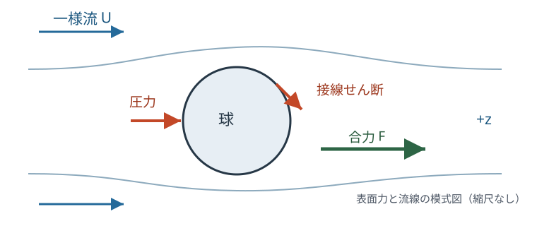

# FLUID18 遅い球周りの流れにかかる抵抗は何か

[FLUID15 の非粘性球周り流れ](../FLUID15/index.md#thm-fluid15-fixed-sphere)では球に働く定常抗力は零だった。しかし実際の液体には粘性があり、ゆっくり動く小球にも抵抗が働く。[FLUID17 の壁面拡散](../FLUID17/index.md#thm-fluid17-first-profile)に続いて、今回は**曲がった固体表面で無滑り条件を課すと、速度と圧力がどう変わるか**を解く。

結論は Stokes の抵抗則 $6\pi\eta aU$ である。係数 $6\pi$ を暗記するだけでは、圧力による抵抗と粘性せん断による抵抗を分けられない。本講では支配方程式から速度場、圧力場、球面の力まで一続きに導出する。

## 0. 慣性を捨ててよいのはいつか

半径 $a>0$ の静止剛体球を原点に置き、無限遠で液体が $+z$ 方向へ一定速度 $U>0$ で流れるとする。流体領域は $\Omega=\{x\in\mathbb R^3:|x|>a\}$ である。密度 $\rho>0$、動的粘性係数 $\eta>0$ は一定、流体は非圧縮 Newton 流体、体積力は零とする。球表面は滑らかで静止し、流体はそこに完全に付着するとする。

既習の[Reynolds 数の定義](../../CTM/CTM16/index.md#def-ctm16-reynolds)と[非圧縮 Navier–Stokes 方程式](../../CTM/CTM15/index.md#thm-ctm15-incompressible-navier-stokes)を使い、空間微分を代表長さ $a$、速度を $U$ で見積もる。対流加速度は $U^2/a$、粘性項を密度で割った大きさは $\eta U/(\rho a^2)$ だから、両者の比は $\rho Ua/\eta$ である。

<a id="def-fluid18-radius-reynolds"></a>

<!-- formal-statement-start -->
> **定義（半径基準 Reynolds 数と低 Reynolds 数の領域）**  
> 一定密度 $\rho>0$、粘性係数 $\eta>0$ の流体が、半径 $a>0$ の球に対し代表相対速度 $U>0$ で流れるとき、半径基準 Reynolds 数を

$$
\mathrm{Re}_a=\frac{\rho Ua}{\eta}
$$

> とする。$\mathrm{Re}_a\ll1$ の領域を本講では低 Reynolds 数の領域と呼ぶ。直径 $d=2a$ を基準とする値は $\mathrm{Re}_d=2\mathrm{Re}_a$ であり、両者を混同しない。
<!-- formal-statement-end -->

<!-- definition-example-start: def-fluid18-radius-reynolds -->
**定義の確認**：水の目安 $\rho=10^3\,\mathrm{kg/m^3}$、$\eta=10^{-3}\,\mathrm{Pa\,s}$、球半径 $a=10^{-3}\,\mathrm m$、相対速度 $U=10^{-5}\,\mathrm{m/s}$ なら、$\rho Ua/\eta=10^3\cdot10^{-5}\cdot10^{-3}/10^{-3}=0.01$、直径基準では $0.02$ となる。単位は $(\mathrm{kg/m^3})(\mathrm{m/s})\mathrm m/(\mathrm{kg/(m\,s)})=1$ である。
<!-- definition-example-end -->

低 Reynolds 数で定常・滑らかな流れを球の大きさ程度の距離で考えれば、移流項が粘性項より小さい。時間微分もなくした**定常 Stokes 近似**では、[非圧縮 Navier–Stokes 方程式](../../CTM/CTM15/index.md#thm-ctm15-incompressible-navier-stokes)の $\rho(v\cdot\nabla)v$ を落とす。遠く離れた領域まで一様に正確という意味ではないことを、最後に確かめる。

<a id="def-fluid18-stokes-sphere"></a>

<!-- formal-statement-start -->
> **定義（静止球の定常 Stokes 境界値問題）**  
> $a,\eta,U>0$ とし、$\Omega=\{x\in\mathbb R^3:|x|>a\}$ とする。未知の速度 $v:\Omega\to\mathbb R^3$ と圧力 $p:\Omega\to\mathbb R$ は十分滑らかで、

$$
-\nabla p+\eta\Delta v=0,\qquad \nabla\cdot v=0 \quad (|x|>a)
$$

> を満たし、[無滑り条件](../../CTM/CTM15/index.md#def-ctm15-no-slip) $v=0$ を $|x|=a$ で、遠方条件 $v(x)\to Ue_z$ と $p(x)\to p_\infty$ を $|x|\to\infty$ で満たすとする。$p_\infty$ は与えた基準圧力である。求める解は軸対称で、無限遠で速度差と圧力差が減衰し、速度勾配と応力も十分減衰するクラスに限る。
<!-- formal-statement-end -->

ここで**軸対称**とは、$z$ 軸の周りに回しても成分の法則が変わらず、周方向の速度成分もない場を指す。極座標の $r=|x|$、$0\le\theta\le\pi$ を、$\theta=0$ が $+z$ 方向となるように取る。$e_r,e_\theta$ は、それぞれ球から外向きの単位方向と $\theta$ の増加方向の単位方向である。$Ue_z=U(\cos\theta\,e_r-\sin\theta\,e_\theta)$ だから、遠方条件の成分は $v_r\to U\cos\theta$、$v_\theta\to-U\sin\theta$ となる。

<!-- definition-example-start: def-fluid18-stokes-sphere -->
**境界条件の確認**：一様場 $v=Ue_z$、$p=p_\infty$ は領域内部の Stokes 方程式と無限遠条件は満たす。しかし球面では $Ue_z\ne0$ で、無滑り条件に反する。逆に $v\equiv0$ は球面条件を満たすが無限遠条件に反する。微分方程式だけでなく両方の境界条件を満たす場が必要である。
<!-- definition-example-end -->

## 1. 球面の条件から速度場を決める

球の前後をつなぐ流れは $z$ 軸に対して対称なので、まず次の一次角依存の形を探す。

$$
v_r=U f(r)\cos\theta,\qquad
v_\theta=-U g(r)\sin\theta,\qquad v_\phi=0 .
$$

この形が先の[境界値問題](#def-fluid18-stokes-sphere)の解を構成できるかを確かめる。球座標の発散と回転の $\phi$ 成分は、この軸対称な場では

$$
\nabla\cdot v=\frac1{r^2}\partial_r(r^2v_r)
+\frac1{r\sin\theta}\partial_\theta(\sin\theta\,v_\theta),\qquad
\omega_\phi=(\nabla\times v)_\phi
=\frac1r\{\partial_r(rv_\theta)-\partial_\theta v_r\}.
$$

発散式へ代入すると、角因子 $U\cos\theta$ を取り除いて

$$
f'(r)+\frac{2}{r}f(r)-\frac{2}{r}g(r)=0,
\qquad g(r)=f(r)+\frac r2 f'(r).
$$

従って速度二成分は独立でなく、$f$ だけで定まる。続いて回転を計算すると

$$
\begin{aligned}
\omega_\phi
&=\frac{U\sin\theta}{r}\{f-g-rg'\}\\
&=-U\sin\theta\left(2f'+\frac r2f''\right)
=-U W(r)\sin\theta .
\end{aligned}
$$

定常 Stokes 方程式の回転を取れば、圧力勾配の回転は零で、粘性係数が一定だから $\Delta\omega=0$。周方向成分のみの $W(r)\sin\theta\,e_\phi$ に対するベクトル Laplacian の成分を計算すると、

$$
(\Delta\omega)_\phi=-U\sin\theta
\left(W''+\frac2rW'-\frac2{r^2}W\right).
$$

ここで $\theta$ についての二回微分と球座標の基底方向の変化を含めた結果が $-2W/r^2$ である。従って未知関数は $W''+2W'/r-2W/r^2=0$ を満たす。$W=r^m$ と仮定すると $m(m-1)+2m-2=(m-1)(m+2)=0$、すなわち

$$
W(r)=A r+\frac B{r^2}.
$$

無限遠で渦度が消える減衰クラスを採用するので $A=0$。$W=2f'+rf''/2$ に戻せば

$$
f''+\frac4r f'=\frac{2B}{r^3},\quad
(r^4f')'=2Br,\quad
r^4f'=Br^2+C,\quad
f(r)=C_0-\frac B r-\frac C{3r^3}.
$$

ここまでの計算は、試しに逆半径の項を置いただけではなく、**方程式が許す半径依存の一般形**を導いている。無限遠条件から $C_0=1$。$v_r(a,\theta)=0$ は $f(a)=0$、$v_\theta(a,\theta)=0$ は $g(a)=0$ であり、前者と $g=f+rf'/2$ を併せると $f'(a)=0$ になる。

<a id="thm-fluid18-stokes-sphere-velocity"></a>

<!-- formal-statement-start -->
> **定理（静止球周りの定常 Stokes 速度場）**  
> [静止球の定常 Stokes 境界値問題](#def-fluid18-stokes-sphere)で、$\rho,\eta,a,U>0$ を一定とする。軸対称・周方向速度零の解は、$r>a$ において

$$
\begin{aligned}
v_r(r,\theta)
&=U\cos\theta\left(1-\frac{3a}{2r}+\frac{a^3}{2r^3}\right),\\
v_\theta(r,\theta)
&=-U\sin\theta\left(1-\frac{3a}{4r}-\frac{a^3}{4r^3}\right),\qquad v_\phi=0.
\end{aligned}
$$

> この解は球面で無滑り、無限遠で $Ue_z$ に収束する。十分な減衰・滑らかさをもつ Stokes 解のクラスでは一意である。
<!-- formal-statement-end -->

### 証明の見取り図

直前の発散と渦度の式から $f=1+\alpha/r+\beta/r^3$ と導いた。壁の条件 $f(a)=f'(a)=0$ で二係数を決める。構成した速度が回転を取る前の圧力方程式も満たすことは、次節で圧力を復元して確認する。一意性には、解の差の粘性散逸が零になることを用いる。

<!-- proof-start -->
### 証明

$f=1+\alpha/r+\beta/r^3$ とおくと

$$
f(a)=1+\frac{\alpha}{a}+\frac{\beta}{a^3}=0,\qquad
f'(a)=-\frac{\alpha}{a^2}-\frac{3\beta}{a^4}=0.
$$

第二式から $\alpha=-3\beta/a^2$、第一式から $1-2\beta/a^3=0$ である。従って $\beta=a^3/2$、$\alpha=-3a/2$。さらに

$$
\begin{aligned}
g&=f+\frac r2f'
=1-\frac{3a}{2r}+\frac{a^3}{2r^3}
+\frac{3a}{4r}-\frac{3a^3}{4r^3}\\
&=1-\frac{3a}{4r}-\frac{a^3}{4r^3}.
\end{aligned}
$$

$r=a$ では $f=1-3/2+1/2=0$、$g=1-3/4-1/4=0$。$r\to\infty$ では $f,g\to1$ なので一様流に近づく。発散式は $g=f+rf'/2$ により零であり、回転を取った Stokes 方程式は上の常微分方程式で保証される。残る圧力勾配との適合性は[次の圧力定理](#prop-fluid18-pressure)で直接検算する。

一意性を確かめる。二解の差を $w$、圧力差を $q$ とすると、$-\nabla q+\eta\Delta w=0$、$\nabla\cdot w=0$、球面 $w=0$、無限遠 $w\to0$ である。[Newton 応力](../../CTM/CTM15/index.md#def-ctm15-incompressible-newtonian)の差 $\tau=-qI+2\eta D(w)$、$D(w)=(\nabla w+\nabla w^{\mathsf T})/2$ を使い、球と半径 $R$ の大球の間で積分すると

$$
\int_{\{a<r<R\}}2\eta\,D(w):D(w)\,dV
=\int_{\partial\{a<r<R\}} w\cdot(\tau n)\,dS .
$$

これは $\nabla\cdot\tau=0$ に $w$ を掛けて積分し、$\tau:\nabla w=2\eta D(w):D(w)$ とした恒等式である。内側境界では $w=0$。外側境界について $w=O(R^{-1})$、$\tau=O(R^{-2})$ など境界積分を零にする減衰を仮定したから、右辺は $O(R^{-1})\to0$。従って $D(w)=0$。各成分の対称勾配が零なら、$w$ は平行移動と回転を合わせた剛体速度場に限られ、無限遠の減衰から $w=0$。よって指定した減衰クラスで一意である。
<!-- proof-end -->

**見方**：赤道 $\theta=\pi/2$ では $v_r=0$、球面の接線速度も $v_\theta(a,\pi/2)=0$。これに対し非粘性の[FLUID15 の球面速度](../FLUID15/index.md#thm-fluid15-fixed-sphere)は無貫通だけを課すため赤道で一般に非零である。まさにこの差が、粘性による抵抗を生む。

## 2. 圧力を復元して Stokes 方程式を閉じる

先ほどの解から $f'=3a/(2r^2)-3a^3/(2r^4)$、$f''=-3a/r^3+6a^3/r^5$。従って

$$
W=2f'+\frac r2f''
=\frac{3a}{2r^2},\qquad
\omega_\phi=-\frac{3Ua}{2r^2}\sin\theta .
$$

発散零のベクトル場では $\Delta v=-\nabla\times(\nabla\times v)=-\nabla\times\omega$。軸対称な周方向渦度については

$$
\begin{aligned}
(\nabla\times\omega)_r
&=\frac1{r\sin\theta}\partial_\theta(\sin\theta\,\omega_\phi)
=-\frac{3Ua}{r^3}\cos\theta,\\
(\nabla\times\omega)_\theta
&=-\frac1r\partial_r(r\omega_\phi)
=-\frac{3Ua}{2r^3}\sin\theta .
\end{aligned}
$$

従って $-\nabla p+\eta\Delta v=0$ の径方向・極角方向は

$$
\partial_r p=\frac{3\eta Ua}{r^3}\cos\theta,\qquad
\frac1r\partial_\theta p=\frac{3\eta Ua}{2r^3}\sin\theta .
$$

径方向を積分し、極角方向の式で積分「定数」の角度依存がないことを確かめ、無限遠で $p\to p_\infty$ とすれば次を得る。

<a id="prop-fluid18-pressure"></a>

<!-- formal-statement-start -->
> **命題（球周りの圧力場）**  
> [Stokes 球速度場](#thm-fluid18-stokes-sphere-velocity)に適合する、無限遠で一定値 $p_\infty$ に近づく圧力は

$$
p(r,\theta)=p_\infty-\frac{3\eta Ua}{2r^2}\cos\theta .
$$

> この $p$ と速度場は $r>a$ で定常 Stokes 方程式を成分ごとに満たす。
<!-- formal-statement-end -->

### 証明の見取り図

球座標で $\nabla p$ の両成分を作って速度のベクトル Laplacian と比較する。基準圧力は一定分だけ自由だが、球面の合力には影響しない。

<!-- proof-start -->
### 証明

$r$ 微分は $\partial_r(-3\eta Ua\cos\theta/(2r^2))=3\eta Ua\cos\theta/r^3$。また $\theta$ 微分は $\partial_\theta(-3\eta Ua\cos\theta/(2r^2))=3\eta Ua\sin\theta/(2r^2)$ であり、$1/r$ を掛ければ直前の極角方向式になる。方位角方向はいずれも零で、全成分が一致する。無限遠では補正が $r^{-2}$ で消える。よって Stokes 方程式を満たす。
<!-- proof-end -->

**圧力の符号**：上流側は $\theta=\pi$（$z<0$）であり、$\cos\theta=-1$ なので $p(a,\pi)=p_\infty+3\eta U/(2a)$ と高圧になる。下流側 $\theta=0$ は $p_\infty-3\eta U/(2a)$ となる。「前方」を $\theta=0$ と取り違えると、力の向きまで逆になる。

## 3. 球面の圧力とせん断を合力へ積分する

表面に局所的な力が生じても、全てが流れ方向へ向くわけではない。[Newton 応力](../../CTM/CTM15/index.md#def-ctm15-incompressible-newtonian) $\sigma=-pI+2\eta D$ による、**流体が球へ加える**表面力密度を考える。

球の外向き法線は $e_r$ である。流体領域 $\Omega$ の内側境界の外向き法線は $-e_r$ なので、流体が球へ及ぼす力は作用反作用によって $\sigma e_r$ となる。圧力からの $\sigma e_r$ は $-p e_r$、接線方向成分は $\sigma_{r\theta}e_\theta$ である。$e_r\cdot e_z=\cos\theta$、$e_\theta\cdot e_z=-\sin\theta$ に注意する。

<a id="def-fluid18-drag-parts"></a>

<!-- formal-statement-start -->
> **定義（球に働く圧力抵抗・粘性抵抗）**  
> [Stokes 球の応力場](#def-fluid18-stokes-sphere)において、$z$ 方向合力を、圧力由来の $F_p$ と粘性せん断由来の $F_\eta$ に分ける。球面の面積要素は $dS=a^2\sin\theta\,d\theta\,d\phi$ とし、

$$
F_p=\int_{|x|=a}(-p e_r)\cdot e_z\,dS,\qquad
F_\eta=\int_{|x|=a}(\sigma_{r\theta}e_\theta)\cdot e_z\,dS,\qquad
F_z=F_p+F_\eta
$$

> と定める。$F_z>0$ は固定球が $+z$ 方向の流れから押されることを表す。
<!-- formal-statement-end -->

<!-- definition-example-start: def-fluid18-drag-parts -->
**定義の確認**：仮に一定圧力 $p=p_\infty$ だけが球全体に作用するなら、$F_p=-2\pi a^2p_\infty\int_0^\pi\cos\theta\sin\theta\,d\theta=0$。球面では法線が場所ごとに異なるため、圧力が正でも合力は零になり得る。求める抗力には**圧力の角度依存**が必要である。
<!-- definition-example-end -->



図は $z$ 軸を右向きに取った力の模式図である。球の左側（上流）では圧力が高く、表面の接線せん断も最終的な合力には右向きに寄与する。個々の面力と合力を同じ矢印だと取り違えない。

<a id="thm-fluid18-stokes-drag"></a>

<!-- formal-statement-start -->
> **定理（Stokes の球抵抗則と圧力・せん断寄与）**  
> 半径 $a>0$ の固定球の外側を粘性係数 $\eta>0$ の非圧縮 Newton 流体が $Ue_z$（$U>0$）で流れ、[定常 Stokes 境界値問題](#def-fluid18-stokes-sphere)の速度・圧力を採用する。球に働く $+z$ 方向の力について

$$
\boxed{F_p=2\pi\eta aU,\qquad F_\eta=4\pi\eta aU,\qquad
F_z=6\pi\eta aU.}
$$

> 圧力抵抗は全体の $1/3$、粘性せん断抵抗は $2/3$ である。質量密度 $\rho$ は、この Stokes 近似の抵抗式には明示的に現れない。
<!-- formal-statement-end -->

### 証明の見取り図

速度勾配を球面 $r=a$ で評価し、応力の法線・接線成分を計算する。極角の積分では $\int_0^\pi\cos^2\theta\sin\theta\,d\theta=2/3$、$\int_0^\pi\sin^3\theta\,d\theta=4/3$ が効く。基準圧力 $p_\infty$ は合力で打ち消される。

<!-- proof-start -->
### 証明

球面の法線応力には $\sigma_{rr}=-p+2\eta\,\partial_r v_r$ を用いる。定理の速度から

$$
\partial_r v_r=U\cos\theta\left(\frac{3a}{2r^2}-\frac{3a^3}{2r^4}\right),
\qquad \partial_r v_r|_{r=a}=0.
$$

従って法線の粘性寄与は零である。球座標の接線応力は

$$
\sigma_{r\theta}
=\eta\left\{r\partial_r\!\left(\frac{v_\theta}{r}\right)
+\frac1r\partial_\theta v_r\right\}
=\eta\left(\partial_r v_\theta-\frac{v_\theta}{r}
+\frac1r\partial_\theta v_r\right).
$$

球面で $v_r=v_\theta=0$ は各 $\theta$ について成り立つので、球面上の $\partial_\theta v_r$ も零である。よって $\sigma_{r\theta}(a,\theta)=\eta\,\partial_r v_\theta(a,\theta)$。ここで

$$
\begin{aligned}
\partial_r v_\theta
&=-U\sin\theta\left(\frac{3a}{4r^2}+\frac{3a^3}{4r^4}\right),\\
\sigma_{r\theta}(a,\theta)&=-\frac{3\eta U}{2a}\sin\theta .
\end{aligned}
$$

圧力による合力を[定義](#def-fluid18-drag-parts)で計算する。[圧力場](#prop-fluid18-pressure)の球面値を代入し、$x=\cos\theta$ と置くと

$$
\begin{aligned}
F_p&=-2\pi a^2\int_0^\pi p(a,\theta)\cos\theta\sin\theta\,d\theta\\
&=2\pi a^2\,\frac{3\eta U}{2a}
\int_0^\pi\cos^2\theta\sin\theta\,d\theta\\
&=3\pi\eta aU\int_{-1}^1x^2\,dx
=3\pi\eta aU\,\frac23=2\pi\eta aU.
\end{aligned}
$$

$p_\infty$ の項は $\int_0^\pi\cos\theta\sin\theta\,d\theta=0$ で消えた。一方、接線方向 $e_\theta$ の $z$ 成分は $-\sin\theta$ だから

$$
\begin{aligned}
F_\eta&=2\pi a^2\int_0^\pi
\sigma_{r\theta}(a,\theta)(-\sin\theta)\sin\theta\,d\theta\\
&=2\pi a^2\,\frac{3\eta U}{2a}
\int_0^\pi\sin^3\theta\,d\theta\\
&=3\pi\eta aU\,\frac43=4\pi\eta aU .
\end{aligned}
$$

合計は $F_z=(2+4)\pi\eta aU=6\pi\eta aU>0$。球に働く力は遠方の流れと同じ向きである。
<!-- proof-end -->

**動く球への読み替え**：液体が実験室で静止し、球が速度ベクトル $V$ でゆっくり並進するとき、球に固定した座標系での無限遠速度は $-V$ になる。Stokes 方程式の線形性と球の回転対称性から、流体が球へ及ぼす力は $-6\pi\eta a V$ である。抵抗が「速度と逆向き」という言い方は、この**動く球**の状況を指す。

## 4. 係数の次元、実測条件、近似の限界

質量密度を含まず粘性係数と長さ、速度が比例することは、$[\eta aU]=(\mathrm{kg/(m\,s)})\mathrm m(\mathrm{m/s})=\mathrm{kg\,m/s^2}=\mathrm N$ から検算できる。

<a id="prop-fluid18-drag-coefficient"></a>

<!-- formal-statement-start -->
> **命題（Stokes 領域の抗力係数）**  
> 半径基準の[Reynolds 数](#def-fluid18-radius-reynolds)を $\mathrm{Re}_a=\rho Ua/\eta$ とする。[Stokes 抵抗則](#thm-fluid18-stokes-drag)に対して、正面投影面積 $\pi a^2$ と動圧 $\rho U^2/2$ に基づく抗力係数 $C_D$ は

$$
C_D=\frac{F_z}{\tfrac12\rho U^2\pi a^2}
=\frac{12}{\mathrm{Re}_a}
=\frac{24}{\mathrm{Re}_d},\qquad \mathrm{Re}_d=2\mathrm{Re}_a .
$$

> これは $\mathrm{Re}_a\ll1$ での Stokes 近似の結果であり、任意の Reynolds 数にそのまま外挿しない。
<!-- formal-statement-end -->

### 証明の見取り図

抗力に [Stokes の式](#thm-fluid18-stokes-drag)を代入し、$\rho Ua/\eta$ と直径を使う定義の違いを式のまま追う。

<!-- proof-start -->
### 証明

分母は $(\rho U^2/2)\pi a^2$。従って $C_D=(6\pi\eta aU)/(\rho U^2\pi a^2/2)=12\eta/(\rho Ua)=12/\mathrm{Re}_a$。直径 $2a$ を使う Reynolds 数は $\mathrm{Re}_d=\rho U(2a)/\eta=2\mathrm{Re}_a$ なので $12/\mathrm{Re}_a=24/\mathrm{Re}_d$。$C_D$ は無次元である。
<!-- proof-end -->

**数値例**：上の水中の球（$a=1\,\mathrm{mm}$、$U=10^{-5}\,\mathrm{m/s}$）では

$$
F_z=6\pi(10^{-3})(10^{-3})(10^{-5})\,\mathrm N
=6\pi\times10^{-11}\,\mathrm N
\approx1.885\times10^{-10}\,\mathrm N .
$$

そのうち圧力由来は約 $6.28\times10^{-11}\,\mathrm N$、せん断由来は約 $1.257\times10^{-10}\,\mathrm N$。$\mathrm{Re}_a=0.01$ なら $C_D\approx1200$ となる。抗力係数が大きいことと、抗力の絶対値が大きいことは別である。

**低 Reynolds 数の注意**：球の近くで慣性項と粘性項の比は $\mathrm{Re}_a$ だが、球が作る速度擾乱の減衰はおよそ $a/r$ なので、十分遠方の $r\sim a/\mathrm{Re}_a$ では慣性の補正が無視できなくなる。従って Stokes の速度場を、固定された小さな $\mathrm{Re}_a>0$ に対する全空間一様の厳密な Navier–Stokes 解とは呼ばない。抵抗 $6\pi\eta aU$ は低 Reynolds 数での**先頭近似**であり、有限 Reynolds 数・粗い壁・非 Newton 流体・近接壁・過渡加速では補正や異なる模型が必要になる。

## 5. 球面積分を独立に数値検算する

次の Python は流れ場そのものを数値的に「発見」するコードではない。導出済みの球面圧力とせん断を、極角の中点則で独立に積分し、格子数を倍にしたときの収束を確認する。正面投影面積で合力を割る前に、法線符号を保存する。

[積分検算用 Python ソース](stokes_sphere_check.py)はブラウザ内でも実行できる。

```python-file-lab
# lab-id: FLUID18-STOKES-SPHERE
# lab-title: 圧力と粘性せん断の球面積分
# lab-file: textbook/volumes/dream_thater/物理系/FLUID/FLUID18/stokes_sphere_check.py
# timeout-ms: 30000
# lab-preset: 球面積分を検算 | --n 100
# lab-preset: 角度分割を細かく検算 | --n 400
```

## 6. 演習

特記しない限り $a,\eta,\rho,U>0$、無限遠流速は $Ue_z$、球は固定され、$\theta=0$ を下流の $+z$ 方向に取る。Stokes 近似では [球の速度定理](#thm-fluid18-stokes-sphere-velocity)と[圧力命題](#prop-fluid18-pressure)を使用してよい。計算の向きと仮定を必ず書く。

### Level A

### A1. Reynolds 数と採用する近似

$\rho=1000\,\mathrm{kg/m^3}$、$\eta=10^{-3}\,\mathrm{Pa\,s}$、$a=0.5\,\mathrm{mm}$、$U=2\times10^{-5}\,\mathrm{m/s}$ とする。半径基準・直径基準の Reynolds 数を計算し、Stokes 近似の適否を述べよ。

- Level: A

<!-- solution-start -->
#### 詳細解答

$a=5\times10^{-4}\,\mathrm m$ なので、[半径基準 Reynolds 数](#def-fluid18-radius-reynolds)は $\mathrm{Re}_a=1000(2\times10^{-5})(5\times10^{-4})/10^{-3}=0.01$。直径基準では $\mathrm{Re}_d=2\mathrm{Re}_a=0.02$。ともに $1$ より十分小さく、球の近くの定常粘性支配領域では移流項の省略が妥当な先頭近似になる。ただし全遠方で有限 Reynolds 数の効果まで消えるとは言えない。
<!-- solution-end -->

### A2. 球面の無滑りと遠方条件

[球の速度場](#thm-fluid18-stokes-sphere-velocity)を使い、$r=a$ の両成分と $r\to\infty$ の両成分を求め、境界条件を確認せよ。

- Level: A

<!-- solution-start -->
#### 詳細解答

$r=a$ なら $f=1-3/2+1/2=0$、$g=1-3/4-1/4=0$。よって $v_r(a,\theta)=v_\theta(a,\theta)=0$、$v_\phi=0$ で無滑りを満たす。$r\to\infty$ では $a/r,a^3/r^3\to0$ なので $v_r\to U\cos\theta$、$v_\theta\to-U\sin\theta$。$e_z=\cos\theta e_r-\sin\theta e_\theta$ だから合成速度は $Ue_z$ に近づく。
<!-- solution-end -->

### A3. 圧力の前後差

固定球の上流側（$\theta=\pi$）と下流側（$\theta=0$）の表面圧力を求め、その差と符号を示せ。

- Level: A

<!-- solution-start -->
#### 詳細解答

[圧力命題](#prop-fluid18-pressure)の $r=a$ を使えば $p(a,\theta)=p_\infty-(3\eta U/(2a))\cos\theta$。上流側は $\cos\pi=-1$ より $p_{\rm up}=p_\infty+3\eta U/(2a)$、下流側は $\cos0=1$ より $p_{\rm down}=p_\infty-3\eta U/(2a)$。差は $p_{\rm up}-p_{\rm down}=3\eta U/a>0$ である。上流が高圧で、球は流れ方向へ押される。
<!-- solution-end -->

### A4. 接線せん断の向き

$\theta=\pi/2$ の球面で $\sigma_{r\theta}=-3\eta U/(2a)$ である。この局所接線力 $\sigma_{r\theta}e_\theta$ の $z$ 成分を求め、符号を説明せよ。

- Level: A

<!-- solution-start -->
#### 詳細解答

球座標の $e_\theta\cdot e_z=-\sin\theta$ なので、赤道では $e_\theta\cdot e_z=-1$。従って $(\sigma_{r\theta}e_\theta)\cdot e_z=(-3\eta U/(2a))(-1)=3\eta U/(2a)>0$。応力成分の負符号だけで流れと逆向きと判断せず、基底 $e_\theta$ の向きを $e_z$ に投影して判断する。
<!-- solution-end -->

### A5. 抗力の次元と速さへの依存

粘性係数の単位を $\mathrm{Pa\,s}$ として $6\pi\eta aU$ の単位を示せ。また、他の条件一定で $U$ が半分になったとき、Stokes 抵抗の大きさを求めよ。

- Level: A

<!-- solution-start -->
#### 詳細解答

$[\eta aU]=(\mathrm{N\,s/m^2})\mathrm m(\mathrm{m/s})=\mathrm N$ なので、[Stokes 抵抗](#thm-fluid18-stokes-drag)は力の次元を持つ。$6\pi\eta a$ は $U$ に依存しないから $U\mapsto U/2$ で $F_z\mapsto F_z/2$。ただし Reynolds 数も半分になるため、近似条件がよりよく満たされる方向への変化である。
<!-- solution-end -->

### Level B

### B1. 発散からの二成分の関係

$v_r=Uf(r)\cos\theta$、$v_\theta=-Ug(r)\sin\theta$ と仮定し、球座標の非圧縮条件から $g=f+rf'/2$ を導け。さらに $f=1+A/r+B/r^3$ のとき $g$ を計算せよ。

- Level: B

<!-- solution-start -->
#### 詳細解答

発散に代入すると $r^{-2}\partial_r(r^2Uf\cos\theta)=U\cos\theta(f'+2f/r)$、極角項は $(r\sin\theta)^{-1}\partial_\theta(-Ug\sin^2\theta)=-2Ug\cos\theta/r$。従って $\nabla\cdot v=U\cos\theta(f'+2f/r-2g/r)=0$。全ての $\theta$ に対して成立するので $g=f+rf'/2$。$f'= -A/r^2-3B/r^4$ を使うと

$$
g=1+\frac A r+\frac B{r^3}-\frac A{2r}-\frac{3B}{2r^3}
=1+\frac A{2r}-\frac B{2r^3}.
$$

$A=-3a/2,B=a^3/2$ を代入すれば $g=1-3a/(4r)-a^3/(4r^3)$ となる。
<!-- solution-end -->

### B2. 渦度から半径方程式へ

$v_r=Uf\cos\theta$、$v_\theta=-Ug\sin\theta$、$g=f+rf'/2$ を仮定する。渦度の $\phi$ 成分を求め、$\Delta\omega=0$ により $W''+2W'/r-2W/r^2=0$、$W=2f'+rf''/2$ が必要であることを説明せよ。

- Level: B

<!-- solution-start -->
#### 詳細解答

回転の公式に代入すると $\omega_\phi=r^{-1}[\partial_r(-Ur g\sin\theta)-\partial_\theta(Uf\cos\theta)]=(U\sin\theta/r)(f-g-rg')$。$g=f+rf'/2$ なら $g'=(3/2)f'+(r/2)f''$。従って $f-g-rg'=-rf'/2-r(3f'/2+rf''/2)=-2rf'-r^2f''/2$ なので、$\omega_\phi=-U(2f'+rf''/2)\sin\theta$。

Stokes 方程式の回転を取ると $\eta\Delta\omega=0$（$\eta>0$）。軸対称で $\phi$ 成分しかない場 $h(r)\sin\theta e_\phi$ のベクトル Laplacian は $\{h''+2h'/r-2h/r^2\}\sin\theta e_\phi$ だから、$W''+2W'/r-2W/r^2=0$。べき関数 $W=r^m$ を代入すると $(m-1)(m+2)=0$ で、一般解 $W=Ar+Br^{-2}$。渦度の遠方減衰で $A=0$ とする。
<!-- solution-end -->

### B3. 二つの表面力の積分

球面の応力が $\sigma_{rr}=-p_\infty+3\eta U\cos\theta/(2a)$、$\sigma_{r\theta}=-3\eta U\sin\theta/(2a)$ であるとする。基準圧力を除いた $F_p$ と $F_\eta$ を直接積分して比を求めよ。

- Level: B

<!-- solution-start -->
#### 詳細解答

[力の定義](#def-fluid18-drag-parts)に従い、法線成分の $z$ 射影は $\cos\theta$、接線成分の射影は $-\sin\theta$。$p(a,\theta)-p_\infty=-3\eta U\cos\theta/(2a)$ だから

$$
\begin{aligned}
F_p&=2\pi a^2\,\frac{3\eta U}{2a}\int_0^\pi\cos^2\theta\sin\theta\,d\theta
=3\pi\eta aU\cdot\frac23=2\pi\eta aU,\\
F_\eta&=2\pi a^2\,\frac{3\eta U}{2a}\int_0^\pi\sin^3\theta\,d\theta
=3\pi\eta aU\cdot\frac43=4\pi\eta aU .
\end{aligned}
$$

ここで $\int_0^\pi\cos^2\theta\sin\theta\,d\theta=[-x^3/3]_{x=1}^{x=-1}=2/3$（$x=\cos\theta$）、$\int_0^\pi\sin^3\theta\,d\theta=\int_{-1}^1(1-x^2)\,dx=4/3$。従って $F_p:F_\eta=1:2$。両者とも固定球では流れ方向である。
<!-- solution-end -->

### B4. 動く球と力の向き

静止流体内を球が $V=V_0e_z$（$V_0>0$）で並進するとする。球に固定した座標での遠方流速、球が受ける Stokes 抵抗ベクトル、運動を維持する外力を求めよ（重力などは無視）。

- Level: B

<!-- solution-start -->
#### 詳細解答

球に速度 $V$ で追随する座標では、静止していた流体は無限遠で $-V$ の速度で流れる。Stokes 方程式は線形なので、[固定球の抗力](#thm-fluid18-stokes-drag)の流速方向を $-e_z$ にすれば、球が受ける力は $F_{\rm fluid}=-6\pi\eta aV_0e_z$。速度を保つ外力は運動方程式の力の釣合から $F_{\rm ext}=+6\pi\eta aV_0e_z$。$6\pi\eta aU$ を固定球に作用する $+z$ 方向の力と見た場合と、移動球の進行方向と逆向きの抵抗と見た場合を区別する。
<!-- solution-end -->

### Level C

### C1. 速度から抗力係数までを一気に導く

次の条件のみを使って球の抵抗を再構成せよ。$r>a$ では定常 Stokes 方程式と非圧縮条件、球面 $v=0$、無限遠 $v\to Ue_z$、圧力 $p\to p_\infty$、軸対称で $v_r=Uf(r)\cos\theta$、$v_\theta=-Ug(r)\sin\theta$ とする。渦度方程式は $\Delta\omega=0$ を使用してよい。

(1) $f$ の方程式と $f,g$ を求めよ。(2) 圧力場と球面の二つの応力成分を求めよ。(3) 圧力・せん断の合力と直径基準の抗力係数を求め、近似が破綻する領域を述べよ。

- Level: C

<!-- solution-start -->
#### 詳細解答

(1) 球座標の発散が零なら $g=f+rf'/2$。渦度の $\phi$ 成分は $\omega_\phi=-U(2f'+rf''/2)\sin\theta$ である。$W=2f'+rf''/2$ とおくと渦度方程式は $W''+2W'/r-2W/r^2=0$ となり、遠方減衰を課せば $W=B/r^2$。したがって $(r^4f')'=2Br$、積分して $f=1+\alpha/r+\beta/r^3$。球面の $f(a)=g(a)=0$ は $f(a)=f'(a)=0$ と同値で、

$$
1+\frac\alpha a+\frac\beta{a^3}=0,\qquad
-\frac\alpha{a^2}-\frac{3\beta}{a^4}=0.
$$

第二式を第一式へ代入すると $\beta=a^3/2$、$\alpha=-3a/2$。従って $f=1-3a/(2r)+a^3/(2r^3)$、$g=f+rf'/2=1-3a/(4r)-a^3/(4r^3)$。

(2) $f$ の二回微分から $W=3a/(2r^2)$、$\omega_\phi=-3Ua\sin\theta/(2r^2)$。$-\nabla p+\eta\Delta v=0$ と $\Delta v=-\nabla\times\omega$ を使えば $\partial_rp=3\eta Ua\cos\theta/r^3$、$r^{-1}\partial_\theta p=3\eta Ua\sin\theta/(2r^3)$。無限遠の圧力から

$$
p=p_\infty-\frac{3\eta Ua}{2r^2}\cos\theta.
$$

[Newton 応力](../../CTM/CTM15/index.md#def-ctm15-incompressible-newtonian)で $\sigma_{rr}=-p+2\eta\partial_rv_r$。$\partial_rv_r(a,\theta)=0$ なので $\sigma_{rr}(a,\theta)=-p_\infty+3\eta U\cos\theta/(2a)$。また $\sigma_{r\theta}=\eta(\partial_rv_\theta-v_\theta/r+r^{-1}\partial_\theta v_r)$ であり、壁上の速度が零なので $\sigma_{r\theta}(a,\theta)=\eta\partial_rv_\theta(a,\theta)=-3\eta U\sin\theta/(2a)$。

(3) 流体が球に加える面力は $\sigma e_r$。$z$ 成分は $\sigma_{rr}\cos\theta-\sigma_{r\theta}\sin\theta$、面積要素は $a^2\sin\theta\,d\theta\,d\phi$。従って

$$
\begin{aligned}
F_p&=\frac{3\eta U}{2a}\,2\pi a^2\int_0^\pi\cos^2\theta\sin\theta\,d\theta
=2\pi\eta aU,\\
F_\eta&=\frac{3\eta U}{2a}\,2\pi a^2\int_0^\pi\sin^3\theta\,d\theta
=4\pi\eta aU.
\end{aligned}
$$

合計は $F_z=6\pi\eta aU$。動圧と投影面積による抗力係数は

$$
C_D=\frac{6\pi\eta aU}{\tfrac12\rho U^2\pi a^2}
=\frac{12\eta}{\rho Ua}=\frac{24}{\mathrm{Re}_d}.
$$

ただし低 Reynolds 数 $\mathrm{Re}_a\ll1$ という仮定が必要である。球付近では慣性を捨てられても、有限 $\mathrm{Re}_a$ では $r\sim a/\mathrm{Re}_a$ の遠方で無視できないため、この解を全域の厳密な Navier–Stokes 解とは解釈しない。
<!-- solution-end -->

## 7. 何が分かったか

[FLUID15 の理想流体](../FLUID15/index.md#prop-fluid15-fixed-pressure)では球の前後の圧力の対称性から定常抗力が零だった。今回の粘性流体では無滑り境界条件が速度場を変え、圧力の前後差と接線せん断の双方から非零の抵抗が生じた。

次の FLUID19 では、慣性を落とした Stokes 方程式が線形であることを、異なる境界運動を結ぶ相反関係へ発展させる。ここで導いた球周りの速度場と表面応力は、その具体的な試験場となる。
