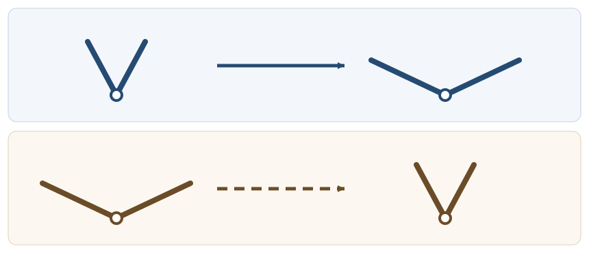

# FLUID19 Stokes流はなぜ時間逆転に似た性質をもつか

[FLUID18 の球抵抗](../FLUID18/index.md#thm-fluid18-stokes-drag)は速度に比例した。速度を反対向きにすると抗力も反対向きになる。この単純な事実を、形が異なる物体・複数の壁・内部の形状変化にまで拡張すると、**一度も流れを解かずに、異なる実験の仕事が等しいと分かる**。それが、今回証明する**二つの流れの相反関係**である。

しかし「時間を逆にすれば粘性まで消える」という意味ではない。[FLUID17 の非定常 Stokes 第一問題](../FLUID17/index.md#thm-fluid17-first-profile)には時間微分が残り、速度を巻き戻しても同じ初期値問題にはならない。今回は**毎瞬間、慣性も記憶も捨てられる低 Reynolds 数の Stokes 模型**だけを扱う。相反定理の導出、散逸との両立、往復運動で泳げない理由までを一続きに追う。

## 0. 二つの流れを一つの領域で比べる

有界で滑らかな境界をもつ連結流体領域 $\Omega\subset\mathbb R^3$ をまず固定する。粘性係数 $\eta>0$ は同じ定数、密度は一定で非圧縮、温度依存や滑り境界は考えない。外向き単位法線 $n$ は**流体領域の外向き**である。剛体の表面では物体から流体への法線と反対向きになる。

既習の[非圧縮 Newton 応力](../../CTM/CTM15/index.md#def-ctm15-incompressible-newtonian)では、速度 $u$ の対称勾配と応力を

$$
D(u)=\frac{\nabla u+(\nabla u)^{\mathsf T}}2,\qquad
\sigma=-pI+2\eta D(u)
$$

とする。ここで $x=(x_1,x_2,x_3)$、$\partial_j=\partial/\partial x_j$ は他の空間座標を固定した偏微分、$(\nabla u)_{ij}=\partial_j u_i$、$D$ は $3\times3$ の対称行列である。以下で行列の二重縮約 $M:N=\sum_{i,j=1}^3M_{ij}N_{ij}$ を用いる。[定常 Stokes 方程式](../FLUID18/index.md#def-fluid18-stokes-sphere)の体積力零の場合を拡げ、単位体積当たりの既知の力 $f$（単位 $\mathrm{N/m^3}$）を認める：

$$
\nabla\cdot\sigma+f=0,\qquad \nabla\cdot u=0,\qquad
(\nabla\cdot\sigma)_i=\sum_{j=1}^3\partial_j\sigma_{ij}.
$$

なぜ応力の発散を使うのか。$\nabla\cdot u=0$ と $\eta$ 一定のとき、成分を展開すると

$$
\begin{aligned}
(\nabla\cdot(2\eta D))_i
&=\eta\sum_j\partial_j(\partial_j u_i+\partial_i u_j)\\
&=\eta\Delta u_i+\eta\partial_i(\nabla\cdot u)
=\eta\Delta u_i,
\end{aligned}
$$

よって $-\nabla p+\eta\Delta u+f=0$ と一致する。外力密度を加えたことを忘れて圧力・粘性項だけで相反性を言うと、後で等式の項が欠ける。

比較する二つの実験は、**同じ瞬間の形状と同じ $\Omega,\eta$** を使うが、壁速度と体積力が異なってよい。その組を以下のように固定する。

<!-- formal-statement-start -->
> **定義（Stokes相反問題の二解と境界仕事）**  
> $k=1,2$ に対し、$u^{(k)}\in C^2(\overline\Omega;\mathbb R^3)$、$p^{(k)}\in C^1(\overline\Omega)$、$f^{(k)}\in C(\overline\Omega;\mathbb R^3)$ が、同じ $\Omega$ と $\eta>0$ で

$$
\nabla\cdot\sigma^{(k)}+f^{(k)}=0,\quad
\nabla\cdot u^{(k)}=0,\quad
\sigma^{(k)}=-p^{(k)}I+2\eta D(u^{(k)})
$$

> を満たすとする。$u^{(k)}$ の境界値はそれぞれ与えられ、境界は滑らかな物体表面と固定壁からなるとする。一方の速度と他方の面力との積分

$$
W_{1|2}=\int_{\partial\Omega}
u^{(1)}\cdot(\sigma^{(2)}n)\,dS
$$

> を**交差境界仕事率**と呼ぶ（単位 $\mathrm W$）。$n$ は流体領域の外向き法線である。$W_{2|1}$ も添字を入れ替えて定める。
<!-- formal-statement-end -->

<!-- definition-example-start: def-fluid19-reciprocal-pair -->
**定義の確認**：高さ $h>0$、周期的な水平断面積 $A>0$ をもつ平板間 $0<y<h$ を考える。上板だけ $Ue_x$ で動く実験1と、下板だけ $Ve_x$ で動く実験2なら、境界は同じで速度条件だけ異なる。各流れは $u^{(1)}=Uy e_x/h$、$u^{(2)}=V(1-y/h)e_x$、$p^{(k)}=0$、$f^{(k)}=0$。いずれも $u_y=0$、$\nabla\cdot u=0$、$\Delta u=0$ で Stokes 方程式を満たす。水平の側面は周期対で相殺され、法線は上板で $+e_y$、下板で $-e_y$。周期セルの角は滑らかでなくても区分的に滑らかな境界として扱え、発散積分の側面寄与は向かい合う面で打ち消し合う。$\partial_yu_x^{(1)}=U/h$、$\partial_yu_x^{(2)}=-V/h$ より、$\sigma_{xy}^{(k)}=\eta\partial_yu_x^{(k)}$ と判定できる。こうして各境界速度と相手側の面力から $W_{1|2}$ を計算できる。
<!-- definition-example-end -->

## 1. 相反定理はどこから生まれるか

流体が非圧縮なので圧力は体積仕事に寄与せず、Newton 粘性応力は対称勾配どうしの内積になる。二つの流れでこの粘性の項を交差させると、添字を入れ替えても同じ量になる。

<!-- formal-statement-start -->
> **定理（Lorentz相反定理）**  
> [二つの Stokes 解](#def-fluid19-reciprocal-pair)を同じ有界領域 $\Omega$、一定 $\eta>0$、共通の外向き法線 $n$ 上で比較すると

$$
\boxed{\int_{\partial\Omega}u^{(1)}\cdot\sigma^{(2)}n\,dS
+\int_\Omega u^{(1)}\cdot f^{(2)}\,dV
=\int_{\partial\Omega}u^{(2)}\cdot\sigma^{(1)}n\,dS
+\int_\Omega u^{(2)}\cdot f^{(1)}\,dV.}
$$

> とくに $f^{(1)}=f^{(2)}=0$ なら、$W_{1|2}=W_{2|1}$。無限遠をもつ領域にも、半径 $R$ で切った外側境界からの交差仕事が $R\to\infty$ で消えるという減衰条件の下で同じ関係が成立する。
<!-- formal-statement-end -->

### 証明の見取り図

二つの積 $u^{(1)}\cdot\sigma^{(2)}$ と $u^{(2)}\cdot\sigma^{(1)}$ の発散を引く。圧力項は発散零で消え、粘性項は $D(u^{(1)}):D(u^{(2)})$ に帰着して相殺する。残る体積力を積分し、発散定理で境界へ移す。法線の符号はこの最後の段階で確定する。

<!-- proof-start -->
### 証明

添字 $i,j$ は $1,2,3$ を走り、繰り返し添字について和を取る。まず積の微分則と Stokes 方程式より

$$
\begin{aligned}
\partial_j(u_i^{(1)}\sigma_{ij}^{(2)})
&=(\partial_j u_i^{(1)})\sigma_{ij}^{(2)}
+u_i^{(1)}\partial_j\sigma_{ij}^{(2)}\\
&=\sigma^{(2)}:\nabla u^{(1)}
-u^{(1)}\cdot f^{(2)}.
\end{aligned}
$$

ここで $A(u)=(\nabla u-(\nabla u)^{\mathsf T})/2$ を速度勾配の反対称部分と定義する。したがって $\nabla u^{(1)}=D(u^{(1)})+A(u^{(1)})$ であり、応力は対称なので、対称行列と反対称行列の二重縮約が零であることを成分交換で確かめる：

$$
\sum_{ij}\sigma^{(2)}_{ij}A^{(1)}_{ij}
=\sum_{ij}\sigma^{(2)}_{ji}A^{(1)}_{ji}
=-\sum_{ij}\sigma^{(2)}_{ij}A^{(1)}_{ij}=0.
$$

続いて非圧縮条件を代入すると

$$
\begin{aligned}
\sigma^{(2)}:\nabla u^{(1)}
&=(-p^{(2)}I+2\eta D(u^{(2)})):D(u^{(1)})\\
&=-p^{(2)}\nabla\cdot u^{(1)}
+2\eta D(u^{(2)}):D(u^{(1)})\\
&=2\eta D(u^{(2)}):D(u^{(1)}).
\end{aligned}
$$

添字 $1,2$ を交換して得る式でも粘性内積は同じである。差を取れば

$$
\nabla\cdot(u^{(1)}\cdot\sigma^{(2)}
-u^{(2)}\cdot\sigma^{(1)})
=u^{(2)}\cdot f^{(1)}-u^{(1)}\cdot f^{(2)}.
$$

左辺のベクトルの第 $j$ 成分を $u_i^{(1)}\sigma_{ij}^{(2)}-u_i^{(2)}\sigma_{ij}^{(1)}$ と読めば、符号・次元とも一致する。有界領域に[発散定理](../../../幾何系/VC/VC4/index.md#thm-vc4-gauss-divergence)を適用すると、体積積分は境界の外向き法線 $n$ との内積になり、

$$
W_{1|2}-W_{2|1}
=\int_\Omega u^{(2)}\cdot f^{(1)}\,dV
-\int_\Omega u^{(1)}\cdot f^{(2)}\,dV.
$$

両辺で項を移せば定理を得る。外部領域では $\Omega_R$ に対して先に同じ式を立て、人工外側境界の仕事が消えることを仮定して極限を取る。無条件に無限遠の境界積分を捨てるわけではない。
<!-- proof-end -->

ここで使った[発散定理](../../../幾何系/VC/VC4/index.md#thm-vc4-gauss-divergence)の参照先と適用条件を満たす滑らかな有界領域で議論した。外力がある場合は境界仕事**だけ**の等式にはならないことを次の具体例で検算する。

### 平行平板で境界仕事の左右を直接計算

先の[二解の定義例](#def-fluid19-reciprocal-pair)に戻る。上板で $\sigma^{(2)}n=-\eta V e_x/h$、下板で $\sigma^{(1)}n=-\eta Ue_x/h$。どちらの実験でも静止した板の速度は零なので、

$$
\begin{aligned}
W_{1|2}
&=\int_{\text{上板}}Ue_x\cdot(-\eta V e_x/h)\,dS
=-\frac{\eta AUV}{h},\\
W_{2|1}
&=\int_{\text{下板}}Ve_x\cdot(-\eta Ue_x/h)\,dS
=-\frac{\eta AUV}{h}.
\end{aligned}
$$

双方とも負なのは、**異なる実験の速度と面力を掛けている**からで、負の粘性散逸を意味しない。一つの実験自身の速度・応力を掛けた仕事は正になる。

### 体積力を捨てると壊れる例

同じ平板で、実験1を体積力 $f^{(1)}=f e_x$（定数 $f>0$）による、両板静止の流れとする。実験2は上板速度 $Ue_x$、体積力零とする：

$$
u^{(1)}=\frac{f}{2\eta}y(h-y)e_x,\qquad
u^{(2)}=\frac{Uy}{h}e_x.
$$

実験1では $\eta\partial_y^2u_x^{(1)}+f=-f+f=0$、実験2では $\partial_y^2u_x^{(2)}=0$ で、両方とも発散零・無滑りである。$W_{1|2}=0$（実験1の壁速度は零）に対し、実験1の上板せん断応力は

$$
(\sigma^{(1)}n)_x\big|_{y=h}
=\eta\partial_yu_x^{(1)}\big|_{h}
=-\frac{fh}{2}.
$$

よって $W_{2|1}=-AUfh/2$。一方、実験2の速度と実験1の体積力の内積を積分すると

$$
\int_\Omega u^{(2)}\cdot f^{(1)}\,dV
=Af\int_0^h\frac{Uy}{h}\,dy
=\frac{AUfh}{2}.
$$

従って[Lorentz相反定理](#thm-fluid19-lorentz-reciprocity)の左辺は零、右辺は $-AUfh/2+AUfh/2=0$。体積力の項を落とした「境界仕事だけの相反性」はこの例で偽になる。

## 2. 何を逆にすると元へ戻るのか

低 Reynolds 数と**低い非定常慣性**は別の条件である。代表寸法 $L$、速度 $U$、駆動時間 $T$ のとき、対流慣性と粘性の比は $\rho UL/\eta$、非定常慣性と粘性の比は $\rho L^2/(\eta T)$。両方が十分小さいとき、境界形状が時間とともにゆっくり変わっても、各時刻の場を瞬時の Stokes 解で近似できる。

時刻 $t$ の形状を固定して、境界速度と力密度を同時に符号反転する操作を考える。これは「本当の時間を逆向きに流す」のではなく、**同じ形状の下で外部駆動を逆向きに与え直す**操作である。

<!-- formal-statement-start -->
> **定義（運動学的な逆向き駆動）**  
> ある固定された流体領域と $\eta>0$ での瞬時 Stokes 解 $(u,p)$ に、境界速度 $g=u|_{\partial\Omega}$、体積力 $f$、圧力の定数基準 $p_0$ を与える。**逆向き駆動**とは、同じ形状・同じ $\eta$ で境界速度 $-g$、体積力 $-f$ を与え、圧力差 $p-p_0$ を比較する操作とする。
<!-- formal-statement-end -->

<!-- definition-example-start: def-fluid19-reversed-drive -->
**定義の確認**：上板だけが速さ $U$ で動く[Couette流](#def-fluid19-reciprocal-pair)では、板速度を $-U$ にすると場は $u=-Uy e_x/h$、$p=p_0$ となる。$\nabla\cdot u=0$ と $\Delta u=0$、壁の速度条件はすべて保たれる。速さをそのままに板だけ交換した場合は境界速度の一律な符号反転ではなく、別の実験になる。
<!-- definition-example-end -->

<!-- formal-statement-start -->
> **定理（瞬時Stokes流の運動学的可逆性）**  
> 固定形状の滑らかな連結領域において、$\eta>0$ 一定、非圧縮・無滑り、瞬時 Stokes 方程式、与えた境界速度・体積力・遠方条件の下で解が一意（圧力の加法定数を除く）とする。$(u,p)$ が境界速度 $g$ と体積力 $f$ に対する解なら、逆向き駆動 $(-g,-f)$ に対する解は

$$
u_{\rm rev}=-u,\qquad
p_{\rm rev}-p_0=-(p-p_0).
$$

> したがって、形状経路を逆順にたどる準静的な駆動では流れの運動学的経路も逆向きに再生される。これは粘性散逸の時間反転不変性を主張しない。
<!-- formal-statement-end -->

### 証明の見取り図

場と圧力差と体積力を一緒に負にすると、線形な方程式の全項が負になる。非圧縮と境界条件を満たすことを個別に確認し、一意性を適用する。散逸は速度勾配の**二乗**なので符号は反転しない。

<!-- proof-start -->
### 証明

もとの解は $-\nabla(p-p_0)+\eta\Delta u+f=0$、$\nabla\cdot u=0$ である。候補 $u_*=-u$、$p_*=2p_0-p$、$f_*=-f$ について

$$
\begin{aligned}
-\nabla p_*+\eta\Delta u_*+f_*
&=+\nabla p-\eta\Delta u-f\\
&=-(-\nabla p+\eta\Delta u+f)=0,\\
\nabla\cdot u_*&=-\nabla\cdot u=0.
\end{aligned}
$$

境界では $u_*|_{\partial\Omega}=-g$。無限遠の値も元の駆動と一緒に逆にしたものを採用する。指定クラスでの一意性から逆向き駆動の解はこの候補に一致する。

一方、単位体積当たりの粘性散逸率は $2\eta D(u):D(u)$。速度を反転させると $D(-u)=-D(u)$ だから

$$
2\eta D(-u):D(-u)=2\eta D(u):D(u)\ge0.
$$

従って、散逸の符号が逆転するわけではない。
<!-- proof-end -->

この定理は[FLUID17 の拡散解](../FLUID17/index.md#thm-fluid17-first-profile)を時間逆向きに解く手続きではない。非定常の $\rho\partial_tu$ を残したとき、もとの解から $-u(x,T-t)$ を作ると $\partial_t[-u(x,T-t)]=+\partial_tu(x,T-t)$ となるため、粘性項の符号反転と一般に釣り合わない。非定常粘性流は初期履歴をもつ。

## 3. 相反性が抵抗行列の対称性を強制する

一つの球なら[Stokesの抵抗則](../FLUID18/index.md#thm-fluid18-stokes-drag)を使える。しかし形の異なる剛体、複数の剛体、回転と並進の連成を毎回直接解くのは大変である。そこで速度から必要な外力を返す線形写像を**抵抗行列**として記録する。

流体は無限遠で静止しているとし、有限個の滑らかな剛体の位置・姿勢を固定した瞬間の配置を考える。物体 $i$ の中心 $X_i$、並進速度 $V_i$、角速度 $\Omega_i$ に対する境界速度は

$$
u(x)=V_i+\Omega_i\times(x-X_i)\quad(x\in S_i).
$$

各 $S_i$ は閉曲面。$n_i$ を物体から流体へ向く法線とすれば、**流体が物体へ加える**力と中心 $X_i$ まわりのトルクは

$$
F_i^{\rm fluid}=\int_{S_i}\sigma n_i\,dS,\qquad
T_i^{\rm fluid}=\int_{S_i}(x-X_i)\times(\sigma n_i)\,dS.
$$

内面の流体法線は $n=-n_i$ である。よって流体側の境界仕事は $\int_{S_i}u\cdot\sigma n=-V_i\cdot F_i^{\rm fluid}-\Omega_i\cdot T_i^{\rm fluid}$ となる。外力で剛体速度を維持するにはこれらと逆の力が必要である。

**なぜ行列で表せるのか。** 配置を固定し、並進3成分と回転3成分を物体ごとに並べた $6N$ 個の速度成分を取る。第 $j$ 成分だけを単位量動かす境界速度に対応する Stokes 解を $(u^{[j]},p^{[j]})$、必要な外力・トルクの各成分を $\mathcal G^{[j]}$ と書く。方程式と境界速度は線形なので、速度成分が $\mathcal V_j$ の一般の駆動は、圧力の加法定数を除き $u=\sum_j\mathcal V_j u^{[j]}$、$\mathcal G=\sum_j\mathcal V_j\mathcal G^{[j]}$ となる。したがって $R_{ij}=(\mathcal G^{[j]})_i$ と置けば $\mathcal G_i=\sum_jR_{ij}\mathcal V_j$ である。各成分の単位は、その並進・回転の成分に合わせて読む。

<!-- formal-statement-start -->
> **定義（剛体運動の抵抗行列）**  
> 一定 $\eta>0$ の非圧縮瞬時 Stokes 流、体積力零、物体面で無滑り、無限遠で $u\to0$ を仮定する。$N$ 個の剛体の一般化速度を

$$
\mathcal V=(V_1,\Omega_1,\ldots,V_N,\Omega_N)^{\mathsf T}\in\mathbb R^{6N}
$$

> とし、流体力・トルクと釣り合う外部の力とトルクをまとめたベクトルを

$$
\mathcal G=(-F_1^{\rm fluid},-T_1^{\rm fluid},\ldots,
-F_N^{\rm fluid},-T_N^{\rm fluid})^{\mathsf T}
$$

> とする。各速度指定に対して滑らかな Stokes 解が一意に存在するとき、線形関係 $\mathcal G=R\mathcal V$ を与える $6N\times6N$ 行列 $R$ を抵抗行列という。並進と回転で単位が異なるため、$R$ の成分は同じ単位とは限らない。
<!-- formal-statement-end -->

<!-- definition-example-start: def-fluid19-resistance-matrix -->
**定義の確認**：半径 $a$ の球を速度 $V$ で並進させ、遠方流体を静止させる。[FLUID18 の固定球の抵抗則](../FLUID18/index.md#thm-fluid18-stokes-drag)では、固定球に遠方速度 $-V$ を与えたときの流体力は $-6\pi\eta aV$ である。速度場に一様な $V$ を加える座標系の変更では速度勾配・応力が変わらないため、動く球に対しても $F^{\rm fluid}=-6\pi\eta aV$、必要な外力は $+6\pi\eta aV$ となる。球の等方性から $e_x,e_y,e_z$ の各単位並進で必要な外力は対応方向だけに $6\pi\eta a$ ずつ生じる。従ってこれら3列を並べた並進・並進ブロックは $R_{tt}=6\pi\eta aI_3$。$[6\pi\eta aV]=\mathrm N$ で、正の係数を持ち、速度が零なら外力も零となる。球の回転成分の値まで、この並進実験から決まると主張しない。
<!-- definition-example-end -->

<!-- formal-statement-start -->
> **定理（抵抗行列の対称性と正の散逸）**  
> [抵抗行列](#def-fluid19-resistance-matrix)の定義において、共通の滑らかな剛体配置、共通粘性係数、体積力零、無滑り条件、無限遠で交差仕事が消える減衰、十分滑らかで一意な解を仮定する。このとき $R$ は対称であり

$$
R^{\mathsf T}=R,\qquad
\mathcal V^{\mathsf T}R\mathcal V
=\int_\Omega2\eta D(u):D(u)\,dV\ge0.
$$

> さらに非零の一般化速度が非零の境界速度場を作り、流れの剛体的零散逸モードが遠方静止条件で排除されるなら、$\mathcal V\ne0$ に対し不等号は厳密で、$R$ は正定値である。
<!-- formal-statement-end -->

### 証明の見取り図

相反定理を二つの剛体運動に適用すると、外力と速度の交差仕事の順序を交換できる。これは行列の対称性そのものを意味する。同じ解を二回使った積分は、粘性散逸と等しくなるので、正の抵抗が生まれる。

<!-- proof-start -->
### 証明

二つの一般化速度 $\mathcal V^{(1)},\mathcal V^{(2)}$ に対する Stokes 解を取る。無限遠で交差仕事零、体積力零だから[Lorentz相反定理](#thm-fluid19-lorentz-reciprocity)により流体境界で

$$
\int_{\partial\Omega}u^{(1)}\cdot\sigma^{(2)}n\,dS
=\int_{\partial\Omega}u^{(2)}\cdot\sigma^{(1)}n\,dS.
$$

剛体境界では $n=-n_i$ なので左辺を力・トルクへ分解すると

$$
\begin{aligned}
\int_{\partial\Omega}u^{(1)}\cdot\sigma^{(2)}n\,dS
&=-\sum_i\left(V_i^{(1)}\cdot F_i^{(2),\rm fluid}
+\Omega_i^{(1)}\cdot T_i^{(2),\rm fluid}\right)\\
&=(\mathcal V^{(1)})^{\mathsf T}\mathcal G^{(2)}
=(\mathcal V^{(1)})^{\mathsf T}R\mathcal V^{(2)}.
\end{aligned}
$$

ここでトルクの項は $(\Omega\times r)\cdot t=\Omega\cdot(r\times t)$ というスカラー三重積を用いた。右辺は添字を交換した $(\mathcal V^{(2)})^{\mathsf T}R\mathcal V^{(1)}$。任意の $\mathcal V^{(1)},\mathcal V^{(2)}$ について一致するので、成分基底ベクトルを代入すれば $R_{ij}=R_{ji}$。

次に $\nabla\cdot\sigma=0$ に速度 $u$ を掛け、積の発散を使う：

$$
\begin{aligned}
\int_{\partial\Omega}u\cdot\sigma n\,dS
&=\int_\Omega \nabla\cdot(u\cdot\sigma)\,dV\\
&=\int_\Omega\{\sigma:\nabla u+u\cdot(\nabla\cdot\sigma)\}\,dV\\
&=\int_\Omega2\eta D(u):D(u)\,dV.
\end{aligned}
$$

左辺はすでに確認した法線の向きにより $\mathcal V^{\mathsf T}\mathcal G=\mathcal V^{\mathsf T}R\mathcal V$ である。$D:D=\sum_{ij}D_{ij}^2\ge0$ だから正半定値。

もし積分が零なら、連続性と $\eta>0$ から全領域で $D(u)=0$、すなわち $\partial_i u_j+\partial_j u_i=0$ である。添字 $i,j,k$ を任意に取り、これらの等式を微分して足し引きすると

$
\begin{aligned}
2\partial_i\partial_j u_k
&=\partial_i(\partial_j u_k+\partial_k u_j)
+\partial_j(\partial_i u_k+\partial_k u_i)\\
&\quad-\partial_k(\partial_i u_j+\partial_j u_i)=0.
\end{aligned}
$

よって $\nabla u$ は連結領域で一定の反対称行列であり、積分すると $u(x)=a+\omega\times x$ の剛体速度場になる。無限遠で $u\to0$ だから $a=\omega=0$。無滑りの物体面でも $V_i+\Omega_i\times(x-X_i)=0$ が全点で成り立つため、各 $V_i=\Omega_i=0$。従って非零の一般化速度は正の散逸を生む。
<!-- proof-end -->

球について $R_{tt}=6\pi\eta aI_3$ なので、並進だけなら外力の仕事率は $6\pi\eta a|V|^2>0$。逆向き駆動をしても $\mathcal V\mapsto-\mathcal V$、$\mathcal G\mapsto-\mathcal G$ となり、積 $\mathcal V\cdot\mathcal G$ は**正のまま**である。

## 4. 往復するだけではなぜ泳げないか

内部のモータで物体を変形させる微小遊泳体を考える。外力も外部トルクもないとして、物体の形の変化と全体の並進は流体力の釣合で決まる。形を変えるたびに流れは変わるが、Stokes 方程式には「往きだけ有利」という慣性の記憶がない。

図の上段では一つの形状変数 $q$ を増やし、下段では**同じ形の順序を逆にして** $q$ を減らす。速度の大きさや所要時間を同じにする必要はない。重要なのは形の経路が戻り道で同一であることである。

この現象を議論するため、一軸方向の並進 $X(t)$ とただ一つの形状変数 $q(t)$ を用いる。周囲の流体は静止し、無限に広く均質で、外部の壁が並進抵抗を位置に依存させないとする。物体は軸対称で、対称性から回転せず軸方向にだけ移動するとする。形は $q$ のみで一意に決まるものとする。

<!-- formal-statement-start -->
> **定義（一自由度の相反ストローク）**  
> 物体の形状を一つの実変数 $q\in[q_{\min},q_{\max}]$ だけで表せ、$q(t)$ は区分的 $C^1$ とする。ある周期 $T>0$ で $q(T)=q(0)$ を満たし、開閉の各部分は同じ形状の区間を行きと帰りにたどるとき、これを一自由度の相反ストロークと呼ぶ。速度 $\dot q$ や時間割当ては往復で一致しなくてもよい。
<!-- formal-statement-end -->

<!-- definition-example-start: def-fluid19-reciprocal-stroke -->
**定義の確認**：$q(0)=1$ から前半で $q=2$ まで開き、後半で $q=1$ まで閉じる開閉運動を考える。$q$ は区分的滑らかで最後に初期の形へ戻り、形状空間は区間 $[1,2]$ の往復だけである。後半を速く閉じても同じ形を逆順に通る。これに対し二つの独立な角度を順番に変える閉路は、一般にはこの一自由度の往復ではない。
<!-- definition-example-end -->

<!-- formal-statement-start -->
> **定理（一自由度のスカラップ定理）**  
> 非圧縮・一定粘性の瞬時 Stokes 流（対流・非定常慣性が無視可能）、無滑り、流体の遠方静止、外部からの合力・トルク零、内部形状駆動のみ、各形状で Stokes 解が一意、という条件を課す。剛体の向きが対称性で固定され、一軸並進 $X$ のみ許され、流体環境は並進不変とする。形状 $q\in[q_{\min},q_{\max}]$ が唯一の滑らかな自由度で、並進抵抗 $R(q)>0$ と形状駆動による力係数 $B(q)$ が連続なら、任意の[一自由度の相反ストローク](#def-fluid19-reciprocal-stroke)の一周期の並進変位は

$$
\boxed{X(T)-X(0)=0.}
$$

> これは「どんな低 Reynolds 数の遊泳体も泳げない」ことを意味せず、形状の独立な自由度や流体の慣性・記憶がある場合は結論の仮定から外れる。
<!-- formal-statement-end -->

### 証明の見取り図

Stokes 問題は境界速度に線形だから、剛体の並進速度 $\dot X$ と形状変化速度 $\dot q$ がつくる流体力はそれぞれの寄与の和である。外力零の釣合から $\dot X=A(q)\dot q$ を得て、変数 $q$ に関する一変数積分が閉路で零になると示す。

<!-- proof-start -->
### 証明

各瞬間の形状 $q$ を固定して Stokes 方程式を解く。境界上の速度を、単位並進に対応する場 $g_{\rm tr}(q)$ と単位形状速度に対応する場 $g_{\rm sh}(q)$ を用いて $g=\dot Xg_{\rm tr}(q)+\dot qg_{\rm sh}(q)$ と分解する。体積力零の Stokes 方程式は線形なので、各境界場に対する解を $(u_{\rm tr},p_{\rm tr})$、$(u_{\rm sh},p_{\rm sh})$ とすれば、

$
u=\dot X u_{\rm tr}+\dot q u_{\rm sh},\qquad
p-p_0=\dot X(p_{\rm tr}-p_0)+\dot q(p_{\rm sh}-p_0)
$

が方程式、非圧縮性と境界条件をすべて満たす。一意性によってこれが実際の瞬時解であり、応力から計算する流体力も $\dot X$ と $\dot q$ に線形となる。[運動学的可逆性](#thm-fluid19-kinematic-reversibility)は、特に両速度の符号を反転した場合である。

正方向に動く物体が受ける流体力を $F^{\rm fluid}$ とすると、外部の並進抵抗 $R(q)>0$ と、形状駆動の係数 $B(q)$ を用いて

$$
F^{\rm fluid}=-R(q)\dot X-B(q)\dot q.
$$

$R(q)>0$ は[抵抗行列の散逸正定値性](#thm-fluid19-resistance-symmetry)を、固定形状に対する一軸並進へ適用したものである。外力零の釣合 $F^{\rm fluid}=0$ から

$$
\dot X=-\frac{B(q)}{R(q)}\dot q
=A(q)\dot q,\qquad A(q)=-\frac{B(q)}{R(q)}.
$$

$R>0$ と $B,R$ の連続性より $A$ は区間上で連続。そこで原始関数

$$
\Phi(q)=\int_{q_0}^q A(s)\,ds
$$

を定義すると、区分的に連鎖律が使え、

$$
\frac{d}{dt}\Phi(q(t))
=A(q(t))\dot q(t)=\dot X(t).
$$

各滑らかな時間区間で積分し、区間の端点を足し合わせると中間値は望遠和として相殺される。よって

$$
X(T)-X(0)
=\Phi(q(T))-\Phi(q(0))=0
$$

である。$q$ の進む速さは式から消えた。必要なのは形状が**同じ一変数区間上で戻る**ことと、$A$ が現在の形だけで定まることである。
<!-- proof-end -->

### 失われる仮定を見分ける

- **二自由度の変形**では一般に $\dot X=A_1(q_1,q_2)\dot q_1+A_2(q_1,q_2)\dot q_2$ となり、閉路積分は一変数の原始関数の差とは限らない。たとえば抽象模型 $\dot X=q_1\dot q_2$ で $(q_1,q_2)$ を $(0,0)\to(1,0)\to(1,1)\to(0,1)\to(0,0)$ と動かすと、第二辺でのみ $q_1dq_2$ が $1$ 積み上がる。この計算は非相反ストロークの**幾何学的可能性**を示すだけで、特定の遊泳体でこの式を実現した証明ではない。
- **有限の対流慣性**があると Navier–Stokes 方程式の $\rho(u\cdot\nabla)u$ は $u\mapsto-u$ でも符号が変わらず、[逆向き駆動の証明](#thm-fluid19-kinematic-reversibility)の「全項が負になる」段階が壊れる。
- **非定常慣性・粘弾性の記憶**があると、瞬時の形 $q$ と速度 $\dot q$ だけから流体力を決める式を立てられない。$A(q)$ の原始関数を作る段階が壊れる。
- **固定壁・不均一な外部環境**があると係数が $X$ に依存することがあり、この一変数積分証明をそのまま適用してはいけない。完全に同じ形の経路を逆向きに再生する場合の可逆性は、位置依存も含めた運動方程式の一意性を別途確認して議論する。

## 5. 演習

以下で $u^{(k)},p^{(k)},\sigma^{(k)},f^{(k)}$ は特に断らない限り同じ定数 $\eta>0$ の滑らかな非圧縮瞬時 Stokes 解を表す。[Lorentz相反定理](#thm-fluid19-lorentz-reciprocity)の法線は流体の外向きとする。各問で境界条件と符号を明示せよ。

### Level A

### A1. 逆向き駆動の方程式

$-\nabla p+\eta\Delta u+f=0$、$\nabla\cdot u=0$、$u|_{\partial\Omega}=g$ を満たす解から、$u_*=-u$、$p_*=2p_0-p$ を作る。これが体積力 $-f$、境界速度 $-g$ の解であることを微分の符号ごと確かめよ。

- Level: A

<!-- solution-start -->
#### 詳細解答

$\nabla p_*=-\nabla p$、$\Delta u_*=-\Delta u$ なので

$$
-\nabla p_*+\eta\Delta u_*-f
=+\nabla p-\eta\Delta u-f
=-(-\nabla p+\eta\Delta u+f)=0.
$$

また $\nabla\cdot(-u)=-\nabla\cdot u=0$、$u_*|_{\partial\Omega}=-g$。従って[逆向き駆動](#def-fluid19-reversed-drive)の条件をすべて満たす。圧力の定数部分 $p_0$ は勾配に影響しない。
<!-- solution-end -->

### A2. 平板の交差仕事

高さ $h$、面積 $A$ の二平板で $u^{(1)}=(Uy/h)e_x$ と $u^{(2)}=V(1-y/h)e_x$（側面周期、体積力零）とする。上下面の法線、せん断応力と交差仕事 $W_{1|2},W_{2|1}$ をそれぞれ計算せよ。

- Level: A

<!-- solution-start -->
#### 詳細解答

上面の流体法線は $+e_y$、下面は $-e_y$。$\sigma_{xy}^{(1)}=\eta U/h$、$\sigma_{xy}^{(2)}=-\eta V/h$。実験1の速度は上面だけ非零なので、$W_{1|2}=AU(-\eta V/h)=-\eta AUV/h$。実験2の速度は下面だけ非零で、下面の実験1の面力は $-\eta Ue_x/h$。従って $W_{2|1}=AV(-\eta U/h)=-\eta AUV/h$。値が一致し、両者の符号も一致する。
<!-- solution-end -->

### A3. 圧力項が消える理由

二つの解で $\sigma^{(2)}=-p^{(2)}I+2\eta D(u^{(2)})$ とする。$\sigma^{(2)}:\nabla u^{(1)}$ の圧力寄与を書き、どの仮定で零になるか示せ。

- Level: A

<!-- solution-start -->
#### 詳細解答

$I:\nabla u^{(1)}=\sum_i\partial_i u_i^{(1)}=\nabla\cdot u^{(1)}$ である。よって圧力寄与は $-p^{(2)}\nabla\cdot u^{(1)}=0$。零になる理由は**実験1の非圧縮条件**であり、圧力 $p^{(2)}$ が一定だからではない。残る粘性内積も応力が対称だから $2\eta D(u^{(2)}):D(u^{(1)})$ になる。
<!-- solution-end -->

### A4. 球の逆走と散逸

半径 $a$ の球が静止流体中を並進速度 $V=Ue_x$ で動く。速度を $-V$ に変えたときの流体抵抗、維持する外力、外力の仕事率を求めよ。$U,a,\eta>0$、他の体積力と壁は無視する。

- Level: A

<!-- solution-start -->
#### 詳細解答

[球抵抗](../FLUID18/index.md#thm-fluid18-stokes-drag)から、逆向き球に働く流体力は $F^{\rm fluid}=-6\pi\eta a(-Ue_x)=+6\pi\eta aUe_x$。必要な外力は $G=-F^{\rm fluid}=-6\pi\eta aUe_x$。仕事率は新しい速度 $-Ue_x$ との内積なので $G\cdot(-Ue_x)=6\pi\eta aU^2>0$。抵抗の符号は変わっても散逸は負にならない。
<!-- solution-end -->

### A5. 二つの小さい数

長さ $L$、速さ $U$、周期 $T$、密度 $\rho$、粘性 $\eta$ を用い、対流慣性と非定常慣性を粘性項で割った無次元比を求めよ。$\rho UL/\eta\ll1$ だけでは準静的な可逆性に不十分な理由を述べよ。

- Level: A

<!-- solution-start -->
#### 詳細解答

代表尺度は $\rho(u\cdot\nabla)u\sim\rho U^2/L$、$\rho\partial_tu\sim\rho U/T$、$\eta\Delta u\sim\eta U/L^2$。したがって比は

$$
\frac{\rho U^2/L}{\eta U/L^2}=\frac{\rho UL}{\eta},
\qquad
\frac{\rho U/T}{\eta U/L^2}=\frac{\rho L^2}{\eta T}.
$$

前者だけが小さくても $T$ が極めて短ければ後者は大きい。非定常項が残れば[瞬時可逆性](#thm-fluid19-kinematic-reversibility)の仮定を満たさない。
<!-- solution-end -->

### Level B

### B1. 相反恒等式を添字から復元

滑らかな有界領域で二組の Stokes 解がある。$\partial_j(u_i^{(1)}\sigma_{ij}^{(2)}-u_i^{(2)}\sigma_{ij}^{(1)})$ を展開し、粘性内積が相殺される理由を成分で示せ。体積力を含む境界積分の等式を結論せよ。

- Level: B

<!-- solution-start -->
#### 詳細解答

積の微分則と $\partial_j\sigma_{ij}^{(k)}=-f_i^{(k)}$ によって

$$
\begin{aligned}
\partial_j(u_i^{(1)}\sigma_{ij}^{(2)}-u_i^{(2)}\sigma_{ij}^{(1)})
&=(\partial_j u_i^{(1)})\sigma_{ij}^{(2)}
-(\partial_j u_i^{(2)})\sigma_{ij}^{(1)}\\
&\quad-u^{(1)}\cdot f^{(2)}+u^{(2)}\cdot f^{(1)}.
\end{aligned}
$$

$\sigma_{ij}^{(k)}=\sigma_{ji}^{(k)}$ だから、勾配の反対称成分との縮約が零である。圧力成分は $-p^{(2)}\partial_i u_i^{(1)}+p^{(1)}\partial_i u_i^{(2)}=0$。粘性部分は

$$
2\eta D_{ij}(u^{(1)})D_{ij}(u^{(2)})
-2\eta D_{ij}(u^{(2)})D_{ij}(u^{(1)})=0.
$$

よって発散は $u^{(2)}\cdot f^{(1)}-u^{(1)}\cdot f^{(2)}$。[発散定理](../../../幾何系/VC/VC4/index.md#thm-vc4-gauss-divergence)で境界へ移すと、[Lorentz相反定理](#thm-fluid19-lorentz-reciprocity)の両辺が得られる。
<!-- solution-end -->

### B2. 抵抗行列の相反交差項

二つの剛体並進自由度だけをもつ Stokes 模型で $G=RV$、$R=\begin{pmatrix}a&b\\c&d\end{pmatrix}$ とする。相反性と散逸正値性から $b=c$、$a>0$、$ad-b^2>0$ を導け。剛体の位置を固定し、外力零の流体が遠方で静止する条件を使ってよい。

- Level: B

<!-- solution-start -->
#### 詳細解答

$e_1=(1,0)^{\mathsf T}$、$e_2=(0,1)^{\mathsf T}$ をそれぞれ第一・第二の Stokes 駆動に入れる。[抵抗行列の相反性](#thm-fluid19-resistance-symmetry)より $e_1^{\mathsf T}Re_2=e_2^{\mathsf T}Re_1$、左は $b$、右は $c$ なので $b=c$。正の散逸は任意の非零 $V=(x,y)$ に対して

$$
V^{\mathsf T}RV=ax^2+2bxy+dy^2>0.
$$

$V=(1,0)$ より $a>0$。平方完成して

$$
ax^2+2bxy+dy^2
=a\left(x+\frac ba y\right)^2
+\left(d-\frac{b^2}{a}\right)y^2.
$$

$x=-by/a$、$y\ne0$ を代入すると $d-b^2/a>0$、すなわち $ad-b^2>0$。これは単に行列式が非零という条件より強い。
<!-- solution-end -->

### B3. 体積力付きの相反性を独立検算

高さ $h$ の周期平板領域（断面積 $A$）で、実験1は一定体積力 $fe_x$ による $u^{(1)}=fy(h-y)e_x/(2\eta)$、両板静止。実験2は $u^{(2)}=Uy e_x/h$、体積力零とする。$W_{1|2}$、$W_{2|1}$、$\int_\Omega u^{(2)}\cdot f^{(1)}dV$ を別々に計算し、何を捨てると相反性が破綻するか述べよ。

- Level: B

<!-- solution-start -->
#### 詳細解答

両壁で $u^{(1)}=0$ だから $W_{1|2}=0$。実験1のせん断は $\eta\partial_yu_x^{(1)}=f(h-2y)/2$。上板 $y=h$ で $-fh/2$、実験2の速度は $Ue_x$ なので $W_{2|1}=-AUfh/2$。

体積力の積分は

$$
\int_\Omega u^{(2)}\cdot f^{(1)}dV
=AfU\int_0^h \frac yh\,dy
=AfU\frac{h^2}{2h}=\frac{AUfh}{2}.
$$

もう一方の $\int_\Omega u^{(1)}\cdot f^{(2)}dV=0$。[Lorentz相反定理](#thm-fluid19-lorentz-reciprocity)の左辺 $0+0$ と右辺 $-AUfh/2+AUfh/2=0$ は一致する。体積力の補正を消すと $0=-AUfh/2$ となり、$AUfh\ne0$ に矛盾する。
<!-- solution-end -->

### B4. 形状速度の速さに依存しない往復

力が $F^{\rm fluid}=-R(q)\dot X-B(q)\dot q$ で、無次元形状変数 $q$、長さ $\ell>0$、抵抗係数 $r_0>0$ を用いて $R(q)=r_0(1+q^2)>0$、$B(q)=r_0\ell q(1+q^2)$ とする。外力零で、$q:1\to2\to1$ の相反ストロークを行う。各行程の変位と一周期の変位を計算せよ。開閉時間が違っても結果は同じか。

- Level: B

<!-- solution-start -->
#### 詳細解答

力零より $\dot X=-B(q)\dot q/R(q)=-\ell q\dot q$。ここで $dX=-\ell q\,dq$ は、時間に関する連鎖律 $d(-\ell q(t)^2/2)/dt=-\ell q(t)\dot q(t)$ に基づく省略記法であり、$\dot q=0$ の時刻でも成り立つ。原始関数は $-\ell q^2/2$。開く行程では

$$
\Delta X_{\rm open}=-\ell\int_1^2q\,dq
=-\ell\left[\frac{q^2}{2}\right]_1^2=-\frac{3\ell}{2}.
$$

閉じる行程では

$$
\Delta X_{\rm close}=-\ell\int_2^1q\,dq
=-\ell\left[\frac{q^2}{2}\right]_2^1=+\frac{3\ell}{2}.
$$

合計は零。時間変数を積分から消したため、時間配分が異なっても $q$ が同じ区間を逆にたどる限り結果は変わらない。[一自由度の定理](#thm-fluid19-scallop)の直接計算例である。
<!-- solution-end -->

### Level C

### C1. 相反性、散逸、遊泳の条件を一つに結ぶ

同じ剛体配置に対する非圧縮瞬時 Stokes 解が一意であり、$\eta>0$、体積力零、無滑り、無限遠静止と適切な減衰を満たすとする。

1. 相反定理を二つの剛体駆動へ適用して、一般化抵抗行列 $R$ が対称であることを証明せよ。流体側法線と物体側法線の符号の違いを書くこと。
2. 粘性散逸積分から $V^{\mathsf T}RV>0$（$V\ne0$）となる条件を説明せよ。
3. さらに回転を起こさない一軸の力無し遊泳体が一つの形状変数 $q$ のみで変形し、抵抗 $r(q)>0$、形状力係数 $b(q)$ が現在形状だけで決まるとする。往復で変位が零であることを示せ。
4. この結論が有限慣性と二自由度の形状閉路に自動では拡張されない理由を、元の証明の破綻する箇所から説明せよ。

- Level: C

<!-- solution-start -->
#### 詳細解答

**1. 抵抗の対称性。** 物体 $i$ の流体側法線は物体から流体へ向く $n_i$ の負、$n=-n_i$。境界速度 $u^{(k)}=V_i^{(k)}+\Omega_i^{(k)}\times(x-X_i)$ を[Lorentz相反定理](#thm-fluid19-lorentz-reciprocity)の左側へ代入すると

$$
\int_{\partial\Omega}u^{(1)}\cdot\sigma^{(2)}n\,dS
=-\sum_i(V_i^{(1)}\cdot F_i^{(2),\rm fluid}
+\Omega_i^{(1)}\cdot T_i^{(2),\rm fluid})
=(\mathcal V^{(1)})^{\mathsf T}R\mathcal V^{(2)}.
$$

体積力零で遠方の寄与も零だから、これは添字を入れ替えた $(\mathcal V^{(2)})^{\mathsf T}R\mathcal V^{(1)}$ に等しい。$\mathcal V^{(1)}=e_i$、$\mathcal V^{(2)}=e_j$ を選べば $R_{ij}=R_{ji}$。

**2. 正の散逸。** 同じ駆動に対し $u\cdot(\nabla\cdot\sigma)=0$ を積分し、積の微分則と非圧縮性から

$$
\mathcal V^{\mathsf T}R\mathcal V
=\int_{\partial\Omega}u\cdot\sigma n\,dS
=\int_\Omega\sigma:\nabla u\,dV
=\int_\Omega2\eta|D(u)|^2\,dV\ge0.
$$

零なら $D(u)=0$、連結域で $u$ は剛体速度場。遠方静止がこの場を零にするので、無滑りのもとでは $\mathcal V=0$。ゆえに非零速度では厳密に正。

**3. 往復の変位。** 位置に依存しない抵抗という追加条件のもとで、全流体力は $F^{\rm fluid}=-r(q)\dot X-b(q)\dot q$。外力零から

$$
\dot X=-\frac{b(q)}{r(q)}\dot q.
$$

$r>0$ と係数の連続性により $A(q)=-b(q)/r(q)$ は原始関数 $\Phi$ を持つ。連鎖律で $\dot X=d\Phi(q(t))/dt$、周期で $q(T)=q(0)$ より

$$
X(T)-X(0)=\Phi(q(T))-\Phi(q(0))=0.
$$

**4. 仮定が外れた場合。** 有限慣性では速度を反転しても対流慣性 $\rho(u\cdot\nabla)u$ の符号が変わらないため、瞬時線形 Stokes 問題を用いる1の前提や3の線形力分解が壊れる。二自由度では $dX=A_1\,dq_1+A_2\,dq_2$ の閉路積分が一般には原始関数の端点差へ帰着しない。抽象例 $dX=q_1\,dq_2$ の単位正方形閉路では変位 $1$ となる。これは二自由度の現実の遊泳体が必ず泳ぐという主張ではなく、一自由度で零を保証した論証が使えなくなるという意味である。
<!-- solution-end -->

## 6. 何が分かったか、どこまで使えるか

Stokes 方程式で二つの流れを比較すると、圧力の体積仕事は非圧縮性で消え、粘性の交差項は対称になる。この単純な代数が、体積力を含む Lorentz 相反定理、抵抗行列の対称性、準静的な逆向き運動へとつながる。ただし散逸は常に非負であり、相反性と「熱力学的な無損失」は全く別の話である。

一自由度の相反ストロークでは、抵抗が形だけで定まると $dX=A(q)\,dq$ が原始関数をもち、閉じた往復で変位が消える。次の FLUID20 では、薄膜の隙間では幾何と粘性の尺度が変わり、Reynolds 潤滑方程式が現れることを導く。
