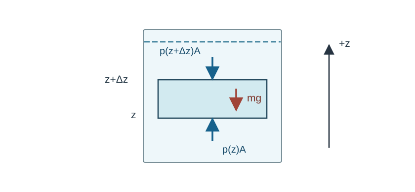

# FLUID2 静止流体の圧力はどう分布するか

**前提講座（直接）**：[FLUID1 連続体近似](../FLUID1/index.md)（その既習系列に [CTM15 の Newton 流体](../../CTM/CTM15/index.md#def-ctm15-newtonian-fluid)を含む）。

[FLUID1 の連続体近似](../FLUID1/index.md#def-fluid1-scale-separation)で水や気体を連続的な場として扱える条件を調べた。次に知りたいのは、**流れが止まっていても深い位置ほど大きい圧力が生まれる理由**である。静止は「力がない」という意味ではない。[CTM7 の局所運動量収支](../../CTM/CTM7/index.md#thm-ctm7-material-momentum)では、加速度が零でも表面力と体積力が互いに支え合う。

本講では、圧力の等方的な面力から出発し、鉛直座標の向き、密度の仮定、自由表面の圧力基準を固定して、一定密度・密度成層・連通管を順に計算する。浮力による物体全体の合力は次講 FLUID3 で扱う。

## 0. 座標、単位と静止流体のモデル

空間は三次元の直交デカルト座標 $(x,y,z)$ とし、位置ベクトルは $\boldsymbol r=(x,y,z)$ と表す。**$z$ は上向き**、鉛直上向き単位ベクトルは $e_z$、重力加速度の大きさは $g>0$（m/s$^2$）、単位質量当たりの重力は $b=-ge_z$ とする。密度 $\rho>0$ の単位は kg/m$^3$、圧力 $p$ は Pa = N/m$^2$、単位質量当たりの体積力 $b$ は N/kg、単位体積当たりの重力 $\rho b$ は N/m$^3$ である。

[Cauchy の応力定理](../../CTM/CTM6/index.md#thm-ctm6-cauchy-stress)によれば、単位外法線 $n$ を向く小面に周囲から作用する表面力密度は $\sigma n$ である。[CTM15 の圧縮性 Newton 流体の構成則](../../CTM/CTM15/index.md#def-ctm15-newtonian-fluid)では、速度場が $v=0$ なら変形速度 $D=0$ かつ体積変化率 $\theta=0$ なので、せん断・体積粘性の応力は消え、$\sigma=-pI_3$ となる。ここで $I_3$ は三次元単位行列である。この等方応力を**静止流体のモデル仮定**として使う。静止している固体や降伏応力のある物質へ無条件に適用するものではない。

<!-- formal-statement-start -->
### 定義（静止等方圧力状態）

開領域 $\Omega\subset\mathbb R^3$ 上の流体で、速度 $v=0$、密度 $\rho:\Omega\to(0,\infty)$、圧力 $p:\Omega\to\mathbb R$ が与えられ、Cauchy 応力が

$$
\sigma(\boldsymbol r)=-p(\boldsymbol r)I_3,\qquad
t(\boldsymbol r,n)=-p(\boldsymbol r)n\quad (|n|=1)
$$

を満たす状態を、本講では**静止等方圧力状態**という。以降の平衡計算では $\rho,p\in C^1(\Omega)$ を仮定する。$p>0$ なら表面力は外法線と逆向き（圧縮方向）である。この定義だけで重力との釣合が成立するとは限らない。
<!-- formal-statement-end -->

<!-- definition-example-start: def-fluid2-static-isotropic-state -->
### **定義の確認**：同じ圧力でも面の向きで力が変わる

例えば開領域 $\Omega=(0,1)^3$ 上の全点 $\boldsymbol r$ で、$v(\boldsymbol r)=0$、$\rho(\boldsymbol r)=1000\ \mathrm{kg/m^3}>0$、$p(\boldsymbol r)=p_0=2.0\times10^5\ \mathrm{Pa}$、$\sigma(\boldsymbol r)=-p_0I_3$ と指定する。これらは定数場なので $\rho,p\in C^1(\Omega)$ でもある。

なぜ単位行列で面力を判定できるのか。[Cauchy の応力定理](../../CTM/CTM6/index.md#thm-ctm6-cauchy-stress)によって面の外法線 $n=(n_1,n_2,n_3)$ に対する表面力密度は $\sigma n$ であり、直交基底で行列の各成分は $\sigma_{ij}=-p_0\delta_{ij}$ である。したがって、任意の単位法線 $|n|=1$ に対して

$
t_i(\boldsymbol r,n)=\sum_{j=1}^3\sigma_{ij}n_j
=-p_0\sum_{j=1}^3\delta_{ij}n_j=-p_0n_i
\qquad(i=1,2,3).
$

特に水平上面の $n=e_z$ では $t=-2.0\times10^5e_z$ Pa、下面の $n=-e_z$ では $t=+2.0\times10^5e_z$ Pa、右側面の $n=e_x$ では $t=-2.0\times10^5e_x$ Pa である。任意の向きで $t=-p_0n$ が成り立ち、接線成分も零なので、定義の速度零・密度正・等方応力の各条件を確認した。ただし一定圧力なら $\nabla p=0$ だから、$g>0$ の重力下では $\rho b=-\rho ge_z\ne0$ と釣り合わない。**定義を満たすことと静水圧の平衡条件を満たすことは別**である。
<!-- definition-example-end -->

小さな流体要素を切り出すと、上面を押す下向きの力は約 $p(z+\Delta z)A$、下面を押す上向きの力は約 $p(z)A$、重力は下向き $\rho g A\Delta z$ である。下図の矢印はそれぞれの面に働く力の**方向**を示す。上向きの $z$ と重力の向きを逆にしないことが重要である。

[図を拡大表示](assets/hydrostatic-slab.svg)

## 1. 静止が課す局所的な圧力勾配

[CTM7 の局所運動量方程式](../../CTM/CTM7/index.md#thm-ctm7-material-momentum)は $\rho D_tv=\operatorname{div}\sigma+\rho b$ である。静止状態では $v=0$ から物質加速度 $D_tv=\partial_tv+(v\cdot\nabla)v=0$ となる。まず、**圧力がどちらへ増える必要があるか**をこの式から調べよう。

<!-- formal-statement-start -->
### 定理（静水圧方程式）

連結した開領域 $\Omega\subset\mathbb R^3$ 上で、$\rho,p\in C^1(\Omega)$、$\rho>0$ とする。[静止等方圧力状態](#def-fluid2-static-isotropic-state)、古典的 Cauchy 連続体の局所運動量収支、一定の重力 $b=-ge_z$（$g>0$）が成り立つなら、各点で

$$
\nabla p=\rho b=-\rho g e_z,
$$

すなわち

$$
\frac{\partial p}{\partial x}=0,\qquad
\frac{\partial p}{\partial y}=0,\qquad
\boxed{\frac{\partial p}{\partial z}=-\rho g}
$$

が成立する。ここで「水平な圧力勾配が零」は同じ連結な水平断面成分の内部で圧力が一定であることを意味し、異なる連結成分の圧力を自動的に同一視しない。
<!-- formal-statement-end -->

### 証明の見取り図

表面力の等方性は応力が $-pI_3$ であることを意味する。応力の発散を座標成分で計算し、加速度が零の局所運動量式へ入れる。重力の第3成分だけが負で残る。

<!-- proof-start -->
### 証明

[CTM6 の応力の列の規約](../../CTM/CTM6/index.md#thm-ctm6-cauchy-stress)で $\sigma_{ij}=-p\delta_{ij}$ と書く。ここで $\delta_{ij}=1$（$i=j$）または $0$（$i\ne j$）である。応力の発散の第 $i$ 成分を計算すると

$$
(\operatorname{div}\sigma)_i
=\sum_{j=1}^3\frac{\partial\sigma_{ij}}{\partial x_j}
=-\sum_{j=1}^3\delta_{ij}\frac{\partial p}{\partial x_j}
=-\frac{\partial p}{\partial x_i}.
$$

したがって $\operatorname{div}\sigma=-\nabla p$ である。[CTM7 の局所運動量式](../../CTM/CTM7/index.md#thm-ctm7-material-momentum)の左辺は静止により零だから

$$
0=-\nabla p+\rho b=-\nabla p-\rho ge_z.
$$

移項して $\nabla p=-\rho ge_z$ を得る。$e_z=(0,0,1)$ の三成分を比較すれば表示した偏微分方程式となる。$\square$
<!-- proof-end -->

**薄い要素からの独立な符号検算。** 水平面積 $A>0$、厚さ $\Delta z>0$ の直方体で、密度がほぼ一定なら鉛直力の釣合は

$$
p(z)A-p(z+\Delta z)A-\rho(z)gA\Delta z\simeq0.
$$

$A\Delta z$ で割ると $[p(z+\Delta z)-p(z)]/\Delta z\simeq-\rho g$。極限 $\Delta z\to0$ で同じ符号を得る。これは直感的確認であり、定理自体は応力の局所式から導いた。圧力は**上へ行くほど下がる**。

## 2. 深さで積分する：密度はどこで効くか

重力が一定でも密度が一定とは限らない。温度や組成により密度が高さとともに変わる流体でも、[静水圧方程式](#thm-fluid2-hydrostatic-balance)の第3成分を積分できる。ただし一本の鉛直区間が流体領域内に収まることを明示する。以降、水平座標 $(x,y)$ を固定した鉛直線上では、三変数の場 $p(x,y,z),\rho(x,y,z)$ を高さだけの関数 $p(z),\rho(z)$ と略記する。

<!-- formal-statement-start -->
### 命題（鉛直柱の静水圧積分）

鉛直区間 $z\in[a,b]$ が一つの流体領域内にあり、$g>0$ は一定、$\rho:[a,b]\to(0,\infty)$ は連続、$p\in C^1([a,b])$ が $dp/dz=-\rho(z)g$ を満たすとする。このとき任意の $z,z_0\in[a,b]$ に対し

$$
\boxed{p(z)=p(z_0)-g\int_{z_0}^{z}\rho(s)\,ds}
$$

が成り立つ。また $z_1<z_2$ なら

$$
p(z_1)-p(z_2)=g\int_{z_1}^{z_2}\rho(s)\,ds>0.
$$

圧力分布を一意に決めるには、どこか一箇所の圧力値などの境界条件が必要である。
<!-- formal-statement-end -->

### 証明の見取り図

高さを変えて圧力がどれだけ変わるかは、局所勾配を積み重ねた積分である。密度が正なら、上端と下端を交換したとき圧力差の符号まで分かる。

<!-- proof-start -->
### 証明

[静水圧方程式](#thm-fluid2-hydrostatic-balance)を、$[a,b]$ の点 $z_0$ から $z$ まで積分する。[微積分の基本定理](../../../基礎科目/RA/RA4/index.md#thm-ra4-ftc2)はここでは $p$ が連続微分可能であることにより適用でき、

$$
p(z)-p(z_0)=\int_{z_0}^{z}p'(s)\,ds
=-g\int_{z_0}^{z}\rho(s)\,ds.
$$

移項すると第一式を得る。次に $z_1<z_2$ なら $\rho(s)>0$ と区間の長さが正であるため $\int_{z_1}^{z_2}\rho(s)ds>0$、よって第二式の右辺は正になる。同じ微分方程式を満たす二つの圧力の差 $q$ は $q'=0$ であり、連結な区間で定数である。一点の値を定めればその定数も零になり、一意性が従う。$\square$
<!-- proof-end -->

**密度と水平位置の注意。** 定理の $\partial_xp=\partial_yp=0$ が水平方向に連結した同じ水平面全体で成立するとき、$p$ は高さだけの関数である。さらに $g$ が一定なら $\rho=-p'(z)/g$ であり、その範囲では密度も高さだけの関数でなければならない。密度を任意に $\rho(x,z)$ と設定しながら、水平重力なし・流速零のまま静水圧があると主張することはできない。

### 具体例：線形に増える密度

水面を $z=0$ とし、下向き深さを $h=-z\ge0$ と書く。水平位置 $(x_0,y_0)$ を固定すると $z=-h$ なので、連鎖律と [静水圧方程式](#thm-fluid2-hydrostatic-balance)により

$
\frac{d}{dh}p(x_0,y_0,-h)
=-\frac{\partial p}{\partial z}(x_0,y_0,-h)
=\rho(x_0,y_0,-h)g.
$

以下では深さを引数とする $p(h),\rho(h)$ はそれぞれ左辺の $p(x_0,y_0,-h)$ と $\rho(x_0,y_0,-h)$ の略記とする。密度を $\rho(h)=\rho_0(1+\alpha h)$、$\rho_0>0$、$\alpha\ge0$（単位 m$^{-1}$）と仮定する。深さの微分は $dp/dh=\rho(h)g$ だから

$$
p(h)-p(0)=g\int_0^h\rho_0(1+\alpha s)\,ds
=\rho_0g\left(h+\frac{\alpha h^2}{2}\right).
$$

上から下へ積分しているので正号になる。密度一定の模型は $\alpha=0$ の特別な場合である。$dp/dz$ の式に $z=-h$ を入れたときに、符号だけをコピーしないこと。

## 3. 自由表面と「深さ × 密度 × 重力」

容器内の液体の上面が静止した大気に接し、その界面が平坦で表面張力による曲率圧力差を無視できるとき、自由表面で液体側の圧力は大気の**絶対圧** $p_{\mathrm{atm}}$ に等しい。これは平衡方程式から自動的に出るのではなく、接する気体と液体の圧力を等しく置く**追加の界面での釣合条件**である。曲がった界面での圧力差は後の FLUID26 で扱う。

<!-- formal-statement-start -->
### 系（一定密度の深さと圧力）

鉛直な流体柱 $0\le h\le H$ で、$h$ は自由表面から下向きに測る深さ、密度 $\rho_0>0$ は一定、重力 $g>0$ は一定とする。流体は静止等方圧力状態で、平坦な自由表面の圧力を $p(0)=p_{\mathrm{atm}}$ と指定する。このとき

$$
\boxed{p(h)=p_{\mathrm{atm}}+\rho_0gh}
$$

である。表面から深さ $h$ までの圧力増分 $\rho_0gh$ は、密度と重力と深さの積である。
<!-- formal-statement-end -->

### 証明の見取り図

鉛直座標を $z=-h$ に取り直し、[静水圧積分](#prop-fluid2-integral-profile)に一定密度を代入すればよい。

<!-- proof-start -->
### 証明

自由表面を $z_0=0$ とする。深さ $h$ に対応する点は $z=-h$ である。[鉛直柱の静水圧積分](#prop-fluid2-integral-profile)を $z_0=0,z=-h,\rho(s)=\rho_0$ へ適用すると

$$
p(-h)=p(0)-g\int_0^{-h}\rho_0\,ds
=p_{\mathrm{atm}}-g\rho_0(-h)
=p_{\mathrm{atm}}+\rho_0gh.
$$

従って $p(h)$ を深さ表示した式が得られる。$\square$
<!-- proof-end -->

絶対圧と、比較基準を引いた**ゲージ圧**を区別しよう。圧力差だけで運動量式を書くときは、定数の圧力基準は勾配から消える。

<!-- formal-statement-start -->
### 定義（基準圧力とゲージ圧）

圧力場 $p(\boldsymbol r)$ と一定の基準圧力 $p_{\mathrm{ref}}$（いずれも Pa）が与えられたとき、

$$
p_{\mathrm{gauge}}(\boldsymbol r)=p(\boldsymbol r)-p_{\mathrm{ref}}
$$

を基準 $p_{\mathrm{ref}}$ に対する**ゲージ圧**という。$p$ を絶対圧、$p_{\mathrm{ref}}=p_{\mathrm{atm}}$ をその場所の大気圧に選んだ場合のゲージ圧は、自由表面で零になる。ゲージ圧は負でもよく、絶対圧そのものではない。
<!-- formal-statement-end -->

<!-- definition-example-start: def-fluid2-gauge-pressure -->
### **定義の確認**：表面の圧力を差し引く

例示値 $p_{\mathrm{atm}}=101000$ Pa、$\rho_0=1000$ kg/m$^3$、$g=9.8$ m/s$^2$、$h=2$ m とする。[一定密度の式](#cor-fluid2-constant-density)から $p=101000+1000\cdot9.8\cdot2=120600$ Pa。$p_{\mathrm{ref}}=101000$ Pa と指定すれば $p_{\mathrm{gauge}}=19600$ Pa である。両者は同じ Pa を単位に持ち、差の定義も満たす。比較基準を $125000$ Pa に変えればゲージ圧は $-4400$ Pa になるが、物理的な絶対圧が負になったわけではない。
<!-- definition-example-end -->

単位も確認する。

$$
[\rho gh]=(\mathrm{kg/m^3})(\mathrm{m/s^2})(\mathrm{m})
=\mathrm{kg/(m\,s^2)}=\mathrm{N/m^2}=\mathrm{Pa}.
$$

一方、静止した鉛直壁上の圧力は深さごとに異なる。深さ $h$ にある幅 $w$、高さ $dh$ の細長い壁面で、外法線 $n$ が水平方向なら流体による壁への圧縮力の大きさは $p(h)w\,dh$ である。力を求めるには **圧力を面積にわたって積分**する必要があり、容器の底の圧力に壁全面積を掛けるのは一般に誤りとなる。

## 4. 成層と圧縮性気体：二つの積分モデル

**二層液体。** 高さ $z_i$ に水平界面がある互いに混ざらない二つの液体で、下側密度 $\rho_1$、上側密度 $\rho_2$ がそれぞれ一定、圧力は界面で連続とする。上側自由表面を $z=H>z_i$、そこを $p_{\mathrm{atm}}$ とすれば

$$
p(z)=
\begin{cases}
p_{\mathrm{atm}}+\rho_2g(H-z),&z_i\le z\le H,\\
p_{\mathrm{atm}}+\rho_2g(H-z_i)+\rho_1g(z_i-z),&z\le z_i.
\end{cases}
$$

どちらも各層の [静水圧積分](#prop-fluid2-integral-profile)を使う。境界で等しくなることを代入して確かめられる。**密度が界面で跳んでも圧力そのものは連続**というのは、表面張力による曲率圧力差等を無視した界面条件であり、微分係数 $dp/dz$ は一般に不連続である。

**気体の圧縮。** 密度を一定と置けない場合の具体例として、温度一定の気体の簡単な構成関係 $p=c^2\rho$ を仮定する。$c^2>0$ の単位は m$^2$/s$^2$ で、これは圧力と密度の関係を表す追加の物性定数であって、運動量の保存則から導くものではない。気体の静止柱では $p>0$ とする。

<!-- formal-statement-start -->
### 命題（単純気体柱の指数圧力分布）

高さ区間 $[0,H]$ 上で、$g,c>0$ は定数、静止等方圧力状態、$p=c^2\rho$、$p(0)=p_0>0$ とし、$\rho,p$ は $C^1$ 級とする。このとき

$$
p(z)=p_0\exp\!\left(-\frac{gz}{c^2}\right),\qquad
\rho(z)=\frac{p_0}{c^2}\exp\!\left(-\frac{gz}{c^2}\right).
$$

特性高さ $H_s=c^2/g$ は正で長さの単位を持つ。
<!-- formal-statement-end -->

### 証明の見取り図

[静水圧方程式](#thm-fluid2-hydrostatic-balance)へ $\rho=p/c^2$ を代入すると、圧力自身に比例して減る一階微分方程式になる。$p>0$ を使って変数分離できる。

<!-- proof-start -->
### 証明

$dp/dz=-\rho g$ と $p=c^2\rho$ から

$$
\frac{dp}{dz}=-\frac g{c^2}p.
$$

静止等方圧力状態では $\rho>0$、また $c^2>0$ なので $p=c^2\rho>0$ であり、全区間で $p$ による除算と $\log p$ が許される。$s$ を積分変数とすると、連鎖律から

$
\frac{d}{ds}\log p(s)=\frac{p'(s)}{p(s)}
=-\frac{g}{c^2}.
$

したがって $s=0$ から $z$ まで積分し、$p(0)=p_0$ を代入すると

$
\int_0^z\frac{p'(s)}{p(s)}\,ds
=\log p(z)-\log p_0
=-\frac g{c^2}\int_0^z ds
=-\frac{gz}{c^2}.
$

ここで左辺は $q=p(s)$ と置換した $\int_{p_0}^{p(z)}dq/q$ に等しい。したがって $\log(p(z)/p_0)=-gz/c^2$ である。

指数を取って第一式を得る。次に $\rho=p/c^2$ を代入して第二式を得る。$[c^2/g]=(\mathrm{m^2/s^2})/(\mathrm{m/s^2})=\mathrm m$。指数の $gz/c^2$ は無次元である。$\square$
<!-- proof-end -->

この模型は温度一定、一定 $g$、単一成分の単純な圧力・密度関係という仮定を置いている。$p(z)$ が指数関数であるからといって、任意の大気の温度分布や分子の希薄化を記述できるわけではない。[FLUID1 の尺度分離条件](../FLUID1/index.md#def-fluid1-scale-separation)が上空でも有効かは別に調べる必要がある。

## 5. 連通管で水面が揃う理由

同じ液体が底部でつながる U 字管を考える。二つの枝の水面の高さを $H_L,H_R$ とし、どちらも同じ外圧 $p_a$ を受ける。底部の同じ高さ $z_b$ で圧力が等しく、かつ両枝の液体の密度 $\rho_0$ が同じなら、[一定密度の深さの式](#cor-fluid2-constant-density)から高さが揃う。ただし連通していない別容器、途中に隔膜・ポンプがある容器、界面圧力差を生む装置ではこの推論は使えない。

<!-- formal-statement-start -->
### 命題（同種液体の連通管の等水位）

静止した連通管の左右の枝に、同じ密度 $\rho_0>0$ の連続した液体が入り、両方の自由表面がそれぞれ高さ $H_L,H_R$ で同じ一定外圧 $p_a$ を受けるとする。重力 $b=-ge_z$（$g>0$）は一定、自由表面での曲率圧力差は無視でき、管内は静水圧の釣合を満たすとする。両枝を結ぶ流体内に共通の高さ $z_b<\min(H_L,H_R)$ があり、その高さで左右の圧力が等しければ

$$
H_L=H_R.
$$

液体の種類、外圧、界面条件が異なる場合にはこの等水位を一般に結論できない。
<!-- formal-statement-end -->

### 証明の見取り図

同じ深さの圧力が等しいことと、左右の表面圧力が等しいことを別々の条件として使う。両側の静水圧式を比較する。

<!-- proof-start -->
### 証明

左枝では自由表面から高さ $z_b$ への鉛直距離は $H_L-z_b>0$ だから、[一定密度の深さと圧力](#cor-fluid2-constant-density)から

$$
p_L(z_b)=p_a+\rho_0g(H_L-z_b).
$$

右枝でも同様に $p_R(z_b)=p_a+\rho_0g(H_R-z_b)$。同じ流体中の共通の高さで圧力が等しいという仮定を代入して引き算すると

$$
0=p_L(z_b)-p_R(z_b)=\rho_0g(H_L-H_R).
$$

$\rho_0g>0$ で割れるので $H_L-H_R=0$。$\square$
<!-- proof-end -->

同じ場所に接した異なる液体同士も、曲率圧力差や膜の応力を無視できる静止界面では、**界面の両側で圧力が等しい**。例えば左枝が密度 $\rho_1$ の液体を高さ $h_1$、右枝が密度 $\rho_2$ の液体を高さ $h_2$ だけ同じ界面圧力の高さの上に持ち、上端外圧が等しければ

$$
p_a+\rho_1gh_1=p_a+\rho_2gh_2
\quad\Longrightarrow\quad
\rho_1h_1=\rho_2h_2.
$$

**等水位の法則に別密度をそのまま適用してはいけない。** 圧力が等しい水平位置と、どこを基準に液柱高さを測ったかを揃えてから計算する。

## 6. どの仮定を外すと式が壊れるか

- **等方応力でなくなるとき**：静止固体などで $\sigma$ が $-pI_3$ でなければ、局所式は $0=\operatorname{div}\sigma+\rho b$ のままであり、$\operatorname{div}\sigma=-\nabla p$ へ置き換える根拠がない。
- **流れがあるとき**：[CTM15 の回転流の例](../../CTM/CTM15/index.md#thm-ctm15-incompressible-navier-stokes)のように、定常流でも $v\ne0$ なら $(v\cdot\nabla)v$ が残る。定常と静止を混同しない。
- **圧力境界が異なるとき**：連通管でも左右の気体圧が違えば、深さと圧力の和の釣合が変わる。表面が曲がると [FLUID1 の表面張力](../FLUID1/index.md#def-fluid1-surface-tension)が効くこともあり、その場合は圧力差を零と置く境界モデル自体を見直す。
- **圧力の単位**：$dp/dz$ は Pa/m = N/m$^3$ であり、$\rho g$ と一致する。圧力 Pa と重力の体積力密度 N/m$^3$ をそのまま比較してはいけない。

## 7. 演習

特記がなければ重力は $g=9.8$ m/s$^2$ で、$z$ は上向き、$h$ は水面から下向きに測る。各問題で静止等方圧力状態と必要な界面条件を仮定する。圧力がゲージ圧か絶対圧か、単位と外圧を必ず明記する。

### Level A

### A1. 外法線と圧力の方向

一点で $p=1.5\times10^5$ Pa、面積 $A=0.02$ m$^2$ の平面を考える。法線がそれぞれ $e_z,-e_z,e_x$ のとき、面力 $\sigma n$ と各面の合力を求めよ。圧力は方向によって変わるか。

- Level: A

<!-- solution-start -->
#### 詳細解答

[静止等方圧力状態](#def-fluid2-static-isotropic-state)から $\sigma=-pI_3$ なので、面積当たりの力は順に $-1.5\times10^5e_z$、$+1.5\times10^5e_z$、$-1.5\times10^5e_x$ Pa。圧力が面上で一様だから面積を掛けて

$$
F_{+z}=-3000e_z\ {\rm N},\quad
F_{-z}=+3000e_z\ {\rm N},\quad
F_{+x}=-3000e_x\ {\rm N}.
$$

面の向きが変わると力の方向は変わるが、スカラー圧力 $p=1.5\times10^5$ Pa は同じである。上面と下面では外法線が逆になるため、力も逆になる。
<!-- solution-end -->

### A2. 水中の絶対圧とゲージ圧

自由表面は $p_a=101000$ Pa、液体は $\rho=1000$ kg/m$^3$ で一定とする。深さ $h=3$ m での絶対圧と、$p_a$ 基準のゲージ圧を計算せよ。

- Level: A

<!-- solution-start -->
#### 詳細解答

[一定密度の深さの式](#cor-fluid2-constant-density)から増分は

$$
\rho gh=1000\cdot9.8\cdot3=29400\ {\rm Pa}.
$$

従って絶対圧は $p=101000+29400=130400$ Pa。[ゲージ圧の定義](#def-fluid2-gauge-pressure)で $p_{\rm ref}=101000$ Pa を選ぶと $p_{\rm gauge}=130400-101000=29400$ Pa。二つを混同しない。
<!-- solution-end -->

### A3. 負のゲージ圧を作る基準

絶対圧 $p=95$ kPa の点について、基準圧力を $101$ kPa としたゲージ圧と、基準を $90$ kPa としたゲージ圧を求めよ。負の値の意味を述べよ。

- Level: A

<!-- solution-start -->
#### 詳細解答

[ゲージ圧の定義](#def-fluid2-gauge-pressure)へそれぞれ代入すると

$$
p_{\rm gauge,1}=95-101=-6\ {\rm kPa},\qquad
p_{\rm gauge,2}=95-90=+5\ {\rm kPa}.
$$

負号は選んだ基準より $6$ kPa だけ低い意味で、絶対圧 $95$ kPa は正のままである。定数基準の変更は $\nabla p$ に影響しない。
<!-- solution-end -->

### A4. 二層の底の圧力

上層は密度 $\rho_2=800$ kg/m$^3$、厚さ $h_2=1$ m、下層は $\rho_1=1000$ kg/m$^3$、厚さ $h_1=2$ m。上面は $p_a=100000$ Pa、界面圧力は連続とする。界面と底の絶対圧を求めよ。

- Level: A

<!-- solution-start -->
#### 詳細解答

各層で[一定密度の圧力増分](#cor-fluid2-constant-density)を使う。上層の増分は $800\cdot9.8\cdot1=7840$ Pa だから界面は

$$
p_i=100000+7840=107840\ {\rm Pa}.
$$

下層の増分は $1000\cdot9.8\cdot2=19600$ Pa。従って底は $p_b=p_i+19600=127440$ Pa。下層に上層密度を使わず、圧力だけを界面で引き継ぐ。
<!-- solution-end -->

### A5. 圧力勾配と単位

密度が一定 $\rho=1200$ kg/m$^3$ の静止液体について $dp/dz$ を求め、深さが $0.5$ m 増えたときの圧力増分を求めよ。$\mathrm{Pa/m}$ と $\mathrm{N/m^3}$ の一致も確認せよ。

- Level: A

<!-- solution-start -->
#### 詳細解答

[静水圧方程式](#thm-fluid2-hydrostatic-balance)より

$$
\frac{dp}{dz}=-\rho g=-1200\cdot9.8=-11760\ {\rm Pa/m}.
$$

深くなると $\Delta z=-0.5$ m なので $\Delta p=(dp/dz)\Delta z=(-11760)(-0.5)=5880$ Pa。[圧力の単位](#cor-fluid2-constant-density)を確認すると $1\ {\rm Pa/m}=1\ {\rm N/m^3}$ であり、$\rho g$ の単位 $(\mathrm{kg/m^3})(\mathrm{m/s^2})=\mathrm{N/m^3}$ と一致する。
<!-- solution-end -->

### Level B

### B1. 高さに依存する密度の積分

水面から下向きの深さを $h$ とし、$\rho(h)=1000(1+0.02h)$ kg/m$^3$（係数 $0.02$ の単位は m$^{-1}$、$h$ は m 単位で $0\le h\le5$）とする。水面でゲージ圧零としたとき深さ $5$ m のゲージ圧を積分で求め、一定密度 $1000$ kg/m$^3$ とした値と比較せよ。

- Level: B

<!-- solution-start -->
#### 詳細解答

$\rho(h)>0$ で、静水圧式を深さ表示すれば $dp/dh=\rho(h)g$。[鉛直柱の積分則](#prop-fluid2-integral-profile)により

$$
p_{\rm gauge}(5)=9.8\int_0^5 1000(1+0.02h)\,dh
=9800\left[h+0.01h^2\right]_0^5.
$$

括弧の値は $5+0.01\cdot25=5.25$ m、従って $p_{\rm gauge}(5)=51450$ Pa。密度一定なら $1000\cdot9.8\cdot5=49000$ Pa であり、差 $2450$ Pa だけ成層模型が大きい。密度の増加分だけを積分した差 $9800\int_0^5 0.02h\,dh=2450$ Pa とも一致する。
<!-- solution-end -->

### B2. 異なる液柱の圧力計

二つの開放枝の自由表面が同じ $p_a$ を受け、静止した液柱が共通の高さの界面に接する。その高さから左自由表面まで密度 $1200$ kg/m$^3$ の液体が $0.20$ m、右自由表面まで密度 $800$ kg/m$^3$ の液体が $h_R$ だけあるとする。界面の圧力は連続で、曲率圧力差を無視する。$h_R$ を求め、左右の自由表面が必ず等水位になるか述べよ。

- Level: B

<!-- solution-start -->
#### 詳細解答

界面の左右の圧力は[各液柱の深さの式](#cor-fluid2-constant-density)から

$$
p_L=p_a+1200g\cdot0.20,\qquad
p_R=p_a+800g\,h_R.
$$

界面圧力連続性により $p_L=p_R$。$g>0$ を消去して $240=800h_R$、よって $h_R=0.30$ m となる。自由表面の高さは界面からの高さで $0.20$ m と $0.30$ m と異なる。[連通管の等水位命題](#prop-fluid2-communicating-vessels)は両枝の密度が**同じ**という仮定を使うため、この例には適用できない。
<!-- solution-end -->

### B3. 横方向に異なる密度の可否

$0<x<1$、$0<z<1$ を含む長方形領域で、一定重力 $b=-ge_z$ の下、$\rho(x,z)=\rho_0(1+\varepsilon x)$（$\rho_0>0,\varepsilon>0$、単位を揃えた座標）とする。$C^2$ 級圧力 $p$ で $\nabla p=-\rho ge_z$ を満たせるか、混合偏微分で判定せよ。

- Level: B

<!-- solution-start -->
#### 詳細解答

[静水圧方程式](#thm-fluid2-hydrostatic-balance)の水平成分から $p_x=0$、鉛直成分から $p_z=-\rho_0g(1+\varepsilon x)$。前者を $z$ で微分すると $p_{xz}=0$、後者を $x$ で微分すると $p_{zx}=-\rho_0g\varepsilon\ne0$。$p\in C^2$ なら混合偏導関数は等しいので矛盾する。**重力に水平成分がなく、速度零・等方圧力**という同時仮定を保てない。実際には流動や追加の力・異なる応力などを考える必要がある。
<!-- solution-end -->

### B4. 鉛直壁面の合力

幅 $w=2$ m、高さ $H=3$ m の鉛直な平板が、静止した一定密度の水（$\rho=1000$ kg/m$^3$）に、上端が自由表面となるよう接している。反対側にも同じ一定大気圧 $p_a$ がかかる。水による圧力と大気による反対向きの圧力を差し引いた、平板に働く正味の水平合力の大きさを求めよ。圧力は深さとともに変化するものとする。

- Level: B

<!-- solution-start -->
#### 詳細解答

水側の絶対圧は[一定密度の式](#cor-fluid2-constant-density)で $p_w(h)=p_a+\rho gh$。大気側の圧力 $p_a$ を差し引くと正味の面圧力は $p_w(h)-p_a=\rho gh$。深さ $h$、厚さ $dh$ の帯の面積は $w\,dh$ だから合力は

$$
F=\int_0^H (\rho gh)w\,dh
=\rho gw\left[\frac{h^2}{2}\right]_0^H
=\frac{\rho gwH^2}{2}.
$$

数値を代入して $F=(1000\cdot9.8\cdot2\cdot9)/2=88200$ N。底のゲージ圧 $\rho gH$ を全面積 $wH$ に掛けると二倍になり誤りである。単位は $(\mathrm{N/m^3})(\mathrm m)(\mathrm{m^2})=\mathrm N$ となる。
<!-- solution-end -->

### Level C

### C1. 二層液体と異なる気体圧の統合問題

静止した連通管の左右の枝は、底部で同じ液体を通じてつながっているとする。底を $z=0$ とし、左自由表面の高さを $H_L$、右自由表面の高さを $H_R$ と書く。

左枝には密度 $\rho_1=1000$ kg/m$^3$ の液体が底から $a=0.60$ m まで入り、その上に密度 $\rho_2=800$ kg/m$^3$ の液体が載っている。左上層の厚さは $H_L-a$。右枝は密度 $\rho_1$ の液体だけで、高さ $H_R=0.90$ m まで満たす。

自由表面にかかる気体の絶対圧は左 $p_L^{\rm gas}=100000$ Pa、右 $p_R^{\rm gas}=101000$ Pa。重力は $g=9.8$ m/s$^2$ とする。界面では圧力が連続し、曲率による圧力差を無視する。

(i) 底の圧力を左右それぞれの液柱の和で表し、$H_L$ を求めよ。

(ii) 左枝の高さ $z=a$ における絶対圧と、右枝の同じ高さでの絶対圧を比較せよ。

(iii) 左枝の界面高さ $a$ と右枝の水位 $H_R$ を固定した**別の静止模型**を考える。左枝上端の気体圧を右と同じにした場合の $H_L$ を求め、$H_L=H_R$ が成立するか説明せよ。すべての求めた高さについて層厚が正か確認せよ。

- Level: C

<!-- solution-start -->
#### 詳細解答

**(i) 底圧の一致。** 右枝は密度 $\rho_1$ が一定で、[静水圧積分](#prop-fluid2-integral-profile)を自由表面から底まで適用すると

$$
p_{\rm bottom,R}=101000+1000\cdot9.8\cdot0.90
=101000+8820=109820\ {\rm Pa}.
$$

左枝では上層と下層を分ける。自由表面から界面 $z=a$ までの上層の高さは $H_L-a$、底までの下層の高さは $a$ なので

$$
p_{\rm bottom,L}
=100000+800\cdot9.8(H_L-0.60)+1000\cdot9.8\cdot0.60.
$$

二つの底圧を等しくして数値を整理すると

$$
109820-100000-5880
=7840(H_L-0.60).
$$

左辺は $3940$ Pa なので

$$
H_L-0.60=\frac{3940}{7840}=\frac{197}{392}
\simeq0.502551\ {\rm m},\qquad
H_L\simeq1.10255\ {\rm m}.
$$

よって $H_L-a>0$ が成り立ち、仮定した上層が存在できる。

**(ii) 界面高さでの確認。** 左の界面の圧力は下層側から計算してもよい。底圧 $109820$ Pa から下層 $0.60$ m の圧力増分 $5880$ Pa を引くと

$$
p_L(a)=109820-5880=103940\ {\rm Pa}.
$$

右枝では $z=a$ は水面 $0.90$ m より $0.30$ m 下なので

$$
p_R(a)=101000+1000\cdot9.8\cdot(0.90-0.60)
=101000+2940=103940\ {\rm Pa}.
$$

両者は一致する。左上層からも $100000+7840(197/392)=103940$ Pa と確かめられる。右枝に**同じ高さの水平面**が流体内に存在するから圧力を比較できる。

**(iii) 別の平衡条件での比較。** 界面高さと右水位を与えたまま、今度は左の自由表面圧も $101000$ Pa とする。底圧の釣合は

$$
101000+7840(H_L-0.60)+5880=109820.
$$

従って $7840(H_L-0.60)=2940$ Pa、$H_L-0.60=2940/7840=0.375$ m、$H_L=0.975$ m。上層厚 $0.375>0$、右水位 $0.90>0$、下層厚 $0.60>0$ で、構成は矛盾しない。それでも $H_L\ne H_R$ である。[連通管の等水位命題](#prop-fluid2-communicating-vessels)には同じ液体で全柱が満たされるという仮定があるが、左枝は二層で上層の密度が右と異なるためである。気体圧を等しくしただけでは等水位は保証されない。
<!-- solution-end -->

## 8. まとめと次の講義

流体が静止しても圧力勾配と重力は残る。[CTM7 の運動量収支](../../CTM/CTM7/index.md#thm-ctm7-material-momentum)へ等方応力を入れると $dp/dz=-\rho g$。深さ方向の積分には密度の分布と基準圧力が必要であり、一定密度なら $p=p_{\mathrm{atm}}+\rho gh$、圧縮性気体なら圧力と密度を結ぶ追加の物性関係を指定して別の分布を得る。連通管の等水位は同じ密度・同じ外圧・同じ底圧という仮定を組み合わせた結論である。

次の FLUID3 では、深さによって異なる圧力を**物体の全表面で積分**し、浮力の大きさと作用位置を導く。
