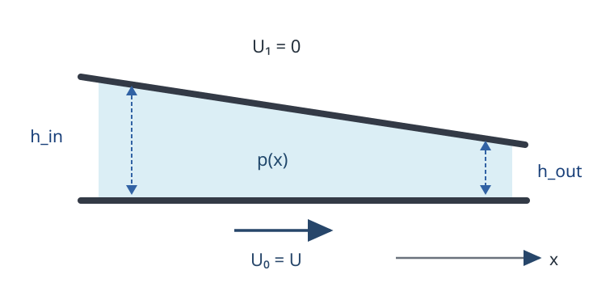

# FLUID20 薄い流れで潤滑方程式が現れるのはなぜか

[FLUID19 の瞬時 Stokes 流](../FLUID19/index.md#thm-fluid19-kinematic-reversibility)では慣性を捨てて粘性力と圧力を釣り合わせた。しかし、細長い隙間に液体を閉じ込めると、単に Stokes 方程式を解くよりさらに簡単になる。壁に沿う距離と壁を横切る距離が非常に違うため、**圧力は厚さ方向にほとんど変わらず、速度は厚さ方向の二階微分で決まる**のである。

この特徴は、軸受のくさび形油膜、微小流路、二枚の板を押し付ける液膜の圧力を予測する。既習の[平板 Couette 流](../../CTM/CTM16/index.md#thm-ctm16-couette-profile)と[平板 Poiseuille 流](../../CTM/CTM17/index.md#thm-ctm17-plane-poiseuille)が、隙間の厚さがゆっくり変化する場合にどう結び付くかを導こう。

## 0. 薄膜とは、何と何が小さいことか

水平な下壁 $z=0$ と上壁 $z=h(x,t)>0$ の間に、一定密度 $\rho>0$、一定動的粘性係数 $\eta>0$ の非圧縮 Newton 流体がある。$x$ は壁に平行な座標、$z$ は下壁から測る高さであり、幅方向 $y$ には何も変化しない**二次元模型**を扱う。速度を $v=(u(x,z,t),w(x,z,t))$ とし、$u$ が $x$ 方向、$w$ が $z$ 方向の成分である。

上壁の水平速度を $U_1$、下壁を $U_0$ と書き、壁に流体が追随する[無滑り条件](../../CTM/CTM15/index.md#def-ctm15-no-slip)を課す。上下の壁は滑らかで、上壁の傾斜は小さいとする。壁の位置が時刻で変わるときは、**壁の形の変化と壁上の粒子の速度を区別**する必要がある。たとえば上壁の粒子が水平方向に動いても、斜面に沿うなら垂直速度は零とは限らない。



この図では、$h_{\rm in}>h_{\rm out}>0$、上壁は静止し $U_1=0$、下壁は右へ $U_0=U>0$ で動く。後の第4節で入口・出口の圧力を同じにしても、途中に正の圧力が生じることを示す。

代表的な水平長さを $L$、膜厚を $H$、水平速さを $U>0$ とする。膜厚を $H$ で割った無次元関数 $\bar h$ が正の定数から上下に有界で、$x/L$ による一階・二階微分も有界と仮定する。したがって壁の傾斜は $O(H/L)$ である。$O(\cdot)$ は、細長比を零へ近づけたときに、その量を定数倍で抑えられるという意味で使う。

<a id="def-fluid20-thin-film"></a>

<!-- formal-statement-start -->
> **定義（二次元薄膜の尺度と境界運動）**  
> $0<x<L$、$0<z<h(x,t)$ において、$h=H\bar h(x/L,tU/L)$、$H,L,U>0$、$\varepsilon=H/L\ll1$ とし、$\bar h$ は正で、その値と $x/L$ に関する一階・二階微分が $\varepsilon$ に依存しない定数で有界とする。速度の代表尺度を $u\sim U$、$w\sim\varepsilon U$、時間の尺度を $L/U$ とする。上下壁の水平速度は $U_0,U_1=O(U)$、垂直速度は下壁で $0$、上壁では
>
$$
w(x,h(x,t),t)=\partial_t h+U_1\partial_x h
$$
>
> とする。この上壁条件を**運動学的境界条件**と呼ぶ。$\rho,\eta$ は正の定数で、速度と圧力は以下の微分が存在するほど滑らかとする。
<!-- formal-statement-end -->

<!-- definition-example-start: def-fluid20-thin-film -->
**定義の確認**：$h(x)=H(2-x/L)$、$0\le x\le L$ とすると、$H\le h\le2H$、$h_x=-H/L=-\varepsilon$、$h_{xx}=0$。したがって正の膜厚と小さい傾斜の条件を満たす。$U_1=0$、$h_t=0$ の固定上壁では $w(h)=0$。別に、上壁全体が速さ $V>0$ で降下する $h(x,t)=H_0-Vt$ では $h_t=-V$、$h_x=0$ なので $w(h)=-V$。後者で $V=O(\varepsilon U)$ なら同じ厚さ方向速度尺度を満たす。
<!-- definition-example-end -->

### Navier–Stokes の各項を別々に比べる

[非圧縮 Navier–Stokes 方程式](../../CTM/CTM15/index.md#thm-ctm15-incompressible-navier-stokes)から、体積力を無視するこの二次元流れでは

$$
\begin{aligned}
\rho(u_t+uu_x+wu_z)&=-p_x+\eta(u_{xx}+u_{zz}),\\
\rho(w_t+uw_x+ww_z)&=-p_z+\eta(w_{xx}+w_{zz}),\\
u_x+w_z&=0.
\end{aligned}
$$

添字 $x,z,t$ はその変数についての偏微分である。非圧縮式の $u_x\sim U/L$ と $w_z\sim(\varepsilon U)/H=U/L$ が同じ次数なので、薄膜内の垂直速度は水平速度より小さい。

無次元座標を $X=x/L$、$Z=z/H$、$T=tU/L$、無次元速度を $\bar u=u/U$、$\bar w=w/(\varepsilon U)$ とし、圧力尺度を

$$
P_*=\frac{\eta UL}{H^2},\qquad \bar p=\frac{p-p_{\rm ref}}{P_*}
$$

と選ぶ。$p_{\rm ref}$ は任意の定数基準圧力である。この尺度は $p_x\sim P_*/L$ と $\eta u_{zz}\sim\eta U/H^2$ を同じ次数にする。水平長さ基準の Reynolds 数を $\mathrm{Re}_L=\rho UL/\eta$ とすれば、実際に変数変換して

$$
\begin{aligned}
\mathrm{Re}_L\varepsilon^2
(\bar u_T+\bar u\bar u_X+\bar w\bar u_Z)
&=-\bar p_X+\varepsilon^2\bar u_{XX}+\bar u_{ZZ},\\
\mathrm{Re}_L\varepsilon^4
(\bar w_T+\bar u\bar w_X+\bar w\bar w_Z)
&=-\bar p_Z+\varepsilon^4\bar w_{XX}+\varepsilon^2\bar w_{ZZ},\\
\bar u_X+\bar w_Z&=0
\end{aligned}
$$

を得る。圧力と速度の各無次元微分が $O(1)$ とする整合的な近似では、$\varepsilon\ll1$ だけでなく

$$
\boxed{\mathrm{Re}_L\varepsilon^2
=\frac{\rho U H^2}{\eta L}\ll1}
$$

が必要である。すると水平運動では $-p_x+\eta u_{zz}=0$、垂直運動では $p_z=0$ が先頭次数に残る。後者は、上下面で圧力が異なるという考えを**主導近似では否定**する。

たとえば $\mathrm{Re}_L=10$、$\varepsilon=0.005$ なら $\mathrm{Re}_L\varepsilon^2=2.5\times10^{-4}$ で、水平長さ基準の Reynolds 数が1より大きくても薄膜内の慣性は小さい。逆に $\varepsilon=0.01$ でも $\mathrm{Re}_L=10^6$ なら比は $100$ であり、薄いだけでは潤滑近似にならない。

時間尺度 $L/U$ を前提としない速い壁運動では、非定常慣性の粘性項に対する比 $\rho H^2/(\eta T_{\rm motion})$ も別に小さくなければならない。ここでは次の主導近似を、誤差が小さいという**漸近的な模型**として扱う。有限の $\varepsilon$ で厳密な Navier–Stokes 解がこの式に一致するという主張ではない。

## 1. 断面内の速度と流量はどう決まるか

$z$ によらない圧力 $p(x,t)$ が与えられると、$x$ 方向の式は $z$ に関する二階常微分方程式になる。平行な板なら既習の[Couette 解](../../CTM/CTM16/index.md#thm-ctm16-couette-profile)と[Poiseuille 解](../../CTM/CTM17/index.md#thm-ctm17-plane-poiseuille)を重ねた形になるが、ここでは隙間が $x$ で変わってもよい。

単位幅当たりに断面を通る体積を数えるため、$x$ を固定した縦断面で水平速度を $z$ 方向に積分する。

<a id="def-fluid20-width-flux"></a>

<!-- formal-statement-start -->
> **定義（薄膜の単位幅流量）**  
> $h(x,t)>0$、$u(x,\cdot,t)$ が $[0,h]$ 上で積分可能な二次元薄膜について、
>
$$
q(x,t)=\int_0^{h(x,t)}u(x,z,t)\,dz
$$
>
> を右向きを正とする**単位幅流量**と定める。単位は $\mathrm{m^2/s}$。幅 $b$ にわたって $y$ 方向一様なら、全体積流量は $Q=bq$（$\mathrm{m^3/s}$）である。
<!-- formal-statement-end -->

<!-- definition-example-start: def-fluid20-width-flux -->
**定義の確認**：一様厚さ $h=H$ の板で下壁 $U_0=U$、上壁 $U_1=0$、圧力勾配零なら線形速度 $u=U(1-z/H)$ が[Couette 解](../../CTM/CTM16/index.md#thm-ctm16-couette-profile)になる。$u(0)=U$、$u(H)=0$、$u_{zz}=0$ を直接確認できる。定義へ代入すると

$$
q=\int_0^H U(1-z/H)\,dz
=U[z-z^2/(2H)]_0^H=\frac{UH}{2}.
$$

$u$ の単位が $\mathrm{m/s}$、$dz$ が $\mathrm m$ なので、$q$ は体積流量そのものではなく単位幅流量である。
<!-- definition-example-end -->

<a id="thm-fluid20-flux"></a>

<!-- formal-statement-start -->
> **定理（薄膜のCouette–Poiseuille速度・流量）**  
> $0<z<h(x,t)$ の二次元非圧縮 Newton 薄膜で $\eta>0$ は一定、主導近似 $p_z=0$、$\eta u_{zz}=p_x$ が成立するとする。上下壁で $u(x,0,t)=U_0$、$u(x,h,t)=U_1$ とし、$h>0$、$p_x,U_0,U_1$ は $z$ に依存しない。このとき速度と[単位幅流量](#def-fluid20-width-flux)はそれぞれ
>
$$
\boxed{u=U_0+\frac{U_1-U_0}{h}z+
\frac{p_x}{2\eta}z(z-h)}
$$
>
$$
\boxed{q=\frac{h}{2}(U_0+U_1)
-\frac{h^3}{12\eta}p_x}
$$
>
> となる。第一項を壁移動による Couette 流量、第二項を圧力勾配による Poiseuille 流量と呼ぶ。
<!-- formal-statement-end -->

### 証明の見取り図

$u_{zz}=p_x/\eta$ を $z$ で二回積分し、下壁・上壁の境界値で積分定数を決める。その多項式を $0$ から $h$ まで積分すると、壁移動の寄与は $h/2$、圧力駆動の寄与は $-h^3/(12\eta)$ になる。

<!-- proof-start -->
### 証明

$x,t$ を固定すれば $p_x,\eta$ は $z$ に依存しない。二回積分して

$$
u_z=\frac{p_x}{\eta}z+C_1,\qquad
u=\frac{p_x}{2\eta}z^2+C_1z+C_0.
$$

$z=0$ で $u=U_0$ より $C_0=U_0$。$z=h$ で $u=U_1$ より

$$
C_1h=U_1-U_0-\frac{p_x}{2\eta}h^2,\quad
C_1=\frac{U_1-U_0}{h}-\frac{p_x h}{2\eta}.
$$

これを $u$ に戻すと第一の式を得る。次に[流量の定義](#def-fluid20-width-flux)へ代入する。

$$
\begin{aligned}
q&=\int_0^h\left(U_0+\frac{U_1-U_0}{h}z+
\frac{p_x}{2\eta}(z^2-hz)\right)dz\\
&=U_0h+\frac{U_1-U_0}{h}\frac{h^2}{2}
+\frac{p_x}{2\eta}\left(\frac{h^3}{3}-\frac{h^3}{2}\right)\\
&=\frac h2(U_0+U_1)-\frac{h^3}{12\eta}p_x.
\end{aligned}
$$

$h^3p_x/\eta$ の次元は $\mathrm{m^3}(\mathrm{Pa/m})/(\mathrm{Pa\,s})=\mathrm{m^2/s}$ であり、第一項と一致する。
<!-- proof-end -->

圧力が $x$ とともに下がる $p_x<0$ のときは、圧力駆動の流量は右向きに**正**である。壁移動の項だけでは圧力の符号は決まらない。次はその流量が場所によって勝手に増減してよいかを調べる。

## 2. 保存則が圧力を決める：Reynolds 潤滑方程式

膜厚が変わると、断面の積分上端そのものが $h(x,t)$ に依存する。ここで上端を定数として微分すると、壁面の運動による質量移動を見落とす。

<a id="thm-fluid20-reynolds"></a>

<!-- formal-statement-start -->
> **定理（Reynolds潤滑方程式）**  
> 滑らかな二次元非圧縮薄膜 $0<z<h(x,t)$、$\eta>0$ 一定で、[薄膜速度・流量](#thm-fluid20-flux)が成り立ち、$u_x+w_z=0$ とする。下壁 $z=0$ は鉛直方向に動かず $w(0)=0$、上壁 $z=h(x,t)$ は水平速度 $U_1$ と運動学的条件 $w(h)=h_t+U_1h_x$ を満たすものとする。このとき
>
$$
\boxed{
\frac{\partial}{\partial x}\left(\frac{h^3}{12\eta}p_x\right)
=h_t+\frac{\partial}{\partial x}\left[\frac h2(U_0+U_1)\right]
}
$$
>
> が成立する。等価な保存形は $h_t+q_x=0$ である。圧力の数値を一意に決めるには入口出口圧力などの境界条件が別途必要である。
<!-- formal-statement-end -->

### 証明の見取り図

連続の式を上下方向に積分する。上端が斜面なので、$u_x$ の積分は単純な $q_x$ ではなく $q_x-u(h)h_x$ になる。一方、上壁の運動学的条件には $+U_1h_x$ が現れ、ちょうど相殺する。この幾何学的な相殺が、質量保存を $h_t+q_x=0$ にする核心である。

<!-- proof-start -->
### 証明

まず $x,t$ を固定して非圧縮条件を $z\in[0,h(x,t)]$ で積分する。

$$
0=\int_0^h(u_x+w_z)\,dz
=\int_0^h u_x\,dz+w(h)-w(0).
$$

積分の上限も $x$ に依存するので、積の微分則を区間積分に適用すると

$$
q_x=\frac{\partial}{\partial x}\int_0^{h(x,t)}u\,dz
=\int_0^h u_x\,dz+u(x,h,t)h_x.
$$

つまり $\int_0^h u_x\,dz=q_x-U_1h_x$。さらに下壁で $w(0)=0$、上壁で $w(h)=h_t+U_1h_x$ を代入して

$$
0=q_x-U_1h_x+(h_t+U_1h_x)
=q_x+h_t
$$

を得る。[速度・流量公式](#thm-fluid20-flux)の

$$
q=\frac h2(U_0+U_1)-\frac{h^3}{12\eta}p_x
$$

を $h_t+q_x=0$ へ代入し、圧力項を右辺へ移せば定理の式になる。$\eta$ が一定なので表示した形でよいが、$\eta$ が $x$ によって変わる模型では係数の微分を勝手に外してはならない。
<!-- proof-end -->

固定された上下の壁で $h_t=0$、$U_0,U_1$ が定数なら $q_x=0$、すなわち**どの断面でも同じ単位幅流量**である。これは物理的な質量保存であり、「速度の放物線形だけ」を解いた時点ではまだ保証されていない。

## 3. くさび形の隙間は圧力をどこで生み出すか

上壁が静止した定常くさびを考える。下壁が右向きに動けば壁移動は液体を運ぶが、出口へ向かって流路が狭くなるので同じ流量を通すには圧力勾配が変化する。出口・入口を同じ大気圧に固定しても、内部で圧力が盛り上がる。

<a id="prop-fluid20-wedge"></a>

<!-- formal-statement-start -->
> **命題（収束くさび軸受の圧力と流量）**  
> 定常薄膜の区間 $0\le x\le L$ で、$\eta,U,L>0$、$h_{\rm in}>h_{\rm out}>0$、$U_0=U$、$U_1=0$、$h_t=0$ とする。膜厚が
>
$$
h(x)=h_{\rm in}+\alpha x,\qquad
\alpha=\frac{h_{\rm out}-h_{\rm in}}{L}<0
$$
>
> であり、ゲージ圧 $p(0)=p(L)=0$ を課す。[Reynolds 潤滑方程式](#thm-fluid20-reynolds)の解の単位幅流量 $q$ は一定で
>
$$
\boxed{q=\frac{U h_{\rm in}h_{\rm out}}{h_{\rm in}+h_{\rm out}}}
$$
>
> となる。圧力は
>
$$
\boxed{p(x)=\frac{12\eta}{\alpha}\left[
\frac U2\left(\frac1{h_{\rm in}}-\frac1{h(x)}\right)
-\frac q2\left(\frac1{h_{\rm in}^2}-\frac1{h(x)^2}\right)
\right].}
$$
>
> 圧力は内部で正、最大は $h(x_*)=2h_{\rm in}h_{\rm out}/(h_{\rm in}+h_{\rm out})$ の一点で生じる。特に $h_{\rm in}=2H$、$h_{\rm out}=H$ なら
>
$$
q=\frac{2UH}{3},\qquad x_*=\frac{2L}{3},\qquad
p(x_*)=\frac{\eta UL}{4H^2}.
$$
<!-- formal-statement-end -->

### 証明の見取り図

定常保存則から $q$ は定数。流量公式を $p_x$ について解き、$p(L)-p(0)=0$ となるよう $q$ を選ぶ。くさびの $h$ は一次関数なので、$dx=dh/\alpha$ の置換積分で必要な $h^{-2},h^{-3}$ が計算できる。最大圧力は $p_x=0$ から探す。

<!-- proof-start -->
### 証明

[流量公式](#thm-fluid20-flux)を $p_x$ について解くと

$$
p_x=\frac{12\eta}{h^3}\left(\frac{Uh}{2}-q\right)
=12\eta\left(\frac U{2h^2}-\frac q{h^3}\right).
$$

両端の圧力差が零だから、$\int_0^L p_x\,dx=0$ である。$\alpha\ne0$ と $dh=\alpha\,dx$ を使い、

$$
\begin{aligned}
\int_0^L\frac{dx}{h^2}
&=\frac1\alpha\left[-\frac1h\right]_{h_{\rm in}}^{h_{\rm out}}
=\frac{L}{h_{\rm in}h_{\rm out}},\\
\int_0^L\frac{dx}{h^3}
&=\frac1\alpha\left[-\frac1{2h^2}\right]_{h_{\rm in}}^{h_{\rm out}}
=\frac{L(h_{\rm in}+h_{\rm out})}
{2h_{\rm in}^2h_{\rm out}^2}.
\end{aligned}
$$

$0=12\eta[(U/2)\int h^{-2}dx-q\int h^{-3}dx]$ だから

$$
q=\frac U2
\frac{L/(h_{\rm in}h_{\rm out})}
{L(h_{\rm in}+h_{\rm out})/(2h_{\rm in}^2h_{\rm out}^2)}
=\frac{Uh_{\rm in}h_{\rm out}}{h_{\rm in}+h_{\rm out}}.
$$

$x$ を上限にする同じ積分を行えば

$$
\int_0^x h(s)^{-2}\,ds
=\frac1\alpha\left(\frac1{h_{\rm in}}-\frac1{h(x)}\right),\qquad
\int_0^x h(s)^{-3}\,ds
=\frac1{2\alpha}\left(\frac1{h_{\rm in}^2}-\frac1{h(x)^2}\right).
$$

$p(0)=0$ と合わせて表示した圧力を得る。$p_x$ の符号は $Uh/2-q$ の符号だけで決まり、$h$ は入口から出口へ狭義単調減少する。$h_*=2q/U=2h_{\rm in}h_{\rm out}/(h_{\rm in}+h_{\rm out})$ は両端厚さの間にあるため、入口側では $p_x>0$、出口側では $p_x<0$。両端で $p=0$ なので内部の圧力は正で、$h=h_*$ に唯一の最大がある。

$h_{\rm in}=2H$、$h_{\rm out}=H$ なら $\alpha=-H/L$、$q=2UH/3$、$h_*=4H/3$。$2H-(H/L)x_*=4H/3$ から $x_*=2L/3$ を得る。圧力式にこの厚さを代入すると角括弧は

$$
\frac U2\left(\frac1{2H}-\frac3{4H}\right)
-\frac{2UH/3}{2}\left(\frac1{4H^2}-\frac9{16H^2}\right)
=-\frac{U}{8H}+\frac{5U}{48H}=-\frac{U}{48H}.
$$

従って $p(x_*)=(12\eta/(-H/L))(-U/(48H))=\eta UL/(4H^2)$。
<!-- proof-end -->

このモデルの「最大圧力」は**ゲージ圧**である。圧力の絶対値を考えるときは $p_{\rm ambient}$ を加える。幅が広い軸受では実際の荷重が膜圧の面積積分で決まり、膜が薄いほど圧力尺度 $P_*=\eta UL/H^2$ が大きくなる。

## 4. 動かないくさびがなくても圧力は生じる：押しつぶし膜

二枚の平行板を近づける場合は水平の壁速度が零でも、液体が左右へ追い出される。上板の垂直運動が[運動学的境界条件](#def-fluid20-thin-film)の $h_t$ に現れ、圧力を作る。

<a id="prop-fluid20-squeeze"></a>

<!-- formal-statement-start -->
> **命題（平行板押しつぶし膜の圧力と荷重）**  
> 二次元薄膜 $-L/2\le x\le L/2$、$0<z<H(t)$ で $\eta,L,H>0$、$U_0=U_1=0$ とする。考えている時刻に $H_t=-V<0$、$V>0$ とし、左右対称の流れで $q(0)=0$、両端のゲージ圧 $p(\pm L/2)=0$ を課す。[Reynolds 潤滑方程式](#thm-fluid20-reynolds)の圧力、流量、上板を支える単位奥行き幅当たりの正味流体荷重は
>
$$
\boxed{q(x)=Vx,\qquad
p(x)=\frac{6\eta V}{H^3}\left(\frac{L^2}{4}-x^2\right)}
$$
>
$$
\boxed{F'=\int_{-L/2}^{L/2}p(x)\,dx
=\frac{\eta VL^3}{H^3}}
$$
>
> である。$F'$ の単位は $\mathrm{N/m}$、圧力は外側の基準圧力との差で測る。
<!-- formal-statement-end -->

### 証明の見取り図

厚さが一様でも時間に依存するため $h_t=-V$ が残る。保存則が $q_x=V$ を要求し、左右対称性が積分定数を零にする。壁の水平速度零の流量公式を反転して $p_x$ を求め、端の圧力で積分定数を決め、最後に圧力を面積積分する。

<!-- proof-start -->
### 証明

[Reynolds 潤滑方程式](#thm-fluid20-reynolds)の保存形 $H_t+q_x=0$ に $H_t=-V$ を代入すると $q_x=V$。従って $q=Vx+C$ で、中心の対称条件 $q(0)=0$ により $C=0$。壁が水平に動かないので[流量公式](#thm-fluid20-flux)は

$$
q=-\frac{H^3}{12\eta}p_x,\qquad
p_x=-\frac{12\eta V}{H^3}x.
$$

$x$ で積分すると $p(x)=-6\eta Vx^2/H^3+C_p$。$p(L/2)=0$ より $C_p=6\eta VL^2/(4H^3)$、反対の端でも $p(-L/2)=0$ である。最後に

$$
\begin{aligned}
F'&=\frac{6\eta V}{H^3}
\int_{-L/2}^{L/2}\left(\frac{L^2}{4}-x^2\right)dx\\
&=\frac{6\eta V}{H^3}
\left[\frac{L^2x}{4}-\frac{x^3}{3}\right]_{-L/2}^{L/2}\\
&=\frac{6\eta V}{H^3}\left(\frac{L^3}{4}-\frac{L^3}{12}\right)
=\frac{\eta VL^3}{H^3}.
\end{aligned}
$$
<!-- proof-end -->

$V$ を一定に保つと、膜厚を半分にしたとき、押しつぶし抵抗 $F'$ は $2^3=8$ 倍になる。ただし膜厚を限りなく零へ縮めればこの連続体・無滑り模型がいつまでも通用するという意味ではない。

## 5. Python で圧力・流量を別々に検算する

解析式が正しく見えても、両端の圧力条件、流量の位置依存、荷重の積分を別々に数値確認する意味がある。次の Python ファイルは標準ライブラリだけで動き、**講義内の実行UIから同じソースをブラウザ実行**できる。

- **収束くさび**：入口厚さ $100\,\mu\mathrm m$、出口厚さ $50\,\mu\mathrm m$、$L=10\,\mathrm{mm}$、$\eta=0.1\,\mathrm{Pa\,s}$、$U=0.1\,\mathrm{m/s}$。圧力が両端零で内部に山を作り、異なる断面の $q$ が一致するか確認する。
- **押しつぶし膜**：$H=50\,\mu\mathrm m$、$L=10\,\mathrm{mm}$、$\eta=0.1\,\mathrm{Pa\,s}$、$V=0.1\,\mathrm{mm/s}$。圧力を台形則で積分した数値荷重が厳密値 $F'=\eta VL^3/H^3$ へ近づくか確認する。

$\mu\mathrm m=10^{-6}\,\mathrm m$。プリセットを切り替え、$H$、$\eta$、$U$、$V$、離散点数を変更してみよう。台形則は有限個の点での積分近似であって、圧力の解析式を証明したことにはならない。圧力曲線の標識は Pa、横軸は mm、単位幅流量は $\mathrm{m^2/s}$ である。

```python-file-lab
# lab-id: FLUID20-LUBRICATION-FILE
# lab-title: 薄膜の圧力と保存流量
# lab-file: textbook/volumes/dream_thater/物理系/FLUID/FLUID20/lubrication_lab.py
# timeout-ms: 15000
# lab-preset: 収束くさび・厚さ2対1 | --case wedge --samples 101
# lab-preset: 平行板押しつぶし | --case squeeze --samples 101
# lab-preset: 押しつぶし・細かい積分 | --case squeeze --samples 401
```

## 6. どこで近似が壊れるか

潤滑近似は「どんな薄い流れでも成立する万能公式」ではない。どの仮定がどこで働いたかを点検する。

- **小さい壁勾配**：$|h_x|=O(\varepsilon)$ でない急な段差では $x$ 方向微分も厚さ方向微分と同じくらい大きくなり、$\varepsilon^2u_{XX}$ を捨てた理由が壊れる。段差の直近には別の局所解が必要になる。
- **慣性と非定常性**：$\mathrm{Re}_L\varepsilon^2\ll1$、また運動時間が異なるなら $\rho H^2/(\eta T_{\rm motion})\ll1$ が必要。これらが大きいと加速度を捨てた段階が壊れる。
- **空洞化**：くさびが発散する場合、同じ両端圧力で潤滑方程式が負のゲージ圧を予測することがある。気泡や気体の出現で液体が連続して充満するという模型が壊れるため、実際には気液境界条件が必要になる。
- **壁のすべり・非Newton性**：無滑りを使って積分定数を決め、一定 $\eta$ で二次速度を得た。すべりや剪断速度依存粘性では第1節の速度公式がそのまま使えない。
- **自由界面と密度変化**：第2節では上下面を所与の固体壁として扱った。液膜自由表面なら表面張力による法線応力と界面運動を別に与える必要があり、圧縮性流体なら $h_t+q_x=0$ を質量保存としてそのまま使えない。

## 7. 演習

各問では $\eta>0$ を一定とし、明記しない限り二次元・非圧縮・無滑りで第0節の薄膜近似が成立するとする。$q$ は右向きを正とする。

### Level A

### A1. 捨てた項の倍率

$L=20\,\mathrm{mm}$、$H=0.1\,\mathrm{mm}$、$\mathrm{Re}_L=40$ の薄膜を考える。$\varepsilon$、水平粘性に対する縦粘性の係数比、水平慣性に対する縦粘性の係数比を求めよ。

- Level: A

<!-- solution-start -->
#### 詳細解答

$\varepsilon=H/L=(0.1)/(20)=0.005$。無次元 $x$ 運動方程式の $u_{XX}$ の係数は $\varepsilon^2=2.5\times10^{-5}$、慣性項の係数は $\mathrm{Re}_L\varepsilon^2=40(2.5\times10^{-5})=10^{-3}$。基準とする $u_{ZZ}$ の係数は1なので、両者はそれぞれ $2.5\times10^{-5}$、$10^{-3}$ 倍である。$\mathrm{Re}_L=40$ だけを見て潤滑近似を否定してはならない。
<!-- solution-end -->

### A2. 壁速度を両方変えたときの流量

一定厚さ $h=H$ の膜で圧力勾配が零、下壁が $U_0=3U$、上壁が $U_1=-U$（$U>0$）で動く。速度分布と $q$ を求め、上下壁の条件を確かめよ。

- Level: A

<!-- solution-start -->
#### 詳細解答

[薄膜の速度公式](#thm-fluid20-flux)で $p_x=0$ とすると $u=3U+(-U-3U)z/H=3U-4Uz/H$。$z=0$ では $u=3U$、$z=H$ では $u=-U$。流量は

$$
q=\int_0^H(3U-4Uz/H)\,dz
=3UH-2UH=UH.
$$

また公式 $q=H(U_0+U_1)/2=H(3U-U)/2=UH$ と一致する。上壁が逆方向に動いても平均壁速度が正なので流量は正である。
<!-- solution-end -->

### A3. 移動する斜面の鉛直速度

$h(x,t)=H_0-Vt+\alpha x$（正の領域）、$V>0$、$\alpha$ は無次元定数とする。上壁の水平速度 $U_1$ に対し、上壁における $w$ と、その成り立つ理由を示せ。$w=-V$ と置ける条件も述べよ。

- Level: A

<!-- solution-start -->
#### 詳細解答

上壁を表す $F(x,z,t)=z-h(x,t)$ の値は壁上の粒子に沿って常に零であるから、連鎖律により $F_t+U_1F_x+wF_z=0$。各偏微分は $F_t=-h_t=V$、$F_x=-h_x=-\alpha$、$F_z=1$。よって $V-\alpha U_1+w=0$ から

$$
w=-V+\alpha U_1=h_t+U_1h_x.
$$

$w=-V$ と置けるのは $U_1\alpha=0$、すなわち壁が水平移動しないか上壁が平行な場合である。
<!-- solution-end -->

### A4. 圧力勾配だけで生じる流量

厚さ $H$ の静止平板間で $p_x=-G$（$G>0$）を一定とする。速度分布、最大速度、$q$ の符号と値を求めよ。

- Level: A

<!-- solution-start -->
#### 詳細解答

[速度・流量公式](#thm-fluid20-flux)で $U_0=U_1=0$、$p_x=-G$ を代入すると

$$
u(z)=\frac{-G}{2\eta}z(z-H)=\frac{G}{2\eta}z(H-z).
$$

$u_z=G(H-2z)/(2\eta)$ が零となる $z=H/2$ で最大となり $u_{\max}=GH^2/(8\eta)$。積分すると

$$
q=\frac{G}{2\eta}\left(\frac{H^3}{2}-\frac{H^3}{3}\right)
=\frac{GH^3}{12\eta}>0.
$$

これは[平板 Poiseuille 流](../../CTM/CTM17/index.md#thm-ctm17-plane-poiseuille)の流量を同じ符号で再現する。
<!-- solution-end -->

### A5. 流量と荷重の単位

$\eta$ の単位を Pa s、$U,V$ の単位を m/s、$h,L$ の単位を m とする。$h^3p_x/\eta$、$\eta VL^3/H^3$、$\eta UL/H^2$ の単位をそれぞれ求め、何の尺度か述べよ。

- Level: A

<!-- solution-start -->
#### 詳細解答

$p_x$ は Pa/m だから $[h^3p_x/\eta]=\mathrm{m^3(Pa/m)/(Pa\,s)}=\mathrm{m^2/s}$、単位幅流量である。$[\eta VL^3/H^3]=(\mathrm{Pa\,s})(\mathrm{m/s})=\mathrm{Pa\,m}=\mathrm{N/m}$、押しつぶし膜の単位奥行き荷重である。$[\eta UL/H^2]=(\mathrm{Pa\,s})(\mathrm{m/s})\mathrm m/\mathrm{m^2}=\mathrm{Pa}$、潤滑の圧力尺度である。最後の二つを同じ「圧力」と呼ぶのは単位の取り違えである。
<!-- solution-end -->

### Level B

### B1. 収束くさびの流量を積分で求める

$h(x)=3H-2Hx/L$、$U_0=U>0$、$U_1=0$、$p(0)=p(L)=0$ の定常膜で $q$ を求めよ。入口・出口の $p_x$ の符号も判定せよ。

- Level: B

<!-- solution-start -->
#### 詳細解答

[くさびの流量命題](#prop-fluid20-wedge)を使う前に導出を確かめる。$q$ が一定で $p_x=12\eta(U/(2h^2)-q/h^3)$ だから、端の圧力差零から

$$
q=\frac U2\frac{\int_0^Lh^{-2}\,dx}{\int_0^Lh^{-3}\,dx}.
$$

$h_{\rm in}=3H$、$h_{\rm out}=H$ を積分結果へ代入すると

$$
\int_0^Lh^{-2}dx=\frac{L}{3H^2},\quad
\int_0^Lh^{-3}dx=\frac{L(3H+H)}{2(3H)^2H^2}
=\frac{2L}{9H^3},
$$

ゆえに $q=(U/2)(L/(3H^2))/(2L/(9H^3))=3UH/4$。入口では $Uh/2-q=3UH/2-3UH/4=3UH/4>0$、出口では $UH/2-3UH/4=-UH/4<0$。$h^3>0$ なので $p_x(0)>0$、$p_x(L)<0$ と決まる。
<!-- solution-end -->

### B2. 膜厚を半分にすると押しつぶし荷重はどうなるか

幅方向に一様な長さ $L$ の平行板押しつぶし膜について、速さ $V>0$ を一定とした瞬間の $F'$ を $H$ から $H/2$ に変更した比で求めよ。さらに、$H$ と $V$ を両方半分にした場合を比べよ。

- Level: B

<!-- solution-start -->
#### 詳細解答

[押しつぶし膜の荷重](#prop-fluid20-squeeze)は $F'=\eta VL^3/H^3$。$V$ を一定とすれば

$$
\frac{F'(H/2,V)}{F'(H,V)}
=\frac{\eta VL^3/(H/2)^3}{\eta VL^3/H^3}=8.
$$

$V$ も $V/2$ とすると

$$
\frac{F'(H/2,V/2)}{F'(H,V)}
=\frac{(V/2)/(H/2)^3}{V/H^3}=4.
$$

荷重は $H^{-3}$ と $V$ の一次に比例するので、厚さを半分にするだけの効果と速さも変える効果を混同しない。
<!-- solution-end -->

### B3. 最大圧力の位置は膜厚で表すと分かる

$h_{\rm in}=3H$、$h_{\rm out}=H$、$U_0=U>0$、$U_1=0$ のくさびで、内部最大圧力を与える位置 $x_*$ を求めよ。$x_*$ では圧力勾配が零であることを $q$ から直接確認せよ。

- Level: B

<!-- solution-start -->
#### 詳細解答

[B1 の流量](#prop-fluid20-wedge)と同じ公式に $h_{\rm in}=3H$、$h_{\rm out}=H$ を入れると $q=3UH/4$。$p_x=12\eta h^{-3}(Uh/2-q)$ なので $p_x=0$ は $h_*=2q/U=3H/2$ と同値。膜厚 $h(x)=3H-2Hx/L$ から

$$
3H-\frac{2H}{L}x_*=\frac{3H}{2}
\quad\Longrightarrow\quad x_*=\frac{3L}{4}.
$$

入口の $h=3H$ は $h_*$ より大きく、出口の $h=H$ は小さい。したがって $p_x$ は正から負へ符号を変え、$x_*$ は局所極値だけでなく区間内の唯一の最大点である。$Uh_*/2=3UH/4=q$ も直接確認できる。
<!-- solution-end -->

### B4. 発散くさびの「負圧」の意味

定常くさびで $0<h_{\rm in}<h_{\rm out}$、$U_0=U>0$、$U_1=0$、両端のゲージ圧を零とする。膜厚が増えるときの $q$、$p_x$ の符号、内部のゲージ圧の符号を導き、それを液体が実際に常に維持できると断定してはいけない理由を述べよ。

- Level: B

<!-- solution-start -->
#### 詳細解答

両端圧力が零で定常なら B1 と同じ積分計算が使え、

$$
q=\frac{Uh_{\rm in}h_{\rm out}}{h_{\rm in}+h_{\rm out}}>0,\qquad
h_*=\frac{2q}{U}
=\frac{2h_{\rm in}h_{\rm out}}{h_{\rm in}+h_{\rm out}}.
$$

今回は $h_{\rm in}<h_*<h_{\rm out}$ で、$h$ は増加する。したがって入口側の $Uh/2-q$ は負、出口側は正なので $p_x$ は負から正へ変わる。両端で $p=0$ だから内部のゲージ圧は負となる。圧力が下がりすぎて気泡ができると「一定密度の液体が膜全体を充満する」という前提が壊れ、この滑らかな単相解を空洞化後の圧力として採用できない。負の**ゲージ圧**自体は負の**絶対圧力**を意味しない点も区別する。
<!-- solution-end -->

### Level C

### C1. Couette 駆動と押しつぶしを同時に扱う

長さ $L>0$ の平行板 $-L/2\le x\le L/2$ を考え、ある瞬間に膜厚は $H>0$ で一様、$H_t=-V<0$、下壁は右向き速度 $U>0$、上壁は水平方向には静止している。$\eta>0$ は一定で $p(\pm L/2)=0$、圧力は左右対称とする。薄膜近似で次を順に求めよ。

1. 質量保存から $q_x$ と、左右対称性に整合する $q(x)$。
2. 流量公式から $p_x$、$p(x)$ と $p(0)$。
3. 上下壁の速度条件を満たす $u(x,z)$ を求め、$z$ で積分して得る流量が1と一致することを再確認せよ。
4. 圧力が作る単位幅荷重 $F'$ と、速度場の下壁せん断 $ \eta u_z(x,0)$ を求め、壁速度 $U$ を倍増しても圧力と荷重が変わらない理由を説明せよ。

- Level: C

<!-- solution-start -->
#### 詳細解答

**1. 保存則。** [Reynolds 潤滑方程式](#thm-fluid20-reynolds)の保存形は $H_t+q_x=0$ である。$H_t=-V$ から $q_x=V$。したがって $q(x)=Vx+C$。$U$ の Couette 成分は左右どこでも同じ流量 $UH/2$ を運ぶので、対称な圧力駆動部分の流量は中心で零となる。よって $q(0)=UH/2$ として $C=UH/2$、従って

$$
\boxed{q(x)=\frac{UH}{2}+Vx.}
$$

**2. 圧力。** [流量公式](#thm-fluid20-flux)へ $U_0=U$、$U_1=0$ を入れると

$$
\frac{UH}{2}+Vx=\frac{UH}{2}-\frac{H^3}{12\eta}p_x.
$$

両辺で $UH/2$ が消えるので $p_x=-12\eta Vx/H^3$。$x$ で積分して $p(x)=-6\eta Vx^2/H^3+C_p$、$p(L/2)=0$ から $C_p=6\eta VL^2/(4H^3)$。反対側も同じ値になる。したがって

$$
\boxed{p(x)=\frac{6\eta V}{H^3}\left(\frac{L^2}{4}-x^2\right)},\qquad
p(0)=\frac{3\eta VL^2}{2H^3}.
$$

**3. 速度と流量の独立確認。** 圧力勾配を[速度公式](#thm-fluid20-flux)へ入れて

$$
u(x,z)=U\left(1-\frac zH\right)
+\frac{-12\eta Vx/H^3}{2\eta}z(z-H)
=U\left(1-\frac zH\right)
+\frac{6Vx}{H^3}z(H-z).
$$

$z=0$ で $u=U$、$z=H$ で $u=0$、$u_{zz}=(-12Vx/H^3)=p_x/\eta$ である。ここから直接積分すると

$$
\begin{aligned}
\int_0^H u\,dz
&=U\left[ z-\frac{z^2}{2H}\right]_0^H
+\frac{6Vx}{H^3}\left[\frac{Hz^2}{2}-\frac{z^3}{3}\right]_0^H\\
&=\frac{UH}{2}+\frac{6Vx}{H^3}\left(\frac{H^3}{2}-\frac{H^3}{3}\right)
=\frac{UH}{2}+Vx,
\end{aligned}
$$

となり保存則から得た1の式と一致する。$q_x=V$ だから $H_t+q_x=-V+V=0$ も成立する。

**4. 荷重と壁面せん断。** [押しつぶし膜の荷重](#prop-fluid20-squeeze)と同じ圧力なので、積分の中間式も同じで

$$
F'=\int_{-L/2}^{L/2}p(x)\,dx
=\frac{6\eta V}{H^3}\left(\frac{L^3}{6}\right)
=\frac{\eta VL^3}{H^3}.
$$

速度式を $z$ で微分して

$$
u_z=-\frac UH+\frac{6Vx}{H^3}(H-2z),\qquad
\eta u_z(x,0)=-\frac{\eta U}{H}+\frac{6\eta Vx}{H^2}.
$$

下壁のせん断には $U$ が入るが、水平に一様な Couette 成分の流量 $UH/2$ は $x$ で微分すると零なので、Reynolds 方程式の圧力の源項には寄与しない。したがって同じ $H,V,L,\eta$ と端圧力を保ったまま $U$ を倍増しても $p,F'$ は変わらない。この独立性は膜厚が $x$ に依存しないという仮定に依存する。
<!-- solution-end -->

## 8. まとめ

薄い隙間では $\varepsilon=H/L\ll1$ と $\mathrm{Re}_L\varepsilon^2\ll1$ により、圧力は膜厚方向で一様になり、速度は壁移動の直線項と圧力勾配の放物線項になる。その断面積分が $q=h(U_0+U_1)/2-h^3p_x/(12\eta)$、動く壁の運動学的条件を含めた質量保存が $h_t+q_x=0$ を与える。この組合せが Reynolds 潤滑方程式である。

くさびの圧力は膜厚の空間変化、押しつぶし膜の圧力は膜厚の時間変化によって生まれる。次の FLUID21 では、同じ粘性を含む式でも**高 Reynolds 数の外側流れとごく薄い壁近傍**で項の釣合いが変わることを調べる。
