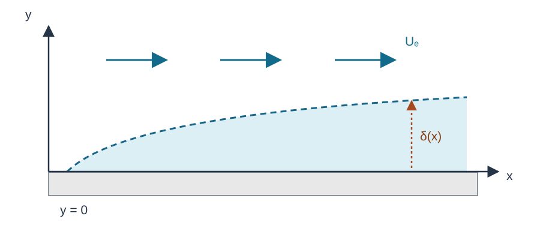

# FLUID21 高Reの壁近傍だけ粘性が残る理由は何か

[FLUID20 の潤滑近似](../FLUID20/index.md#def-fluid20-thin-film)では、薄い隙間で粘性が優勢になる条件を調べた。今回は一見逆の状況である。物体の大きさで測る Reynolds 数が非常に大きくても、静止壁の表面では速度が零になる。外側の流れを[粘性のない Euler 流](../FLUID6/index.md#thm-fluid6-euler-equation)として近似すると、壁上で接線速度が零という条件を一般には満たせない。

この不一致を壁のすぐ上の**薄い境界層**で解消する。外側では粘性を捨て、壁の近くでは速度の厚さ方向の急な変化に粘性が残る。今回は、その釣合いをもとの Navier–Stokes 方程式から導き、近似の使える範囲を明らかにする。次の FLUID22 で、得られた式の特別な解を実際に求める。

## 0. 問題の設定：高Reなのに壁では速度が零

平板に沿う座標を $x$、壁から流体側へ向かう座標を $y$ とする。壁は $y=0$ に固定され、流体は $y>0$ を流れる。密度 $\rho>0$ と動的粘性係数 $\mu>0$ が一定の[非圧縮 Newton 流体](../../CTM/CTM15/index.md#def-ctm15-incompressible-newtonian)を考え、動粘性係数を $\nu=\mu/\rho$ と置く。速度 $(u(x,y),v(x,y))$ の $u$ は壁に平行、$v$ は壁に垂直な成分である。

ここでは定常・二次元・滑らかな流れ、体積力なし、壁面は[無滑り・非貫通](../../CTM/CTM15/index.md#def-ctm15-no-slip)を仮定する。外部流の代表速さを $U>0$、物体に沿う代表長さを $L>0$ とする。壁上の速度は $u(x,0)=v(x,0)=0$ だが、壁から十分遠いところでは外部流の接線速度 $U_e(x)>0$ へ近づく。

以下、下付き添字は**他方の座標を固定した偏微分**を表す。例えば $u_x=\partial u/\partial x$ は $y$ を固定し、$u_{yy}=\partial^2u/\partial y^2$ は $x$ を固定して微分する。一方、$x$ だけの関数 $f(x)$ のプライムは $f'(x)=df/dx$ という、$x$ についての**通常の微分**を表す。例えば外部量について $U_e'(x)=dU_e/dx$、$p_e'(x)=dp_e/dx$ である。



青い破線は速度が変化する領域の大まかな外縁であり、速度の特定の割合から決めた厳密な厚さの線ではない。縦の点線は同じ $x$ での壁と外縁の距離を示す。**外部流が速くても、壁との間のごく短い距離で速度が変わる**ことを読み取ろう。

## 1. 外側と内側を別の物差しで見る

[Reynolds 数の定義](../../CTM/CTM16/index.md#def-ctm16-reynolds)を外部尺度へ当てはめると

$$
\mathrm{Re}_L=\frac{\rho UL}{\mu}=\frac{UL}{\nu}
$$

となる。$\mathrm{Re}_L\gg1$ なら、$L$ 程度の長さで変わる速度の粘性項は慣性項の $O(\mathrm{Re}_L^{-1})$ である。しかし壁からの距離まで $L$ だと決めてしまうと、無滑り条件と外部速度の間の急な変化を見失う。そこで厚さ $\delta\ll L$ を別に導入する。

壁上の非貫通条件 $v(x,0)=0$ と[連続の式](../../CTM/CTM15/index.md#thm-ctm15-incompressible-navier-stokes)を用いる。接線速度が距離 $L$ で $U$ 程度変化すれば

$$
|u_x|_{\rm scale}\sim\frac UL,\qquad
u_x+v_y=0,\qquad
|v_y|_{\rm scale}\sim\frac UL.
$$

厚さ $\delta$ にわたる積分から、垂直速度の尺度は $|v|_{\rm scale}\sim\delta U/L$ となる。非貫通条件と連続の式からこの尺度を選ぶのであって、独立の仮定ではない。

<a id="def-fluid21-inner-scaling"></a>

<!-- formal-statement-start -->
> **定義（高Re境界層の内側尺度）**  
> 代表速度 $U>0$、長さ $L>0$、厚さ $\delta>0$ に対し、$\varepsilon=\delta/L$ と置く。二次元非圧縮流の内側で

> - $x\sim L$、$y\sim\delta$、$u\sim U$、
> - 連続の式と壁の非貫通条件に整合する $v\sim\varepsilon U$、
> - 圧力差の尺度は $\rho U^2$

> を採ることを、本講でいう**内側尺度**とする。議論する領域では無次元速度・圧力と、使う階数までの無次元微分が一様に $O(1)$ と仮定する。
<!-- formal-statement-end -->

<!-- definition-example-start: def-fluid21-inner-scaling -->
**定義の確認**：$U=1$ m/s、$L=1$ m、$\nu=10^{-4}$ m$^2$/s とすれば $\mathrm{Re}_L=10^4$ である。後に得る厚さ $\delta=\sqrt{\nu L/U}=0.01$ m を採ると $\varepsilon=0.01$、垂直速度の尺度は $0.01$ m/s。$u_x$ と $v_y$ の尺度はそれぞれ $U/L=1$ s$^{-1}$、$(\varepsilon U)/\delta=1$ s$^{-1}$ となり、連続の式の二項を同じ次数に保つ。
<!-- definition-example-end -->

垂直速度が小さい理由は「壁に垂直な流れが存在しない」からではない。[非圧縮の質量保存](../../CTM/CTM15/index.md#thm-ctm15-incompressible-navier-stokes)の一部である $u_x+v_y=0$ を、$v(x,0)=0$ と合わせて積分すれば

$$
v(x,y)=-\int_0^y u_x(x,s)\,ds.
$$

$u_x\sim U/L$、積分区間が $\delta$ なら $v\sim U\delta/L$ となる。これは $v$ の規模を**独立に仮定していない**ことを意味する。ただし $u_x$ が局所的に大きくなる剥離近傍や先端では、この尺度が破れることがある。

### 外部流と壁をつなぐ境界条件

外側の解が壁でどんな値でもよいわけではない。内側の速度は壁で静止し、内側の上端では外部流の接線速度へ接続する。この二つの条件を同時に課す。

<a id="def-fluid21-matching"></a>

<!-- formal-statement-start -->
> **定義（付着した境界層の接線速度接続）**  
> 固定した $x$ で壁面が静止し、外部 Euler 流の接線速度を $U_e(x)>0$ とする。壁上では

$$
u(x,0)=v(x,0)=0
$$

> を課す。内側座標を $Y=y/\delta$ とし、先頭次数の接線速度 $u_0(x,Y)$ に次の極限条件を課す。

$$
\lim_{Y\to\infty}u_0(x,Y)=U_e(x)
$$

> この極限条件を**接線速度の整合（matching）**と呼ぶ。ここで $Y\to\infty$ は $\varepsilon\to0$ の内側座標で外側に向かう重なり領域を表し、固定された物理的 $y$ で無限遠へ進む操作と区別する。外部側には壁を横切る速度が先頭次数で零という条件を課すが、内側の $v$ が $Y\to\infty$ で零になるとは限らない。
<!-- formal-statement-end -->

<!-- definition-example-start: def-fluid21-matching -->
**定義の確認**：一定の外部接線速度 $U_e>0$ と長さ $d>0$ を選び、$\delta=d$、$Y=y/d$ とする。物理変数での候補場と、その内側表示は

$$
u(x,y)=U_e(1-e^{-y/d}),\qquad
v(x,y)=0,\qquad
u_0(x,Y)=U_e(1-e^{-Y})
$$

である。壁条件と外縁条件をそれぞれ計算すると

$$
u(x,0)=v(x,0)=0,\qquad
\lim_{Y\to\infty}u_0(x,Y)=U_e.
$$

また $u$ は $x$ に依存せず、$v$ は恒等的に零なので、連続の式は $u_x+v_y=0$ となる。これで**壁条件・接線速度接続・質量保存**を個別に判定できた。

ただし $\nu u_{yy}\ne0$ だから、圧力勾配零の Prandtl 運動量方程式の解ではない。厚さ $d$ の係数も上記の境界条件だけでは決まらない。
<!-- definition-example-end -->

## 2. どの粘性項だけが生き残るか

[一定粘性の非圧縮 Navier–Stokes 方程式](../../CTM/CTM15/index.md#thm-ctm15-incompressible-navier-stokes)を、この二次元・定常・体積力なしの設定に制限すると

$$
\begin{aligned}
u u_x+v u_y&=-\frac1\rho p_x+\nu(u_{xx}+u_{yy}),\\
u v_x+v v_y&=-\frac1\rho p_y+\nu(v_{xx}+v_{yy}),\\
u_x+v_y&=0.
\end{aligned}
$$

$x=LX$、$y=\delta Y$、$u=Ua$、$v=\varepsilon Ub$、$p=p_{\rm ref}+\rho U^2q$ とする。無次元の $a,b,q$ は $(X,Y)$ の関数である。**第一式を $U^2/L$ で割る**と

$$
a a_X+b a_Y=-q_X+
\frac1{\mathrm{Re}_L}a_{XX}+
\frac1{\mathrm{Re}_L\varepsilon^2}a_{YY}.
$$

慣性と厚さ方向の粘性が競合するには

$$
\frac1{\mathrm{Re}_L\varepsilon^2}\sim1,
\qquad
\boxed{\varepsilon=\mathrm{Re}_L^{-1/2}},
\qquad
\boxed{\delta\sim\sqrt{\frac{\nu L}{U}}}.
$$

厚さの**次数**だけが決まる。流れの形に依存する数値係数や厳密な「99%厚さ」は、この尺度解析からは決まらない。

<a id="prop-fluid21-term-orders"></a>

<!-- formal-statement-start -->
> **命題（境界層尺度での項の次数）**  
> [内側尺度](#def-fluid21-inner-scaling)を満たす定常二次元非圧縮流を考える。無次元微分は一様有界とし、尺度を

$$
\mathrm{Re}_L\gg1,\qquad
\varepsilon=\mathrm{Re}_L^{-1/2}
$$

> と選ぶ。このとき、水平慣性・水平圧力勾配・壁に垂直な方向の粘性は同じ基準次数となる。流れ方向の水平速度粘性は相対 $O(\varepsilon^2)$ である。垂直運動量式は先頭次数で $q_Y=0$ を与える。
<!-- formal-statement-end -->

### 証明の見取り図

水平式の $a_{XX}$ と $a_{YY}$ の係数を比べる。垂直式は圧力の基準尺度が大きいため、左辺全体に $\varepsilon^2$ が付く。**圧力が層を横切ってほぼ一定**という主張は、単なる仮定ではなく垂直運動量式からの帰結である。

<!-- proof-start -->
### 証明

$\mathrm{Re}_L^{-1}=\varepsilon^2$ を水平式に代入して

$$
a a_X+b a_Y=-q_X+\varepsilon^2a_{XX}+a_{YY}.
$$

次に垂直運動量の慣性尺度は $\varepsilon U^2/L$、圧力勾配の尺度は $U^2/(\varepsilon L)$ なので、その比は $\varepsilon^2$。第二式を $U^2/(\varepsilon L)$ で割れば

$$
\varepsilon^2(a b_X+b b_Y)
=-q_Y+\varepsilon^4 b_{XX}+\varepsilon^2 b_{YY}.
$$

ここで $v_{xx}$ の係数は $\varepsilon^2/\mathrm{Re}_L=\varepsilon^4$、$v_{yy}$ の係数は $1/\mathrm{Re}_L=\varepsilon^2$ である。無次元関数の対応する微分が一様有界なら、右辺を整理して

$$
q_Y=-\varepsilon^2(a b_X+b b_Y)+
\varepsilon^4b_{XX}+\varepsilon^2b_{YY}=O(\varepsilon^2).
$$

ゆえに先頭次数の圧力 $q_0$ は $Y$ に依存しない。これらは形式的な先頭次数評価であり、有限 $\varepsilon$ の Navier–Stokes 解に一様誤差評価が成立するという証明ではない。
<!-- proof-end -->

例えば $\mathrm{Re}_L=10^6$ なら $\varepsilon=10^{-3}$、$x$ 方向の粘性項の係数は $10^{-6}$ だが、$y$ 方向の粘性項の係数は $1$ である。**同じ粘性係数でも、微分する距離の違いが項の大小を逆転させる**。

### Prandtl 境界層方程式

外側の滑らかな Euler 流の壁に沿う速度を $U_e(x)$、圧力を $p_e(x)$ とする。[既習の Euler 運動方程式](../FLUID6/index.md#thm-fluid6-euler-equation)を固定平板 $y=0$ の接線方向へ適用する。外部速度を $(u_e,v_e)$ とすれば壁上では $u_e(x,0)=U_e(x)$、$v_e(x,0)=0$ であるため、$u_e(u_e)_x+v_e(u_e)_y=U_e\,dU_e/dx$ となり、先頭次数で

$$
U_e(x)\frac{dU_e}{dx}=-\frac1\rho\frac{dp_e}{dx}
$$

を満たすと仮定する。外部速度が壁上で零である必要はない。内側では前の命題により $p_y$ を先頭次数で無視できる。ただし**厚さ方向に一定という事実だけでは圧力の値を確定できない**。内外が同じ流体の重なり領域で圧力も整合することを条件に加え、その先頭項を外部圧力 $p_e(x)$ と結び付ける。

<a id="thm-fluid21-prandtl"></a>

<!-- formal-statement-start -->
> **定理（定常二次元 Prandtl 境界層方程式：形式的先頭次数）**  
> 密度・粘性係数・代表速度・長さを正の定数とし、動粘性係数と Reynolds 数を

$$
\nu=\frac{\mu}{\rho},\qquad
\mathrm{Re}_L=\frac{UL}{\nu}\gg1,
\qquad \rho,\mu,U,L>0
$$

> と定める。滑らかな定常二次元非圧縮 Newton 流体が固定平板 $y=0$ の上を流れ、[内側尺度](#def-fluid21-inner-scaling)と[整合条件](#def-fluid21-matching)を満たすとする。外部速度 $U_e(x)>0$ と圧力 $p_e(x)$ は滑らかで、外部 Euler の接線式を満たす。さらに内側圧力の先頭項は重なり領域で $p_e(x)$ に接続すると仮定する。

> 各流れでは $\rho,\mu,U,L$ は一定とするが、その値を変えて $\mathrm{Re}_L\to\infty$ とする流れの族を考える。$\varepsilon=\mathrm{Re}_L^{-1/2}\to0$ で、無次元速度・圧力の先頭項 $a_0,b_0,q_0$ が存在し、$a=a_0+o(1)$、$b=b_0+o(1)$、$q=q_0+o(1)$ と、方程式に現れる階数までの偏導関数についても先頭項を取れると仮定する。そのとき先頭次数の運動方程式と条件は

$$
\boxed{u_x+v_y=0,}
$$

$$
\boxed{u u_x+v u_y
=-\frac1\rho p_e'(x)+\nu u_{yy}
=U_e(x)U_e'(x)+\nu u_{yy},}
$$

$$
u(x,0)=v(x,0)=0,\qquad
u(x,y)\longrightarrow U_e(x)
\quad (y/\delta\to\infty).
$$

> ここで $(u,v)$ は境界層近似の先頭次数を物理単位に戻して書いたもので、圧力は先頭次数で $p_e(x)$ に等しい。これは一般の Navier–Stokes 方程式の厳密な恒等式ではない。
<!-- formal-statement-end -->

### 証明の見取り図

水平の移流項二つは両方残る。垂直式から圧力が $Y$ に依存しないことを得て外部圧力に合わせる。外部 Euler 式はその圧力勾配を外部速度の変化へ変換するために使う。

<!-- proof-start -->
### 証明

[項の次数](#prop-fluid21-term-orders)の水平式から、$\varepsilon\to0$ で $\varepsilon^2a_{XX}$ を落とすと

$$
a_0(a_0)_X+b_0(a_0)_Y=-(q_0)_X+(a_0)_{YY}.
$$

[項の次数の命題](#prop-fluid21-term-orders)と先頭項の極限操作から $(q_0)_Y=0$ を得たから、$q_0$ は $Y$ に依存せず $q_0=q_e(X)$ と書ける。ここで仮定した**重なり領域での圧力接続**により $q_e(X)=\{p_e(LX)-p_{\rm ref}\}/(\rho U^2)$ と決まる。その導関数は $(q_e)_X=L p_e'(LX)/(\rho U^2)$ である。さらに $u=Ua_0$、$v=\varepsilon Ub_0$ に対して

$$
u_x=\frac UL(a_0)_X,\quad
v u_y=\frac{U^2}{L}b_0(a_0)_Y,\quad
\nu u_{yy}=\frac{\nu U}{\varepsilon^2L^2}(a_0)_{YY}
=\frac{U^2}{L}(a_0)_{YY}
$$

となるから、無次元水平式へ $U^2/L$ を掛けて元の変数に戻すと

$$
u u_x+v u_y=-\frac{p_e'(x)}\rho+\nu u_{yy}.
$$

さらに外側での接線方向 Euler 方程式 $\rho U_eU_e'=-p_e'$ を代入して第二の表示を得る。連続の式は尺度変更で $a_X+b_Y=0$ となり、$\varepsilon$ を掛ける必要がないから、そのまま $u_x+v_y=0$ に戻る。

壁では固定壁の[無滑り条件](../../CTM/CTM15/index.md#def-ctm15-no-slip)と非貫通条件を使う。外縁では[接線速度の整合](#def-fluid21-matching)を使う。以上で先頭次数の方程式と境界条件が定まる。
<!-- proof-end -->

外縁で $v\to0$ を追加すると一般には過剰な条件になる。境界層の内部から外側へ流体が押し出される効果は、小さな法線速度として外部流の次次数に接続するからである。

## 3. 外部速度の変化が圧力の源になる

定常境界層の圧力を $y$ 方向に解く必要はない。ただし「圧力一定」という意味ではない。$x$ に沿う外部速度 $U_e(x)$ が増減すると圧力も $x$ 方向へ変化する。

<a id="prop-fluid21-edge-pressure"></a>

<!-- formal-statement-start -->
> **命題（外部流の圧力と加速）**  
> 定常・密度一定の滑らかな外側 Euler 流が、直線状の固定平板 $y=0$ に沿って接線速度 $U_e(x)>0$ を持ち、壁での法線速度が零、体積力がないとする。$x$ は平板に沿う距離とする。壁に沿う Euler 方程式により

$$
\boxed{p_e(x)+\frac{\rho}{2}U_e(x)^2=C}
$$

> が壁に沿う一つの滑らかな区間で成り立つ。特に $U_e'>0$ は $p_e'<0$、$U_e'<0$ は $p_e'>0$ に対応する。
<!-- formal-statement-end -->

### 証明の見取り図

[Prandtl 方程式](#thm-fluid21-prandtl)の右辺に現れる圧力勾配を、外側の Euler の接線式で求める。積分定数は同じ外部流の一つの区間で共通である。

<!-- proof-start -->
### 証明

外側では粘性の寄与を先頭次数で捨てる。[Euler 運動方程式](../FLUID6/index.md#thm-fluid6-euler-equation)の接線成分を壁上で評価すると、$v_e(x,0)=0$ と $(u_e)_x(x,0)=U_e'(x)$ から $U_eU_e'=-p_e'/\rho$ となる。両辺に $\rho$ を掛けて

$$
p_e'+\rho U_eU_e'
=\frac d{dx}\left(p_e+\frac\rho2 U_e^2\right)=0.
$$

従って $p_e+\rho U_e^2/2=C$。$U_e,\rho>0$ より $p_e'=-\rho U_eU_e'$ の符号は $U_e'$ の反対である。
<!-- proof-end -->

**直接例**：$U_e(x)=U_0(1+ax/L)$、$U_0>0$、$a>0$、$0\le x\le L$ なら

$$
p_e(x)-p_e(0)
=-\frac{\rho U_0^2}{2}
\left[\left(1+\frac{ax}{L}\right)^2-1\right]<0
\quad (x>0).
$$

この圧力勾配を[Prandtl 方程式](#thm-fluid21-prandtl)へ渡す。外部流が減速する場合には逆に $p_e'>0$ となり、壁近傍の流れに不利な圧力勾配を作る。ただし、ここでただちに剥離の発生位置が決まるわけではない。剥離そのものは FLUID24 で扱う。

## 4. 下流へ行くほど層は厚くなるか

局所的な距離 $x>0$ までの流れを考えると、粘性による横方向の運動量輸送に使える時間の目安は移流時間 $t_a=x/U$ である。拡散に対応する距離は $\sqrt{\nu t_a}$ だから、厚さは $\sqrt{\nu x/U}$ と見積もられる。この発想は [FLUID17 の粘性拡散](../FLUID17/index.md)とも一致するが、今回は定常・下流発達という別の問題である。

局所の有効性を $\mathrm{Re}_L$ だけで判定すると、前縁付近で困る。$x$ を長さとして使った数を導入する。

<a id="def-fluid21-local-re"></a>

<!-- formal-statement-start -->
> **定義（平板の局所 Reynolds 数）**  
> 一様外部速度 $U>0$、一定動粘性係数 $\nu>0$、前縁からの距離 $x>0$ に対し、

$$
\boxed{\mathrm{Re}_x=\frac{Ux}{\nu}}
$$

> を**局所 Reynolds 数**とする。$\mathrm{Re}_x=\mathrm{Re}_L(x/L)$ であり、同じ流体・同じ外部速度でも前縁に近いほど小さい。
<!-- formal-statement-end -->

<!-- definition-example-start: def-fluid21-local-re -->
**定義の確認**：$U=1$ m/s、$\nu=10^{-5}$ m$^2$/s、$L=1$ m なら $\mathrm{Re}_L=10^5$。$x=0.01$ m では $\mathrm{Re}_x=10^3$、$x=1$ m では $\mathrm{Re}_x=10^5$。実際、定義式の比 $\mathrm{Re}_x/\mathrm{Re}_L=x/L$ は順に $0.01$ と $1$ であり、位置による Reynolds 数の差を直接確認できた。相対厚さ $\delta(x)/x$ の相違は次の命題で、この定義と運動量の釣合いから導く。
<!-- definition-example-end -->

<a id="prop-fluid21-thickness"></a>

<!-- formal-statement-start -->
> **命題（零圧力勾配・付着層流の厚さ尺度）**  
> 一様な $U>0$ の外部流が、滑らかな静止平板に沿う定常二次元付着層流を形成し、局所変化の $x$ 方向長さが $x>0$、無次元微分が有界で水平移流と垂直粘性が両方残ると仮定する。$\mathrm{Re}_x\gg1$ の領域では

$$
\boxed{\frac{\delta(x)}x\sim\mathrm{Re}_x^{-1/2}},
\qquad
\boxed{\delta(x)\sim\sqrt{\frac{\nu x}{U}}}.
$$

> この $\sim$ は尺度の次数の同等性を表し、厚さを99%速度などの基準で測ったときの厳密な係数を意味しない。
<!-- formal-statement-end -->

### 証明の見取り図

[境界層の項の次数](#prop-fluid21-term-orders)にある $L$ を、前縁からの距離 $x$ に置き換える。同じ釣合いを局所的に適用できるのは $\delta(x)\ll x$、つまり $\mathrm{Re}_x\gg1$ の場所だけである。

<!-- proof-start -->
### 証明

水平慣性と垂直粘性の尺度をそれぞれ書くと

$$
u u_x+v u_y\sim\frac{U^2}{x},
\qquad
\nu u_{yy}\sim\frac{\nu U}{\delta(x)^2}.
$$

ここで連続の式から $v\sim U\delta(x)/x$ であり、$v u_y\sim(U\delta/x)(U/\delta)=U^2/x$。釣合いは

$$
\frac{U^2}{x}\sim\frac{\nu U}{\delta(x)^2}
\quad\Longrightarrow\quad
\delta(x)^2\sim\frac{\nu x}{U}.
$$

両辺を $x^2$ で割り、[局所 Reynolds 数](#def-fluid21-local-re)を用いると $\delta(x)/x\sim\mathrm{Re}_x^{-1/2}$。また捨てた粘性項の比は

$$
\frac{\nu U/x^2}{\nu U/\delta(x)^2}
=\left(\frac{\delta(x)}x\right)^2
\sim\mathrm{Re}_x^{-1}.
$$

従って $\mathrm{Re}_x\gg1$ のときのみ、$x$ 方向粘性を捨てる局所近似が自己整合的になる。
<!-- proof-end -->

$\delta(x)$ は下流へ増えるが、相対厚さ $\delta(x)/x$ は減る。$x\to0$ をそのまま式に代入して「前縁でも境界層近似が正しい」と主張してはいけない。前縁では $\mathrm{Re}_x$ が小さくなり、元の長さの大小関係が崩れる。

### 壁面に残るせん断力

速度の壁法線方向の勾配が大きいなら、粘性応力は壁で消えない。[非圧縮 Newton 流体の応力](../../CTM/CTM15/index.md#def-ctm15-incompressible-newtonian)の接線成分は $\sigma_{xy}=\mu(u_y+v_x)$ である。

<a id="prop-fluid21-wall-shear"></a>

<!-- formal-statement-start -->
> **命題（境界層における壁面せん断）**  
> [Prandtl 境界層の尺度](#thm-fluid21-prandtl)と滑らかな直線状固定壁の無滑り条件の下で、壁面の接線粘性応力は、先頭次数の速度場を用いて

$$
\boxed{\tau_w(x)=\mu\,u_y(x,0)}
$$

> となる。ただし $\tau_w$ は流体の応力成分 $\sigma_{xy}$ を壁位置で評価した符号付き量であり、壁が流体に与える接線力の向きとは区別する。$U_e(x)>0$ とする局所摩擦係数は

$$
\boxed{C_f(x)=\frac{\tau_w(x)}{\tfrac12\rho U_e(x)^2}}
$$

> と定められる。尺度解析だけでは $C_f$ の正確な係数も、どこでも $\tau_w>0$ となることも決まらない。
<!-- formal-statement-end -->

### 証明の見取り図

$u_y$ と $v_x$ は同じ微分とは限らない。内側尺度を使って一つずつ比較する。壁に働く力の向きを考えるときは、法線と作用相手を明示する。

<!-- proof-start -->
### 証明

壁の接線粘性応力は $\sigma_{xy}=\mu(u_y+v_x)$ である。$u_y\sim U/\delta=U/(\varepsilon L)$ に対し、$v_x\sim\varepsilon U/L$ だから

$$
\frac{|v_x|_{\rm scale}}{|u_y|_{\rm scale}}
=\varepsilon^2=\mathrm{Re}_L^{-1}.
$$

この比は、境界層の内部で $v_x$ が高次の補正であることを示す。**壁上ではさらに強い事実**が使える。固定された直線壁に沿って非貫通条件がすべての $x$ で成り立ち、速度が滑らかなので、

$$
v(x,0)=0,\qquad
v_x(x,0)=\frac{d}{dx}[v(x,0)]=0
$$

である。したがって元の Newton 応力についても

$$
\sigma_{xy}(x,0)=\mu\{u_y(x,0)+v_x(x,0)\}
=\mu u_y(x,0)
$$

は厳密な壁上の恒等式となる。ただし境界層の近似速度で評価した壁応力の**数値**は、元の Navier–Stokes 解の先頭次数近似である。

局所摩擦係数は動圧 $\rho U_e^2/2$ で割った無次元量として定義した。せん断応力の単位は $\mu u_y=(\mathrm{Pa\,s})\mathrm{s}^{-1}=\mathrm{Pa}$ である。
<!-- proof-end -->

**直接例**：係数が未定な厚さ $d>0$ に対して、壁で零・外側で $U$ に近づく候補分布

$$
u(y)=U\left(1-e^{-y/d}\right)
$$

なら壁面での微分と摩擦係数は

$$
u_y(0)=\frac Ud,\qquad
\tau_w=\frac{\mu U}{d},\qquad
C_f=\frac{2\nu}{Ud}
$$

となる。この分布は境界条件と壁面応力の**計算例**であって、Prandtl 方程式の解だという主張ではない。実際の係数は FLUID22 で運動量方程式を解いて初めて得られる。

## 5. 連続の式まで満たす候補場で尺度を検算する

壁と外側を結ぶ指数関数を使って、連続の式も満たす具体的な二次元速度場を作ろう。$x>0$ に対して

$$
d(x)=\sqrt{\frac{\nu x}{U}},\qquad
\zeta=\frac{y}{d(x)},\qquad
u(x,y)=U(1-e^{-\zeta}).
$$

$d'(x)=d(x)/(2x)$ なので、$y$ を固定した連鎖律から

$$
\zeta_x=-\frac{y}{d(x)^2}d'(x)=-\frac{\zeta}{2x},\qquad
u_x=Ue^{-\zeta}\zeta_x=-\frac{U}{2x}\zeta e^{-\zeta}.
$$

連続の式 $v_y=-u_x$ を $v(x,0)=0$ とともに積分すれば

$$
\begin{aligned}
v(x,y)
&=\frac{Ud(x)}{2x}\int_0^\zeta s e^{-s}\,ds\\
&=\frac{Ud(x)}{2x}\left[1-(1+\zeta)e^{-\zeta}\right].
\end{aligned}
$$

実際に $v_y=(U/(2x))\zeta e^{-\zeta}=-u_x$ である。さらに $u(x,0)=v(x,0)=0$、$u(x,y)\to U$、$v(x,y)\to Ud(x)/(2x)$ が確かめられる。**外側の法線速度を内側の極限で零と置かない**理由が、この構成例で目に見える。

<a id="ref-fluid21-trial-derivatives"></a>

### 候補場の二階導関数と粘性比

この候補場の二階導関数も、$y$ を固定して $\zeta_x=-\zeta/(2x)$ を用いれば

$$
\begin{aligned}
u_{xx}
&=-\frac U2\frac{\partial}{\partial x}
\left(\frac{\zeta e^{-\zeta}}x\right)\\
&=-\frac U2\left[
-\frac{\zeta e^{-\zeta}}{x^2}
+\frac{e^{-\zeta}(1-\zeta)}x\left(-\frac{\zeta}{2x}\right)\right]\\
&=\frac{Ue^{-\zeta}}{4x^2}\zeta(3-\zeta),\\
u_{yy}
&=\frac{\partial}{\partial y}\left(\frac U{d(x)}e^{-\zeta}\right)
=-\frac{Ue^{-\zeta}}{d(x)^2}.
\end{aligned}
$$

例えば $y=d(x)$、すなわち $\zeta=1$ では

$$
\boxed{\left|\frac{u_{xx}}{u_{yy}}\right|
=\frac{d(x)^2}{2x^2}=\frac1{2\mathrm{Re}_x}}.
$$

この式は**粘性の二方向の比**を確かめるだけである。この候補場を Prandtl 方程式へ代入すると一般には残差があり、運動方程式を満たす厳密解ではない。その残差まで零だと誤認しないことが大切である。

### ブラウザ Python：距離・Re と厚さの関係

次の実行欄は、上記の候補場を数値的に標本化して $d(x)$ と微分比を比較する。$x$ の前縁近くは避け、$x\in[0.05L,L]$ で表示する。$U,L,\nu$ を変えた場合、$d(L)/L=\mathrm{Re}_L^{-1/2}$ がどのように動くかを確認しよう。数値差分の連続式残差も出すが、これは運動量方程式の厳密解の証明ではない。

```python-file-lab
# lab-id: FLUID21-BOUNDARY-LAYER-FILE
# lab-title: 高Re境界層の厚さと微分比
# lab-file: textbook/volumes/dream_thater/物理系/FLUID/FLUID21/boundary_layer_lab.py
# timeout-ms: 15000
# lab-preset: Re=1000・粗い標本 | --nu 0.001 --samples 51
# lab-preset: Re=100000・標準 | --nu 0.00001 --samples 101
# lab-preset: Re=100000・細かい標本 | --nu 0.00001 --samples 301
```

[検算用 Python ソース](boundary_layer_lab.py) は標準ライブラリだけで動く。各プリセットで縦の厚さ $d$ と横の位置 $x$ の単位を確認し、局所 Reynolds 数が小さい最初の点では近似が相対的に悪くなることを、微分比 $1/(2\mathrm{Re}_x)$ と突き合わせる。

## 6. 近似が破れる場所を先に知っておく

**境界層が薄いという条件は、流れの全域で自動的に成立しない。**

- **前縁のごく近傍**：$\mathrm{Re}_x$ が大きくないので、$x$ 方向の粘性を捨てる根拠が失われる。
- **逆圧力勾配と剥離**：外部流が減速する場合、壁面勾配が小さくなり、逆流が現れる可能性がある。正の $U_e$ だけでは付着を保証しない。
- **乱流への遷移**：$\mathrm{Re}_x\gg1$ であっても、常に層流の平板境界層が続くわけではない。
- **時間変化・三次元性・曲率**：今回は定常二次元の局所模型であり、非定常慣性や三次元速度、強い曲率を自動的には扱わない。
- **無滑りが成り立たない壁**：流体が壁に追随しない場合は、壁上の条件から変更が必要になる。

また高 Reynolds 数であっても [FLUID20 の潤滑近似](../FLUID20/index.md#def-fluid20-thin-film)が適切となる状況がある。あちらの支配比は $\mathrm{Re}_L(H/L)^2$、こちらの境界層では同じ比を**1程度に釣り合わせる**。形が薄いことだけで、どちらの近似か決めない。

## 7. 演習

以下では特記しない限り $\rho,\mu,\nu,U,L>0$、$\nu=\mu/\rho$ である。答えだけでなく、どの尺度・境界条件を使ったか示すこと。

### Level A

### A1. 粘性が消えない場所

$\mathrm{Re}_L=10^6$、$\delta/L=10^{-3}$ のとき、水平運動量式の $u_{xx}$ と $u_{yy}$ の項の係数、および垂直運動量式の $b_{XX}$ と $b_{YY}$ の係数を、慣性・圧力の基準で表せ。

- Level: A

<!-- solution-start -->
#### 詳細解答

[項の次数の命題](#prop-fluid21-term-orders)に $\varepsilon=10^{-3}$、$\mathrm{Re}_L^{-1}=10^{-6}=\varepsilon^2$ を代入する。慣性・圧力を基準にした二方向の粘性係数は

$$
\begin{array}{c|cc}
 & \text{流れ方向の二階微分} & \text{壁法線方向の二階微分}\\ \hline
\text{水平運動量} & \varepsilon^2=10^{-6} & 1\\
\text{垂直運動量} & \varepsilon^4=10^{-12} & \varepsilon^2=10^{-6}
\end{array}
$$

垂直運動量の慣性項全体にも $\varepsilon^2=10^{-6}$ が掛かるため、先頭次数では $q_Y=0$。一方、水平運動量の $u_{yy}$ は係数が $1$ で残る。
<!-- solution-end -->

### A2. 垂直速度の規模

$u_x$ の規模が $U/L$、壁からの高さ $y$ が $\delta$、$v(x,0)=0$ の場合、$v$ の尺度を連続の式から求めよ。$U=2$ m/s、$\delta/L=0.002$ で数値も示せ。

- Level: A

<!-- solution-start -->
#### 詳細解答

[連続の式](../../CTM/CTM15/index.md#thm-ctm15-incompressible-navier-stokes) $u_x+v_y=0$ を $y=0$ から $\delta$ まで積分し、壁条件 $v(x,0)=0$ を用いると

$$
v(x,\delta)-v(x,0)
=-\int_0^\delta u_x(x,s)\,ds,\qquad
|v|_{\rm scale}\sim\frac{U\delta}{L}.
$$

従って垂直速度の尺度は $2\times0.002=0.004$ m/s。符号は $u_x$ の分布が分からないので決められない。
<!-- solution-end -->

### A3. 外側の加速と圧力

$U_e(x)=U_0(1+x/L)$、$0\le x\le L$ とする。壁に沿う圧力差 $p_e(L)-p_e(0)$ と圧力勾配の符号を求めよ。

- Level: A

<!-- solution-start -->
#### 詳細解答

[外部流の圧力と加速](#prop-fluid21-edge-pressure)より $p_e+\rho U_e^2/2$ は一定。$U_e(0)=U_0$、$U_e(L)=2U_0$ だから

$$
p_e(L)-p_e(0)
=-\frac\rho2[(2U_0)^2-U_0^2]
=-\frac32\rho U_0^2.
$$

また $p_e'(x)=-\rho U_e U_e'=-\rho U_0^2(1+x/L)/L<0$。従って下流へ圧力が減る。
<!-- solution-end -->

### A4. 局所厚さの比

一様外部速度の平板で $x$ を $x_1$ から $4x_1$ に変える。$\delta(x)\sim\sqrt{\nu x/U}$ の尺度に従うとき、絶対厚さと相対厚さ $\delta/x$ はそれぞれ何倍になるか。

- Level: A

<!-- solution-start -->
#### 詳細解答

[厚さ尺度](#prop-fluid21-thickness)では $\delta(4x_1)/\delta(x_1)=\sqrt{4x_1/x_1}=2$。一方

$$
\frac{\delta(4x_1)/(4x_1)}{\delta(x_1)/x_1}
=\frac{2}{4}=\frac12.
$$

下流で絶対厚さが増す一方、流れ方向距離に対しては相対的に薄くなる。
<!-- solution-end -->

### A5. 壁応力の単位と符号

$u(y)=U(1-e^{-y/d})$、$U,d>0$ とする。$u_y(0)$、$\tau_w$、$C_f$ を求め、$\tau_w$ が示す符号の意味を述べよ。

- Level: A

<!-- solution-start -->
#### 詳細解答

$u_y=(U/d)e^{-y/d}$ より $u_y(0)=U/d>0$。[境界層における壁面せん断](#prop-fluid21-wall-shear)から

$$
\tau_w=\frac{\mu U}{d}>0,\qquad
C_f=\frac{2\mu}{\rho Ud}=\frac{2\nu}{Ud}.
$$

$\tau_w$ の単位は Pa、$C_f$ は無次元。正符号は $\sigma_{xy}$ の正方向を表す。壁が流体に及ぼす力の向きは流体側領域の壁法線を考えて別に決めるため、$\tau_w$ の符号だけを抵抗力ベクトルそのものと取り違えない。
<!-- solution-end -->

### Level B

### B1. 垂直運動量式の無次元化

$x=LX$、$y=\varepsilon LY$、$u=Ua$、$v=\varepsilon Ub$、$p=\rho U^2q+p_{\rm ref}$ を元の定常垂直運動量式へ直接代入し、$\varepsilon=\mathrm{Re}_L^{-1/2}$ での無次元式を導け。$p_y$ の先頭次数について結論せよ。

- Level: B

<!-- solution-start -->
#### 詳細解答

二つの移流項は

$$
u v_x=U a\frac{\varepsilon U}{L}b_X
=\frac{\varepsilon U^2}{L}a b_X,
\quad
v v_y=\varepsilon U b\frac U L b_Y
=\frac{\varepsilon U^2}{L}b b_Y.
$$

また $p_y/\rho=U^2q_Y/(\varepsilon L)$。粘性項は

$$
\nu v_{xx}=\frac{\nu\varepsilon U}{L^2}b_{XX},\qquad
\nu v_{yy}=\frac{\nu U}{\varepsilon L^2}b_{YY}.
$$

$U^2/(\varepsilon L)$ で割り $\nu/(UL)=\mathrm{Re}_L^{-1}=\varepsilon^2$ を入れると

$$
\varepsilon^2(a b_X+b b_Y)
=-q_Y+\varepsilon^4b_{XX}+\varepsilon^2b_{YY}.
$$

無次元微分が $O(1)$ なら $q_Y=O(\varepsilon^2)$。よって先頭項は $q_0=q_e(X)$ であり、厚さ方向に一定である。
<!-- solution-end -->

### B2. 連続条件を満たす候補場

第5節の $d(x)=\sqrt{\nu x/U}$ と $u(x,y)=U(1-e^{-y/d(x)})$ から、壁の非貫通条件を満たす $v$ を積分で求めよ。$y\to\infty$ での極限と $v_y+u_x$ も確認せよ。

- Level: B

<!-- solution-start -->
#### 詳細解答

$\zeta=y/d(x)$、$d'(x)=d/(2x)$ だから $\zeta_x=-\zeta/(2x)$。従って

$$
u_x=U e^{-\zeta}\zeta_x
=-\frac U{2x}\zeta e^{-\zeta}.
$$

$u_x+v_y=0$ と $v(x,0)=0$ から

$$
v=\frac U{2x}\int_0^y\frac{s}{d(x)}e^{-s/d(x)}ds
=\frac{Ud(x)}{2x}\int_0^\zeta t e^{-t}dt.
$$

部分積分して $\int_0^\zeta t e^{-t}dt=1-(1+\zeta)e^{-\zeta}$。ゆえに

$$
v=\frac{Ud(x)}{2x}[1-(1+\zeta)e^{-\zeta}].
$$

$y\to\infty$ で指数項は零となり $v\to Ud/(2x)$。$y$ 微分すると $v_y=U\zeta e^{-\zeta}/(2x)=-u_x$。これは質量保存の検算であり、運動量方程式の成立までは示さない。
<!-- solution-end -->

### B3. 捨てる粘性と残す粘性を数値で比較

$U=2$ m/s、$x=0.5$ m、$\nu=10^{-5}$ m$^2$/s とする。局所厚さ $d=\sqrt{\nu x/U}$ と局所 Reynolds 数を求め、第5節の候補場の $y=d$ で $|u_{xx}/u_{yy}|$ を数値で示せ。

- Level: B

<!-- solution-start -->
#### 詳細解答

[局所 Reynolds 数](#def-fluid21-local-re)は $\mathrm{Re}_x=Ux/\nu=2\times0.5/10^{-5}=10^5$。厚さは

$$
d=\sqrt{\frac{10^{-5}\times0.5}{2}}
=\sqrt{2.5\times10^{-6}}\ \mathrm m
\simeq1.5811\times10^{-3}\ \mathrm m.
$$

[第5節の候補場の導関数](#ref-fluid21-trial-derivatives)の計算に $y=d$ を入れると $\zeta=1$ で、比は

$$
\left|\frac{u_{xx}}{u_{yy}}\right|
=\frac{d^2}{2x^2}
=\frac1{2\mathrm{Re}_x}
=5\times10^{-6}.
$$

粘性係数 $\nu$ は比の分子・分母に共通だから消える。これを「粘性力が全方向で零」と解釈してはならない。
<!-- solution-end -->

### B4. 高Reなら潤滑か境界層か

$\varepsilon=H/L=0.01$ とする。二つの流れで $\mathrm{Re}_L=100$ と $\mathrm{Re}_L=10^6$ が与えられた。$(\mathrm{Re}_L\varepsilon^2)$ を計算して、$H$ を厚さ尺度にしたとき粘性と慣性がどう釣り合うか述べよ。両方の近似を機械的に適用しない理由も説明せよ。

- Level: B

<!-- solution-start -->
#### 詳細解答

$\varepsilon^2=10^{-4}$ なので、二つのケースで

$$
\mathrm{Re}_L\varepsilon^2
=\begin{cases}
100\times10^{-4}=0.01\ll1,\\
10^6\times10^{-4}=100\gg1
\end{cases}
$$

となる。

[FLUID20 の薄膜尺度](../FLUID20/index.md#def-fluid20-thin-film)では前者は慣性が小さい潤滑近似の候補だが、長い緩やかな隙間と適切な壁条件がさらに必要。後者では $\nu U/H^2$ は $U^2/L$ より小さく、$H$ を境界層厚さとみなしても[Prandtl の釣合い](#prop-fluid21-term-orders)に合わない。外側速度や実際の速度勾配から別途厚さを定める必要がある。$H/L$ の値だけで両者を選べない。
<!-- solution-end -->

### Level C

### C1. 高Re平板の尺度・圧力・壁応力を通して求める

密度 $\rho=1000$ kg/m$^3$、動粘性係数 $\nu=10^{-6}$ m$^2$/s の流体が、$U=2$ m/s で平板に沿って流れる。$L=0.5$ m とし、外部速度は一定、外部圧力勾配は零、定常二次元付着層流・無滑りを**模型の仮定**とする。前縁から $x=L$ の場所について以下を答えよ。

1. $\mathrm{Re}_L$ と $\delta_*=\sqrt{\nu L/U}$、および $\delta_*/L$ を求める。
2. 支配する定常境界層方程式を二つ書き、なぜ $u_{xx}$ と $p_y$ を先頭次数で落とせるか説明する。
3. 厳密な解ではない近似候補 $u=U(1-e^{-y/\delta_*})$ をこの断面の速度分布に採る。$u(0)$、$u(\delta_*)/U$、$u_y(0)$、$\tau_w$ と $C_f$ を求める。
4. この候補の摩擦係数を「平板層流の正確な係数」と呼んではいけない理由と、近似が前縁まで一様に使えない理由を説明する。

- Level: C

<!-- solution-start -->
#### 詳細解答

**1. 尺度。** [Reynolds 数の定義](../../CTM/CTM16/index.md#def-ctm16-reynolds)により

$$
\mathrm{Re}_L=\frac{UL}{\nu}
=\frac{2\times0.5}{10^{-6}}=10^6.
$$

[厚さ尺度](#prop-fluid21-thickness)の係数を 1 とした代表厚さは

$$
\delta_*=\sqrt{\frac{10^{-6}\times0.5}{2}}
=\sqrt{2.5\times10^{-7}}=5\times10^{-4}\ \mathrm m,
\qquad
\frac{\delta_*}{L}=\frac{5\times10^{-4}}{0.5}=10^{-3}.
$$

**2. 方程式と項の根拠。** $U_e=U$ 一定なので [外部圧力式](#prop-fluid21-edge-pressure)から $p_e'=0$。[Prandtl 方程式](#thm-fluid21-prandtl)は

$$
u_x+v_y=0,\qquad
u u_x+v u_y=\nu u_{yy}.
$$

[項の次数](#prop-fluid21-term-orders)から、$u_{xx}$ の粘性寄与の比は $\varepsilon^2=10^{-6}$。垂直式は $q_Y=O(\varepsilon^2)$ なので先頭次数で $p_y=0$。境界条件は $y=0$ で $u=v=0$、外縁で $u\to U$。これは元の方程式の厳密解を得たという意味ではない。

**3. 壁面応力。** 候補分布を微分すると $u_y=(U/\delta_*)e^{-y/\delta_*}$。従って

$$
u(0)=0,\qquad
\frac{u(\delta_*)}{U}=1-e^{-1}\simeq0.63212,
\qquad
u_y(0)=\frac{2}{5\times10^{-4}}
=4000\ \mathrm{s}^{-1}.
$$

$\mu=\rho\nu=1000\times10^{-6}=10^{-3}$ Pa s。よって[境界層における壁面せん断](#prop-fluid21-wall-shear)から

$$
\tau_w=\mu u_y(0)
=10^{-3}\times4000=4\ \mathrm{Pa},
\qquad
C_f=\frac{4}{(1000)(2^2)/2}=0.002.
$$

**4. 近似の限界。** 指数分布は $u(0)=0$ と $u\to U$ を満たすだけで、[Prandtl の運動量方程式](#thm-fluid21-prandtl)の解とは示されていない。従って得た $C_f$ はこの候補分布固有の値であり、実際の平板解の係数ではない。また $x\to0$ では $\mathrm{Re}_x=Ux/\nu\to0$、$\delta(x)/x\sim\mathrm{Re}_x^{-1/2}$ が小さくなくなるため、境界層の仮定は前縁まで一様には成立しない。
<!-- solution-end -->

## 8. まとめ

高 Reynolds 数の外部流では長さ $L$ にわたる粘性は小さい。しかし壁の無滑り条件により速度が厚さ $\delta$ で変わるため、$\nu u_{yy}$ を残す釣合い $\delta/L\sim\mathrm{Re}_L^{-1/2}$ が生じる。非圧縮性は $v\sim U\delta/L$ を、垂直運動量は先頭次数で $p=p_e(x)$ を与える。その結果が [Prandtl 境界層方程式](#thm-fluid21-prandtl)である。

尺度は厚さの次数を決めるだけで、正確な厚さ係数や壁摩擦は決めない。FLUID22 では一様外部速度の平板について、自己相似解を導き、この未定な係数を境界値問題の解から求める。
