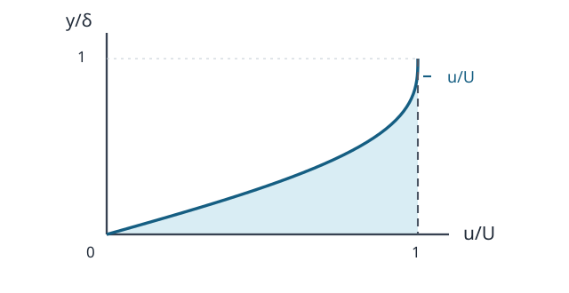

# FLUID23 境界層を積分すると抗力を評価できるか

## この講義で解決すること

[Prandtl境界層方程式](../FLUID21/index.md#thm-fluid21-prandtl)は速度場の偏微分方程式である。[Blasius解](../FLUID22/index.md#thm-fluid22-blasius-equation)を数値的に求めれば壁面摩擦を計算できるが、一般の物体の外側速度が変わる場合や速度分布を近似する場合、毎回偏微分方程式を解くのは大変である。

速度の不足分を壁法線方向に積分すれば、境界層全体を二つの「厚さ」でまとめられる。さらに運動量の保存を積分すると、その厚さの変化と壁面せん断が結び付く。**速度分布を完全には知らなくても抗力を推定できる**こと、ただし近似形の選択が答えの精度を決めることを示す。

## 1. 流量と運動量の欠損を厚さで表す

壁に沿う座標を $x>0$、流体側を $y\ge0$ とする。密度と動粘度は正の定数であり、粘性係数との関係は $\mu=\rho\nu$ である。

速度場 $(u(x,y),v(x,y))$ は定常・二次元・非圧縮性の滑らかな付着層流とする。固定壁では接線・法線速度とも零、外側では接線速度が正の $U_e(x)$ に近づき、その壁法線方向微分は零へ近づく。積分の収束、$x$ 微分との交換、外縁での後述する欠損流束の消滅が成立する範囲で考える。

この章で $U_e'(x)=dU_e/dx$ など $x$ のみの関数に付けるプライムは、$x$ に関する常微分を表す。一方、二変数の速度 $u(x,y)$ に付く $u_x=\partial u/\partial x$、$u_y=\partial u/\partial y$ は、他方の変数を固定した偏微分である。外部速度の変化は[外側のEuler関係](../FLUID21/index.md#prop-fluid21-edge-pressure)とつながっている。

$$
-\frac{p_e'}{\rho}=U_eU_e'.
$$

流体の流速 $u$ が一様速度 $U_e$ より小さい断面では、厚さ $dy$ を通る流量が $(U_e-u)dy$ だけ不足する。この総量を、一様流に置いた壁を仮想的に押し上げた厚さとして表す。

<a id="def-fluid23-displacement"></a>

<!-- formal-statement-start -->
> **定義（変位厚さ）**  
> $x$ を固定し、$U_e(x)>0$ および $1-u(x,\cdot)/U_e(x)$ が $[0,\infty)$ で積分可能とする。変位厚さ $\delta^*(x)$ を次で定める。

$$
\delta^*(x)=\int_0^\infty\left(1-\frac{u(x,y)}{U_e(x)}\right)\,dy.
$$
<!-- formal-statement-end -->

<!-- definition-example-start: def-fluid23-displacement -->
**定義の確認**： 厚さ $\delta>0$、無次元座標 $z=y/\delta$ として、$0\le y\le\delta$ では $u/U_e=z$、$y>\delta$ では $u/U_e=1$ という折れ線状の分布を考える。欠損は $0\le z\le1$ にだけ残るため、$dy=\delta\,dz$ から

$$
\delta^*=\delta\int_0^1(1-z)\,dz
=\delta\left[z-\frac{z^2}{2}\right]_0^1
=\frac{\delta}{2}.
$$

この分布は壁の $u=0$ と外側の $u=U_e$ を満たし、積分も有限である。ただし外縁で勾配が折れ曲がるため、厳密な境界層解だとは主張しない。
<!-- definition-example-end -->

欠損流量 $\int_0^\infty(U_e-u)\,dy=U_e\delta^*$ の単位は m$^2$/s（単位幅当たり）である。$\delta^*$ 自身の単位は m であり、99%厚さとは別の量である。

流量が一致しても運動量流束は一致しない。運動量流束には速度をもう一度掛けるため、不足分を $u(U_e-u)$ で測る。

<a id="def-fluid23-momentum"></a>

<!-- formal-statement-start -->
> **定義（運動量厚さ）**  
> $U_e(x)>0$ とし、$u(x,\cdot)(U_e(x)-u(x,\cdot))$ が $[0,\infty)$ 上で積分可能とする。運動量厚さ $\theta(x)$ を

$$
\theta(x)=\int_0^\infty
\frac{u(x,y)}{U_e(x)}
\left(1-\frac{u(x,y)}{U_e(x)}\right)\,dy
$$

> と定める。したがって欠損運動量流束は $\rho U_e^2\theta$ である。
<!-- formal-statement-end -->

<!-- definition-example-start: def-fluid23-momentum -->
**定義の確認**： 上の折れ線状分布は積分可能であり、$u/U_e=z$ を代入すると

$$
\theta=\delta\int_0^1z(1-z)\,dz
=\delta\left[\frac{z^2}{2}-\frac{z^3}{3}\right]_0^1
=\frac{\delta}{6}.
$$

$\delta^*=\delta/2$ と $\theta=\delta/6$ は同じ速度分布から得たが一致しない。$0\le u/U_e\le1$ なら被積分関数はともに非負であり、$\theta\le\delta^*$ が従う。この不等式は逆流 $u<0$ のある分布には無条件には使えない。
<!-- definition-example-end -->

二つの厚さの比は速度分布の形を要約する。

<a id="def-fluid23-shape-factor"></a>

<!-- formal-statement-start -->
> **定義（形状係数）**  
> $\delta^*$ と $\theta$ が有限で $\theta>0$ の境界層に対し、形状係数 $H$ を

$$
H(x)=\frac{\delta^*(x)}{\theta(x)}
$$

> と定める。無次元量である。
<!-- formal-statement-end -->

<!-- definition-example-start: def-fluid23-shape-factor -->
**定義の確認**： 同じ折れ線状分布では $H=(\delta/2)/(\delta/6)=3$ である。両厚さは長さなので比の単位は消える。$H$ は速度分布の要約であって、$H$ だけから壁面勾配を一意に復元できるわけではない。
<!-- definition-example-end -->



図の破線は一様外部速度 $u/U_e=1$、実線は壁で零となる速度分布を示す。間にある領域の横幅を縦方向に積分したものが $\delta^*$ である。$\theta$ を得るには、その横幅へさらに局所速度比 $u/U_e$ を掛ける。

## 2. von Kármán の運動量積分式

[Prandtl境界層方程式](../FLUID21/index.md#thm-fluid21-prandtl)を、外部速度が $x$ によって変わる場合にも使う。

$$
u_x+v_y=0,\qquad
u u_x+v u_y=U_eU_e'+\nu u_{yy}.
$$

壁面せん断応力を $\tau_w=\mu u_y(x,0)$ と符号付きで書く。$u_y(x,0)>0$ なら平板が流体から受ける抗力の正の大きさに一致するが、壁面勾配が負なら $\tau_w$ も負となる。以下の恒等式はどちらの符号でも成り立つ。[Newton流体の壁面応力](../FLUID21/index.md#prop-fluid21-wall-shear)との対応である。

積分しやすい量は速度そのものではなく、**運動量欠損密度** $u(U_e-u)$ である。

<a id="thm-fluid23-karman-integral"></a>

<!-- formal-statement-start -->
> **定理（von Kármán の運動量積分式）**  
> $\rho,\nu>0$ が一定、$U_e\in C^1((0,L])$ が正であるとする。$u,v$ は定常二次元のPrandtl方程式を満たし、壁で $u=v=0$、$y\to\infty$ で $u\to U_e$、$u_y\to0$ とする。欠損積分が有限で $x$ 微分と積分の交換が可能、さらに $v(U_e-u)\to0$ と仮定する。このとき

$$
\frac{d}{dx}(U_e^2\theta)
+U_eU_e'\delta^*=\frac{\tau_w}{\rho},
\qquad \tau_w=\mu u_y(x,0).
$$

> $\theta>0$ なら同値な表示は

$$
\boxed{\displaystyle
\frac{d\theta}{dx}
+\frac{\theta}{U_e}(2+H)\frac{dU_e}{dx}
=\frac{\tau_w}{\rho U_e^2}.}
$$
<!-- formal-statement-end -->

### 証明の見取り図

[連続の式と運動量式](../FLUID21/index.md#thm-fluid21-prandtl)を別々に積分すると、外縁からの法線流束の扱いが残る。そこで最初に方程式を「欠損の保存形」へ組み直す。外縁で消える $v(U_e-u)$ と、壁で残る $-\nu u_y$ を区別することが核心である。

<!-- proof-start -->
### 証明

$D=u(U_e-u)$、$G=v(U_e-u)$ とおく。$U_e$ は $y$ に依らないので、積の微分を一項ずつ行うと

$$
D_x=uU_e'+(U_e-2u)u_x,
\qquad
G_y=(U_e-u)v_y-vu_y.
$$

[連続の式](../FLUID21/index.md#thm-fluid21-prandtl) $v_y=-u_x$ を代入し、$u_x$ の係数をまとめる。

$$
\begin{aligned}
D_x+G_y
&=uU_e'+(U_e-2u)u_x-(U_e-u)u_x-vu_y\\
&=uU_e'-u u_x-vu_y.
\end{aligned}
$$

さらに[Prandtl運動量式](../FLUID21/index.md#thm-fluid21-prandtl)の $u u_x+v u_y=U_eU_e'+\nu u_{yy}$ を用いると

$$
D_x+G_y
=-(U_e-u)U_e'-\nu u_{yy}.
$$

まず有限な高さ $Y>0$ まで積分する。

$$
\frac{d}{dx}\int_0^Y D\,dy
+G(x,Y)-G(x,0)
=-U_e'\int_0^Y(U_e-u)\,dy
-\nu\bigl[u_y(x,Y)-u_y(x,0)\bigr].
$$

壁では $v(x,0)=0$ より $G(x,0)=0$。仮定した収束と交換、および $Y\to\infty$ で $G(x,Y)\to0,\ u_y(x,Y)\to0$ を用いる。すると[二つの厚さの定義](#def-fluid23-momentum)と[変位厚さの定義](#def-fluid23-displacement)により

$$
\frac{d}{dx}(U_e^2\theta)
=-U_eU_e'\delta^*+\nu u_y(x,0).
$$

$\mu=\rho\nu$ なので $\nu u_y(x,0)=\tau_w/\rho$。左辺を積の微分で展開し、

$$
U_e^2\theta'+2U_eU_e'\theta
+U_eU_e'\delta^*=\frac{\tau_w}{\rho}
$$

を得る。$U_e^2>0$ で割り、$\delta^*=H\theta$ を代入すれば第二の式が従う。
<!-- proof-end -->

右辺 $\tau_w/\rho$ の単位は m$^2$/s$^2$。左辺も $U_e^2\theta$ の $x$ 微分なので同じ単位である。$U_e'<0$ のとき圧力が上昇することは[外側のEuler関係](../FLUID21/index.md#prop-fluid21-edge-pressure)から分かるが、この式だけで剥離位置を確定することはできない。

## 3. 一様外部流の平板：抗力は運動量厚さで決まる

$U_e(x)=U>0$ が一定なら、[運動量積分式](#thm-fluid23-karman-integral)は

$$
\theta'(x)=\frac{\tau_w(x)}{\rho U^2}.
$$

壁の抗力を単位スパン（幅1 m）で測る。先端 $x=0$ から長さ $L$ まで、片面の摩擦抗力を $D'(L)=\int_0^L\tau_w(x)\,dx$ と定義する。$D'$ のプライムはここでは「単位幅当たり」を表し、$x$ 微分ではない。

<a id="prop-fluid23-flat-drag"></a>

<!-- formal-statement-start -->
> **命題（一様外部流平板の運動量欠損と摩擦抗力）**  
> 定理の条件に加え $U_e=U>0$ が一定、$\theta(0+)=0$、$\tau_w$ が $(0,L)$ 上で可積分とする。このとき平板片面の単位幅当たりの抗力は

$$
D'(L)=\rho U^2\theta(L).
$$

> 片面の平均摩擦係数を $\overline C_f=D'(L)/(\rho U^2L/2)$、局所摩擦係数を $C_{f,x}=2\tau_w/(\rho U^2)$ とすると

$$
\overline C_f=\frac{2\theta(L)}{L},
\qquad
C_{f,x}=2\theta'(x).
$$
<!-- formal-statement-end -->

### 証明の見取り図

壁の局所摩擦係数を積分する代わりに、[運動量積分式](#thm-fluid23-karman-integral)の右辺を $x$ 方向に積分する。先端の厚さが零という境界条件を忘れない。

<!-- proof-start -->
### 証明

$U$ は一定なので $\tau_w=\rho U^2\theta'$。任意の $\epsilon>0$ で積分して

$$
\int_\epsilon^L\tau_w\,dx
=\rho U^2\int_\epsilon^L\theta'\,dx
=\rho U^2[\theta(L)-\theta(\epsilon)].
$$

$\epsilon\downarrow0$、$\theta(0+)=0$ と可積分性から $D'=\rho U^2\theta(L)$。動圧と基準面積（片面の幅1 m、長さ $L$）で除せば

$$
\overline C_f
=\frac{\rho U^2\theta(L)}{\rho U^2L/2}
=\frac{2\theta(L)}L.
$$

局所係数も $C_{f,x}=2\tau_w/(\rho U^2)=2\theta'$ である。
<!-- proof-end -->

[Blasius解の壁摩擦](../FLUID22/index.md#prop-fluid22-wall-friction)に現れる $a=f''(0)\simeq0.3320573362$ を使えば、$C_{f,x}=2a/\sqrt{\mathrm{Re}_x}$。$\mathrm{Re}_x=Ux/\nu$ を代入すると

$$
\theta'(x)=a\sqrt{\frac{\nu}{Ux}},
\qquad
\theta(x)=2a\sqrt{\frac{\nu x}{U}}
$$

（先端の定数を零に選んだ）。したがって

$$
D'_{\rm Blasius}(L)=2a\rho U^2\sqrt{\frac{\nu L}{U}},
\qquad
\overline C_{f,\rm Blasius}=\frac{4a}{\sqrt{\mathrm{Re}_L}}
\simeq\frac{1.328229}{\sqrt{\mathrm{Re}_L}}.
$$

この数値は先端から全長まで付着層流が続く**片面**の摩擦抗力である。両面が同じ条件なら力を二倍するが、片面基準の係数を両面基準面積の係数と取り違えない。

## 4. 速度分布を近似して厚さを求める

Blasiusの常微分方程式を解かなくても、境界条件に適う試行分布から[運動量積分式](#thm-fluid23-karman-integral)を閉じられる。ただし運動量積分式は**一つの式**しか与えないので、形状と壁勾配の関係を別途仮定する必要がある。

平板の零圧力勾配の場合、壁で $u=v=0$ なので[運動量式](../FLUID21/index.md#thm-fluid21-prandtl)を壁で評価すると $u_{yy}(x,0)=0$（$\nu>0$）。そこで $z=y/\delta(x)$、$0\le z\le1$ とし、速度比を四次多項式にする。外側 $z\ge1$ では速度比を1に固定する。

<a id="def-fluid23-quartic-profile"></a>

<!-- formal-statement-start -->
> **定義（零圧力勾配の四次近似速度分布）**  
> $U,\delta(x)>0$ とし、$g(z)=2z-2z^3+z^4$（$0\le z\le1$）を用いる。近似速度は

$$
\frac{u(x,y)}U=
\begin{cases}
g(y/\delta(x)),&0\le y\le\delta(x),\\
1,&y\ge\delta(x)
\end{cases}
$$

> とする。$\delta(x)$ はこの近似での有限な外縁位置であり、99%厚さではない。
<!-- formal-statement-end -->

<!-- definition-example-start: def-fluid23-quartic-profile -->
**定義の確認**： $x$ を固定すると $z=y/\delta(x)$ について $\partial z/\partial y=1/\delta(x)$ である。ここで $g'(z)=dg/dz$、$g''(z)=d^2g/dz^2$ は無次元座標 $z$ に関する微分を表す。連鎖律により、近似層の内側 $0<y<\delta(x)$ で

$$
u_y=\frac{U}{\delta(x)}g'(z),\qquad
u_{yy}=\frac{U}{\delta(x)^2}g''(z).
$$

したがって壁面条件 $u_{yy}(x,0)=0$ は $g''(0)=0$ に対応し、外縁の一様流との一階・二階微分の接続には $g'(1)=g''(1)=0$ を確かめればよい。実際に

$$
g'(z)=2-6z^2+4z^3,\qquad g''(z)=-12z+12z^2
$$

であり、$g(0)=0$、$g(1)=1$ と併せて

$$
g'(0)=2,\quad g''(0)=0,\quad
g'(1)=g''(1)=0.
$$

外側の定数分布との値・一階・二階導関数が $z=1$ で連続し、壁条件と壁の $u_{yy}=0$ にも一致する。さらに $g'(z)=2(1-z)^2(1+2z)\ge0$ より $0\le g\le1$ である。ただし三階以上の導関数を含む方程式の**厳密解**を作ったわけではない。
<!-- definition-example-end -->

なぜこの係数なのか。一般に $g(z)=Az+Bz^2+Cz^3+Dz^4$ とおき、壁の二階微分零から $B=0$。外縁で $g(1)=1$、$g'(1)=g''(1)=0$ を課すと

$$
A+C+D=1,\quad A+3C+4D=0,\quad 6C+12D=0.
$$

最後の式から $C=-2D$、第二式から $A=2D$、第一式から $D=1$。よって上の $g$ が得られる。

<a id="prop-fluid23-quartic-integrals"></a>

<!-- formal-statement-start -->
> **命題（四次近似の厚さと壁摩擦）**  
> 上の四次近似速度分布、$\mu=\rho\nu>0$、固定壁、$U>0$ に対して、変位厚さ、運動量厚さ、形状係数、壁面せん断はそれぞれ

$$
\delta^*=\frac{3}{10}\delta,\qquad
\theta=\frac{37}{315}\delta,\qquad
H=\frac{189}{74},\qquad
\tau_w=\frac{2\mu U}{\delta}.
$$
<!-- formal-statement-end -->

### 証明の見取り図

[厚さの定義](#def-fluid23-displacement)と[運動量厚さの定義](#def-fluid23-momentum)で $dy=\delta\,dz$ に変数を移す。壁の勾配は $u_y=(U/\delta)g'(z)$ を $z=0$ で評価する。

<!-- proof-start -->
### 証明

外側 $z\ge1$ では欠損が零なので

$$
\begin{aligned}
\frac{\delta^*}{\delta}
&=\int_0^1(1-2z+2z^3-z^4)\,dz\\
&=\left[z-z^2+\frac{z^4}{2}-\frac{z^5}{5}\right]_0^1
=\frac{3}{10}.
\end{aligned}
$$

運動量厚さの被積分関数を展開すると

$$
g(1-g)=2z-4z^2-2z^3+9z^4-4z^5-4z^6+4z^7-z^8.
$$

よって

$$
\begin{aligned}
\frac{\theta}{\delta}
&=\left[z^2-\frac43z^3-\frac12z^4+\frac95z^5
-\frac23z^6-\frac47z^7+\frac12z^8-\frac19z^9\right]_0^1\\
&=\frac{37}{315}.
\end{aligned}
$$

したがって[形状係数の定義](#def-fluid23-shape-factor)から $H=(3/10)/(37/315)=189/74$。一方 $\partial_y z=1/\delta$ なので壁の[Newton応力](../FLUID21/index.md#prop-fluid21-wall-shear)は

$$
\tau_w=\mu\frac U\delta g'(0)
=\frac{2\mu U}{\delta}.
$$
<!-- proof-end -->

<a id="prop-fluid23-quartic-drag"></a>

<!-- formal-statement-start -->
> **命題（四次積分近似の平板抗力）**  
> $U,\rho,\nu>0$ が一定で、上の四次近似分布を[運動量積分式](#thm-fluid23-karman-integral)に代入し $\delta(0+)=0$ とする。$c=37/315$、$\mathrm{Re}_x=Ux/\nu$ と書けば

$$
\delta(x)=\frac{2}{\sqrt c}\sqrt{\frac{\nu x}{U}},
\quad
\theta(x)=2\sqrt c\sqrt{\frac{\nu x}{U}},
$$

$$
C_{f,x}=\frac{2\sqrt c}{\sqrt{\mathrm{Re}_x}},
\qquad
\overline C_f=\frac{4\sqrt c}{\sqrt{\mathrm{Re}_L}}.
$$

> 数値係数は順に $\delta/\sqrt{\nu x/U}\simeq5.8356$、$C_{f,x}\sqrt{\mathrm{Re}_x}\simeq0.68545$、$\overline C_f\sqrt{\mathrm{Re}_L}\simeq1.37090$ である。
<!-- formal-statement-end -->

### 証明の見取り図

近似分布で $c\delta=\theta$、$2\mu U/\delta=\tau_w$ と表せた。[運動量積分式](#thm-fluid23-karman-integral)の右辺と左辺へ代入すれば、未知の $\delta$ に関する一次の式ではなく、$\delta^2$ に関する一次式になる。

<!-- proof-start -->
### 証明

$U_e'=0$ の[積分式](#thm-fluid23-karman-integral)に、[四次近似の積分結果](#prop-fluid23-quartic-integrals)と $\mu=\rho\nu$ を入れる。

$$
\frac{d}{dx}(c\delta)
=\frac{2\mu U/\delta}{\rho U^2}
=\frac{2\nu}{U\delta}.
$$

両辺に $\delta$ を掛け、$\delta\delta'=\frac12(\delta^2)'$ を使うと

$$
\frac{c}{2}\frac{d(\delta^2)}{dx}=\frac{2\nu}{U},
\qquad
\delta^2(x)=\frac{4\nu x}{cU}+K.
$$

先端の条件 $\delta(0+)=0$ より $K=0$、$\delta>0$ より正の平方根を選ぶ。さらに $\theta=c\delta$、[局所・平均係数](#prop-fluid23-flat-drag)から

$$
\begin{aligned}
C_{f,x}&=2\theta'
=2c\frac{1}{\sqrt c}\sqrt{\frac{\nu}{Ux}}
=\frac{2\sqrt c}{\sqrt{\mathrm{Re}_x}},\\
\overline C_f&=\frac{2\theta(L)}L
=4\sqrt c\sqrt{\frac{\nu}{UL}}
=\frac{4\sqrt c}{\sqrt{\mathrm{Re}_L}}.
\end{aligned}
$$
<!-- proof-end -->

四次近似では局所係数 $0.68545/\sqrt{\mathrm{Re}_x}$ が[Blasiusの値](../FLUID22/index.md#prop-fluid22-wall-friction) $0.664115/\sqrt{\mathrm{Re}_x}$ より約 $3.21\%$ 大きい。これは数学的な丸め誤差ではなく、速度分布を一つの多項式族に制限した**模型誤差**である。$\delta$ は四次模型の端であり、Blasius解の99%厚さ $4.91\sqrt{\nu x/U}$ と同一視してはいけない。

## 5. Pythonで厚さ積分と誤差を検算する

同じ Python ファイルで四次多項式の台形積分、刻み幅半減、壁勾配による摩擦、運動量積分式による摩擦、Blasius係数との差を計算する。速度曲線と二種類の欠損密度も同じ実験に描く。

```python-file-lab
# lab-id: FLUID23-MOMENTUM-DEFICIT
# lab-title: 変位厚さ・運動量厚さ・平板抗力の積分検算
# lab-file: textbook/volumes/dream_thater/物理系/FLUID/FLUID23/momentum_integral_lab.py
# timeout-ms: 15000
# lab-preset: 標準格子 | --n 80 --speed 2 --length 0.5
# lab-preset: 粗い格子 | --n 10 --speed 2 --length 0.5
# lab-preset: 細かい格子 | --n 320 --speed 2 --length 0.5
# lab-preset: 長さ2倍 | --n 80 --speed 2 --length 1
```

[Pythonソースを閲覧](momentum_integral_lab.py)し、格子数を増やしたときの積分誤差と、Blasiusとの差約 $3.21\%$ を区別しよう。前者は刻み幅で縮むが、後者は同じ四次近似を使う限り縮まない。

具体例として $\rho=1000$ kg/m$^3$、$\nu=10^{-6}$ m$^2$/s、$U=2$ m/s、$L=0.5$ m では $\mathrm{Re}_L=10^6$、$\sqrt{\nu L/U}=5\times10^{-4}$ m。片面の単位幅当たりの抗力は

$$
\begin{aligned}
D'_{\rm quartic}&=\rho U^2\theta(L)
=4000(0.6854497)(5\times10^{-4})
\simeq1.37090\ {\rm N/m},\\
D'_{\rm Blasius}&=4000(0.6641147)(5\times10^{-4})
\simeq1.32823\ {\rm N/m}.
\end{aligned}
$$

これらは流れが全長で付着層流となる**仮定付きの予測**であり、$\mathrm{Re}_L$ だけで現実の遷移・粗さ・前縁条件を決められるものではない。

## 6. 外側速度が変化するとき

[運動量積分式](#thm-fluid23-karman-integral)で $U_e'\ne0$ とすると、$\theta'$ は壁摩擦だけでなく $-(2+H)\theta U_e'/U_e$ の寄与を受ける。

たとえば $\theta>0$、$H>0$、$\tau_w\ge0$ の範囲で $U_e'<0$ なら、右辺の摩擦項と、移項した外部減速項はいずれも $\theta$ を増やす向きに作用する。$\tau_w=0$ となるだけで速度分布や剥離の成否を確定できない。次講 FLUID24 では圧力勾配と壁面剪断をさらに調べる。

## 7. 演習

### Level A

### A1. 二種類の欠損の単位

$\rho>0$、$U_e>0$ とし、$u/U_e$ は $y$ のみの関数で外側で1へ近づくものとする。$\delta^*$、$\theta$、$\rho U_e^2\theta$ のSI単位を求めよ。また $u/U_e=1$ が全域で成り立つ場合の二つの厚さを求めよ。

- Level: A

<!-- solution-start -->
#### 詳細解答

[変位厚さの定義](#def-fluid23-displacement)の被積分関数は速度比の差であり無次元である。積分要素 $dy$ は長さなので、変位厚さの単位は m となる。

[運動量厚さの定義](#def-fluid23-momentum)でも二つの速度比の積を長さで積分するので、その単位は m である。

密度と速度の二乗の積は圧力と同じ単位をもつ。したがって運動量欠損流束の単位は

$$
[\rho U_e^2\theta]
=\frac{\mathrm{kg}}{\mathrm{m\,s^2}}\cdot\mathrm m
=\frac{\mathrm N}{\mathrm m}.
$$

これは単位幅当たりの運動量流束である。一様流なら両方の被積分関数が恒等的に零なので、変位厚さも運動量厚さも零となる。
<!-- solution-end -->

### A2. 折れ線状分布の形状係数

$\delta>0$、$z=y/\delta$ とする。$0\le z\le1$ で $u/U_e=z$、$z>1$ で1の流れについて、$\delta^*$、$\theta$、$H$ を計算し、$0\le u/U_e\le1$ を確認せよ。

- Level: A

<!-- solution-start -->
#### 詳細解答

$0\le z\le1$ では $0\le z\le1$ なので速度比の条件を満たす。$dy=\delta dz$ と[二つの厚さ](#def-fluid23-displacement)・[運動量厚さ](#def-fluid23-momentum)の定義から

$$
\delta^*=\delta\int_0^1(1-z)dz=\frac{\delta}{2},\quad
\theta=\delta\int_0^1(z-z^2)dz=\frac{\delta}{6}.
$$

分母 $\theta=\delta/6>0$ なので[形状係数](#def-fluid23-shape-factor)は $H=(\delta/2)/(\delta/6)=3$。$z=1$ での勾配の折れ曲がりのため、厳密なPrandtl解という意味ではない。
<!-- solution-end -->

### A3. 壁面せん断の符号

$U>0$ の固定平板で、$u_y(x,0)>0$、$\mu>0$ とする。$\tau_w$ と局所摩擦係数 $C_{f,x}$ の符号を示し、流体が壁から受ける接線方向の力の向きと区別せよ。

- Level: A

<!-- solution-start -->
#### 詳細解答

[壁面応力の式](../FLUID21/index.md#prop-fluid21-wall-shear)から $\tau_w=\mu u_y(x,0)>0$ である。動圧 $\rho U^2/2>0$ なので $C_{f,x}=\tau_w/(\rho U^2/2)>0$。これは摩擦抗力の**大きさ**を表す。一方、正の $x$ 方向に流れる流体は固定壁から負の $x$ 方向の接線力を受ける。流体に働く力の向きと、壁が受ける抗力の正の大きさを混同しない。
<!-- solution-end -->

### A4. 厚さから平均摩擦係数へ

$U>0$ が一定、$\theta(0+)=0$、$\theta(L)=0.30$ mm、$L=0.50$ m とする。[一様外部流平板の運動量欠損と摩擦抗力](#prop-fluid23-flat-drag)から片面の平均摩擦係数を求めよ.

- Level: A

<!-- solution-start -->
#### 詳細解答

$0.30$ mm=$3.0\times10^{-4}$ m と単位を揃える。[平均摩擦係数](#prop-fluid23-flat-drag)を用いて

$$
\overline C_f=\frac{2\theta(L)}L
=\frac{2(3.0\times10^{-4})}{0.50}
=1.2\times10^{-3}.
$$

分子・分母とも長さだから無次元である。$\theta(0+)=0$ という仮定がなければ、この式ではなく厚さの差が必要になる。
<!-- solution-end -->

### A5. 外部流の減速の符号

[運動量積分式](#thm-fluid23-karman-integral)の $\theta>0$、$H>0$、$U_e>0$、$\tau_w\ge0$ を仮定する。$U_e'<0$ のとき、$\theta'$ の符号を判定せよ。

- Level: A

<!-- solution-start -->
#### 詳細解答

[積分式](#thm-fluid23-karman-integral)を $\theta'$ について解くと

$$
\theta'=\frac{\tau_w}{\rho U_e^2}
-\frac{(2+H)\theta}{U_e}U_e'.
$$

第一項は非負、第二項は $(2+H)\theta/U_e>0$ と $U_e'<0$ により正である。従って $\theta'>0$。これは与えられた符号条件下の結論であり、実流で逆流が生じる場合にも必ず $H>0$ や $\tau_w\ge0$ が続くと主張してはいけない。
<!-- solution-end -->

### Level B

### B1. 欠損保存形を導く

定常境界層の $u_x+v_y=0$、$u u_x+v u_y=U_eU_e'+\nu u_{yy}$ を仮定する。$D=u(U_e-u)$、$G=v(U_e-u)$ について、保存形 $D_x+G_y$ を求め、外縁・壁の条件を用いて運動量積分式を証明せよ。

- Level: B

<!-- solution-start -->
#### 詳細解答

$U_e=U_e(x)$ の積の微分により

$$
D_x=uU_e'+(U_e-2u)u_x,\qquad
G_y=v_y(U_e-u)-vu_y.
$$

連続の式 $v_y=-u_x$ を代入して

$$
D_x+G_y=uU_e'-u u_x-vu_y
=uU_e'-(U_eU_e'+\nu u_{yy})
=-U_e'(U_e-u)-\nu u_{yy}.
$$

有限高さ $Y$ で積分し、$G(x,0)=0$、$G(x,Y)\to0$、$u_y(x,Y)\to0$ を使う（欠損積分の収束と微分交換も仮定）。[厚さの定義](#def-fluid23-displacement)と[運動量厚さ](#def-fluid23-momentum)から

$$
(U_e^2\theta)'=-U_eU_e'\delta^*+\nu u_y(x,0).
$$

$\nu u_y(x,0)=\tau_w/\rho$、積の微分 $(U_e^2\theta)'=U_e^2\theta'+2U_eU_e'\theta$ より[運動量積分式](#thm-fluid23-karman-integral)を得る。
<!-- solution-end -->

### B2. 四次多項式の係数を境界条件から決める

$g(z)=Az+Bz^2+Cz^3+Dz^4$ を $0\le z\le1$ で使う。$g(1)=1$、$g'(1)=g''(1)=0$、$g''(0)=0$ から係数をすべて求め、壁速度 $g(0)$ と壁勾配 $g'(0)$ を確認せよ。

- Level: B

<!-- solution-start -->
#### 詳細解答

$g(0)=0$ は定数項がないため満たす。$g''(z)=2B+6Cz+12Dz^2$ だから $g''(0)=0$ は $B=0$ を与える。残りは

$$
A+C+D=1,\quad A+3C+4D=0,\quad 6C+12D=0.
$$

第三式から $C=-2D$、第二式から $A-6D+4D=A-2D=0$ より $A=2D$。第一式から $2D-2D+D=1$、従って $D=1$、$A=2$、$C=-2$、$B=0$。よって

$$
g(z)=2z-2z^3+z^4,\quad g(0)=0,\quad g'(0)=2.
$$

[四次近似分布](#def-fluid23-quartic-profile)の条件をすべて直接確認できた。
<!-- solution-end -->

### B3. 四次近似の厚さを独立に積分する

[四次近似分布](#def-fluid23-quartic-profile)の $g(z)=2z-2z^3+z^4$ と有限外縁 $\delta>0$ を使い、$\delta^*/\delta$、$\theta/\delta$ を定義から積分して求め、$H$ を計算せよ。

- Level: B

<!-- solution-start -->
#### 詳細解答

$dy=\delta dz$、$z>1$ では欠損零なので

$$
\frac{\delta^*}{\delta}=\int_0^1(1-2z+2z^3-z^4)dz
=\left[z-z^2+\frac12z^4-\frac15z^5\right]_0^1=\frac3{10}.
$$

運動量側では、$g^2=(2z-2z^3+z^4)^2=4z^2-8z^4+4z^5+4z^6-4z^7+z^8$ だから

$$
g-g^2=2z-4z^2-2z^3+9z^4-4z^5-4z^6+4z^7-z^8.
$$

各単項式を0から1へ積分すると

$$
\frac{\theta}{\delta}
=1-\frac43-\frac12+\frac95-\frac23-\frac47+\frac12-\frac19
=\frac{37}{315}.
$$

$\theta>0$ より[形状係数](#def-fluid23-shape-factor)は

$$
H=\frac{3/10}{37/315}=\frac{189}{74}\simeq2.55405.
$$
<!-- solution-end -->

### B4. 指数型の試行分布は何を予測するか

一様外部流 $U>0$ で、$u/U=1-e^{-y/h(x)}$、$h(x)>0$ を試行分布とする（$x>0$）。$\delta^*$、$\theta$、$\tau_w$ を求め、[運動量積分式](#thm-fluid23-karman-integral)と $h(0+)=0$ から $h(x)$、局所摩擦係数を導け。また壁の運動量式に適合するか調べよ。

- Level: B

<!-- solution-start -->
#### 詳細解答

$z=y/h$ と置き $dy=h\,dz$。$\int_0^\infty e^{-z}dz=1$、$\int_0^\infty e^{-2z}dz=1/2$ だから

$$
\delta^*=h\int_0^\infty e^{-z}dz=h,\qquad
\theta=h\int_0^\infty(e^{-z}-e^{-2z})dz=\frac h2.
$$

$u_y=(U/h)e^{-y/h}$ より $\tau_w=\mu U/h$。[運動量積分式](#thm-fluid23-karman-integral)の $U_e'=0$ の場合を適用すると、$\theta'=\tau_w/(\rho U^2)$ なので

$$
\frac{h'}2=\frac{\nu}{Uh},\quad
(h^2)'=\frac{4\nu}{U},\quad
h^2=\frac{4\nu x}{U}.
$$

正の平方根で $h=2\sqrt{\nu x/U}$、$\theta=\sqrt{\nu x/U}$。[局所摩擦係数の式](#prop-fluid23-flat-drag)を $x$ で微分した $\theta$ に適用すると

$$
C_{f,x}=2\theta'(x)
=2\cdot\frac12\sqrt{\frac{\nu}{Ux}}
=\frac{1}{\sqrt{\mathrm{Re}_x}}.
$$

これは[Blasius値](../FLUID22/index.md#prop-fluid22-wall-friction) $0.664115/\sqrt{\mathrm{Re}_x}$ より約 $50.6\%$ 大きい。さらに

$$
u_{yy}(x,0)=-\frac{U}{h^2}\ne0.
$$

零圧力勾配の[Prandtl式](../FLUID21/index.md#thm-fluid21-prandtl)を固定壁で評価すると $u=v=0$ より $\nu u_{yy}(x,0)=0$ が必要である。指数型試行分布はこの条件を満たさない。積分式を満たすことと偏微分方程式の全点での解になることは別である。
<!-- solution-end -->

### Level C

### C1. 平板抗力の二つの計算法を照合する

密度 $\rho=1000$ kg/m$^3$、動粘度 $\nu=10^{-6}$ m$^2$/s、外部速度 $U=2$ m/s、平板長さ $L=0.5$ m とする。定常二次元・零圧力勾配、平板片面の付着層流を仮定し、先端で $\theta(0+)=0$ とする。Blasiusの $a=0.3320573362$ を使ってよい。

1. $D'(L)=\rho U^2\theta(L)$ を導くための欠損保存形を示せ。
2. 四次分布 $g(z)=2z-2z^3+z^4$ から $\delta^*$、$\theta$、$\tau_w$ を求めて $\delta(x)$ を導け。
3. 四次近似の $\overline C_f$ と単位幅当たりの $D'$ を計算せよ。
4. Blasiusの局所摩擦係数から $\theta(L)$ と $D'$ を別に算出し、近似の相対誤差・単位・適用限界を論じよ。

- Level: C

<!-- solution-start -->
#### 詳細解答

**1. 保存形と抗力。** [Prandtl方程式](../FLUID21/index.md#thm-fluid21-prandtl)において $U_e'=0$ とし、$D=u(U-u)$、$G=v(U-u)$ をとる。積の微分と $v_y=-u_x$ により

$$
D_x+G_y=(U-2u)u_x+(U-u)(-u_x)-vu_y
=-u u_x-vu_y=-\nu u_{yy}.
$$

外縁の $G\to0$、$u_y\to0$、壁の $v=0$ と収束条件から $(U^2\theta)'=\nu u_y(0)=\tau_w/\rho$。よって $\tau_w=\rho U^2\theta'$ を $\epsilon<x<L$ で積分し、$\theta(0+)=0$ から $D'=\rho U^2\theta(L)$ を得る。

**2. 四次分布の積分と厚さ。** $z=y/\delta$、$dy=\delta dz$ で、$z>1$ の欠損は零である。[四次近似の厚さ](#prop-fluid23-quartic-integrals)を直接確認すると

$$
\delta^*=\delta\int_0^1(1-2z+2z^3-z^4)\,dz=\frac3{10}\delta,
$$

$$
\theta=\delta\int_0^1g(1-g)\,dz=\frac{37}{315}\delta=c\delta,
\qquad
\tau_w=\mu\frac U\delta g'(0)=\frac{2\rho\nu U}{\delta}.
$$

従って $c\delta'=2\nu/(U\delta)$、$(\delta^2)'=4\nu/(cU)$。先端条件を使えば

$$
\delta(x)=\frac2{\sqrt c}\sqrt{\frac{\nu x}U},\qquad
\theta(x)=2\sqrt c\sqrt{\frac{\nu x}U}.
$$

**3. 抗力の近似。** $\mathrm{Re}_L=UL/\nu=2(0.5)/10^{-6}=10^6$、$d_L=\sqrt{\nu L/U}=5.0\times10^{-4}$ m。$\sqrt c\simeq0.3427248422$ より

$$
\theta_{\rm quartic}(L)=2\sqrt c\,d_L
\simeq3.42725\times10^{-4}\ {\rm m}.
$$

[平均係数の式](#prop-fluid23-flat-drag)から

$$
\overline C_{f,\rm quartic}=\frac{2\theta(L)}L
\simeq1.37090\times10^{-3},
$$

$$
D'_{\rm quartic}=\rho U^2\theta(L)
=4000(3.42725\times10^{-4})
\simeq1.37090\ {\rm N/m}.
$$

**4. Blasiusとの照合。** [Blasius摩擦係数](../FLUID22/index.md#prop-fluid22-wall-friction)は $C_{f,x}=2a\sqrt{\nu/(Ux)}$ だから、[平板命題](#prop-fluid23-flat-drag)の $C_{f,x}=2\theta'$ を用いて

$$
\theta'=a\sqrt{\frac{\nu}{Ux}},\qquad
\theta(L)=2a\sqrt{\frac{\nu L}{U}}
\simeq3.32057\times10^{-4}\ {\rm m}.
$$

従って $D'_{\rm Blasius}=4000\theta(L)\simeq1.32823$ N/m。相対誤差は

$$
\frac{D'_{\rm quartic}-D'_{\rm Blasius}}{D'_{\rm Blasius}}
=\frac{\sqrt{37/315}-a}{a}
\simeq0.0321
$$

で、約 $3.21\%$ の過大評価である。$\theta$ は長さ、$D'$ は N/m、$\overline C_f$ は無次元。全長で高局所Reynolds数の付着層流が成立し、前縁で $\theta(0+)=0$ とする近似であり、遷移・粗さ・剥離を含む実物体の総抗力とは区別する。
<!-- solution-end -->

## 8. まとめと次への接続

変位厚さは流量の欠損、運動量厚さは運動量流束の欠損を長さに換算する。[von Kármán積分式](#thm-fluid23-karman-integral)は壁面せん断と二つの厚さを結び、定速平板では[片面の抗力](#prop-fluid23-flat-drag)を終端の運動量厚さだけから計算できる。四次の近似分布は計算を簡単にするが、厳密なBlasius解との約 $3.21\%$ の差を残す。次のFLUID24では外部流が減速するときに壁面剪断と境界層の形がどう変わるかを考える。
