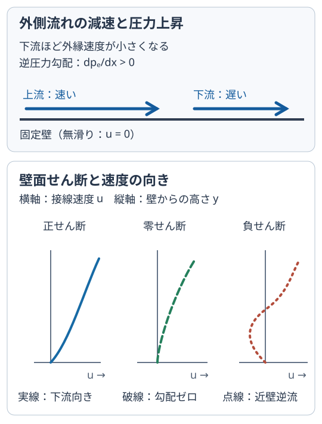

# FLUID24 圧力勾配はどのように境界層を剥離させるか

## この講義で解決すること

[FLUID23の運動量積分式](../FLUID23/index.md#thm-fluid23-karman-integral)は、壁面の摩擦を境界層全体の速度欠損に結び付けた。しかし外側の流れが減速するとき、厚さが増えることと、壁付近の流体が流れに逆らって動き始めることは同じではない。

この講義では、外側の圧力上昇が壁面の速度分布にどう現れ、どの条件の下で壁面せん断が零になるかを調べる。さらに外側速度がべき乗で変わる流れについて、[Blasiusの相似化](../FLUID22/index.md#thm-fluid22-blasius-equation)を拡張し、**圧力勾配の符号から剥離位置を直接決めてはいけない理由**を理解する。

## 1. 外側流れの減速が壁に及ぼすこと

固定された滑らかな平面壁に沿って $x>0$、壁から流体側へ $y\ge0$ をとる。$\rho>0$ は一定密度、$\nu>0$ は動粘度、$\mu=\rho\nu$ は粘性係数とする。接線速度を $u(x,y)$、法線速度を $v(x,y)$、境界層外縁の接線速度を $U_e(x)>0$、その圧力を $p_e(x)$ と書く。ここでは定常・二次元・非圧縮・Newton流体の層流を扱う。

[外側Euler関係](../FLUID21/index.md#prop-fluid21-edge-pressure)は、壁に沿う圧力勾配を外側速度の変化へ翻訳する。

$$
\frac{dp_e}{dx}=-\rho U_e\frac{dU_e}{dx}.
$$

したがって外側流れが減速する $U_e'<0$ は $p_e'>0$ を意味する。外側の流体は、進むにつれて圧力が高くなる領域へ入る。

<!-- formal-statement-start -->
> **定義（順圧力勾配と逆圧力勾配）**  
> $\rho>0$ が一定で、正の外側速度 $U_e\in C^1(I)$ と外側Euler関係 $p_e'=-\rho U_eU_e'$ を満たす区間 $I$ を考える。$p_e'(x)<0$（同値に $U_e'(x)>0$）を**順圧力勾配**、$p_e'(x)>0$（同値に $U_e'(x)<0$）を**逆圧力勾配**とする。$p_e'=0$ は零圧力勾配とする。
<!-- formal-statement-end -->

<!-- definition-example-start: def-fluid24-adverse-gradient -->
**定義の確認**：$U_e(x)=U_0(1-x/(2L))$（$U_0,L>0,\ 0<x<L$）では $U_e>0$、$U_e'=-U_0/(2L)<0$ なので

$$
p_e'(x)=-\rho U_0\left(1-\frac{x}{2L}\right)
\left(-\frac{U_0}{2L}\right)
=\frac{\rho U_0^2}{2L}\left(1-\frac{x}{2L}\right)>0.
$$

区間・速度の正値・勾配の符号をすべて確認したので逆圧力勾配である。**この計算だけで壁面の流れが逆転したとはいえない。**
<!-- definition-example-end -->

壁の近くでは粘性が速度を壁の零へ引き戻す一方、圧力勾配は流体を下流へ進ませる向きと反対に働くことがある。圧力と速度がどう釣り合うかは、次の壁面の微分関係を見ると明確になる。

## 2. 壁面せん断が零になる条件と剥離

定常二次元の[Prandtl境界層方程式](../FLUID21/index.md#thm-fluid21-prandtl)を使う。

$$
u_x+v_y=0,\qquad
u u_x+v u_y=-\frac{p_e'}{\rho}+\nu u_{yy}
=U_eU_e'+\nu u_{yy}.
$$

壁の無滑り・非浸透条件は $u(x,0)=v(x,0)=0$ である。壁面での接線方向せん断応力は、[Newton粘性応力による関係](../FLUID21/index.md#prop-fluid21-wall-shear)から符号付きで $\tau_w(x)=\mu u_y(x,0)$ と書ける。ここで壁に垂直な $y$ 軸を**流体側へ正**に選んでいるため、付着した通常の下流向き流れでは $\tau_w>0$ となる。

<!-- formal-statement-start -->
> **定義（壁面せん断の零点と逆流の判定）**  
> 滑らかな固定壁上の定常二次元速度場で、$u(x,0)=0$、$\mu>0$、壁面微分 $u_y(x,0)$ が存在するとする。$\tau_w(x)=\mu u_y(x,0)$ とおく。$\tau_w(x_s)=0$ は**壁面せん断の零点**であり、付着した正せん断領域から逆流を伴う負せん断領域へ移る場合の $x_s$ を、通常の定常二次元剥離の候補位置とする。$\tau_w(x)<0$ なら壁近くに $u(x,y)<0$ となる領域が存在する。
<!-- formal-statement-end -->

<!-- definition-example-start: def-fluid24-wall-separation -->
**定義の確認**：$y$ が十分小さい範囲で $u(x,y)=-a y+b y^2$（$a,b>0$）なら $u(x,0)=0$、$u_y(x,0)=-a$ で $\tau_w=-\mu a<0$。さらに $0<y<a/b$ では $-ay+by^2<0$ となり、壁に隣接する逆流が実際に存在する。逆に $u=by^2$ なら壁面せん断は零でも $y>0$ で速度は正である。**零せん断だけでは逆流の存在を証明できない。** いずれも局所速度形状を確認する例で、境界層全域の厳密解とは主張しない。
<!-- definition-example-end -->

図の速度断面は異なる状態を模式的に示している。壁から離れた流体が下流へ進んでも、壁のすぐ近くだけ逆流し得る。図は定量的な剥離位置を与えるものではない。

### 壁面でPrandtl式を評価する

壁では $u=v=0$ なので移流項が消える。ただしこの操作には、壁まで $u_{yy}$ と外側圧力勾配が連続に延びる程度の滑らかさが必要である。

<!-- formal-statement-start -->
> **命題（壁面圧力勾配と速度曲率）**  
> $\rho,\nu,\mu>0$ は一定、$\mu=\rho\nu$ とし、定常二次元Prandtl式を満たす $u,v$ が固定平面壁で $u=v=0$ を満たすとする。壁まで $u,u_x,u_y,u_{yy},v$ が必要な意味で連続に延び、外側圧力 $p_e\in C^1$ が $y$ に依存しないと仮定する。このとき

$$
\boxed{\displaystyle \mu u_{yy}(x,0)=p_e'(x).}
$$

> 特に逆圧力勾配 $p_e'(x)>0$ の下では壁面の速度曲率が正である。
<!-- formal-statement-end -->

### 証明の見取り図

[Prandtlの接線運動量式](../FLUID21/index.md#thm-fluid21-prandtl)を $y\downarrow0$ で評価する。壁では $u$ と $v$ がともに零なので、$u u_x+v u_y$ は消え、圧力と粘性の二項だけが残る。

<!-- proof-start -->
### 証明

接線運動量式を壁の直前で書く。

$$
u u_x+v u_y=-\frac{p_e'}{\rho}+\nu u_{yy}.
$$

仮定した連続性と $u(x,0)=v(x,0)=0$ より

$$
0=-\frac{p_e'(x)}{\rho}+\nu u_{yy}(x,0).
$$

両辺に $\rho$ を掛けて $\rho\nu=\mu$ を代入すると、$\mu u_{yy}(x,0)=p_e'(x)$ を得る。
<!-- proof-end -->

$u(x,y)$ が壁の近くで $y$ について三階まで十分滑らかなら、Taylor展開と $u(x,0)=0$ から

$$
u(x,y)
=\frac{\tau_w(x)}{\mu}y
+\frac{p_e'(x)}{2\mu}y^2+O(y^3)
\qquad(y\downarrow0)
$$

となる。[壁面曲率の命題](#prop-fluid24-wall-curvature)を使った。$p_e'>0$ かつ $\tau_w=0$ では、先頭の二次項はむしろ**正**である。したがって「逆圧力勾配が正なら必ず逆流する」「せん断が零なら直ちに負の速度になる」という推論は誤りである。一方 $\tau_w<0$ なら一次の負の項が二次項に勝つ十分小さな $y>0$ があり、逆流が確かに生じる。

### 積分式が教えることと教えないこと

[運動量積分式](../FLUID23/index.md#thm-fluid23-karman-integral)は、運動量厚さ $\theta>0$、変位厚さ $\delta^*$、形状係数 $H=\delta^*/\theta$ を使うと

$$
\theta'
=\frac{\tau_w}{\rho U_e^2}
-(2+H)\frac{\theta}{U_e}U_e'
$$

となる。速度欠損が非負の通常の付着流で $H>0,\ \theta>0$、$U_e'<0$、$\tau_w\ge0$ なら、二つの項は非負であり $\theta'>0$ である。しかし $\theta'$ の観測値だけでは、速度分布の壁面勾配を一意に復元できない。剥離を予測するには、速度分布の形状と壁摩擦を結ぶ**追加の情報**が要る。

## 3. べき乗外部速度なら相似化できる

[Blasiusの相似解](../FLUID22/index.md#thm-fluid22-blasius-equation)は $U_e$ が定数である場合のモデルだった。外側速度が $x$ のべきで変わるなら、厚さの尺度を $x$ に合わせて変えれば、再び一つの常微分方程式に帰着できる。

以後は $x>0$ に限り、$C>0,\ m>-1$ として

$$
U_e(x)=Cx^m,\qquad
U_e'(x)=\frac{mU_e(x)}{x}.
$$

とおく。$C$ の単位は $[{\rm m}^{1-m}{\rm s}^{-1}]$ であり、$m$ は無次元である。$m>-1$ は次に定義する相似変数の平方根を実数かつ正に保つ選択である。$m<0$ は $x\downarrow0$ で外部速度が発散するため、現実の前縁まで模型を延ばせるという意味ではない。

<!-- formal-statement-start -->
> **定義（Falkner–Skanの相似表示）**  
> $\nu>0,\ C>0,\ m>-1,\ x>0$ とし、$U_e=Cx^m$ とおく。相似座標 $\eta$、流れ関数 $\psi$、無次元関数 $f$ を

$$
\eta=y\sqrt{\frac{(m+1)U_e}{2\nu x}},
\qquad
\psi(x,y)=\sqrt{\frac{2\nu xU_e}{m+1}}\,f(\eta)
$$

> で結ぶ。速度は $u=\psi_y,\ v=-\psi_x$ と定める。また圧力勾配の無次元指標を

$$
\beta=\frac{2m}{m+1}
$$

> とする。
<!-- formal-statement-end -->

<!-- definition-example-start: def-fluid24-falkner-skan -->
**定義の確認**：$m=0$ では $U_e=C$、$\beta=0$、$\eta=y\sqrt{C/(2\nu x)}$、$\psi=\sqrt{2\nu Cx}\,f(\eta)$。$\eta$ は長さ $y$ と逆長さの平方根の積だから無次元で、$\psi$ の単位は m$^2$/s である。$\psi_y$ の単位は m/s となり速度として整合する。$m=1$ なら $\beta=1$、$m=-1/20$ なら $\beta=-2/19<0$。これらはすべて $m>-1$ を満たす。
<!-- definition-example-end -->

流れ関数を選ぶ理由は、$u_x+v_y=(\psi_y)_x-(\psi_x)_y=0$ により連続の式を自動的に満たせるからである。ただし $f$ はまだ未知であり、壁と外縁の条件を使って求める。

<!-- formal-statement-start -->
> **定理（Falkner–Skan方程式への還元）**  
> $\rho,\nu,C>0$、$m>-1$、$x>0$ とし、$U_e=Cx^m$ に対応する定常二次元Prandtl方程式と固定壁条件 $u=v=0$、接線速度の外縁条件 $u/U_e\to1$（$y\to\infty$）を考える。$f\in C^3([0,\infty))$ による上記の相似表示を仮定すると、元の方程式と条件は

$$
\boxed{\displaystyle
f'''+f f''+\beta(1-f'^2)=0,\qquad
\beta=\frac{2m}{m+1}}
$$

> および $f(0)=f'(0)=0,\ \lim_{\eta\to\infty}f'(\eta)=1$ に帰着する。プライムは $\eta$ 微分を表す。逆にこれらを満たす十分滑らかな $f$ から得られる速度場は、示したPrandtl方程式・壁・接線外縁条件を満たす。相似境界値問題の解の存在や一意性まで主張する定理ではない。
<!-- formal-statement-end -->

### 証明の見取り図

$\eta$ と $\psi$ の $x,y$ 微分をまず計算し、$(u,v)$ を求める。その後 $u u_x+v u_y$ を展開すると、$\eta f'f''$ の項が打ち消し合う。この相殺こそ、べき乗外部速度を選んだ理由である。

<!-- proof-start -->
### 証明

$A(x)=\sqrt{2\nu xU_e/(m+1)}$、$B(x)=\sqrt{(m+1)U_e/(2\nu x)}$ とおくと $\psi=Af(By)$、$\eta=By$、$AB=U_e$ である。$U_e'/U_e=m/x$ から対数微分により

$$
\frac{A'}A=\frac{m+1}{2x},
\qquad
\frac{B'}B=\frac{m-1}{2x},
\qquad
\eta_x=\frac{m-1}{2x}\eta,
\qquad
\eta_y=B.
$$

したがって

$$
\begin{aligned}
u=\psi_y&=ABf'=U_e f',\\
v=-\psi_x&=-\frac{A}{2x}\bigl((m+1)f+(m-1)\eta f'\bigr).
\end{aligned}
$$

$AB=U_e$ なので、上の定義の範囲では混合偏微分の交換により $u_x+v_y=0$ である。さらに

$$
\begin{aligned}
u_x&=\frac{U_e}{x}
\left(mf'+\frac{m-1}{2}\eta f''\right),\\
u_y&=U_e B f'',\\
u_{yy}&=U_e B^2f'''.
\end{aligned}
$$

これを左辺へ代入し、$AB=U_e$ を使うと

$$
\begin{aligned}
u u_x+v u_y
&=\frac{U_e^2}{x}\left(mf'^2+
\frac{m-1}{2}\eta f'f''\right)\\
&\quad-\frac{U_e^2}{2x}
\left((m+1)ff''+(m-1)\eta f'f''\right)\\
&=\frac{U_e^2}{x}\left(mf'^2-\frac{m+1}{2}ff''\right).
\end{aligned}
$$

一方、[外側Euler関係](../FLUID21/index.md#prop-fluid21-edge-pressure)と $B^2=(m+1)U_e/(2\nu x)$ から右辺は

$$
U_eU_e'+\nu u_{yy}
=\frac{U_e^2}{x}\left(m+\frac{m+1}{2}f'''\right).
$$

二つを等置し、$2x/((m+1)U_e^2)>0$ を掛けると

$$
\frac{2m}{m+1}f'^2-ff''
=\frac{2m}{m+1}+f'''.
$$

移項して表示されたFalkner–Skan方程式を得る。壁で $u=U_e f'=0$ は $f'(0)=0$、$v=-A(m+1)f(0)/(2x)=0$ は $f(0)=0$ と同値である（$m>-1$）。外側で $u/U_e=f'\to1$ が必要である。逆方向も同じ等式を遡れば確認できる。
<!-- proof-end -->

$m=0$、つまり $\beta=0$ の式は $f'''+ff''=0$ となる。[Blasius方程式](../FLUID22/index.md#thm-fluid22-blasius-equation)の $F'''+\tfrac12 FF''=0$ と係数が異なるのは規格化の違いである。具体的には

$$
\eta_B=\sqrt2\,\eta,\qquad
F(\eta_B)=\sqrt2\,f(\eta_B/\sqrt2)
$$

であり、$F'(\eta_B)=f'(\eta_B/\sqrt2)$、$F''(\eta_B)=f''(\eta_B/\sqrt2)/\sqrt2$、$F'''(\eta_B)=f'''(\eta_B/\sqrt2)/2$。これをBlasius式に入れるとFalkner–Skanの $\beta=0$ の式の $1/2$ 倍になるため、両者は同じ速度場を表す。

## 4. 相似解から壁摩擦を読み取る

Falkner–Skan方程式で未知なのは $f$ であり、境界値問題を満たす解を選ばなければ $f''(0)$ は定まらない。方程式が書けただけで、摩擦係数や剥離位置を数値で決めたことにはならない。

<!-- formal-statement-start -->
> **命題（Falkner–Skan相似流れの壁摩擦と壁面曲率）**  
> $C,\rho,\nu>0,\ m>-1,\ x>0$、$U_e=Cx^m$ とし、[Falkner–Skan方程式](#thm-fluid24-falkner-skan-ode)の滑らかな解 $f$ を用いる。$\mathrm{Re}_x=U_e x/\nu>0$、$\tau_w=\mu u_y(x,0)$、局所摩擦係数 $C_{f,x}=2\tau_w/(\rho U_e^2)$ とすれば

$$
\boxed{\displaystyle
C_{f,x}=\sqrt{\frac{2(m+1)}{\mathrm{Re}_x}}\,f''(0),}
\qquad f'''(0)=-\beta.
$$

> よって $f''(0)$ の符号は壁近くの接線速度勾配の符号に一致する。$\beta<0$ なら壁面の無次元速度曲率 $f'''(0)$ は正である。
<!-- formal-statement-end -->

### 証明の見取り図

相似速度 $u=U_e f'(\eta)$ を壁法線方向へ微分し、壁で $\eta=0$ を入れる。さらに相似常微分方程式を $\eta=0$ で評価すると、壁で $f=f'=0$ なので三階微分が圧力勾配だけで決まる。

<!-- proof-start -->
### 証明

[相似表示](#def-fluid24-falkner-skan)より $\eta_y=B$、したがって

$$
u_y(x,0)=U_e B f''(0)
=U_e\sqrt{\frac{(m+1)U_e}{2\nu x}}\,f''(0).
$$

$\tau_w=\rho\nu u_y(x,0)$ を $C_{f,x}=2\tau_w/(\rho U_e^2)$ に代入すると

$$
C_{f,x}
=2\frac{\nu}{U_e}
\sqrt{\frac{(m+1)U_e}{2\nu x}}\,f''(0)
=\sqrt{\frac{2(m+1)\nu}{U_e x}}\,f''(0).
$$

$\mathrm{Re}_x=U_e x/\nu$ を用いれば所望の式となる。また[相似方程式](#thm-fluid24-falkner-skan-ode)で $\eta=0$ とし $f(0)=f'(0)=0$ を代入すると $f'''(0)+\beta=0$ となる。
<!-- proof-end -->

<!-- definition-example-start: def-fluid24-falkner-skan -->
**係数の整合例**：$m=0$ のとき、[Blasius壁面係数](../FLUID22/index.md#prop-fluid22-wall-friction) $F''(0)\simeq0.3320573$ と $f''(0)=\sqrt2 F''(0)$ を用いると

$$
C_{f,x}=\sqrt{\frac{2}{\mathrm{Re}_x}}\sqrt2(0.3320573)
\simeq\frac{0.6641146}{\sqrt{\mathrm{Re}_x}}.
$$

前講の局所摩擦係数と一致する。この例は、$f''(0)$ そのものの数値が相似変数の規格化に依存することも示す。
<!-- definition-example-end -->

$m<0$ なら $\beta<0$ で逆圧力勾配となる。しかし $f'''(0)>0$ は $f''(0)<0$ を意味しない。前者は壁面近くの**曲率**、後者は**傾き**である。滑らかな解では $f'$ を $\eta=0$ で展開して

$$
f'(\eta)=f''(0)\eta-\frac{\beta}{2}\eta^2+o(\eta^2)
$$

となる。壁摩擦が零（$f''(0)=0$）で $\beta<0$ の場合、二次の係数は正であり、やはり壁近くで直ちに逆流するとは限らない。

## 5. 相似模型の限界と剥離の読み方

外側速度が $Cx^m$ という強い制約を満たすときだけ、$f$ が $x$ に依らない一つの関数となる。実際の翼や曲面では $U_e(x)$ は通常べき乗一つでは表せない。圧力勾配が途中で符号を変える場合、相似境界値問題一つで全長の流れを解いたことにはならない。

また負の $\beta$ に対する境界値問題は、摩擦の正負と解分枝・存在範囲を調べる必要がある。$m$ または $\beta$ の符号を知るだけでは $f''(0)$ の値は出ない。逆圧力勾配に対する古典的な付着解分枝には限界があるが、臨界値を計算するには境界条件を満たす数値解、解分枝の追跡、および計算区間・刻みの収束確認が必要である。ここでは検証されていない臨界値を剥離の普遍定数として扱わない。

**どこまでを予測できるか**を整理すると、外側Euler関係だけで圧力勾配の向きは分かる。[壁面曲率の命題](#prop-fluid24-wall-curvature)で壁の二階微分の符号も分かる。[相似解の壁摩擦式](#prop-fluid24-falkner-friction)は、境界値問題を解けば一階微分の符号を判定できることを示す。ただし逆流・剥離後には、通常の薄い付着境界層の近似や外側流との接続が破綻する場合があるため、剥離以後の流れを同じ模型だけで追い続けてはいけない。

## 6. 演習

### Level A

### A1. 圧力の向きと符号

$\rho,U_0,L>0$、$U_e(x)=U_0(1-x/(2L))$、$0<x<L$ とする。$U_e'$, $p_e'$ の符号を計算し、これだけで壁摩擦の符号が決まるか答えよ。

- Level: A

<!-- solution-start -->
#### 詳細解答

直接微分すると $U_e'=-U_0/(2L)<0$。$0<x<L$ では $1-x/(2L)>1/2>0$ だから $U_e>0$。[外側Euler関係](../FLUID21/index.md#prop-fluid21-edge-pressure)より

$$
p_e'=-\rho U_e U_e'
=\frac{\rho U_0^2}{2L}\left(1-\frac{x}{2L}\right)>0.
$$

したがって逆圧力勾配である。しかし $\tau_w=\mu u_y(x,0)$ は境界層内部の速度勾配を要し、$U_e'$ の符号だけからは決まらない。
<!-- solution-end -->

### A2. 壁の一次項と二次項

$\mu>0$ とし、壁近くで $u(y)=a y+b y^2+O(y^3)$ とする。$u(0)=0$ のとき $\tau_w$ と壁面曲率を求め、$a<0$ と $a=0,b>0$ の違いを述べよ。

- Level: A

<!-- solution-start -->
#### 詳細解答

$u_y(y)=a+2by+O(y^2)$、$u_{yy}(y)=2b+O(y)$ なので

$$
\tau_w=\mu u_y(0)=\mu a,\qquad u_{yy}(0)=2b.
$$

$a<0$ なら $u(y)/y=a+by+O(y^2)\to a<0$。したがって十分小さい $y>0$ で $u(y)<0$ になる。一方 $a=0,b>0$ なら $u(y)/y^2=b+O(y)\to b>0$ なので、せん断零でも壁近くの速度は正である。
<!-- solution-end -->

### A3. べき乗の指数と圧力勾配

$U_e=Cx^m$、$C>0,\ x>0,\ m>-1$ とする。$m=1,0,-1/20$ で $\beta=2m/(m+1)$ を求め、それぞれ順・零・逆のいずれか判定せよ。

- Level: A

<!-- solution-start -->
#### 詳細解答

$U_e'=mCx^{m-1}$ であり、$Cx^{m-1}>0$ だから符号は $m$ と一致する。[圧力勾配の定義](#def-fluid24-adverse-gradient)より $m>0$ が順、$m=0$ が零、$m<0$ が逆である。

$$
\begin{aligned}
m=1 &: \quad \beta=\frac{2}{2}=1\quad(\text{順}),\\
m=0 &: \quad \beta=0\quad(\text{零}),\\
m=-\frac1{20} &: \quad
\beta=\frac{-2/20}{19/20}=-\frac2{19}\quad(\text{逆}).
\end{aligned}
$$

どの場合も $m>-1$ を満たし、相似変数は実数で定義できる。
<!-- solution-end -->

### A4. 壁摩擦係数の単位

相似流れで $U_e>0,\ x>0,\ \rho,\nu>0$、$f''(0)=s$ とする。$\tau_w$ と $C_{f,x}$ を $s$ で表し、$C_{f,x}$ が無次元であることを示せ。

- Level: A

<!-- solution-start -->
#### 詳細解答

[相似速度の微分](#prop-fluid24-falkner-friction)より

$$
\tau_w=\rho\nu U_e\sqrt{\frac{(m+1)U_e}{2\nu x}}\,s.
$$

$\rho\nu$ は Pa$\cdot$s、$U_e\sqrt{U_e/(\nu x)}$ は s$^{-1}$ なので $\tau_w$ は Pa である。動圧 $\rho U_e^2/2$ で割ると

$$
C_{f,x}=\frac{2\tau_w}{\rho U_e^2}
=\sqrt{\frac{2(m+1)}{\mathrm{Re}_x}}\,s.
$$

$\eta$ と $f'$ は無次元なので $s=f''(0)$ も無次元であり、$\mathrm{Re}_x=U_ex/\nu$ も無次元である。従って係数全体が無次元になる。
<!-- solution-end -->

### A5. 運動量厚さの増加を判断する

$\theta>0,\ H>0,\ U_e>0,\ U_e'<0,\ \tau_w\ge0$ の区間で、[運動量積分式](../FLUID23/index.md#thm-fluid23-karman-integral)から $\theta'$ の符号を決めよ。また $\theta'>0$ だけから剥離したといえるか述べよ。

- Level: A

<!-- solution-start -->
#### 詳細解答

式を移項すると

$$
\theta'=\frac{\tau_w}{\rho U_e^2}
-(2+H)\frac{\theta U_e'}{U_e}.
$$

第1項は非負、第2項は $2+H>0,\ \theta>0,\ U_e'<0$ なので**厳密に正**である。よって $\theta'>0$。しかしこの結果はむしろ $\tau_w\ge0$ の付着流でも厚さが増えることを示す。$\theta'>0$ から $\tau_w\le0$ や逆流を結論できない。
<!-- solution-end -->

### Level B

### B1. 相似化の中間微分

$U_e=Cx^{1/3}$、$C,\nu>0$ とする。[相似表示](#def-fluid24-falkner-skan)の $A,B$ を求め、$u_x,u_y,v$ を $f$ で表せ。また相似方程式の $\beta$ を求めよ。

- Level: B

<!-- solution-start -->
#### 詳細解答

$m=1/3$ を代入し、$m+1=4/3$、$m-1=-2/3$ を使う。

$$
A=\sqrt{\frac{3\nu xU_e}{2}},\qquad
B=\sqrt{\frac{2U_e}{3\nu x}},
\qquad AB=U_e.
$$

$A'/A=2/(3x)$、$B'/B=-1/(3x)$ だから $\eta_x=-\eta/(3x)$ である。したがって

$$
\begin{aligned}
u_x&=\frac{U_e}{x}\left(\frac13f'-\frac13\eta f''\right),\\
u_y&=U_e B f'',\\
v&=-\frac{A}{2x}\left(\frac43 f-\frac23\eta f'\right)
=-\frac{A}{3x}(2f-\eta f').
\end{aligned}
$$

$\beta=2(1/3)/(4/3)=1/2$ なので相似方程式は

$$
f'''+ff''+\frac12(1-f'^2)=0
$$

である。この式だけでは $f''(0)$ を数値として決定できず、壁・遠方の境界条件が必要になる。
<!-- solution-end -->

### B2. 逆流する滑らかな試行速度

$\delta,U_e>0$、$z=y/\delta$ とし、$0\le z\le1$ で $u/U_e=g(z)=-z+5z^2-3z^3$、$z\ge1$ で $u/U_e=1$ と置く。壁・外縁の値と一階導関数、逆流区間を調べ、これが厳密なPrandtl解とは限らない理由を述べよ。

- Level: B

<!-- solution-start -->
#### 詳細解答

$g(0)=0$、$g(1)=-1+5-3=1$。導関数は

$$
g'(z)=-1+10z-9z^2=-(1-z)(1-9z)
$$

なので $g'(0)=-1$、$g'(1)=0$。外縁の定数分布と値・一階勾配がつながる。壁では

$$
u_y(x,0)=\frac{U_e}{\delta}g'(0)=-\frac{U_e}{\delta}<0.
$$

逆流する区間は $g(z)<0$ を解けばよい。

$$
g(z)=z(-1+5z-3z^2),\qquad
3z^2-5z+1=0
$$

の小さい根は $z_0=(5-\sqrt{13})/6$。$0<z<z_0$ では $-1+5z-3z^2<0$、従って $u<0$。ただしこの分布が $x$ 方向の連続の式と接線運動量式の双方を満たす保証はなく、$\delta(x)$ や $U_e(x)$ も指定されていない。**境界条件らしく見えること**と**支配方程式の解であること**を区別する。
<!-- solution-end -->

### B3. 壁面曲率とFalkner–Skanの一致

$m\in(-1,0)$、$U_e=Cx^m$ とし、Falkner–Skan解が壁まで滑らかであるとする。$f'''(0)$ を求め、[壁面曲率の命題](#prop-fluid24-wall-curvature)の式が相似表示でも満たされることを直接確かめよ。

- Level: B

<!-- solution-start -->
#### 詳細解答

[相似方程式](#thm-fluid24-falkner-skan-ode)に $f(0)=f'(0)=0$ を代入すると $f'''(0)=-\beta=-2m/(m+1)>0$ となる。

$$
u_{yy}(x,0)=U_eB^2f'''(0)
=\frac{(m+1)U_e^2}{2\nu x}
\left(-\frac{2m}{m+1}\right)
=-\frac{mU_e^2}{\nu x}.
$$

$\mu=\rho\nu$ を掛けると

$$
\mu u_{yy}(x,0)=-\rho\frac{mU_e^2}{x}.
$$

一方 $U_e'=mU_e/x$ と[外側Euler関係](../FLUID21/index.md#prop-fluid21-edge-pressure)から $p_e'=-\rho mU_e^2/x$ なので両者が一致する。$\beta<0$ から従うのは曲率正という情報であって、$f''(0)$ の正負ではない。
<!-- solution-end -->

### Level C

### C1. 相似運動量収支で壁摩擦を表す

$C,\rho,\nu>0,\ m>-1,\ x>0$、$U_e=Cx^m$ の滑らかな相似流れを考える。速度欠損積分が収束し、外縁流束条件が成り立ち、$\theta>0$、$H>0$ は $x$ に依存せず、運動量厚さは $\theta(x)=K\sqrt{\nu x/U_e(x)}$（定数 $K>0$）であるとする。

(1) $\theta'$ を求めよ。(2) [von Kármán運動量積分式](../FLUID23/index.md#thm-fluid23-karman-integral)から $C_{f,x}$ を $m,H,K$ と $\mathrm{Re}_x$ で表せ。(3) $m<0$ で $C_{f,x}=0$ が起きる条件を求め、その条件を満たしたとしても流れ全体の剥離が確定したとはいえない理由を述べよ。

- Level: C

<!-- solution-start -->
#### 詳細解答

**(1) 厚さの微分。** $U_e=Cx^m$ を代入すると

$$
\theta=K\sqrt{\frac{\nu}{C}}x^{(1-m)/2}.
$$

$x>0$ なのでべき関数の微分が使え、

$$
\theta'=\frac{1-m}{2x}\theta.
$$

**(2) 摩擦係数。** [運動量積分式](../FLUID23/index.md#thm-fluid23-karman-integral)へ $U_e'/U_e=m/x$、上式、$\delta^*=H\theta$ を代入する。

$$
\begin{aligned}
\frac{\tau_w}{\rho U_e^2}
&=\theta'+(2+H)\frac{\theta U_e'}{U_e}\\
&=\frac{\theta}{x}\left(\frac{1-m}{2}+m(2+H)\right)\\
&=\frac{\theta}{2x}\bigl(1+m(3+2H)\bigr).
\end{aligned}
$$

$C_{f,x}=2\tau_w/(\rho U_e^2)$ と $\theta/x=K\sqrt{\nu/(U_e x)}=K/\sqrt{\mathrm{Re}_x}$ より

$$
\boxed{\displaystyle
C_{f,x}=\frac{K}{\sqrt{\mathrm{Re}_x}}
\bigl(1+m(3+2H)\bigr).}
$$

すべての係数は無次元で、$K>0$、$\mathrm{Re}_x>0$ である。

**(3) 零せん断。** $C_{f,x}=0$ なら

$$
1+m(3+2H)=0,\qquad
m=-\frac{1}{3+2H}.
$$

$H>0$ だから $-1/3<m<0$ となり、逆圧力勾配の場合である。ただし $H$ 自体は未知の相似境界値問題から決まる量であり、式を解いたことで $m$ の普遍的臨界値を求めたわけではない。さらに零せん断は壁面の候補判定で、逆流領域の存在や剥離後の全流れを保証しない。Falkner–Skan解の存在・分枝の確認と境界層近似の有効性を別途確かめなければならない。
<!-- solution-end -->

## 7. 学んだ結果と次への接続

逆圧力勾配では壁面の速度曲率が正になり、相似流れでは $\beta<0$ になる。しかし剥離判定に直接必要なのは曲率でなく**壁面の一階勾配**である。Falkner–Skan方程式はその勾配を境界値問題へ結び付けるが、単一の圧力勾配符号や積分厚さだけでは解を確定できない。

次のFLUID25では、剥離後の流れで生じ得る後流の運動量欠損と物体の抗力を、検査体積の収支から整理する。
