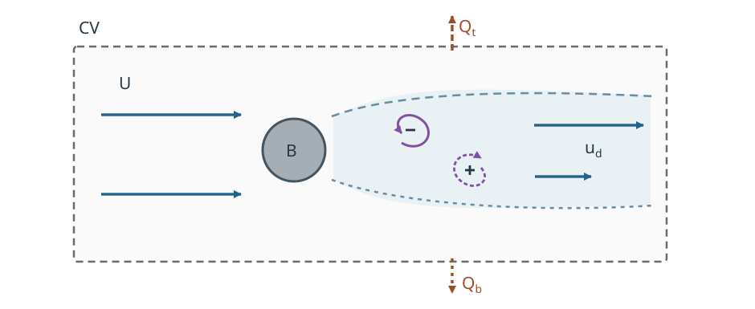

# FLUID25 物体の抗力と後流の渦をどう結ぶか

## この講義で解決すること

[FLUID23 の運動量積分式](../FLUID23/index.md#thm-fluid23-karman-integral)は、付着した平板境界層の速度欠損から摩擦抗力を評価した。[FLUID24 の壁面せん断による判定](../FLUID24/index.md#def-fluid24-wall-separation)では、逆圧力勾配により壁近くの逆流が現れ得ることを学んだ。しかし円柱のような鈍い物体では、剥離後の大きな後流を薄い付着境界層だけで記述することはできない。

今度は**物体を囲む流体全体**に運動量保存を適用する。遠くの後流で失われた下流向きの運動量と抗力が対応する理由を導き、圧力回復が不十分な場合の補正、交互に放出される渦とその周波数、定常平均と瞬間値の違いを整理する。渦列は抗力の原因を考える重要な手掛かりだが、「渦の個数だけで抗力が決まる」とは主張しない。

## 0. 模型・座標・力の向き

水平な二次元の固定物体断面 $B$ を考える。$x$ 軸を一様接近流の向き（右向き）、$y$ 軸を上向きに取り、紙面垂直方向の**単位スパン当たり**で力と流束を数える。流体領域を、物体を内側に含む長方形 $\Omega=(-L,R)\times(-H,H)$ から $B$ を除いた領域 $V=\Omega\setminus B$ とする。$L,R,H>0$、$B$ は区分的 $C^1$ 境界をもつ有界集合で、$\overline B\subset\Omega$ とする。

本章で使う抗力 $D'$ と揚力 $L'$ のプライムは、**時間微分ではなく単位スパン当たりの力**を表す印である。時間微分は $d/dt$ で明示し、後に現れる内部運動量 $P(t)$ の微分は $dP/dt$ と書く。

流体は一定密度 $\rho>0$ [kg/m$^3$]、一定動粘度 $\nu>0$ [m$^2$/s] の非圧縮 Newton 流体で、粘性係数は $\mu=\rho\nu$ [Pa s] とする。速度を $(u(x,y,t),v(x,y,t))$ [m/s]、圧力を $p(x,y,t)$ [Pa] と書く。流速・圧力は外側の境界まで必要な回数だけ滑らかで、流体中で連続の式と運動量保存を満たす。ここでは物体を固定し、流体に体積力の水平成分はないとする。固体境界で非貫通、粘性を含む流れのモデルでは無滑り条件を課す。

$\partial\Omega$ の外向き単位法線を $n$、物体の外向き法線（物体から流体へ向くもの）を $n_B$ とする。$\partial V$ 上では物体境界の法線は $-n_B$ である。この区別が抗力の符号に効く。[FLUID5 の検査体積の運動量収支](../FLUID5/index.md#thm-fluid5-moving-momentum)を、動かない $\Omega$ に適用する。



図で $Q_t,Q_b$ はそれぞれ上面・下面の外向き体積流束（符号付き）を表し、後に使う合計は $Q_s=Q_t+Q_b$ である。図の上下境界は流線ではなく、流体が横切れる仮想検査面である。後流によって下流側の流量が不足しても、上下の通過流束が質量をつり合わせられることに注意する。渦の描画は定性的であり、流体計算結果ではない。

## 1. 物体表面の圧力と粘性が抗力を作る

[FLUID14 の圧力による揚抗力の定義](../FLUID14/index.md#def-fluid14-lift-drag)は非粘性の圧力合力を扱った。粘性流では圧力のほか、流体が物体表面を接線・法線方向に引く応力も必要である。

[CTM6 の Cauchy 応力定理](../../CTM/CTM6/index.md#thm-ctm6-cauchy-stress)では、単位法線 $n$ の面に働く力の面積密度を応力行列と法線の積 $\sigma n$ で表した。ここではその平面成分を使い、$I$ を二次単位行列、$\tau$ を粘性応力行列として

$$
\sigma=-pI+\tau
$$

と書く。二次元直交座標では $x_1=x$、$x_2=y$ とし、速度成分は $(u_1,u_2)=(u,v)$ とする。$\partial_i=\partial/\partial x_i$（$i=1,2$）は空間座標による偏微分である。

[CTM15 の非圧縮 Newton 構成則](../../CTM/CTM15/index.md#def-ctm15-incompressible-newtonian)をこの座標に制限すると、

$$
\tau_{ij}=\mu(\partial_i u_j+\partial_j u_i),
\qquad i,j\in\{1,2\}
$$

となる。例えば $\tau_{11}=2\mu\,\partial_xu$、$\tau_{12}=\mu(\partial_yu+\partial_xv)$ である。これはひとつの応力行列の成分表示であり、法線 $n_B=((n_B)_x,(n_B)_y)$ を代入して $x$ 方向の粘性表面力密度を取り出すと、

$$
(\tau n_B)_x=\tau_{11}(n_B)_x+\tau_{12}(n_B)_y
$$

となる。圧力による表面力密度は $-pn_B$ であり、これらを物体表面に沿って積分したものが次の抗力である。

<a id="def-fluid25-drag-components"></a>

<!-- formal-statement-start -->
> **定義（圧力抗力・粘性抗力と全抗力）**  
> 固定された区分的に滑らかな二次元物体 $B$ の外向き法線を $n_B$ とし、$p$ と $\tau$ が表面で積分可能とする。流体が物体へ加える $x$ 方向の力（単位スパン当たり）を、圧力による成分 $D_p'$ と粘性による成分 $D_\tau'$ に分ける。

$$
D_p'=-\int_{\partial B}p(n_B)_x\,ds,\qquad
D_\tau'=\int_{\partial B}(\tau n_B)_x\,ds,\qquad
D'=D_p'+D_\tau'.
$$

> 右向きを正とし、$D'<0$ も数学的には許す。$D'$ の単位は N/m である。
<!-- formal-statement-end -->

<!-- definition-example-start: def-fluid25-drag-components -->
**定義の確認**（円柱に非対称な圧力を与える）：半径 $a>0$ の円柱の中心を原点に置き、下流側を $\theta=0$ とする。円周の位置を $r(\theta)=(a\cos\theta,a\sin\theta)$（$0\le\theta\le2\pi$）と表す。半径方向が物体の外向き法線なので $n_B=r/a=(\cos\theta,\sin\theta)$ であり、接線ベクトルと弧長要素は

$$
\frac{dr}{d\theta}=a(-\sin\theta,\cos\theta),\qquad
ds=\left|\frac{dr}{d\theta}\right|d\theta=a\,d\theta
$$

である。これにより定義の表面積分を $\theta$ に関する積分へ移せる。試験的な表面圧力 $p(\theta)=p_\infty-k\cos\theta$（$k>0$）、表面で $(\tau n_B)_x=0$ を仮定すれば、

$$
\begin{aligned}
D_p'&=-a\int_0^{2\pi}
(p_\infty-k\cos\theta)\cos\theta\,d\theta\\
&=-ap_\infty[\sin\theta]_0^{2\pi}
+ak\int_0^{2\pi}\cos^2\theta\,d\theta
=\pi ak>0,\\
D_\tau'&=0,\qquad D'=\pi ak .
\end{aligned}
$$

この圧力は上流側で高く下流側で低いため、正の抗力になる。ここでは**与えた応力分布を積分しただけ**で、その分布が Navier–Stokes 方程式の解から得られるとは主張していない。
<!-- definition-example-end -->

円柱のような鈍い物体では、剥離に伴う前後の圧力差が抗力に大きく寄与し得る。ただし物体表面で定義した $D_p'$ と、遠方検査面の圧力補正は別の積分量であり、両者を同じものとしてはいけない。

## 2. 瞬間の抗力を検査体積から求める

物体表面の応力が測れなくても、外側の検査面で流速・圧力・粘性応力を測れば、その物体に働く合力を復元できる。時刻によって後流が変わる場合は、箱の中に一時的に蓄えられる運動量も数える。

<a id="thm-fluid25-control-volume-force"></a>

<!-- formal-statement-start -->
> **定理（固定検査体積による瞬間抗力）**  
> 第0節の一定密度・非圧縮 Newton 流体が固定物体 $B$ を囲む $V=\Omega\setminus B$ で運動量収支を満たし、物体表面で非貫通、$\partial\Omega$ で応力と速度の積分が定義できるとする。体積力の $x$ 成分は零とする。$p_\infty$ を任意の空間一定の基準圧力とすれば、流体が物体へ与える瞬間の単位スパン抗力は

$$
\boxed{\displaystyle
D'(t)=
-\frac{d}{dt}\int_V\rho u\,dA
-\int_{\partial\Omega}
\left[
\rho u\bigl((u,v)\cdot n\bigr)
+(p-p_\infty)n_x-(\tau n)_x
\right]ds .}
$$

> 右辺は固定検査体積**外周**の測定量と、内部運動量の変化からなる。物体境界の流束は零だが、そこで働く応力は $-D'$ として運動量収支に入る。
<!-- formal-statement-end -->

### 証明の見取り図

[固定検査体積の運動量収支](../FLUID5/index.md#thm-fluid5-moving-momentum)で、外周と物体境界の寄与を分離する。流体領域から見た物体境界の法線は $-n_B$ なので、そこを通る応力の $x$ 成分は**物体への抗力の反作用**である。最後に基準圧力を引ける理由を確認する。

<!-- proof-start -->
### 証明

固定領域 $V$ の流体について $x$ 運動量の積分収支は

$$
\frac{d}{dt}\int_V\rho u\,dA
+\int_{\partial V}\rho u((u,v)\cdot n_V)\,ds
=\int_{\partial V}(-pn_{V,x}+(\tau n_V)_x)\,ds
$$

である。$\partial V=\partial\Omega\cup\partial B$、$\partial\Omega$ では $n_V=n$、$\partial B$ では $n_V=-n_B$ である。物体は固定され、非貫通により物体境界の法線流速は零なので

$$
\int_{\partial B}\rho u((u,v)\cdot n_V)\,ds=0.
$$

物体境界の応力項は[圧力・粘性抗力の定義](#def-fluid25-drag-components)より

$$
\begin{aligned}
\int_{\partial B}(-pn_{V,x}+(\tau n_V)_x)\,ds
&=-\int_{\partial B}(-p(n_B)_x+(\tau n_B)_x)\,ds\\
&=-D'(t).
\end{aligned}
$$

これらを最初の収支式へ代入し、$D'$ を左辺から右辺へ移すと

$$
D'=-\frac{d}{dt}\int_V\rho u\,dA
-\int_{\partial\Omega}
\bigl[\rho u((u,v)\cdot n)+pn_x-(\tau n)_x\bigr]\,ds .
$$

長方形の閉曲線 $\partial\Omega$ について $\int_{\partial\Omega}n_x\,ds=2H-2H=0$ である。従って $p$ を $p-p_\infty$ に置き換えても式は変わらない。これで示された。
<!-- proof-end -->

**符号の確認**：もし右側検査面から流出する下流向き運動量が小さくなり、その他の補正も適切に扱えば、流体は物体から左向きの力を受ける。その反作用で物体の抗力 $D'$ は正になる。外周上の圧力差、上下流束、内部蓄積を省いたまま「右の速度が小さいから $D'>0$」と推論するのは危険である。

## 3. 後流の速度欠損が平均抗力になる条件

下流の流速が接近流より遅い領域を観測して、どれだけ運動量が不足したかを数えたい。まず速度欠損を定める。これは[FLUID23 の運動量厚さ](../FLUID23/index.md#def-fluid23-momentum)と似た積分を使うが、片側に壁のある付着境界層ではなく、物体から離れた**後流全断面**を対象とする。

<a id="def-fluid25-wake-deficit"></a>

<!-- formal-statement-start -->
> **定義（後流速度欠損と運動量欠損積分）**  
> 接近流速 $U>0$ を一定とし、下流のある断面の $x$ 速度 $u_d(y)$ を考える。$U-u_d$ を**後流速度欠損**と呼ぶ。$u_d(U-u_d)$ が積分可能なら、単位スパン当たりの運動量欠損積分を

$$
M_d=\rho\int_{-H}^{H}u_d(y)\bigl(U-u_d(y)\bigr)\,dy
$$

> と定める。$M_d$ の単位は N/m であり、$u_d$ が $0$ と $U$ の間にある場所では被積分関数は非負である。
<!-- formal-statement-end -->

<!-- definition-example-start: def-fluid25-wake-deficit -->
**定義の確認**（矩形状の観測プロファイル）：$0<a<1$、$0<b<H$ とし、$|y|\le b$ で $u_d=U(1-a)$、$b<|y|\le H$ で $u_d=U$ とする。この断面の速度欠損は $|y|\le b$ に限って $Ua$、そこにおける被積分関数は $U^2a(1-a)$ なので

$$
M_d=\rho\int_{-b}^{b}U^2a(1-a)\,dy
=2\rho U^2 b\,a(1-a)>0 .
$$

$u_d$ は区分的に不連続な**積分手順を示すために仮定した断面速度**であり、滑らかな粘性流の厳密な速度場ではない。この例では、積分可能性・台・符号・単位を直接確かめた。
<!-- definition-example-end -->

後流を含む長方形検査領域の上下境界を「流れが横切らない」とは仮定しない。まさに側面からの流束を使って運動量の式を整理する。

<a id="thm-fluid25-wake-drag"></a>

<!-- formal-statement-start -->
> **定理（定常後流による抗力評価）**  
> 第2節の設定で流れは定常とする。左検査面 $x=-L$ では $u=U>0$、$p=p_\infty$、右検査面 $x=R$ では $u=u_d(y)$、$p=p_d(y)$ とする。上下検査面では $u=U$ であり、法線方向速度 $v$ は零とは限らないとする。$\partial\Omega$ 上の粘性応力による $x$ 方向の合力は零と仮定する（十分遠方で無視できる場合は近似式と読む）。非圧縮性、物体表面の非貫通、および両断面の積分可能性の下では

$$
\boxed{\displaystyle
D'=\rho\int_{-H}^{H}u_d(U-u_d)\,dy
+\int_{-H}^{H}(p_\infty-p_d)\,dy .}
$$

> 特に下流圧力が $p_d=p_\infty$ まで回復していれば、$D'=M_d$ である。圧力回復がない断面で運動量欠損積分だけを全抗力とみなしてはならない。
<!-- formal-statement-end -->

### 証明の見取り図

[瞬間抗力の式](#thm-fluid25-control-volume-force)で定常の蓄積項と外周粘性項を消す。上下の流束は一見未知だが、同じ箱の[質量保存](../FLUID5/index.md#thm-fluid5-moving-mass)を使うと、そこで運ばれる $x$ 運動量を下流・上流の流量差で置き換えられる。

<!-- proof-start -->
### 証明

上下の外向き法線は $(0,1),(0,-1)$ であり、側面を横切る質量流束の単位密度当たりの合計を

$$
Q_s=\int_{\text{上下面}}v n_y\,ds
$$

と書く。右面では $n=(1,0)$、左面では $n=(-1,0)$ だから、[固定領域の質量収支](../FLUID5/index.md#thm-fluid5-moving-mass)を定常・密度一定・物体非貫通に適用すると

$$
\begin{aligned}
0&=\int_{\partial\Omega}(u,v)\cdot n\,ds\\
&=\int_{-H}^H u_d(y)\,dy-\int_{-H}^H U\,dy+Q_s,\\
Q_s&=\int_{-H}^H(U-u_d(y))\,dy .
\end{aligned}
$$

続いて[瞬間抗力の定理](#thm-fluid25-control-volume-force)で蓄積項と外周の粘性項を零とする。下流・上流の運動量流束の差はそれぞれ $\rho\int u_d^2\,dy$ と $-\rho\int U^2\,dy$、上下の運動量流束は $u=U$ より $\rho UQ_s$ である。圧力項の外周積分は、上下で $n_x=0$ だから

$$
\int_{\partial\Omega}(p-p_\infty)n_x\,ds
=\int_{-H}^{H}(p_d-p_\infty)\,dy .
$$

従って

$$
\begin{aligned}
D'&=\rho\int_{-H}^{H}(U^2-u_d^2)\,dy
-\rho UQ_s+\int_{-H}^{H}(p_\infty-p_d)\,dy\\
&=\rho\int_{-H}^{H}
\{U^2-u_d^2-U(U-u_d)\}\,dy
+\int_{-H}^{H}(p_\infty-p_d)\,dy\\
&=\rho\int_{-H}^{H}u_d(U-u_d)\,dy
+\int_{-H}^{H}(p_\infty-p_d)\,dy.
\end{aligned}
$$

途中の $-\rho UQ_s$ を消してしまうと、$u_d(U-u_d)$ の代わりに誤った $U^2-u_d^2$ が残る。これが側面流束を省けない理由である。
<!-- proof-end -->

**適用範囲**：有限の $H$ で上下速度が厳密に $U$ とならない場合、上式の等号を使う前に横側の運動量流束と質量流束を別に評価する必要がある。測定断面が近すぎて圧力がまだ回復していない場合には、下流圧力の積分も残る。定常でない場合には、[瞬間式](#thm-fluid25-control-volume-force)に戻すか、周期平均・長時間平均の条件を使う。

### 具体例：滑らかな Gaussian 型の後流

$0<a<1$、$b>0$ とし、測定された断面を近似する**運動学的模型**として

$$
u_d(y)=U\bigl(1-ae^{-y^2/b^2}\bigr),\qquad y\in\mathbb R
$$

を置く。$y=0$ では $u_d=U(1-a)>0$、$|y|\to\infty$ では $u_d\to U$、しかも $U-u_d=Ua e^{-y^2/b^2}$ は積分可能である。$E(y)=e^{-y^2/b^2}$ と書けば

$$
u_d(U-u_d)=U^2(1-aE)aE
=U^2(aE-a^2E^2).
$$

<a id="ref-fluid25-gaussian-integral"></a>

### Gaussian 積分の導出

ここで使う Gaussian 積分を確認しておく。$I=\int_{-\infty}^{\infty}e^{-z^2}\,dz>0$ は収束し、その二乗を直交二座標の積分とみて極座標 $z=r\cos\theta,w=r\sin\theta$（Jacobian $r$）に変換すると

$$
I^2=\int_{\mathbb R^2}e^{-(z^2+w^2)}\,dz\,dw
=\int_0^{2\pi}\!\int_0^\infty e^{-r^2}r\,dr\,d\theta
=2\pi\left[-\frac12e^{-r^2}\right]_0^\infty
=\pi .
$$

したがって $I=\sqrt\pi$ である。非負の積分関数なので積分順序と極座標変換が許される。

下流圧力が回復し、上の定理の外側流束条件が満たされ、$H\to\infty$ の極限が取れるなら、[この Gaussian 積分](#ref-fluid25-gaussian-integral)を利用できる。第1項では $z=y/b$ と置いて $dy=b\,dz$、第2項では $w=\sqrt2y/b$ と置いて $dy=(b/\sqrt2)\,dw$ となる。従って

$$
\int_{\mathbb R}e^{-y^2/b^2}\,dy=b\sqrt\pi,\qquad
\int_{\mathbb R}e^{-2y^2/b^2}\,dy=\frac b{\sqrt2}\sqrt\pi.
$$

これらを代入すると

$$
\begin{aligned}
D'&=\rho U^2
\left(a\int_{-\infty}^{\infty}e^{-y^2/b^2}\,dy
-a^2\int_{-\infty}^{\infty}e^{-2y^2/b^2}\,dy\right)\\
&=\rho U^2b\sqrt\pi
\left(a-\frac{a^2}{\sqrt2}\right)>0.
\end{aligned}
$$

円柱径など代表長さ $d>0$ を選べば、投影面積 $d\times1$ に基づく抗力係数は

$$
C_D=\frac{D'}{\tfrac12\rho U^2d}
=2\sqrt\pi\,\frac bd
\left(a-\frac{a^2}{\sqrt2}\right).
$$

この式は**与えた速度断面と遠方条件から抗力を推定する式**であり、$a$ と $b$ を物体形状や Reynolds 数から予測する公式ではない。断面形状を勝手に指定して流体方程式の解を得たことにはならない。

## 4. なぜ後流に交互の渦が現れるのか

速度の遅い後流と速い外側流の間には大きな速度勾配がある。二次元渦度を $\omega=\partial_xv-\partial_yu$ [s$^{-1}$] とすると、[FLUID10 の二次元渦度輸送・拡散式](../FLUID10/index.md#prop-fluid10-planar-transport)は滑らかな流体内部で

$$
\partial_t\omega+u\partial_x\omega+v\partial_y\omega
=\nu(\partial_{xx}\omega+\partial_{yy}\omega)
$$

となる。流体内部での渦の移動・拡散に加え、固体の無滑り条件が壁近傍に渦度を生み、剥離したせん断層が渦として巻き上がる場合がある。渦放出の開始・安定性・三次元化はこの式だけで一意に決まるわけではなく、形状・Reynolds 数・境界条件・外乱にも依存する。

円柱で上下から**符号の異なる渦が交互に下流へ運ばれる**典型的なパターンを Kármán 渦列という。渦度の符号は $x,y$ の右手系で定義する。例えば円柱上側の外向き流れに近い層では $\partial_yu>0$ なら $\omega\approx-\partial_yu<0$、下側ではその逆符号になり得る。実際の局所符号は速度場で判定する必要がある。

[CTM16 の Reynolds 数](../../CTM/CTM16/index.md#def-ctm16-reynolds)と[Strouhal 数](../../CTM/CTM16/index.md#def-ctm16-strouhal)を、代表長さを円柱径 $d$、時間尺度を渦放出の周期 $T=1/f$ として使うと

$$
\mathrm{Re}=\frac{Ud}{\nu},
\qquad
\mathrm{St}=\frac{d}{UT}=\frac{fd}{U}.
$$

周期 $T$ は、例えば上側から出る渦の符号と放出状態が再び同じになるまでの時間とする。上下交互の渦**2個**を含むのが典型的な1周期であり、単に1個ごとの時間間隔を $T$ としない。

上側と下側の流れが半周期後に入れ替わるなら、力の向きにも対応する制約が生じる。ただし「渦が交互に見える」という観察だけでは、この**速度場と圧力場全体の鏡映条件**は保証されない。

<a id="prop-fluid25-frequency-symmetry"></a>

<!-- formal-statement-start -->
> **命題（半周期の鏡映対称性と揚抗力の周期）**  
> 固定円柱まわりの時間周期 $T>0$ の滑らかな二次元 Newton 流れについて、物体表面の圧力と粘性応力の合力が存在するとする。位置を $r=(x,y)$、速度ベクトルを $\boldsymbol q(r,t)=(u(r,t),v(r,t))$、鏡映行列を $S=\operatorname{diag}(1,-1)$ とする。流体領域の全点と全時刻で

$$
\boldsymbol q(Sr,t+T/2)=S\boldsymbol q(r,t),\qquad
p(Sr,t+T/2)=p(r,t)
$$

> が成立すると仮定する。このとき流体が円柱へ与える $x$ 方向の力 $D'(t)$ と $y$ 方向の力 $L'(t)$ は

$$
D'(t+T/2)=D'(t),\qquad
L'(t+T/2)=-L'(t).
$$

> 従ってこの対称性の下では抗力の変動は $T/2$ 周期、揚力の変動は $T$ 周期の反対称関係を持つ。ただし最小周期や特定の周波数成分の非零性までは断言しない。
<!-- formal-statement-end -->

### 証明の見取り図

鏡映は $x$ 方向を変えず $y$ 方向だけ符号を反転する。円柱表面の応力からなる力ベクトルを同じ鏡映で移すと、$x$ 成分は同じ、$y$ 成分は逆になる。

<!-- proof-start -->
### 証明

$S^\mathsf T=S$、$S^2=I$ である。命題の速度の鏡映条件を、時刻 $t$ を固定して位置 $r$ で微分する。速度勾配を $(\nabla\boldsymbol q)_{ij}=\partial_j q_i$ と定めると、連鎖律から

$$
(\nabla\boldsymbol q)(Sr,t+T/2)S
=S(\nabla\boldsymbol q)(r,t),
$$

$$
(\nabla\boldsymbol q)(Sr,t+T/2)
=S(\nabla\boldsymbol q)(r,t)S^\mathsf T.
$$

[非圧縮 Newton 応力の構成則](../../CTM/CTM15/index.md#def-ctm15-incompressible-newtonian)では $\tau=\mu\{\nabla\boldsymbol q+(\nabla\boldsymbol q)^\mathsf T\}$ である。上の式と圧力の鏡映条件を $\sigma=-pI+\tau$ に代入すると

$$
\sigma(Sr,t+T/2)=S\sigma(r,t)S^\mathsf T
$$

を得る。円柱の法線は $n_B(r)=r/a$ なので $n_B(Sr)=Sn_B(r)$ であり、$S$ が長さを保つため弧長要素 $ds$ も変わらない。[表面力の定義](#def-fluid25-drag-components)に対応する合力ベクトルを $F(t)=\int_{\partial B}\sigma(r,t)n_B(r)\,ds$ とすれば、$r'=Sr$ の変数変換で

$$
\begin{aligned}
F(t+T/2)
&=\int_{\partial B}\sigma(r',t+T/2)n_B(r')\,ds\\
&=\int_{\partial B}S\sigma(r,t)S^\mathsf T Sn_B(r)\,ds\\
&=S\int_{\partial B}\sigma(r,t)n_B(r)\,ds
=SF(t).
\end{aligned}
$$

$S(D',L')=(D',-L')$ なので結論が従う。
<!-- proof-end -->

**数値例**：$U=1.5$ m/s、$d=0.10$ m、$\nu=1.5\times10^{-5}$ m$^2$/s、観測された放出周波数 $f=3$ Hz なら

$$
\mathrm{Re}=\frac{1.5(0.10)}{1.5\times10^{-5}}=10^4,\qquad
\mathrm{St}=\frac{3(0.10)}{1.5}=0.20.
$$

これは観測値から無次元化した例である。**あらゆる Reynolds 数で $\mathrm{St}=0.20$ になる**という定理ではない。また半周期の鏡映対称性が崩れる流れや三次元流れに、上の力の関係を無条件で適用しない。

## 5. 平均収支と測定・数値計算の検証

周期 $T$ の状態で、運動量の蓄積量 $P(t)=\int_V\rho u\,dA$ が有界かつ $P(t+T)=P(t)$ なら

$$
\frac1T\int_{t_0}^{t_0+T}\frac{dP}{dt}\,dt
=\frac{P(t_0+T)-P(t_0)}T=0 .
$$

従って[瞬間の抗力収支](#thm-fluid25-control-volume-force)を周期平均したとき、蓄積項は消える。一方、速度の二乗平均には一般に

$$
\overline{u^2}=(\overline u)^2+
\overline{(u-\overline u)^2}
$$

が成り立ち、$\overline{u^2}$ を $(\overline u)^2$ に取り替えてはいけない。非定常後流を平均速度断面だけで計算するなら、変動の運動量流束や側面条件も点検する必要がある。

測定・計算で抗力を比較するときには、少なくとも次を分ける。

1. **物理模型**：二次元か三次元か、非圧縮か、固定壁の無滑り条件か、$U,d,\rho,\nu$ と Reynolds 数は何か。
2. **収支の閉じ方**：瞬間値か周期平均か、下流断面の圧力は回復しているか、上下境界の流量・運動量流束は補正できているか。
3. **数値近似**：格子幅・時間刻み・外部境界位置を別々に変え、抗力係数と放出周波数の収束を確かめる。滑らかな可視化だけでは保存則の検算にならない。

### Pythonで運動量欠損の積分誤差を分離する

次の実験は第3節の **Gaussian 型の測定断面**を台形則で積分するもので、Navier–Stokes 方程式の時間発展や円柱の渦放出を数値計算するものではない。$\pm H$ で切る**断面範囲の誤差**と、同じ範囲で格子を刻む**求積誤差**を別々に出力する。速度分布と運動量欠損密度も同じ Python ファイルから図示する。

```python-file-lab
# lab-id: FLUID25-WAKE-MOMENTUM
# lab-title: 後流の運動量欠損・断面範囲と刻み誤差
# lab-file: textbook/volumes/dream_thater/物理系/FLUID/FLUID25/wake_momentum_lab.py
# timeout-ms: 15000
# lab-preset: 基準 | --n 80 --extent 2 --amplitude 0.4
# lab-preset: 粗格子 | --n 8 --extent 2 --amplitude 0.4
# lab-preset: 細格子 | --n 320 --extent 2 --amplitude 0.4
# lab-preset: 狭い観測範囲 | --n 80 --extent 0.5 --amplitude 0.4
# lab-preset: 深い欠損 | --n 80 --extent 2 --amplitude 0.7
```

[Pythonソースを閲覧](wake_momentum_lab.py)。刻み数を増やしても有限の測定範囲の外に残る欠損は回収できない。逆に外側範囲を広げても、刻みを固定すれば求積誤差の比較は別途必要である。得られる $D'$ は第3節の外側流束条件と圧力回復を満たす場合に**限って**抗力の推定値となる。

## 6. 演習

### Level A

### A1. 表面圧力の前後差を積分する

半径 $a>0$ の固定円柱表面で $p(\theta)=p_\infty-k\cos\theta$（$k>0$）、粘性表面力の $x$ 成分は零とする。$\theta=0$ は下流側であり、$n_B=(\cos\theta,\sin\theta)$ である。単位スパンの圧力抗力の値と符号を求めよ。

- Level: A

<!-- solution-start -->
#### 詳細解答

[圧力抗力の定義](#def-fluid25-drag-components)で $ds=a\,d\theta$ を使う。

$$
D_p'=-a\int_0^{2\pi}(p_\infty-k\cos\theta)\cos\theta\,d\theta .
$$

定数圧力項は $\int_0^{2\pi}\cos\theta\,d\theta=0$。残る積分は $\cos^2\theta=(1+\cos2\theta)/2$ から $\pi$ である。よって

$$
D'=D_p'=ak\pi>0\quad [\mathrm{N/m}] .
$$

上流側 $\theta=\pi$ の圧力が高く、結果の正方向は接近流方向に一致する。
<!-- solution-end -->

### A2. 矩形の後流欠損を計算する

$U,\rho,H>0$、$0<b<H$、$0<a<1$。下流速度を $u_d=U(1-a)$（$|y|\le b$）、それ以外では $u_d=U$ とする。$M_d$ を求め、$a=1/2$ の値も求めよ。

- Level: A

<!-- solution-start -->
#### 詳細解答

[後流運動量欠損の定義](#def-fluid25-wake-deficit)で欠損は幅 $2b$ のみに存在する。そこで $u_d(U-u_d)=U^2(1-a)a$ だから

$$
M_d=\rho\int_{-b}^{b}U^2a(1-a)\,dy
=2\rho U^2b\,a(1-a).
$$

$a=1/2$ なら $a(1-a)=1/4$ より

$$
M_d=\frac12\rho U^2b .
$$

$H$ は $b<H$ の条件を満たす限り式から消える。この矩形分布は積分用の近似断面である。
<!-- solution-end -->

### A3. 渦放出の無次元周波数

$U=2$ m/s、円柱径 $d=0.08$ m、$\nu=2\times10^{-5}$ m$^2$/s、同じ符号の渦が出る時間間隔 $T=0.4$ s とする。$\mathrm{Re}$、$\mathrm{St}$、放出周波数を求めよ。

- Level: A

<!-- solution-start -->
#### 詳細解答

[Reynolds 数](../../CTM/CTM16/index.md#def-ctm16-reynolds)と[Strouhal 数](../../CTM/CTM16/index.md#def-ctm16-strouhal)を使う。まず $f=T^{-1}=2.5$ Hz。従って

$$
\mathrm{Re}=\frac{2(0.08)}{2\times10^{-5}}=8000,
\qquad
\mathrm{St}=\frac{(2.5)(0.08)}{2}=0.10 .
$$

異符号の渦が交互に出るとしても、ここで与えた $T$ は**同符号**の渦が戻る周期であり、半周期と取り違えない。
<!-- solution-end -->

### A4. 下流圧力を無視してよいか

第3節の定常後流の仮定で $p_d(y)=p_\infty-\Delta p$（$|y|\le b$）、他では $p_d=p_\infty$、$\Delta p>0$、$b<H$ とする。測定断面の運動量欠損積分が $M_d$ であるとき、全抗力は幾らか。

- Level: A

<!-- solution-start -->
#### 詳細解答

[定常後流の抗力式](#thm-fluid25-wake-drag)の圧力差積分は幅 $2b$ だけ非零である。

$$
\int_{-H}^{H}(p_\infty-p_d)\,dy
=\int_{-b}^{b}\Delta p\,dy=2b\Delta p.
$$

従って

$$
D'=M_d+2b\Delta p.
$$

$M_d$ のみを用いれば $2b\Delta p$ だけ過小評価する。圧力補正は検査断面での量であって、物体表面の圧力抗力成分そのものではない。
<!-- solution-end -->

### A5. 圧力回復と運動量蓄積

流れが時間周期 $T>0$ で、固定検査領域内の $x$ 運動量が $P(t)=P_0+A\sin(2\pi t/T)$ とする。瞬間の蓄積項 $-dP/dt$ と一周期平均を求めよ。

- Level: A

<!-- solution-start -->
#### 詳細解答

微分すると

$$
-\frac{dP}{dt}=-\frac{2\pi A}{T}\cos(2\pi t/T).
$$

時間積分では

$$
-\frac1T\int_{t_0}^{t_0+T}\frac{dP}{dt}\,dt
=-\frac{P(t_0+T)-P(t_0)}T=0
$$

となる。周期平均で零でも瞬間の運動量蓄積は一般には零でない。[瞬間抗力式](#thm-fluid25-control-volume-force)を各時刻で使うときはこの項を落とさない。
<!-- solution-end -->

### Level B

### B1. 滑らかな後流から抗力係数を出す

$U,\rho,b,d>0$、$0<a<1$ とし、下流速度は $u_d(y)=U(1-ae^{-y^2/b^2})$ とする。外周流束・圧力回復の条件を満たす遠方断面と仮定して $D'$ と $C_D=D'/(\rho U^2d/2)$ を導け。

- Level: B

<!-- solution-start -->
#### 詳細解答

まず $E=e^{-y^2/b^2}$ を使うと

$$
u_d(U-u_d)=U(1-aE)\,UaE=U^2(aE-a^2E^2).
$$

[定常後流の抗力定理](#thm-fluid25-wake-drag)の圧力項は零である。[Gaussian 積分](#ref-fluid25-gaussian-integral)で、$z=y/b$ と $w=\sqrt2y/b$ と別々に置換すると

$$
\int_{\mathbb R}E\,dy=b\sqrt\pi,\qquad
\int_{\mathbb R}E^2\,dy=b\sqrt{\pi/2}.
$$

従って

$$
D'=\rho U^2b\sqrt\pi
\left(a-\frac{a^2}{\sqrt2}\right),\qquad
C_D=\frac{2b\sqrt\pi}{d}
\left(a-\frac{a^2}{\sqrt2}\right).
$$

$a<1$ なので $a-a^2/\sqrt2>a(1-1/\sqrt2)>0$。ただし $a,b$ の値は物体の支配方程式から自動的には決まらない。
<!-- solution-end -->

### B2. 上下を通る流量を忘れると何が壊れるか

左面速度 $U>0$、右面速度 $u_d(y)$ の定常二次元検査領域で、上下境界の $x$ 速度は $U$、境界上の外側粘性応力と圧力差は零とする。質量収支から上下の法線流束 $Q_s$ を求め、運動量収支から $D'=\rho\int u_d(U-u_d)dy$ を導け。また上下で $v=0$ と置けない場合を説明せよ。

- Level: B

<!-- solution-start -->
#### 詳細解答

[質量収支](../FLUID5/index.md#thm-fluid5-moving-mass)により、物体表面は非貫通だから

$$
0=\int_{-H}^{H}(u_d-U)\,dy+Q_s,
\qquad Q_s=\int_{-H}^{H}(U-u_d)\,dy.
$$

[固定検査体積の運動量収支](#thm-fluid25-control-volume-force)は定常で圧力差・外側粘性項が零だから

$$
\begin{aligned}
D'&=\rho\int_{-H}^{H}(U^2-u_d^2)\,dy-\rho UQ_s\\
&=\rho\int_{-H}^{H}
[U^2-u_d^2-U(U-u_d)]\,dy\\
&=\rho\int_{-H}^{H}u_d(U-u_d)\,dy.
\end{aligned}
$$

もし $u_d<U$ が正の幅で存在し、それ以外で $u_d\le U$ なら $\int(U-u_d)dy>0$。このとき $Q_s>0$ だから上下境界で同時に $v=0$ と置くのは質量保存に反する。
<!-- solution-end -->

### B3. 半周期の力の対称性

円柱表面の応力が、時間 $T/2$ の経過と $y\mapsto-y$ の鏡映で一致すると仮定する。表面の上半円と下半円の力を対応させ、抗力と揚力の半周期関係を証明せよ。また、この仮定を外したときの結論を述べよ。

- Level: B

<!-- solution-start -->
#### 詳細解答

[半周期鏡映の命題](#prop-fluid25-frequency-symmetry)と同様、鏡映 $S=\operatorname{diag}(1,-1)$ で、上半円上の点 $r$ に対応する下半円上の点が $Sr$ である。法線と応力の変換は $n_B(Sr)=Sn_B(r)$ と $\sigma(Sr,t+T/2)=S\sigma(r,t)S^\mathsf T$。従って $Sr$ での力の微小寄与は

$$
\sigma(Sr,t+T/2)n_B(Sr)\,ds
=S\sigma(r,t)S^\mathsf T Sn_B(r)\,ds
=S\sigma(r,t)n_B(r)\,ds.
$$

円周全体に積分すると $F(t+T/2)=SF(t)$。その $x$ 成分は $D'(t+T/2)=D'(t)$、$y$ 成分は $L'(t+T/2)=-L'(t)$ である。鏡映対称性がない場合、単に渦が交互に見えることだけではこの等式を証明できない。また等式から特定の Fourier 係数の非零性までは従わない。
<!-- solution-end -->

### B4. 速度の平均から二乗平均を復元する

下流断面の一点で $u(t)=U-a+b\cos(2\pi t/T)$（$U>a+|b|>0$）とする。$\bar u$ と $\overline{u^2}$ を一周期で計算し、$\overline{u(U-u)}$ と $\bar u(U-\bar u)$ の差を求めよ。

- Level: B

<!-- solution-start -->
#### 詳細解答

一周期の平均は $\overline{\cos}=0$、$\overline{\cos^2}=1/2$ である。よって

$$
\bar u=U-a,\qquad
\overline{u^2}=(U-a)^2+\frac{b^2}{2}.
$$

定数 $U$ について $\overline{u(U-u)}=U\bar u-\overline{u^2}$ だから

$$
\begin{aligned}
\overline{u(U-u)}
&=U(U-a)-(U-a)^2-\frac{b^2}{2}\\
&=a(U-a)-\frac{b^2}{2},\\
\bar u(U-\bar u)&=a(U-a).
\end{aligned}
$$

従って前者は後者より $b^2/2$ 小さい。平均速度だけで非定常の運動量流束を置き換えると、この変動の寄与を落とす。
<!-- solution-end -->

### Level C

### C1. 後流断面・圧力補正・周波数をまとめて検証する

密度 $\rho>0$、速度 $U>0$、円柱径 $d>0$、動粘度 $\nu>0$ とし、円柱の下流断面の速度を

$$
u_d(y)=U\left(1-\frac12e^{-y^2/d^2}\right)
$$

で近似する。圧力は $p_d(y)=p_\infty-\Delta p\,e^{-y^2/d^2}$（$\Delta p\ge0$）とする。まずこれを仮想的な**定常二次元模型**の遠方断面と解釈し、外側の流束・粘性応力の条件を満たし、$H\to\infty$ の極限が正当化できると仮定する。比較のため、実物の円柱では周期的な渦放出が観測され、その周波数が $f>0$ と判明した場合も考える。定常模型と非定常の実流を混同しない。

1. $D'$ を求め、速度欠損だけで評価した値との差を出せ。
2. $C_D$、$\mathrm{Re}$、$\mathrm{St}$ を式で表せ。
3. 実際にこの流れが非定常の場合、測定した時間平均速度だけから同じ $D'$ を主張できない理由を運動量収支に沿って説明せよ。
4. $[-H,H]$ の刻みを細かくしても、$H$ を固定したままでは解消しない誤差を特定せよ。

- Level: C

<!-- solution-start -->
#### 詳細解答

**1. 欠損と圧力項。** $a=1/2$、$b=d$ を[定常後流の抗力定理](#thm-fluid25-wake-drag)へ代入し、[Gaussian 積分](#ref-fluid25-gaussian-integral)で各項を積分する。速度部分は

$$
\begin{aligned}
M_d&=\rho U^2d\sqrt\pi
\left(\frac12-\frac{1}{4\sqrt2}\right).
\end{aligned}
$$

圧力部分は $z=y/d$ の置換で

$$
\int_{\mathbb R}(p_\infty-p_d)\,dy
=\Delta p\,d\int_{\mathbb R}e^{-z^2}\,dz
=\Delta p\,d\sqrt\pi.
$$

従って

$$
D'=d\sqrt\pi
\left[
\rho U^2\left(\frac12-\frac1{4\sqrt2}\right)
+\Delta p
\right] .
$$

速度欠損だけの推定値との差は $\Delta p\,d\sqrt\pi$ であり、$\Delta p>0$ なら速度欠損だけでは抗力を過小評価する。

**2. 無次元量。** 基準の動圧と投影長さの積 $\rho U^2d/2$ で割る。

$$
C_D=
2\sqrt\pi\left(
\frac12-\frac1{4\sqrt2}+
\frac{\Delta p}{\rho U^2}\right).
$$

さらに[Reynolds 数](../../CTM/CTM16/index.md#def-ctm16-reynolds)と[Strouhal 数](../../CTM/CTM16/index.md#def-ctm16-strouhal)より

$$
\mathrm{Re}=\frac{Ud}{\nu},\qquad
\mathrm{St}=\frac{fd}{U}.
$$

両者は同じ長さ $d$ を使うが、周波数 $f$ を速度分布から導いたわけではない。

**3. 非定常性。** [瞬間の収支](#thm-fluid25-control-volume-force)には内部蓄積 $-P'(t)$ と、外側の $\rho u(u,v)\cdot n$ がある。厳密周期では前者の周期平均は零だが、後者の平均は $\overline{u^2}$ などを含む。変動 $u'=u-\bar u$ には $\overline{(u')^2}$ が生じるため、平均速度 $\bar u$ を定常式の $u_d$ に代入するだけでは平均抗力を復元できない。側面の流束と圧力変動も同様に確認が必要である。

**4. 積分範囲。** $z=y/d$ と置けば $dy=d\,dz$ であり、有限の $H$ では各 Gaussian 項の積分範囲が $[-H/d,H/d]$ に切られる。速度欠損と圧力補正を合計した**抗力の切断誤差**は、対称性より

$$
\begin{aligned}
D'_{\infty}-D'_H
&=2d\int_{H/d}^{\infty}
\left[
\rho U^2\left(\frac12e^{-z^2}-\frac14e^{-2z^2}\right)
+\Delta p\,e^{-z^2}
\right]\,dz>0.
\end{aligned}
$$

$z\ge0$ では $e^{-2z^2}\le e^{-z^2}$ だから、角括弧の速度欠損部分は $\rho U^2e^{-z^2}/4$ 以上である。$H<\infty$ では尾部が必ず正で、刻み幅を零にしてもこの**測定範囲の誤差**は消えない。台形則等の求積誤差は、同じ有限区間の厳密積分との差として別に評価する。
<!-- solution-end -->

## 7. 学んだ結果と次への接続

抗力は**物体表面の圧力・粘性応力の合力**として定義される。一方、保存則を使えば、適切な外周・圧力・非定常補正のもとで**遠方後流の運動量欠損**からも同じ抗力を求められる。渦放出はその非定常後流の代表現象だが、Strouhal 数は流れの時空間尺度を整理する量であって、抗力係数を一意に決める普遍公式ではない。

次の FLUID26 では、物体を押す力の積分から、流体と流体を隔てる**曲がった界面**に働く表面張力と圧力差の釣合へ進む。
