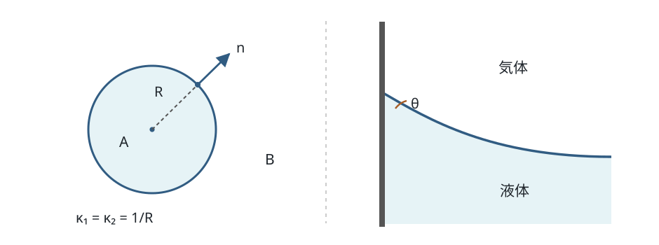

# FLUID26 曲がった界面の圧力差は何で決まるか

## この講義で解決すること

[FLUID1 の表面張力](../FLUID1/index.md#def-fluid1-surface-tension)は、液体と気体の境界の面積を増やすと自由エネルギーが増えるという物性である。[FLUID2 の静水圧方程式](../FLUID2/index.md#thm-fluid2-hydrostatic-balance)では、静止した液体の圧力を高さに沿って求めた。しかし、そのとき界面の両側の圧力を等しいと置いた箇所では、**表面が曲がると何が変わるか**をまだ説明できなかった。

曲面を内側へ縮めようとする張力は、圧力差によって釣り合う。本講義では、界面の**どちら側の圧力からどちら側を引くか**を固定して Young–Laplace の式を導く。さらに液滴と気泡の違い、濡れを決める接触角、毛細管内の液面の高さ、壁際のメニスカス（湾曲した液面）の形状を一つの釣合からつなぐ。

## 0. 模型と法線の約束

互いに混ざらない二つの静止流体を相 A、相 B と呼び、界面を滑らかな曲面 $S$ とする。界面の厚さは巨視的長さに比べ十分小さく、表面張力 $\gamma>0$ [N/m] は位置・方向によらず一定、界面にせん断応力や曲げ剛性はないとする。

両相の応力は $-p_AI$、$-p_BI$ とする。ここで $I$ は三次元単位行列で、$-pI$ は垂直圧力のみを伝える等方応力を表す。

相 A から相 B へ向く単位法線を $n$ とし、**圧力差は $\Delta p=p_A-p_B$** と固定する。

曲面上の一点で法線方向に $w>0$ だけ動くとは、A の占める体積が増える方向に界面を変位させることを意味する。圧力の仮定は静止状態の局所釣合に用い、界面の変形は平衡状態のまわりの仮想的な微小変化として扱う。重力がある場合は各相の内部で静水圧式を別々に解き、界面条件と結び付ける。

## 1. 曲面の向きと曲率をそろえる

平らな面では、両側から押す圧力が同じなら面は動かない。球形の液滴のように面が曲がると、面積を増やす張力の仕事が変位方向に依存する。その変化率を記述するには、二つの独立な接線方向に沿って面がどれだけ曲がるかが必要になる。

[GEO10 の主曲率・平均曲率の定義](../../../幾何系/GEO/GEO10/index.md#def-geo10-principal-curvature)では、形作用素を $-dn$（GEO10 での記号 $S$ は、本講義の界面 $S$ とは別の対象）として定めるため、外向き法線の球の主曲率は $-1/R$ になる。本講義では流体界面の圧力差と符号を直接結ぶため、**法線の変化率 $dn$ の固有値**を $\kappa_1,\kappa_2$ と表す。従って GEO10 の主曲率の符号をともに逆転させた値であり、外向き球では両方が $+1/R$ となる。対応する直交方向を主方向とし、二つの方向を区別して曲面の曲がりを数える。

ここで $dn$ を単なる記号で済ませず、接方向から確認する。点 $q\in S$ の単位接ベクトル $v$ に沿う曲面内の曲線 $c(s)$ を取り、$c(0)=q$、$c'(0)=v$ とする。$dn_q(v)$ は、法線 $n(c(s))$ を曲線の弧長変数 $s$ で微分した $s=0$ での値である。

$|n|^2=1$ を微分すると $n(q)\cdot dn_q(v)=0$ だから、この値は接平面 $T_qS$ に属する。従って $dn_q:T_qS\to T_qS$ は接方向を別の接方向へ写す線形写像である。

[GEO10 の形作用素](../../../幾何系/GEO/GEO10/index.md#def-geo10-shape-operator)の符号を反転した写像であり、その正規直交固有ベクトル $e_1,e_2$ で $dn_q(e_i)=\kappa_i e_i$ と書く。この基底では

$$
\operatorname{div}_S n
=\langle dn_q(e_1),e_1\rangle+\langle dn_q(e_2),e_2\rangle
=\kappa_1+\kappa_2.
$$

よって「二つの曲率を足す」とは、各単位接方向での法線の変化率を足す操作である。

幾何学の Gauss 曲率（主曲率の積）とここで扱う**主曲率の和**は異なる。二方向の値を合計する記号には $\kappa_\Sigma$ を使い、GEO10 で Gauss 曲率に用いられる記号 $K$ と混同しない。

<a id="def-fluid26-oriented-curvature"></a>

<!-- formal-statement-start -->
> **定義（向き付き全曲率）**  
> $C^2$ 級の向き付けられた曲面 $S\subset\mathbb R^3$ と単位法線 $n$ に対し、点 $q\in S$ での主曲率を、半径 $R>0$ の外向き球で $+1/R$ となる規約の $\kappa_1(q),\kappa_2(q)$ とする。その和

$$
\kappa_\Sigma(q)=\kappa_1(q)+\kappa_2(q)=\operatorname{div}_S n(q)
$$

> を**向き付き全曲率**とする。平均曲率を $H=\kappa_\Sigma/2$ と呼ぶ流儀では $\kappa_\Sigma=2H$ である。法線を $-n$ に替えると $\kappa_\Sigma$ の符号も変わる。
<!-- formal-statement-end -->

<!-- definition-example-start: def-fluid26-oriented-curvature -->
**定義の確認**：平面・球面・円筒面。二つの主方向へ進むときの法線の変化をそれぞれ確認する。

- 平面では法線がどちらの接線方向でも一定なので、$\kappa_1=\kappa_2=0$、曲率和も零である。
- 原点中心、半径 $R>0$ の球面では $n(q)=q/R$ である。接平面上の任意の単位ベクトル $v$ に沿って微分すれば $dn_q(v)=v/R$。したがって二つの直交接方向 $e_1,e_2$ はともに固有ベクトルで、固有値はそれぞれ $1/R$ となる。

$$
dn_q(e_1)=\frac1R e_1,\qquad
dn_q(e_2)=\frac1R e_2,\qquad
\kappa_\Sigma=\frac2R.
$$

- 半径 $R>0$ の円筒側面を $q(\phi,z)=(R\cos\phi,R\sin\phi,z)$ と表示する。ここで $\phi$ は円周角、$z$ は軸方向座標であり、外向き法線は $n(\phi,z)=(\cos\phi,\sin\phi,0)$ である。円周方向の単位接ベクトル $e_\phi=(-\sin\phi,\cos\phi,0)$ について、弧長の増分が $R\,d\phi$ なので $dn_q(e_\phi)=e_\phi/R$。軸方向の $e_z=(0,0,1)$ では $n$ が $z$ に依存しないため $dn_q(e_z)=0$。よって

$$
\kappa_1=\frac1R,\qquad \kappa_2=0,
\qquad \kappa_\Sigma=\frac1R.
$$

いずれも**二方向を別々に検算した**。見かけの一断面だけで二つの曲率を同一視しない。
<!-- definition-example-end -->



左図は液滴内部を相 A、外部を相 B とし、半径 $R$ と外向き法線 $n$ を示す。右図では水に相当する液体を壁際の曲面の下側に置く。二つの現象は形が違っても、界面の**法線と圧力差の順序**を統一すれば同じ式で記述できる。

## 2. 圧力と表面張力の力を釣り合わせる

[界面の表面張力](../FLUID1/index.md#def-fluid1-surface-tension)から、面積が $\delta A$ だけ増えれば界面自由エネルギーは $\gamma\delta A$ 増える。一方、A 側の圧力が B 側より大きいなら、A の体積を $\delta V>0$ 増やす際の圧力の仕事は $(p_A-p_B)\delta V$ となる。局所的にこの二つを釣り合わせる。

<a id="thm-fluid26-young-laplace"></a>

<!-- formal-statement-start -->
> **定理（Young–Laplace の界面圧力跳躍）**  
> $C^2$ 級の界面 $S$ で、二つの静止流体 A、B の応力はそれぞれ等方的な $-p_AI$、$-p_BI$、表面張力 $\gamma>0$ は一定とする。相 A から相 B への法線 $n$ で測る曲率を[向き付き全曲率](#def-fluid26-oriented-curvature) $\kappa_\Sigma$ とし、界面に追加の面力や曲げ剛性はないとする。任意の局所的な法線仮想変位で静的釣合が成立するなら、界面上の各点で

$$
\boxed{p_A-p_B=\gamma \kappa_\Sigma=\gamma(\kappa_1+\kappa_2).}
$$

> 圧力と曲率は同じ界面点の値である。重力があってもこの局所条件は保たれるが、各相の圧力は高さで変化し得る。
<!-- formal-statement-end -->

### 証明の見取り図

面積の変化を体積の変化と比較する。局所の接線方向に小さな長方形を取り、法線方向へ少し移動すると、二つの辺の伸び率がそれぞれ主曲率で決まる。面積変化の係数が**曲率の和**になることが核心である。

<!-- proof-start -->
### 証明

一点 $q$ の主方向に沿った微小な長さを $ds_1,ds_2$ とする。$w$ がその小領域で一定とみなせる法線移動 $\varepsilon w$（$\varepsilon$ は無次元の微小量）により、平行な面の二方向の線素は一次まで

$$
ds_1'=(1+\varepsilon w\kappa_1)ds_1+o(\varepsilon),
\qquad
ds_2'=(1+\varepsilon w\kappa_2)ds_2+o(\varepsilon)
$$

となる。積を取って二次項を除くと

$$
dA'=ds_1'ds_2'
=\{1+\varepsilon w(\kappa_1+\kappa_2)\}\,dA+o(\varepsilon).
$$

変位 $w$ が領域内部で滑らかに変わる場合も確認する。変形写像 $F_\varepsilon(q)=q+\varepsilon w(q)n(q)$ を主方向 $e_i$ に沿って微分すると

$$
dF_\varepsilon(e_i)
=e_i+\varepsilon\{(\partial_{e_i}w)n+w\kappa_i e_i\}.
$$

ここで $\partial_{e_i}w$ は $e_i$ に沿った $w$ の方向微分である。$n\cdot e_i=0$ だから、$|dF_\varepsilon(e_i)|^2=1+2\varepsilon w\kappa_i+O(\varepsilon^2)$ である。従って $\partial_{e_i}w$ が作る法線方向の変化は面積の一次項に現れず、先の曲率和の係数が残る。境界で $w=0$ となる小領域を使えば境界線の仕事もない。したがって

$$
\delta A=\varepsilon\int_S \kappa_\Sigma w\,dA+o(\varepsilon).
$$

同じ変位で A の体積が増える一次変化は

$$
\delta V_A=\varepsilon\int_S w\,dA+o(\varepsilon).
$$

面積仕事から圧力仕事を引いた一次の正味エネルギー変化は

$$
\delta E
=\varepsilon\int_S\{\gamma \kappa_\Sigma-(p_A-p_B)\}w\,dA+o(\varepsilon).
$$

界面上の任意の小領域に支持された正負両方向の滑らかな $w$ を選べ、静的平衡なら一次の係数は零である。$p_A,p_B,\kappa_\Sigma$ が連続だから各点で $\gamma \kappa_\Sigma-(p_A-p_B)=0$ が成り立つ。
<!-- proof-end -->

**符号の反証。** 法線を B から A へ逆転させると $\kappa_i$ と $\kappa_\Sigma$ は負に変わり、左辺も $p_B-p_A$ へ変える必要がある。「外側の圧力から内側を引く」だけを固定して曲率の向きは反転させない、という使い方は誤りである。

<a id="prop-fluid26-sphere-cylinder"></a>

<!-- formal-statement-start -->
> **命題（球面と円筒面の圧力差）**  
> 一定表面張力 $\gamma>0$ をもつ静止界面が半径 $R>0$ の球面または軸方向に一様な円筒側面であり、内側を相 A、外側を相 B とし、法線を外向きに取る。重力による界面上の圧力変化を無視できる条件で、球面では $p_A-p_B=2\gamma/R$、円筒面では $p_A-p_B=\gamma/R$ である。
<!-- formal-statement-end -->

### 証明の見取り図

球では二方向とも曲率 $1/R$、円筒では一方向だけ $1/R$ である。[Young–Laplace の式](#thm-fluid26-young-laplace)に順に代入する。

<!-- proof-start -->
### 証明

球面の法線断面は直交する二主方向とも半径 $R$ の円だから $\kappa_\Sigma=1/R+1/R=2/R$。従って $p_A-p_B=\gamma(2/R)=2\gamma/R$。円筒側面では円周方向が $1/R$、軸方向が $0$ なので $\kappa_\Sigma=1/R+0=1/R$、従って $p_A-p_B=\gamma/R$。どちらも圧力差は正で、相 A の方が高圧となる。
<!-- proof-end -->

**三種類の泡を区別する。** 液滴（内側液体、外側気体）も、液中の**単一界面**の気泡（内側気体、外側液体）も、それぞれ内側が $2\gamma/R$ 高圧である。これに対して薄い石鹸膜の泡は内面と外面に**二つの界面**がある。両界面の張力が同じ $\gamma$、膜厚が $R$ に比べ小さく、膜内の圧力差を無視できれば、内外の気体圧力差はそれぞれの跳躍を足して約 $4\gamma/R$ になる。単一の気泡に二面分を数えてはいけない。

### 具体例：半径を半分にした液滴

$\gamma=0.072$ N/m、$R=1.0$ mm の液滴では

$$
p_{\mathrm{in}}-p_{\mathrm{out}}
=\frac{2(0.072)}{1.0\times10^{-3}}
=144\ \mathrm{Pa}.
$$

$R=0.5$ mm とすれば $288$ Pa。物性・界面数が同じなら、半径が半分で差圧は二倍となる。長い円筒状液柱なら同じ半径で $72$ Pa に留まる。

## 3. 接触線で液体はどの角度で壁に出会うか

界面が固体の壁に触れると、液体・気体・固体の三つが出会う**接触線**ができる。壁と液体界面の角度は、界面の曲率式そのものでは決まらない。固体と液体、固体と気体、液体と気体それぞれの界面エネルギーを別に指定する必要がある。

接触角 $\theta$ は**液体の内部から測る**、固体表面と液体‐気体界面のなす角で、$0<\theta<\pi$ とする。$\theta<\pi/2$ なら濡れやすい側、$\theta>\pi/2$ なら濡れにくい側である。実験で接触線がピン止めされると、前進角と後退角が違うこともあり、一つの平衡角だけでは記述できない。

<a id="def-fluid26-contact-angle"></a>

<!-- formal-statement-start -->
> **定義（液体側から測る接触角）**  
> 滑らかな固体表面 $W$ と滑らかな液体‐気体界面 $S$ が接触線で交わり、両面に一意な接平面があるとする。接触線に垂直な断面で、固体表面に沿う半直線と液体‐気体界面の接線が**液体の存在する側**でつくる角 $\theta\in(0,\pi)$ を接触角という。$\cos\theta$ は濡れの符号を表し、壁の外側から測る補角 $\pi-\theta$ とは区別する。
<!-- formal-statement-end -->

<!-- definition-example-start: def-fluid26-contact-angle -->
**定義の確認**：垂直壁と右下がりの接線。壁を $x=0$、液体を $x>0$ 側で界面の下に置く。接触線から液体側へ進む接線を $(1,-\cot\theta)$（横 $x$、鉛直 $z$ の成分）とすれば、固体に沿って液体の内部へ向かう単位ベクトルは $(0,-1)$ である。両者の内積を接線の長さで割ると

$$
\frac{(1,-\cot\theta)\cdot(0,-1)}
{\sqrt{1+\cot^2\theta}}=\cot\theta\sin\theta=\cos\theta.
$$

$0<\theta<\pi$ では $\sin\theta>0$ だから、二つの半直線の角は確かに $\theta$ になる。例えば $\theta=60^\circ$ なら接線勾配は $-1/\sqrt3$、内積による余弦は $1/2$ であり、角の定義を直接満たす。
<!-- definition-example-end -->

<a id="prop-fluid26-young-contact"></a>

<!-- formal-statement-start -->
> **命題（理想平衡接触線の Young の式）**  
> 剛体の平坦で均質・滑らかな固体面上に、接触線が自由に可逆移動できる液体と気体が接する。固体‐気体、固体‐液体、液体‐気体の等方的な界面張力をそれぞれ $\gamma_{SG},\gamma_{SL},\gamma_{LG}>0$ とする。線張力、接触線のピン止め、追加の外力の接線成分を無視し、接触角 $\theta\in(0,\pi)$ が平衡にあるなら

$$
\boxed{\gamma_{SG}-\gamma_{SL}=\gamma_{LG}\cos\theta.}
$$

> 特に $|\gamma_{SG}-\gamma_{SL}|\le\gamma_{LG}$ が、有限の平衡角の必要条件である。
<!-- formal-statement-end -->

### 証明の見取り図

接触線を固体面上で距離 $dx$ だけ動かすと、固体‐液体の面積が増え、固体‐気体の面積が同じだけ減る。液体‐気体の界面が接線方向へ引く力の固体面成分は $\gamma_{LG}\cos\theta$ なので、これらの接線力が釣り合う。

<!-- proof-start -->
### 証明

接触線の単位長さを考え、液体が広がる向きを正に取る。固体‐気体の界面が線を正方向へ引く大きさは $\gamma_{SG}$、固体‐液体の界面が反対方向へ引く大きさは $\gamma_{SL}$ である。液体‐気体界面の張力は自身の接線に沿い、その固体面成分は反対向きに $\gamma_{LG}\cos\theta$。接線方向合力を零と置けば

$$
\gamma_{SG}-\gamma_{SL}-\gamma_{LG}\cos\theta=0.
$$

従って式を得る。$-1\le\cos\theta\le1$ を使えば必要条件が続く。固体の変形やヒステリシスを無視した境界模型の式であり、すべての現実の接触線に適用できる恒等式ではない。
<!-- proof-end -->

例えば $\gamma_{SG}=0.08$ N/m、$\gamma_{SL}=0.04$ N/m、$\gamma_{LG}=0.08$ N/m なら $\cos\theta=0.5$、従って $\theta=60^\circ$。$|\gamma_{SG}-\gamma_{SL}|>\gamma_{LG}$ なら有限角の余弦が存在せず、完全濡れ等の別の境界状態を検討する。

## 4. 細い管では水面がどこまで上がるか

曲面の重力影響をどこまで無視できるかは、曲率圧力と静水圧差の大きさを比べて判断する。その比較に使う固有の長さをここで固定する。

<a id="def-fluid26-capillary-length"></a>

<!-- formal-statement-start -->
> **定義（毛管長）**  
> 表面張力 $\gamma>0$、密度差 $\Delta\rho>0$、重力加速度 $g>0$ をもつ二相流体について

$$
\ell_c=\sqrt{\frac{\gamma}{\Delta\rho g}}
$$

> を毛管長と定義する。界面の長さ尺度が $\ell_c$ 程度なら、表面張力の曲率圧力と静水圧差が同程度になる。$\mathrm{Bo}=(a/\ell_c)^2$ は長さ $a$ に基づく Bond 数である。
<!-- formal-statement-end -->

<!-- definition-example-start: def-fluid26-capillary-length -->
**定義の確認**：実数性・単位・Bond 数。$\gamma=0.072$ N/m、$\Delta\rho=1000$ kg/m$^3$、$g=9.8$ m/s$^2$ とする。いずれも正なので平方根の中身は正であり、

$$
\frac{\gamma}{\Delta\rho g}=\frac{0.072}{9800}\ {\rm m^2}>0,
\qquad
\ell_c=\sqrt{\frac{0.072}{9800}}\ {\rm m}\simeq2.71\ {\rm mm}.
$$

密度差と重力の積は単位体積当たりの重さだから、$[\Delta\rho g]=\mathrm{N/m^3}$ である。従って $[\gamma/(\Delta\rho g)]=(\mathrm{N/m})/(\mathrm{N/m^3})=\mathrm{m^2}$ で、$\ell_c$ は長さになる。半径 $a=1$ mm の管では $\mathrm{Bo}=a^2/\ell_c^2\simeq0.136$ と計算でき、無次元である。
<!-- definition-example-end -->

水槽に鉛直な細い円管を挿すと、濡れやすい液体は管壁に引かれて上昇し得る。ここで上昇高 $h$ は**水槽のほぼ平坦な自由表面から、管内のメニスカスの代表高さまでの差**であり、曲面上の全点の高さが等しいと主張するものではない。半径を $a>0$、気体と液体の密度差を $\Delta\rho=\rho_l-\rho_g>0$ とする。

$a$ が十分小さく、管内液面を接触角 $\theta$ の球面帽で近似できるなら、壁での接線方向と球の半径を結び付けられる。管軸から外向きの水平座標を $r$、界面高さを $z(r)$ とする。液体側から測る接触角の定義により、壁 $r=a$ での接線勾配は $z_r(a)=\cot\theta$（ここで $z_r=dz/dr$）である。従って、液体から気体への上向き法線の断面成分は

$$
\frac{(-z_r(a),1)}{\sqrt{1+z_r(a)^2}}
=(-\cos\theta,\sin\theta).
$$

球面帽の中心は管軸上にあり、その半径方向の法線成分の絶対値は $a/R$ でもある。よって $\theta\ne\pi/2$ では $a/R=|\cos\theta|$、すなわち $R=a/|\cos\theta|$。

液体側の法線は濡れる凹面では球面の中心へ向くため、二つの主曲率の**符号**も含めると $\kappa_1=\kappa_2=-\cos\theta/a$ となる。従って

$$
\kappa_\Sigma\simeq-\frac{2\cos\theta}{a}.
$$

$\theta=\pi/2$ では球面帽の半径が無限大となる平面の極限と読み、曲率は零である。濡れやすい場合 $\cos\theta>0$ なので液面は凹形で、液体側が低圧である。

<a id="thm-fluid26-jurin-rise"></a>

<!-- formal-statement-start -->
> **定理（細管近似での毛管上昇・下降）**  
> 半径 $a>0$ の鉛直円管が、密度差 $\Delta\rho=\rho_l-\rho_g>0$、表面張力 $\gamma>0$ の静止した液体‐気体界面に接する。管内の一様接触角は $\theta\in(0,\pi)$ とし、管の内外の気体は連通している。管が十分細く、液面の球面帽近似、管内外の同じ高さでの静水圧差、メニスカス内部の高さ変化の無視が正当化されるなら、槽外水面からの符号付き毛管高さは近似的に

$$
\boxed{h\simeq\frac{2\gamma\cos\theta}{\Delta\rho\,g\,a}.}
$$

> $h>0$ は上昇、$h<0$ は下降である。管半径に対する Bond 数 $\mathrm{Bo}=\Delta\rho ga^2/\gamma$ が十分小さいことは球面帽近似の代表的な尺度条件である。
<!-- formal-statement-end -->

### 証明の見取り図

液面の跳躍は負の曲率によって $p_l-p_g\simeq-2\gamma\cos\theta/a$。一方、[静水圧積分](../FLUID2/index.md#prop-fluid2-integral-profile)から水槽の水平自由表面より高さ $h$ では $p_l-p_g=-\Delta\rho gh$ となる。この二つの差圧が同じであることを使う。

<!-- proof-start -->
### 証明

水平な槽外自由表面を $z=0$ とし、液体・気体の基準圧力がそこで等しいとする。両相で[静水圧方程式](../FLUID2/index.md#thm-fluid2-hydrostatic-balance)をそれぞれ積分すると、同じ高さ $z=h$ で

$$
p_l(h)=p_0-\rho_lgh,\qquad
p_g(h)=p_0-\rho_ggh.
$$

したがって

$$
p_l(h)-p_g(h)=-(\rho_l-\rho_g)gh=-\Delta\rho gh.
$$

円管内の液面が球面帽なら、垂直な壁に対する接触角 $\theta$ から半径は符号付きで $1/R_{\rm signed}=-\cos\theta/a$ に対応し、二つの主曲率はともに $-\cos\theta/a$。よって[Young–Laplace の式](#thm-fluid26-young-laplace)は

$$
p_l(h)-p_g(h)\simeq\gamma \kappa_\Sigma
\simeq-\frac{2\gamma\cos\theta}{a}.
$$

二つを等置すると $-\Delta\rho gh\simeq-2\gamma\cos\theta/a$。$\Delta\rho,g,a>0$ で割れば主張を得る。
<!-- proof-end -->

同じ結果は、管壁の接触線全周に働く表面張力の**鉛直成分** $F_z=2\pi a\gamma\cos\theta$ と、管内外の液柱の正味重量 $\Delta\rho g(\pi a^2)h$ の釣合からも確認できる。これらの式を等置し、共通の $\pi a$ を消すと同じ $h$ が出る。壁面濡れの条件を落として $\cos\theta=1$ としてしまうと、濡れにくい管でも常に上昇するという誤った予測になる。

**近似の境界**：管が太くなると $\mathrm{Bo}$ は大きくなり、球面帽の曲率は高さ依存の静水圧差と両立しにくくなる。メニスカスの上下変動を同一高さに押し込む操作が破れるため、断面全体の形状方程式を解く必要がある。接触角がピン止め・時間変化する場合や、管が極端に細く連続体近似が壊れる場合にもこの式をそのまま適用しない。

### 具体例：内径を取り違えない

$\gamma=0.072$ N/m、$\Delta\rho=1000$ kg/m$^3$、$g=9.8$ m/s$^2$、**半径** $a=0.5$ mm、$\theta=60^\circ$ とする。

$$
h\simeq\frac{2(0.072)(1/2)}
{1000(9.8)(0.5\times10^{-3})}
=\frac{0.072}{4.9}
\simeq0.01469\ \mathrm m.
$$

したがって約 $14.7$ mm 上昇する。上で定義した毛管長 $\ell_c\simeq2.71$ mm に対し $a/\ell_c\simeq0.184$、$\mathrm{Bo}\simeq0.034$ なので、これは小 Bond 数の近似例である。高さが管径より大きくても、球面帽**内部の高さ差**が毛管長の変化尺度に比べ小さいことを区別する。

## 5. 壁際のメニスカスはどんな形になるか

細管の上昇高だけでなく、平らな垂直壁に沿った液面を横から観察したい。壁から水平方向に $x\ge0$、鉛直上向きに $z$ を取り、界面を一価のグラフ $z=h(x)$ で表す。液体は下、気体は上にあり、十分遠方では $h\to0$、$h'\to0$ とする。二次元断面を紙面奥行き方向へ平行移動した**並進不変界面**を仮定するので、紙面奥行きの主曲率は零である。

このグラフで液体から気体へ向く法線は $n=(-h',0,1)/\sqrt{1+h'^2}$。法線を上下方向に変化させず延長すれば

$$
\kappa_\Sigma=\nabla\cdot n
=-\frac{d}{dx}\left(\frac{h'}{\sqrt{1+h'^2}}\right)
=-\frac{h''}{(1+h'^2)^{3/2}}.
$$

ここで $h'=dh/dx$、$h''=d^2h/dx^2$ はともに水平距離 $x$ に関する導関数であり、時間微分ではない。途中の商の微分は

$$
\frac d{dx}\left(\frac{h'}{\sqrt{1+h'^2}}\right)
=\frac{h''}{\sqrt{1+h'^2}}
-\frac{h'^2h''}{(1+h'^2)^{3/2}}
=\frac{h''}{(1+h'^2)^{3/2}}
$$

である。遠方で二相の基準圧力が等しいなら、[静水圧積分](../FLUID2/index.md#prop-fluid2-integral-profile)から界面高さ $h$ で $p_l-p_g=-\Delta\rho gh$。したがって[Young–Laplace の式](#thm-fluid26-young-laplace)は

$$
\gamma\frac{h''}{(1+h'^2)^{3/2}}=\Delta\rho gh
$$

となる。これがこの模型の静的な形状方程式であり、時間発展を解く方程式ではない。[ODE4 の保存量・第一積分](../../../解析系/ODE/ODE4/index.md#def-ode4-first-integral)と同じく、微分すると零になる組合せを探して一度積分すれば、二階の式を一階の式へ変換できる。


<a id="thm-fluid26-wall-meniscus"></a>

<!-- formal-statement-start -->
> **定理（鉛直壁の静的メニスカスと第一積分）**  
> $0<\theta<\pi$、$\gamma,\Delta\rho,g>0$ とする。$x\ge0$ の一価の $C^2$ 級界面 $z=h(x)$ は液体を下側に持ち、静止した二相の[毛管長](#def-fluid26-capillary-length)を $\ell_c$ とする。界面は

$$
\frac{h''}{(1+h'^2)^{3/2}}=\frac{h}{\ell_c^2},
\qquad h'(0)=-\cot\theta,
\qquad \lim_{x\to\infty}(h,h')=(0,0)
$$

> を満たすとする。このとき全ての $x\ge0$ で次の第一積分が成り立つ。

$$
\boxed{\frac1{\sqrt{1+h'^2}}=1-\frac{h^2}{2\ell_c^2}.}
$$

> 壁での高さ $h_0=h(0)$ の絶対値は $\ell_c\sqrt{2(1-\sin\theta)}$ である。遠方の平面へ単調に近づく分枝を取れば $h_0$ の符号は $\cos\theta$ の符号であり、

$$
h_0=
\begin{cases}
+\ell_c\sqrt{2(1-\sin\theta)},&0<\theta<\pi/2,\\
0,&\theta=\pi/2,\\
-\ell_c\sqrt{2(1-\sin\theta)},&\pi/2<\theta<\pi.
\end{cases}
$$
<!-- formal-statement-end -->

### 証明の見取り図

形状方程式に $h'$ を掛けると、左辺は $-1/\sqrt{1+h'^2}$ の微分、右辺は $h^2/(2\ell_c^2)$ の微分になる。遠方条件で積分定数を定め、壁の勾配から $\sin\theta$ が出る。

<!-- proof-start -->
### 証明

$h\in C^2$ なので積の連鎖律を使え、

$$
\frac d{dx}\left(-\frac1{\sqrt{1+h'^2}}\right)
=\frac{h'h''}{(1+h'^2)^{3/2}},
\qquad
\frac d{dx}\left(\frac{h^2}{2\ell_c^2}\right)
=\frac{hh'}{\ell_c^2}.
$$

形状方程式の両辺に $h'$ を掛けると、この二つの微分係数が等しい。従って差は定数であり、

$$
-\frac1{\sqrt{1+h'^2}}-\frac{h^2}{2\ell_c^2}=C.
$$

$x\to\infty$ で $h,h'\to0$ とする仮定を代入すると $C=-1$。項を移して第一積分が得られる。壁では $h'(0)=-\cot\theta$ だから

$$
\frac1{\sqrt{1+h'(0)^2}}
=\frac1{\sqrt{1+\cot^2\theta}}
=\sin\theta\qquad(0<\theta<\pi).
$$

従って $\sin\theta=1-h_0^2/(2\ell_c^2)$ となり

$$
h_0^2=2\ell_c^2(1-\sin\theta).
$$

符号を定めるには遠方へ単調に近づく分枝を使う。$\theta<\pi/2$ なら $h'(0)=-\cot\theta<0$ で、壁から遠方の零へ減少するので $h_0>0$。$\theta>\pi/2$ なら $h'(0)>0$ で零へ増加するので $h_0<0$。$\theta=\pi/2$ では、壁で $h_0=h'(0)=0$ であり零解となる。
<!-- proof-end -->

勾配が小さいとき $|h'|\ll1$ なら分母 $(1+h'^2)^{3/2}\simeq1$ と置けて $h''\simeq h/\ell_c^2$。減衰する解は $h(x)\simeq h_{\rm lin}(0)e^{-x/\ell_c}$ で、壁の勾配 $h'(0)=-\cot\theta$ から $h_{\rm lin}(0)=\ell_c\cot\theta$。**この線形近似は $\theta$ が $90^\circ$ に近い場合にだけ整合的**で、強い濡れで $\cot\theta$ が大きいときに外挿してはいけない。

### ブラウザで静的メニスカスを検算する

下の Python は第一積分を使い、無次元高さ $H=h/\ell_c$ と $X=x/\ell_c$ を直接積分する。第一積分から、単調分枝では

$$
\frac{dH}{dX}
=-\frac{H\sqrt{1-H^2/4}}{1-H^2/2}.
$$

符号は $H>0$、$H<0$ の両方で同じ式で扱える。初期値は上の定理の $H(0)$ を使い、[NA7 で導入した古典四段四次 Runge–Kutta 法](../../../計算系/NA/NA7/index.md#def-na7-runge-kutta)で $0\le X\le6$ を刻む。出力には境界の高さ、細分化前後の $X=3$ における差、差分勾配で検算した第一積分残差、非線形形状と小勾配の指数近似を含める。

これは**静的な二次元毛管形状の境界値問題を第一積分で積分した結果**であり、管内の三次元自由表面や時間依存の流動の計算ではない。折れ線と指数近似のずれは、刻み誤差だけでなく小勾配近似そのものの誤差を含む。

```python-file-lab
# lab-id: FLUID26-STATIC-MENISCUS
# lab-title: 静的毛管形状の数値積分と小勾配近似
# lab-file: textbook/volumes/dream_thater/物理系/FLUID/FLUID26/static_meniscus_lab.py
# timeout-ms: 15000
# lab-preset: 標準・60度 | --theta-deg 60 --n 160
# lab-preset: 小勾配・80度 | --theta-deg 80 --n 160
# lab-preset: 撥水・110度 | --theta-deg 110 --n 160
# lab-preset: 粗い刻み | --theta-deg 60 --n 40
# lab-preset: 細かい刻み | --theta-deg 60 --n 640
```

[Pythonソースを閲覧](static_meniscus_lab.py)。初回実行ではブラウザの Python 環境を取得するため通信が必要な場合がある。$\theta$ を $90^\circ$ に近づければ非線形曲線と指数近似の違いが減るが、境界角を固定して刻み数だけ変えた比較とは区別する。

## 6. 演習

各問で指定しない限り $\gamma>0$ は一枚の界面の表面張力、圧力差は**内側から外側を引く**符号とする。使った界面数・半径・法線の向き・単位を必ず示す。

### Level A

### A1. 液滴の圧力差と単位

表面張力 $\gamma=0.050$ N/m、半径 $R=2.0$ mm の球形液滴が気体中で静止している。内外の圧力差を計算し、符号と単位を示せ。

- Level: A

<!-- solution-start -->
#### 詳細解答

液滴の内側を A、気体を B、法線を外向きにすると主曲率はどちらも $+1/R$。[球面の圧力差](#prop-fluid26-sphere-cylinder)を適用する。

$$
p_{\rm in}-p_{\rm out}=\frac{2\gamma}{R}
=\frac{2(0.050)}{2.0\times10^{-3}}
=50\ \mathrm{Pa}>0.
$$

$\mathrm{N/m}$ を $\mathrm m$ で割ると $\mathrm{N/m^2}=\mathrm{Pa}$ で、単位も正しい。
<!-- solution-end -->

### A2. 円筒面との比較

半径 $R=1$ mm、$\gamma=0.06$ N/m の長い液柱の円筒側面と、同じ半径の球形液滴の差圧をそれぞれ求めよ。端面は考えない。

- Level: A

<!-- solution-start -->
#### 詳細解答

円筒では円周方向が $1/R$、軸方向が $0$ なので[曲率和の定義](#def-fluid26-oriented-curvature)から $\kappa_\Sigma=1/R$。球面では $\kappa_\Sigma=2/R$ である。[Young–Laplace の式](#thm-fluid26-young-laplace)より

$$
\Delta p_{\rm cylinder}=\frac{0.06}{10^{-3}}=60\ \mathrm{Pa},
\qquad
\Delta p_{\rm sphere}=\frac{2(0.06)}{10^{-3}}=120\ \mathrm{Pa}.
$$

どちらも内側が高圧であり、球面は主曲率を二つ数えるため二倍になる。
<!-- solution-end -->

### A3. 一面の気泡と石鹸膜の泡

$\gamma=0.030$ N/m、$R=3.0$ mm とする。液体中の一枚の気体‐液体界面で囲まれた球形気泡と、同じ $\gamma$ の表裏二界面をもつ薄い石鹸膜の球形泡について、内側気体から外側を引いた圧力差を求めよ。

- Level: A

<!-- solution-start -->
#### 詳細解答

一枚の界面なら[球面式](#prop-fluid26-sphere-cylinder)で $\Delta p_1=2\gamma/R=2(0.030)/(0.003)=20$ Pa。薄膜は、表裏の半径がほぼ $R$、二つの張力が同じという仮定の下で、それぞれが $20$ Pa に対応するため

$$
\Delta p_{\rm soap}\simeq2\Delta p_1
=\frac{4\gamma}{R}=40\ \mathrm{Pa}.
$$

単一界面の気泡には二倍を加えてはいけない。
<!-- solution-end -->

### A4. 濡れやすい円管の上昇

$\gamma=0.072$ N/m、$\Delta\rho=1000$ kg/m$^3$、$g=9.8$ m/s$^2$、管半径 $a=1.0$ mm、$\theta=60^\circ$ とする。小 Bond 数近似で高さとその符号を求めよ。

- Level: A

<!-- solution-start -->
#### 詳細解答

$0<\theta<90^\circ$ だから $\cos\theta=1/2>0$ で上昇を予測する。[毛管上昇の式](#thm-fluid26-jurin-rise)へ代入する。

$$
h\simeq\frac{2(0.072)(0.5)}
{(1000)(9.8)(1.0\times10^{-3})}
=\frac{0.072}{9.8}\simeq0.00735\ \mathrm m.
$$

高さは約 $7.35$ mm。$\mathrm{Bo}=(1000)(9.8)(10^{-3})^2/0.072\simeq0.136$ であり、近似の尺度を併記する。
<!-- solution-end -->

### A5. 接触角と毛管長

$\gamma_{SG}=0.09$ N/m、$\gamma_{SL}=0.05$ N/m、$\gamma_{LG}=0.08$ N/m とする。理想平衡接触角の余弦と角度を求めよ。また $\Delta\rho=1000$ kg/m$^3$、$g=9.8$ m/s$^2$ に対する毛管長を求めよ。

- Level: A

<!-- solution-start -->
#### 詳細解答

[Young の接触線の式](#prop-fluid26-young-contact)より

$$
\cos\theta=\frac{0.09-0.05}{0.08}=0.5,
\qquad \theta=60^\circ.
$$

正の余弦は濡れやすい側に対応する。[毛管長](#def-fluid26-capillary-length)には液体‐気体の $\gamma=\gamma_{LG}=0.08$ N/m を使い、

$$
\ell_c=\sqrt{\frac{0.08}{1000(9.8)}}
\simeq0.002857\ \mathrm m=2.86\ \mathrm{mm}.
$$

固体界面の $\gamma_{SL}$ を毛管長の式に代入するのは誤りである。
<!-- solution-end -->

### Level B

### B1. 球の面積と体積から Young–Laplace を再導出

表面張力 $\gamma>0$ の球形液滴について、$A=4\pi R^2$、$V=4\pi R^3/3$ とする。半径の可逆変化に対する仕事から差圧を求めよ。

- Level: B

<!-- solution-start -->
#### 詳細解答

[R の変化に伴う表面張力の仕事](../FLUID1/index.md#def-fluid1-surface-tension)は $\gamma\,dA$、内側が外側を押し広げる圧力仕事は $(p_{\rm in}-p_{\rm out})\,dV$。ここで

$$
\frac{dA}{dR}=8\pi R,\qquad
\frac{dV}{dR}=4\pi R^2.
$$

微小な $dR$ を用いて二つの仕事を等しくすると

$$
\gamma(8\pi R)dR
=(p_{\rm in}-p_{\rm out})(4\pi R^2)dR.
$$

$R>0$、$dR\ne0$ の仮想変化に対して共通因子を消せば

$$
p_{\rm in}-p_{\rm out}
=\gamma\frac{8\pi R}{4\pi R^2}
=\frac{2\gamma}{R}.
$$

これは[一般の局所曲率式](#thm-fluid26-young-laplace)の球面の場合と一致する。静的な球形の仮定を外して任意曲面へ $A(R),V(R)$ を流用することはできない。
<!-- solution-end -->

### B2. 管半径と濡れの反転

同じ $\gamma,\Delta\rho,g$ で、管半径が $a$ から $2a$ になった場合の毛管高さの比を求めよ。また $\theta=60^\circ$ を $\theta=120^\circ$ に変えたときの高さと符号を比較せよ。

- Level: B

<!-- solution-start -->
#### 詳細解答

[細管の毛管高さ式](#thm-fluid26-jurin-rise)を $h(a,\theta)=2\gamma\cos\theta/(\Delta\rho ga)$ と書く。$a,\Delta\rho,g>0$ なので

$$
\frac{h(2a,60^\circ)}{h(a,60^\circ)}
=\frac{1/(2a)}{1/a}=\frac12.
$$

また $\cos120^\circ=-1/2=-\cos60^\circ$ より

$$
h(a,120^\circ)=-h(a,60^\circ).
$$

前者は管半径の倍増による高さの半減、後者は同じ大きさの下降を表す。いずれも球面帽近似を保つ範囲に限る。
<!-- solution-end -->

### B3. 垂直壁での高さと勾配を検算

二次元静的メニスカスについて、$\theta=60^\circ$ と $120^\circ$ のそれぞれで $h(0)/\ell_c$ と $h'(0)$ を求めよ。第一積分を壁で確かめよ。

- Level: B

<!-- solution-start -->
#### 詳細解答

[鉛直壁の第一積分](#thm-fluid26-wall-meniscus)から、$\sin60^\circ=\sin120^\circ=\sqrt3/2$ なので

$$
\left|\frac{h(0)}{\ell_c}\right|
=\sqrt{2-\sqrt3}.
$$

$\cos60^\circ>0$ で上昇、$\cos120^\circ<0$ で下降となるため、$h_{60}(0)/\ell_c=\sqrt{2-\sqrt3}$、$h_{120}(0)/\ell_c=-\sqrt{2-\sqrt3}$。壁の勾配はそれぞれ

$$
h_{60}'(0)=-\cot60^\circ=-\frac1{\sqrt3},
\qquad
h_{120}'(0)=-\cot120^\circ=+\frac1{\sqrt3}.
$$

両者について第一積分の左辺は $1/\sqrt{1+1/3}=\sqrt3/2$。右辺も

$$
1-\frac{h(0)^2}{2\ell_c^2}
=1-\frac{2-\sqrt3}{2}=\frac{\sqrt3}{2},
$$

で一致する。高さの符号は第一積分を二乗しただけでは決まらず、壁から遠方の零へ近づく分枝で選ぶ。
<!-- solution-end -->

### B4. Young の式の成立域と反例

$\gamma_{LG}=0.050$ N/m、$\gamma_{SG}=0.12$ N/m、$\gamma_{SL}=0.04$ N/m とする。理想平衡接触角 $\theta\in(0,\pi)$ が存在するか判定し、存在しない場合にどの仮定・式の機構が破れるか述べよ。

- Level: B

<!-- solution-start -->
#### 詳細解答

[Young の式](#prop-fluid26-young-contact)を仮に適用すると

$$
\cos\theta=\frac{\gamma_{SG}-\gamma_{SL}}{\gamma_{LG}}
=\frac{0.12-0.04}{0.050}=1.6.
$$

しかし $0<\theta<\pi$ では $-1<\cos\theta<1$ だから解は存在しない。これは代数計算の誤りではなく、**有限の接触角と自由な接触線の接線力釣合**という模型の仮定を同時には維持できないことを示す。固体上へ液体が完全に広がる可能性、追加の相互作用・界面変形などを別の境界模型で検討する必要がある。角度を無理に $0^\circ$ と代入して Young の等式が成り立ったことにしてはならない。
<!-- solution-end -->

### Level C

### C1. 液滴・細管・壁面の三模型を比較する

一様な二相の密度差を $\Delta\rho=1000$ kg/m$^3$、張力を $\gamma=0.072$ N/m、重力を $g=9.8$ m/s$^2$ とする。$\theta=60^\circ$ の理想平衡接触角を持つ半径 $a=0.50$ mm の鉛直円管と、半径 $R=0.50$ mm の球形液滴、および垂直壁の二次元静的メニスカスを考える。

(i) 液滴の内部と外部の圧力差を求める。

(ii) 管の毛管高さと Bond 数を求め、球面帽近似の意味を述べる。

(iii) 毛管長と壁際の高さ $h_0$ を求め、管内の高さとの差を説明する。

(iv) 液滴を半径 $R/2$ に、管を半径 $2a$ に変えた場合の差圧・毛管高さの倍率を示し、どちらの予測にも同じ形で重力が現れるかを説明する。

- Level: C

<!-- solution-start -->
#### 詳細解答

**(i) 液滴。** 法線は液体内部から外部へ向ける。球の二つの主曲率は $1/R$ なので[球面差圧式](#prop-fluid26-sphere-cylinder)を用い、

$$
p_{\rm in}-p_{\rm out}
=\frac{2(0.072)}{0.50\times10^{-3}}
=288\ \mathrm{Pa}.
$$

内圧の方が高い。外圧から内圧を引くなら同じ現象でも $-288$ Pa である。

**(ii) 細管。** $\cos60^\circ=1/2$ だから[毛管高さ](#thm-fluid26-jurin-rise)は

$$
h_{\rm tube}\simeq
\frac{2(0.072)(1/2)}{(1000)(9.8)(0.50\times10^{-3})}
=\frac{0.072}{4.9}
\simeq0.014694\ \mathrm m=14.7\ \mathrm{mm}.
$$

Bond 数の値を明示すると

$$
\mathrm{Bo}=\frac{(1000)(9.8)(0.50\times10^{-3})^2}{0.072}
=\frac{0.00245}{0.072}\simeq0.0340.
$$

管径尺度で静水圧変化が曲率圧力より小さく、球面帽による近似を検討できる。ただし正確なメニスカス断面を一様高さへ置く近似であり、誤差が完全に零となることを意味しない。

**(iii) 垂直壁。** [毛管長](#def-fluid26-capillary-length)は

$$
\ell_c=\sqrt{0.072/(1000\cdot9.8)}
\simeq0.002711\ \mathrm m=2.71\ \mathrm{mm}.
$$

[壁面の第一積分](#thm-fluid26-wall-meniscus)で $\theta=60^\circ$ とすると

$$
h_0=\ell_c\sqrt{2(1-\sqrt3/2)}
=\ell_c\sqrt{2-\sqrt3}
\simeq(2.711)(0.5176)\ \mathrm{mm}
\simeq1.40\ \mathrm{mm}.
$$

管の $14.7$ mm と壁際の $1.40$ mm は矛盾しない。前者は**二主曲率を持つ円管内の球面帽**の釣合、後者は**奥行き方向の曲率が零の平面壁**の二次元形状方程式から求めたもので、幾何と境界条件が違う。

**(iv) 尺度。** 液滴では圧力跳躍が半径に反比例する。$R$ を $R/2$ にすると

$$
\frac{2\gamma/(R/2)}{2\gamma/R}=2.
$$

一方、細管の高さも半径に反比例するため、$a$ を $2a$ にすると

$$
\frac{h(2a,\theta)}{h(a,\theta)}
=\frac{1/(2a)}{1/a}=\frac12.
$$

球形液滴の局所的な Young–Laplace 式そのものには重力 $g$ は現れない。しかし球形のまま静止できるかは重力の影響を受ける。毛管高さでは、局所的な圧力跳躍を[静水圧方程式](../FLUID2/index.md#thm-fluid2-hydrostatic-balance)に結び付けるために $g$ が現れる。
<!-- solution-end -->

## 7. まとめと次の講義

一枚の界面では法線を A から B へ向ければ $p_A-p_B=\gamma(\kappa_1+\kappa_2)$。球面は二方向の曲率があり、円筒面は一方向だけ曲がる。二面をもつ石鹸膜の泡は別の物理模型である。壁際の接触角には固体と各流体の界面エネルギーが必要で、理想平衡接触線の Young の式と Young–Laplace の式は異なる役割を果たす。

細管での $h\simeq2\gamma\cos\theta/(\Delta\rho ga)$ は、曲率による跳躍と静水圧を結ぶ小 Bond 数近似である。一方、垂直壁の非線形メニスカスは第一積分で高さと角度を結び付けられる。次の **FLUID27** では静止界面を動かし、重力と表面張力が自由表面波の伝播速度をどう決めるかを調べる。
