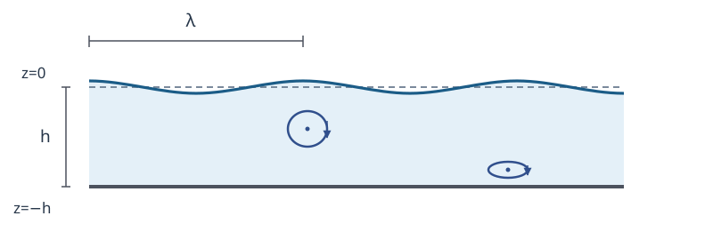

# FLUID27 水面波の伝播速度は波長でなぜ変わるか

## この講義で解決すること

[FLUID26 の Young–Laplace の式](../FLUID26/index.md#thm-fluid26-young-laplace)は曲がった界面に圧力差が生じることを教えた。一方、[FLUID11 の速度ポテンシャル](../FLUID11/index.md#def-fluid11-velocity-potential)を使えば、渦のない流れを一つの関数から表せる。これらを合わせると、**小さな水面の揺れがどの速さで進むか**を自由表面の境界条件から決定できる。

水深が波長と同程度なら底の存在が効き、短い波では表面張力も効く。「重力波は長いほど速い」とだけ覚えると、浅い水や毛管波で誤る。本講義では非圧縮・非粘性・非回転の線形模型を選び、有限水深の分散関係を導き、深水・浅水の極限と流体粒子の運動まで自分で検算する。二つの波の重ね合わせは観察するが、その包絡とエネルギーの輸送速度の定量化は次講で扱う。

## 0. 自由表面を動かす模型

水平座標を $x$、鉛直上向きを $z$、時刻を $t$ とする。静止した一様液体の平均水面を $z=0$、水平な不透過底面を $z=-h$ とする。水深は $h>0$ である。

実際の水面は $z=\eta(x,t)$ であり、液体領域は $-h<z<\eta(x,t)$ となる。液体密度 $\rho>0$、重力加速度の大きさ $g>0$、一枚の液体‐気体界面の一様な表面張力 $\gamma\ge0$ は定数とする。

上側の気体圧力は一定の $p_a$ とし、気体の密度・慣性・粘性・風の影響は無視する。液体は非圧縮・非粘性で、二次元の単連結領域内では無渦である。

ここでの $h$ は**平均水深**、$\eta$ はその平均位置からの**符号付き変位**である。$\eta>0$ は山、$\eta<0$ は谷を意味する。

速度場を $u=(u_x,u_z)$ と書き、[速度ポテンシャルの定義](../FLUID11/index.md#def-fluid11-velocity-potential)と同じ勾配表示を二次元の $(x,z)$ 座標へ適用して

$$
u_x=\partial_x\phi,\qquad u_z=\partial_z\phi
$$

と置く。以下、$\eta_x=\partial\eta/\partial x$、$\eta_t=\partial\eta/\partial t$ は他方の変数を固定した偏微分、$\phi_z=\partial\phi/\partial z$ や $\phi_{xx}=\partial_x(\partial_x\phi)$ も残りの変数を固定した偏微分を表す。下付き添字 $x,z,t$ は微分する変数を示し、速度成分を表す $u_x,u_z$ とは役割が異なる。

液体内部の質量保存 $\partial_xu_x+\partial_zu_z=0$ と合わせると

$$
\partial_{xx}\phi+\partial_{zz}\phi=0
\qquad(-h<z<\eta(x,t))
$$

である。底面は動かないので、そこを通り抜けない条件は

$$
\partial_z\phi(x,-h,t)=0.
$$

波長 $\lambda>0$ は隣り合う山の水平距離であり、対応する波数 $k=2\pi/\lambda$ は波長が短いほど大きい。角周波数 $\omega>0$ は波の位相 $kx-\omega t$ が時間とともに変化する速さである。これらの関係は後で周期と合わせて定義する。

**小さな振幅を仮定する際の条件**：代表振幅 $a>0$、波数 $k>0$ に対して $ka\ll1$ と $a/h\ll1$ を要求する。

水平勾配、速度の二乗、変位した位置 $z=\eta$ で評価することによる二次の補正を捨て、すべての境界式を**静止水面 $z=0$** で評価する。これは有限振幅の砕波や流れの剥離を扱う模型ではない。

## 1. 水面で何を釣り合わせるか

### 1.1 自由表面は流体粒子とともに動く

表面を表す関数 $F(x,z,t)=z-\eta(x,t)$ は、水面上の粒子を追う間は零であり続ける。粒子位置を $(x(t),z(t))$ と書けば $dx/dt=u_x$、$dz/dt=u_z$ である。$DF/Dt$ はこの軌道上での常微分 $dF(x(t),z(t),t)/dt$ を表す。連鎖律によって

$$
0=\frac{DF}{Dt}=F_t+u_xF_x+u_zF_z
=-\eta_t-u_x\eta_x+u_z.
$$

ゆえに正確な運動学的境界条件は $\eta_t+u_x\eta_x=u_z$（$z=\eta$）である。$u_x\eta_x$ は小振幅の二次項、$z=\eta$ と $z=0$ での速度差も一次解の評価では二次の寄与になるので、線形化すると

$$
\boxed{\eta_t=\phi_z\quad(z=0).}
$$

この式は**水面の高さの時間変化が、水面位置での鉛直速度に等しい**ことを表す。動かない底面の条件とは区別する。

### 1.2 水面の圧力は曲率によって変わる

[向き付き全曲率](../FLUID26/index.md#def-fluid26-oriented-curvature)の規約では、液体が下側にあるグラフ面 $z=\eta(x,t)$ の上向き法線は

$$
n=\frac{(-\eta_x,1)}{\sqrt{1+\eta_x^2}},
\qquad
\kappa_\Sigma=-\frac{\eta_{xx}}{(1+\eta_x^2)^{3/2}}.
$$

曲率は面外方向に一定の二次元断面を考え、面外方向の主曲率が零であることを使った。[Young–Laplace の圧力跳躍](../FLUID26/index.md#thm-fluid26-young-laplace)を液体側から気体側へ適用すると

$$
p_l-p_a=\gamma\kappa_\Sigma
\simeq-\gamma\eta_{xx}\quad(z=0).
$$

波の山 $\eta=a\cos(kx-\omega t)$ では $\eta_{xx}=-k^2\eta$ なので、山の頂点では $\gamma>0$ なら液体側の圧力が高い。曲率の符号を誤ると、後で表面張力が不安定化するという誤った分散式が現れる。

液体内部では、[一定密度 Euler 方程式](../FLUID6/index.md#thm-fluid6-euler-equation)が成り立つ。$u=\nabla\phi$ を代入する。ここで $\nabla=(\partial_x,\partial_z)$ は空間微分であり、$\partial_t$ は空間座標を固定する時間偏微分である。

$\phi$ が二階連続微分可能なら、各 $i\in\{x,z\}$ について

$$
\begin{aligned}
((u\cdot\nabla)u)_i
&=\sum_{j\in\{x,z\}}(\partial_j\phi)(\partial_j\partial_i\phi)\\
&=\partial_i\!\left[\frac12\bigl((\partial_x\phi)^2+(\partial_z\phi)^2\bigr)\right].
\end{aligned}
$$

従って $(u\cdot\nabla)u=\nabla(|\nabla\phi|^2/2)$、また $\partial_tu=\nabla\phi_t$ だから、Euler 方程式は

$$
\nabla\left(\phi_t+\frac12|\nabla\phi|^2+\frac{p_l}{\rho}+gz\right)=0.
$$

領域は連結だから括弧内は時刻だけの関数 $C(t)$ である。$\phi$ に時刻だけの関数を加えても速度は変わらないので、その時間微分を調整し、$C(t)=p_a/\rho$ と選べる。これが**非定常ポテンシャル流**の Bernoulli 関係である。[定常流線上の Bernoulli 積分](../FLUID6/index.md#thm-fluid6-streamline-bernoulli)を、非定常波へ仮定抜きで直接流用してはいけない。

水面 $z=\eta$ に代入して $p_l-p_a$ の式を用いると

$$
\phi_t+\frac12|\nabla\phi|^2+g\eta
-\frac{\gamma}{\rho}
\frac{\eta_{xx}}{(1+\eta_x^2)^{3/2}}=0
\quad(z=\eta).
$$

小振幅の一次だけ残す。例えば $\phi_t(x,\eta,t)=\phi_t(x,0,t)+\eta\,\phi_{tz}(x,0,t)+\cdots$ である。静止状態の周りでは $\eta$ と $\phi_t$ はともに一次の摂動だから、積 $\eta\phi_{tz}$ は二次となる。$ka\ll1$ と $a/h\ll1$ によって水平・鉛直の評価位置の補正を捨て、水面を $z=0$ で評価すれば

$$
\boxed{\phi_t+g\eta-\frac{\gamma}{\rho}\eta_{xx}=0
\quad(z=0).}
$$

これが線形の力学的境界条件である。**重力による復元**は $g\eta$、**表面張力による復元**は $-\gamma\eta_{xx}/\rho$ から来る。

<a id="prop-fluid27-linear-boundary"></a>

<!-- formal-statement-start -->
> **命題（線形自由表面条件）**  
> 水深 $h>0$、密度 $\rho>0$、重力 $g>0$、一様表面張力 $\gamma\ge0$ の二次元・非圧縮・非粘性・無渦液体を考える。
>
> 一定気圧の下で小振幅 $ka\ll1,\ a/h\ll1$ の静止状態まわりに一次線形化する。平均水面 $z=0$、底面 $z=-h$ とする。このとき速度ポテンシャル $\phi$ と水面変位 $\eta$ は次の境界値問題を満たす。

$$
\begin{cases}
\phi_{xx}+\phi_{zz}=0,&-h<z<0,\\
\phi_z=0,&z=-h,\\
\eta_t=\phi_z,&z=0,\\
\phi_t+g\eta-(\gamma/\rho)\eta_{xx}=0,&z=0.
\end{cases}
$$

> 時刻だけのポテンシャルの自由度は一定の気圧を基準として固定した。これらは線形化した模型の条件であり、有限振幅の正確な自由表面方程式ではない。
<!-- formal-statement-end -->

**直接確認**：$\eta=0$、$\phi=0$ とすれば内部の Laplace 方程式、底面の非貫通、二つの水面条件はいずれも $0=0$ となる。これが摂動を加える元の静止解である。次節ではこの四条件を同時に満たす非自明な波を構成する。

## 2. 波数と位相速度を先に定める

水面が山から次の山へ進む水平距離を波長 $\lambda>0$ とし、山が一定時間に進む速さを読みたい。位相 $\theta=kx-\omega t$ を固定して山を追うために、波数と角周波数を導入する。

<a id="def-fluid27-wavenumber"></a>

<!-- formal-statement-start -->
> **定義（波数・角周波数・周期）**  
> 振幅 $a>0$ の右進行波を次の形で表す。

$$
\eta(x,t)=a\cos(kx-\omega t).
$$

> その空間周期を波長 $\lambda>0$ といい、波数 $k>0$、角周波数 $\omega>0$、時間周期 $T>0$ を次の式で結ぶ。

$$
k=\frac{2\pi}{\lambda},\qquad T=\frac{2\pi}{\omega}.
$$

> $k$ の単位は rad/m（ラジアンは無次元）、$\omega$ の単位は rad/s である。
<!-- formal-statement-end -->

<!-- definition-example-start: def-fluid27-wavenumber -->
**定義の確認**：$\lambda=2$ m、$k=\pi$ m$^{-1}$ なら $k(x+\lambda)-\omega t=(kx-\omega t)+2\pi$。従って任意の $x,t$ で $\eta(x+\lambda,t)=\eta(x,t)$。同様に $t+T$ では位相が $-2\pi$ 変化するので $\eta(x,t+T)=\eta(x,t)$。波長と周期の**両条件**を直接満たす。
<!-- definition-example-end -->

一定の位相 $\theta(x(t),t)=\theta_0$ を追う。ここで $x(t)$ は山など同じ位相の点の位置であり、流体粒子の軌道とは限らない。偏微分を含む連鎖律を使うと

$$
0=\frac{d}{dt}\theta(x(t),t)
=\frac{\partial\theta}{\partial x}\frac{dx}{dt}
+\frac{\partial\theta}{\partial t}
=k\frac{dx}{dt}-\omega.
$$

$k>0$ だから $dx/dt=\omega/k$ が進行速度である。

<a id="def-fluid27-phase-speed"></a>

<!-- formal-statement-start -->
> **定義（位相速度）**  
> 波数 $k>0$、角周波数 $\omega>0$ の右進行平面波 $\cos(kx-\omega t)$ において、位相が一定の点の速度

$$
c_p=\frac{\omega}{k}
$$

> を位相速度という。単位は m/s。これは波の山など**位相を一定に保つ点**の移動速度であり、個々の流体粒子の恒常的な移流速度を意味しない。
<!-- formal-statement-end -->

<!-- definition-example-start: def-fluid27-phase-speed -->
**定義の確認**：$k=2$ m$^{-1}$、$\omega=6$ s$^{-1}$ の波では山の位相を $2x-6t=0$ と置ける。時刻 $t=0$ で $x=0$ の山が、$t=1$ s に $x=3$ m へ動く。従って $dx/dt=3$ m/s であり、$\omega/k=6/2=3$ m/s と一致する。
<!-- definition-example-end -->

## 3. 底面を満たすポテンシャルから分散式を導く

水面の候補を $\eta=a\cos(kx-\omega t)$ と置く。対応する $\phi$ は、内部の Laplace 方程式を満たし、底面で鉛直速度が零になるように作る。

水平依存を $\sin(kx-\omega t)$ とし、$\phi=Z(z)\sin(kx-\omega t)$ と仮定する。ここで $Z(z)$ は鉛直座標だけの未知関数、$Z'$ と $Z''$ は $z$ に関する常微分である。

$\phi_{zz}$ は $x,t$ を固定して二度偏微分するので $Z''(z)\sin(kx-\omega t)$ となる。実際、

$$
\phi_{xx}=-k^2Z(z)\sin\theta,\qquad
\phi_{zz}=Z''(z)\sin\theta.
$$

ゆえに $Z''-k^2Z=0$。一般解 $Z=A\cosh(k(z+h))+B\sinh(k(z+h))$ の導関数は

$$
Z'(z)=kA\sinh(k(z+h))+kB\cosh(k(z+h)).
$$

底面 $z=-h$ では $Z'(-h)=kB=0$ なので $B=0$。このように**底面からの距離 $z+h$** を使えば、底面条件を手で確認できる。

<a id="thm-fluid27-dispersion"></a>

<!-- formal-statement-start -->
> **定理（有限水深の重力・毛管波の分散関係）**  
> [線形自由表面条件](#prop-fluid27-linear-boundary)を満たす二次元液体を考え、$h,\rho,g>0$、$\gamma\ge0$、$k,a,\omega>0$ とする。右向き単色波

$$
\eta(x,t)=a\cos(kx-\omega t)
$$

> に対して非自明な速度ポテンシャルが存在するための条件は

$$
\boxed{\omega^2=
\left(gk+\frac{\gamma}{\rho}k^3\right)\tanh(kh).}
$$

> この条件が成り立つなら、速度ポテンシャルを

$$
\boxed{\phi(x,z,t)=
\frac{a\omega}{k\sinh(kh)}
\cosh(k(z+h))\sin(kx-\omega t)}
$$

> と選べる。$-h\le z\le0$ でこの式は線形化した境界値問題の解を与える。$\omega>0$ を採用したため右進行波となり、$\omega<0$ の枝はここでは取らない。
<!-- formal-statement-end -->

### 証明の見取り図

内部の調和条件と底面での鉛直速度零から鉛直形状 $\cosh(k(z+h))$ が決まる。次に水面の運動学的条件で係数を定め、力学的条件へ代入すると $\omega$ と $k$ の関係が決まる。一方だけの水面条件では分散式は得られない。

<!-- proof-start -->
### 証明

内部方程式と底面条件から、上で導いた形 $\phi=A\cosh(k(z+h))\sin\theta$ を用いる（$\theta=kx-\omega t$）。偏微分を順に計算すると

$$
\phi_x=Ak\cosh(k(z+h))\cos\theta,\quad
\phi_z=Ak\sinh(k(z+h))\sin\theta,
$$

$$
\phi_{xx}=-Ak^2\cosh(k(z+h))\sin\theta,\quad
\phi_{zz}=Ak^2\cosh(k(z+h))\sin\theta.
$$

従って $\phi_{xx}+\phi_{zz}=0$、$\phi_z(-h)=Ak\sinh0\sin\theta=0$。次に $\eta_t=a\omega\sin\theta$ なので、水面の運動学的条件 $\eta_t=\phi_z(0)$ は

$$
a\omega\sin\theta=Ak\sinh(kh)\sin\theta.
$$

任意の $\theta$ で成立するため係数は $a\omega=Ak\sinh(kh)$。$k,h>0$ より $\sinh(kh)>0$ なので

$$
A=\frac{a\omega}{k\sinh(kh)}
$$

と定まる。時間微分と曲率の線形項はそれぞれ

$$
\phi_t(0)=-A\omega\cosh(kh)\cos\theta,\qquad
\eta_{xx}=-ak^2\cos\theta.
$$

力学的境界条件へ代入すると、全位相について

$$
-A\omega\cosh(kh)+ga+
\frac{\gamma}{\rho}ak^2=0.
$$

ここに $A$ を代入し、$a>0$ で割ると

$$
-\frac{\omega^2}{k}
\frac{\cosh(kh)}{\sinh(kh)}
+g+\frac{\gamma}{\rho}k^2=0.
$$

$\cosh(kh)/\sinh(kh)=1/\tanh(kh)$ を使い、$k\tanh(kh)>0$ を掛けると

$$
\omega^2=\left(gk+\frac{\gamma}{\rho}k^3\right)\tanh(kh).
$$

逆にこの関係を満たす $\omega>0$ と上の $\phi,\eta$ は、示した微分計算によって内部・底面・二つの水面条件すべてを満たす。従って必要性と十分性が示された。
<!-- proof-end -->

**なぜ波長で速さが変わるか**：[位相速度の定義](#def-fluid27-phase-speed)に代入すると

$$
\boxed{c_p^2=
\left(\frac gk+\frac{\gamma}{\rho}k\right)\tanh(kh).}
$$

$k=2\pi/\lambda$ なので、波長を変えると重力項 $g/k$ は逆方向に、表面張力項 $\gamma k/\rho$ は同方向に変わる。さらに底の影響を表す $\tanh(kh)$ も変化する。三つの作用が競合するため、全ての波で「長いほど速い」とは言えない。

## 4. 深水と浅水は何を意味するか

波長そのものの大小ではなく、無次元量 $kh=2\pi h/\lambda$ によって、波が底を強く感じるかを区別する。界面の重力と表面張力の比は、先の分散式の二項から

$$
\frac{\text{毛管項}}{\text{重力項}}
=\frac{\gamma k^3/\rho}{gk}
=\frac{\gamma k^2}{\rho g}.
$$

この比は [FLUID26 の毛管長](../FLUID26/index.md#def-fluid26-capillary-length)と直接結びつく。上側気体の密度を無視した本模型では $\Delta\rho\simeq\rho$ と考え、$\gamma>0$ の場合に限り次の尺度を使う。

<a id="def-fluid27-crossover"></a>

<!-- formal-statement-start -->
> **定義（重力・毛管の交差波数）**  
> $\gamma>0$、$\rho>0$、$g>0$ に対し、重力項と毛管項の係数が等しくなる波数

$$
k_c=\sqrt{\frac{\rho g}{\gamma}}>0,\qquad
\lambda_c=\frac{2\pi}{k_c}
$$

> を交差波数および交差波長とする。$k\ll k_c$ なら重力項が優勢、$k\gg k_c$ なら毛管項が優勢である。$k_c=1/\ell_c$ は上側気体を無視した毛管長 $\ell_c=\sqrt{\gamma/(\rho g)}$ の逆数である。
<!-- formal-statement-end -->

<!-- definition-example-start: def-fluid27-crossover -->
**定義の確認**：$k=k_c$ を比に代入すると

$$
\frac{\gamma k_c^2}{\rho g}
=\frac{\gamma}{\rho g}\frac{\rho g}{\gamma}=1.
$$

また $k=2k_c$ ならこの比は $4$、$k=k_c/2$ なら $1/4$ となり、「毛管優勢」と「重力優勢」を式から直接判定できる。$k_c$ は**両復元項の交点**であり、有限水深における位相速度の極小位置であるとは限らない。
<!-- definition-example-end -->

<a id="prop-fluid27-depth-limits"></a>

<!-- formal-statement-start -->
> **命題（深水・浅水の位相速度）**  
> 有限水深の[重力・毛管波分散関係](#thm-fluid27-dispersion)で $k,h,\rho,g>0$、$\gamma\ge0$ とする。深水では $k$ を固定して $h\to\infty$、浅水では $h,\rho,g,\gamma$ を固定して $k\to0$ とする。
>
> **（D）深水極限**：$kh\to\infty$ で

$$
c_p^2\sim\frac gk+\frac{\gamma}{\rho}k.
$$

> **（S）浅水極限**：$kh\to0$ で

$$
c_p^2=gh+
\left(\frac{\gamma h}{\rho}-\frac{gh^3}{3}\right)k^2+O(k^4)
$$

> が $h,\rho,g,\gamma$ 固定で $k\to0$ のとき成り立つ。特に $\gamma=0$ なら浅水の主項は $c_p\sim\sqrt{gh}$ であり、波数によらない。
<!-- formal-statement-end -->

### 証明の見取り図

深水では $\tanh(kh)\to1$。浅水では $\tanh q=q-q^3/3+O(q^5)$ を使う。重力項 $g/k$ があっても、先頭の $kh$ と積になるため有限の $gh$ が残る。

<!-- proof-start -->
### 証明

$kh\to\infty$ なら $\tanh(kh)\to1$ なので、[位相速度の式](#thm-fluid27-dispersion)の右辺から直ちに（D）が従う。浅水では $q=kh\to0$ と置く。$\sinh q=q+q^3/6+O(q^5)$ と $\cosh q=1+q^2/2+O(q^4)$ の商から

$$
\tanh q=q\frac{1+q^2/6+O(q^4)}{1+q^2/2+O(q^4)}
=q\left(1-\frac{q^2}{3}+O(q^4)\right)
$$

を得る。これを代入して二つの復元項を別々に掛けると

$$
\begin{aligned}
c_p^2
&=\left(\frac gk+\frac{\gamma}{\rho}k\right)
\left(kh-\frac{k^3h^3}{3}+O(k^5)\right)\\
&=gh-\frac{gh^3}{3}k^2+
\frac{\gamma h}{\rho}k^2+O(k^4).
\end{aligned}
$$

$\gamma=0$ なら $c_p^2=gh+O(k^2)$、$g,h>0$ より正の平方根を取って $c_p\to\sqrt{gh}$ を得る。
<!-- proof-end -->

重力だけなら、深水では $c_p\sim\sqrt{g/k}$ なので長い波が速い。一方、深水で毛管項が優勢なら $c_p\sim\sqrt{\gamma k/\rho}$ なので**短い波ほど速い**。

浅水での $c_p\simeq\sqrt{gh}$ は「浅い海ではどの波長も厳密に同じ速度」という意味ではなく、$kh\ll1$ の主近似である。上の $k^2$ 補正まで残せば位相速度の波数依存性が見える。

### 例：深水の速さが最小になる長さ

$h\to\infty$ として $\gamma>0$ なら $c_p^2=g/k+\gamma k/\rho$。正の $k$ に関する微分は

$$
\frac{d(c_p^2)}{dk}
=-\frac{g}{k^2}+\frac{\gamma}{\rho},
\qquad
\frac{d^2(c_p^2)}{dk^2}=\frac{2g}{k^3}>0.
$$

従って深水極限の最小値は $k=k_c$ で生じ、

$$
c_{p,\min}^2=2\sqrt{\frac{g\gamma}{\rho}},
\qquad
c_{p,\min}=\left(\frac{4g\gamma}{\rho}\right)^{1/4}.
$$

**この極小位置の結論は深水極限に限る。** 有限水深では $\tanh(kh)$ の $k$ 微分も含まれるため、単純に交差波数が極小とは言えない。

## 5. 波とともに水粒子も水平に進むのか

[速度ポテンシャル](#thm-fluid27-dispersion)を微分すると、一次の水平・鉛直速度は

$$
u_x=\frac{a\omega\cosh(k(z+h))}{\sinh(kh)}\cos\theta,
\qquad
u_z=\frac{a\omega\sinh(k(z+h))}{\sinh(kh)}\sin\theta.
$$

波が右へ進んでも、固定された平均位置 $(x_0,z_0)$ の流体粒子は一次近似では前後・上下に振動する。粒子のずれを $(\xi(t),\zeta(t))$ とすると、実際の粒子位置は $(x_0+\xi(t),z_0+\zeta(t))$ である。

速度場と変位はともに一次の小量なので、速度の評価位置を変位させたことによる補正は二次である。従って一次では

$$
\dot\xi=\frac{d\xi}{dt}=u_x(x_0,z_0,t),\qquad
\dot\zeta=\frac{d\zeta}{dt}=u_z(x_0,z_0,t)
$$

を時間積分する。点付き記法は、時間だけで動く粒子変位の**常微分**を表す。

<a id="prop-fluid27-particle-orbit"></a>

<!-- formal-statement-start -->
> **命題（線形波に伴う粒子の楕円軌道）**  
> [有限水深の重力・毛管波](#thm-fluid27-dispersion)の一次近似を考える。平均粒子位置 $(x_0,z_0)$ は $-h\le z_0\le0$ とする。振動の時間平均を零に選ぶと、一次の粒子変位は

$$
\xi(t)=-a\frac{\cosh(k(z_0+h))}{\sinh(kh)}
\sin(kx_0-\omega t),
$$

$$
\zeta(t)=a\frac{\sinh(k(z_0+h))}{\sinh(kh)}
\cos(kx_0-\omega t).
$$

> $z_0>-h$ では半軸比（鉛直振幅／水平振幅）が $\tanh(k(z_0+h))$ の楕円を描き、底面 $z_0=-h$ では鉛直変位は零となる。これは一次の粒子変位であり、二次の Stokes 漂流の有無については結論しない。
<!-- formal-statement-end -->

### 証明の見取り図

固定平均位置で速度を評価し、$\partial_t\sin(kx_0-\omega t)=-\omega\cos(kx_0-\omega t)$ と $\partial_t\cos(kx_0-\omega t)=\omega\sin(kx_0-\omega t)$ を使って時間積分する。

<!-- proof-start -->
### 証明

$\theta_0=kx_0-\omega t$ と書く。提示した $\xi$ を微分すると

$$
\dot\xi=-a\frac{\cosh(k(z_0+h))}{\sinh(kh)}
(-\omega\cos\theta_0)
=u_x(x_0,z_0,t).
$$

同様に

$$
\dot\zeta=a\frac{\sinh(k(z_0+h))}{\sinh(kh)}
(\omega\sin\theta_0)
=u_z(x_0,z_0,t).
$$

$\omega>0$ なので一周期平均は両方とも零。$z_0>-h$ なら二つの振幅

$$
A_x=a\frac{\cosh(k(z_0+h))}{\sinh(kh)}>0,\quad
A_z=a\frac{\sinh(k(z_0+h))}{\sinh(kh)}>0
$$

に対して $(\xi/A_x)^2+(\zeta/A_z)^2=\sin^2\theta_0+\cos^2\theta_0=1$。比は $A_z/A_x=\tanh(k(z_0+h))$。$z_0=-h$ では $\sinh0=0$ なので $A_z=0$、$\zeta=0$。これは底面条件とも一致する。
<!-- proof-end -->



図では隣り合う山の距離が波長 $\lambda$、破線から底面までの距離が平均水深 $h$ である。粒子の楕円は軌道の形を見やすくするため実際の波面振幅に対して拡大して描いた。楕円の半軸比は[粒子軌道の式](#prop-fluid27-particle-orbit)で決まり、図の見かけの長さを測って数値計算してはいけない。

深水で $kh\gg1$、底から十分離れていれば $A_x\simeq A_z\simeq a e^{kz_0}$ で、粒子軌道はほぼ円になる。

浅水で $kh\ll1$ の水面付近では $A_z/A_x\simeq kh\ll1$ だから横長の楕円になる。いずれも**波の位相速度**と**粒子の平均速度**を混同してはならない。

## 6. ブラウザで分散関係と二波の重ね合わせを確かめる

下の Python は[分散関係](#thm-fluid27-dispersion)を直接計算し、波長に対する位相速度と、近い二つの波数 $k$ と $1.10k$ の**線形な重ね合わせ**を一つの実行結果に描く。

表面形状は $t=0$ と搬送波の一周期後 $t=T$ の二枚の曲線で比較する。これは水面形状の標本化であり、流体力学の非線形時間発展シミュレーションではない。

数値欄には $kh$、毛管／重力項の比、位相速度、重力だけにした比較、および**力学的水面条件の相対残差**も表示する。波長を短くするプリセットは $\gamma>0$ の効果を、浅い水深では $\tanh(kh)$ の効果を観察する。波形の重なりを見ても、包絡の速度をそのまま位相速度と断定しないこと。

```python-file-lab
# lab-id: FLUID27-DISPERSION
# lab-title: 有限水深の分散曲線と二波の線形重ね合わせ
# lab-file: textbook/volumes/dream_thater/物理系/FLUID/FLUID27/dispersion_lab.py
# timeout-ms: 15000
# lab-preset: 標準・水深40cm | --depth 0.4 --wavelength 1 --samples 240
# lab-preset: 浅水・水深5cm | --depth 0.05 --wavelength 1 --amplitude 0.001 --samples 240
# lab-preset: 短い毛管波 | --depth 0.4 --wavelength 0.03 --amplitude 0.0003 --samples 240
# lab-preset: 張力なし | --depth 0.4 --wavelength 1 --gamma 0 --samples 240
# lab-preset: 波形細分化 | --depth 0.4 --wavelength 1 --samples 480
```

[Pythonソースを閲覧](dispersion_lab.py)。二つの重ね合わせ曲線は $x/\lambda$ と $\eta/a$ を軸に取るため無次元である。サンプル点数だけを倍にして曲線が近づくことは**描画の標本化精度**の確認であり、分散関係そのものの数学的誤差評価ではない。

## 7. 演習

すべての問で波は右向き、$k>0,\omega>0$ とする。特記しない場合、平均水面 $z=0$、底面 $z=-h$、一定密度・非圧縮・非粘性・無渦、上側は一定気圧である。近似した箇所では、どの無次元量を小さいとみなしたかを書け。

### Level A

### A1. 波長・周期・深水の重力波

深水極限、表面張力なし、$g=9.8$ m/s$^2$ とする。波長 $\lambda=4\pi$ m の右向き波について、$k,\omega,c_p,T$ を求め、$c_p$ の単位を確認せよ。

- Level: A

<!-- solution-start -->
#### 詳細解答

[波数・角周波数・周期の定義](#def-fluid27-wavenumber)から $k=2\pi/(4\pi)=1/2$ m$^{-1}$。[深水極限](#prop-fluid27-depth-limits)で $\gamma=0$ なので

$$
\omega^2=gk=9.8\cdot\frac12=4.9\ {\rm s^{-2}},
\qquad \omega=\sqrt{4.9}\ {\rm s^{-1}}.
$$

[位相速度](#def-fluid27-phase-speed)と周期は

$$
c_p=\frac{\sqrt{4.9}}{1/2}=2\sqrt{4.9}=\sqrt{19.6}\ {\rm m/s},
\qquad T=\frac{2\pi}{\sqrt{4.9}}\ {\rm s}.
$$

$[\omega/k]=({\rm s^{-1}})/({\rm m^{-1}})={\rm m/s}$ で単位も適切である。
<!-- solution-end -->

### A2. 浅水近似の精度

$\gamma=0$、$h=0.25$ m、$\lambda=10$ m、$g=9.8$ m/s$^2$ とする。$kh$ を計算し、浅水位相速度の主項を求めよ。さらに $c_p^2/(gh)=\tanh(kh)/(kh)$ を使い、最初の補正の相対的な大きさを求めよ。

- Level: A

<!-- solution-start -->
#### 詳細解答

$k=2\pi/10=\pi/5$ m$^{-1}$ だから $kh=(\pi/5)(0.25)=\pi/20\simeq0.157$。$kh\ll1$ の範囲で[浅水極限](#prop-fluid27-depth-limits)を使えば

$$
c_p\simeq\sqrt{gh}=\sqrt{9.8(0.25)}
=\sqrt{2.45}\simeq1.565\ {\rm m/s}.
$$

$\tanh q/q=1-q^2/3+O(q^4)$ を $q=\pi/20$ に適用すると

$$
\frac{c_p^2}{gh}
=1-\frac{\pi^2}{1200}+O\!\left((\pi/20)^4\right)
\simeq1-0.00822.
$$

これは**速度の二乗**の相対補正で約 $-0.82\%$。速度自体は $\sqrt{1-\delta}=1-\delta/2+O(\delta^2)$（$\delta=\pi^2/1200$）より、相対補正が約 $-0.41\%$ となる。両者を混同しない。
<!-- solution-end -->

### A3. 波の山での圧力跳躍

$\eta(x,t)=a\cos(kx-\omega t)$、$a,k,\gamma>0$ とする。波の山と谷で液体側から気体側を引いた一次の圧力差を計算せよ。

- Level: A

<!-- solution-start -->
#### 詳細解答

[Young–Laplace の圧力跳躍](../FLUID26/index.md#thm-fluid26-young-laplace)と上向き法線の[曲率規約](../FLUID26/index.md#def-fluid26-oriented-curvature)から

$$
p_l-p_a\simeq-\gamma\eta_{xx},
\qquad\eta_{xx}=-ak^2\cos(kx-\omega t).
$$

よって $p_l-p_a\simeq\gamma ak^2\cos\theta$。山 $\cos\theta=1$ では $+\gamma ak^2$、谷 $\cos\theta=-1$ では $-\gamma ak^2$ である。表面張力が零なら両方零となる。
<!-- solution-end -->

### A4. 分散関係の次元

$g$ の単位を m/s$^2$、$\rho$ を kg/m$^3$、$\gamma$ を N/m とする。$gk$、$(\gamma/\rho)k^3$ および $\omega^2$ の単位が一致することを示せ。

- Level: A

<!-- solution-start -->
#### 詳細解答

$[k]={\rm m^{-1}}$ より $[gk]=({\rm m/s^2})({\rm m^{-1}})={\rm s^{-2}}$。$[\gamma]={\rm N/m}=({\rm kg\,m/s^2})/{\rm m}={\rm kg/s^2}$ なので

$$
\left[\frac{\gamma}{\rho}k^3\right]
=\frac{{\rm kg/s^2}}{{\rm kg/m^3}}\,{\rm m^{-3}}
={\rm s^{-2}}.
$$

$\tanh(kh)$ は $kh$ が無次元であるため無次元。従って右辺は s$^{-2}$、左辺の $[\omega^2]$ と一致する。
<!-- solution-end -->

### A5. 底面の粒子は上下に動くか

[線形粒子変位](#prop-fluid27-particle-orbit)を用い、$z_0=-h$ と $z_0=-h/2$ の鉛直／水平振幅比を求めよ。$kh=2$ のとき、後者を式のまま評価せよ。

- Level: A

<!-- solution-start -->
#### 詳細解答

[楕円軌道の命題](#prop-fluid27-particle-orbit)で半軸比は $\tanh(k(z_0+h))$。底面では $z_0+h=0$ なので $\tanh0=0$、すなわち鉛直振幅 $A_z=0$。一方 $z_0=-h/2$ では

$$
\frac{A_z}{A_x}=\tanh(kh/2).
$$

$kh=2$ を代入すると $\tanh1$（約 $0.762$）となる。底面で水平速度が零とは限らず、鉛直速度だけが零という境界条件と整合する。
<!-- solution-end -->

### Level B

### B1. 二つの自由表面条件を線形化する

液体が下にある $z=\eta(x,t)$ で、正確な運動学条件 $\eta_t+u_x\eta_x=u_z$、上向き法線に対する圧力跳躍 $p_l-p_a=-\gamma\eta_{xx}/(1+\eta_x^2)^{3/2}$、非定常ポテンシャル流の Bernoulli 関係を与える。$ka\ll1,\ a/h\ll1$ を仮定して $z=0$ 上の線形自由表面条件を導け。

- Level: B

<!-- solution-start -->
#### 詳細解答

まず $u=\nabla\phi$ だから運動学式は

$$
\eta_t+\phi_x(x,\eta,t)\eta_x=\phi_z(x,\eta,t).
$$

$\phi=O(a)$、$\eta=O(a)$ の一次摂動とし、$\eta_x=O(ka)$ だから積 $\phi_x\eta_x$ を二次として捨てる。水面位置での速度は $\phi_z(x,\eta,t)=\phi_z(x,0,t)+\eta\phi_{zz}(x,0,t)+\cdots$ と展開でき、後項は二次摂動なので捨てる。従って水面を平均位置で評価すれば

$$
\eta_t=\phi_z(x,0,t).
$$

一方 [圧力跳躍](../FLUID26/index.md#thm-fluid26-young-laplace)で $(1+\eta_x^2)^{-3/2}=1+O((ka)^2)$ とし、$p_l-p_a\simeq-\gamma\eta_{xx}$。Bernoulli 関係から定数気圧の基準を引くと

$$
\phi_t+\frac12|\nabla\phi|^2+
\frac{p_l-p_a}{\rho}+g\eta=0 \quad(z=\eta).
$$

速度の二乗を二次項として捨てる。$\phi_t(x,\eta,t)=\phi_t(x,0,t)+\eta\phi_{tz}(x,0,t)+\cdots$ の後項も二次摂動だから、評価位置を $z=0$ に替えられる。一次の圧力跳躍を代入して

$$
\phi_t+g\eta-\frac{\gamma}{\rho}\eta_{xx}=0 \quad(z=0)
$$

を得る。この二条件は[線形自由表面条件](#prop-fluid27-linear-boundary)に一致する。**気体圧力は一定**としたから $p_a$ の時間・空間変動項は現れない。
<!-- solution-end -->

### B2. 底面から分散式へ

$\eta=a\cos(kx-\omega t)$ と $\phi=Z(z)\sin(kx-\omega t)$ を仮定する。内部の Laplace 方程式、底面非貫通、両水面条件から $Z(z)$ と分散関係を求め、必要十分性を確認せよ。$a,k,\omega,h>0$ とする。

- Level: B

<!-- solution-start -->
#### 詳細解答

代入すると $\phi_{xx}+\phi_{zz}=(Z''-k^2Z)\sin\theta=0$。従って

$$
Z=A\cosh(k(z+h))+B\sinh(k(z+h)).
$$

底面で $Z'(-h)=kB=0$、$k>0$ より $B=0$。水面で $\eta_t=a\omega\sin\theta=Z'(0)\sin\theta=Ak\sinh(kh)\sin\theta$ なので

$$
A=\frac{a\omega}{k\sinh(kh)}.
$$

さらに $\phi_t(0)=-A\omega\cosh(kh)\cos\theta$、$\eta_{xx}=-ak^2\cos\theta$ を力学式へ入れると

$$
-A\omega\cosh(kh)+ga+(\gamma/\rho)ak^2=0.
$$

$A$ を代入して $a>0$ で割り、$\sinh(kh)/\cosh(kh)=\tanh(kh)$ を使えば

$$
\omega^2=(gk+\gamma k^3/\rho)\tanh(kh).
$$

逆にこの関係で定めた $\omega>0$ と $\phi=A\cosh(k(z+h))\sin\theta$ を選べば、直前の微分式がすべて逆に成り立ち、Laplace 式・底面・二水面条件を満たす。従って単なる必要条件でなく十分条件でもある。
<!-- solution-end -->

### B3. 深水波の位相速度の極小

$h\to\infty$、$g,\rho,\gamma>0$ とする。$c_p^2=g/k+\gamma k/\rho$ が最小になる $k>0$ を求め、$c_{p,\min}$ を示せ。また、有限水深で同じ極小波数だと断定できない理由を述べよ。

- Level: B

<!-- solution-start -->
#### 詳細解答

$k>0$ で平方根は単調増加だから $c_p$ の最小化は $c_p^2$ の最小化と同値である。[深水分散式](#prop-fluid27-depth-limits)から

$$
\frac{d(c_p^2)}{dk}
=-\frac{g}{k^2}+\frac{\gamma}{\rho}=0
\quad\Longleftrightarrow\quad
k^2=\frac{\rho g}{\gamma}.
$$

$k_c=\sqrt{\rho g/\gamma}>0$、二階導関数 $2g/k^3>0$、両端で $c_p^2\to\infty$ なのでこれが正の波数全体で一意に最小となる点である。代入すると

$$
c_{p,\min}^2=\frac{g}{k_c}+\frac{\gamma}{\rho}k_c
=2\sqrt{\frac{g\gamma}{\rho}},
\quad c_{p,\min}=(4g\gamma/\rho)^{1/4}.
$$

有限水深では $c_p^2=(g/k+\gamma k/\rho)\tanh(kh)$。$d(\tanh(kh))/dk=h/\cosh^2(kh)$ と積の微分を使えば

$$
\frac{d(c_p^2)}{dk}
=\left(-\frac{g}{k^2}+\frac{\gamma}{\rho}\right)\tanh(kh)
+\left(\frac gk+\frac{\gamma}{\rho}k\right)
\frac{h}{\cosh^2(kh)}.
$$

$k=k_c$ では第1項が零だが、$h,g,\rho,\gamma,k_c>0$ により第2項は正である。従って有限水深では交差波数と最小波数を同一視してはいけない。
<!-- solution-end -->

### B4. 浅水での最初の分散補正

$h,g,\rho>0$ と $\gamma\ge0$ を固定して $k\to0$ とする。$\tanh(kh)$ を三次まで展開し $c_p^2$ の $k^2$ 項を求めよ。さらに $\gamma>0$ なら、その係数が零となる水深を導け。

- Level: B

<!-- solution-start -->
#### 詳細解答

$\tanh q=(q+q^3/6+O(q^5))/(1+q^2/2+O(q^4))$。分母の逆数 $1-q^2/2+O(q^4)$ を掛けると

$$
\tanh q=q+q^3(1/6-1/2)+O(q^5)
=q-q^3/3+O(q^5).
$$

$q=kh$ とおき [位相速度の式](#thm-fluid27-dispersion)に代入すると

$$
\begin{aligned}
c_p^2
&=(g/k+\gamma k/\rho)
(kh-k^3h^3/3+O(k^5))\\
&=gh+\left(\gamma h/\rho-gh^3/3\right)k^2+O(k^4).
\end{aligned}
$$

$k^2$ 係数は $h(\gamma/\rho-gh^2/3)$。$h>0$ より零の条件は $h^2=3\gamma/(\rho g)$。従って

$$
h_{\mathrm{crit}}=\sqrt{\frac{3\gamma}{\rho g}}.
$$

ここでは $k^2$ の**主補正が相殺**されるだけで、全波数にわたって完全に無分散となるとは言えない。
<!-- solution-end -->

### Level C

### C1. 交差波数の有限水深波を再構成する

$\rho,g,\gamma>0$ を定数とし、$k=\sqrt{\rho g/\gamma}$ を選ぶ。平均水深 $h=1/k$、振幅 $a>0$ は $ka\ll1$ とする。次をすべて実行せよ。

1. $kh$ と重力・毛管項の比を求め、$\omega$ と位相速度 $c_p$ を求める。
2. $\eta=a\cos(kx-\omega t)$ に対応する $\phi$ を明記し、底面条件、運動学的条件、力学的条件の各々を直接確認する。
3. 同じ $k,h$ で $\gamma$ のみ零にした場合と位相速度を比較する。
4. 平均位置 $z_0=-h/2$ の粒子について、鉛直／水平振幅比を求め、位相速度をその粒子の平均水平速度としてはいけない理由を述べる。

- Level: C

<!-- solution-start -->
#### 詳細解答

1. $h=1/k$ だから $kh=1$。交差波数の定義より $\gamma k^2/(\rho g)=1$ なので $\gamma k^3/\rho=gk$。[分散関係](#thm-fluid27-dispersion)へ代入して

$$
\omega^2=(gk+gk)\tanh1=2gk\tanh1,\quad
\omega=\sqrt{2gk\tanh1}>0,
$$

$$
c_p=\omega/k=\sqrt{\frac{2g}{k}\tanh1}.
$$

2. $k,h,\omega>0$ なので $\sinh(kh)=\sinh1>0$。よって

$$
\phi(x,z,t)=\frac{a\omega}{k\sinh1}
\cosh(k(z+h))\sin(kx-\omega t)
$$

と定められる。$A=a\omega/(k\sinh1)$、$\theta=kx-\omega t$ と置けば

$$
\phi_{xx}=-Ak^2\cosh(k(z+h))\sin\theta,\quad
\phi_{zz}=+Ak^2\cosh(k(z+h))\sin\theta,
$$

ゆえに内部の Laplace 方程式を満たす。底面では $\phi_z(-h)=Ak\sinh0\sin\theta=0$。水面では

$$
\phi_z(0)=Ak\sinh1\sin\theta
=a\omega\sin\theta=\eta_t.
$$

さらに $\phi_t(0)=-A\omega\cosh1\cos\theta$、$\eta_{xx}=-ak^2\cos\theta$ だから、力学条件の左辺は

$$
\begin{aligned}
\phi_t+g\eta-(\gamma/\rho)\eta_{xx}
&=a\left[-\frac{\omega^2}{k}\coth1
+g+\frac{\gamma k^2}{\rho}\right]\cos\theta\\
&=a[-2g+g+g]\cos\theta=0.
\end{aligned}
$$

ここで $\omega^2=2gk\tanh1$ および $\coth1=1/\tanh1$ を用いた。

3. 同じ $k,h$ を保って $\gamma=0$ にした**別の模型**では $\omega_g^2=gk\tanh1$。従って $c_{p,g}^2=(g/k)\tanh1$ であり

$$
\frac{c_p}{c_{p,g}}=\sqrt{\frac{2g\tanh1/k}{g\tanh1/k}}=\sqrt2.
$$

気圧や水深も同時に変えて比較しているわけではない。

4. [粒子楕円軌道](#prop-fluid27-particle-orbit)から $z_0=-h/2$ の半軸比は

$$
\frac{A_z}{A_x}=\tanh(kh/2)=\tanh(1/2).
$$

水面の一定位相は右へ $c_p>0$ で進む。しかし一次の水平変位は $\xi=-A_x\sin(kx_0-\omega t)$ で、一周期後は同じ値へ戻る。従って一次の時間平均水平速度 $\langle\dot\xi\rangle_T=(\xi(T)-\xi(0))/T=0$。波の速さを粒子の平均移動速度と呼ぶことはできない。有限振幅の二次効果については、この一次模型だけでは判定できない。
<!-- solution-end -->

## まとめ

自由表面の運動学的条件は水面の動きと鉛直速度を結び、力学的条件は重力と表面張力を復元力として結ぶ。底の非貫通条件を満たす鉛直形状を選ぶことで、有限水深の分散式が導かれる。$kh$ は底の影響、$\gamma k^2/(\rho g)$ は毛管と重力の競合を表す。位相速度は「山の進む速さ」であり、粒子の運動や二波の包絡の移動とは別の問いである。
