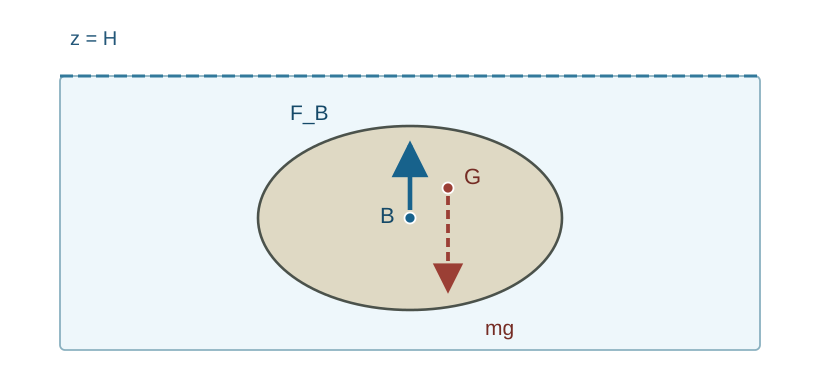

# FLUID3 浮力と静水安定性をどう計算するか

**前提講座（直接）**：[FLUID2 静止流体の圧力](../FLUID2/index.md)。以下では、必要な場所で前講の静水圧式と既習のCauchy表面力を参照する。

[FLUID2の静水圧方程式](../FLUID2/index.md#thm-fluid2-hydrostatic-balance)から、深さが増えると圧力が大きくなることを知った。ところが、物体の上面と下面で圧力を比較するだけでは、曲がった表面の合力や**力がどの位置に作用するか**がまだ分からない。本講の目標は、圧力の面積積分から浮力を出発し、物体全体の力とトルクを組み合わせて「浮くか」「傾けたとき戻るか」を判定することである。

## 0. 模型・法線・符号を固定する

三次元直交座標を $(x,y,z)$、固定原点から測る位置ベクトルを $r=(x,y,z)$ とする（[FLUID2](../FLUID2/index.md) の $\boldsymbol r$ と同じ位置を表す）。鉛直上向き単位ベクトルを $e_z$、高さを $z$ とし、重力は単位質量当たり $-ge_z$、$g>0$ とする。成分を用いるときは $x_1=x,x_2=y,x_3=z$、$e_1=e_x,e_2=e_y,e_3=e_z$ と書き、$\partial_i p=\partial p/\partial x_i$ は他の空間座標を固定した偏微分である。

外圧を一定の $p_a$ とし、静止した非圧縮液体の密度は、断りのない限り $\rho_f>0$（kg/m$^3$）で一定とする。自由表面を水平面 $z=H$ とし、表面張力・界面曲率圧力差、空気密度、外部支持力は無視する。

液体内部の圧力は[一定密度の深さと圧力](../FLUID2/index.md#cor-fluid2-constant-density)により

$$
p(z)=p_a+\rho_f g(H-z),\qquad z\le H.
$$

物体の占める閉領域を $K$、その表面から**物体の外側へ向く**単位法線を $n$ とする。[Cauchy表面力](../../CTM/CTM6/index.md#thm-ctm6-cauchy-stress)により、液体から物体への面力密度は $-pn$ である。法線を「液体の外法線」に取り違えると浮力の向きが反転する。圧力の単位は Pa = N/m$^2$、体積の単位は m$^3$、トルクの単位は N m。

## 1. 物体を押す圧力を全部足す

物体が液体の内部に完全に沈んでいても、圧力は上側で小さく下側で大きい。水平な上下二面なら差を引くだけでよい。しかし球や傾いた板でも同じ結果となるのはなぜだろう。

### 長方形の箱による先行例

高さ $a>0$、水平底面積 $A>0$ の直方体が、上面の深さ $h\ge0$ で液体中にある。上面への下向き力は $p(h)A$、下面への上向き力は $p(h+a)A$。側面の水平成分は対向面で打ち消し、鉛直成分は零だから

$$
F_z=[p(h+a)-p(h)]A
=[\rho_f g(h+a)-\rho_f gh]A
=\rho_f gAa.
$$

外圧 $p_a$ と上面深さ $h$ が消えた。直方体以外にも成立することを示すには、面法線の方向を一括して扱う必要がある。

<!-- formal-statement-start -->
### 定理（Archimedes の原理：完全水没）

有界で区分的に滑らかな境界をもち、座標方向のグラフ領域に有限分割できる物体領域 $K\subset\mathbb R^3$ が、一様密度 $\rho_f>0$ の静止液体に完全に囲まれているとする。重力は $-ge_z$（$g>0$）、液体は[静止等方圧力状態](../FLUID2/index.md#def-fluid2-static-isotropic-state)で静水圧方程式を満たすとする。体積を $V=|K|$、外法線を $n$ とすれば、液体から物体に働く圧力の合力は

$$
\boxed{F_B=-\int_{\partial K}p n\,dS=\rho_f gV e_z.}
$$

この力は、液体が占めていたはずの**排除体積**の液体の重さに等しく、鉛直上向きである。
<!-- formal-statement-end -->

### 証明の見取り図

[静水圧方程式](../FLUID2/index.md#thm-fluid2-hydrostatic-balance)は圧力の勾配を与える。一方、閉曲面の法線を掛けた圧力の面積積分は、[Gauss--Ostrogradsky の発散定理](../../../幾何系/VC/VC4/index.md#thm-vc4-gauss-divergence)を各座標成分へ適用すれば体積内の圧力勾配の積分に移せる。物体の内部は液体でなくても、同じ圧力式を**計算のために延長**できる。

<!-- proof-start -->
### 証明

物体の近傍で成立するアフィン関数 $p(x,y,z)=c-\rho_f gz$ を、物体の内部に数学的に延長する。これは物体内部の実際の応力を仮定する操作ではなく、境界上の既知の圧力値を保つ補助関数の選択である。

上記の[発散定理](../../../幾何系/VC/VC4/index.md#thm-vc4-gauss-divergence)を $p e_i$（$i=1,2,3$）に適用する。$K$ は区分的に滑らかな境界をもつ有限分割可能な領域、延長した $p$ はその閉包近傍で $C^1$ であるため適用できる。$e_i$ が一定なので $\operatorname{div}(p e_i)=\partial_i p$ であり、

$$
\int_{\partial K}p n_i\,dS
=\int_{\partial K}(p e_i)\cdot n\,dS
=\int_K\partial_i p\,dV.
$$

三成分をまとめると

$$
-\int_{\partial K}p n\,dS
=-\int_K\nabla p\,dV.
$$

[静水圧方程式](../FLUID2/index.md#thm-fluid2-hydrostatic-balance)により $\nabla p=-\rho_f ge_z$ であり、$\rho_f,g$ は一定なので

$$
F_B=\int_K\rho_f ge_z\,dV
=\rho_f ge_z\int_KdV
=\rho_f gVe_z.
$$

この結論の体積 $V$ は物体の**全体積**であり、質量・材料密度を使っていない。$\square$
<!-- proof-end -->

### 直接検算：水没した角柱

上の箱で $A=0.30$ m$^2$、$a=0.20$ m、$\rho_f=1000$ kg/m$^3$、$g=9.8$ m/s$^2$ なら $V=0.060$ m$^3$ だから

$$
F_B=1000\cdot9.8\cdot0.060=588\ {\rm N}.
$$

圧力差からも $\Delta p=\rho_f ga=1960$ Pa、$\Delta p A=1960\cdot0.30=588$ N。深さを変えても一様密度なら同じ浮力になるが、深いほど**各面の絶対圧自体**は大きい。

## 2. 浮力はどこに作用するか

合力だけが分かっても物体の回転を判定できない。基準点 $O$ の位置ベクトルを $r_O$ とし、物体表面の点の $O$ からの相対位置を $r-r_O$ と書く。圧力のトルクは $\tau_B(O)=-\int_{\partial K}(r-r_O)\times (pn)\,dS$ である。液体で置き換えた体積の幾何学的な中心を、浮力の作用線の代表点として求めたい。

<!-- formal-statement-start -->
### 定義（浮心）

一様密度の静止液体が排除された体積領域 $D$（体積 $V_D>0$）に対し、

$$
\boxed{r_B=\frac1{V_D}\int_D r\,dV}
$$

で定まる点 $B$ を**浮心**という。ここで $r$ と $r_B$ はともに第0節で固定した原点からの位置ベクトルであり、基準点 $O$ からの相対位置は $r_B-r_O$ である。完全水没なら $D=K$、自由表面を貫く物体なら $D=K\cap\{z\le H\}$（浸水領域）とする。重心 $G$ は物体自身の質量分布による中心であり、一般に浮心と一致しない。
<!-- formal-statement-end -->

<!-- definition-example-start: def-fluid3-center-buoyancy -->
### **定義の確認**：一様な直方体の浮心

原点を角柱の底面中央に置き、底面を $-a/2\le x\le a/2$、$-b/2\le y\le b/2$、高さを $0\le z\le d$ とする。体積は $V_D=abd>0$。対称性と積分から

$$
\int_D x\,dV=\int_D y\,dV=0,\qquad
\int_D z\,dV=ab\int_0^d z\,dz=\frac{abd^2}{2}.
$$

従って $r_B=(0,0,d/2)$。これは指定した体積領域の積分を実際に計算した結論であり、物体の質量密度が一様かどうかを問わない。
<!-- definition-example-end -->

<!-- formal-statement-start -->
### 命題（静水圧合力の作用線）

[Archimedes の原理](#thm-fluid3-archimedes)の仮定の下で、任意の基準点 $O$ に関し圧力のトルクは

$$
\boxed{\tau_B(O)=(r_B-r_O)\times(\rho_f gV e_z).}
$$

従って浮力の作用線は浮心 $B$ を通る鉛直線である（同じ作用線上のどの点でも同じトルクを与える）。
<!-- formal-statement-end -->

### 証明の見取り図

力に位置を掛けた積分も、各成分に発散定理を使うと圧力勾配の体積積分へ戻る。一定重力場なら $\nabla p$ が一定で、平均位置 $r_B$ が現れる。

<!-- proof-start -->
### 証明

基準点 $O$ からの相対位置を $s=r-r_O=(s_1,s_2,s_3)$ と置く。[VC7 の Levi--Civita 記号](../../../幾何系/VC/VC7/index.md#def-vc7-epsilon) $\varepsilon_{ijk}$ は添字が重複すると零、それ以外では置換の符号を表し、外積の成分は $(a\times b)_i=\sum_{j,k=1}^3\varepsilon_{ijk}a_jb_k$ である。これをトルクの第 $i$ 成分に使うと

$$
(\tau_B)_i=-\sum_{j,k}\varepsilon_{ijk}
\int_{\partial K}s_j p n_k\,dS.
$$

[発散定理](../../../幾何系/VC/VC4/index.md#thm-vc4-gauss-divergence)をベクトル場 $s_jp e_k$ に用いると

$$
\int_{\partial K}s_jp n_k\,dS
=\int_K\partial_k(s_jp)\,dV
=\int_K(\delta_{jk}p+s_j\partial_kp)\,dV.
$$

ここで $\partial_k s_j=\delta_{jk}$ であり、[Kronecker のデルタ](../../../幾何系/VC/VC7/index.md#def-vc7-delta) $\delta_{jk}$ は $j=k$ のとき1、そうでないとき0である。$\varepsilon_{ijk}$ は $j=k$ なら零なので $\sum_{j,k}\varepsilon_{ijk}\delta_{jk}=0$ となり、$p$ の項は消える。よって

$$
(\tau_B)_i
=-\sum_{j,k}\varepsilon_{ijk}\int_K s_j\partial_kp\,dV,
\qquad
\tau_B=-\int_K s\times\nabla p\,dV.
$$

$\nabla p=-\rho_f ge_z$ を代入すると

$$
\tau_B=\rho_f g\left(\int_K(r-r_O)\,dV\right)\times e_z
=\rho_f g(Vr_B-Vr_O)\times e_z
=(r_B-r_O)\times(\rho_f gV e_z).
$$

第2節の[浮心の定義](#def-fluid3-center-buoyancy)で $\int_Kr\,dV=Vr_B$、また $\int_Kr_O\,dV=Vr_O$ とした。$\square$
<!-- proof-end -->

図は質量中心 $G$ と排除体積の中心 $B$ を区別する模式図である。矢印は作用位置を表し、同じ鉛直線上の二力が常に釣り合うとは限らない。圧力は分布力だが、その合力・合トルクを浮心を通る鉛直力で代表できる。

## 3. 自由表面を貫く物体と浮く条件

水面に浮く物体の上側は空気、下側は水に接するため、物体の全体積を排除体積としては使えない。空気側の一様な大気圧を含めた全周の力と、水側の圧力を**大気圧からの増分（ゲージ圧）**として積分する方法は同値である。

<!-- formal-statement-start -->
### 命題（部分浸水した物体の浮力）

上面が一定大気圧 $p_a$ の空気に接し、下面・側面のうち液体に濡れた部分が一定密度 $\rho_f$ の静止液体に接する物体 $K$ を考える。平坦な水面 $z=H$ と物体が区分的に滑らかに交わり、空気の重さと表面張力を無視する。浸水部分を $D=K\cap\{z\le H\}$、その体積を $V_D>0$ とすると、**外圧 $p_a$ を差し引いた正味の流体圧力合力**は

$$
\boxed{F_B=\rho_f gV_D e_z}
$$

であり、合トルクの作用線は[浸水体積の浮心](#def-fluid3-center-buoyancy)を通る鉛直線である。
<!-- formal-statement-end -->

### 証明の見取り図

濡れた面だけにゲージ圧 $q=p-p_a=\rho_fg(H-z)$ が残る。浸水体積を閉じるため水面に水平な仮想の蓋を置くと、その蓋上では $q=0$。したがって蓋からの余計な力・トルクは零で、完全水没の場合と同じ体積積分に帰着する。

<!-- proof-start -->
### 証明

水に濡れる物体表面を $S_w$、高さ $H$ で浸水領域 $D$ を閉じる仮想水線面を $S_H$ とする。物体全周の一様圧力 $p_a$ の力は、閉曲面の積分 $\int_{\partial K}n\,dS=0$ により零である。そこで水の側だけに上乗せされるゲージ圧 $q=\rho_f g(H-z)$ を考える。

水線面上は $z=H$ で $q=0$、また $\partial D=S_w\cup S_H$（重複する境界線は面積零）であるから

$$
F_B=-\int_{S_w}q n\,dS
=-\int_{\partial D}q n_D\,dS
=-\int_D\nabla q\,dV.
$$

ここで $S_w$ では浸水領域の外法線 $n_D$ は物体外法線 $n$ に一致する。$\nabla q=-\rho_f ge_z$ を代入して $F_B=\rho_f gV_De_z$ を得る。トルクにも[作用線の命題](#prop-fluid3-buoyancy-line)の証明と同じ成分計算を $D,q$ へ適用すると、$\int_D(r-r_O)\,dV=V_D(r_B-r_O)$ だから $\tau_B(O)=(r_B-r_O)\times F_B$ である。$\square$
<!-- proof-end -->

<!-- formal-statement-start -->
### 命題（自由浮体の鉛直釣合）

質量 $m>0$ の剛体が、前命題の仮定の下で、接触・係留などの外力を受けずに静止して浮いているなら、排除体積は

$$
\boxed{V_D=\frac{m}{\rho_f}}.
$$

さらに水平軸まわりの回転も釣り合うには、重心 $G$ と浮心 $B$ が同じ鉛直作用線上になければならない（重心の高さと浮心の高さは異なってよい）。これは平衡の必要条件であり、傾斜に対する安定性までは保証しない。
<!-- formal-statement-end -->

### 証明の見取り図

鉛直方向には重量 $mg$ と浮力 $\rho_f gV_D$ が反対向きに作用する。両力のトルクの差は、作用線がずれると零にならない。

<!-- proof-start -->
### 証明

重量は $F_G=-mg e_z$ であり、[部分浸水の浮力](#prop-fluid3-partial-buoyancy)は $F_B=\rho_f gV_De_z$。鉛直合力零は

$$
0=(\rho_f gV_D-mg)e_z
\quad\Longrightarrow\quad \rho_f V_D=m
$$

（$g>0$）を与える。トルクは

$$
\tau(O)=(r_B-r_O)\times F_B+(r_G-r_O)\times F_G
=mg(r_B-r_G)\times e_z.
$$

ここで重量・浮力が等大であることを用いた。$r_B-r_G$ が鉛直方向だけを向けば $(r_B-r_G)\times e_z=0$ である。一方、水平成分がずれるとこのベクトル積は零でない。したがって $B,G$ の鉛直作用線の一致が必要となる。$\square$
<!-- proof-end -->

### 具体例：均質な直方体が浮く深さ

水平断面積 $A$、高さ $h$ の均質な柱で、材料密度 $\rho_b$ が $0<\rho_b<\rho_f$ とする。質量は $m=\rho_b Ah$、浸水体積は $V_D=Ad$（吃水 $d$）である。[自由浮体の鉛直釣合](#prop-fluid3-floating-equilibrium)から

$$
\rho_f Ad=\rho_b Ah,\qquad
\boxed{\frac d h=\frac{\rho_b}{\rho_f}}.
$$

この比例則は**水平断面が高さによらず一定の柱**だから成り立つ。一般の船体では $V_D$ と $d$ が比例せず、体積と水面の交わりを幾何学的に計算する必要がある。例として $\rho_b=600$ kg/m$^3$、$\rho_f=1000$ kg/m$^3$、$h=0.80$ m なら $d=0.48$ m。水面より上に $0.32$ m が出る。

## 4. 浸水部分が動くと浮心も動く：復元トルク

[自由浮体の鉛直釣合](#prop-fluid3-floating-equilibrium)が成り立つ水平な状態で、浮体を左右へわずかに傾けよう。完全水没物体と違い、傾斜すると一方の側で水が増え、他方で減る。そのため**浮心が物体に対して動く**。静止時の浮心が重心より下にあっても復元する場合がある。

以下では長手方向を $y$、横方向を $x$、上を $z$ とし、$y$ 軸まわりの小傾斜角 $\theta$ を採る。正の $\theta$ は $x>0$ の側を下げる向きとする。物体に固定した座標で元の水線面を $z=0$、傾斜後の水線面を $z=\theta x+O(\theta^2)$ と書く。ここで $O(\theta^2)$ は $\theta\to0$ で絶対値が定数倍の $\theta^2$ 以下となる剰余を表す。展開の変数は時間ではなく傾斜角 $\theta$ である。浮体は左右対称で元の水線面の面積中心を $x=0$ とし、上下に滑らかに浸水部が変わる（角やデッキの浸水開始が生じない）とする。

傾斜前の水線面の水平領域を $A_w$ とし、長手軸に関する**水線面の断面二次モーメント**を

$$
I_w=\int_{A_w}x^2\,dA
$$

と置く。$I_w$ の単位は m$^4$、浸水体積 $V_D$ の単位は m$^3$ である。なぜ二次モーメントが効くかを見ると、水線面の位置 $x$ に増減する薄いくさびの高さは一次で $\theta x$、その体積の横方向一次モーメントは $x(\theta x)\,dA$ である。したがって横方向の浮心変位の一次項は $\theta I_w/V_D$ となる。この幾何学的な計算と物体自体の回転による位置変化を、次の定理で組み合わせる。

<!-- formal-statement-start -->
### 定義（横メタセンタ高さ）

直立した対称浮体の浸水体積を $V_D>0$、浮心と重心の高さを $z_B,z_G$、横傾斜に対する水線面の断面二次モーメントを $I_w$ とする。小傾斜について

$$
BM=\frac{I_w}{V_D},\qquad
GM=z_B+\frac{I_w}{V_D}-z_G
$$

とおき、$BM$ を**メタセンタ半径**、$GM$ を**横メタセンタ高さ**という。高さは鉛直上向きを正とし、$GM$ は長さ（m）の次元を持つ。
<!-- formal-statement-end -->

<!-- definition-example-start: def-fluid3-metacentric-height -->
### **定義の確認**：長方形水線面の二次モーメント

長さ $L>0$、幅 $b>0$ の直方体型浮体が吃水 $d>0$ まで浸水し、水線面が $-b/2\le x\le b/2$、$-L/2\le y\le L/2$ にあるとする。

$$
I_w=\int_{-L/2}^{L/2}\int_{-b/2}^{b/2}x^2\,dx\,dy
=L\left[\frac{x^3}{3}\right]_{-b/2}^{b/2}
=\frac{Lb^3}{12}.
$$

$V_D=Lbd$、浮心は水面から下へ $d/2$ なので、底面を高さ零に取り直すと

$$
z_B=\frac d2,\qquad
BM=\frac{Lb^3/12}{Lbd}=\frac{b^2}{12d},\qquad
GM=\frac d2+\frac{b^2}{12d}-z_G.
$$

例えば $b=1.2$ m、$d=0.4$ m、$z_G=0.45$ m なら $BM=0.30$ m、$GM=0.20+0.30-0.45=0.05$ m。体積・二次モーメント・重心位置の条件をすべて使って定義値を得た。
<!-- definition-example-end -->

<!-- formal-statement-start -->
### 定理（小傾斜の復元トルク）

質量 $m>0$ の左右対称な剛体が、一定密度 $\rho_f>0$ の液体上で、外力・係留・表面張力なしに直立平衡しているとする。物体は小角度 $|\theta|\ll1$ の横傾斜で水線面近くの形状が滑らかに変化し、浸水体積 $V_D=m/\rho_f$ を保つとする。水線面の面積中心を $x=0$ とし、重心 $G$ は物体に固定されているとする。このとき $y$ 軸まわりの合トルクは

$$
\boxed{\tau_y=-mg\,GM\,\theta+O(\theta^2),\qquad
GM=z_B+\frac{I_w}{V_D}-z_G.}
$$

$GM>0$ なら十分小さい傾斜に対してトルクは傾きを減らす向き（静的に復元）、$GM<0$ なら増やす向き（静的に不安定）。$GM=0$ では一次判定だけでは結論できない。
<!-- formal-statement-end -->

### 証明の見取り図

傾斜で水線面の右側に薄い液体のくさびが加わり、左側で同じ一次体積が減る。追加体積の $x$ 方向一次モーメントは $\theta\int x^2dA=\theta I_w$。体積 $V_D$ で割って浮心の横移動を出し、浮力と重力の二つの作用線のずれから復元トルクを求める。

<!-- proof-start -->
### 証明

物体固定座標で傾斜前の浸水領域を $D_0$、傾斜後を $D_\theta$ とする。体積の一次変化は、水線面 $A_w$ の各点 $(x,y)$ で新旧水位の差 $\theta x$ を掛けたものの積分である。

$$
V(D_\theta)-V(D_0)
=\theta\int_{A_w}x\,dA+O(\theta^2).
$$

水線面中心を $x=0$ としたので $\int_{A_w}x\,dA=0$ であり、一次の体積変化は零。必要な鉛直平行移動は高々 $O(\theta^2)$ で、横一次モーメントには寄与しない。

浮心の $x$ 成分については、薄いくさびの高さ $\theta x$ とその位置 $x$ を掛けて

$$
\int_{D_\theta}x\,dV-\int_{D_0}x\,dV
=\theta\int_{A_w}x^2\,dA+O(\theta^2)
=\theta I_w+O(\theta^2).
$$

直立対称性で $\int_{D_0}x\,dV=0$、体積は $V_D$ のままなので

$$
x_B^{\rm body}(\theta)=\frac{I_w}{V_D}\theta+O(\theta^2).
$$

物体が正の $\theta$ だけ $y$ 軸まわりに傾くと、物体固定座標 $(x,z)$ の点は空間座標で $x^{\rm world}=x+\theta z+O(\theta^2)$ に移る。従って浮心と固定重心の水平位置の差は

$$
x_B^{\rm world}-x_G^{\rm world}
=\left(\frac{I_w}{V_D}+z_B-z_G\right)\theta+O(\theta^2)
=GM\,\theta+O(\theta^2).
$$

[自由浮体の釣合](#prop-fluid3-floating-equilibrium)により浮力と重量はどちらも大きさ $mg$。空間での合トルクは

$$
\tau=mg(r_B^{\rm world}-r_G^{\rm world})\times e_z,
$$

その $y$ 成分は、$e_x\times e_z=-e_y$ を使って

$$
\tau_y=e_y\cdot\tau=-mg(x_B^{\rm world}-x_G^{\rm world})
=-mg\,GM\,\theta+O(\theta^2)
$$

となる。$\theta>0$ に対して $\tau_y<0$ なら復元、$\tau_y>0$ なら転倒方向である。$\square$
<!-- proof-end -->

### 直方体型浮体の安定性を確かめる

上の定義例に $L=3$ m、$\rho_f=1000$ kg/m$^3$、$g=9.8$ m/s$^2$ を加えると、体積 $V_D=3\cdot1.2\cdot0.4=1.44$ m$^3$、質量 $m=1440$ kg。$GM=0.05$ m なので、$\theta=0.10$ rad での一次復元トルクは

$$
\tau_y\simeq-1440\cdot9.8\cdot0.05\cdot0.10
=-70.56\ {\rm N\,m}.
$$

$z_G$ を $0.55$ m に変えると、同じ排除体積でも $GM=0.20+0.30-0.55=-0.05$ m となり、同じ小傾斜のトルクは正へ反転する。吃水が同じでも**重心を上げると不安定になり得る**。

## 5. 成立しない模型を見抜く

1. **密度が高さで変わる液体**：静水圧勾配は依然 $\nabla p=-\rho(z)ge_z$ だが、体積積分は $g\int_D\rho(z)\,dV$ となる。一様密度 $\rho_f$ を外へ出して $\rho_f gV_D$ と書けない。力の代表点も幾何学的な体積中心ではなく、排除液体の**密度重み付き中心**になる。
2. **曲がった自由表面・毛管力**：[FLUID1の表面張力](../FLUID1/index.md#def-fluid1-surface-tension)が効けば、水面上のゲージ圧が零という仮定や界面の線力が無視できず、前節の部分浸水の証明はそのまま使えない。
3. **外力で支える物体**：ばね・紐・底面接触があれば $F_B-mg$ 以外の力があり、排除体積が $m/\rho_f$ でなくても静止できる。
4. **完全水没と浮体を混同しない**：完全水没では物体に固定された浮心は傾斜だけで動かない。一方、自由表面を貫く浮体では浸水形状が変わり、水線面の $I_w$ が復元に寄与する。
5. **静的安定と動的な揺れは別**：$GM>0$ は小傾斜の静的復元方向を判定するだけで、減衰・波・付加質量・大角度の復元性や転覆しない保証までは与えない。

## 6. 演習

特記がなければ、$g=9.8$ m/s$^2$、液体密度 $\rho_f=1000$ kg/m$^3$、平坦な自由表面、静止等方圧力、外部支持と表面張力なしとする。合力は物体が受ける向き、傾斜 $\theta>0$ は右側（$x>0$）が下がる向きで表す。解答には力の単位・作用点と仮定を記す。

### Level A

### A1. 上面と下面を別々に積分する

水平底面積 $0.20$ m$^2$、高さ $0.30$ m の直方体が完全に水没する。上面の深さは $1.0$ m、大気圧は $100000$ Pa。上面・下面にかかる絶対圧と鉛直圧力合力を求めよ。

- Level: A

<!-- solution-start -->
#### 詳細解答

[一定密度の深さと圧力](../FLUID2/index.md#cor-fluid2-constant-density)から $p_t=100000+1000\cdot9.8\cdot1.0=109800$ Pa、下面は深さ $1.3$ m なので $p_b=100000+1000\cdot9.8\cdot1.3=112740$ Pa。上面力は $-p_tAe_z$、下面力は $+p_bAe_z$。鉛直合力は

$$
F_z=(112740-109800)\cdot0.20=2940\cdot0.20=588\ {\rm N}.
$$

側面の鉛直成分は零。体積 $0.20\cdot0.30=0.060$ m$^3$ に対する[Archimedes の原理](#thm-fluid3-archimedes)の $1000\cdot9.8\cdot0.060=588$ N と一致する。
<!-- solution-end -->

### A2. 水中での見かけの重量

質量 $8$ kg、体積 $0.003$ m$^3$ の剛体を紐で完全水没のまま静止させる。紐が上向きに引く力を求めよ。

- Level: A

<!-- solution-start -->
#### 詳細解答

[Archimedes の原理](#thm-fluid3-archimedes)から浮力 $F_B=1000\cdot9.8\cdot0.003=29.4$ N。重量は $mg=8\cdot9.8=78.4$ N。紐の張力を上向き $T$ とすれば

$$
T+29.4-78.4=0,\qquad T=49.0\ {\rm N}.
$$

紐の力があるため、自由浮体の $V_D=m/\rho_f$ を適用してはいけない。
<!-- solution-end -->

### A3. 浮体の吃水

密度 $\rho_b=750$ kg/m$^3$ の均質な角柱を鉛直に浮かべる。高さ $h=0.80$ m、水平断面積 $A$ は一定。吃水 $d$ と、水面上に出る高さを求めよ。

- Level: A

<!-- solution-start -->
#### 詳細解答

全質量は $m=750Ah$、排除体積は $V_D=Ad$。[鉛直釣合](#prop-fluid3-floating-equilibrium)は $1000Ad=750Ah$。$A>0$ を消すと

$$
d=(750/1000)\cdot0.80=0.60\ {\rm m},\qquad
h-d=0.20\ {\rm m}.
$$

$0<d<h$ を満たすため、仮定した部分浸水の状態と整合する。
<!-- solution-end -->

### A4. 浮心と重心を区別する

幅 $2$ m、長さ $3$ m、底から浸水高さ $0.4$ m の水平な角柱型浮体がある。底面中央を $(0,0,0)$ とする。浸水部分の浮心を積分で求め、物体の重心が $(0,0,0.5)$ m のとき鉛直方向の釣合だけでは安定性が決まらない理由を述べよ。

- Level: A

<!-- solution-start -->
#### 詳細解答

浸水領域の $z$ の範囲は $0\le z\le0.4$、$x,y$ は各々中心対称である。面積 $6$ m$^2$ なので

$$
V_D=6\cdot0.4=2.4\ {\rm m^3},\qquad
\int_Dz\,dV=6\int_0^{0.4}z\,dz
=6\cdot\frac{0.4^2}{2}=0.48\ {\rm m^4}.
$$

[浮心の定義](#def-fluid3-center-buoyancy)から $z_B=0.48/2.4=0.20$ m、$x_B=y_B=0$。重心 $G$ の高さ $0.50$ m は浮心より上だが、水平状態では両力の作用線が一致する。傾けると浸水形状が変わるため、復元か転倒かは[小傾斜の定理](#thm-fluid3-small-heel-restoring)の $I_w/V_D$ を加えて初めて決まる。
<!-- solution-end -->

### Level B

### B1. 成層液体での浮力

密度 $900$ kg/m$^3$ の上層と密度 $1100$ kg/m$^3$ の下層が水平界面で接する静止液体に、完全水没した物体がまたがる。上層中の排除体積は $0.030$ m$^3$、下層中は $0.020$ m$^3$ とする。浮力を圧力勾配の体積積分から求め、一種類の密度を全体積に掛けられない理由を説明せよ。

- Level: B

<!-- solution-start -->
#### 詳細解答

[静水圧方程式](../FLUID2/index.md#thm-fluid2-hydrostatic-balance)は各層で $\nabla p=-\rho_i ge_z$。界面で圧力が連続し表面張力がないので、体積を層ごとに分けた面力の積分で界面の内部寄与は相殺する。従って

$$
F_B=g(900\cdot0.030+1100\cdot0.020)
=9.8(27+22)=480.2\ {\rm N}
$$

で鉛直上向き。全体積 $0.050$ m$^3$ のうち各密度に対応する部分が異なるため、一方の密度を全体積に掛けると誤る。**この結果は、密度の異なる場合に一様密度の[Archimedes の原理](#thm-fluid3-archimedes)を無条件で使ったものではない。**
<!-- solution-end -->

### B2. 長方形の水線面からメタセンタ高さ

長さ $L=3$ m、幅 $b=1.2$ m の直方体型浮体の吃水は $d=0.4$ m、重心高さは底から $z_G=0.45$ m とする。$I_w$、$V_D$、$BM$、$GM$、$\theta=0.10$ rad における一次復元トルクを求めよ。浮体は自由釣合している。

- Level: B

<!-- solution-start -->
#### 詳細解答

横座標 $x\in[-0.6,0.6]$、長手座標 $y\in[-1.5,1.5]$ で水線面積分を行う。

$$
I_w=\int_{-1.5}^{1.5}\int_{-0.6}^{0.6}x^2\,dx\,dy
=3\cdot\frac{2(0.6)^3}{3}
=0.432\ {\rm m^4}.
$$

$V_D=Lbd=1.44$ m$^3$、$BM=I_w/V_D=0.30$ m、[浮心の定義](#def-fluid3-center-buoyancy)から $z_B=d/2=0.20$ m。よって $GM=0.20+0.30-0.45=0.05$ m。静止釣合より $m=\rho_fV_D=1440$ kg。[小傾斜の定理](#thm-fluid3-small-heel-restoring)の一次項を代入すると

$$
\tau_y\simeq-1440\cdot9.8\cdot0.05\cdot0.10
=-70.56\ {\rm N\,m}.
$$

負号は右側が沈む傾斜を減らす向き。大角度のトルクをこの一次式で断定しない。
<!-- solution-end -->

### B3. 水線面の幅と重心の競争

水平断面が長方形で、長さ $L$、幅 $b$、吃水 $d$ の浮体を考える。重心が底から $z_G$ にあり、$z_G>d/2$ とする。(i) 小傾斜で静的に復元する $b$ の条件を求めよ。(ii) $d=0.6$ m、$z_G=0.5$ m の場合の境界幅を計算せよ。定義された小傾斜模型の中で比較すること。

- Level: B

<!-- solution-start -->
#### 詳細解答

[メタセンタ高さの定義](#def-fluid3-metacentric-height)へ $V_D=Lbd$、$I_w=Lb^3/12$、$z_B=d/2$ を代入すると

$$
GM=\frac d2+\frac{b^2}{12d}-z_G.
$$

[小傾斜の定理](#thm-fluid3-small-heel-restoring)の復元条件は $GM>0$。仮定 $z_G>d/2$ のもとで移項すると

$$
b^2>12d\left(z_G-\frac d2\right),\qquad
b>\sqrt{12d\left(z_G-\frac d2\right)}
$$

（$b>0$）。(ii) $12d(z_G-d/2)=12\cdot0.6\cdot(0.5-0.3)=1.44$ m$^2$ なので境界幅は $1.2$ m。$b>1.2$ m は復元、$b<1.2$ m は不安定。$b=1.2$ m では $GM=0$ で、一次判定は保留である。
<!-- solution-end -->

### Level C

### C1. 浮くこと・浮心・復元性を同時に判定する

長さ $L=3$ m、幅 $b=1.2$ m、高さ $h=0.8$ m の均質な直方体型浮体が、密度 $1000$ kg/m$^3$ の水に、水平姿勢で自由浮遊している。物体の平均密度は $600$ kg/m$^3$ で、重心は底から $z_G=0.4$ m。$g=9.8$ m/s$^2$ とし、小傾斜で水線面が直方体の側面上に残るものとする。

(i) 質量、浸水体積、吃水、乾舷（水面上に出る高さ）を計算せよ。

(ii) 浮心の高さ、$I_w$、$BM$、$GM$ を計算し、小傾斜の復元性を判定せよ。

(iii) 右側が下がる $\theta=0.05$ rad について、復元トルクの一次近似を求めよ。

(iv) 全質量と外形、吃水を固定したまま内部の質量配置を変え、重心だけを $z_G=0.60$ m に上げた場合、一次の安定判定はどう変わるか。近似の適用範囲も述べよ。

- Level: C

<!-- solution-start -->
#### 詳細解答

**(i) 排除体積の釣合。** 全体積は $Lbh=3\cdot1.2\cdot0.8=2.88$ m$^3$。質量は $m=600\cdot2.88=1728$ kg、重量は $16934.4$ N。[自由浮体の鉛直釣合](#prop-fluid3-floating-equilibrium)によれば

$$
V_D=\frac{m}{\rho_f}=\frac{1728}{1000}=1.728\ {\rm m^3},
\qquad d=\frac{V_D}{Lb}=\frac{1.728}{3.6}=0.48\ {\rm m}.
$$

乾舷は $h-d=0.80-0.48=0.32$ m。$0<d<h$ なので部分浸水模型と整合する。

**(ii) 力の作用位置と復元条件。** [浮心の定義](#def-fluid3-center-buoyancy)で浸水部は底から $0\le z\le d$ の直方体だから $z_B=d/2=0.24$ m。[水線面積分](#def-fluid3-metacentric-height)を実行すると

$$
I_w=\frac{Lb^3}{12}
=\frac{3\cdot1.2^3}{12}
=0.432\ {\rm m^4},\qquad
BM=\frac{0.432}{1.728}=0.25\ {\rm m}.
$$

したがって

$$
GM=z_B+BM-z_G=0.24+0.25-0.40=0.09\ {\rm m}>0.
$$

[小傾斜の復元トルク定理](#thm-fluid3-small-heel-restoring)により、直立姿勢は小傾斜に対して静的に復元する。

**(iii) トルクの符号と単位。** $\theta$ は無次元の rad 表示で、一次近似は

$$
\tau_y\simeq-mgGM\,\theta
=-1728\cdot9.8\cdot0.09\cdot0.05
=-76.2048\ {\rm N\,m}.
$$

負号が正の傾斜を減らす向きと一致する。

**(iv) 重心のみ変更。** 浸水形状・$I_w$・$V_D$ は変わらないので

$$
GM_{\rm new}=0.24+0.25-0.60=-0.11\ {\rm m}.
$$

よって $\theta>0$ に対する一次モーメントは $\tau_y\simeq-1728\cdot9.8(-0.11)\theta>0$ で、傾斜を増す向きとなり静的に不安定。実物では質量再配置の方法が外形・慣性・内部自由液面を変え得るが、設問は総質量と形状を固定した理想模型である。$\theta=0.05$ rad に対する水線面の端の相対高さ変化は最大約 $(b/2)\theta=0.6\cdot0.05=0.03$ m で、吃水 $0.48$ m と乾舷 $0.32$ m より小さい。従ってこの角度では側面を水線面が外れないという仮定に矛盾しない。ただし高次項・有限角度・波の動的効果までは判定できない。
<!-- solution-end -->

## 7. まとめと次の講義

[静水圧の勾配](../FLUID2/index.md#thm-fluid2-hydrostatic-balance)を全表面で積分すると、一定密度では浮力が $\rho_f gV_D$ となる。浮力の作用線は[浮心](#def-fluid3-center-buoyancy)を通り、静止する自由浮体は排除体積が質量を流体密度で割った値に等しい。浮く条件と安定に浮く条件は別であり、直立姿勢の小傾斜には $GM=z_B+I_w/V_D-z_G$ の符号が必要である。

次の FLUID4 では、今度は静止模型を離れ、速度場の中で「流線」「流跡線」「流脈線」が異なる理由を、同じ非定常場の計算で区別する。
