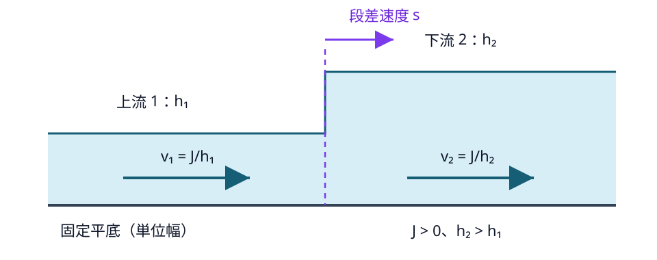

# FLUID30 段波と跳水の上下流をどうつなぐか

## この講義で解決すること

[FLUID29 の浅水方程式](../FLUID29/index.md#thm-fluid29-shallow-water)は、水深と流量の保存則を与えた。しかしダム決壊の先端や跳水では、水深・流速が急に変わる。そこで微分を含む式を不連続面にそのまま代入することはできない。**前後の状態を、薄い検査領域を通る量の出入りから結び付ける**。

本講では、幅方向に一様な直線水路、水平で固定した底、一定密度の非圧縮液体、重力 $g>0$、両側の正の水深を仮定する。跳躍の内部にある砕波・乱流・粘性散逸の微細構造は解かないが、内部が十分薄いときの外側の質量と水平運動量の収支を求める。**運動量は保存しても、力学的エネルギーは一般には保存しない**。後者は許される跳びを選ぶ物理的条件になる。

[FLUID29 の滑らかな解のエネルギー定理](../FLUID29/index.md#thm-fluid29-energy)を不連続面の両側へ無条件に延長しない。一般的な保存則の跳びは[NPDE1 の Rankine–Hugoniot 条件](../../../解析系/NPDE/NPDE1/index.md#thm-npde1-rankine-hugoniot)、不連続解の選択は[NPDE2 の entropy 条件](../../../解析系/NPDE/NPDE2/index.md#prop-npde2-shock-entropy-jump)でも扱う。本講で必要な水理学の式はここで直接導き、これらの一般理論を前提にしない。

## 0. 動く段差をどの座標から見るか

右向きを $+x$、時刻を $t$、段差の位置を $x=X(t)$ とする。段差の速度を $s=X'(t)=dX(t)/dt$ [m/s] とし、ここでプライムは時間 $t$ に関する通常の微分を表す。左右の極限をそれぞれ $(h_-,u_-)$、$(h_+,u_+)$ と書く。水深 $h_\pm>0$ [m]、平均流速 $u_\pm$ [m/s]、流量 $q_\pm=h_\pm u_\pm$ [m$^2$/s] である。記号 $[A]=A_+-A_-$ は**右の値から左の値を引く**。この記法の左右と、流体が流れ込む「上流・下流」は必ずしも同一でない。

移動する段差に追随すれば流体の相対速度は $v=u-s$ となる。単位幅当たりの相対体積流量 $J=h(u-s)$ は m$^2$/s の量であり、$J>0$ なら水は段差を左から右へ通る。定常跳水では $s=0$ と置けばよい。



この章では右向き相対流量 $J>0$ の跳水を主として考え、左を上流の状態 1、右を下流の状態 2 と書く。後で段波を動かすときは、添字 $-$ / $+$ と $s$ に戻す。

なぜ速度を引くのか。段差が時速（この章では m/s）で移動している間にも液体はそれ自身の速度で移動する。段差の面を単位時間に横切る体積は「液体速度 $u$ と面速度 $s$ の差」に水深を掛けたものだからである。例えば $h=2$ m、$u=5$ m/s、$s=1$ m/s なら $J=2(5-1)=8$ m$^2$/s。面が静止している場合の $q=10$ m$^2$/s とは異なる。

## 1. 不連続面を挟むと何を保存できるか

水深が段差で連続でないため、微分式の代わりに短い区間をまたぐ積分収支を用いる。[FLUID29 の平底浅水保存形](../FLUID29/index.md#thm-fluid29-shallow-water)で状態と流束は

$$
U=\begin{pmatrix}h\\q\end{pmatrix},
\qquad
F(U)=\begin{pmatrix}q\\q^2/h+gh^2/2\end{pmatrix}.
$$

ここで $h>0$ であり、$F$ の第2成分の単位は m$^3$/s$^2$。$sU$ は移動面が運び去る量を表す。

<a id="thm-fluid30-jump-balance"></a>

<!-- formal-statement-start -->
> **定理（移動する段波の質量・運動量跳躍条件）**  
> 平底で $g>0$ 一定の一次元非粘性浅水方程式を考える。$C^1$ 級の曲線 $x=X(t)$ の左右で正の水深 $h_\pm(t)>0$、流量 $q_\pm(t)=h_\pm u_\pm$ が連続な片側極限を持ち、各側は界面まで片側の一階微分が局所有界な滑らかな解として浅水方程式を満たすとする。界面に質量や水平運動量の集中源がないなら、界面速度 $s=X'(t)$ に対し

$$
\boxed{
s[h]=[q],\qquad
s[q]=\left[\frac{q^2}{h}+\frac12gh^2\right].
}
$$

> 逆に、この二つの関係が成り立つなら、各側の保存則は界面をまたいで分布の意味でも成立する。相対流量は両側で等しく、

$$
\boxed{J=h_-(u_--s)=h_+(u_+-s).}
$$
<!-- formal-statement-end -->

### 証明の見取り図

移動する短い検査区間の収支を考える。左右の固定断面を通る流束 $F$ から、移動する境界が掃く量 $sU$ を引くと、消えるはずの薄い領域に残る跳びだけを取り出せる。

<!-- proof-start -->
### 証明

一般の保存量 $A$ と流束 $B$ について、界面の両側では $A_t+B_x=0$ とする。幅 $2\delta$ の移動検査区間 $[X(t)-\delta,X(t)+\delta]$ を考える。**界面に集中源がない**とは、両側の微分方程式だけでなく、界面を含む検査区間全体についても「内部の量の変化＝両端の正味の流入」という積分収支を課すことである。両端の移動速度が $s=X'(t)$ なので、端を横切る流束は $B-sA$ となり、

$$
\frac{d}{dt}\int_{X(t)-\delta}^{X(t)+\delta}A(x,t)\,dx
=-\bigl(B-sA\bigr)(X(t)+\delta,t)
+\bigl(B-sA\bigr)(X(t)-\delta,t).
$$

左辺がなぜ零へ近づくかも、界面で微分して確かめる。$y=x-X(t)$ と置いて左右の滑らかな枝を $A_-,A_+$ と書けば、

$$
\begin{aligned}
\frac{d}{dt}\int_{X-\delta}^{X+\delta}A\,dx
&=\frac{d}{dt}\left(
\int_{-\delta}^{0}A_-(X+y,t)\,dy
+\int_{0}^{\delta}A_+(X+y,t)\,dy\right)\\
&=\int_{-\delta}^{0}(A_{-,t}+sA_{-,x})(X+y,t)\,dy\\
&\quad+\int_{0}^{\delta}(A_{+,t}+sA_{+,x})(X+y,t)\,dy
=O(\delta).
\end{aligned}
$$

最後の評価には両側の値と一階微分の局所有界性を使う。$y=0$ の分割点は移動座標では固定されており、界面上の片側値を同一視していない。よって $\delta\downarrow0$ で右辺は $-[B]+s[A]$ に収束し、$s[A]=[B]$ を得る。これを $A=h,B=q$、次に $A=q,B=q^2/h+gh^2/2$ へ適用すると二つの式になる。逆に、各側の保存則を試験関数で部分積分したとき界面に残る係数は $[B]-s[A]$ であり、二成分とも零なら分布的な保存則が成立する。

第1式を移項すれば

$$
q_+-sh_+=q_--sh_-,
$$

となる。$q_\pm=h_\pm u_\pm$ だから双方を $J$ と書ける。
<!-- proof-end -->

実際、$s=0$ の定常跳水なら、上流と下流では $q_1=q_2=J$、さらに $q_1^2/h_1+gh_1^2/2=q_2^2/h_2+gh_2^2/2$ である。**流速だけが保存されるのではなく、流量と運動量流束が保存される**。

## 2. 一つの水深からもう一つをどう決めるか

正の相対流量 $J>0$ が与えられても、上下流水深は自由には決められない。運動量流束の等式が二つの水深を結ぶ。その関係を、上流に対して下流に対応する「共役水深」の関係として導く。

<a id="thm-fluid30-conjugate-depth"></a>

<!-- formal-statement-start -->
> **定理（共役水深と Froude 数）**  
> 平底、$g>0$、相対流量 $J>0$ の定常な移動座標において、両側の正の水深 $h_1,h_2$、相対速度 $v_i=J/h_i>0$ が質量・運動量の[跳躍条件](#thm-fluid30-jump-balance)を満たすとする。$h_2\ne h_1$ なら

$$
\boxed{J^2=\frac g2h_1h_2(h_1+h_2).}
$$

> 上流 Froude 数 $Fr_1=v_1/\sqrt{gh_1}>0$ と水深比 $r=h_2/h_1>0$ は

$$
\boxed{Fr_1^2=\frac{r(r+1)}2,\qquad
r=\frac{\sqrt{1+8Fr_1^2}-1}{2}.}
$$

> さらに $Fr_2^2=(1+r)/(2r^2)$。$Fr_1>1$ と $h_2>h_1$ は同値で、その場合 $Fr_2<1$。関係式を $Fr_1\downarrow1$ と連続的に延長すると $r\downarrow1$ となるが、$r=1$ は前提 $h_2\ne h_1$ から除外した跳躍のない極限である。
<!-- formal-statement-end -->

### 証明の見取り図

速度を $J/h$ で消す。水深差で割る前に、水深差が零の場合を分ける。非自明な跳びだけで因数分解して、正の二次方程式の根を選ぶ。

<!-- proof-start -->
### 証明

[運動量の跳び](#thm-fluid30-jump-balance)は移動系で

$$
\frac{J^2}{h_1}+\frac12gh_1^2
=\frac{J^2}{h_2}+\frac12gh_2^2
$$

となる。移動速度 $s$ を含む元の流束では、$q_i=J+sh_i$ を代入すると $q_i^2/h_i+gh_i^2/2-sq_i=J^2/h_i+sJ+gh_i^2/2$ となり、共通の $sJ$ が消える。

移項・因数分解から

$$
\begin{aligned}
J^2\left(\frac1{h_1}-\frac1{h_2}\right)
&=\frac g2(h_2^2-h_1^2),\\
\frac{J^2(h_2-h_1)}{h_1h_2}
&=\frac g2(h_2-h_1)(h_1+h_2).
\end{aligned}
$$

$h_2\ne h_1$ なので差を割ることができ、最初の結論を得る。$Fr_1^2=J^2/(gh_1^3)$ と $r=h_2/h_1$ を代入すると

$$
Fr_1^2=\frac{h_2(h_1+h_2)}{2h_1^2}
=\frac{r(r+1)}2.
$$

よって $r^2+r-2Fr_1^2=0$。$r>0$ なので負の根 $(-1-\sqrt{1+8Fr_1^2})/2$ を除き、示した正の根を採用する。同じ $J$ で $Fr_2^2=J^2/(gh_2^3)=(1+r)/(2r^2)$ である。

$r>1$ なら $r(r+1)>2$ より $Fr_1>1$、また $1+r<2r^2$（差は $(r-1)(2r+1)>0$）より $Fr_2<1$。逆向きも $Fr_1^2=r(r+1)/2$ の $r>0$ における単調性から従う。
<!-- proof-end -->

**数値例**：$g=9.8$ m/s$^2$、$h_1=1$ m、$Fr_1=2$ とすると

$$
r=\frac{\sqrt{33}-1}{2}\simeq2.37228,\qquad
h_2\simeq2.37228\ {\rm m}.
$$

相対速度は $v_1=2\sqrt{9.8}\simeq6.26099$ m/s、$v_2=v_1/r\simeq2.63923$ m/s、$Fr_2\simeq0.54737$。水深が増す一方、相対速度が減る。もし段波が $s=1$ m/s で進むなら、実験室から見た両側の速度は $u_i=v_i+1$ である。**移動する段波に対して $u_i$ をそのまま Froude 数に代入するのは誤り**である。

## 3. なぜ運動量を保ってエネルギーを失うのか

[FLUID29 の水柱エネルギー](../FLUID29/index.md#def-fluid29-column-energy)から、平底 $b=0$ における密度で割ったエネルギーと流束は

$$
E=\frac12hu^2+\frac12gh^2,\qquad
G=u\left(E+\frac12gh^2\right)
=\frac12hu^3+gh^2u.
$$

滑らかな流れでは $E_t+G_x=0$ だが、跳水内部は滑らかではない。運動する段差の前後で保存式を課すと、エネルギーに関しては $[G]-s[E]=0$ が必要になる。実際の跳水はこの等号を一般に満たさず、内部の乱れなどへ力学的エネルギーを渡す。

移動系で単位重量当たりの力学的エネルギーを考えると、その尺度は長さであり、**比エネルギー水頭** $H=h+v^2/(2g)$ で表せる。水底標高が固定で同じであることを使い、同じ相対流量なら水頭差でエネルギー損失を評価する。

<a id="def-fluid30-specific-head"></a>

<!-- formal-statement-start -->
> **定義（移動座標の比エネルギー水頭）**  
> $g>0$、平底、$h>0$、段差速度 $s$、実験室流速 $u$ の浅水状態について、相対速度 $v=u-s$ とし、

$$
\mathcal H(h,v)=h+\frac{v^2}{2g}
$$

> を移動座標の比エネルギー水頭とする。水深と速度水頭の和であり単位は m。固定底の標高を零以外に取れば、全水頭にはその標高を同じだけ加える。
<!-- formal-statement-end -->

<!-- definition-example-start: def-fluid30-specific-head -->
**定義の確認**：水深 $2$ m、相対速度 $3$ m/s、$g=9$ m/s$^2$ なら、$h>0$、$g>0$ で各項は長さの単位を持つ。速度水頭は $3^2/(2\cdot9)=0.5$ m なので $\mathcal H=2.5$ m。段差速度を $s=1$ m/s とした実験室速度 $u=4$ m/s の平方を誤って使うと $2+16/18$ m となり、定義と一致しない。
<!-- definition-example-end -->

<a id="thm-fluid30-energy-loss"></a>

<!-- formal-statement-start -->
> **定理（跳水の水頭損失とエネルギーの許容条件）**  
> 平底の一次元浅水跳躍で、$g>0$、$J=h_1v_1=h_2v_2>0$、$h_1,h_2>0$、$h_2\ne h_1$ とし、[質量・運動量跳躍条件](#thm-fluid30-jump-balance)を満たすとする。このとき

$$
\boxed{\mathcal H_1-\mathcal H_2
=\frac{(h_2-h_1)^3}{4h_1h_2}.}
$$

> 実験室座標のエネルギー流束を $G$、エネルギー密度を $E$ とすると、

$$
\boxed{[G]-s[E]=-gJ(\mathcal H_1-\mathcal H_2).}
$$

> エネルギーが界面で生まれない条件 $[G]-s[E]\le0$ は、$J>0$ の場合 $h_2\ge h_1$ を要求する。非自明な許容跳水では $h_2>h_1$ となり、力学的エネルギーの減少量は正である。
<!-- formal-statement-end -->

### 証明の見取り図

水頭差へ $v_i=J/h_i$ を入れ、共役水深式で $J^2$ を消す。エネルギー流束差は、移動系への変換で質量・運動量の跳びが相殺するため、相対流量 $J$ と水頭差だけで表せる。

<!-- proof-start -->
### 証明

水頭差は

$$
\mathcal H_1-\mathcal H_2
=(h_1-h_2)+\frac{J^2}{2g}
\left(\frac1{h_1^2}-\frac1{h_2^2}\right).
$$

[共役水深式](#thm-fluid30-conjugate-depth)を代入し、通分すると

$$
\begin{aligned}
\mathcal H_1-\mathcal H_2
&=-(h_2-h_1)
+\frac{h_1h_2(h_1+h_2)}4
\frac{(h_2-h_1)(h_2+h_1)}{h_1^2h_2^2}\\
&=\frac{h_2-h_1}{4h_1h_2}
\bigl((h_1+h_2)^2-4h_1h_2\bigr)\\
&=\frac{(h_2-h_1)^3}{4h_1h_2}.
\end{aligned}
$$

エネルギー式の変換も、保存則の組合せから確かめる。ここで $E',G'$ のプライムは**移動座標で測った量のラベル**であり、$X'(t)=dX/dt$ の微分記号ではない。運動量流束を $M=q^2/h+gh^2/2$ とする。移動速度 $s$ のその時刻での値を使い、相対速度 $v=u-s$ に対するエネルギー密度を

$$
E'=E-sq+\frac{s^2}{2}h
=\frac12h(u-s)^2+\frac12gh^2
=\frac12hv^2+\frac12gh^2
$$

と置く。各滑らかな側では、[FLUID29 のエネルギー保存](../FLUID29/index.md#thm-fluid29-energy)、[運動量・質量保存](../FLUID29/index.md#thm-fluid29-shallow-water)の流束を係数 $1,-s,s^2/2$ で組み合わせると、固定断面を通る $E'$ の瞬間的な流束は $G-sM+s^2q/2$ になる。移動断面ではさらに $sE'$ を差し引くので、

$$
G'=G-sM+\frac{s^2}{2}q-sE'.
$$

実際に $u=v+s,\ q=h(v+s)$ を代入すれば、

$$
\begin{aligned}
G'&=\frac h2(v+s)^3+gh^2(v+s)
-s\left(h(v+s)^2+\frac12gh^2\right)\\
&\quad+\frac{s^2h}{2}(v+s)
-s\left(\frac h2v^2+\frac12gh^2\right)\\
&=\frac12hv^3+gh^2v
=J\left(\frac{v^2}{2}+gh\right)
=gJ\mathcal H.
\end{aligned}
$$

また、$[E']=[E]-s[q]+s^2[h]/2$、[質量・運動量の跳び](#thm-fluid30-jump-balance)から $[q]=s[h]$、$[M]=s[q]$ である。したがって

$$
\begin{aligned}
[G']-[G]+s[E]
&=-s[M]+\frac{3s^2}{2}[q]-\frac{s^3}{2}[h]\\
&=-s^2[q]+\frac{3s^2}{2}[q]-\frac{s^2}{2}[q]=0.
\end{aligned}
$$

この計算は各時刻の界面速度を使う跳躍の代数計算であり、$s(t)$ が変化するときに移動系のエネルギーが全領域で時間保存するとは主張しない。ゆえに $[G']=[G]-s[E]$ となり、

$$
[G]-s[E]=gJ(\mathcal H_2-\mathcal H_1)
=-gJ(\mathcal H_1-\mathcal H_2).
$$

不連続面のエネルギー不等式 $E_t+G_x\le0$ の界面寄与は $[G]-s[E]$ だから非正でなければならない。$g,J,h_1,h_2>0$ なら水頭損失式の符号は $h_2-h_1$ と同じであり、$h_2>h_1$ が非自明な許容側となる。
<!-- proof-end -->

前節の $Fr_1=2$ の例では $\mathcal H_1-\mathcal H_2\simeq0.272335$ m。密度で割ったエネルギー流束の損失は $gJ(\mathcal H_1-\mathcal H_2)\simeq16.7098$ m$^4$/s$^3$ である。密度 $\rho$ を掛ければ単位幅当たりのエネルギー損失率 [W/m] になる。

**反例（逆向きの跳び）**：$J>0$ のまま $h_2<h_1$ を選ぶと、二つの保存式は満たし得るが $\mathcal H_1-\mathcal H_2<0$ となる。すると $[G]-s[E]>0$ で界面がエネルギーを生み出す。この失敗は質量・運動量の式では検出できず、散逸という追加条件が失われたことにある。したがって保存式が二つ成立するだけで観測される跳水だと判断してはならない。

## 4. 特性の向きも切り替わるか

[FLUID29 の特性速度](../FLUID29/index.md#thm-fluid29-characteristics)は $u\pm\sqrt{gh}$ である。段差と一緒に動く座標では $s$ を引くので、二つの相対特性速度は $v\pm\sqrt{gh}$。$J>0$ で $h_2>h_1$ のとき前節の結果から

$$
v_1-\sqrt{gh_1}>0,\qquad
v_2-\sqrt{gh_2}<0,
$$

となり、遅い方の特性が段差へ両側から入り込む。速い方の特性は $v_i+\sqrt{gh_i}>0$ で両側とも右向きに進む。これが右向き相対流の跳水の圧縮性である。逆向きの非物理的な跳びでは、遅い特性が段差から両側へ離れてしまう。

<a id="prop-fluid30-characteristic-selection"></a>

<!-- formal-statement-start -->
> **命題（右向き相対流の圧縮型跳水）**  
> $g>0,J>0$、平底、$h_2>h_1>0$ の非自明な[共役水深跳躍](#thm-fluid30-conjugate-depth)について、実験室特性速度を $\lambda_\pm^{(i)}=u_i\pm\sqrt{gh_i}$、跳躍速度を $s$ とすると

$$
\lambda_-^{(1)}>s>\lambda_-^{(2)},
\qquad
\lambda_+^{(1)}>s,\quad \lambda_+^{(2)}>s.
$$

> これは一つの特性族が跳躍へ集まる関係であり、$J>0$ の水理学的許容跳水である。
<!-- formal-statement-end -->

### 証明の見取り図

各特性速度から $s$ を引き、既に示した上流・下流の Froude 数の大小を当てはめる。

<!-- proof-start -->
### 証明

$u_i-s=v_i=J/h_i>0$ なので $\lambda_+^{(i)}-s=v_i+\sqrt{gh_i}>0$。一方、[共役水深定理](#thm-fluid30-conjugate-depth)から $Fr_1=v_1/\sqrt{gh_1}>1$ と $Fr_2=v_2/\sqrt{gh_2}<1$ が成り立つ。よって

$$
\lambda_-^{(1)}-s=\sqrt{gh_1}(Fr_1-1)>0,
\qquad
\lambda_-^{(2)}-s=\sqrt{gh_2}(Fr_2-1)<0.
$$

主張の不等式を得る。
<!-- proof-end -->

ここでの波の許容性は、**二つの保存式に加えた物理的散逸と特性の向き**の検査である。一般の非線形保存則全体の一意性の証明をこの観察だけから得たわけではない。そこでは[NPDE2 の跳躍 entropy 条件](../../../解析系/NPDE/NPDE2/index.md#prop-npde2-shock-entropy-jump)のような選択原理を扱う。

## 5. 検算用の Python ラボ

静止した跳水も、同じ二状態に速度 $s$ を一律に足した移動段波も、**相対流量と水頭損失は同一**になる。数値実験では、入力した上流水深・Froude 数・段差速度から共役水深を計算し、移動系と実験室系の両方で質量・運動量の跳び残差、エネルギーの符号、特性の向きを数値比較する。

これは跳躍条件の**代数的な検算**であり、跳水の内部厚さやダム決壊の時間発展をシミュレーションするものではない。時間発展の保守的有限体積法は[FLUID29 の数値ラボ](../FLUID29/index.md)を使う。Froude 数を変えたグラフは共役水深比と水頭損失の関係を示し、色だけでなく名前で系列を区別する。

```python-file-lab
# lab-id: FLUID30-JUMP-CHECK
# lab-title: 跳水の共役水深・移動速度・エネルギー損失の検算
# lab-file: textbook/volumes/dream_thater/物理系/FLUID/FLUID30/jump_lab.py
# timeout-ms: 12000
# lab-preset: 静止した許容跳水 | --depth 1 --fr 2 --speed 0
# lab-preset: 同じ跳水を動かす | --depth 1 --fr 2 --speed 1
# lab-preset: ほぼ臨界の跳び | --depth 1 --fr 1.1 --speed 0
# lab-preset: より強い跳び | --depth 1 --fr 3 --speed -1
```

[Python ソースを閲覧](jump_lab.py)。$Fr_1$ を 1 へ近づけると水深比と水頭損失はともに極限値へ近づき、$s$ を変えても相対量は変化しない。全プリセットで水深・流量・単位・数値残差を読み比べる。

## 6. 演習

全問で平底、一定密度、$g>0$、$h_\pm>0$ とし、内部に集中した質量・運動量源がない一次元浅水模型を用いる。指定がなければ相対流量は正 $J>0$ とし、上流 1、下流 2 の順に左から右へ流れる。必要な式は各問で導出元へ戻って確認する。

### Level A

### A1. 移動面を横切る流量

左側で $h_-=2$ m、$u_-=5$ m/s、段差速度 $s=1$ m/s とする。$J$ と、右側の水深が $h_+=4$ m のときの $u_+$ を求め、質量の跳びを検算せよ。

- Level: A

<!-- solution-start -->
#### 詳細解答

[移動面の質量跳躍](#thm-fluid30-jump-balance)より $J=h_-(u_--s)=2(5-1)=8$ m$^2$/s。右側でも $4(u_+-1)=8$ だから $u_+=3$ m/s。$q_-=2\cdot5=10$、$q_+=4\cdot3=12$ m$^2$/s。したがって $[q]=12-10=2$ m$^2$/s、$s[h]=1(4-2)=2$ m$^2$/s と一致する。この数値が運動量条件まで満たすとはまだ主張していない。
<!-- solution-end -->

### A2. Froude 数から水深比

$Fr_1=\sqrt3$ の跳水で $h_1=2$ m とする。共役水深比 $r$ と $h_2$ を求めよ。

- Level: A

<!-- solution-start -->
#### 詳細解答

[共役水深定理](#thm-fluid30-conjugate-depth)の $r(r+1)=2Fr_1^2=6$ より $r^2+r-6=(r-2)(r+3)=0$。水深比は正なので $r=2$ であり、$h_2=rh_1=4$ m。負の根 $-3$ は正の水深に反する。
<!-- solution-end -->

### A3. 跳躍の前後で特性を調べる

$g=9$ m/s$^2$、$h_1=1$ m、$J=6$ m$^2$/s、$h_2=2$ m という移動系の二状態について、$Fr_1,Fr_2$ を求めよ。この二状態が共役水深条件も満たすか調べよ。

- Level: A

<!-- solution-start -->
#### 詳細解答

$v_1=J/h_1=6$ m/s、$v_2=J/h_2=3$ m/s。$\sqrt{gh_1}=3$、$\sqrt{gh_2}=\sqrt{18}=3\sqrt2$ m/s。$Fr_1=2>1$、$Fr_2=1/\sqrt2<1$ となる。しかし[共役水深条件](#thm-fluid30-conjugate-depth)の右辺は $(g/2)h_1h_2(h_1+h_2)=(9/2)\cdot1\cdot2\cdot3=27$ m$^4$/s$^2$ で、$J^2=36$ m$^4$/s$^2$ と等しくない。Froude 数が超臨界から常流へ変わるだけでは運動量保存を保証しない。
<!-- solution-end -->

### A4. エネルギー損失の符号

$h_1=1$ m、$h_2=2$ m の非自明な共役水深の跳水について、$\mathcal H_1-\mathcal H_2$ を求めよ。深さの順序を逆にした場合の符号も調べよ。

- Level: A

<!-- solution-start -->
#### 詳細解答

[水頭損失定理](#thm-fluid30-energy-loss)より $(2-1)^3/(4\cdot1\cdot2)=1/8$ m。逆に $h_1=2,h_2=1$ とすると $(1-2)^3/(4\cdot2\cdot1)=-1/8$ m。$J>0$ で後者は流出水頭が流入水頭を上回るため、追加の外部エネルギー源がない跳水として許されない。
<!-- solution-end -->

### A5. 移動速度の符号

相対流量 $J=4$ m$^2$/s、左水深 $h_-=1$ m、右水深 $h_+=2$ m、段差速度 $s=-1$ m/s とする。実験室速度と質量跳躍式を確かめよ。

- Level: A

<!-- solution-start -->
#### 詳細解答

$u_-=J/h_-+s=4-1=3$ m/s、$u_+=J/h_++s=2-1=1$ m/s。ゆえに $q_-=3$、$q_+=2$ m$^2$/s。$[q]=-1$ m$^2$/s、$s[h]=(-1)(2-1)=-1$ m$^2$/s。段差自体が左へ進んでいても、水は段差に対して右へ流れる。運動量式が成立するかは別条件である。
<!-- solution-end -->

### Level B

### B1. 薄い移動区間から二つの跳びを導く

$s$ が一定の区間で $U_t+F(U)_x=0$、$U=(h,q)^{\mathsf T}$、$F=(q,q^2/h+gh^2/2)^{\mathsf T}$ とする。移動区間 $[st-\delta,st+\delta]$ の収支から二つの跳びを示し、$q_i=J+sh_i$ を代入して相対運動量式を導け。

- Level: B

<!-- solution-start -->
#### 詳細解答

各成分について、界面に集中源を置かない移動区間の[積分収支](#thm-fluid30-jump-balance)を使う。移動境界を横切る量は $F-sU$ なので、

$$
\frac{d}{dt}\int_{st-\delta}^{st+\delta}U\,dx
=-(F-sU)(st+\delta,t)+(F-sU)(st-\delta,t).
$$

変数 $y=x-st$ に直して界面 $y=0$ の左右に積分を分けると、左辺は両側の $U_t+sU_x$ の長さ $\delta$ の積分の和となる。局所有界性により $O(\delta)\to0$、右辺は $-[F]+s[U]$ へ近づく。よって $s[U]=[F]$。第1成分から $J=q_--sh_-=q_+-sh_+$ を得る。第2成分は $[q^2/h+gh^2/2-sq]=0$。$q=J+sh$ を代入すると

$$
\frac{(J+sh)^2}{h}+\frac12gh^2-s(J+sh)
=\frac{J^2}{h}+sJ+\frac12gh^2.
$$

共通項 $sJ$ が左右で消え、$[J^2/h+gh^2/2]=0$ が得られる。$h>0$ を使って割り算した。
<!-- solution-end -->

### B2. 水頭損失式を再構成する

$J>0$ と $h_2>h_1>0$ の共役水深の跳水について、運動量式から $J^2$ を求め、それを $\mathcal H_1-\mathcal H_2$ に代入して水頭損失式を導け。

- Level: B

<!-- solution-start -->
#### 詳細解答

運動量式は $J^2(1/h_1-1/h_2)=g(h_2^2-h_1^2)/2$。$h_2-h_1\ne0$ と $h_i>0$ より両辺を整理して $J^2=gh_1h_2(h_1+h_2)/2$。次に

$$
\begin{aligned}
\mathcal H_1-\mathcal H_2
&=h_1-h_2+\frac{J^2}{2g}\left(\frac1{h_1^2}-\frac1{h_2^2}\right)\\
&=-(h_2-h_1)+\frac{(h_2-h_1)(h_1+h_2)^2}{4h_1h_2}\\
&=\frac{(h_2-h_1)((h_1-h_2)^2)}{4h_1h_2}
=\frac{(h_2-h_1)^3}{4h_1h_2}.
\end{aligned}
$$

分子・分母は長さ3乗と2乗なので結果の単位は m。
<!-- solution-end -->

### B3. 速度平行移動と跳躍残差

$h_1,h_2,J$ は共役水深条件を満たし、$s$ を任意の実数として $u_i=s+J/h_i$ とする。$s$ に関係なく二つの実験室系跳躍式が成り立つことを代入で示せ。

- Level: B

<!-- solution-start -->
#### 詳細解答

$q_i=h_iu_i=sh_i+J$ より $[q]=s[h]$。運動量流束から $s q_i$ を引くと

$$
\frac{q_i^2}{h_i}+\frac12gh_i^2-sq_i
=\frac{J^2}{h_i}+sJ+\frac12gh_i^2.
$$

両側の差は $J^2(1/h_2-1/h_1)+g(h_2^2-h_1^2)/2$。共役水深条件はこの差が零であることと同値なので $[q^2/h+gh^2/2]-s[q]=0$。速度の平行移動で変わる $q$ と $u$ は、$J$ の保存と矛盾しない。
<!-- solution-end -->

### B4. 特性不等式を水深比から示す

共役水深比 $r>1$ の許容跳水で、$Fr_1^2=r(r+1)/2$、$Fr_2^2=(r+1)/(2r^2)$ だけを使って、遅い特性が段差の両側から入ることを証明せよ。

- Level: B

<!-- solution-start -->
#### 詳細解答

$r>1$ から $r(r+1)>2$ で $Fr_1>1$。また $2r^2-(r+1)=(r-1)(2r+1)>0$ より $Fr_2<1$。$J>0$ で $v_i=J/h_i>0$、$\lambda_-^{(i)}-s=v_i-\sqrt{gh_i}=\sqrt{gh_i}(Fr_i-1)$ だから左で正、右で負。さらに $\lambda_+^{(i)}-s=\sqrt{gh_i}(Fr_i+1)>0$。両特性について符号を確認して、[圧縮型跳水命題](#prop-fluid30-characteristic-selection)を再構成できた。
<!-- solution-end -->

### Level C

### C1. 観測された動く段波の診断

平底で $g=9$ m/s$^2$、$h_-=1$ m、$h_+=2$ m、段差速度 $s=1$ m/s とする。$J>0$ として質量・運動量の両方を満たす $u_-,u_+$ を決め、$Fr_-,Fr_+$、水頭損失、エネルギー流束の界面差 $[G]-s[E]$ を求めよ。さらに、同じ水深で $J<0$ を選んだとき、なぜその左右配置を同じ意味の許容跳水とはみなせないか説明せよ。

- Level: C

<!-- solution-start -->
#### 詳細解答

[共役水深定理](#thm-fluid30-conjugate-depth)から

$$
J^2=\frac92\cdot1\cdot2\cdot3=27\ {\rm m^4/s^2},
\qquad J=3\sqrt3\ {\rm m^2/s}
$$

を得る。$J>0$ の指定が正の根を選ぶ理由である。相対速度は $v_-=3\sqrt3$ m/s、$v_+=3\sqrt3/2$ m/s、よって実験室速度は

$$
u_-=1+3\sqrt3,\qquad u_+=1+\frac{3\sqrt3}{2}
\quad({\rm m/s}).
$$

質量式は $q_-=u_-$、$q_+=2u_+$ から $[q]=1=s[h]$。運動量は共役水深式により成立し、直接には $[q^2/h+gh^2/2-sq]=[J^2/h+9h^2/2]=0$。

Froude 数は

$$
Fr_-=\frac{3\sqrt3}{\sqrt9}=\sqrt3,\qquad
Fr_+=\frac{3\sqrt3/2}{\sqrt{18}}
=\sqrt{\frac38}.
$$

したがって上流は超臨界、下流は常流である。[水頭損失定理](#thm-fluid30-energy-loss)から $\mathcal H_--\mathcal H_+=(2-1)^3/(4\cdot1\cdot2)=1/8$ m。ゆえに

$$
[G]-s[E]=-gJ(\mathcal H_--\mathcal H_+)
=-9\cdot3\sqrt3\cdot\frac18
=-\frac{27\sqrt3}{8}\ {\rm m^4/s^3}<0.
$$

ここでは速度を移動系で判定した。逆に $J=-3\sqrt3$ を選ぶと左から右へ流れるのではなく、右から左へ流れる。水深が大きい右側が流入側、浅い左側が流出側となり、相対流の向きに沿うと $h_{\rm downstream}<h_{\rm upstream}$ で水頭は増加する。実際、右から左へのエネルギー流を考えると元の $[G]-s[E]=-gJ/8>0$ となるため、外部エネルギー供給のない跳水としては許容されない。
<!-- solution-end -->

## 7. 学びのまとめ

[FLUID29 の浅水模型](../FLUID29/index.md#thm-fluid29-shallow-water)が与える二つの保存量を不連続面でも使うためには、**面が移動して掃く量**を差し引く必要がある。その結果が $s[U]=[F(U)]$ であり、相対流量 $J$ に直せば共役水深と Froude 数が計算できる。一方、滑らかな流れの力学的エネルギー等式は跳水にそのまま延長できず、エネルギー散逸の符号が許容・非許容を分ける。ここまでの浅水段波は非圧縮の水理学的模型であり、気体の圧縮性衝撃波では、流体の内部の熱エネルギーも含む保存則と、気体の圧力・密度・温度を結ぶ関係を別途扱う。
