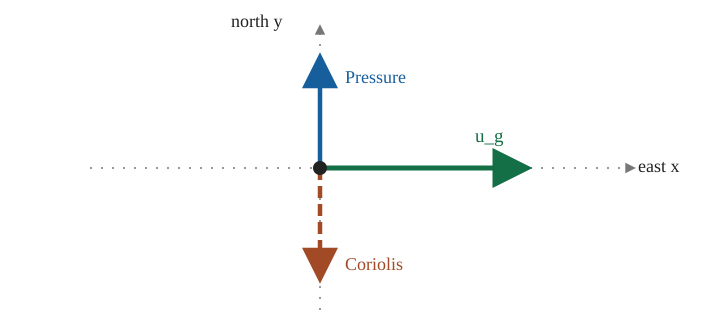

# FLUID32 地球回転で地衡流が成立する条件は何か

[FLUID31 の非回転 Boussinesq 模型](../FLUID31/index.md#def-fluid31-boussinesq)では、水平圧力差が流体を加速する。一方、実際の大規模な海流・大気の流れは、圧力勾配があっても直ちにその向きへ走り続けるとは限らない。地球とともに回転する観測者には、流れの向きに直角な見かけの力が現れるからである。

本講では、回転座標の加速度を導いてから、**どの項が小さいときに圧力勾配と Coriolis 力だけが釣り合うか**を明確にする。さらに壁の近くでは粘性が無視できないことを、線形の Ekman 層の厳密解で調べる。「地球上の流れはすべて地衡流」という結論にはしない。

## 0. 座標・力・模型の約束

局所直交座標を $x$ 東向き、$y$ 北向き、$z$ 上向きとする。$\boldsymbol e_z$ は上向きの単位ベクトル、水平速度は $\boldsymbol u_h=(u,v)$、鉛直速度は $w$、圧力は $p$ [Pa]。回転角速度の大きさ $\Omega>0$ [s$^{-1}$]、緯度 $\varphi$（北緯を正）、参照密度 $\rho_0>0$ [kg/m$^3$] とする。以下、地球の $\Omega$ を時間的に一定とする。

[FLUID1 の動粘度](../FLUID1/index.md#def-fluid1-kinematic-viscosity)は $\nu=\eta/\rho_0>0$ [m$^2$/s] である。壁の無滑り条件と粘性応力は[FLUID16 の非圧縮 Newton 流体](../FLUID16/index.md#def-fluid16-pipe-flow)で使ったものを、ここでは局所平面上に適用する。成層のある領域を扱う場合も、慣性に現れる密度の近似を $\rho_0$ とする条件は[FLUID31](../FLUID31/index.md#def-fluid31-boussinesq)に従う。

地球自転の角速度ベクトルはこの局所座標では

$$
\boldsymbol\Omega=(0,\Omega\cos\varphi,\Omega\sin\varphi)
$$

となる。このうち鉛直成分が水平の向きを曲げる。$\varphi>0$ では水平速度を**右へ**、$\varphi<0$ では**左へ**曲げることを、符号付き方程式から確認する。

## 1. なぜ回転座標では速度に比例する項が出るのか

回る座標軸で見た時間微分と、慣性系で見た時間微分は同じでない。回転座標で成分が一定の任意のベクトル $\boldsymbol A$ でも、慣性系では軸とともに方向が変わる。回転する基底を微小時間 $\Delta t$ だけ回せば、ベクトルの差は一次で $\Delta t\,\boldsymbol\Omega\times\boldsymbol A$。したがって一般の $\boldsymbol A$ について

$$
\left(\frac{d\boldsymbol A}{dt}\right)_{\!I}
=\left(\frac{d\boldsymbol A}{dt}\right)_{\!R}
+\boldsymbol\Omega\times\boldsymbol A.
$$

位置 $\boldsymbol r$ に一度使うと、慣性系速度は $\boldsymbol v_I=\boldsymbol v_R+\boldsymbol\Omega\times\boldsymbol r$。もう一度微分すると

$$
\boldsymbol a_I=\boldsymbol a_R
+2\boldsymbol\Omega\times\boldsymbol v_R
+\boldsymbol\Omega\times(\boldsymbol\Omega\times\boldsymbol r)
$$

を得る（$\dot{\boldsymbol\Omega}=0$）。最後の遠心項は、静止背景の有効重力へまとめる。流体の回転系の運動方程式に移すと、速度に比例する項は左辺の $+2\boldsymbol\Omega\times\boldsymbol v_R$ となる。

<!-- formal-statement-start -->
> **定理（一定角速度の回転系における加速度）**  
> 慣性系と角速度ベクトル $\boldsymbol\Omega$ が一定の回転系が同じ原点を共有し、位置 $\boldsymbol r(t)$ は二回微分可能とする。回転系での速度・加速度を $\boldsymbol v_R,\boldsymbol a_R$ とすれば、慣性系での加速度は

$$
\boldsymbol a_I=\boldsymbol a_R
+2\boldsymbol\Omega\times\boldsymbol v_R
+\boldsymbol\Omega\times(\boldsymbol\Omega\times\boldsymbol r).
$$

> 右辺第2項が回転系の運動方程式で Coriolis 加速度項を生み、第3項は遠心項である。原点が並進加速する場合はその加速度も別に加える。
<!-- formal-statement-end -->

### 証明の見取り図

回る基底の微分則を位置へ一回、速度へもう一回使う。二つの交差項がそれぞれ $\boldsymbol\Omega\times\boldsymbol v_R$ となる点が係数2の理由である。

<!-- proof-start -->
### 証明

回転系成分の微分を $D_R$、慣性系微分を $D_I$ と書く。回転基底に対して $D_I\boldsymbol A=D_R\boldsymbol A+\boldsymbol\Omega\times\boldsymbol A$。従って

$$
\boldsymbol v_I=D_I\boldsymbol r
=\boldsymbol v_R+\boldsymbol\Omega\times\boldsymbol r.
$$

$\boldsymbol\Omega$ は時間一定だから、右辺を $D_I$ で微分して

$$
\begin{aligned}
\boldsymbol a_I
&=D_I\boldsymbol v_R+\boldsymbol\Omega\times D_I\boldsymbol r\\
&=(\boldsymbol a_R+\boldsymbol\Omega\times\boldsymbol v_R)
 +\boldsymbol\Omega\times(\boldsymbol v_R+\boldsymbol\Omega\times\boldsymbol r)\\
&=\boldsymbol a_R+2\boldsymbol\Omega\times\boldsymbol v_R
 +\boldsymbol\Omega\times(\boldsymbol\Omega\times\boldsymbol r).
\end{aligned}
$$

もし $\boldsymbol\Omega=\boldsymbol0$ なら追加項は両方消える。回転する軸上に静止する粒子は $\boldsymbol v_R=\boldsymbol0$ だが、軸から離れていれば遠心項は残る。従って二つの項を混同できない。
<!-- proof-end -->

地表の小領域で遠心項を背景の有効重力と合わせ、局所座標へ書き直す。$\boldsymbol\Omega$ と速度 $\boldsymbol v_R=(u,v,w)$ の外積は

$$
2\boldsymbol\Omega\times\boldsymbol v_R
=(-2\Omega\sin\varphi\,v+2\Omega\cos\varphi\,w,\,
2\Omega\sin\varphi\,u,\,-2\Omega\cos\varphi\,u).
$$

ここで水平運動の $2\Omega\cos\varphi\,w$ と、鉛直運動の $-2\Omega\cos\varphi\,u$ を落とし、鉛直は別途静水圧近似で扱う **traditional approximation（伝統的近似）** を採用する。これは外積の恒等式ではなく、浅い層・小さな鉛直速度などの尺度条件の下で行うモデル化である。赤道近傍などでは小さいと無条件に断定できない。

水平速度に掛かる係数だけを一つの符号付き量で表す。

<!-- formal-statement-start -->
> **定義（Coriolis パラメータ）**  
> 自転角速度 $\Omega>0$、緯度 $\varphi\in[-\pi/2,\pi/2]$ に対して

$$
f=2\Omega\sin\varphi
$$

> と定義する。単位は s$^{-1}$。北半球で $f>0$、南半球で $f<0$、赤道で $f=0$。狭い緯度帯で $f$ を一定と置く局所模型を **$f$ 面近似** とする。
<!-- formal-statement-end -->

<!-- definition-example-start: def-fluid32-coriolis-parameter -->
**定義の確認**：$\Omega=7.29\times10^{-5}$ s$^{-1}$ とすると、北緯30度では $\sin\varphi=1/2$ なので $f=+7.29\times10^{-5}$ s$^{-1}$、南緯30度では $f=-7.29\times10^{-5}$ s$^{-1}$。絶対値は同じだが、曲がる向きは逆である。北向き速度 $(u,v)=(0,V)$、$V>0$ に作用する回転項は $f(-V,0)$ となり、運動方程式の右辺の見かけの力は東向き $+fV$（北向き進行の右側）となる。
<!-- definition-example-end -->

## 2. 圧力勾配の向きへ加速しない流れ

有効重力で支えられる静水圧背景を差し引き、水平圧力勾配を $\nabla_h p=(p_x,p_y)$ とする。均一な $\rho_0$、十分滑らかな速度・圧力、一定 $f$ の下で、水平運動は

$$
\begin{aligned}
D_tu-fv&=-\frac{p_x}{\rho_0}+\nu\Delta u,\\
D_tv+fu&=-\frac{p_y}{\rho_0}+\nu\Delta v,
\end{aligned}
\qquad
D_t=\partial_t+u\partial_x+v\partial_y+w\partial_z.
$$

この式は[非圧縮 Navier–Stokes 方程式](../FLUID16/index.md#def-fluid16-pipe-flow)を回転系へ書き換え、遠心力を有効重力へ含め、traditional approximation を採用したものである。鉛直運動と質量保存の解を同時に満たす必要があり、この水平二式だけが流体の全方程式ではない。

圧力勾配による加速度の尺度を $U^2/L$ と決め打ちせず、回転の大きさ $|f|U$ と比べる。代表水平速度 $U>0$、水平長さ $L>0$、時間尺度 $T>0$、鉛直長さ $H>0$ を与え、$f\ne0$ とする。移流項は $U^2/L$、非定常項は $U/T$、鉛直粘性は $\nu U/H^2$ の尺度を持つ。

<!-- formal-statement-start -->
> **定義（Rossby 数と Ekman 数）**  
> $U,L,H,\nu>0$、一定 $f\ne0$ とし、回転加速度に対する水平移流と鉛直粘性の相対的大きさをそれぞれ

$$
\mathrm{Ro}=\frac{U}{|f|L},
\qquad
\mathrm{Ek}=\frac{\nu}{|f|H^2}
$$

> と定義する。両者は無次元である。非定常加速度の比は別に $(|f|T)^{-1}$、水平粘性の比は $\nu/(|f|L^2)$ で判定する。
<!-- formal-statement-end -->

<!-- definition-example-start: def-fluid32-rossby-ekman -->
**定義の確認**：$U=0.10$ m/s、$L=10^5$ m、$|f|=10^{-4}$ s$^{-1}$ なら $\mathrm{Ro}=0.10/(10^{-4}\cdot10^5)=0.01$。$H=100$ m、$\nu=0.01$ m$^2$/s なら $\mathrm{Ek}=0.01/(10^{-4}\cdot10^4)=0.01$。各分母の次元は Ro では m/s、Ek では m$^2$/s と分子に一致する。ただしこの $\nu$ は大きな渦粘性の**模型値**としての例であり、分子粘度と同一視しない。
<!-- definition-example-end -->

時間も十分ゆっくり変わり、$\mathrm{Ro}\ll1$、$\mathrm{Ek}\ll1$、水平粘性比も十分小さく、かつ実際に圧力の水平勾配が回転項と同程度である領域を考える。このとき最低次の水平釣合は $f(-v,u)=-\nabla_h p/\rho_0$。この関係を満たす速度を、新しく導入する。

<!-- formal-statement-start -->
> **定義（地衡流）**  
> 局所 $f$ 面で $f\ne0$、$\rho_0>0$、水平一階微分可能な圧力 $p(x,y,z,t)$ が与えられるとき、水平速度 $\boldsymbol u_g=(u_g,v_g)$ が

$$
f\boldsymbol e_z\times\boldsymbol u_g
=-\frac{\nabla_h p}{\rho_0}
$$

> を満たすなら、その速度を指定圧力場に対する地衡流速と定義する。$z$ 方向や時間に依存してもよい。地衡流は通常、水平運動の**最低次の近似**であり、完全な Navier–Stokes 解であることを定義から保証しない。
<!-- formal-statement-end -->

<!-- definition-example-start: def-fluid32-geostrophic-flow -->
**定義の確認**：$f=10^{-4}$ s$^{-1}$、$\rho_0=1000$ kg/m$^3$、$p_x=0$、$p_y=-0.01$ Pa/m とする。$p_y<0$ なので北ほど低圧である。$\boldsymbol u_g=(0.10,0)$ m/s を代入すると $f(-v_g,u_g)=(0,10^{-5})$ m/s$^2$、一方 $-\nabla_h p/\rho_0=(0,10^{-5})$ m/s$^2$ で両方の成分が一致する。北半球では東向き流の左（北）に低圧がある。圧力勾配「の向き」ではなく、それに**垂直な流れ**が成立する。
<!-- definition-example-end -->

この図では一点を原点に、速度は東、二つの加速度は南北の同一直線で逆向きに表している。異なる力が相殺することと、流速が力と直交することを確認してほしい。

<!-- formal-statement-start -->
> **定理（地衡流速の成分と水平発散）**  
> $\rho_0>0$、一定 $f\ne0$、各高さ・時刻で $p\in C^2$（水平変数について）とする。[地衡流の定義](#def-fluid32-geostrophic-flow)は一意の水平速度

$$
\boxed{u_g=-\frac{p_y}{\rho_0 f},\qquad v_g=\frac{p_x}{\rho_0 f}}
$$

> を与える。その水平発散は $\partial_xu_g+\partial_yv_g=0$ であり、水平相対渦度は

$$
\zeta_g=\partial_xv_g-\partial_yu_g
=\frac{p_{xx}+p_{yy}}{\rho_0 f}.
$$

> $f$ または $\rho_0$ が水平に変わるとき、同じ発散零の結論は一般には成立しない。
<!-- formal-statement-end -->

### 証明の見取り図

$\boldsymbol e_z\times(u_g,v_g)=(-v_g,u_g)$ を二成分で比較する。発散の二つの混合偏微分が相殺するのは、$f,\rho_0$ の一定性と圧力の $C^2$ 性による。

<!-- proof-start -->
### 証明

地衡流の式を東・北成分に分けると

$$
-fv_g=-p_x/\rho_0,\qquad fu_g=-p_y/\rho_0.
$$

$f\ne0$ なので割り算ができ、表示の一意な速度を得る。さらに

$$
\begin{aligned}
\partial_xu_g+\partial_yv_g
&=-\frac{p_{yx}}{\rho_0f}+\frac{p_{xy}}{\rho_0f}=0,\\
\partial_xv_g-\partial_yu_g
&=\frac{p_{xx}}{\rho_0f}+\frac{p_{yy}}{\rho_0f}.
\end{aligned}
$$

混合偏微分の一致には $p\in C^2$ を使う。もし $f=f(y)$ なら、$v_g=p_x/(\rho_0 f(y))$ の $y$ 微分に $-p_x f'(y)/(\rho_0f(y)^2)$ が残り、発散零の証明が壊れる。
<!-- proof-end -->

**反例に含まれる物理**：低圧側へ直ちに加速する小さな渦や短時間の流れでは、$\mathrm{Ro}\ll1$ だけでなく $(|f|T)^{-1}\ll1$ も必要である。粘性が支配的な壁近傍にも、この釣合をそのまま押し付けられない。

## 3. 成層があると高さによって流速は変わるか

[FLUID31 の静水圧釣合](../FLUID31/index.md#def-fluid31-boussinesq)と地衡流を同時に使うと、**水平密度差と鉛直方向の地衡流速の変化**が関係する。ここでは重力加速度の大きさ $g>0$、密度 $\rho(x,y,z)$ が十分滑らか、局所 $f$ 面の $f,\rho_0$ が一定、各高さで地衡釣合が成立する場合だけを扱う。鉛直方向は静水圧近似 $p_z=-g\rho$ を課す。これは年中あらゆる流れで成立する式ではない。

<!-- formal-statement-start -->
> **命題（静水圧・地衡釣合から得る熱風関係）**  
> $f\ne0$、$\rho_0,g>0$ は定数、$p$ は混合偏微分が交換でき、$\rho$ は水平微分可能とする。水平地衡釣合と鉛直静水圧釣合 $p_z=-g\rho$ が同時に成立すれば、地衡流速の鉛直変化は

$$
\boxed{\partial_z u_g=\frac{g}{\rho_0 f}\,\partial_y\rho,\qquad
\partial_z v_g=-\frac{g}{\rho_0 f}\,\partial_x\rho.}
$$

> ここで「熱風」は温度を直接仮定する名称ではなく、密度の水平勾配が地衡流の鉛直シアを定める関係を指す。
<!-- formal-statement-end -->

### 証明の見取り図

[地衡流速の成分式](#thm-fluid32-geostrophic-formula)を $z$ で微分し、$p_{yz}=(p_z)_y=-g\rho_y$、$p_{xz}=-g\rho_x$ とする。

<!-- proof-start -->
### 証明

地衡流の $u_g=-p_y/(\rho_0 f)$ で係数は定数だから

$$
\partial_z u_g=-\frac{1}{\rho_0f}\partial_z\partial_y p
=-\frac{1}{\rho_0f}\partial_y(-g\rho)
=\frac{g\rho_y}{\rho_0 f}.
$$

同じく $v_g=p_x/(\rho_0 f)$ では

$$
\partial_z v_g=\frac{1}{\rho_0f}\partial_z\partial_x p
=\frac{1}{\rho_0f}\partial_x(-g\rho)
=-\frac{g\rho_x}{\rho_0f}.
$$

$\rho_y,\rho_x$ の単位は kg/m$^4$ なので、右辺の単位は s$^{-1}$、左辺の速度の鉛直勾配の単位と一致する。
<!-- proof-end -->

**例**：北半球で $\rho_y=10^{-5}$ kg/m$^4$、$\rho_x=0$、$g=10$ m/s$^2$、$\rho_0=1000$ kg/m$^3$、$f=10^{-4}$ s$^{-1}$ なら $(u_g)_z=10^{-3}$ s$^{-1}$、$(v_g)_z=0$。高さを $20$ m 上がると、指定範囲で $u_g$ が $0.020$ m/s 増える。$p_z=-g\rho$ と地衡釣合がともに満たされる範囲だけの予測である。

## 4. 壁の近くで地衡流が破れるのはなぜか

地衡釣合は**粘性の小さい内部領域の近似**であって、壁の無滑り条件を満たすとは限らない。上の例では内部の地衡流速が $u_g=U_g>0$ でも、静止した水平底面 $z=0$ では $u=v=0$ でなければならない。二つの速度をつなぐ薄い層では、鉛直粘性 $\nu \partial_{zz}$ が Coriolis 項と同程度になる。

この薄い層の代表厚さを $\delta$ とすると、$\nu U_g/\delta^2\sim |f|U_g$ より $\delta\sim\sqrt{\nu/|f|}$。係数 $\sqrt2$ を含む正確な厚さは以下の線形解から決まる。ここでは底面から上へ無限に伸びる半空間で、定常・水平一様、$\rho_0,\nu,f$ 一定、$f\ne0$ とし、鉛直速度は $w=0$、背景圧力勾配は高さに依らず $(p_x,p_y)=(0,-\rho_0 fU_g)$ とする。移流項は水平一様性と $w=0$ によって**厳密に零**である。渦粘性を定数とみなす場合も、現実の乱流底層そのものを解いたとは主張しない。

<!-- formal-statement-start -->
> **定義（定数粘性模型の Ekman 厚さ）**  
> 一定 $f\ne0$、$\nu>0$ の半空間定常・水平一様な回転粘性流の模型で

$$
\delta_E=\sqrt{\frac{2\nu}{|f|}}
$$

> を Ekman 厚さと定義する。単位は長さである。$f\to0$ で発散するのは、赤道に対してこの模型の「薄い回転境界層」という尺度が成立しないことを意味する。
<!-- formal-statement-end -->

<!-- definition-example-start: def-fluid32-ekman-depth -->
**定義の確認**：$\nu=0.01$ m$^2$/s、$|f|=10^{-4}$ s$^{-1}$ なら $\delta_E=\sqrt{200}$ m $\simeq14.14$ m。単位は $\sqrt{({\rm m^2/s})/({\rm s^{-1}})}={\rm m}$。$\nu$ を4倍にすると厚さは2倍、$|f|$ を4倍にすると厚さは半分である。
<!-- definition-example-end -->

<!-- formal-statement-start -->
> **定理（静止水平底面上の Ekman らせん）**  
> 半空間 $z\ge0$ において $f\in\mathbb R\setminus\{0\}$、$\nu,\rho_0>0$ は定数、$U_g\in\mathbb R$ とする。水平一様・定常・$w=0$ の回転粘性方程式

$$
-fv=-\frac{p_x}{\rho_0}+\nu u_{zz},
\qquad
fu=-\frac{p_y}{\rho_0}+\nu v_{zz}
$$

> に $p_x=0$、$p_y=-\rho_0 fU_g$、無滑り $u(0)=v(0)=0$、遠方条件 $(u,v)\to(U_g,0)$ と、有界で二回微分可能な速度を課す。この解は一意であり、$s=\operatorname{sgn}(f)$ と $\delta_E=\sqrt{2\nu/|f|}$ を用いて

$$
\boxed{\begin{aligned}
u(z)&=U_g\left[1-e^{-z/\delta_E}\cos(z/\delta_E)\right],\\
v(z)&=sU_g e^{-z/\delta_E}\sin(z/\delta_E).
\end{aligned}}
$$

> 特に $U_g>0$ なら、壁の直上で北半球（$s=1$）は $v>0$、南半球（$s=-1$）は $v<0$ となる。これは底面境界層の解であり、表面に応力を課す風成 Ekman 層と境界条件が異なる。
<!-- formal-statement-end -->

### 証明の見取り図

地衡流速との差 $(u-U_g,v)$ を複素数にまとめると、二つの連立方程式が一つの定係数二階方程式になる。複素指数関数の実部と虚部から指数減衰と回転する流向が同時に出る。

<!-- proof-start -->
### 証明

指定圧力を入れると $p_x=0$、$-p_y/\rho_0=fU_g$ なので

$$
\nu u_{zz}=-fv,\qquad
\nu v_{zz}=f(u-U_g).
$$

$U=u-U_g$、$V=v$、$W=U+iV$（$i^2=-1$）とおけば

$$
\nu W_{zz}=-fV+ifU=if(U+iV)=ifW.
$$

よって $W_{zz}=(if/\nu)W$。$\delta_E^2=2\nu/|f|$、$s=\operatorname{sgn}(f)$ より

$$
\left(\frac{1+is}{\delta_E}\right)^2
=\frac{1+2is-1}{\delta_E^2}
=\frac{2is}{2\nu/|f|}=\frac{if}{\nu}.
$$

$\lambda=(1+is)/\delta_E$ の実部は正なので、一般解は $W=C_+e^{\lambda z}+C_-e^{-\lambda z}$。$z\to\infty$ で $W\to0$ かつ有界であるため $C_+=0$。壁では $W(0)=u(0)-U_g+iv(0)=-U_g$ だから $C_-=-U_g$。従って

$$
\begin{aligned}
W(z)&=-U_g e^{-(1+is)z/\delta_E}\\
&=-U_g e^{-z/\delta_E}
\left[\cos(z/\delta_E)-is\sin(z/\delta_E)\right].
\end{aligned}
$$

実部と虚部を比較すると表示式を得る。$z=0$ では $u=v=0$、$z\to\infty$ では $(u,v)\to(U_g,0)$。各指数解が同じ二階式を満たすことから両成分の元の運動方程式も満たす。無限遠で発散する成分と壁の自由定数を除いたので、指定した解クラス内で一意である。
<!-- proof-end -->

**値を具体的に見る**：$U_g=0.10$ m/s、$f>0$、$z=\delta_E$ で $e^{-1}\simeq0.3679$、$\cos1\simeq0.5403$、$\sin1\simeq0.8415$ より

$$
u(\delta_E)\simeq0.0801\ {\rm m/s},
\qquad
v(\delta_E)\simeq0.0310\ {\rm m/s}.
$$

壁から離れるほど単調に東向きだけ増えるわけではなく、$z=\pi\delta_E$ では $u/U_g=1+e^{-\pi}>1$、$v=0$ となる。指数減衰に振動が重なって流向が回ることが「らせん」の意味である。大きさがどんどん増える不安定性を指す名称ではない。

境界層の面積あたりの輸送を、無限遠の一様地衡流を引いた**非地衡速度の鉛直積分**で定める。積分をそのまま行うと

$$
\begin{aligned}
\int_0^\infty [u(z)-U_g]\,dz
&=-U_g\delta_E\int_0^\infty e^{-a}\cos a\,da
=-\frac{U_g\delta_E}{2},\\
\int_0^\infty v(z)\,dz
&=sU_g\delta_E\int_0^\infty e^{-a}\sin a\,da
=s\frac{U_g\delta_E}{2}.
\end{aligned}
$$

ここで $a=z/\delta_E$ と置いた。また $\int_0^\infty e^{-a}\cos a\,da=\int_0^\infty e^{-a}\sin a\,da=1/2$ は、$e^{-a}(-\cos a+\sin a)/2$ と $-e^{-a}(\sin a+\cos a)/2$ をそれぞれ原始関数として境界値を代入すれば得られる。輸送量の単位は m$^2$/s であり、底層の正味の輸送が地衡流向きの成分にも垂直成分にもあることが分かる。

## 5. 成立しない条件を定量的に切り分ける

1. **赤道付近**：$f\to0$ なら $\mathrm{Ro}$ と $\mathrm{Ek}$ は固定した $U,L,H,\nu$ に対して大きくなる。$f$ で割る[地衡流速の式](#thm-fluid32-geostrophic-formula)も使えない。赤道の流体が存在しないのではなく、別の主釣合が必要である。
2. **短い時間**：急な起動・加速で $(|f|T)^{-1}$ が小さくなければ局所加速度を無視できず、圧力と Coriolis 力だけの関係にはならない。
3. **小さな渦や強い剪断**：$\mathrm{Ro}=O(1)$ なら慣性項が回転項と競合する。[定義](#def-fluid32-rossby-ekman)の数が小さいことは地衡釣合の**必要な尺度条件**であり、実際の境界・強制や圧力勾配の整合まで自動保証しない。
4. **壁・海底**：全体で $\mathrm{Ek}\ll1$ でも、局所鉛直尺度を $H=\delta_E$ と選べば $\nu/(|f|\delta_E^2)=1/2$ で粘性は Coriolis 項と同じ次数になる。[Ekman 層の定理](#thm-fluid32-ekman-spiral)は、内部で捨てた項が壁付近では必須なことを具体的に示す。
5. **緯度の変化が無視できない領域**：$f$ 一定の仮定を失うと[水平発散零の証明](#thm-fluid32-geostrophic-formula)はそのまま使えない。緯度勾配を主役とする波は次の FLUID33 で扱う。

## 6. 演習

特記しなければ $x$ 東、$y$ 北、$z$ 上、$\rho_0$ 一定、$g>0$、$\Omega>0$、$f=2\Omega\sin\varphi$ とする。パラメータが一定と明記された場合のみ $f$ 面近似を用いる。数値では単位・北南半球の符号を記せ。

### Level A

### A1. 緯度による Coriolis の符号

$\Omega=7.29\times10^{-5}$ s$^{-1}$ とする。北緯30度・南緯30度・赤道の $f$ を求め、北向き水平速度 $(u,v)=(0,1)$ m/s に働く Coriolis の見かけの加速度の東西成分を答えよ。

- Level: A

<!-- solution-start -->
#### 詳細解答

[定義](#def-fluid32-coriolis-parameter)で $\sin30^\circ=1/2$、$\sin(-30^\circ)=-1/2$ だから $f=+7.29\times10^{-5},-7.29\times10^{-5},0$ s$^{-1}$。水平運動の左辺の回転項は $f(-v,u)=(-f,0)$。見かけの加速度は反対符号の $-f(-v,u)=(f,0)$。従って北緯30度で東向き $+7.29\times10^{-5}$ m/s$^2$、南緯30度で西向き $-7.29\times10^{-5}$ m/s$^2$、赤道ではこの鉛直自転成分による水平加速度は零である。赤道で全 Coriolis 加速度が厳密に零だとは述べない（traditional approximation で捨てた成分がある）。
<!-- solution-end -->

### A2. 圧力勾配から地衡流を復元

$\rho_0=1000$ kg/m$^3$、$f=10^{-4}$ s$^{-1}$、$p_x=0$、$p_y=-0.01$ Pa/m とする。地衡流を求め、力の二成分を直接照合せよ。

- Level: A

<!-- solution-start -->
#### 詳細解答

$f\ne0$ である。[地衡流速の成分式](#thm-fluid32-geostrophic-formula)から

$$
u_g=-\frac{-0.01}{1000(10^{-4})}=0.10\ {\rm m/s},
\qquad v_g=0.
$$

Coriolis 項は $f(-v_g,u_g)=(0,10^{-5})$ m/s$^2$。圧力による項は $(-p_x/\rho_0,-p_y/\rho_0)=(0,10^{-5})$ m/s$^2$。従って二成分とも一致し、流れは東向き、北側が低圧である。
<!-- solution-end -->

### A3. 尺度数と急速変化

$U=0.2$ m/s、$L=2.0\times10^5$ m、$|f|=10^{-4}$ s$^{-1}$ とする。Rossby 数を求め、時間尺度 $T=100$ s のとき局所加速度を無視できるか判定せよ。

- Level: A

<!-- solution-start -->
#### 詳細解答

[尺度数の定義](#def-fluid32-rossby-ekman)より

$$
\mathrm{Ro}=\frac{0.2}{10^{-4}(2.0\times10^5)}
=\frac{0.2}{20}=0.01.
$$

一方、時間尺度について $1/(|f|T)=1/(10^{-4}\cdot100)=100$ で、1よりはるかに大きい。従って移流項は小さくても非定常加速度は小さくない。$\mathrm{Ro}\ll1$ だけを理由に地衡流としてよいとは結論できない。
<!-- solution-end -->

### A4. Ekman 厚さとその中の速度

$\nu=0.01$ m$^2$/s、$f=10^{-4}$ s$^{-1}$、$U_g=0.10$ m/s の静止底面模型で、$\delta_E$ と $z=\delta_E$ の $u,v$ を求めよ。

- Level: A

<!-- solution-start -->
#### 詳細解答

[Ekman 厚さ](#def-fluid32-ekman-depth)は

$$
\delta_E=\sqrt{\frac{2(0.01)}{10^{-4}}}=\sqrt{200}\simeq14.14\ {\rm m}.
$$

$f>0$ なので $s=1$。[Ekman らせん](#thm-fluid32-ekman-spiral)へ $z/\delta_E=1$ を代入し、

$$
u=0.10[1-e^{-1}\cos1]\simeq0.0801\ {\rm m/s},
\qquad
v=0.10e^{-1}\sin1\simeq0.0310\ {\rm m/s}.
$$

底面のすぐ上では地衡流と同じ東向き成分だけでなく北向き成分も生じる。
<!-- solution-end -->

### A5. 南半球の符号を二成分で調べる

$\rho_0=1000$ kg/m$^3$、$f=-10^{-4}$ s$^{-1}$、$p_x=0.02$ Pa/m、$p_y=-0.04$ Pa/m とする。地衡流を求め、釣合の二成分を確認せよ。

- Level: A

<!-- solution-start -->
#### 詳細解答

$\rho_0f=-0.1$ kg/(m$^3$s) なので、[成分式](#thm-fluid32-geostrophic-formula)から

$$
u_g=-\frac{-0.04}{-0.1}=-0.40\ {\rm m/s},
\qquad
v_g=\frac{0.02}{-0.1}=-0.20\ {\rm m/s}.
$$

左辺は $(-fv_g,fu_g)=(-2\times10^{-5},4\times10^{-5})$ m/s$^2$。右辺は $(-p_x/\rho_0,-p_y/\rho_0)=(-2\times10^{-5},4\times10^{-5})$ m/s$^2$。一致する。北半球の符号を流用すると二成分とも逆になってしまう。
<!-- solution-end -->

### Level B

### B1. 回転系の係数2を導く

$\boldsymbol\Omega$ 一定の回転系で、$D_I\boldsymbol A=D_R\boldsymbol A+\boldsymbol\Omega\times\boldsymbol A$ を出発点として加速度の変換式を導け。回転系で静止する粒子のときに消える項と残る項も述べよ。

- Level: B

<!-- solution-start -->
#### 詳細解答

位置から速度を作ると

$$
\boldsymbol v_I=D_I\boldsymbol r
=D_R\boldsymbol r+\boldsymbol\Omega\times\boldsymbol r
=\boldsymbol v_R+\boldsymbol\Omega\times\boldsymbol r.
$$

もう一度 $D_I$ を用い、$\boldsymbol\Omega$ 一定だから

$$
\begin{aligned}
\boldsymbol a_I
&=D_I\boldsymbol v_R+\boldsymbol\Omega\times D_I\boldsymbol r\\
&=\boldsymbol a_R+\boldsymbol\Omega\times\boldsymbol v_R
 +\boldsymbol\Omega\times(\boldsymbol v_R+\boldsymbol\Omega\times\boldsymbol r)\\
&=\boldsymbol a_R+2\boldsymbol\Omega\times\boldsymbol v_R
 +\boldsymbol\Omega\times(\boldsymbol\Omega\times\boldsymbol r).
\end{aligned}
$$

[回転系の定理](#thm-fluid32-rotating-frame)と一致する。$\boldsymbol v_R=\boldsymbol0$ なら Coriolis の速度比例項は消えるが、軸外の $\boldsymbol r$ には遠心項が残る。
<!-- solution-end -->

### B2. 地衡流の発散と渦度

一定 $f\ne0,\rho_0>0$ の $f$ 面で $p(x,y)=p_0+\tfrac12 a(x^2+y^2)$、$a$ は定数 [Pa/m$^2$] とする。地衡流、水平発散、相対渦度を求めよ。

- Level: B

<!-- solution-start -->
#### 詳細解答

$p_x=ax$、$p_y=ay$ である。[地衡流速の成分式](#thm-fluid32-geostrophic-formula)から

$$
(u_g,v_g)=\left(-\frac{ay}{\rho_0f},\frac{ax}{\rho_0f}\right).
$$

$x$ 微分した $u_g$ と $y$ 微分した $v_g$ は両方零なので水平発散は零。相対渦度は

$$
\zeta_g=\partial_xv_g-\partial_yu_g
=\frac{a}{\rho_0f}-\left(-\frac{a}{\rho_0f}\right)
=\frac{2a}{\rho_0f}.
$$

単位は $(\mathrm{Pa/m^2})/[(\mathrm{kg/m^3})(\mathrm{s^{-1}})]=\mathrm{s^{-1}}$。円形の等圧線に沿う速度が発散零でも、渦度まで零とは限らない。
<!-- solution-end -->

### B3. 南北の Ekman らせん

定数 $f=-F<0$、$F>0$、$\nu>0$、$U_g>0$ とし、静止底面 $z=0$、無限遠で $(U_g,0)$ に近づく定常水平一様な流れを考える。複素速度を使い解を導き、$z=\delta_E$ の $v$ の符号を述べよ。

- Level: B

<!-- solution-start -->
#### 詳細解答

圧力勾配は $p_y=-\rho_0fU_g$、$p_x=0$。[Ekman らせん定理](#thm-fluid32-ekman-spiral)の連立式から $\nu u''=-fv$、$\nu v''=f(u-U_g)$。$W=u-U_g+iv$ とおくと

$$
\nu W''=-fv+if(u-U_g)=ifW=-iFW.
$$

$\delta_E=\sqrt{2\nu/F}$ とすれば $\lambda=(1-i)/\delta_E$ は $\lambda^2=-iF/\nu$。無限遠で減衰する解は $W=C e^{-\lambda z}$、壁条件 $W(0)=-U_g$ により $C=-U_g$。従って

$$
W=-U_g e^{-z/\delta_E}(\cos(z/\delta_E)+i\sin(z/\delta_E)),
$$

から

$$
u=U_g[1-e^{-z/\delta_E}\cos(z/\delta_E)],
\qquad v=-U_g e^{-z/\delta_E}\sin(z/\delta_E).
$$

$z=\delta_E$ では $v=-U_g e^{-1}\sin1<0$。北半球の公式を符号変更なしに持ち込まない。
<!-- solution-end -->

### B4. 水平密度勾配と地衡流の鉛直変化

一定 $f=10^{-4}$ s$^{-1}$、$\rho_0=1000$ kg/m$^3$、$g=10$ m/s$^2$ とし、局所領域で $\rho_x=0$、$\rho_y=10^{-5}$ kg/m$^4$、$p_z=-g\rho$、各高さの地衡釣合を仮定する。$z$ が20 m増えたときの地衡流速の変化を求めよ。密度勾配の符号を変えるとどうなるか。

- Level: B

<!-- solution-start -->
#### 詳細解答

[熱風関係](#prop-fluid32-thermal-wind)の仮定は指定されている。従って

$$
\partial_z u_g=\frac{10(10^{-5})}{1000(10^{-4})}=10^{-3}\ {\rm s^{-1}},
\qquad \partial_zv_g=0.
$$

勾配一定の区間だから積分して $\Delta u_g=(10^{-3})(20)=0.020$ m/s、$\Delta v_g=0$。密度勾配 $\rho_y$ を負にすれば $\Delta u_g=-0.020$ m/s へ反転する。ここでは地衡流の**変化量**だけが分かり、ある高さでの速度そのものは追加の圧力勾配・境界値がなければ決まらない。
<!-- solution-end -->

### Level C

### C1. 海底上の回転流を尺度から解までつなぐ

一定密度 $\rho_0=1000$ kg/m$^3$、北半球 $f=+10^{-4}$ s$^{-1}$、鉛直定数粘性模型 $\nu=0.01$ m$^2$/s とする。圧力は $p_x=0$、$p_y=-0.01$ Pa/m、内部流の代表水平尺度は $L=10^5$ m、鉛直尺度は $H=100$ m、変化時間は $T=10^6$ s とする。底面は $z=0$ で静止し、半空間上方で地衡流に近づく。問題の実速度は定常・水平一様、$w=0$ と仮定する。

1. 内部の地衡流速と $\mathrm{Ro},\mathrm{Ek},(|f|T)^{-1}$ を計算し、内部釣合と底面での釣合を区別せよ。
2. 回転粘性の二成分を複素常微分方程式へ直し、両端条件から $u(z),v(z)$ を導け。
3. $z=\delta_E$ と $z=\pi\delta_E$ における速度を計算せよ。
4. 内部の一様地衡流との差の鉛直積分を求めよ。南半球で $f$ の符号を反転し、**同じ圧力勾配を固定した場合**、地衡流と Ekman らせんのどこが反転するか述べよ。

- Level: C

<!-- solution-start -->
#### 詳細解答

**1. 尺度と内部釣合**：[地衡流の成分式](#thm-fluid32-geostrophic-formula)より

$$
U_g=-\frac{-0.01}{1000\cdot10^{-4}}=0.10\ {\rm m/s},
\qquad v_g=0.
$$

$U=|U_g|=0.10$ m/s と選び、[Rossby・Ekman 数の定義](#def-fluid32-rossby-ekman)を使うと

$$
\mathrm{Ro}=\frac{0.10}{10^{-4}\cdot10^5}=0.01,
\quad
\mathrm{Ek}=\frac{0.01}{10^{-4}\cdot100^2}=0.01,
\quad
\frac1{|f|T}=\frac1{10^{-4}\cdot10^6}=0.01.
$$

この尺度の内部では移流・粘性・非定常項がいずれも回転項より小さい。ただし実速度を定常・水平一様としたとき移流と時間微分は**近似的にではなく零**。底面では $u=v=0$ だから内部の $u_g=0.10$ m/s は無滑り条件に合わず、鉛直粘性を復活させる。

**2. 底面解**：$p_x=0$、$p_y=-\rho_0fU_g$ を使うと

$$
\nu u''=-fv,\qquad \nu v''=f(u-U_g).
$$

$W=u-U_g+iv$ なら $\nu W''=ifW$。$f>0$、[Ekman 厚さ](#def-fluid32-ekman-depth)は $\delta_E=\sqrt{200}$ m $\simeq14.142$ m。$\lambda=(1+i)/\delta_E$ と置けば $\lambda^2=if/\nu$。発散する $e^{\lambda z}$ を無限遠で排除し、$W(0)=-U_g$ より

$$
W=-U_g e^{-(1+i)z/\delta_E}.
$$

実部と虚部から

$$
u=0.10[1-e^{-z/\delta_E}\cos(z/\delta_E)],
\quad
v=0.10e^{-z/\delta_E}\sin(z/\delta_E)
$$

[m/s]。これは[Ekman らせん](#thm-fluid32-ekman-spiral)そのものであり、方程式と両端条件を満たす。

**3. 二つの高さ**：$a=z/\delta_E$ と置く。$a=1$ では $e^{-1}\cos1\simeq0.19877$、$e^{-1}\sin1\simeq0.30956$ なので

$$
(u,v)|_{z=\delta_E}\simeq(0.0801,0.0310)\ {\rm m/s}.
$$

$a=\pi$ では $\cos\pi=-1$、$\sin\pi=0$ より

$$
(u,v)|_{z=\pi\delta_E}
=(0.10[1+e^{-\pi}],0)\simeq(0.10432,0)\ {\rm m/s}.
$$

後者は地衡流速よりやや大きい。単調な接続ではない。

**4. 輸送と半球差**：$a=z/\delta_E$ と変数変換し、指数三角関数の積分がともに $1/2$ であることを使うと

$$
\begin{aligned}
M_x&=\int_0^\infty(u-U_g)\,dz=-\frac{U_g\delta_E}{2}
\simeq-0.7071\ {\rm m^2/s},\\
M_y&=\int_0^\infty v\,dz=+\frac{U_g\delta_E}{2}
\simeq+0.7071\ {\rm m^2/s}.
\end{aligned}
$$

もし同じ圧力勾配を固定し $f'=-f$ とすると、地衡公式 $u'_g=-p_y/(\rho_0f')=-0.10$ m/s に反転する。$\delta'_E=\delta_E$、$s'=-1$ として

$$
u'(z)=-0.10[1-e^{-a}\cos a],
\qquad
v'(z)=(-1)(-0.10)e^{-a}\sin a
=+0.10e^{-a}\sin a.
$$

つまりこの「圧力一定」の比較では東西速度 $u$ と $M_x$ は逆になり、**南北速度 $v$ と $M_y$ は逆にならない**。半球の符号だけを変えて「同じ東向き $U_g$ を保持する」比較とは別である。$M'_x=+0.7071$ m$^2$/s、$M'_y=+0.7071$ m$^2$/s となる。この違いは Coriolis の回転方向と地衡流の向きが同時に変わるためである。
<!-- solution-end -->

## 7. まとめ

回転する座標では基底そのものが動くため、慣性系加速度との差に $2\boldsymbol\Omega\times\boldsymbol v$ が現れる。局所の水平模型で $f=2\Omega\sin\varphi\ne0$ とすると、移流の $\mathrm{Ro}$、非定常の $(|f|T)^{-1}$、粘性の $\mathrm{Ek}$ が小さく、圧力と回転項の釣合が成立する領域に限って、$\boldsymbol u_g$ は圧力勾配に直交する。鉛直静水圧釣合を併せれば密度の水平勾配が地衡流の鉛直変化を決める。壁では水平運動が同じでも粘性の尺度が変わり、厚さ $\delta_E=\sqrt{2\nu/|f|}$ の Ekman 層で地衡流への接続が起きる。次の FLUID33 では $f$ を緯度で一定とせず、その変化が波の伝播にどう効くかを調べる。
