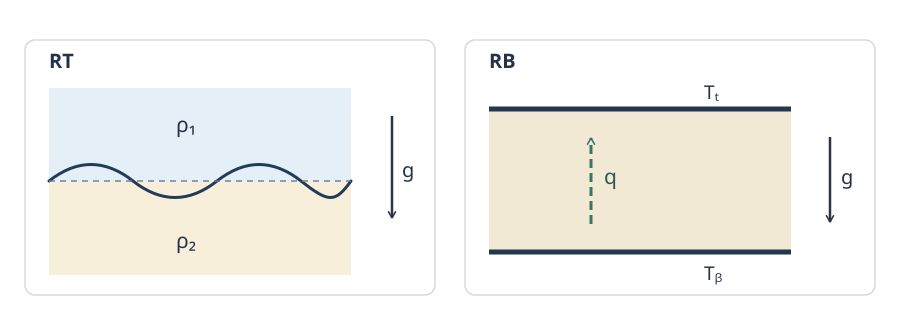

# FLUID35 重い流体が上にあると何が起きるか

## 0. 密度の上下が逆になると、何が波を大きくするのか

[FLUID31 の局所浮力試験](../FLUID31/index.md#prop-fluid31-parcel)では、安定な連続成層の流体粒子が元の高さへ戻る様子を調べた。[FLUID34 の二層分散関係](../FLUID34/index.md#thm-fluid34-dispersion)では、流速差による Kelvin–Helmholtz 不安定性を導いた。本講では**二層の速度差が零でも、上に重い流体があるだけで界面が増幅する**場合をまず求める。これが Rayleigh–Taylor 不安定性である。

後半では、一つの流体層を**下から温める**と鉛直方向の密度差が生まれ、粘性と熱拡散がその増幅を抑える Rayleigh–Bénard 対流を扱う。両者は「上方が重くなると浮力が復元力でなくなる」という直観を共有するが、鋭い界面と連続温度分布、非粘性と粘性、そして境界条件が異なる。したがって臨界値を同じ式で表してはいけない。

下図の左は**鋭い二層界面**（重い上層 $\rho_1$ と軽い下層 $\rho_2$）、右は**一層の加熱・伝導状態**（底板 $T_b>T_t$、上向きの熱流束 $q$）を表す模式図である。どちらも重力 $g$ は下向きだが、右図には二流体界面は存在せず、加熱層の伝導状態では流れがない。二つの枠に分けたのは、密度の跳びを伴う界面と固定温度の壁を、同じ種類の境界だと誤解しないためである。



本講でいう「不安定」は、**指定した静止状態の周りで方程式を線形化したとき、ある小振幅正規モードに正の時間成長率があること**を意味する。有限振幅の指状構造・混合・対流ロールの飽和をそのまま予言するものではない。

## 1. 二層界面：重い流体が上にある

水平座標を $x$、鉛直上向きを $z$、下向き重力加速度の大きさを $g>0$ とする。上層 $z>0$ の密度を $\rho_1>0$、下層 $z<0$ の密度を $\rho_2>0$ [kg/m$^3$] とし、どちらの背景流速も零とする。

界面は $z=\eta(x,t)$ であり、両層は半無限、密度一定、非圧縮・非粘性で、界面張力 $\sigma\ge0$ [N/m] は一定とする。各層内部の擾乱は無渦で遠方減衰し、回転・拡散・混合を無視する。

$k>0$ [m$^{-1}$] の単一水平波数を用いる。$\widehat\eta$ [m] は界面変位の複素振幅（第1.1節で用いる正規モードの係数）とし、初期に $k|\widehat\eta|\ll1$ の小勾配で一次化する。時間とともに増幅する枝では、この小勾配条件を各時刻で改めて確かめる。

山を少し上へ押した場所で上の流体が下より重ければ、軽い流体がその場所を持ち上げたことになる。界面を押し戻すはずの重力が、かえって変位を大きくする。そこで密度差の**向き**と無次元の比を先に決める。

<a id="def-fluid35-atwood"></a>

<!-- formal-statement-start -->
> **定義（Rayleigh–Taylor密度逆転とAtwood数）**  
> この二層模型で $\rho_1>\rho_2$ を**密度逆転**と呼ぶ。上層と下層の密度差の無次元指標を
>
$$
A_T=\frac{\rho_1-\rho_2}{\rho_1+\rho_2},\qquad -1<A_T<1
$$
>
> と定義し、Atwood 数と呼ぶ。$A_T>0$ が密度逆転、$A_T<0$ が安定な密度配置、$A_T=0$ が等密度である。
<!-- formal-statement-end -->

<!-- definition-example-start: def-fluid35-atwood -->
**定義の確認**：$\rho_1=1050,\rho_2=1000$ kg/m$^3$ なら両密度は正、$1050>1000$ なので密度逆転である。$A_T=50/2050=1/41>0$ となる。一方、密度を上下で入れ替えると $A_T=-1/41<0$。単に密度差の絶対値を使うと、この重要な判定を失う。
<!-- definition-example-end -->

### 1.1 圧力と運動学的境界条件から分散式へ

界面擾乱は次の正規モードで表す。

$$
\eta(x,t)=\operatorname{Re}\{\widehat\eta e^{i(kx-\omega t)}\}.
$$

ここで $\omega\in\mathbb C$ [s$^{-1}$] は複素角周波数である。[FLUID34 の正規モードと時間成長率](../FLUID34/index.md#def-fluid34-normal-mode)に従い、$\gamma=\operatorname{Im}\omega>0$ は増幅を表す。

以下の線形境界条件では、$\eta$ と $\phi_j$ を一時的に**実部を取る前の複素表示**として扱う（[FLUID34 の複素振幅による境界条件](../FLUID34/index.md#prop-fluid34-kinematic-amplitudes)）。実際の界面・速度は最後に実部を取る。

そこで $\partial_t\phi_j$ は複素表示の時間微分、$\eta_{xx}=\partial_x^2\eta$ は水平座標 $x$ に関する二階偏微分として用いる。

[FLUID34 の運動学的境界条件](../FLUID34/index.md#prop-fluid34-kinematic-amplitudes)を背景速度 $U_1=U_2=0$ に適用する。各層の擾乱速度ポテンシャルを

$$
\phi_1=C_1e^{-kz}e^{i(kx-\omega t)},\quad
\phi_2=C_2e^{kz}e^{i(kx-\omega t)}
$$

と書けば、上層・下層の鉛直微分がそれぞれ $-kC_1$ と $kC_2$ なので

$$
-i\omega\widehat\eta=-kC_1=kC_2,\qquad
C_1=\frac{i\omega}{k}\widehat\eta,\quad
C_2=-\frac{i\omega}{k}\widehat\eta.
$$

この対応は二つの層が同じ界面を共有することを表すが、**ポテンシャルの振幅が同じ**という条件ではない。重力による静水圧変化 $-\rho_jg\eta$ と [Young–Laplace圧力跳躍](../FLUID26/index.md#thm-fluid26-young-laplace)を併せると、下側圧力から上側圧力を引いた値は

$$
-\rho_2(\partial_t\phi_2+g\eta)
+\rho_1(\partial_t\phi_1+g\eta)=-\sigma\eta_{xx}
$$

となる。$\partial_t\phi_1=\omega^2\eta/k$、$\partial_t\phi_2=-\omega^2\eta/k$、$\eta_{xx}=-k^2\eta$ を代入する前に、上下の時間微分の符号差を確認する。

<a id="thm-fluid35-rt-growth"></a>

<!-- formal-statement-start -->
> **定理（Rayleigh–Taylorの分散関係と成長率）**  
> 上記の半無限二層、静止、非圧縮・非粘性・内部無渦、小振幅、遠方減衰、$\rho_1,\rho_2,g,k>0$、$\sigma\ge0$ の模型で、非零の界面正規モードが運動学的条件と線形圧力条件を満たす必要十分条件は
>
$$
\boxed{\omega^2=\frac{(\rho_2-\rho_1)gk+\sigma k^3}{\rho_1+\rho_2}
=-A_Tgk+\frac{\sigma k^3}{\rho_1+\rho_2}.}
$$
>
> 右辺が負のとき、二根は $\omega=\pm i\gamma$ で、成長枝の時間成長率は
>
$$
\boxed{\gamma(k)=\sqrt{A_Tgk-\frac{\sigma k^3}{\rho_1+\rho_2}}>0.}
$$
>
> 右辺が正なら二根は実数で、その単一モードは指数増大しない。零のときは重根なので、$\gamma=0$ だけからすべての初期値の有界性までは結論しない。
<!-- formal-statement-end -->

### 証明の見取り図

界面での静水圧変化を消してはならない。上下のポテンシャルには反対の鉛直指数が入り、同じ界面条件から $\omega^2$ の係数は $\rho_1+\rho_2$ になる。成長は $e^{-i\omega t}$ の虚部の符号で読む。

<!-- proof-start -->
### 証明

前述の運動学的条件から $\partial_t\phi_1=\omega^2\eta/k$、$\partial_t\phi_2=-\omega^2\eta/k$。これを圧力条件へ代入すると、非零の $\eta$ の係数として

$$
-\rho_2\left(-\frac{\omega^2}{k}+g\right)
+\rho_1\left(\frac{\omega^2}{k}+g\right)
=\sigma k^2.
$$

左辺を順に展開すると

$$
\frac{(\rho_1+\rho_2)\omega^2}{k}
+(\rho_1-\rho_2)g=\sigma k^2,
$$

したがって $k>0$ を掛け、正の $\rho_1+\rho_2$ で割って表示した分散式を得る。逆に分散式を満たす $\omega$ について任意の非零 $\widehat\eta$ を選び、上の $C_1,C_2$ を定めれば Laplace 方程式、無限遠減衰、運動学的条件、圧力条件を満たすので必要十分である。

$\omega^2=-\gamma^2<0$ なら $\omega=\pm i\gamma$、$\gamma=\sqrt{-\omega^2}>0$。$\omega=+i\gamma$ の枝では $e^{-i\omega t}=e^{\gamma t}$ と指数成長する。$\omega^2>0$ なら $\omega$ は実数で $|e^{-i\omega t}|=1$ である。
<!-- proof-end -->

**数値例**：$\rho_1=1050,\rho_2=1000$ kg/m$^3$、$g=9.81$ m/s$^2$、$\sigma=0.072$ N/m、$k=10$ m$^{-1}$ とすると

$$
\gamma^2=\frac{50\cdot9.81\cdot10-0.072\cdot10^3}{2050}
=\frac{4833}{2050}\simeq2.35756\ {\rm s^{-2}}.
$$

したがって $\gamma\simeq1.53543$ s$^{-1}$。この係数は密度の単位と張力の単位を含めても s$^{-2}$ となる。初期振幅 $10^{-5}$ m の成長枝は $0.2$ s 後に約 $1.36\cdot10^{-5}$ m となり、$k|\eta|<1.4\cdot10^{-4}$ だから、その時点では小勾配条件と整合している。

### 1.2 表面張力は短波を止められるか

上の成長率は $A_Tgk$ が**重力による増幅**、$\sigma k^3/(\rho_1+\rho_2)$ が**短波を戻す項**である。$\sigma=0$ なら、この半無限・非粘性の理想模型では成長率が $\sqrt{k}$ とともに無限に増え、特徴的な最速波長を選べない。これは現実の無限成長を意味せず、粘性・拡散・界面厚さ・非線形変形を捨てた模型の限界を示す。

<a id="prop-fluid35-rt-cutoff"></a>

<!-- formal-statement-start -->
> **命題（表面張力で選択される不安定波数帯と最速波数）**  
> [Rayleigh–Taylor分散関係](#thm-fluid35-rt-growth)の仮定に加えて $\rho_1>\rho_2$、$\sigma>0$ とする。指数成長する波数の集合は
>
$$
0<k<k_c,\qquad k_c=\sqrt{\frac{(\rho_1-\rho_2)g}{\sigma}}
$$
>
> であり、成長率が最大となる唯一の正波数と最大値は
>
$$
\boxed{k_*=\frac{k_c}{\sqrt3}},\qquad
\boxed{\gamma_{\max}^2=\frac23 A_Tgk_*}.
$$
>
> $k=k_c$ では $\gamma=0$ だが、重根の長時間挙動を指数成長率だけで判定しない。
<!-- formal-statement-end -->

### 証明の見取り図

$\gamma$ そのものではなく、正の領域で $\gamma^2(k)$ を微分する。$k$ をくくると不安定区間が直接出る。

<!-- proof-start -->
### 証明

$\Delta\rho=\rho_1-\rho_2>0$ と置けば

$$
\gamma^2(k)=\frac{k(\Delta\rho g-\sigma k^2)}{\rho_1+\rho_2}.
$$

$k>0$ なので正になる条件は $\Delta\rho g-\sigma k^2>0$。$\sigma>0$ で割ると $k^2<\Delta\rho g/\sigma$、したがって $0<k<k_c$。

次に

$$
\frac{d\gamma^2}{dk}=
\frac{\Delta\rho g-3\sigma k^2}{\rho_1+\rho_2}.
$$

正波数の停留点は $k_*^2=\Delta\rho g/(3\sigma)=k_c^2/3$。導関数はその前で正、その後で負だから、一意の最大点である。$\sigma k_*^2=\Delta\rho g/3$ を元の式へ戻すと

$$
\gamma^2(k_*)=\frac{k_*}{\rho_1+\rho_2}
\left(\Delta\rho g-\frac13\Delta\rho g\right)
=\frac23 A_Tgk_*.
$$
<!-- proof-end -->

先ほどの数値例では $k_c\simeq82.54$ m$^{-1}$、$k_*\simeq47.65$ m$^{-1}$。この値が予測するのは**線形モードの初期増幅率の最大**であって、完成した混合層の指の間隔ではない。

## 2. 加熱層：密度の連続変化と拡散が競争する

次に鋭い界面を捨て、同一の流体が $0<z<d$ に満たされた水平に無限（または水平周期的で十分広い）層を考える。$d>0$ は層厚 [m]。底板 $z=0$ を $T_b$、上板 $z=d$ を $T_t$ に一定温度で保ち、$\Delta T=T_b-T_t>0$ [K] とする。

物性として、基準密度 $\rho_0>0$、動粘性係数 $\nu>0$ [m$^2$/s]、熱拡散率 $\kappa>0$ [m$^2$/s]、熱膨張係数 $\alpha>0$ [K$^{-1}$] を**定数**とする。

$T_0$ を密度 $\rho_0$ を定める基準温度とする。$|\alpha(T-T_0)|\ll1$ の小密度差を仮定し、密度差は浮力だけに残す。慣性・非圧縮条件・粘性の密度には $\rho_0$ を用いる。

これは [FLUID31 の Boussinesq 近似](../FLUID31/index.md#def-fluid31-boussinesq)における**慣性と浮力での密度の扱い**を引き継いだものである。ただし、その非粘性・非拡散の設定は引き継がず、ここでは粘性 $\nu$ と熱拡散 $\kappa$ を保持する。

静止流体でも、温度は下から上へ直線的に下がり熱が伝導する。この**伝導基底状態**からの小さな速度・温度のずれを調べる。

<a id="def-fluid35-rayleigh"></a>

<!-- formal-statement-start -->
> **定義（Rayleigh–Bénardの伝導基底状態・Rayleigh数・Prandtl数）**  
> 水平無限層 $0<z<d$ の固定温度 $T_b>T_t$、定数 $g,\alpha,\nu,\kappa>0$ の Boussinesq 模型において、基底速度が零、基底温度が
>
$$
\overline T(z)=T_b-\beta z,\qquad
\beta=\frac{\Delta T}{d}>0
$$
>
> の状態を伝導基底状態と呼ぶ。無次元数を
>
$$
\boxed{\mathrm{Ra}=\frac{g\alpha\Delta T\,d^3}{\nu\kappa}},\qquad
\boxed{\mathrm{Pr}=\frac{\nu}{\kappa}}
$$
>
> と定義し、それぞれ Rayleigh 数、Prandtl 数と呼ぶ。以下の加熱層では $\mathrm{Ra}>0$、$\mathrm{Pr}>0$ である。
<!-- formal-statement-end -->

<!-- definition-example-start: def-fluid35-rayleigh -->
**定義の確認**：$g=10$ m/s$^2$、$\alpha=0.003$ K$^{-1}$、$\Delta T=10$ K、$d=8\cdot10^{-4}$ m、$\nu=10^{-6}$ m$^2$/s、$\kappa=1.5\cdot10^{-7}$ m$^2$/s の仮想的な定物性流体なら、両板の温度差は正、物性は全て正で、$\alpha\Delta T=0.03\ll1$ という近似も概ね満たす。$\beta=12500$ K/m で $\overline T(0)=T_b$、$\overline T(d)=T_b-\Delta T=T_t$ を直接確かめられる。

$$
\mathrm{Ra}=\frac{10\cdot0.003\cdot10\cdot(8\cdot10^{-4})^3}
{10^{-6}\cdot1.5\cdot10^{-7}}=1024,\qquad
\mathrm{Pr}=\frac{10^{-6}}{1.5\cdot10^{-7}}=\frac{20}{3}.
$$

分子の単位は $(\mathrm{m/s^2})(\mathrm{K^{-1}})(\mathrm K)(\mathrm{m^3})=\mathrm{m^4/s^2}$、分母も $(\mathrm{m^2/s})^2=\mathrm{m^4/s^2}$ だから両方無次元である。これは模型パラメータの例であり、特定の実験装置の測定値を表すものではない。
<!-- definition-example-end -->

**加熱の向きに注意**：上を加熱した $\Delta T<0$ の別の配置では、同じ正の $g,\alpha,\nu,\kappa$ を使えば $\mathrm{Ra}<0$ と拡張して書くこともある。本章の閾値定理は「下を温めた $\Delta T>0$」の設定で証明する。

## 3. なぜ温度と鉛直速度の固有値問題になるのか

温度のずれを $\theta=T-\overline T$、速度の擾乱を $\boldsymbol u=(u,w)$ とする。圧力は伝導基底状態の静水圧分布を引いたずれを $p'$ とする。$x$ 方向と $z$ 方向の二次元擾乱だけを書くが、水平二方向では水平波数の大きさを使えば同じ結果となる。正の温度差は密度を $\rho'\simeq-\rho_0\alpha\theta$ だけ減らすので、鉛直上向きの浮力加速度は $+g\alpha\theta$ である。

非圧縮・Boussinesq の運動量・温度方程式をこの静止した伝導状態の周りで一次化すると

$$
\partial_t\boldsymbol u=-\frac{\nabla p'}{\rho_0}
+\nu\nabla^2\boldsymbol u+g\alpha\theta\,\boldsymbol e_z,
\quad \nabla\cdot\boldsymbol u=0,
$$

$$
\partial_t\theta-\beta w=\kappa\nabla^2\theta.
$$

後式の負号は、流体粒子の鉛直速度 $w$ が基底温度を移流する項 $w\overline T'(z)=-\beta w$ から現れる。

ここでプライム $\overline T'(z)=d\overline T/dz$ は**高さ $z$ に関する常微分**であり、$\partial_t\theta$ は $z$ を固定した時間偏微分である。$T=\overline T(z)+\theta(x,z,t)$ を温度の移流項へ代入すると、一次の項は

$$
w\frac{d\overline T}{dz}=-\beta w
$$

となる。暖かい流体粒子が少し上昇すると周囲より高温になり、浮力がさらに上向きに働く。この**正の帰還**と粘性・熱拡散の競争が重要である。

固定温度の両板では $\theta=0$ とする。まず計算可能な**自由滑り（接線方向の粘性応力零）・不透過**の境界条件を採用する。水平擾乱波数 $k_h>0$ の正規モードについて、両壁で $w=0$ と $\partial_z^2w=0$ を要求する。

後者は非圧縮条件 $\partial_xu+\partial_zw=0$ と接線応力条件 $\partial_zu+\partial_xw=0$ から導く。壁で全ての $x$ に対し $w=0$ なので $\partial_xw=0$ であり、接線応力条件は $\partial_zu=0$ となる。

さらに非圧縮条件を $z$ で微分すると

$$
\partial_x\partial_zu+\partial_z^2w=0.
$$

壁上で $\partial_zu=0$ が全ての $x$ に対して成り立つため $\partial_x\partial_zu=0$、従って $\partial_z^2w=0$ である。**無滑り壁**の $u=w=0$ とは異なる。

### 3.1 圧力を消すと何が残るか

まず二次元の非圧縮条件 $\partial_xu+\partial_zw=0$ を時間微分し、運動量方程式の発散を使う。圧力に関して

$$
0=-\frac{\nabla^2p'}{\rho_0}+g\alpha\partial_z\theta
$$

だから $\nabla^2p'/\rho_0=g\alpha\partial_z\theta$ である。鉛直運動量式

$$
(\partial_t-\nu\nabla^2)w=-\frac{\partial_zp'}{\rho_0}+g\alpha\theta
$$

の両辺へ $\nabla^2$ を施し、圧力の関係を代入すると

$$
(\partial_t-\nu\nabla^2)\nabla^2w
=-g\alpha\partial_z^2\theta+g\alpha\nabla^2\theta
=g\alpha\partial_x^2\theta.
$$

この操作によって**圧力の未知量が消え**、温度 $\theta$ と鉛直速度 $w$ の二つだけになった。

### 3.2 壁条件を満たす正規モードを作る

鉛直方向の正弦関数 $\sin(n\pi z/d)$（整数 $n\ge1$）は $z=0,d$ で零となり、二回微分しても $-(n\pi/d)^2\sin(n\pi z/d)$ なので二階微分も両壁で零になる。したがって、この基底は先ほどの**不透過・自由滑り・固定温度**条件をすべて満たす。これは固有値を「突然計算する」のではなく、壁条件から正弦基底を選ぶ理由である。

波数 $k_h>0$、複素成長率 $s$ [s$^{-1}$]、非零整数 $n$ を使い

$$
w=W_0\sin\left(\frac{n\pi z}{d}\right)e^{ik_hx+st},\quad
\theta=\Theta_0\sin\left(\frac{n\pi z}{d}\right)e^{ik_hx+st}
$$

とする。ここで $W_0$ [m/s] と $\Theta_0$ [K] は複素振幅であり、実部が物理的擾乱である。$q>0$ を水平波数と鉛直波数を合成した波数とし、$q^2=k_h^2+n^2\pi^2/d^2$ [m$^{-2}$] と置くと、$\nabla^2w=-q^2w$、$\partial_x^2\theta=-k_h^2\theta$ である。前小節の圧力消去式と温度式をそれぞれ代入して

$$
(s+\nu q^2)q^2 W_0=g\alpha k_h^2\Theta_0,
\qquad
(s+\kappa q^2)\Theta_0=\beta W_0
$$

を得る。これが二つの振幅を結ぶ線形連立方程式である。

<a id="thm-fluid35-rb-eigen"></a>

<!-- formal-statement-start -->
> **定理（自由滑り等温壁のRayleigh–Bénard固有値方程式）**  
> $d,\rho_0,g,\alpha,\nu,\kappa>0$、$\Delta T>0$、水平方向無限、上下壁を固定温度・不透過・自由滑り、非回転・Boussinesq・定物性とする線形加熱層を考える。整数 $n\ge1$、水平波数 $k_h>0$ の正弦鉛直モードについて、
>
$$
a=k_hd,\quad Q=a^2+n^2\pi^2,\quad
\lambda=\frac{s d^2}{\kappa},\quad \mathrm{Pr}=\frac{\nu}{\kappa},
\quad \mathrm{Ra}=\frac{g\alpha\Delta T d^3}{\nu\kappa}
$$
>
> と置く。非零の速度・温度擾乱が存在する必要十分条件は
>
$$
\boxed{(\lambda+\mathrm{Pr}Q)(\lambda+Q)Q
=\mathrm{Pr}\,\mathrm{Ra}\,a^2.}
$$
>
> このモードの無次元時間成長率の二根は
>
$$
\boxed{\lambda_\pm=-\frac{(\mathrm{Pr}+1)Q}{2}
\pm\sqrt{\frac{(\mathrm{Pr}-1)^2Q^2}{4}
+\frac{\mathrm{Pr}\,\mathrm{Ra}\,a^2}{Q}}.}
$$
>
> $\mathrm{Ra}>0$ なら二根は実数で、$\lambda_+>0$ となる必要十分条件は
> $\mathrm{Ra}>(a^2+n^2\pi^2)^3/a^2$ である。
<!-- formal-statement-end -->

### 証明の見取り図

前小節の $W_0,\Theta_0$ の連立式を、それぞれ波数・時間・温度・速度の基準尺度で無次元化する。固有値が行列の行列式を零にする条件へつながることを確認し、正の根の条件は**定数項の符号**で読む。

<!-- proof-start -->
### 証明

$k_h=a/d$、$q^2=Q/d^2$、$s=\kappa\lambda/d^2$、$\beta=\Delta T/d$ とし、温度振幅を $\Theta_0=\beta d\,\Theta$、速度振幅を $W_0=(\kappa/d)W$ と無次元化する。

温度式では

$$
\left(\frac{\kappa}{d^2}\lambda+\frac{\kappa}{d^2}Q\right)(\beta d\,\Theta)
=\beta\frac{\kappa}{d}W
$$

なので $(\lambda+Q)\Theta=W$。鉛直速度式の左辺は

$$
\left(\frac{\kappa\lambda+\nu Q}{d^2}\right)
\frac{Q}{d^2}\frac{\kappa W}{d}
=\frac{\kappa^2}{d^5}(\lambda+\mathrm{Pr}Q)QW.
$$

右辺は $g\alpha(a^2/d^2)(\beta d\Theta)=g\alpha\beta a^2\Theta/d$。両辺を $\kappa^2/d^5$ で割り、$g\alpha\beta d^4/\kappa^2=\mathrm{Pr}\,\mathrm{Ra}$ を使うと

$$
(\lambda+\mathrm{Pr}Q)QW=\mathrm{Pr}\,\mathrm{Ra}\,a^2\Theta.
$$

よって二成分の方程式は

$$
\begin{pmatrix}
\lambda+\mathrm{Pr}Q&-\mathrm{Pr}\,\mathrm{Ra}\,a^2/Q\\
-1&\lambda+Q
\end{pmatrix}
\begin{pmatrix}W\\\Theta\end{pmatrix}=\begin{pmatrix}0\\0\end{pmatrix}.
$$

$Q>0$ だから非零解が存在する必要十分条件は行列式が零となること。行列式に $Q$ を掛ければ表示した固有値方程式を得る。これを展開して

$$
\lambda^2+(\mathrm{Pr}+1)Q\lambda+
\mathrm{Pr}\left(Q^2-\frac{\mathrm{Ra}a^2}{Q}\right)=0.
$$

二次式を平方完成して両根を求める。判別式の四分の一は

$$
\frac{(\mathrm{Pr}+1)^2Q^2}{4}
-\mathrm{Pr}Q^2+\frac{\mathrm{Pr}\,\mathrm{Ra}a^2}{Q}
=\frac{(\mathrm{Pr}-1)^2Q^2}{4}
+\frac{\mathrm{Pr}\,\mathrm{Ra}a^2}{Q},
$$

なので二根の式を得る。$\mathrm{Pr}>0,Q>0$ より二根の和は負、判別式は非負。定数項が負なら根の積が負で $\lambda_+>0>\lambda_-$。定数項が零なら $\lambda_+=0$。正なら根の和が負、積が正なので二根とも負。したがって $\lambda_+>0$ は $Q^3<\mathrm{Ra}a^2$ と同値である。
<!-- proof-end -->

**意味**：$\lambda=s d^2/\kappa$ なので実際の増幅率は $s=\kappa\lambda/d^2$。$\lambda_+>0$ は熱拡散時間 $d^2/\kappa$ を単位とした指数成長である。[RTの $\gamma$](#thm-fluid35-rt-growth) と違い、$\nu$ と $\kappa$ が必ず式に入る。壁に沿って周期的な対流模様が最初に成長し始めるかを調べているのであり、非線形対流セルの完成形を描いたわけではない。

**固有モードの条件確認**：$n=1$ の $\sin(\pi z/d)$ は上下板で $0$、$\partial_z^2\sin(\pi z/d)=-(\pi/d)^2\sin(\pi z/d)$ も板で $0$。$\theta$ も同じ正弦形だから固定温度条件を満たす。$\Theta$ と $W$ の非零固有ベクトルは上の $2$ 行から再構成でき、例えば $\Theta=W/(\lambda+Q)$（$\lambda+Q\ne0$ の場合）である。この場合 $\lambda_+$ は $\mathrm{Ra}>0$ で $\lambda_+>-Q$ なので、増幅枝の固有ベクトルを確実に作れる。

## 4. 臨界 Rayleigh 数：どこまで温めると成長するか

前節の $\mathrm{Ra}>(a^2+n^2\pi^2)^3/a^2$ は、特定の水平波数と鉛直モードに関する条件である。実際には**どれか一つでも**正の成長率をもてば伝導状態は線形不安定になる。すべての $a>0$ と $n\ge1$ の中で最も小さい閾値を探す。

<a id="thm-fluid35-rb-critical"></a>

<!-- formal-statement-start -->
> **定理（自由滑り等温壁の臨界Rayleigh数）**  
> [自由滑り等温壁の固有値方程式](#thm-fluid35-rb-eigen)と同じ仮定の下、すべての正弦鉛直モードと正の水平波数を通じた線形不安定の発生閾値は
>
$$
\boxed{\mathrm{Ra}_c=\frac{27\pi^4}{4}\simeq657.511},\qquad
\boxed{a_c=\frac{\pi}{\sqrt2}\simeq2.22144}
$$
>
> である。$\mathrm{Ra}<\mathrm{Ra}_c$ ではすべての非零水平波数の正規モードで $\lambda_+<0$、$\mathrm{Ra}>\mathrm{Ra}_c$ では正の成長率をもつモードが存在する。等号での臨界モードは中立である。
<!-- formal-statement-end -->

### 証明の見取り図

正の $a^2$ を変数にすれば、三乗の分子をもつ一変数関数の最小値になる。鉛直方向は $n=1$ が最も不安定になりやすいことを先に示す。

<!-- proof-start -->
### 証明

$Q=a^2+n^2\pi^2$ とし、[固有値の成長条件](#thm-fluid35-rb-eigen)から各モードの中立曲線は

$$
\mathrm{Ra}_n(a)=\frac{(a^2+n^2\pi^2)^3}{a^2}.
$$

$a>0$ を固定すると、$n$ を増やすほど分子が厳密に増えるので $\mathrm{Ra}_n(a)\ge\mathrm{Ra}_1(a)$。従って最小値は $n=1$ から探せる。

$x=a^2>0$、$c=\pi^2$ として $f(x)=(x+c)^3/x$ と置く。商の微分を省略せず書くと

$$
f'(x)=\frac{3(x+c)^2x-(x+c)^3}{x^2}
=\frac{(x+c)^2(2x-c)}{x^2}.
$$

従って $0<x<c/2$ では負、$x>c/2$ では正であり、唯一の最小点は $x=c/2$。両端で $f(x)\to+\infty$ だからこれは大域的最小である。代入すると

$$
a_c^2=\frac{\pi^2}{2},\qquad
f\left(\frac{\pi^2}{2}\right)=
\frac{(3\pi^2/2)^3}{\pi^2/2}
=\frac{27\pi^4}{4}.
$$

最後に、[固有値定理](#thm-fluid35-rb-eigen)で $\mathrm{Ra}<\mathrm{Ra}_n(a)$ と $\lambda_+<0$ が同値だった。最小値より下なら全モード減衰、最小値を超えれば $n=1,a=a_c$ のモードは $\lambda_+>0$、等号なら $\lambda_+=0$ となる。
<!-- proof-end -->

水平方向の臨界波長は $\ell_c=2\pi/k_h=2\pi d/a_c=2\sqrt2\,d$。波数 $a_c$ は**無次元**であり、波長を計算するときには層厚 $d$ を戻す。

### 4.1 壁を固くしたら、657.5のままでよいか

**いけない。** ここまでの正弦鉛直モードは自由滑り壁の条件 $w=w''=0$ と固定温度 $\theta=0$ に適合する。両板を無滑り（剛体）へ替えると水平速度も壁で零、非圧縮条件から $w=w'=0$ が必要になる。$w=\sin(\pi z/d)$ は壁で $w'\ne0$ だから、**もはや試験関数ですらない**。

定常中立（$s=0$）では、前節の**定数の振幅 $W,\Theta$ とは区別して**、高さに依存する鉛直速度振幅 $\mathcal W(z)$ と温度振幅 $\mathcal T(z)$ を

$$
w(x,z,t)=\operatorname{Re}\{\mathcal W(z)e^{ik_hx}\},\qquad
\theta(x,z,t)=\operatorname{Re}\{\mathcal T(z)e^{ik_hx}\}
$$

と置く。$D_z=d/dz$ は $z$ だけを動かす常微分であり、$L=D_z^2-k_h^2$ と書く。圧力消去式と温度式（第3.1節）へ代入すると、$\partial_x^2\mapsto-k_h^2$ なので

$$
-\nu L^2\mathcal W=-g\alpha k_h^2\mathcal T,
\qquad -\beta\mathcal W=\kappa L\mathcal T.
$$

$g,\alpha,k_h>0$ であるから第1式より $\mathcal T=\nu L^2\mathcal W/(g\alpha k_h^2)$ と解ける。これを第2式へ代入して両辺へ $g\alpha k_h^2/(\nu\kappa)$ を掛けると

$$
\boxed{\left(D_z^2-k_h^2\right)^3\mathcal W
=-\frac{g\alpha\beta}{\nu\kappa}k_h^2\mathcal W.}
$$

上下の**無滑り・固定温度**壁では $w=0$ より $\mathcal W=0$、水平速度 $u=0$ と非圧縮条件 $ik_hu+D_z\mathcal W=0$ より $D_z\mathcal W=0$。さらに固定温度 $\mathcal T=0$ は上の第1式を介して $L^2\mathcal W=0$ と同値になる。すなわち両壁で

$$
\mathcal W=D_z\mathcal W=(D_z^2-k_h^2)^2\mathcal W=0.
$$

これは先ほどの正弦関数を代入するだけでは解けない、別の六階境界値・固有値問題である。

この問題を数値的に解いた古典的な基準値は、水平無限・上下とも**無滑りかつ固定温度**の場合、$\mathrm{Ra}_c\simeq1707.762$、$a_c\simeq3.117$。これは本講で解析的に証明した $657.511$ から**自動的に導いた値ではなく**、別の固有値問題の数値基準値として引用する（[Scholarpedia: Rayleigh–Bénard convection](https://www.scholarpedia.org/article/Rayleigh-B%C3%A9nard_convection)）。片側だけ自由滑り、一定熱流束境界、有限幅・回転付きでは、さらに別の条件と閾値が必要となる。

先ほどの $\mathrm{Ra}=1024$ の仮想流体なら、自由滑りの無限層では $1024>657.511$ なので線形不安定だが、上下無滑り・固定温度の無限層では $1024<1707.762$ なので臨界値未満である。同じ温度差でも**境界条件を言わずに「対流する」と判定するのは誤り**である。

## 5. ブラウザPython：分散根・固有値と二つの中立曲線

実験では [Pythonソース](instability_lab.py) を同じページの実行欄で用いる。Rayleigh–Taylor では解析分散式から成長率対波数と線形界面変位を表示し、Rayleigh–Bénard では自由滑り・固定温度壁に限って、正弦鉛直モードの**二次元振幅行列**の固有値を求める。数値曲線は数学的な線形模型の評価であって、混合・乱流・非線形対流の直接数値計算ではない。

RT 入力は $\rho_1,\rho_2,g,\sigma,k,\widehat\eta,t$（SI単位）、RBC は $\mathrm{Ra},\mathrm{Pr},a,n$（無次元）である。RBC の成長時間 $\lambda$ は $\kappa/d^2$ の逆数を掛けて物理時間に戻す。$n=1$ の中立曲線と時間成長率の図は、固有値方程式の残差で数値照合する。$n>1$ を指定すると選択モードの固有値が変わるが、中立曲線の図は比較しやすいよう**常に $n=1$** を表示する。

```python-file-lab
# lab-id: FLUID35-RT-RBC-EIGEN
# lab-title: RTの波数帯とRBCの自由滑り固有値・臨界条件
# lab-file: textbook/volumes/dream_thater/物理系/FLUID/FLUID35/instability_lab.py
# timeout-ms: 15000
# lab-preset: RT密度逆転・RBC臨界超え | --rho1 1050 --rho2 1000 --k 10 --ra 800 --a 2.2
# lab-preset: RT張力で短波安定 | --rho1 1050 --rho2 1000 --k 150 --ra 500
# lab-preset: RT密度順序を戻す | --rho1 1000 --rho2 1050 --k 10 --ra 500
# lab-preset: RBC自由滑り臨界付近 | --ra 657.511 --a 2.22144
# lab-preset: RBC第2鉛直モード | --ra 800 --a 2.2 --n 2
```

**ラボの見方**：RTでは $0<k<k_c$ でのみ $\gamma>0$、$\sigma>0$ のとき $k=k_*$ の近くに成長率の頂点がある。RBCでは $\mathrm{Ra}_1(a)$ が $a=\pi/\sqrt2$ で最小になり、$\mathrm{Ra}=800$ のとき $\lambda_1(a)$ はある帯域で正となる。ラボが報告する残差は**採用した線形固有値式への実装一致**の確認であり、別の壁条件に適用できることの証明ではない。局所増幅の表示は $k|\eta|<0.1$ に制限しており、増幅が続いてこの仮定が破れた先は表示しない。

## 6. 演習：符号・境界・固有値を自力で検算する

RTの設問は特記なければ第1節の二層・半無限・非粘性・非圧縮・小振幅模型、RBCの設問は特記なければ第2〜4節の定物性Boussinesq・水平無限・固定温度・自由滑り模型とする。波数と物理量は各設問で与える。

### Level A

### A1. Atwood数だけで増幅の向きを判定する

上層密度 $\rho_1=1200$、下層密度 $\rho_2=800$ kg/m$^3$、表面張力 $\sigma=0$、$g>0,k>0$ とする。Atwood数と $\omega^2$ の符号を求め、密度を上下で入れ替えたときの判定も述べよ。

- Level: A

<!-- solution-start -->
#### 詳細解答

[定義](#def-fluid35-atwood)により $A_T=(1200-800)/(1200+800)=400/2000=0.2$。上層の方が重く、[RT分散式](#thm-fluid35-rt-growth)で $\sigma=0$ とすると $\omega^2=-0.2gk<0$、増幅枝は $\gamma=\sqrt{0.2gk}>0$ である。上下を入れ替えると $A_T=-0.2$、$\omega^2=+0.2gk>0$ なので、この単一モードは振動する。
<!-- solution-end -->

### A2. 毛管安定化の境界波数

$\rho_1=1100,\rho_2=1000$ kg/m$^3$、$g=10$ m/s$^2$、$\sigma=0.1$ N/m とする。RTの不安定波数区間を求め、$k=50,150$ m$^{-1}$ のどちらが増幅するか判定せよ。

- Level: A

<!-- solution-start -->
#### 詳細解答

$\Delta\rho=100$ kg/m$^3>0$ だから [不安定波数帯の命題](#prop-fluid35-rt-cutoff)を適用できる。$k_c=\sqrt{100\cdot10/0.1}=\sqrt{10000}=100$ m$^{-1}$。従って不安定区間は $0<k<100$ m$^{-1}$。$50<100$ では分散式の $\omega^2<0$ により実数の $\gamma>0$ が定義できる。$150>100$ では $\omega^2>0$ で根は実数となり、指数増幅しない。$\gamma^2$ を安定域まで負値で延長して実数の成長率と混同してはならない。
<!-- solution-end -->

### A3. 正弦モードの壁条件

厚さ $d>0$ のRBC層で $W(z)=W_0\sin(2\pi z/d)$、$\Theta(z)=\Theta_0\sin(2\pi z/d)$ とする。上下壁の $W,W'',\Theta$ を求め、この形の鉛直モード番号を答えよ。

- Level: A

<!-- solution-start -->
#### 詳細解答

$z=0,d$ で $\sin(0)=\sin(2\pi)=0$ なので $W=\Theta=0$。二回微分すると $W''(z)=-(2\pi/d)^2W_0\sin(2\pi z/d)$ であり、両壁で $W''=0$。従って固定温度 $\Theta=0$ と自由滑り・不透過 $W=W''=0$ を全て満たす。正弦関数 $\sin(n\pi z/d)$ と比べて $n=2$ であり、$n=1$ の基底モードとは異なる。
<!-- solution-end -->

### A4. Rayleigh数とPrandtl数の次元

$g=10$ m/s$^2$、$\alpha=10^{-3}$ K$^{-1}$、$\Delta T=10$ K、$d=10^{-3}$ m、$\nu=10^{-6}$ m$^2$/s、$\kappa=10^{-7}$ m$^2$/s とする。Rayleigh数とPrandtl数を求め、無次元性を確認せよ。

- Level: A

<!-- solution-start -->
#### 詳細解答

[定義](#def-fluid35-rayleigh)へ代入する。分子は $10\cdot10^{-3}\cdot10\cdot(10^{-3})^3=10^{-10}$ m$^4$/s$^2$、分母は $10^{-6}\cdot10^{-7}=10^{-13}$ m$^4$/s$^2$。従って $\mathrm{Ra}=1000$。$\mathrm{Pr}=10^{-6}/10^{-7}=10$ である。Rayleigh数の分子には $g\alpha\Delta T d^3$ なので温度単位 K が $\alpha$ と $\Delta T$ の間で相殺し、長さ・時間は $\mathrm{m^4/s^2}$ に一致する。
<!-- solution-end -->

### A5. 温度差の臨界値

自由滑り・等温壁の層で $d,\nu,\kappa,g,\alpha>0$ を固定し、下側を加熱して $\Delta T>0$ とする。最初の線形不安定が現れる温度差 $\Delta T_c$ を記号で求めよ。

- Level: A

<!-- solution-start -->
#### 詳細解答

[臨界値の定理](#thm-fluid35-rb-critical)により $\mathrm{Ra}_c=27\pi^4/4$。[Rayleigh数の定義](#def-fluid35-rayleigh)は $\mathrm{Ra}=g\alpha\Delta T d^3/(\nu\kappa)$。分母・係数はすべて正なので、不安定となる $\mathrm{Ra}>\mathrm{Ra}_c$ を $\Delta T$ について解ける：

$$
\Delta T>\frac{\nu\kappa}{g\alpha d^3}\frac{27\pi^4}{4}.
$$

従って $\Delta T_c=27\pi^4\nu\kappa/(4g\alpha d^3)$ [K] であり、等号は中立条件である。
<!-- solution-end -->

### Level B

### B1. RTの最速成長を導出し直す

$\rho_1>\rho_2>0$、$\sigma>0$、$g>0$ とし、半無限二層の RT 分散式を出発点に、成長可能な $k$ の範囲と最速成長波数 $k_*$、最大成長率 $\gamma_{\max}$ を求めよ。$\sigma=0$ の極限に最速有限波数があるかも述べよ。

- Level: B

<!-- solution-start -->
#### 詳細解答

[RT分散関係](#thm-fluid35-rt-growth)に $\Delta\rho=\rho_1-\rho_2>0$ を入れると $\gamma^2=k(\Delta\rho g-\sigma k^2)/(\rho_1+\rho_2)$。分母と $k$ は正なので $\gamma^2>0$ は $k^2<\Delta\rho g/\sigma$、つまり $0<k<k_c=\sqrt{\Delta\rho g/\sigma}$。この範囲で $\gamma^2$ を微分すると

$$
\frac{d\gamma^2}{dk}=
\frac{\Delta\rho g-3\sigma k^2}{\rho_1+\rho_2}.
$$

ゆえに増加から減少に転じる点 $k_*=\sqrt{\Delta\rho g/(3\sigma)}=k_c/\sqrt3$ が最大点である。この点で $\sigma k_*^2=\Delta\rho g/3$ なので

$$
\gamma_{\max}=
\sqrt{\frac{k_*(\Delta\rho g-\Delta\rho g/3)}{\rho_1+\rho_2}}
=\sqrt{\frac23 A_Tgk_*}.
$$

$\sigma=0$ の場合は $\gamma=\sqrt{A_Tgk}$ が $k$ とともに増加し続けるため、この非粘性理想模型には有限の最速波数はない。
<!-- solution-end -->

### B2. 二成分固有値の行列式を自分で展開する

自由滑り・固定温度のRBCで $a>0,n\ge1$、$Q=a^2+n^2\pi^2$ とする。無次元振幅 $W,\Theta$ が $(\lambda+\mathrm{Pr}Q)QW=\mathrm{Pr}\,\mathrm{Ra}a^2\Theta$、$(\lambda+Q)\Theta=W$ を満たす。行列式から二次固有値式を導き、成長する根があるための条件を示せ。

- Level: B

<!-- solution-start -->
#### 詳細解答

最初の式を正の $Q$ で割れば $(\lambda+\mathrm{Pr}Q)W-(\mathrm{Pr}\,\mathrm{Ra}a^2/Q)\Theta=0$、次の式は $-W+(\lambda+Q)\Theta=0$。非零ベクトルが存在するには

$$
\begin{vmatrix}
\lambda+\mathrm{Pr}Q&-\mathrm{Pr}\,\mathrm{Ra}a^2/Q\\
-1&\lambda+Q
\end{vmatrix}
=(\lambda+\mathrm{Pr}Q)(\lambda+Q)
-\frac{\mathrm{Pr}\,\mathrm{Ra}a^2}{Q}=0.
$$

これを展開して $\lambda^2+(\mathrm{Pr}+1)Q\lambda+\mathrm{Pr}(Q^2-\mathrm{Ra}a^2/Q)=0$。$\mathrm{Pr},Q>0$ だから根の和は負である。$\mathrm{Ra}>0$ なら判別式は $(\mathrm{Pr}-1)^2Q^2+4\mathrm{Pr}\,\mathrm{Ra}a^2/Q\ge0$。積が負のとき正の根が1個あり、それは $Q^2-\mathrm{Ra}a^2/Q<0$、すなわち $\mathrm{Ra}>Q^3/a^2$ と同値である。
<!-- solution-end -->

### B3. 水平波数と鉛直モードを両方最適化する

自由滑り・固定温度RBCの中立曲線 $\mathrm{Ra}_n(a)=(a^2+n^2\pi^2)^3/a^2$（$a>0,n\ge1$）について、全モードの最小値と対応する水平波数を導け。$a\to0$ と $a\to\infty$ で閾値がどうなるか述べよ。

- Level: B

<!-- solution-start -->
#### 詳細解答

$n\ge1$ なので $n^2\pi^2\ge\pi^2$、従って固定した $a>0$ では分子が最小の $n=1$ が候補。$x=a^2$ と置くと $f(x)=(x+\pi^2)^3/x$。微分を通分して

$$
f'(x)=\frac{3(x+\pi^2)^2x-(x+\pi^2)^3}{x^2}
=\frac{(x+\pi^2)^2(2x-\pi^2)}{x^2}.
$$

$x=\pi^2/2$ で負から正に変化するので、$a_c=\sqrt x=\pi/\sqrt2$、$\mathrm{Ra}_c=((3\pi^2/2)^3)/(\pi^2/2)=27\pi^4/4$。$a\to0$ なら分母 $a^2\to0$ に対し分子は $\pi^6$ へ近づくので $+\infty$、$a\to\infty$ なら分子 $\sim a^6$、分母 $a^2$ だから $\sim a^4\to\infty$ となる。長波も極短波もこの設定では最初に成長するモードにならない。
<!-- solution-end -->

### B4. 上から加熱した場合に不安定は起きるか

固定温度・自由滑りのBoussinesq層について $\Delta T<0$、したがって $\beta<0$ とする。前節と同じ線形化を使い、$a>0,n\ge1$、$\mathrm{Pr}>0$ の正弦モードが指数成長しないことを、固有値多項式の係数から示せ。

- Level: B

<!-- solution-start -->
#### 詳細解答

[RBC固有値導出](#thm-fluid35-rb-eigen)は温度式の $\beta$ の符号をそのまま保つので、$\mathrm{Ra}=g\alpha\beta d^4/(\nu\kappa)<0$ と拡張しても

$$
\lambda^2+(\mathrm{Pr}+1)Q\lambda+
\mathrm{Pr}\left(Q^2-\frac{\mathrm{Ra}a^2}{Q}\right)=0
$$

を得る。$\mathrm{Ra}<0$ だから定数項は $\mathrm{Pr}(Q^2+|\mathrm{Ra}|a^2/Q)>0$、一次係数も $(\mathrm{Pr}+1)Q>0$。判別式が正なら二根は実で、和が負・積が正なので双方負。判別式が負なら二根は共役複素数で、実部は $-(\mathrm{Pr}+1)Q/2<0$。どちらも $\operatorname{Re}\lambda<0$ である。下から温めた場合に導いた $\mathrm{Ra}_c$ の不等号をそのまま流用するのでなく、**温度勾配の符号を戻して**判定する。
<!-- solution-end -->

### Level C

### C1. 界面の増幅と加熱層の閾値を混同しない

次の二つの独立な模型を比較せよ。

(i) RT：上層密度 $\rho_1=1050$、下層密度 $\rho_2=1000$ kg/m$^3$、$g=9.81$ m/s$^2$、$\sigma=0.072$ N/m、$k=10$ m$^{-1}$、初期振幅 $10^{-5}$ m とする。Atwood数、$\gamma$、$k_c,k_*$、$t=0.2$ s での振幅と $k|\eta|$ を計算し、$k=150$ m$^{-1}$ の増幅の有無も判定せよ。

(ii) RBC：$g=10$ m/s$^2$、$\alpha=0.003$ K$^{-1}$、$\Delta T=10$ K、$d=8\cdot10^{-4}$ m、$\nu=10^{-6}$ m$^2$/s、$\kappa=1.5\cdot10^{-7}$ m$^2$/s の仮想的な定物性Boussinesq流体とする。$\mathrm{Ra},\mathrm{Pr}$ を求め、上下固定温度・自由滑りの無限層と、上下固定温度・無滑りの無限層で、線形伝導基底状態が不安定かを別々に判定せよ。自由滑りの場合の臨界水平方向波長を求めよ。どちらの模型でも線形結果だけから主張できない現象を一つずつ述べよ。

- Level: C

<!-- solution-start -->
#### 詳細解答

(i) [Atwood数](#def-fluid35-atwood)は $A_T=50/2050=1/41\simeq0.0243902$。$\rho_1>\rho_2$ で、[RT分散式](#thm-fluid35-rt-growth)を $k=10$ に適用すると

$$
\gamma^2=A_Tgk-\frac{\sigma k^3}{\rho_1+\rho_2}
=\frac{50\cdot9.81\cdot10-0.072\cdot1000}{2050}
=\frac{4833}{2050}\simeq2.35756\ {\rm s^{-2}}.
$$

よって $\gamma\simeq1.53543$ s$^{-1}$。$\sigma>0$ なので [不安定波数帯](#prop-fluid35-rt-cutoff)を使え、$k_c=\sqrt{50\cdot9.81/0.072}\simeq82.54$ m$^{-1}$、$k_*=k_c/\sqrt3\simeq47.65$ m$^{-1}$。$t=0.2$ s の増幅係数は $e^{1.53543\cdot0.2}=e^{0.307086}\simeq1.3594$、従って振幅は約 $1.36\cdot10^{-5}$ m、$k|\eta|\simeq1.36\cdot10^{-4}\ll1$。$k=150>k_c$ では分散式の $\omega^2>0$ で二根は実数になり、指数成長しない（この領域では実数の正の $\gamma$ は定義しない）。

(ii) [Rayleigh–Bénardの伝導基底状態・Rayleigh数・Prandtl数](#def-fluid35-rayleigh)から $\mathrm{Pr}=10^{-6}/(1.5\cdot10^{-7})=20/3$、$\alpha\Delta T=0.03\ll1$。Rayleigh数の分子は

$$
g\alpha\Delta T d^3
=10\cdot0.003\cdot10\cdot(8\cdot10^{-4})^3
=0.3\cdot5.12\cdot10^{-10}
=1.536\cdot10^{-10}.
$$

分母は $\nu\kappa=1.5\cdot10^{-13}$ なので $\mathrm{Ra}=1024$。上下が**自由滑り・固定温度**なら [解析的な閾値](#thm-fluid35-rb-critical) $27\pi^4/4\simeq657.511$ より大きく、$n=1$ のある水平波数帯が線形不安定になる。臨界波数は $a_c=\pi/\sqrt2$、従って臨界波長は

$$
\ell_c=\frac{2\pi d}{a_c}
=2\sqrt2(8\cdot10^{-4})\ {\rm m}
\simeq2.26\cdot10^{-3}\ {\rm m}.
$$

上下が**無滑り・固定温度**なら先の正弦モードは壁条件を満たさず、比較には別固有値問題の基準値 $\mathrm{Ra}_c\simeq1707.762$ を使う。$1024<1707.762$ なのでこの条件では臨界値未満である。RTの指数成長は指状界面の大振幅混合を、RBCの閾値超過は非線形対流ロールの飽和形状・熱輸送量を、それぞれ予測していない。
<!-- solution-end -->

## 7. まとめ

- 鋭い界面の Rayleigh–Taylor 不安定性では、上の密度が大きいことが $A_T>0$ として式に現れる。表面張力は短波を安定化し、正の張力があれば線形最速波数が決まる。
- Rayleigh–Bénard は連続温度分布をもつ粘性・熱拡散性の加熱層であり、伝導基底状態の線形化から温度と鉛直速度の固有値式が出る。
- 水平無限・上下固定温度・自由滑りという**この節で採用した壁条件**なら $\mathrm{Ra}_c=27\pi^4/4$ を解析的に導ける。無滑りの基準値 $1707.762$ は別の固有値問題に属する。
- 正の時間成長率は線形不安定の判定であって、有限振幅の混合・対流の非線形時間発展を解いた証拠ではない。
