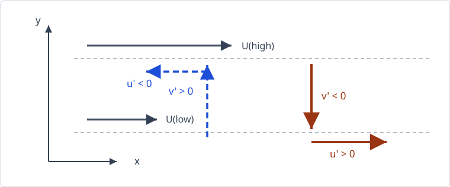

# FLUID38 Reynolds応力はなぜ閉じないか

[FLUID37 の Reynolds 分解](../FLUID37/index.md#def-fluid37-reynolds-decomposition)で、瞬時の速度から平均速度と変動を分け、[二点共分散](../FLUID37/index.md#def-fluid37-two-point-covariance)を測れるようになった。しかし流れの方程式を平均すれば、平均速度だけを未知数とする方程式が得られるのだろうか。実は、速度の積を平均すると、**平均速度の積ではない新しい量**が現れる。これが Reynolds 応力であり、乱流閉鎖問題の入口である。

本講では、平均方程式を厳密に導いた後、なぜ高次の未知量が次々現れるのかを確かめる。その上で Boussinesq の渦粘性仮説と Prandtl の混合長模型を**経験的な近似**として導入し、計算できる範囲と破綻する場合を区別する。

## 0. どの流れを平均するか

空間は三次元の周期領域または十分滑らかな領域とする。流体の密度は一定で $\rho>0$ [kg/m$^3$]、動粘度は一定で $\nu>0$ [m$^2$/s] とする。

各実現 $\omega$ の速度成分 $u_i(\boldsymbol x,t,\omega)$ [m/s] と圧力 $p(\boldsymbol x,t,\omega)$ [Pa] は、[非圧縮 Navier–Stokes 方程式](../../CTM/CTM15/index.md#thm-ctm15-incompressible-navier-stokes)を満たすものとする。

添字 $i,j,k\in\{1,2,3\}$ は座標成分を表す。繰り返した添字は三成分について和を取る。

$$
\partial_t u_i+u_j\partial_j u_i
=-\frac1\rho\partial_i p+\nu\partial_j\partial_j u_i,
\qquad \partial_j u_j=0.
$$

外力は省略する。$\partial_i=\partial/\partial x_i$、$\partial_t=\partial/\partial t$ である。集合平均 $\overline f=\mathbb E_\omega f$ は**位置・時刻を固定して**取る。以下の解析的導出では、各実現が十分滑らかで、表示する積とその微分に可積分な一様支配があり、平均と $\partial_t,\partial_i,\partial_i\partial_j$ を交換できると仮定する。これは任意の弱解に無条件で成り立つという主張ではない。三次までの変動積、圧力と速度の積、勾配の二次積にも有限な期待値を仮定する。

平均を $U_i=\overline{u_i}$、$P=\overline p$、変動を $u_i'=u_i-U_i$、$p'=p-P$ と書く。[平均の直交性](../FLUID37/index.md#prop-fluid37-mean-variance)によって $\overline{u_i'}=0$ である。一定密度を用いるため、ここでは密度重み付き平均は必要ない。圧縮性流れにはそのまま移せない。

## 1. 速度変動の積が運動量を運ぶ

例えば平均流が水平方向に速くなる高さへ、遅い流体塊が上昇すると、鉛直速度変動 $v'>0$ と水平速度変動 $u'<0$ が同時に起こりやすい。速い流体塊が下降すると $v'<0$、$u'>0$ となる。このとき積 $u'v'$ の平均は負になる。平均鉛直速度がゼロでも、**水平運動量の鉛直輸送**が消えない理由である。

平均を取った積の余分な部分を、一点での変動共分散 $R_{ij}$ と呼ぶ。流体の応力として解釈するときには密度と負号を付ける。次の二つの記号を混同しない。

<a id="def-fluid38-reynolds-stress"></a>

<!-- formal-statement-start -->
> **定義（Reynolds共分散とReynolds応力）**  
> 三次元の二乗可積分な速度確率場に対して、同じ $(\boldsymbol x,t)$ での Reynolds 共分散 $R_{ij}$ と、運動量方程式における Reynolds 応力 $\tau^R_{ij}$ を

$$
R_{ij}=\overline{u_i'u_j'},\qquad
\tau^R_{ij}=-\rho R_{ij}
$$

> で定める。$R_{ij}$ の単位は m$^2$/s$^2$、$\tau^R_{ij}$ の単位は Pa である。$R_{ij}$ 自体には負号を付けない。ここで $\rho$ は一定かつ正とする。
<!-- formal-statement-end -->

<!-- definition-example-start: def-fluid38-reynolds-stress -->
**定義の確認**：等確率で $\pm1$ を取る $Z$ に対し、成分順を $(x_1,x_2,x_3)$ として $\boldsymbol a=(2,-1,0)$ [m/s]、$\boldsymbol u'=Z\boldsymbol a$ とする。$\overline Z=0$、$\overline{Z^2}=1$ だから $\overline{\boldsymbol u'}=\boldsymbol0$ である。ここで行列 $R$ の第 $(i,j)$ 成分は**第 $i$ 成分と第 $j$ 成分の変動積の平均**であり、定義から

$$
R_{ij}=\overline{(Za_i)(Za_j)}
=a_ia_j\overline{Z^2}=a_ia_j.
$$

よって行・列を速度の三成分の順に並べると

$$
R=\begin{pmatrix}4&-2&0\\-2&1&0\\0&0&0\end{pmatrix}
\ {\rm m^2/s^2},\qquad
\tau^R_{12}=-\rho R_{12}=\rho(2\ {\rm m^2/s^2})
$$

となる（例えば $\rho=1000$ kg/m$^3$ なら $\tau^R_{12}=2000$ Pa）。対角成分は変動の分散で非負、交差成分は負でもよい。[集合平均・Reynolds分解・乱流運動エネルギー](../FLUID37/index.md#def-fluid37-reynolds-decomposition)から $k=\tfrac12\operatorname{tr}R=(4+1)/2=2.5$ m$^2$/s$^2$ である。
<!-- definition-example-end -->

共分散行列が単なる任意の対称行列ではないことは、閉鎖モデルを判定するときに重要になる。

<a id="prop-fluid38-realizability"></a>

<!-- formal-statement-start -->
> **命題（共分散の対称性・非負性・交差成分の上限）**  
> 二乗可積分な三次元速度変動の一点共分散 $R$ は対称かつ半正定値であり、任意の $\boldsymbol a\in\mathbb R^3$ と $i,j\in\{1,2,3\}$ に対して

$$
a_iR_{ij}a_j\ge0,\qquad
|R_{ij}|^2\le R_{ii}R_{jj},\qquad
\operatorname{tr}R=2k.
$$
<!-- formal-statement-end -->

### 証明の見取り図

$R$ を行列で扱えるのは、それがどの方向の速度変動についても分散を表すからである。交差成分の制約は [FLUID37 の共分散不等式](../FLUID37/index.md#prop-fluid37-covariance-bound)と同じ機構から出る。

<!-- proof-start -->
### 証明

積の可換性により $R_{ij}=R_{ji}$。実数ベクトル $\boldsymbol a$ を固定し、有限和と期待値を交換すると

$$
a_iR_{ij}a_j
=\overline{(a_i u_i')(a_j u_j')}
=\overline{(a_i u_i')^2}\ge0.
$$

これが半正定値性の条件である。$\lambda\in\mathbb R$ について $0\le\overline{(u_i'-\lambda u_j')^2}$ を展開すると

$$
0\le R_{ii}-2\lambda R_{ij}+\lambda^2 R_{jj}.
$$

$R_{jj}>0$ なら $\lambda=R_{ij}/R_{jj}$ を代入して $R_{ij}^2\le R_{ii}R_{jj}$。$R_{jj}=0$ のとき $u_j'=0$ がほとんど確実に成立し、$R_{ij}=0$ なので同じ不等式を得る。最後に $\operatorname{tr}R=\overline{\sum_i(u_i')^2}=2k$ は $k$ の定義そのものである。
<!-- proof-end -->

## 2. Navier–Stokes方程式を平均する

平均操作を非線形移流項に通すときが核心である。先に

$$
u_iu_j=(U_i+u_i')(U_j+u_j')
=U_iU_j+U_iu_j'+U_ju_i'+u_i'u_j'
$$

を展開すれば、交差項の平均はゼロとなり

$$
\overline{u_i u_j}=U_iU_j+R_{ij}
$$

を得る。ここで $\overline{u_iu_j}=U_iU_j$ としてしまうと、乱流輸送を最初から捨てたことになる。

<a id="thm-fluid38-rans"></a>

<!-- formal-statement-start -->
> **定理（一定密度のReynolds平均Navier–Stokes方程式）**  
> 第0節の滑らかさ、平均と微分の交換条件および一定 $\rho,\nu$ の下で、各実現が非圧縮 Navier–Stokes 方程式を満たすなら、平均速度 $U_i=\overline{u_i}$、平均圧力 $P=\overline p$、共分散 $R_{ij}=\overline{u_i'u_j'}$ は

$$
\partial_j U_j=0,
$$

$$
\partial_tU_i+U_j\partial_jU_i
=-\frac1\rho\partial_iP+\nu\partial_j\partial_jU_i-\partial_j R_{ij}
$$

> を満たす。同値な保存形では、移流フラックスは $U_iU_j+R_{ij}$ である。
<!-- formal-statement-end -->

### 証明の見取り図

非圧縮性で移流を積の発散に直し、先ほどの二次積の平均を入れる。最後の $-\partial_jR_{ij}$ が閉鎖を必要とする新項である。

<!-- proof-start -->
### 証明

各実現の $\partial_j u_j=0$ から、積の微分則により

$$
\partial_j(u_i u_j)=u_j\partial_j u_i+u_i\partial_j u_j=u_j\partial_j u_i.
$$

ここで $\Delta f=\sum_{j=1}^3\partial_j\partial_jf$ は空間変数 $\boldsymbol x$ に関する Laplace 演算子であり、第0節の $\partial_j\partial_j$ と同じ意味である。従って瞬時の方程式は $\partial_tu_i+\partial_j(u_i u_j)=-\rho^{-1}\partial_i p+\nu\Delta u_i$。仮定した交換可能性を使って

$$
\partial_t U_i+\partial_j\overline{u_iu_j}
=-\frac1\rho\partial_iP+\nu\Delta U_i.
$$

上で導いた $\overline{u_iu_j}=U_iU_j+R_{ij}$ を代入すると

$$
\partial_tU_i+\partial_j(U_iU_j)+\partial_jR_{ij}
=-\frac1\rho\partial_iP+\nu\Delta U_i.
$$

一方、$\partial_j U_j=\overline{\partial_j u_j}=0$ なので、

$$
\partial_j(U_iU_j)
=U_j\partial_jU_i+U_i\partial_jU_j
=U_j\partial_jU_i.
$$

$\partial_jR_{ij}$ を右辺へ移せば結論を得る。
<!-- proof-end -->

**何が未決定か**：平均運動量の三成分と非圧縮条件だけでは、平均速度・圧力に加えて新たに現れた六つの独立な $R_{ij}$ の値が定まらない。$R$ を測定値や別の方程式により与えなければ、平均方程式だけでは予測計算を完結できない。ここでいう「閉じない」とは、平均方程式を導出できないのではなく、**平均未知量だけの方程式系にならない**という意味である。

## 3. 応力の方程式を追加しても高次の量が現れる

では $R_{ij}$ 自身の発展方程式を導けばよいのだろうか。差し引いた変動方程式を用いれば厳密な式は書けるが、その中には三つの速度変動の積や圧力との相関が現れる。以下の式でどこから来るかを確認する。

平均移流を表す記号を $D_U=\partial_t+U_k\partial_k$ とする。変動圧力は $p'=p-P$ であり、変動は $\partial_k u_k'=0$ を満たす。三次の変動積を $T_{ijk}=\overline{u_i'u_j'u_k'}$ と書く。また $\delta_{ij}$ は $i=j$ のとき $1$、$i\ne j$ のとき $0$ である Kronecker 記号とする。

<a id="prop-fluid38-stress-transport"></a>

<!-- formal-statement-start -->
> **命題（Reynolds共分散の厳密な輸送式）**  
> 第0節の仮定の下で、$R_{ij}=\overline{u_i'u_j'}$ は

$$
D_U R_{ij}
=-R_{ik}\partial_k U_j-R_{jk}\partial_k U_i
-\partial_k Q_{ijk}+\Pi_{ij}-\varepsilon_{ij}
$$

> を満たす。右辺に現れる輸送フラックス $Q_{ijk}$、圧力・変形相関 $\Pi_{ij}$、勾配相関 $\varepsilon_{ij}$ は、それぞれ

$$
Q_{ijk}=T_{ijk}
+\frac{\delta_{ik}\overline{p'u_j'}+\delta_{jk}\overline{p'u_i'}}{\rho}
-\nu\partial_k R_{ij},
$$

$$
\Pi_{ij}=\frac1\rho\overline{p'(\partial_i u_j'+\partial_j u_i')},
\qquad
\varepsilon_{ij}=2\nu\overline{\partial_k u_i'\partial_k u_j'}
$$

> である。$\delta_{ij}$ は Kronecker 記号。これは新しい閉鎖仮説ではなく、瞬時の方程式からの恒等的な帰結である。
<!-- formal-statement-end -->

### 証明の見取り図

変動方程式を $u_j'$ 倍したものと、$i,j$ を入れ替えたものを足す。非圧縮条件で三次積が発散になり、圧力と粘性にはそれぞれ積の微分則を使う。

<!-- proof-start -->
### 証明

[Reynolds平均方程式](#thm-fluid38-rans)を瞬時の式から差し引く。非圧縮性と $u_i=U_i+u_i'$ によって

$$
D_Uu_i'+u_k'\partial_kU_i
+\partial_k(u_i'u_k'-R_{ik})
=-\frac1\rho\partial_i p'+\nu\Delta u_i'.
$$

これに $u_j'$ を掛けたものと、添字を交換した式に $u_i'$ を掛けたものを足し、平均する。$D_U$ は実現に依らず、積の微分則を使えるから、左辺の最初の和は $D_U\overline{u_i'u_j'}=D_UR_{ij}$。平均剪断との積は $R_{jk}\partial_kU_i+R_{ik}\partial_kU_j$ になる。

非線形変動項の和は、$\overline{u_i'}=\overline{u_j'}=0$、$\partial_k u_k'=0$ により

$$
\begin{aligned}
&\overline{u_j'\partial_k(u_i'u_k'-R_{ik})
+u_i'\partial_k(u_j'u_k'-R_{jk})}\\
&=\overline{u_k'\partial_k(u_i'u_j')}
=\partial_k\overline{u_i'u_j'u_k'}
=\partial_k T_{ijk}.
\end{aligned}
$$

圧力については積の微分則を逆向きに使い、

$$
\begin{aligned}
&-\frac1\rho\overline{u_j'\partial_i p'+u_i'\partial_j p'}\\
&=-\frac1\rho\partial_i\overline{p'u_j'}
-\frac1\rho\partial_j\overline{p'u_i'}
+\Pi_{ij}.
\end{aligned}
$$

また、$\Delta(u_i'u_j')$ を微分すると交差項が二つ生じるので

$$
\nu\overline{u_j'\Delta u_i'+u_i'\Delta u_j'}
=\nu\Delta R_{ij}
-2\nu\overline{\partial_k u_i'\partial_k u_j'}.
$$

これらを集め、$T_{ijk}$、圧力輸送、$\nu\Delta R_{ij}=\partial_k(\nu\partial_kR_{ij})$ を $-\partial_kQ_{ijk}$ にまとめると表示式になる。
<!-- proof-end -->

**閉鎖の階層**：$R$ の方程式で未知の $T_{ijk}$、圧力・速度相関、勾配相関が必要になった。さらに $T$ の式を求めれば一般に四次の変動積が現れる。有限個の低次統計量だけを取り出しても、その発展を自動的に決定する仕組みはない。これを乱流の**閉鎖問題**と呼ぶ。平均化と微分の交換に失敗したせいではなく、非線形な積の平均が新しいモーメントを生成することが本質である。

## 4. 平均剪断に限定すると符号が見える

具体的に水平方向を $x=x_1$、鉛直方向を $y=x_2$ とし、平均速度を $\boldsymbol U=(U(y,t),0,0)$ とする。平均圧力の $x$ 方向微分を $\partial_xP$ と書く。$R$ の各成分も $x,z$ に依存しないと仮定する。このとき第2節の $i=1$ 成分は

$$
\partial_t U
=-\frac1\rho\partial_xP
+\partial_y\left(\nu\partial_yU-R_{12}\right).
$$

この式に一定密度 $\rho$ を掛け、左辺へ鉛直方向の輸送を集めると

$$
\partial_t(\rho U)+\partial_yJ_{yx}=-\partial_xP,
\qquad
J_{yx}=\rho R_{12}-\rho\nu\partial_yU
$$

となる。$J_{yx}$ は **$+y$ 方向を正とする水平運動量の流束**であり、添字 $yx$ は「$y$ 方向に運ばれる $x$ 方向の運動量」を表す。対して、[Newton 流体の粘性応力](../../CTM/CTM15/index.md#def-ctm15-incompressible-newtonian)と [Reynolds 応力の定義](#def-fluid38-reynolds-stress)を合わせた剪断応力（右辺で発散を取る量）は

$$
\sigma^{\rm eff}_{12}
=\rho\nu\partial_yU+\tau^R_{12}
=\rho\nu\partial_yU-\rho R_{12}
=-J_{yx}
$$

であり、**流束と応力では符号が逆**になる。例えば $\partial_yU>0$ で $R_{12}<0$ なら、上向きの乱流運動量流束 $\rho R_{12}$ は負だが、乱流剪断応力 $-\rho R_{12}$ は正である。$\partial_yU$ は時刻 $t$ を固定して $y$ で偏微分した量であり、以下で定常平均流 $U(y)$ を考えるときの $dU/dy$ と同じ勾配を表す。図の上下の交換運動はこの符号を説明する模式図であり、流れの数値解ではない。



### 平均のエネルギーから変動への受け渡し

平均運動エネルギーの局所収支では、平均方程式の $-\partial_jR_{ij}$ に $U_i$ を掛ける。積の微分則を一段ずつ使うと

$$
-U_i\partial_jR_{ij}
=-\partial_j(U_iR_{ij})+R_{ij}\partial_jU_i.
$$

右辺第1項は輸送、第2項は平均速度勾配との仕事である。その**符号を反転した量**を、平均流から変動へ移る単位質量・単位時間当たりの生成率 $\mathcal P$ と呼ぶ。

<a id="prop-fluid38-shear-production"></a>

<!-- formal-statement-start -->
> **命題（平均剪断と乱流エネルギー生成率）**  
> 一定密度・非圧縮の平均流について、平均流から速度変動への局所的なエネルギー受け渡し率を

$$
\mathcal P=-R_{ij}\partial_jU_i
$$

> と置くと、$\mathcal P$ の単位は m$^2$/s$^3$ である。特に $\boldsymbol U=(U(y),0,0)$ で $R$ が水平方向に一様なら

$$
\mathcal P=-\overline{u'v'}\,\frac{dU}{dy}.
$$

> $\mathcal P$ は正・ゼロ・負のいずれにもなり得る。ここでは生成率の局所式だけを扱い、変動エネルギー収支の他の項は次講で調べる。
<!-- formal-statement-end -->

### 証明の見取り図

平均運動方程式に $U_i$ を掛けたときの、応力フラックスの発散と仕事率を区別する。$\mathcal P>0$ は平均流のエネルギーが変動へ移る符号である。

<!-- proof-start -->
### 証明

[平均方程式](#thm-fluid38-rans)の Reynolds 項を積の微分則で分けると上の $-U_i\partial_jR_{ij}$ の式を得る。平均のエネルギーに現れる交換項は $R_{ij}\partial_jU_i$ だから、変動側への符号を負として $\mathcal P=-R_{ij}\partial_jU_i$ と表す。$\boldsymbol U=(U(y),0,0)$ では非零の勾配は $\partial_2U_1=dU/dy$ のみ。従って $\mathcal P=-R_{12}dU/dy$。単位は $[R_{12}]\,[dU/dy]=({\rm m^2/s^2})({\rm s^{-1}})$ である。
<!-- proof-end -->

例えば $dU/dy=2$ s$^{-1}$、$\overline{u'v'}=-0.09$ m$^2$/s$^2$ なら $\mathcal P=0.18$ m$^2$/s$^3$。符号を逆にして $\overline{u'v'}=+0.09$ とすれば $\mathcal P=-0.18$。実際の局所輸送が常に平均流から変動へ向かうと仮定してはいけない。

## 5. Boussinesqの渦粘性仮説

平均方程式を計算するためには $R$ を平均速度の勾配などから推定する追加規則が要る。Newton 流体の[粘性応力と変形速度](../../CTM/CTM15/index.md#def-ctm15-incompressible-newtonian)の関係に似せて、乱流輸送も平均の変形速度に比例すると**仮定**するのが渦粘性近似である。

平均の変形速度を $S_{ij}=(\partial_jU_i+\partial_iU_j)/2$ とする。$k=\tfrac12R_{ii}$ は変動エネルギーであり、$\operatorname{tr}R=2k$。一般の $R$ の等方成分は $(2k/3)\delta_{ij}$ であるが、**異方成分がゼロであるとは仮定しない**。異方成分を変形速度の形で近似する。

<a id="def-fluid38-eddy-viscosity"></a>

<!-- formal-statement-start -->
> **定義（Boussinesq渦粘性閉鎖）**  
> 一定密度の非圧縮平均流 $U_i$ に対し、渦動粘度 $\nu_t(\boldsymbol x,t)\ge0$ [m$^2$/s] をモデル量として与え、Reynolds 応力の**近似式**を

$$
-R_{ij}\ \approx\ 2\nu_tS_{ij}-\frac23k\delta_{ij}
$$

> とする。等方部分 $\tfrac23k\delta_{ij}$ は $R$ のトレースと整合させた量である。$\nu_t$ が分子動粘度 $\nu$ と同じ定数であるとは仮定しない。式は Navier–Stokes 方程式からの厳密な帰結ではない。
<!-- formal-statement-end -->

<!-- definition-example-start: def-fluid38-eddy-viscosity -->
**定義の確認**：非圧縮の単純平均剪断 $\boldsymbol U=(Gy,0,0)$ で $G$ は定数とする。勾配から $S_{12}=S_{21}=G/2$、$S_{11}=S_{22}=S_{33}=0$、$\operatorname{tr}S=0$。従って模型は

$$
R_{12}^{\rm model}=-\nu_tG,\qquad
R_{11}^{\rm model}=R_{22}^{\rm model}=R_{33}^{\rm model}=\frac23k
$$

を予測する。例えば $G=2$ s$^{-1}$、$\nu_t=0.03$ m$^2$/s、$k=0.15$ m$^2$/s$^2$ を指定すると、

$$
R_{12}^{\rm model}=-0.06\ \mathrm{m^2/s^2},\qquad
R_{11}^{\rm model}=R_{22}^{\rm model}=R_{33}^{\rm model}=0.10\ \mathrm{m^2/s^2}.
$$

したがって $\tfrac12\operatorname{tr}R^{\rm model}=(0.10+0.10+0.10)/2=0.15=k$ であり、剪断成分・等方部分・トレースの条件を満たす。

さらに、この具体例が共分散として許されるか、[共分散の半正定値性](#prop-fluid38-realizability)を確かめる。互いに直交する三つの単位方向 $(1,1,0)/\sqrt2$、$(1,-1,0)/\sqrt2$、$(0,0,1)$ における二次形式は

$$
0.10-0.06=0.04,\qquad
0.10+0.06=0.16,\qquad
0.10
\quad[\mathrm{m^2/s^2}]
$$

であり、いずれも非負である。三方向は三次元空間の正規直交基底をなすので、任意方向の二次形式はこれらの非負値を係数とする平方の和になる。この数値例は半正定値だが、模型が常に条件を満たすわけではない。
<!-- definition-example-end -->

<a id="prop-fluid38-eddy-production"></a>

<!-- formal-statement-start -->
> **命題（非負渦粘性が予測する生成率）**  
> 非圧縮平均流で Boussinesq 渦粘性閉鎖を採用し、$\nu_t\ge0$ とすると、閉鎖が予測する生成率は

$$
\mathcal P_{\rm model}=2\nu_t S_{ij}S_{ij}\ge0.
$$

> 特に $\boldsymbol U=(U(y),0,0)$ では $\mathcal P_{\rm model}=\nu_t(dU/dy)^2$ となる。これはモデルによる予測であって、真の $\mathcal P$ が必ず非負だという定理ではない。
<!-- formal-statement-end -->

### 証明の見取り図

平均速度勾配を対称部分と反対称部分に分ける。$S$ と反対称部分の縮約はゼロ、非圧縮性で等方項もゼロになる。

<!-- proof-start -->
### 証明

$\partial_jU_i=S_{ij}+A_{ij}$ とおく。$A_{ij}=(\partial_jU_i-\partial_iU_j)/2$ は反対称であり、$S_{ij}A_{ij}=0$ が成り立つ。実際、和の添字を交換すると $S_{ij}A_{ij}=S_{ji}A_{ji}=-S_{ij}A_{ij}$ だからゼロである。また $\delta_{ij}\partial_jU_i=\partial_iU_i=0$。ゆえに [生成率の式](#prop-fluid38-shear-production)へ模型を代入すれば

$$
\begin{aligned}
\mathcal P_{\rm model}
&=\left(2\nu_tS_{ij}-\frac23k\delta_{ij}\right)\partial_jU_i\\
&=2\nu_t S_{ij}(S_{ij}+A_{ij})-\frac23k\,\partial_iU_i\\
&=2\nu_tS_{ij}S_{ij}\ge0.
\end{aligned}
$$

単純剪断では $S_{12}=S_{21}=G/2$ のみが非零なので、$S_{ij}S_{ij}=2(G/2)^2=G^2/2$。従って $\mathcal P_{\rm model}=\nu_tG^2$。
<!-- proof-end -->

非負の渦粘性模型は、実際の局所的な逆向きエネルギー受け渡しを表現できない。また、$k$ と $\nu_t$ が与えられない限り、この式だけでは模型そのものも閉じない。

## 6. Prandtlの混合長模型と適用限界

渦動粘度の値をどう決めるか。平均剪断中で、流体塊がある距離 $\ell_m$ を移動する間に平均速度差 $\ell_m|dU/dy|$ を持ち運ぶ、と想像する。この直感を速度相関の経験則に仕立てるのが**混合長**である。変動の向きの相関まで含む係数を、単純な模型では $\ell_m$ に吸収する。したがってこれは変動を Navier–Stokes 方程式から厳密に解いた結果ではない。

<a id="def-fluid38-mixing-length"></a>

<!-- formal-statement-start -->
> **定義（Prandtl混合長閉鎖）**  
> 非圧縮の平行平均流 $\boldsymbol U=(U(y),0,0)$ で、非負の長さ $\ell_m(y)$ [m] を**別途指定**し、

$$
\nu_t(y)=\ell_m(y)^2\left|\frac{dU}{dy}\right|,
\qquad
-\overline{u'v'}^{\,\rm model}
=\ell_m(y)^2\left|\frac{dU}{dy}\right|\frac{dU}{dy}
$$

> と置く経験的閉鎖を Prandtl 混合長模型という。$\ell_m$ は流体の分子平均自由行程ではなく、流れの環境に依存する模型パラメータである。
<!-- formal-statement-end -->

<!-- definition-example-start: def-fluid38-mixing-length -->
**定義の確認**：$dU/dy=2$ s$^{-1}$、$\ell_m=0.15$ m なら $\ell_m\ge0$ を満たし、

$$
\nu_t=(0.15)^2(2)=0.045\ {\rm m^2/s},\qquad
-\overline{u'v'}^{\,\rm model}=(0.15)^2(2)(2)
=0.090\ {\rm m^2/s^2}.
$$

速度勾配を $-2$ s$^{-1}$ に反転すれば $\nu_t=0.045$ は変わらず、$-\overline{u'v'}^{\,\rm model}=-0.090$ となる。$|G|G$ の絶対値を取り忘れるとこの符号反転を再現できない。
<!-- definition-example-end -->

**この模型が使えない場面**：$\ell_m$ をどう選ぶかは平均方程式では決まらない。壁・圧力勾配・遷移・剥離・回転・成層の効果もこの局所関係だけでは予測できない。特に $G=0$ ならこの模型は必ず $R_{12}^{\rm model}=0$ とするが、瞬時の変動から得られる相関が常にゼロになるわけではない。これは模型が失った情報である。

### 共分散として実現可能か

[共分散の非負性](#prop-fluid38-realizability)も閉鎖模型に必ず継承されるとは限らない。単純剪断について $k\ge0$ と $\nu_t\ge0$ を独立に与えると、模型の $xy$ 部分は

$$
R^{\rm model}_{xy}
=\begin{pmatrix}
2k/3&-\nu_tG\\
-\nu_tG&2k/3
\end{pmatrix}.
$$

[共分散の半正定値性](#prop-fluid38-realizability)は、任意の実数ベクトル $\boldsymbol a=(x,y,z)$ について $a_iR_{ij}^{\rm model}a_j\ge0$ を要求する。$d=2k/3$、$b=\nu_tG$ と置き、$xy$ 平面の直交する二方向への成分を $\xi=(x+y)/\sqrt2$、$\eta=(x-y)/\sqrt2$ とすると、この直交座標は逆に $x=(\xi+\eta)/\sqrt2$、$y=(\xi-\eta)/\sqrt2$ と戻せる。したがって

$$
\begin{aligned}
a_iR_{ij}^{\rm model}a_j
&=d(x^2+y^2+z^2)-2bxy\\
&=d(\xi^2+\eta^2+z^2)-b(\xi^2-\eta^2)\\
&=(d-b)\xi^2+(d+b)\eta^2+dz^2.
\end{aligned}
$$

$\xi,\eta,z$ は独立に任意の実数を取るので、この式が常に非負である必要十分条件は $d-b\ge0$、$d+b\ge0$、$d\ge0$ である。これは **$|\nu_tG|\le2k/3$** と同値であり、二方向だけの試験でなく三次元の全方向を調べた判定になっている。例えば $k=0.125$ m$^2$/s$^2$、$\nu_t=0.045$ m$^2$/s、$G=2$ s$^{-1}$ なら $|\nu_tG|=0.090>2k/3\approx0.0833$。剪断応力の数値だけが合っても、この模型は負の固有方向分散を予測する。原因は **$R$ の六成分を一つの渦動粘度と等方成分に押し込めたこと**にある。

## 7. 合成データで「応力の符号」と「模型の不足」を比較する

四つの等確率の実現を用意する。$Z,W$ は互いに独立な $\pm1$ の符号であり、$a=0.4$ m/s、$b=0.3$ m/s、$-1\le c\le1$ として

$$
u'=aZ,\qquad
v'=-b\left(cZ+\sqrt{1-c^2}\,W\right),\qquad w'=0
$$

を作る。これは**合成確率データ**であり、Navier–Stokes 方程式の解でも DNS でもない。四つの実現を等重みで平均するだけで

$$
\overline{u'}=\overline{v'}=0,\quad
\overline{(u')^2}=a^2,\quad
\overline{(v')^2}=b^2,\quad
R_{12}=-abc,\quad k=\frac{a^2+b^2}{2}=0.125
$$

を厳密に検算できる。$c$ を変えても平均速度と各分散は同じなのに、**交差応力だけが変わる**。つまり平均と各分散を知るだけでは、輸送の向きすら決まらない。

下の Python ラボでは、平均剪断 $G=2$ s$^{-1}$、混合長 $\ell_m=0.15$ m を標準とし、四実現の集計、理論値との差、混合長模型の予測、生成率、実現可能性を同じ計算から出力する。線グラフは $c$ と $\ell_m$ を変えた**模型曲線**であり、実測乱流の時系列ではない。初回実行時にはブラウザの Python 環境を取得する通信が必要になる場合がある。

```python-file-lab
# lab-id: FLUID38-REYNOLDS-CLOSURE
# lab-title: 合成共分散とBoussinesq・混合長閉鎖
# lab-file: textbook/volumes/dream_thater/物理系/FLUID/FLUID38/reynolds_closure_lab.py
# timeout-ms: 30000
# lab-preset: 正の運動量輸送 | --corr 0.75 --shear 2 --length 0.15
# lab-preset: 相関ゼロ | --corr 0 --shear 2 --length 0.15
# lab-preset: 逆向き輸送 | --corr -0.75 --shear 2 --length 0.15
# lab-preset: 剪断を反転 | --corr 0.75 --shear -2 --length 0.15
```

**読取り方**：$c=0.75$ なら観測式から $-\overline{u'v'}=0.090$ m$^2$/s$^2$、$\mathcal P=0.180$ m$^2$/s$^3$。選んだ混合長はこの一成分にちょうど合うが、全共分散の形や別の $c$ まで予測できたわけではない。$c=-0.75$ では真の合成値 $-\overline{u'v'}=-0.090$ と $\mathcal P=-0.180$ を、非負渦粘性模型は再現しない。

## 8. 演習：平均から閉鎖の限界まで

### Level A

#### A1. 積の平均を展開する
- Level: A

$u=U+u'$、$v=V+v'$ が同一点の二乗可積分な速度成分で $\overline{u'}=\overline{v'}=0$ とする。$\overline{uv}$ を $U,V,R_{12}$ で表し、$\overline{uv}=UV$ が成り立つ条件を述べよ。

<!-- solution-start -->
#### 詳細解答

まず $uv=UV+Uv'+Vu'+u'v'$。$U,V$ は実現に依存しないので

$$
\overline{uv}=UV+U\overline{v'}+V\overline{u'}+\overline{u'v'}=UV+R_{12}.
$$

従って等号 $\overline{uv}=UV$ は $R_{12}=0$ と同値。各変動がゼロである必要はない。
<!-- solution-end -->

#### A2. 応力の符号と単位
- Level: A

一定密度 $\rho=1000$ kg/m$^3$、共分散 $R_{12}=-0.04$ m$^2$/s$^2$ とする。Reynolds 応力 $\tau^R_{12}$ を求め、値の単位を検算せよ。

<!-- solution-start -->
#### 詳細解答

[Reynolds 応力の定義](#def-fluid38-reynolds-stress)に密度と共分散を代入すると

$$
\tau^R_{12}=-\rho R_{12}=-(1000)(-0.04)=40\ \mathrm{Pa}.
$$

単位も

$$
(\mathrm{kg/m^3})(\mathrm{m^2/s^2})
=\mathrm{kg/(m\,s^2)}=\mathrm{Pa}
$$

となる。共分散が負であっても、応力の剪断成分には正号が付く。
<!-- solution-end -->

#### A3. 平行平均流のフラックス
- Level: A

$\boldsymbol U=(U(y,t),0,0)$、$\partial_xP=0$、$R_{12}=R_{12}(y,t)$、その他の共分散成分は $x,z$ に依存しないとする。第2節の平均方程式から $U$ の時間発展式を導き、$R_{12}$ が一定のときの効果を述べよ。

<!-- solution-start -->
#### 詳細解答

[Reynolds 平均方程式](#thm-fluid38-rans)の $i=1$ 成分では、$U_j\partial_jU_1=U\partial_xU=0$、$\Delta U=U_{yy}=\partial_y^2U$、$\partial_jR_{1j}=\partial_yR_{12}$ である。従って

$$
\partial_tU=\nu U_{yy}-\partial_yR_{12}
=\partial_y(\nu U_y-R_{12}).
$$

$R_{12}$ が $y$ に依らず一定なら $\partial_yR_{12}=0$ なので、体積内部の平均加速項には寄与しない。ただし境界での輸送や応力としての意味までゼロとは限らない。
<!-- solution-end -->

#### A4. 混合長の次元と剪断反転
- Level: A

混合長 $\ell_m=0.10$ m、速度勾配 $G=\pm3$ s$^{-1}$ とする。各場合の $\nu_t=\ell_m^2|G|$ と $-R_{12}^{\rm model}=\ell_m^2|G|G$ を計算し、単位を確かめよ。

<!-- solution-start -->
#### 詳細解答

[混合長閉鎖](#def-fluid38-mixing-length)では $\ell_m^2=0.01$ m$^2$、$|G|=3$ s$^{-1}$ だから、勾配の符号によらず

$$
\nu_t=\ell_m^2|G|=0.01\cdot3=0.03\ \mathrm{m^2/s}.
$$

一方、剪断成分は

$$
-R_{12}^{\rm model}
=\nu_tG=
\begin{cases}
+0.09\ \mathrm{m^2/s^2}&(G=+3\ \mathrm{s^{-1}}),\\
-0.09\ \mathrm{m^2/s^2}&(G=-3\ \mathrm{s^{-1}}).
\end{cases}
$$

絶対値が $\nu_t\ge0$ を保ち、勾配の符号は輸送の向きに反映される。
<!-- solution-end -->

#### A5. 生成率の符号
- Level: A

$G=4$ s$^{-1}$、$R_{12}=0.02$ m$^2$/s$^2$ とする。真の生成率 $\mathcal P$ を求め、$\nu_t\ge0$ の渦粘性模型で再現できるか判定せよ。

<!-- solution-start -->
#### 詳細解答

[平均剪断の生成率](#prop-fluid38-shear-production)に代入すると

$$
\mathcal P=-R_{12}G=-(0.02)(4)=-0.08\ \mathrm{m^2/s^3}.
$$

一方、[非負渦粘性模型の生成率](#prop-fluid38-eddy-production)は

$$
\mathcal P_{\rm model}=\nu_tG^2=16\nu_t\ge0
$$

であるため、$\nu_t\ge0$ を守る限り一致させられない。破綻するのは厳密な生成率の式ではなく、非負渦粘性で応力を置き換える仮説である。
<!-- solution-end -->

### Level B

#### B1. 保存形からReynolds平均式
- Level: B

一定密度・一定動粘度の非圧縮流体について、各実現が第0節の Navier–Stokes 方程式を満たし、期待値と微分を交換でき、二乗可積分であるとする。$\partial_j u_j=0$ と $\overline{u_i u_j}=U_iU_j+R_{ij}$ から、平均式の移流と Reynolds 項の符号を自力で導け。

<!-- solution-start -->
#### 詳細解答

非圧縮性から $u_j\partial_j u_i=\partial_j(u_iu_j)$。これを平均すると

$$
\partial_tU_i+\partial_j\overline{u_i u_j}
=-\rho^{-1}\partial_iP+\nu\Delta U_i.
$$

Reynolds 分解で $\overline{u_i u_j}=U_iU_j+R_{ij}$ なので

$$
\partial_tU_i+\partial_j(U_iU_j)+\partial_jR_{ij}
=-\rho^{-1}\partial_iP+\nu\Delta U_i.
$$

$\partial_jU_j=0$ により $\partial_j(U_iU_j)=U_j\partial_jU_i$。従って $R$ を右辺へ移したときだけ $-\partial_jR_{ij}$ となる。$R$ を定義した段階では負号は付いていない。
<!-- solution-end -->

#### B2. 同じ二次統計で異なる三次統計
- Level: B

零平均の実確率変数 $X$ を二通り考える。模型 I は $X=\pm1$ が各確率 $1/2$。模型 II は $X=-1/\sqrt2$ が確率 $2/3$、$X=\sqrt2$ が確率 $1/3$。両者の平均、二乗平均、三乗平均を計算し、二次モーメントだけで三次モーメントを決められるか判定せよ。

<!-- solution-start -->
#### 詳細解答

模型 I は $\mathbb EX=0$、$\mathbb EX^2=(1+1)/2=1$、$\mathbb EX^3=(-1+1)/2=0$。模型 II の平均は

$$
\mathbb EX=-\frac{2}{3\sqrt2}+\frac{\sqrt2}{3}=0.
$$

二乗平均は $\mathbb EX^2=(2/3)(1/2)+(1/3)(2)=1/3+2/3=1$。三乗平均は

$$
\mathbb EX^3
=-\frac{2}{3}\frac{1}{2\sqrt2}
+\frac{1}{3}(2\sqrt2)
=-\frac{1}{3\sqrt2}+\frac{4}{3\sqrt2}
=\frac1{\sqrt2}.
$$

二次までの統計が一致しても三次は $0$ と $1/\sqrt2$ に分かれる。これはモーメント階層の**確率的な例**であり、これら二つが実際の乱流解であるという主張ではない。
<!-- solution-end -->

#### B3. 渦粘性模型の半正定値条件
- Level: B

単純剪断 $U_1=Gy$、$U_2=U_3=0$、$G\ne0$ に Boussinesq 模型を適用し、$k\ge0$ と $\nu_t\ge0$ を指定したとする。模型共分散が半正定値である必要十分条件を導き、$k=0.12$ m$^2$/s$^2$、$\nu_t=0.05$ m$^2$/s、$G=2$ s$^{-1}$ の場合を判定せよ。

<!-- solution-start -->
#### 詳細解答

[Boussinesq 渦粘性閉鎖](#def-fluid38-eddy-viscosity)で $S_{12}=S_{21}=G/2$ で他はゼロ。従って $R^{\rm model}$ の $xy$ ブロックの対角成分は $d=2k/3$、非対角成分は $-\nu_tG$、$z$ 方向の対角成分も $d$。正規直交方向 $(1,1,0)/\sqrt2$、$(1,-1,0)/\sqrt2$、$(0,0,1)$ に沿った二次形式は

$$
d-\nu_tG,\qquad d+\nu_tG,\qquad d.
$$

三方向は直交基底なので、任意のベクトルの二次形式はこれら三つを係数とする平方の和となる。従って [共分散の半正定値条件](#prop-fluid38-realizability)が全方向で成立する必要十分条件は $d\ge|\nu_tG|$（この条件から $d\ge0$ も従う）。数値では $d=2(0.12)/3=0.08$、$|\nu_tG|=0.05\cdot2=0.10$。第一方向の二次形式は $-0.02$ m$^2$/s$^2$ となり、分散の非負性に反する。模型の予測が実現可能な共分散ではない。
<!-- solution-end -->

#### B4. 渦粘性模型と局所逆輸送
- Level: B

二次元の平均剪断 $U_1=Gy$、$G=3$ s$^{-1}$ で、測定から $R_{12}=+0.06$ m$^2$/s$^2$ を得たとする。線形渦粘性 $\nu_t=-R_{12}/G$ を形式的に逆算し、生成率と共に、非負渦粘性閉鎖との両立性を説明せよ。

<!-- solution-start -->
#### 詳細解答

形式的に $\nu_t=-0.06/3=-0.02$ m$^2$/s となる。一方、[平均剪断の生成率](#prop-fluid38-shear-production)は $\mathcal P=-R_{12}G=-0.06\cdot3=-0.18$ m$^2$/s$^3$。非負の $\nu_t$ を要求すれば $\mathcal P_{\rm model}=\nu_tG^2\ge0$ なので負の生成率を作れない。負の形式的 $\nu_t$ をそのまま混合長模型 $\nu_t=\ell_m^2|G|$ に入れることもできない（実数の $\ell_m$ に対して右辺は非負）。この例は局所的な逆向き輸送で模型の**符号仮定**が破れる仕組みを示す。
<!-- solution-end -->

### Level C

#### C1. 合成変動の正確な統計と閉鎖の破綻
- Level: C

$Z,W$ は独立に $\pm1$ を等確率で取る。$a=0.4$ m/s、$b=0.3$ m/s、$c=3/4$ として

$$
u'=aZ,\qquad
v'=-b(cZ+\sqrt{1-c^2}W),\qquad w'=0
$$

を作る。平均流は $U_1=Gy$、$G=2$ s$^{-1}$ とする。

1. 全変動の平均・$R_{11},R_{22},R_{12},k$ を計算する。
2. 真の $\mathcal P$ を求める。
3. 剪断成分を合わせる渦動粘度 $\nu_t$ と混合長 $\ell_m$ を求める。
4. この $\nu_t$ と $k$ で構成した Boussinesq 模型の全共分散が半正定値か判定し、何が一致し何が一致しないか説明せよ。

<!-- solution-start -->
#### 詳細解答

(i) $\mathbb EZ=\mathbb EW=0$、$\mathbb EZ^2=\mathbb EW^2=1$、独立性から $\mathbb E(ZW)=0$。ゆえに $\overline{u'}=\overline{v'}=\overline{w'}=0$、また

$$
R_{11}=a^2=0.16,\qquad
R_{22}=b^2(c^2+1-c^2)=0.09,
$$

$$
\begin{aligned}
R_{12}
&=-ab\,\mathbb E[Z(cZ+\sqrt{1-c^2}W)]\\
&=-ab(c\mathbb EZ^2+\sqrt{1-c^2}\mathbb E(ZW))\\
&=-(0.4)(0.3)(0.75)=-0.09.
\end{aligned}
$$

全ての $R$ の単位は m$^2$/s$^2$。$R_{33}=0$ なので $k=(0.16+0.09)/2=0.125$ m$^2$/s$^2$。実際 $R_{12}^2=0.0081\le0.16\cdot0.09=0.0144$ で、共分散の上限も満たす。

(ii) [平均剪断の生成率](#prop-fluid38-shear-production)から $\mathcal P=-R_{12}G=-(-0.09)(2)=0.18$ m$^2$/s$^3$。

(iii) 剪断成分だけを $\nu_tG=-R_{12}$ へ合わせれば $\nu_t=0.09/2=0.045$ m$^2$/s。混合長の関係 $\nu_t=\ell_m^2|G|$ から $\ell_m^2=0.045/2=0.0225$ m$^2$、$\ell_m=0.15$ m。

(iv) [Boussinesq 渦粘性閉鎖](#def-fluid38-eddy-viscosity)では模型の対角成分は一律 $2k/3=0.25/3\approx0.08333$ となり、真の $(0.16,0.09,0)$ と一致しない。模型の $xy$ ブロックの方向 $(1,1)/\sqrt2$ の分散は $2k/3-\nu_tG=0.08333-0.09\approx-0.00667$ m$^2$/s$^2$。これは負であり半正定値ではない。つまり **一つの剪断応力と生成率を合わせても、異方性と共分散としての実現可能性を保証できない**。このデータは合成分布であり、実乱流の検証や閉鎖模型の普遍的な不可能性の証明ではない。
<!-- solution-end -->

## 9. 次へつながる問い

平均式は [Navier–Stokes 方程式](../../CTM/CTM15/index.md#thm-ctm15-incompressible-navier-stokes)から厳密に導けたが、$R_{ij}$ を平均速度だけで決めることはできなかった。$R$ 自身の輸送式には三次相関や圧力・勾配相関が現れ、Boussinesq 渦粘性と Prandtl 混合長はその情報を経験的に縮約する。次の FLUID39 では、変動エネルギー $k$ の収支の生成・輸送・散逸を切り分け、乱流の尺度間の受け渡しを考える。
