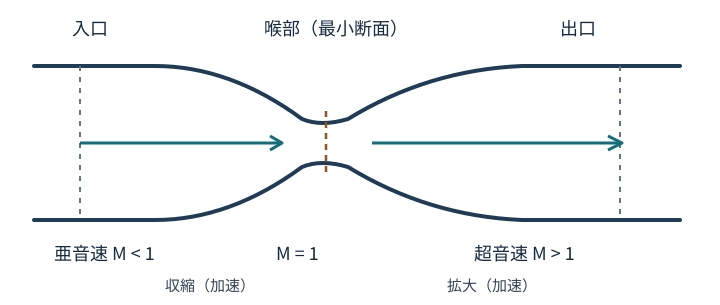

# FLUID42 ノズルで音速に達する条件は何か

[FLUID41の圧縮性Euler保存則](../FLUID41/index.md#thm-fluid41-euler-conservative)と[等エントロピー音速](../FLUID41/index.md#def-fluid41-sound-speed)により、密度が変わる気体でも質量・運動量・全エネルギーを追えた。しかし、管の断面を狭くしたとき流速はいつまでも増やせるのだろうか。音速に近づくと、密度も大きく変化するため、**断面積を減らせば必ず加速する**とは言えなくなる。

この講義では、滑らかな定常流だけを使い、面積の変化と流速の関係を導き、喉部で音速になる条件と最大質量流量を求める。最後に、同じ断面積比に亜音速・超音速という二つの解がある意味を計算で確かめる。衝撃波を含む流れは対象外であり、次の FLUID43 で保存則から扱う。

## 0. 模型と未知量

流れの向きに沿う座標を $x$ [m]、管に垂直な断面積を $A(x)>0$ [m$^2$]、断面平均の下流向き速度を $v(x)>0$ [m/s] とする。圧力 $p(x)>0$ [Pa]、密度 $\rho(x)>0$ [kg/m$^3$]、絶対温度 $T(x)>0$ [K] は同じ断面上で一様と近似する。この**準一次元近似**は、断面積が軸方向に十分緩やかに変わり、剥離や強い横方向の速度を無視できる場合の模型である。以下ではこれらの関数を少なくとも $C^1$ 級とし、音速点の局所的な展開にはさらに必要な滑らかさを仮定する。

気体は定数 $R>0$ [J/(kg K)]、$c_v>0$ を持つ[理想気体](../FLUID41/index.md#def-fluid41-ideal-gas)で、$\gamma=1+R/c_v>1$ とする。流れは**定常・非粘性・断熱・可逆（等エントロピー）**で、軸に沿う外力・軸仕事・熱供給・衝撃波はない。等エントロピーという条件を明示するのは、断熱だけでは不可逆な衝撃波を排除できないためである。

気体が微小な圧力変化を伝える速度を[FLUID41の音速](../FLUID41/index.md#def-fluid41-sound-speed)から $c=\sqrt{\gamma p/\rho}=\sqrt{\gamma RT}>0$ と計算する。局所流速がこの速度の何倍かを、正の無次元量で表す。

<!-- formal-statement-start -->
> **定義（準一次元定常ノズル流とMach数）**  
> 上の正の $A,\rho,p,T,v$ を持つ定常流において、軸に直角な各断面を通る質量流量 $\dot m$ [kg/s] と Mach数 $M$ を

$$
\dot m=\rho v A,\qquad M=\frac{v}{c},
\qquad c^2=\gamma RT
$$

> とする。$0<M<1$ を亜音速、$M=1$ を音速、$M>1$ を超音速という。$\dot m$ の断面に依存しない性質は保存則から導くものであって、定義だけではまだ仮定しない。
<!-- formal-statement-end -->

<!-- definition-example-start: def-fluid42-quasi1d-mach -->
**定義の確認**：$R=287$ J/(kg K)、$\gamma=1.4$、$T=300$ K、$\rho=1.2$ kg/m$^3$、$v=100$ m/s、$A=0.01$ m$^2$ とすると $c=\sqrt{1.4\cdot287\cdot300}\simeq347.19$ m/s、$M\simeq0.288<1$、$\dot m=1.2\cdot100\cdot0.01=1.2$ kg/s。$[\rho v A]=({\rm kg/m^3})({\rm m/s})({\rm m^2})={\rm kg/s}$ である。Mach数の判定では流速と**その場所の**音速を比較し、入口の音速を使い回さない。
<!-- definition-example-end -->

## 1. 面積を狭めると、いつ加速するか

定常の[質量保存](../FLUID41/index.md#thm-fluid41-euler-conservative)を断面で積分すると、側壁を通る質量流出がないので、断面間で $\rho v A$ は一定となる。軸方向の非粘性運動量式は、[圧縮性Euler式](../FLUID41/index.md#thm-fluid41-euler-conservative)を流れに沿って書けば $v\,dv+dp/\rho=0$ になる。断面の圧力作用を無視したのではなく、壁の軸方向圧力成分を含めて準一次元化した式である。

等エントロピーなら[FLUID41の等エントロピー関係](../FLUID41/index.md#prop-fluid41-isentropic)から $dp=c^2\,d\rho$。この三式を結びつけると、音速の手前と後で加速方向が逆転する。

<!-- formal-statement-start -->
> **定理（準一次元ノズルの面積–速度関係）**  
> 第0節の仮定を満たす滑らかな準一次元定常流では、各 $x$ において

$$
\dot m=\rho vA=\text{一定},\qquad
\frac{dA}{A}=(M^2-1)\frac{dv}{v}.
$$

> したがって $0<M<1$ の加速には $dA<0$ が、$M>1$ の加速には $dA>0$ が必要である。また有限な $dv/dx$ を持つ内部音速点 $M=1$ では必ず $dA/dx=0$ となる。逆に $dA/dx=0$ だけから $M=1$ は結論できない。
<!-- formal-statement-end -->

### 証明の見取り図

密度変化を独立に扱わず、[音速の微分関係](../FLUID41/index.md#def-fluid41-sound-speed)で速度変化へ換算する。連続の式には三つの相対変化が現れ、運動量の式を代入すると面積–速度関係が残る。

<!-- proof-start -->
### 証明

[質量保存の保存形](../FLUID41/index.md#thm-fluid41-euler-conservative)を、側壁で法線速度がゼロの短い管区間へ積分する。上流・下流断面の質量流量が一致するので

$$
\frac{d}{dx}(\rho v A)=0.
$$

$\rho,v,A>0$ で割って積の微分を展開すれば

$$
\frac1\rho\frac{d\rho}{dx}
+\frac1v\frac{dv}{dx}
+\frac1A\frac{dA}{dx}=0. \tag{1}
$$

軸方向の滑らかなEuler運動量式（[FLUID41](../FLUID41/index.md#thm-fluid41-euler-conservative)）と[等エントロピー音速](../FLUID41/index.md#def-fluid41-sound-speed)から

$$
v\frac{dv}{dx}+\frac1\rho\frac{dp}{dx}=0,
\qquad
\frac{dp}{dx}=c^2\frac{d\rho}{dx}.
$$

よって

$$
\frac1\rho\frac{d\rho}{dx}
=-\frac{v}{c^2}\frac{dv}{dx}
=-M^2\frac1v\frac{dv}{dx}. \tag{2}
$$

(2) を (1) に代入して

$$
\frac1A\frac{dA}{dx}
=(M^2-1)\frac1v\frac{dv}{dx}
$$

を得る。$M<1$ と $M>1$ で係数の符号が逆である。$M=1$ では $A,v>0$ と有限の $dv/dx$ の下で右辺がゼロなので $A'=0$。逆向きの含意は、例えば一様な面積で一定の亜音速流を取れば成り立たない。
<!-- proof-end -->

**状況を読む**：亜音速では収縮によって流速が増し、超音速では拡大によって増す。収縮拡大ノズルの最小断面を**喉部**という。滑らかに亜音速から超音速へ移る場合、喉部に音速点が置かれるのが自然である。ただし、喉部があるだけでチョークするわけではない。

## 2. 全温・全圧はどこから出るか

流れが加速すると静温 $T$ は下がる。それでも熱や軸仕事を加えず、流れを可逆かつ断熱に減速して $v=0$ に戻すと、同じ流線上で取り戻せるエネルギーは一定である。この「静止させたときの状態」を使うと、局所の $p,T$ を Mach数だけで表現できる。

比エンタルピー（単位質量当たりのエンタルピー）を $h=e+p/\rho$ [J/kg] とする。[理想気体の閉鎖](../FLUID41/index.md#def-fluid41-ideal-gas)の $e=c_vT$、$p/\rho=RT$ から

$$
h=(c_v+R)T=c_pT,\qquad
c_p=c_v+R=\frac{\gamma R}{\gamma-1}>0.
$$

<!-- formal-statement-start -->
> **定義（停滞状態と全温・全圧）**  
> 第0節の定数比熱理想気体の流れを同じ比エントロピーのまま仮想的に $v=0$ まで減速した状態の温度 $T_0>0$、圧力 $p_0>0$ を、それぞれ全温・全圧（停滞温度・停滞圧力）という。密度 $\rho_0=p_0/(RT_0)$ も停滞密度という。定常・断熱・軸仕事なしで

$$
c_pT_0=c_pT+\frac{v^2}{2},
\qquad
\frac{p_0}{\rho_0^\gamma}=\frac{p}{\rho^\gamma}
$$

> が成り立つ状態を考える。$T_0$ と $p_0$ は、流れが滑らかで可逆なら流線に沿って一定である。$p_0$ は周囲の背圧ではない。
<!-- formal-statement-end -->

<!-- definition-example-start: def-fluid42-stagnation -->
**定義の確認**：$\gamma=1.4,R=287,T=300$ K、$M=0.5$ とする。$v^2=\gamma RTM^2$ だから

$$
\frac{T_0}{T}
=1+\frac{\gamma R}{2c_p}M^2
=1+\frac{\gamma-1}{2}M^2
=1.05.
$$

よって $T_0=315$ K。等エントロピー比 $p_0/p=(T_0/T)^{\gamma/(\gamma-1)}=1.05^{3.5}>1$ も成り立つ。どちらも正の状態で、全温が静温より高いことと矛盾しない。
<!-- definition-example-end -->

[全エネルギー保存形](../FLUID41/index.md#thm-fluid41-euler-conservative)の定常フラックスは $(E+p)vA$ である。$\dot m=\rho vA$ で割ると

$$
\frac{(E+p)vA}{\rho vA}
=e+\frac{v^2}{2}+\frac p\rho
=h+\frac{v^2}{2},
$$

したがって熱・仕事・外力がなければ $h+v^2/2=c_pT_0$ は一定である。これに[等エントロピー関係](../FLUID41/index.md#prop-fluid41-isentropic)と理想気体の $p=\rho RT$ を加えると、

$$
\boxed{\frac{T}{T_0}=\left(1+\frac{\gamma-1}{2}M^2\right)^{-1}},
$$

$$
\boxed{\frac{p}{p_0}=
\left(1+\frac{\gamma-1}{2}M^2\right)^{-\gamma/(\gamma-1)}},
\qquad
\frac{\rho}{\rho_0}=
\left(1+\frac{\gamma-1}{2}M^2\right)^{-1/(\gamma-1)}.
$$

**導出の中間式**：$p=K\rho^\gamma$ と $p/\rho=RT$ から $T=(K/R)\rho^{\gamma-1}$、すなわち $T/T_0=(\rho/\rho_0)^{\gamma-1}$。よって $\rho/\rho_0=(T/T_0)^{1/(\gamma-1)}$ と $p/p_0=(T/T_0)^{\gamma/(\gamma-1)}$ を得た。全圧と静圧の換算には**等エントロピー**を使っており、衝撃波の前後に同じ $p_0$ を置くことはできない。

## 3. 面積比から Mach数を決められるか

第1節は「どちらに加速するか」を示すが、具体的な面積比から速度を求めるには積分された関係が欲しい。正の質量流量 $\dot m$ と全圧 $p_0$、全温 $T_0$ を固定したとき、同じ流量がもし $M=1$ を通過するなら必要な面積を $A_*$ と記す。実際に音速断面が存在しない場合も、**計算上の基準面積**として $A_*$ を使える。

質量流量を局所Mach数で表すと、$\rho=p/(RT)$、$v=M\sqrt{\gamma RT}$ より

$$
\begin{aligned}
\frac{\dot m}{A}
&=\rho v
=p\sqrt{\frac{\gamma}{RT}}M\\
&=\frac{p_0}{\sqrt{T_0}}\sqrt{\frac{\gamma}{R}}\,
M\left(1+\frac{\gamma-1}{2}M^2\right)^{-(\gamma+1)/(2(\gamma-1))}.
\end{aligned}
$$

この式を $M=1$ で評価した面積が $A_*$ である。

<!-- formal-statement-start -->
> **定理（面積–Mach関係と二分枝）**  
> 第0節の滑らかな定常等エントロピー理想気体で、$\dot m,p_0,T_0,R>0$、$\gamma>1$ が流線上で一定とする。$A_*>0$ を同じ $\dot m,p_0,T_0$ で $M=1$ となる仮想断面積とすれば、

$$
\frac{A}{A_*}
=F_\gamma(M)
=\frac1M
\left[
\frac{2}{\gamma+1}
\left(1+\frac{\gamma-1}{2}M^2\right)
\right]^{(\gamma+1)/(2(\gamma-1))}.
$$

> $F_\gamma(M)\ge1$ であり、等号は $M=1$ に限る。$A/A_*>1$ に対し $0<M<1$ の解と $M>1$ の解がちょうど一つずつある。これらは**局所の代数解**であって、背圧と境界条件を満たす全ノズルの解が両方存在するとは限らない。
<!-- formal-statement-end -->

### 証明の見取り図

[停滞状態](#def-fluid42-stagnation)を用いて $\rho v$ を Mach数で表し、同じ質量流量の音速状態との比を取る。二分枝の判定は、面積比の対数を Mach数で微分すると符号が $M^2-1$ に一致することから示す。

<!-- proof-start -->
### 証明

第2節の等エントロピー換算式を質量流束 $\rho v$ に代入すると、前掲の

$$
j(M)=\frac{\dot m}{A}
=\frac{p_0}{\sqrt{T_0}}\sqrt{\frac{\gamma}{R}}\,
M(1+\alpha M^2)^{-b},\quad
\alpha=\frac{\gamma-1}{2},\quad
b=\frac{\gamma+1}{2(\gamma-1)}
$$

を得る。ここで $p_0,T_0,R,\gamma$ は正の定数なので、$j(M)>0$。定義より $\dot m=A_*j(1)=Aj(M)$ だから

$$
\frac{A}{A_*}=\frac{j(1)}{j(M)}
=\frac1M\left(\frac{1+\alpha M^2}{1+\alpha}\right)^b.
$$

$1+\alpha=(\gamma+1)/2$ を代入すると結論の $F_\gamma(M)$ となる。続いて $M>0$ に対して対数を取って微分する：

$$
\begin{aligned}
\frac{d}{dM}\log F_\gamma(M)
&=-\frac1M+\frac{2b\alpha M}{1+\alpha M^2}\\
&=-\frac1M+\frac{(\gamma+1)M/2}{1+\alpha M^2}\\
&=\frac{M^2-1}{M(1+\alpha M^2)}.
\end{aligned}
$$

分母は常に正。従って $0<M<1$ で厳密に減少し、$M>1$ で厳密に増加する。$F_\gamma(1)=1$。さらに $M\downarrow0$ では $F_\gamma(M)\to+\infty$、$M\to+\infty$ では $F_\gamma(M)$ の主要べきが $M^{2b-1}=M^{2/(\gamma-1)}$ なので $+\infty$ に発散する。連続性・単調性・中間値の定理から $A/A_*>1$ に二解がちょうど一つずつ存在する。
<!-- proof-end -->

**数値の直接例**：$\gamma=1.4$ なら $\alpha=0.2$、$b=3$ で、$M=2$ では

$$
F_{1.4}(2)
=\frac12\left[\frac{5}{6}(1+0.2\cdot4)\right]^3
=\frac12(1.5)^3=1.6875.
$$

同じ面積比を亜音速分枝で解くと $M\simeq0.3722445$ となり、二つの異なる流れが同じ局所面積比に対応する。$M=2$ 側の静圧比は $p/p_0=1.8^{-3.5}\simeq0.12780$ である。ただし、どちらの分枝を採用するかは**境界条件と上流からの連続な接続**によって決まる。

### 音速点で式を「0で割らない」

[面積–速度定理](#thm-fluid42-area-velocity)を $dv/v=(dA/A)/(M^2-1)$ として $M=1$ に代入するのは誤りである。$M=1$ では $A'=0$ という必要条件を使い、局所の変化は[面積–Mach関係](#thm-fluid42-area-mach)から評価する。実際、上の対数微分式を $M=1$ の周囲でさらに一度微分すると

$$
F_\gamma(1+\varepsilon)
=1+\frac{2}{\gamma+1}\varepsilon^2+O(\varepsilon^3)
\quad(\varepsilon\to0).
$$

したがって $A/A_*-1$ は音速からの偏差の二乗に対応する。例えば $A(x)/A_*=1+kx^2+O(x^3)$ ($k>0$、喉部 $x=0$) なら、滑らかな亜音速から超音速への接続に限り、$M(x)-1\simeq\sqrt{k(\gamma+1)/2}\,x$ となる。上流・下流で同じ分枝の符号を選ぶと $|x|$ 型の折れ曲がりが生じるので、滑らかな通過と同一視できない。

## 4. いつ「チョーク」して流量が増えなくなるか

ノズルに上流の全圧・全温を与え、下流圧力を下げると、通常は流量が増える。しかし $M=1$ の質量流束は、固定された全圧・全温に対する**最大値**になる。この意味で流れが音速に制限される状態を区別する。

<!-- formal-statement-start -->
> **定義（臨界断面とチョーク流）**  
> 第0節の定常等エントロピー模型で $M=1$ を満たす断面を音速断面（臨界断面）といい、その断面積を $A_*$ とする。ノズルの実際の最小断面積 $A_t$ で $M=1$ となり、固定した上流全圧 $p_0$・全温 $T_0$ のもとで理想模型の最大質量流量に達した状態を**チョークした流れ**という。一般に計算上の $A_*$ と幾何学的な喉部面積 $A_t$ は同一とは限らない。
<!-- formal-statement-end -->

<!-- definition-example-start: def-fluid42-choking -->
**定義の確認**：収縮拡大ノズルの喉部面積が $A_t=0.010$ m$^2$、上流 $p_0=101325$ Pa、$T_0=300$ K、$R=287$、$\gamma=1.4$ とし、喉部で $M=1$ となる滑らかな流れを取る。$A_t=A_*$、$p_*,T_*,\rho_*>0$ であり、下の最大流量式から $\dot m_*\simeq2.36448$ kg/s を得る。一方、同じ幾何で喉部が $M<1$ のときは音速断面が実在せず、計算上の $A_*<A_t$ となる。形が同じでもチョークの有無は変わる。
<!-- definition-example-end -->

<!-- formal-statement-start -->
> **定理（固定停滞状態での臨界質量流量）**  
> 定数比熱理想気体の滑らかな定常等エントロピー流において $R>0$、$\gamma>1$、停滞状態 $p_0,T_0>0$ を固定する。局所質量流束 $j=\rho v$ は $M=1$ で唯一の最大値を持つ。その値と臨界圧力比は

$$
j_*=\frac{p_0}{\sqrt{T_0}}\sqrt{\frac{\gamma}{R}}
\left(\frac2{\gamma+1}\right)^{(\gamma+1)/(2(\gamma-1))},
$$

$$
\frac{p_*}{p_0}
=\left(\frac2{\gamma+1}\right)^{\gamma/(\gamma-1)}.
$$

> 実喉部面積 $A_t$ で滑らかに $M=1$ を実現すれば、理想チョーク質量流量は $\dot m_*=A_tj_*$ である。この上限は、実気体・摩擦・衝撃波を無視した**指定模型の上限**である。
<!-- formal-statement-end -->

### 証明の見取り図

[面積–Mach定理](#thm-fluid42-area-mach)の証明で得た $j(M)$ の極値を調べる。そこでは面積比が最小になる条件と質量流束が最大になる条件が同じ $M=1$ になる。

<!-- proof-start -->
### 証明

[停滞状態の換算](#def-fluid42-stagnation)から

$$
j(M)=C M(1+\alpha M^2)^{-b},\quad
C=p_0\sqrt{\frac{\gamma}{RT_0}}>0,
\quad \alpha=\frac{\gamma-1}2,\quad b=\frac{\gamma+1}{2(\gamma-1)}.
$$

$M>0$ で対数微分すると

$$
\begin{aligned}
\frac1j\frac{dj}{dM}
&=\frac1M-\frac{2b\alpha M}{1+\alpha M^2}\\
&=\frac{1-M^2}{M(1+\alpha M^2)}.
\end{aligned}
$$

分母は正なので $0<M<1$ では増加、$M>1$ では減少する。$M=1$ が唯一の最大点であり、$j_*=C(1+\alpha)^{-b}$ に $1+\alpha=(\gamma+1)/2$ を代入すれば第一式になる。圧力についても第2節の $p/p_0=(1+\alpha M^2)^{-\gamma/(\gamma-1)}$ を $M=1$ で評価して第二式を得る。実喉部で $M=1$ なら断面積を掛けて $\dot m_*=A_tj_*$ となる。
<!-- proof-end -->

**空気に近い定数での計算**：$\gamma=1.4$ では $p_*/p_0=(5/6)^{3.5}\simeq0.52828$。$p_0=101325$ Pa、$T_0=300$ K、$R=287$、$A_t=0.01$ m$^2$ なら

$$
j_*\simeq236.4478\ {\rm kg/(m^2\,s)},
\qquad \dot m_*\simeq2.36448\ {\rm kg/s}.
$$

臨界圧力比は**静圧 $p_*$ と全圧 $p_0$ の比**であって、任意のノズルにおける背圧の一律のしきい値ではない。

## 5. 背圧を下げたら必ず超音速になるか

まず出口が最小断面である**収縮だけのノズル**を考える。下流の静圧（背圧）を $p_b>0$ とする。外へ出た後の膨張の詳細は無視し、内部が定常・等エントロピーであるとする。

<!-- formal-statement-start -->
> **命題（収縮ノズルの理想チョーク圧力条件）**  
> 上流で一定の $p_0,T_0>0$ を与えた、出口が最小面積 $A_t$ である収縮ノズルを考える。流れは滑らかで定常、理想気体・非粘性・等エントロピー、内部に衝撃波がなく、入口は亜音速とする。亜音速出口流で出口静圧 $p_e=p_b$ が成立する範囲では、$p_b$ の低下とともに流量は増える。出口が音速に達する臨界背圧は

$$
\frac{p_{b,\mathrm{crit}}}{p_0}
=\left(\frac2{\gamma+1}\right)^{\gamma/(\gamma-1)}.
$$

> さらに背圧を下げても、同じ停滞状態・出口面積の理想ノズル内部の流量は $\dot m_*=A_tj_*$ を超えない。背圧が臨界以下なら出口静圧は一般に $p_b$ と一致するとは限らず、外部の噴流膨張は本模型の対象外である。
<!-- formal-statement-end -->

### 証明の見取り図

亜音速で $M$ を増やすと[臨界流束定理](#thm-fluid42-critical-flux)により流束が増え、第2節の静圧比は下がる。出口で $M=1$ に達したところが亜音速分枝の終点となる。

<!-- proof-start -->
### 証明

亜音速出口 $0<M_e<1$ では、[全圧–静圧換算](#def-fluid42-stagnation)より

$$
\frac{p_e}{p_0}
=\left(1+\frac{\gamma-1}{2}M_e^2\right)^{-\gamma/(\gamma-1)}.
$$

右辺は $M_e$ の増加で厳密に減少し、[質量流束](#thm-fluid42-critical-flux) $j(M_e)$ は $0<M_e<1$ で厳密に増える。$p_e=p_b$ の範囲では背圧低下と流量増加が対応する。亜音速分枝の端 $M_e\uparrow1$ で圧力比は定理の値へ収束し、流量は $A_tj_*$ に達する。これより低い背圧で亜音速かつ $p_e=p_b$ を保つ解は存在しない。なぜならその圧力比を式へ代入すれば $M_e>1$ が必要なのに、収縮部を亜音速から滑らかに音速を超えて進むには[面積–速度式](#thm-fluid42-area-velocity)に反するためである。
<!-- proof-end -->

収縮**拡大**ノズルでは事情が異なる。喉部がチョークしていても、拡大側で超音速の等エントロピー分枝が出口まで続くか、衝撃波が生じるか、亜音速分枝が続くかは、背圧と境界条件に依存する。したがって**$p_b/p_0<0.5283$ ならどんな収縮拡大ノズルも出口で超音速**という推論は誤りである。FLUID43で不連続解と衝撃波の前後状態を扱う。

## 6. 収縮拡大ノズルの形と数値分枝

次の模式図は、入口で亜音速、喉部で $M=1$、拡大部で超音速となる**滑らかな設計状態**を示す。一般の背圧で必ずこの分布になるわけではない。

**数値実験**では実流の偏微分方程式を離散化しない。[面積–Mach関係](#thm-fluid42-area-mach)という**解析式の二つの根を二分法で求める**。入力は $\gamma,R,p_0,T_0,A_*$、末端の $A/A_*$ と標本点数。$A/A_*\ge1$ の各点で $0<M\le1$ と $M\ge1$ の根を個別に求め、両分枝の $M$ および $p/p_0$ を描く。$\rho vA$ と $c_pT+v^2/2$ の解析的保存値への相対残差、面積比への再代入残差も出す。下流圧力からの衝撃波判定や粘性境界層を再現するものではない。

<!-- python-file-lab -->
# lab-id: FLUID42-ISENTROPIC-NOZZLE
# lab-title: 面積–Mach二分枝・臨界流量・保存残差（衝撃波なし）
# lab-file: textbook/volumes/dream_thater/物理系/FLUID/FLUID42/nozzle_isentropic_lab.py
# timeout-ms: 30000
# lab-preset: 基準：A/A*=1.6875 | --area-ratio 1.6875 --grid 128
# lab-preset: 狭い拡大：A/A*=1.5 | --area-ratio 1.5 --grid 128
# lab-preset: 広い拡大：A/A*=2 | --area-ratio 2 --grid 256
# lab-preset: 喉部のみ：A/A*=1 | --area-ratio 1 --grid 64
# lab-preset: 比熱比を変更：gamma=1.3 | --area-ratio 1.6875 --gamma 1.3 --grid 128
<!-- python-file-lab-end -->

公開 [Pythonソース](nozzle_isentropic_lab.py) は標準ライブラリだけで実行できる。ローカルでは Python 3 で \`python nozzle_isentropic_lab.py --self-test\` として基準値・入力範囲・保存残差を検査できる。ブラウザ側のPython環境は初回に通信を必要とすることがある。静的に確認する場合は、第3節の $M=2$ に対する面積比 $1.6875$ と、第4節の圧力比 $0.52828$ を式に代入する。

**読み取り方**：面積比 $1.6875$ では亜音速根 $0.37224$ と超音速根 $2$ の両方が出るが、同じノズルで同時に観測した二本の流線ではない。根の再代入残差が小さいことは二分法・解析式の整合性を示すだけで、衝撃波を含む実験の妥当性や境界条件選択を保証しない。**臨界圧力比は出口の全圧・静圧の比較に使うが、収縮拡大ノズルで背圧の代用にしない。**

## 7. 演習：面積・温度・質量流量を結びつける

### Level A

#### A1. 加速に必要な断面積の符号
- Level: A

正の $A,v$ の準一次元等エントロピー定常流で、$M=0.5$ と $M=2$ のそれぞれについて $dv>0$ のとき $dA$ の符号を答え、根拠の係数を示せ。

<!-- solution-start -->
#### 詳細解答

[面積–速度定理](#thm-fluid42-area-velocity)は $dA/A=(M^2-1)dv/v$。$A,v>0$ なので $dv>0$ なら $dv/v>0$ である。$M=0.5$ の係数は $0.25-1=-0.75<0$ で $dA<0$。$M=2$ は $4-1=3>0$ で $dA>0$。亜音速は収縮で、超音速は拡大で加速する。
<!-- solution-end -->

#### A2. 停滞温度と比エンタルピー
- Level: A

$\gamma=1.4$、$R=287$ J/(kg K)、$T=300$ K、$M=0.5$ で $c_p$、$T_0$、$v^2/2$ を求め、$c_pT_0=c_pT+v^2/2$ の単位を確かめよ。

<!-- solution-start -->
#### 詳細解答

[停滞状態の定義](#def-fluid42-stagnation)より $c_p=\gamma R/(\gamma-1)=1.4\cdot287/0.4=1004.5$ J/(kg K)。$T_0=T(1+0.2M^2)=300(1+0.2\cdot0.25)=315$ K。音速式 $v^2=M^2\gamma RT$ から

$$
\frac{v^2}{2}
=\frac12\cdot0.25\cdot1.4\cdot287\cdot300
=15067.5\ {\rm J/kg}.
$$

一方 $c_p(T_0-T)=1004.5(315-300)=15067.5$ J/kg と一致する。$[c_pT]={\rm J/kg}$、$[v^2]={\rm m^2/s^2}={\rm J/kg}$ である。
<!-- solution-end -->

#### A3. 臨界圧力比の評価
- Level: A

比熱比 $\gamma=1.4$ について $p_*/p_0$ を求め、$p_0=100$ kPa に対応する $p_*$ を kPa で示せ。これは何と何の圧力の比か。

<!-- solution-start -->
#### 詳細解答

[臨界流束定理](#thm-fluid42-critical-flux)から

$$
\frac{p_*}{p_0}=
\left(\frac2{1.4+1}\right)^{1.4/(1.4-1)}
=\left(\frac56\right)^{3.5}
\simeq0.5282818.
$$

従って $p_*=100\cdot0.5282818\simeq52.83$ kPa。分子は音速断面の静圧、分母は同じ等エントロピー流の全圧であり、収縮拡大ノズルの任意の背圧比ではない。
<!-- solution-end -->

#### A4. Mach数から面積比と静圧を出す
- Level: A

$\gamma=1.4$、$M=2$ について $A/A_*$ と $p/p_0$ を計算せよ。

<!-- solution-start -->
#### 詳細解答

[面積–Mach定理](#thm-fluid42-area-mach)の指数は $b=(2.4)/(0.8)=3$ である。

$$
\frac{A}{A_*}
=\frac12\left[\frac{2}{2.4}(1+0.2\cdot4)\right]^3
=\frac12(1.5)^3=1.6875.
$$

[停滞状態](#def-fluid42-stagnation)から

$$
\frac p{p_0}=(1+0.2\cdot4)^{-1.4/0.4}
=1.8^{-3.5}\simeq0.12780.
$$

$A/A_*>1$ だから、喉部より拡がった断面における超音速分枝の候補となる。
<!-- solution-end -->

#### A5. 音速点での微分
- Level: A

$A,v$ が正で $C^1$ 級とし、$M(x_*)=1$、$dv/dx$ が有限とする。$A'(x_*)$ に必要な条件を示し、$A'(x_*)=0$ なら必ず $M(x_*)=1$ と言えるか答えよ。

<!-- solution-start -->
#### 詳細解答

[面積–速度定理](#thm-fluid42-area-velocity)の微分表示

$$
\frac{A'}A=(M^2-1)\frac{v'}v
$$

に $M(x_*)=1$ と有限な $v'(x_*)$ を代入すると $A'(x_*)/A(x_*)=0$。$A>0$ だから $A'(x_*)=0$。逆は成り立たない。一様断面 $A(x)=A_0$ で $v,\rho,p$ がそれぞれ一定、$0<M<1$ の平行流なら $A'=0$ でも音速ではない。
<!-- solution-end -->

### Level B

#### B1. 分枝の個数と音速近傍
- Level: B

$F_\gamma(M)=A/A_*$ を $M>0$ 上の関数として、$\gamma>1$ のもとで対数微分し、$A/A_*>1$ には二根あることを示せ。さらに $M=1+\varepsilon$ での二次までの近似を求めよ。

<!-- solution-start -->
#### 詳細解答

[面積–Mach定理](#thm-fluid42-area-mach)から $\alpha=(\gamma-1)/2$、$b=(\gamma+1)/(2(\gamma-1))$ とすれば

$$
\log F_\gamma(M)=-\log M
+b\log(1+\alpha M^2)-b\log(1+\alpha).
$$

各項を微分し、

$$
(\log F_\gamma)'=-\frac1M
+\frac{2b\alpha M}{1+\alpha M^2}
=\frac{M^2-1}{M(1+\alpha M^2)}.
$$

$M<1$ で負、$M>1$ で正、$F_\gamma(1)=1$。両端 $M\downarrow0,M\to\infty$ で $F_\gamma\to\infty$ なので、各側に一根ずつである。$M=1$ では一階微分が0、二階の対数微分は $2/(1+\alpha)=4/(\gamma+1)$。Taylor 展開で

$$
\log F_\gamma(1+\varepsilon)
=\frac{2}{\gamma+1}\varepsilon^2+O(\varepsilon^3).
$$

指数を戻し、$\varepsilon^4$ 以上の項は二次近似に影響しないので $F_\gamma(1+\varepsilon)=1+\frac{2}{\gamma+1}\varepsilon^2+O(\varepsilon^3)$。$\varepsilon$ の符号が異なる二解の接近が二乗で起こる。
<!-- solution-end -->

#### B2. 固定した全圧・全温での流量最大
- Level: B

一定 $\gamma>1$ について $\rho v$ を $M$ で書き、極値を求めよ。$\gamma=1.4$、$p_0=101325$ Pa、$T_0=300$ K、$R=287$、$A_t=0.010$ m$^2$ における最大流量も示せ。

<!-- solution-start -->
#### 詳細解答

[停滞状態の換算](#def-fluid42-stagnation)と $v=M\sqrt{\gamma RT}$ より

$$
j(M)=p_0\sqrt{\frac{\gamma}{RT_0}}\,
M(1+\alpha M^2)^{-b},
\quad\alpha=\frac{\gamma-1}{2},\quad
b=\frac{\gamma+1}{2(\gamma-1)}.
$$

$\frac{d}{dM}\log j=\frac{1-M^2}{M(1+\alpha M^2)}$ は $0<M<1$ で正、$M>1$ で負なので最大は $M=1$。このとき

$$
\dot m_*=A_t p_0\sqrt{\frac{\gamma}{RT_0}}
\left(\frac{2}{\gamma+1}\right)^b.
$$

数値を代入すると $\dot m_*=0.010\cdot101325
\sqrt{1.4/(287\cdot300)}(5/6)^3
\simeq2.36448$ kg/s。$\dot m_*$ は実喉部が音速になったときの上限であり、任意の亜音速状態でその流量が実現するわけではない。
<!-- solution-end -->

#### B3. 同じ面積比に二つの局所解
- Level: B

$\gamma=1.4$、$A/A_*=1.6875$ の二根が $M_{\rm sub}\simeq0.3722445$ と $M_{\rm sup}=2$ であることを面積式で確かめ、それぞれの $p/p_0$ の大小を比較せよ。両解が同じ管の同じ位置で同時に流れると解釈できるか。

<!-- solution-start -->
#### 詳細解答

[面積–Mach関係](#thm-fluid42-area-mach)は

$$
F_{1.4}(M)=M^{-1}
\left[\frac56(1+0.2M^2)\right]^3.
$$

超音速側では $F_{1.4}(2)=(1/2)(1.5)^3=1.6875$。亜音速側で $M=0.3722445$ を代入すると、$1+0.2M^2\simeq1.027712$、その $5/6$ 倍は約 $0.856427$ であり、三乗して $M$ で割れば $1.6875$ に近い。静圧は[停滞状態の換算](#def-fluid42-stagnation)により $p/p_0=(1+0.2M^2)^{-3.5}$。亜音速側は $(1.027712)^{-3.5}\simeq0.9087$、超音速側は $1.8^{-3.5}\simeq0.12780$。同じ面積で圧力は大きく異なる。これは同じ停滞状態・質量流量に対する**二つの数学的分枝**であり、同一断面の流体が二重に存在するという意味ではない。どちらの枝が入口・出口と接続するかは境界条件を使って決める。
<!-- solution-end -->

### Level C

#### C1. 設計状態の収縮拡大ノズルを一貫して計算する
- Level: C

$\gamma=1.4$、$R=287$ J/(kg K)、$p_0=101325$ Pa、$T_0=300$ K の理想気体が、喉部面積 $A_t=0.010$ m$^2$、出口面積 $A_e=1.6875A_t$ の収縮拡大ノズルを滑らかに等エントロピーで通過する。入口は亜音速、喉部は音速、出口は超音速の**設計状態**と仮定する。出口Mach数・温度・圧力・流速・密度、質量流量を求め、出口で $\rho_e v_e A_e=\dot m$ を確認せよ。最後に、背圧を勝手に変更しても同じ設計状態が持続するとは言えない理由を述べよ。

<!-- solution-start -->
#### 詳細解答

喉部が音速なので[臨界断面の定義](#def-fluid42-choking)より $A_t=A_*$。指定出口面積比は[面積–Mach定理](#thm-fluid42-area-mach)の $\gamma=1.4,M=2$ の値と一致し、超音速分枝を選ぶという仮定から $M_e=2$ である。$M<1$ 側の別の根はここでは選ばない。

[停滞状態の定義](#def-fluid42-stagnation)より、$\alpha=(\gamma-1)/2=0.2$ を使い

$$
T_e=\frac{300}{1+0.2\cdot4}
=\frac{300}{1.8}\simeq166.6667\ {\rm K},
$$

$$
p_e=101325(1.8)^{-3.5}
\simeq12950\ {\rm Pa}.
$$

局所音速と流速は

$$
c_e=\sqrt{\gamma R T_e}
=\sqrt{1.4\cdot287\cdot166.6667}\simeq258.77\ {\rm m/s},
\qquad v_e=2c_e\simeq517.53\ {\rm m/s}.
$$

密度は状態方程式から

$$
\rho_e=\frac{p_e}{RT_e}
\simeq\frac{12950}{287\cdot166.6667}
\simeq0.2707\ {\rm kg/m^3}.
$$

一方[臨界質量流量](#thm-fluid42-critical-flux)から

$$
\dot m=A_t p_0\sqrt{\frac{\gamma}{RT_0}}
\left(\frac56\right)^3
\simeq2.36448\ {\rm kg/s}.
$$

出口面積 $A_e=0.016875$ m$^2$ として $\rho_e v_e A_e\simeq0.2707\cdot517.53\cdot0.016875\simeq2.36$ kg/s。丸め誤差のない式では、定義 $A_e/A_*=F_\gamma(M_e)=j_*/j(M_e)$ より $A_ej(M_e)=A_*j_*=\dot m$ と**厳密に一致**する。

この設計状態では外部との圧力整合が必要であり、例えば背圧を $p_e$ から変えると出口の圧力・波構造や不連続が変わり得る。面積–Mach式は内部が滑らかな等エントロピー流である場合の局所関係であって、背圧から実解を一意に選ぶ方程式ではない。衝撃波が発生すると全圧が保存されないため、この単一分枝計算は失効する。
<!-- solution-end -->

## 8. 何を予測でき、どこから別の理論が必要か

- **予測できること**：与えられた $\gamma,p_0,T_0,\dot m$ と滑らかな面積分布について、局所の亜音速・超音速分枝、音速断面、臨界流量と静圧・静温を計算できる。
- **追加条件が要ること**：背圧と入口条件からどの枝を選ぶか、超音速側へ連続につながるか、外部噴流の形をどうするか。
- **この模型で予測できないこと**：内部衝撃波、摩擦による全圧損失、熱流入、流れの剥離・多次元効果。例えば衝撃波を入れると $p\rho^{-\gamma}$ を全流路で一定とする証明機構が壊れる。保存則自体は残るが、圧力の跳びを[FLUID41の滑らかな等エントロピー関係](../FLUID41/index.md#prop-fluid41-isentropic)で跨いで計算してはいけない。

次の FLUID43 では質量・運動量・全エネルギーの**跳躍条件**を使い、不連続の前後をつなぐ。
