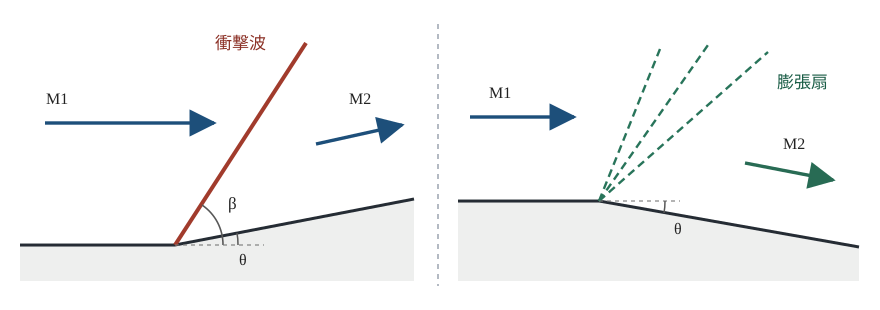

# FLUID44 斜めの衝撃波と膨張波をどう区別するか

[FLUID43 の正面衝撃波](../FLUID43/index.md#thm-fluid43-normal-shock-ratios)は流れを波面の法線方向に減速させた。では、超音速流がくさびの角を曲がるときは何が起こるだろう。流れを壁に**押し込む角**では斜め衝撃波が立ち、壁が流れから**遠ざかる角**では滑らかな膨張波の扇が広がる。どちらも方向が変わるが、圧力・エントロピー・許される解の決め方は異なる。

本講では、二次元・定常の定数比熱理想気体を扱う。上流は一様な超音速流 $M_1>1$、密度 $\rho_1>0$、静圧 $p_1>0$、絶対温度 $T_1>0$ とする。気体定数 $R>0$ と比熱比 $\gamma>1$ は一定で、[理想気体の閉鎖条件](../FLUID41/index.md#def-fluid41-ideal-gas) $p=\rho RT$、$c^2=\gamma RT$、$c_p=\gamma R/(\gamma-1)$ を使う。粘性境界層、波の反射、有限厚さの衝撃波内部、実在気体の解離はこの模型の対象外である。

小画面で角度ラベルが読みにくいときは[原寸の模式図](assets/shock_expansion_geometry.svg)を別タブで拡大して確かめられる。図は角度・長さの数値比を再現したものではなく、波面と壁の位置関係を示す模式図である。

## 0. 波面の角度と流れの方向を先に固定する

上流速度の大きさを $q_1>0$、上流方向から下流方向への**偏向角の大きさ**を $\theta\geq0$ とする。流れを押し曲げる圧縮角では、上流方向と平面衝撃波のなす鋭角を $\beta$ とする（波面への入射角であり、波面法線となす角ではない）。波面に垂直な成分を $u_n$、接線方向の成分を $u_t$ と書く。正の質量流束が上流から下流へ進む向きに法線を選ぶ。

衝撃波の前後で速度が曲がるため、角を分けて記録する必要がある。上流・下流の速度と波面のなす角はそれぞれ $\beta$ と $\beta-\theta$ である。前者は後者より大きくなる。膨張角では衝撃波面は存在せず、後で特性線から膨張扇を構成する。

<!-- formal-statement-start -->
> **定義（斜め波面の入射角と偏向角）**  
> 二次元・定常の一様上流速度 $q_1$ と、これを横切る平面衝撃波を考える。上流速度と波面がなす角を $\beta\in(0,\pi/2]$、下流方向の回転角の大きさを $\theta\in[0,\beta)$ とする。速度成分は
>
$$
u_{1n}=q_1\sin\beta,\quad u_{1t}=q_1\cos\beta,\qquad
u_{2n}=q_2\sin(\beta-\theta),\quad
u_{2t}=q_2\cos(\beta-\theta).
$$
>
> 局所音速を $c_i=\sqrt{\gamma RT_i}$ とし、全 Mach 数 $M_i=q_i/c_i$ と法線 Mach 数 $M_{in}=u_{in}/c_i$ を区別する。
<!-- formal-statement-end -->

<!-- definition-example-start: def-fluid44-wave-angles -->
**定義の確認**：$M_1=2$、$\beta=45^\circ$ なら $M_{1n}=2\sin45^\circ=\sqrt2>1$。同じ上流状態でも $\beta=20^\circ$ では $M_{1n}\simeq0.684<1$。全 Mach 数が 2 だからといって、任意の入射角で圧縮衝撃波を作れるわけではない。成分は速度ベクトルを波面の接線・法線に射影して得るのであり、単に $M_1$ を「正面衝撃波公式へ代入」するのは誤りである。
<!-- definition-example-end -->

## 1. 斜めでも保存するのは法線流束である

薄い検査体積を波面に沿って置く。[FLUID41 の二次元Euler保存形](../FLUID41/index.md#thm-fluid41-euler-conservative)を法線に射影すれば、質量・法線運動量・接線運動量・全エネルギーの各流束が左右で一致する。接線方向の圧力力は平面波面上でゼロになる。

<!-- formal-statement-start -->
> **定理（斜め衝撃波の法線跳躍と接線速度）**  
> 第0節の定常・断熱・非粘性の平面波面を挟み、両側が一定状態で $\rho_i,p_i,T_i,u_{in}>0$、$j=\rho_1u_{1n}>0$ とする。外力・熱・仕事の波面内寄与を無視し、保存形Euler方程式を積分的に満たすなら
>
$$
[\rho u_n]=0,\quad
[\rho u_n^2+p]=0,\quad
[\rho u_nu_t]=0,\quad
[\rho u_n(h+q^2/2)]=0
$$
>
> である。したがって $u_{2t}=u_{1t}$ であり、非自明な**圧縮型**解では法線 Mach 数 $M_{1n}>1$ を使った[正面衝撃波の圧力・密度比](../FLUID43/index.md#thm-fluid43-normal-shock-ratios)
>
$$
r:=\frac{\rho_2}{\rho_1}
=\frac{(\gamma+1)M_{1n}^2}{(\gamma-1)M_{1n}^2+2},
\qquad
P:=\frac{p_2}{p_1}
=1+\frac{2\gamma}{\gamma+1}(M_{1n}^2-1)
$$
>
> が成立する。温度比は $T_2/T_1=P/r$、下流法線 Mach 数は
>
$$
M_{2n}^2=\frac{1+(\gamma-1)M_{1n}^2/2}
{\gamma M_{1n}^2-(\gamma-1)/2}
$$
>
> となる。全 Mach 数 $M_2$ と $M_{2n}$ は一般に一致しない。
<!-- formal-statement-end -->

### 証明の見取り図

平面を跨ぐ小さな柱の両端では圧力の法線成分だけが残る。接線運動量の跳びを質量流束 $j>0$ で割ると接線速度が一定と分かる。ゆえにエネルギー跳躍の両側から同じ $u_t^2/2$ を消せば、法線速度だけの[FLUID43 の三保存式](../FLUID43/index.md#thm-fluid43-jump-balance)に還元できる。

<!-- proof-start -->
### 証明

上流から下流へ向く単位法線 $\boldsymbol n$ と、波面に沿う単位接線 $\boldsymbol t$ を取る。[圧縮性Euler保存形](../FLUID41/index.md#thm-fluid41-euler-conservative)の運動量フラックスを法線方向に通すと $\rho u_n\boldsymbol u+p\boldsymbol n$ である。これを $\boldsymbol n,\boldsymbol t$ へ射影し、定常保存形を厚さ $2\varepsilon$ の小柱で積分して $\varepsilon\downarrow0$ とすると、主張の質量・法線運動量・接線運動量条件を得る。全エネルギーの流束は $(E+p)u_n=\rho u_n(h+q^2/2)$ である。

質量保存より $j=\rho_1u_{1n}=\rho_2u_{2n}>0$。接線運動量保存は $j u_{1t}=j u_{2t}$ なので $u_{1t}=u_{2t}$。全エンタルピーの等式は
$$
h_1+\frac{u_{1n}^2+u_{1t}^2}{2}
=h_2+\frac{u_{2n}^2+u_{2t}^2}{2}.
$$
同じ接線速度の二乗を消すと
$$
h_1+\frac{u_{1n}^2}{2}=h_2+\frac{u_{2n}^2}{2}.
$$
残る質量保存 $j=\rho_i u_{in}$、法線運動量保存 $p_1+ju_{1n}=p_2+ju_{2n}$ と合わせると、変数 $(\rho_i,p_i,T_i,u_{in})$ に対する[正面衝撃波の跳躍条件](../FLUID43/index.md#thm-fluid43-jump-balance)に一致する。その[非自明な圧縮分枝の解](../FLUID43/index.md#thm-fluid43-normal-shock-ratios)へ上流 Mach 数として $u_{1n}/c_1=M_1\sin\beta$ を代入して各比を得る。
<!-- proof-end -->

**判断の核心**：斜め衝撃波では接線速度は保存するが、法線速度は低下する。一方、エントロピーは[正面衝撃波のエントロピー増大](../FLUID43/index.md#thm-fluid43-entropy-selection)により増え、停滞圧は低下する。断熱であることを等エントロピーであることと取り違えてはならない。

## 2. 角度 $\theta$ が与えられたとき、波面角 $\beta$ はいくつあるか

くさびの角 $\theta$ は壁の境界条件から決まるが、衝撃波角 $\beta$ は未知である。[法線跳躍](#thm-fluid44-oblique-jumps)と接線速度の一致を合わせて、未知の波面角を決定する。

<!-- formal-statement-start -->
> **定理（斜め衝撃波の偏向角・波面角・Mach数関係）**  
> 第1節の非自明な圧縮型・付着平面衝撃波で $M_1>1$、$\gamma>1$、$0<\theta<\beta\leq\pi/2$ とする。上流法線 Mach 数が 1 より大きいなら、偏向角と波面角は
>
$$
\tan\theta
=2\cot\beta\,
\frac{M_1^2\sin^2\beta-1}
{M_1^2(\gamma+\cos2\beta)+2}
$$
>
> を満たす。下流全 Mach 数は
>
$$
M_2=\frac{M_{2n}}{\sin(\beta-\theta)}
$$
>
> であり、上流 $M_1$ を直接[正面衝撃波の下流 Mach 公式](../FLUID43/index.md#thm-fluid43-normal-shock-ratios)に入れてはならない。
<!-- formal-statement-end -->

### 証明の見取り図

速度の法線・接線成分が作る二つの直角三角形を比較する。密度比 $r$ を挟んで $\tan(\beta-\theta)=\tan\beta/r$ と書き、差角の公式を使って $\theta$ を孤立させる。

<!-- proof-start -->
### 証明

[斜め衝撃波の質量・接線条件](#thm-fluid44-oblique-jumps)から $u_{2n}=u_{1n}/r$、$u_{2t}=u_{1t}$。両側の速度が波面となす角により
$$
\tan(\beta-\theta)
=\frac{u_{2n}}{u_{2t}}
=\frac{u_{1n}/r}{u_{1t}}
=\frac{\tan\beta}{r}.
$$
差角の公式 $\tan(\beta-\theta)=(\tan\beta-\tan\theta)/(1+\tan\beta\tan\theta)$ を使い、分母を払うと
$$
r(\tan\beta-\tan\theta)
=\tan\beta(1+\tan\beta\tan\theta).
$$
$\tan\theta$ を集めて
$$
\tan\theta=\frac{\tan\beta(r-1)}{r+\tan^2\beta}.
$$
ここへ $N=M_1^2\sin^2\beta$、[密度比](#thm-fluid44-oblique-jumps)
$$
r=\frac{(\gamma+1)N}{(\gamma-1)N+2},
\quad
r-1=\frac{2(N-1)}{(\gamma-1)N+2}
$$
を代入すると
$$
\tan\theta
=\frac{2\tan\beta(N-1)}
{(\gamma+1)N+[(\gamma-1)N+2]\tan^2\beta}.
$$
分子・分母に $\cos^2\beta$ を掛け、さらに $\sin^2\beta$ で割ると、分母の $N$ の係数は
$(\gamma+1)\cos^2\beta+(\gamma-1)\sin^2\beta=\gamma+\cos2\beta$ となり、表示した式を得る。$\beta=\pi/2$ は式の連続極限として扱い、偏向角は零になる。下流速度の法線射影 $M_{2n}=M_2\sin(\beta-\theta)$ から最後の式を得る。
<!-- proof-end -->

### 最大偏向角が現れる理由

圧縮分枝の条件は $M_{1n}=M_1\sin\beta>1$ だから
$$
\mu:=\arcsin(1/M_1)<\beta\leq\frac{\pi}{2}.
$$
$\beta\downarrow\mu$ では法線成分が音速となって波が消え、$\beta\uparrow\pi/2$ では正面衝撃波となって流れを曲げない。両端で $\theta=0$ なのに途中では正である。したがって折り返しがある。

<!-- formal-statement-start -->
> **命題（最大偏向角と弱・強衝撃波分枝）**  
> $M_1>1,\gamma>1$ を固定し、[上記の角度関係](#thm-fluid44-theta-beta-mach)で $\beta\in[\mu,\pi/2]$ とする。偏向角 $\theta(\beta)$ は内部のただ一つの点 $\beta_*$ で正の最大値 $\theta_{\max}$ を取る。$0<\theta<\theta_{\max}$ では、$\mu<\beta_{\mathrm w}<\beta_*<\beta_{\mathrm s}<\pi/2$ を満たす二つの角度解（弱・強分枝）がある。$\theta=\theta_{\max}$ では合流し、$\theta>\theta_{\max}$ に付着した平面衝撃波の解はない。
<!-- formal-statement-end -->

<!-- proof-start -->
### 証明

$A=M_1^2-1>0$、$B=M_1^2(\gamma-1)+2>0$、$C=M_1^2(\gamma+1)+2>0$ とし、$z=\cot^2\beta$ を置く。$0<z<A$ であり、[角度関係](#thm-fluid44-theta-beta-mach)の右辺は
$$
f(z):=\tan\theta
=\frac{2\sqrt z(A-z)}{B+Cz}.
$$
$f(0)=f(A)=0$、内部では $f(z)>0$ である。分母は正なので、導関数の符号は
$$
\operatorname{sgn}f'(z)
=\operatorname{sgn}\left(AB-(3B+AC)z-Cz^2\right)
$$
と一致する（正の因子 $[\,\sqrt z(B+Cz)^2\,]^{-1}$ を省いただけである）。この二次式は $z\geq0$ で厳密に減少し、$z=0$ では $AB>0$、$z=A$ では $-2AB-2CA^2<0$ である。従って内部零点 $z_*$ はただ一つ。$f$ は $(0,z_*)$ で増加、$(z_*,A)$ で減少する。$\tan$ は $[0,\pi/2)$ で単調増加し、$z=\cot^2\beta$ は $\beta$ と逆向きに動くので、主張の唯一の極大と二分枝が従う。
<!-- proof-end -->

実用的には
$$
D=3B+AC,\qquad
z_*=\frac{2AB}{D+\sqrt{D^2+4ABC}},
\qquad
\beta_*=\arctan\frac1{\sqrt{z_*}}
$$
を使う。これは近い二数の引き算を避けて正の根を計算する形である。$M_1=2,\gamma=1.4$ では $\mu=30^\circ$、$\beta_*\simeq64.669^\circ$、$\theta_{\max}\simeq22.974^\circ$。例えば偏向角 $25^\circ$ のくさびに、この模型の**付着した**直線衝撃波を割り当ててはならない。実際の流れでは離脱した湾曲衝撃波など別の構造を考える必要がある。

### 二分枝を数で確認する

$M_1=2,\gamma=1.4,\theta=10^\circ$ のとき二つの根は
$$
\beta_{\mathrm w}\simeq39.3139^\circ,\qquad
\beta_{\mathrm s}\simeq83.7001^\circ.
$$
[法線跳躍式](#thm-fluid44-oblique-jumps)と下流の角度を使うと、弱分枝では $M_2\simeq1.6405$、$p_2/p_1\simeq1.7066$、強分枝では $M_2\simeq0.6037$、$p_2/p_1\simeq4.4438$。一般に外部の滑らかな超音速流からの小偏向には弱分枝がよく選ばれるが、保存則だけで境界条件や下流の圧力を定めたことにはならない。また、弱分枝でも最大偏向角の近くでは下流が亜音速になり得るため、「弱なら常に $M_2>1$」は誤りである。

## 3. 衝撃波が消える極限：Mach角

前節の $\mu$ は単なる解の下限ではない。微小な圧縮・膨張擾乱が定常超音速流中を伝わる方向そのものである。有限跳躍のない微小波についてだけ、音波線形化が使える。

<!-- formal-statement-start -->
> **定義（Mach角）**  
> 一様超音速流 $M=q/c>1$ において、流れ方向と定常な微小音響擾乱の特性線がなす鋭角 $\mu$ を Mach角とし、
>
$$
\sin\mu=\frac1M,\qquad 0<\mu<\frac{\pi}{2}
$$
>
> で定める。有限振幅衝撃波の角度 $\beta$ とは区別し、圧縮衝撃波では $\beta>\mu$ である。
<!-- formal-statement-end -->

<!-- definition-example-start: def-fluid44-mach-angle -->
**定義の確認**：$M=2$ の一様流に対して $\sin\mu=1/2$ なので $\mu=30^\circ$。$M=1$ では線は流れに垂直な極限 $\mu=90^\circ$ となるが、本定義の定常超音速特性線としての扱いは $M>1$ に限る。
<!-- definition-example-end -->

<!-- proof-start -->
### 証明（Mach角の線形化による導出）

等エントロピー・渦なしの一様基準流 $(U,0)$、基準密度 $\rho_0$ と音速 $c_0$ の周りで、[FLUID11で定義した速度ポテンシャル](../FLUID11/index.md#def-fluid11-velocity-potential)を $\Phi=Ux+\psi(x,y)$、$|\nabla\psi|\ll U$ と置く。局所的に渦がないため速度を勾配 $\boldsymbol u=\nabla\Phi$ と表せる条件は[無渦場の局所ポテンシャル存在](../FLUID11/index.md#prop-fluid11-local-potential)による。[FLUID41 の等エントロピー関係](../FLUID41/index.md#prop-fluid41-isentropic)を使い、一定の停滞エンタルピー $h+|\nabla\Phi|^2/2$ を一次まで展開すると
$$
c_0^2\frac{\rho'}{\rho_0}+U\psi_x=0,
\qquad
\rho'=-\frac{\rho_0 U}{c_0^2}\psi_x.
$$
質量保存 $\partial_x(\rho\Phi_x)+\partial_y(\rho\Phi_y)=0$ を一次まで展開し、
$$
U\rho'_x+\rho_0(\psi_{xx}+\psi_{yy})=0.
$$
先ほどの $\rho'$ を代入して $\rho_0>0$ で割ると
$$
(1-M^2)\psi_{xx}+\psi_{yy}=0,\qquad M=U/c_0.
$$
二階方程式 $A\psi_{xx}+C\psi_{yy}=0$ の特性の傾きは $A(dy)^2+C(dx)^2=0$ で決まるので、
$$
\left(\frac{dy}{dx}\right)^2=\frac1{M^2-1}.
$$
したがって流れとの角度は $\tan\mu=1/\sqrt{M^2-1}$。$0<\mu<\pi/2$ で三角恒等式を使うと $\sin\mu=1/M$ となる。$M<1$ ではこの傾きは実数でなく、同じ超音速Mach線は存在しない。
<!-- proof-end -->

## 4. 壁が流れから遠ざかると何が起きるか

外向きの凸角を曲がるとき、流れは一枚の圧縮衝撃波ではなく、互いに異なる角度を持つ微小なMach線の扇を通る。この**Prandtl–Meyer膨張扇**の各場所では状態は連続で、理想化した滑らかな断熱可逆流として扱える。ここではさらに二次元・定常・渦なしの単純波で、各状態の停滞エンタルピーが共通と仮定する。

速度の大きさを $q>0$、速度方向を角 $\varphi$、流れ方向を $s$、その左法線方向を $n$ とし、局所 Mach 数を $M=q/c>1$ とする。角度 $\varphi$ と偏向角 $\theta$ は、向きつきの量とその大きさという違いがある。以下の $\theta>0$ は**膨張によって曲がる角の大きさ**であり、圧縮角の符号をそのまま流用しない。

<!-- formal-statement-start -->
> **定理（Prandtl–Meyer膨張関係）**  
> $M_1>1,\gamma>1$ の定数比熱理想気体の一様超音速流が、定常・二次元・渦なし・等エントロピーの単純膨張扇を通って、流れから遠ざかる壁へ角度 $\theta>0$ だけ曲がるとする。扇内で $M>1$ かつ $h+q^2/2$ は一定とする。このとき
>
$$
\theta=\nu(M_2)-\nu(M_1),\qquad M_2>M_1
$$
>
> である。ただし Prandtl–Meyer関数は $M\geq1$ で
>
$$
\nu(M)=\sqrt{\frac{\gamma+1}{\gamma-1}}\,
\arctan\sqrt{\frac{\gamma-1}{\gamma+1}(M^2-1)}
-\arctan\sqrt{M^2-1}
$$
>
> とし、$\nu(1)=0$ と定める。$\nu$ は $M>1$ で狭義増加し、
>
$$
\frac{d\nu}{dM}
=\frac{\sqrt{M^2-1}}{M[1+(\gamma-1)M^2/2]}>0.
$$
>
> 角度はラジアンで評価する。最大値を次のように置く。

$$
\nu_\infty=\left(\sqrt{\frac{\gamma+1}{\gamma-1}}-1\right)\frac\pi2.
$$

> 有限の下流 Mach 数 $M_2$ が存在するための条件は次のとおりである。

$$
\nu(M_1)+\theta<\nu_\infty.
$$
<!-- formal-statement-end -->

### 証明の見取り図

[音速と等エントロピー関係](../FLUID41/index.md#def-fluid41-sound-speed)を使って、流速変化 $dq/q$ を $dM$ に書き換える。二次元の質量保存と渦なし条件を流線に沿う座標へ直すと、Mach線に沿う速度方向の回転と速度増分の関係が現れる。これを膨張扇の一様状態間で積分する。

<!-- proof-start -->
### 証明

**(i) 回転と速度の微分関係。** 速度ベクトルを $\boldsymbol u=q(\cos\varphi,\sin\varphi)$ とする。局所直交単位ベクトルを $\boldsymbol e_s=(\cos\varphi,\sin\varphi)$、$\boldsymbol e_n=(-\sin\varphi,\cos\varphi)$ と置き、$\partial_s=\boldsymbol e_s\cdot\nabla$、$\partial_n=\boldsymbol e_n\cdot\nabla$ とする。

等エントロピー・停滞エンタルピー一定より $dh=dp/\rho=c^2d\rho/\rho$、$q\,dq+dh=0$。従って
$$
\frac{d\rho}{\rho}=-\frac{q\,dq}{c^2},
\qquad
d(\rho q)=\rho(1-M^2)\,dq.
$$
質量保存 $\nabla\cdot(\rho q\boldsymbol e_s)=0$ において $\nabla\cdot\boldsymbol e_s=\partial_n\varphi$ だから
$$
(1-M^2)\partial_s q+q\partial_n\varphi=0.
$$
また渦なし $\partial_xu_y-\partial_yu_x=0$ をこの基底へ射影すると
$$
q\partial_s\varphi-\partial_nq=0.
$$

**(ii) Mach線上での関係。** 流れから $\pm\mu$ の方向の方向微分は $D_\pm=\cos\mu\,\partial_s\pm\sin\mu\,\partial_n$ である。上の質量式・渦なし式を代入し、$\cot\mu=\sqrt{M^2-1}$ を用いると
$$
\begin{aligned}
D_\pm\varphi
&=\cos\mu\,\frac{\partial_nq}{q}
\pm\sin\mu\,\frac{(M^2-1)\partial_sq}{q}\\
&=\pm\frac{\sqrt{M^2-1}}{q}
\left(\cos\mu\,\partial_sq\pm\sin\mu\,\partial_nq\right)\\
&=\pm\frac{\sqrt{M^2-1}}{q}D_\pm q.
\end{aligned}
$$
従って各Mach線に沿って $d\varphi=\pm\sqrt{M^2-1}\,dq/q$ となる。単純膨張扇では、一つの特性線族の不変量 $\varphi\mp\nu(M)$ が一定であり、凸角で流れが加速する向きを選ぶと、速度方向の回転角の大きさは $d\theta=d\nu>0$ である。

**(iii) Mach数で積分。** 停滞温度を $T_0=T[1+(\gamma-1)M^2/2]$ とする[FLUID42 の停滞状態](../FLUID42/index.md#def-fluid42-stagnation)は、等エントロピーの各状態で共通である。$a=(\gamma-1)/2$ とすれば
$$
q=M\sqrt{\gamma RT}
=M\sqrt{\frac{\gamma RT_0}{1+aM^2}},
\qquad
\frac{dq}{q}
=\left(\frac1M-\frac{aM}{1+aM^2}\right)dM
=\frac{dM}{M(1+aM^2)}.
$$
よって
$$
d\nu=\sqrt{M^2-1}\frac{dq}{q}
=\frac{\sqrt{M^2-1}}{M(1+aM^2)}\,dM.
$$
$t=\sqrt{M^2-1}$ と置けば $M^2=1+t^2$、$dM=t\,dt/M$ だから
$$
d\nu=\frac{t^2}{(1+t^2)[1+a(1+t^2)]}\,dt
=\left(\frac{1+a}{1+a+at^2}-\frac1{1+t^2}\right)dt.
$$
第一項の積分は $\sqrt{(1+a)/a}\arctan(t\sqrt{a/(1+a)})$、第二項は $\arctan t$。下限 $t=0$ で $\nu(1)=0$ を選ぶと表示式となる。導関数の正値性と、二つの arctan の $M\to\infty$ 極限から有限解の存在条件が得られる。
<!-- proof-end -->

### 膨張後の圧力・温度・密度

膨張扇では、**衝撃波の跳躍式を使わない**。扇を横切ってエントロピーが一定だから、[FLUID41 の等エントロピー関係](../FLUID41/index.md#prop-fluid41-isentropic)と停滞温度保存を別々に使う。$a=(\gamma-1)/2$ として
$$
\frac{T_2}{T_1}=\frac{1+aM_1^2}{1+aM_2^2},\qquad
\frac{p_2}{p_1}=\left(\frac{T_2}{T_1}\right)^{\gamma/(\gamma-1)},
\qquad
\frac{\rho_2}{\rho_1}=\left(\frac{T_2}{T_1}\right)^{1/(\gamma-1)}.
$$
$M_2>M_1$ なので $T_2<T_1$、$p_2<p_1$、$\rho_2<\rho_1$ である。状態は連続し、$s_2=s_1$、$p_{02}=p_{01}$。速度は $q^2/2=c_p(T_0-T)$ より増加する。

**手計算の目印**：$\gamma=1.4,M_1=2$ なら $\nu(M_1)\simeq26.3798^\circ$。凸角を $10^\circ$ 曲がる膨張扇では $\nu(M_2)\simeq36.3798^\circ$ だから $M_2\simeq2.38489$。このとき $p_2/p_1\simeq0.547969$。先ほどの同じ $10^\circ$ の圧縮角（弱分枝）では $p_2/p_1\simeq1.70658$ だった。偏向角の大きさが同じでも、波の種類と圧力の変化は反対である。

## 5. 三つの流れを取り違えない

| 場面 | 適用の前提 | 下流での状態変化 | エントロピー・停滞圧 |
| --- | --- | --- | --- |
| 圧縮角の付着斜め衝撃波 | $M_1>1$、$0<\theta\leq\theta_{\max}$、$M_{1n}>1$ | $p,\rho,T$ は跳んで増加。$M_2$ は枝に依存 | $s_2>s_1$、$p_{02}<p_{01}$ |
| 凸角のPrandtl–Meyer膨張扇 | $M_1>1$、滑らか・等エントロピー・渦なし・単純波 | $M$ は連続的に増え、$p,\rho,T$ は下がる | $s_2=s_1$、$p_{02}=p_{01}$ |
| 微小Mach線 | $M>1$、微小擾乱の線形化 | 有限の跳びを持たない | この模型では有限の散逸を主張しない |

斜め衝撃波で法線成分のみ[FLUID43 の不可逆圧縮条件](../FLUID43/index.md#thm-fluid43-entropy-selection)が適用される。膨張波を一枚の「膨張衝撃波」で置き換えると、保存形の代数解だけを満たしてもエントロピー条件を破る（[FLUID43 の証明と反例](../FLUID43/index.md#thm-fluid43-entropy-selection)を参照）。反対に、等エントロピーの膨張扇の式を圧縮衝撃波に当てはめると衝撃波の停滞圧損失を消してしまう。

## 6. ブラウザPythonで二分枝と膨張扇を検算する

実行欄の一つの Python ファイルが、$\theta$–$\beta$–$M$ 式の極値、二分法による弱・強分枝、Prandtl–Meyer関数の逆算を行う。グラフには角度・下流Mach数・静圧比を並べる。衝撃波では法線の質量・運動量、接線速度、全エンタルピーの残差と $\Delta s/R$ を計算する。膨張扇では $\nu(M_2)-\nu(M_1)-\theta$、全エンタルピー、等エントロピー状態比を検算する。**解が存在しない角度には架空の付着衝撃波を描かない。**

<!-- python-file-lab -->
# lab-id: FLUID44-OBLIQUE-EXPANSION
# lab-title: 斜め衝撃波の弱・強分枝とPrandtl–Meyer膨張
# lab-file: textbook/volumes/dream_thater/物理系/FLUID/FLUID44/oblique_expansion_lab.py
# timeout-ms: 30000
# lab-preset: 基準：M1=2、偏向10度 | --mach 2 --turn 10 --grid 80
# lab-preset: 最大角を超える：M1=2、25度 | --mach 2 --turn 25 --grid 80
# lab-preset: 弱い偏向：M1=2、2度 | --mach 2 --turn 2 --grid 80
# lab-preset: 強い超音速流：M1=3、15度 | --mach 3 --turn 15 --grid 120
# lab-preset: 比熱比を変更：gamma=1.3 | --mach 2 --turn 10 --gamma 1.3 --grid 80
<!-- python-file-lab-end -->

初回実行にはブラウザ上で Python 実行環境の読み込みが必要になることがある。グラフは特定の定常・非粘性・定数比熱模型の解析関係を描き、衝撃波厚さや粘性流の数値解を表していない。基準条件で $\theta_{\max}\simeq22.974^\circ$、弱・強の $\beta\simeq39.314^\circ,83.700^\circ$、膨張後 $M_2\simeq2.38489$ を得るはずである。局所 CLI では同じファイルを Python 3 で実行し、引数 --self-test で代表値・保存残差・入力境界を検査できる。

## 7. 演習：角度と波面を跨ぐ保存流束をつなぐ

### Level A

#### A1. Mach角と入射条件
- Level: A

一様超音速流の Mach 数を $M_1=2$ とする。(i) Mach角、(ii) $\beta=30^\circ$ と $45^\circ$ での法線Mach数を計算せよ。(iii) どちらの角度なら非自明な圧縮衝撃波があり得るか、理由を述べよ。

<!-- solution-start -->
#### 詳細解答

(i) [Mach角の定義](#def-fluid44-mach-angle)より $\sin\mu=1/2$、従って $\mu=30^\circ$。

(ii) [法線Mach数](#def-fluid44-wave-angles)に角度を代入する。
$$
\begin{aligned}
M_{1n}(30^\circ)&=2\sin30^\circ=1,\\
M_{1n}(45^\circ)&=2\sin45^\circ=\sqrt2.
\end{aligned}
$$

(iii) 非自明な圧縮型の[法線跳躍](#thm-fluid44-oblique-jumps)には $M_{1n}>1$ が必要である。従って $45^\circ$ は候補となり、$30^\circ$ は波が消える限界である。候補というだけでは、壁の偏向角との整合をまだ検査したことにはならない。
<!-- solution-end -->

#### A2. 与えられた衝撃波角から状態比を得る
- Level: A

$M_1=2,\gamma=1.4,\beta=45^\circ$ の付着圧縮衝撃波を仮定する。$r=\rho_2/\rho_1$、$P=p_2/p_1$、$T_2/T_1$ を求めよ。

<!-- solution-start -->
#### 詳細解答

$M_{1n}^2=M_1^2\sin^245^\circ=4/2=2$。[斜め衝撃波の法線跳躍](#thm-fluid44-oblique-jumps)より
$$
r=\frac{2.4\cdot2}{0.4\cdot2+2}=\frac{12}{7},
\qquad
P=1+\frac{2.8}{2.4}(2-1)=\frac{13}{6}.
$$
理想気体 $p=\rho RT$ で $R$ は共通だから
$$
\frac{T_2}{T_1}=\frac{P}{r}
=\frac{13}{6}\frac7{12}=\frac{91}{72}.
$$
三比とも 1 より大きい。$M_1^2=4$ を正面衝撃波公式へそのまま入れると異なる値になり、斜め波面の法線運動量を誤って評価する。
<!-- solution-end -->

#### A3. 偏向角と下流Mach数を区別する
- Level: A

A2 と同じ気体・衝撃波で、$\theta$ と $M_2$ を求める式を示し、$M_{2n}$ と $M_2$ が同じでないことを確かめよ。

<!-- solution-start -->
#### 詳細解答

[接線速度の連続性](#thm-fluid44-oblique-jumps)と質量保存から $\tan(\beta-\theta)=\tan\beta/r=7/12$。$\beta=45^\circ$ なので
$$
\theta=45^\circ-\arctan(7/12)\simeq14.7436^\circ.
$$
法線下流 Mach 数は[正面衝撃波関係](#thm-fluid44-oblique-jumps)より
$$
M_{2n}^2=\frac{1+0.2\cdot2}{1.4\cdot2-0.2}
=\frac7{13},\quad M_{2n}=\sqrt{7/13}.
$$
一方、$\beta-\theta=\arctan(7/12)$ だから $\sin(\beta-\theta)=7/\sqrt{193}$。従って
$$
M_2=\frac{\sqrt{7/13}}{7/\sqrt{193}}
=\sqrt{\frac{193}{91}}\simeq1.4563.
$$
$M_{2n}\simeq0.7338<1$ でも、全 Mach 数は $M_2>1$ となる。
<!-- solution-end -->

#### A4. 膨張後の圧力比
- Level: A

$\gamma=1.4$、$M_1=2$ の超音速流が凸角で $10^\circ$ 等エントロピー膨張する。$\nu(M_1)\simeq26.3798^\circ$、逆算で $M_2\simeq2.384887$ を用い、$T_2/T_1$ と $p_2/p_1$ を求めよ。

<!-- solution-start -->
#### 詳細解答

[Prandtl–Meyer関係](#thm-fluid44-prandtl-meyer)より $\nu(M_2)=26.3798^\circ+10^\circ=36.3798^\circ$。$a=0.2$ なので
$$
\frac{T_2}{T_1}=\frac{1+0.2\cdot4}{1+0.2(2.384887)^2}
=\frac{1.8}{2.13754\ldots}\simeq0.842.
$$
[等エントロピーの状態比](#thm-fluid44-prandtl-meyer)を使い
$$
\frac{p_2}{p_1}
=\left(\frac{1.8}{1+0.2(2.384887)^2}\right)^{3.5}
\simeq0.547969<1.
$$
これは下流圧力が約45.2%低下することを意味する。衝撃波のように $P>1$ の式を使ってはいけない。
<!-- solution-end -->

#### A5. 衝撃波の停滞圧損失
- Level: A

$\gamma=1.4$、$M_1=2$、$\theta=10^\circ$ の弱斜め衝撃波では $r\simeq1.4584256$、$P\simeq1.7065786$ である。$\Delta s/R$ と $p_{02}/p_{01}$ を求め、静圧比との違いを述べよ。

<!-- solution-start -->
#### 詳細解答

[衝撃波のエントロピー関係](../FLUID43/index.md#thm-fluid43-entropy-selection)を法線状態へ適用する。$c_p/R=\gamma/(\gamma-1)$ と $c_v/R=1/(\gamma-1)$ なので
$$
\frac{\Delta s}{R}
=\frac{\ln P-\gamma\ln r}{\gamma-1}
=\frac{\ln1.7065786-1.4\ln1.4584256}{0.4}
\simeq0.0154751>0.
$$
停滞温度は等しくても停滞圧は
$$
\frac{p_{02}}{p_{01}}=\exp(-\Delta s/R)
\simeq\exp(-0.0154751)\simeq0.98464<1
$$
に下がる。$P\simeq1.70658>1$ は**静圧**比であり、全圧と混同できない。
<!-- solution-end -->

### Level B

#### B1. 最大偏向角が一意であることを示す
- Level: B

$A=M_1^2-1$、$B=M_1^2(\gamma-1)+2$、$C=M_1^2(\gamma+1)+2$ とする。$\tan\theta=f(z)=2\sqrt z(A-z)/(B+Cz)$、$z=\cot^2\beta\in(0,A)$ の極大がただ一つであることを示し、数値計算で解の探索範囲をどう分けるか説明せよ。

<!-- solution-start -->
#### 詳細解答

$z>0$ の範囲では分母と $\sqrt z$ が正なので、微分の符号だけ調べればよい。積の微分で
$$
f'(z)=\frac{(A-3z)(B+Cz)-2Cz(A-z)}
{\sqrt z(B+Cz)^2}
=\frac{AB-(3B+AC)z-Cz^2}{\sqrt z(B+Cz)^2}.
$$
分子 $Q(z)=AB-(3B+AC)z-Cz^2$ の導関数は
$$
Q'(z)=-(3B+AC)-2Cz<0.
$$
また $Q(0)=AB>0$、$Q(A)=-2AB-2CA^2<0$。中間値の定理と狭義単調性により零点 $z_*$ がただ一つある。$f$ は $z_*$ で唯一の最大を持つ。$\beta$ へ戻すと $\mu<\beta_*<\pi/2$ であり、任意の $0<\theta<\theta_{\max}$ に対して $(\mu,\beta_*)$ と $(\beta_*,\pi/2)$ の各区間で二分法を使える。全区間を一つの二分法に渡すと両端が同符号となるため、二根を検出できない。
<!-- solution-end -->

#### B2. Prandtl–Meyer積分を再現する
- Level: B

一定の停滞温度と $c^2=\gamma RT$ から $dq/q$ を $dM$ で表し、$d\nu=\sqrt{M^2-1}\,dq/q$ を積分して $\nu(M)$ を導け。$\nu(1)=0$ を用いよ。

<!-- solution-start -->
#### 詳細解答

[停滞状態](../FLUID42/index.md#def-fluid42-stagnation)より $T=T_0/(1+aM^2)$、$a=(\gamma-1)/2$ だから
$$
q=M\sqrt{\frac{\gamma RT_0}{1+aM^2}}.
$$
対数微分を取ると
$$
d\ln q=\frac{dM}{M}-\frac12\frac{2aM\,dM}{1+aM^2}
=\frac{dM}{M(1+aM^2)}.
$$
したがって
$$
d\nu=\frac{\sqrt{M^2-1}}{M(1+aM^2)}\,dM.
$$
$t=\sqrt{M^2-1}$ なら $dM=t\,dt/M$、$M^2=1+t^2$ で
$$
d\nu=\left(\frac{1+a}{1+a+at^2}-\frac1{1+t^2}\right)dt.
$$
それぞれ積分して
$$
\nu(M)=\sqrt{\frac{1+a}{a}}\arctan\left(t\sqrt{\frac a{1+a}}\right)-\arctan t+C.
$$
$M=1$ で $t=0$、$\nu(1)=0$ から $C=0$。$a=(\gamma-1)/2$ を戻せば[Prandtl–Meyer関数](#thm-fluid44-prandtl-meyer)となる。$M>1$ で被積分関数が正なので、逆算に用いる単調性も確かめられる。
<!-- solution-end -->

#### B3. 膨張の不連続はなぜ代用にならないか
- Level: B

$\gamma=1.4$ とし、上流法線 Mach 数を形式的に $M_{1n}=0.8$ として[正面衝撃波の状態比](../FLUID43/index.md#thm-fluid43-normal-shock-ratios)の右辺へ代入する。$r,P$ と $\Delta s/R$ を計算し、なぜ滑らかな膨張扇の代わりに採用できないか述べよ。

<!-- solution-start -->
#### 詳細解答

$N=0.8^2=0.64$ を代入すると
$$
r=\frac{2.4\cdot0.64}{0.4\cdot0.64+2}
=\frac{1.536}{2.256}=\frac{32}{47}\simeq0.68085,
$$
$$
P=1+\frac76(0.64-1)=1-\frac{21}{50}=\frac{29}{50}=0.58.
$$
[エントロピー状態差](../FLUID43/index.md#thm-fluid43-entropy-selection)の式を代数的に評価すると
$$
\frac{\Delta s}{R}
=\frac{\ln(29/50)-1.4\ln(32/47)}{0.4}<0
$$
となる（約 $-0.016$）。これは保存式の非自明分枝を亜音速法線条件へ**適用範囲外で**形式代入したもので、圧縮型衝撃波の $M_{1n}>1$ も、断熱の[エントロピー生成非負](../../CTM/CTM10/index.md#principle-ctm10-entropy)も満たさない。滑らかな[Prandtl–Meyer膨張](#thm-fluid44-prandtl-meyer)では非ゼロの有限跳びではなく、各点で連続、$s_2=s_1$ の単純波を用いる。
<!-- solution-end -->

#### B4. 同じ角度でも波の種類で圧力が逆転する
- Level: B

$M_1=2,\gamma=1.4,\theta=10^\circ$ とし、弱付着衝撃波では $(r,P)\simeq(1.4584256,1.7065786)$、等エントロピー膨張では $M_2\simeq2.384887$ とする。静圧・停滞圧・エントロピーの変化をそれぞれ比較せよ。

<!-- solution-start -->
#### 詳細解答

弱圧縮衝撃波では $P>1$、一方[エントロピー増大](../FLUID43/index.md#thm-fluid43-entropy-selection)により
$$
\frac{\Delta s}{R}
=\frac{\ln P-1.4\ln r}{0.4}\simeq0.0154751>0,\quad
\frac{p_{02}}{p_{01}}=e^{-0.0154751}\simeq0.98464<1.
$$
膨張扇では $a=0.2$、温度比 $t=(1+0.2\cdot4)/(1+0.2(2.384887)^2)$ だから[等エントロピー関係](../FLUID41/index.md#prop-fluid41-isentropic)より
$$
\frac{p_2}{p_1}=t^{3.5}\simeq0.547969<1,\quad
\frac{\rho_2}{\rho_1}=t^{2.5}.
$$
ここで $\ln(p_2/p_1)-\gamma\ln(\rho_2/\rho_1)=3.5\ln t-1.4\cdot2.5\ln t=0$ より $\Delta s=0$、従って $p_{02}/p_{01}=1$ である。つまり静圧は衝撃波で上昇、膨張扇で下降するが、停滞圧は衝撃波でだけ失われる。
<!-- solution-end -->

### Level C

#### C1. くさびと凸角を一つの上流状態から比較する
- Level: C

定数比熱理想気体について $M_1=2$、$\gamma=1.4$、$R=287$ J/(kg K)、$p_1=100$ kPa、$T_1=300$ K とする。(i) 付着可能な最大偏向角と弱・強衝撃波の角度範囲、(ii) $\theta=10^\circ$ の圧縮角に対する両分枝の $\beta,M_2,P,r,\Delta s/R,p_{02}/p_{01}$、(iii) 同じ大きさの凸角における $M_2,p_2,T_2$、(iv) 衝撃波における質量・法線運動量・全エンタルピーの残差を**一般式へ戻して**検証せよ。(v) 圧縮角が $25^\circ$ の場合に本講のどの仮定が破綻するか述べよ。

<!-- solution-start -->
#### 詳細解答

(i) 上流音速と Mach角は
$$
c_1=\sqrt{\gamma RT_1}=\sqrt{1.4\cdot287\cdot300}\simeq347.19\ {\rm m/s},
\qquad \mu=\arcsin(1/2)=30^\circ.
$$
[最大偏向角命題](#prop-fluid44-max-turn)で $A=3$、$B=3.6$、$C=11.6$、$D=3B+AC=45.6$ と置く。
$$
z_*=\frac{2\cdot3\cdot3.6}
{45.6+\sqrt{45.6^2+4\cdot3\cdot3.6\cdot11.6}},
\quad \beta_*\simeq64.669^\circ,\quad
\theta_{\max}\simeq22.974^\circ.
$$
従って弱角は $30^\circ<\beta_{\rm w}<64.669^\circ$、強角は $64.669^\circ<\beta_{\rm s}<90^\circ$。

(ii) [角度関係](#thm-fluid44-theta-beta-mach)に $\theta=10^\circ$ を入れて両区間で二分法を行うと
$$
\beta_{\rm w}\simeq39.31393^\circ,\qquad
\beta_{\rm s}\simeq83.70008^\circ.
$$
$N=(2\sin\beta)^2$ を各根に代入し、
$$
r=\frac{2.4N}{0.4N+2},\qquad
P=1+\frac76(N-1),\qquad
M_2=\frac{\sqrt{(1+0.2N)/(1.4N-0.2)}}{\sin(\beta-10^\circ)}
$$
から次の値を得る。

| 量 | 弱分枝 | 強分枝 |
| --- | ---: | ---: |
| $r=\rho_2/\rho_1$ | $1.45843$ | $2.64873$ |
| $P=p_2/p_1$ | $1.70658$ | $4.44381$ |
| $M_2$ | $1.64052$ | $0.60370$ |
| $\Delta s/R=[\ln P-1.4\ln r]/0.4$ | $0.015475$ | $0.319495$ |
| $p_{02}/p_{01}=\exp(-\Delta s/R)$ | $0.98464$ | $0.72652$ |

(iii) [膨張関係](#thm-fluid44-prandtl-meyer)から $\nu(2)=26.37976^\circ$、$\nu(M_2)=36.37976^\circ$ を解いて $M_2\simeq2.384887$。停滞温度を共通に使えば
$$
t=\frac{T_2}{T_1}=\frac{1.8}{1+0.2(2.384887)^2}\simeq0.8421,
\quad T_2=300t\simeq252.6\ {\rm K},
$$
$$
p_2=100\ {\rm kPa}\,t^{3.5}\simeq54.797\ {\rm kPa}.
$$
ここでは $s_2=s_1$ と全圧一定であり、(ii) の不可逆な衝撃波とは異なる。

(iv) 質量流束を $j=\rho_1q_1\sin\beta$、密度比を $r$ とすれば $u_{2n}=q_1\sin\beta/r$ なので
$$
\rho_2u_{2n}-\rho_1u_{1n}
=(r\rho_1)\frac{q_1\sin\beta}{r}-\rho_1q_1\sin\beta=0.
$$
法線運動量は
$$
(p_2+\rho_2u_{2n}^2)-(p_1+\rho_1u_{1n}^2)
=p_1(P-1)-\rho_1q_1^2\sin^2\beta(1-1/r).
$$
$\rho_1q_1^2\sin^2\beta=\gamma p_1N$ と、[法線圧力の跳躍式](#thm-fluid44-oblique-jumps) $P-1=\gamma N(1-1/r)$ を代入すると零になる。全エンタルピーの差は $u_t$ が一致するため
$$
H_2-H_1=c_p(T_2-T_1)+\frac{u_{2n}^2-u_{1n}^2}{2}
=\frac{\gamma p_1}{(\gamma-1)\rho_1}(P/r-1)
+\frac{q_1^2\sin^2\beta}{2}(r^{-2}-1)=0.
$$
最後の零は[正面衝撃波のエネルギー跳躍](../FLUID43/index.md#thm-fluid43-jump-balance)に $u_1=q_1\sin\beta$ を適用したもの。数値実験でもこれらを分枝ごとに丸め前の値で照合する。

(v) $\theta=25^\circ>\theta_{\max}$ なので[最大偏向角命題](#prop-fluid44-max-turn)の付着平面波面は存在しない。これは保存則の破綻ではなく、**定常な一本の付着直線衝撃波でくさび境界を満たせる**という幾何的仮定の破綻である。離脱衝撃波など別の流れの構造と境界条件が必要となる。
<!-- solution-end -->

## 8. 適用範囲と次への接続

本講の解法は、衝撃波で**保存流束＋エントロピー選択**、膨張扇で**滑らかな等エントロピー特性線**を使い分ける方法である。弱・強分枝は、単に代数根が二つあるというだけでなく、後続の圧力条件や周囲の流れにより選択が変わり得る。粘性境界層と衝撃波が干渉する場合、反射や三次元の曲がった衝撃波、非一様気体、衝撃波の離脱ではこの局所模型をそのまま領域全体の答えにしてはならない。

次の FLUID45 では、滑らかでない解でも質量などを壊さないため、保存形をセル面フラックスで離散化する。
