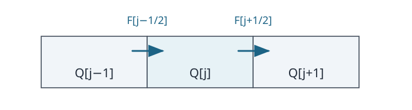

# FLUID45 数値計算で保存則を壊さない方法は何か

[FLUID5 の検査体積と符号付き流束](../FLUID5/index.md#def-fluid5-relative-mass-flux)では、物質は境界を通って隣の領域へ移り、境界内部で突然消えたり生まれたりしない。[FLUID41 の圧縮性Euler方程式の保存形](../FLUID41/index.md#thm-fluid41-euler-conservative)も同じ構造を持つ。しかし、微分方程式を格子点の値へ単純に置き換えると、隣接セルの境界で計算した流出量と流入量が一致する保証はない。

**そこで未知数を点の値ではなく「小区間内の平均」とし、各境界に一つだけ数値流束を置く。** これが有限体積法の入口である。本講では一次元の線形移流だけを使い、有限体積更新の導出、離散総量の厳密な相殺、流入・流出境界の収支を証明する。CFL条件と安定性・収束の詳細な分析は次講で扱うが、「保存するだけでは安全な計算法ではない」という反例はここで確かめる。

## 0. 方程式と物理量を固定する

長さ $L>0$ の区間 $0\leq x<L$ を考え、一定の速度 $a>0$ [m/s] で運ばれる質量の**線密度** $q(x,t)$ [kg/m] を考える。三次元の体積密度 [kg/m$^3$] を断面積 [m$^2$] にわたって積分すると得られる、単位長さ当たりの質量である。したがって $q\,dx$ の単位は kg、フラックス $f(q)=aq$ は kg/s である。流入や生成・消滅のない区間内部では

$$
\partial_t q+\partial_x f(q)=0,\qquad f(q)=aq,\qquad 0<x<L,\quad t>0.
$$

$0$ と $L$ を同一視する**周期境界**では $q(0,t)=q(L,t)$ と置く。開放区間では正速度 $a>0$ のため、左端 $x=0$ に流入値 $q_{\rm in}(t)$ を与え、右端 $x=L$ には追加の流入値を指定しない。本講は一定格子上の一次精度更新を扱い、非線形Euler系の数値流束を直接実装するものではない。

滑らかな $q$ を固定区間 $[x_\ell,x_r]$ で積分する。$\partial_tq$ は位置 $x$ を固定した時間微分、$\partial_x f(q)$ は時刻 $t$ を固定した空間微分であり、$d/dt$ は両端 $x_\ell,x_r$ を固定した積分値の時間微分である。この条件の下で微分と積分を交換し、$x$ に関する定積分へ[微積分学の基本定理II](../../../基礎科目/RA/RA4/index.md#thm-ra4-ftc2)を適用する：

$$
\frac{d}{dt}\int_{x_\ell}^{x_r}q(x,t)\,dx
=-\int_{x_\ell}^{x_r}\partial_x f(q)\,dx
=f(q(x_\ell,t))-f(q(x_r,t)).
$$

**左端の流束は正の流入、右端は正の流出**である。この符号は[固定・移動検査体積の収支](../FLUID5/index.md#thm-fluid5-moving-mass)を一次元・固定境界へ特殊化したものでもある。有限体積法はこの積分恒等式を直接離散化する。

## 1. 点の値ではなくセル平均を未知数にする

区間を $N\geq2$ 個のセルへ分け、幅 $h=L/N$、境界 $x_{j+1/2}=(j+1)h$、セル $I_j=[jh,(j+1)h)$（$j=0,\dots,N-1$）とする。格子境界は隣の二つのセルが共有する同じ位置である。時刻 $t_n$ において、セルに含まれる総量を $h\bar q_j(t_n)$ と書く。

<!-- formal-statement-start -->
> **定義（セル平均）**  
> $q(\cdot,t)$ が各セル $I_j$ 上で積分可能なら
>
$$
\bar q_j(t)=\frac1h\int_{jh}^{(j+1)h}q(x,t)\,dx
$$
>
> をそのセルの平均と呼ぶ。$\bar q_j$ の単位は $q$ と同じ kg/m、$h\bar q_j$ はセルに含まれる質量 kg である。数値未知量 $Q_j^n$ は時刻 $t_n$ の $\bar q_j(t_n)$ を近似する。
<!-- formal-statement-end -->

<!-- definition-example-start: def-fluid45-cell-average -->
**定義の確認**：$L=1$ m、$N=2$ で $q(x,0)=(2\ {\rm kg/m^2})x$ とする（以下の積分計算では長さを m 単位の数値で代入する）。各セルは幅 $h=1/2$ m であり、
$$
\bar q_0(0)=2\int_0^{1/2}2x\,dx=\frac12\ {\rm kg/m},
\qquad
\bar q_1(0)=2\int_{1/2}^1 2x\,dx=\frac32\ {\rm kg/m}.
$$
全質量は $h(\bar q_0+\bar q_1)=1$ kg で、直接積分 $\int_0^1 2x\,dx=1$ kg と一致する。ここでは $q(jh,0)$ や $q((j+1/2)h,0)$ を定義として使ったのではなく、セル積分で定めたことが重要である。
<!-- definition-example-end -->

各セルの左右の境界を通る**同じ物理フラックス**を時間積分すれば、セル平均の正確な収支が得られる。まず積分形の定理を確かめよう。

<!-- formal-statement-start -->
> **定理（セルごとの正確な積分収支）**  
> $q$ は各セル内部で $C^1$ 級、各境界で共通の連続したフラックス $f(q)$ の跡を持ち、$\partial_tq+\partial_xf(q)=0$ を満たすとする。このとき任意の $t_{n+1}>t_n$ に対して
>
$$
h\bigl[\bar q_j(t_{n+1})-\bar q_j(t_n)\bigr]
=-\int_{t_n}^{t_{n+1}}\!\!
\left[f(q(x_{j+1/2},t))-f(q(x_{j-1/2},t))\right]dt.
$$
>
> 不連続な場合も、この右辺のフラックスの跡が適切に定義され、保存則を積分的に満たす場合に同じ関係が成り立つ。
<!-- formal-statement-end -->

<!-- proof-start -->
### 証明

セル $I_j$ を固定して先ほどの区間積分収支を適用する。左辺は $d(h\bar q_j)/dt$、右辺は $f(q(x_{j-1/2},t))-f(q(x_{j+1/2},t))$ となる。この時間微分の恒等式を $t_n$ から $t_{n+1}$ まで積分すると

$$
h\bar q_j(t_{n+1})-h\bar q_j(t_n)
=\int_{t_n}^{t_{n+1}}f(q(x_{j-1/2},t))dt
-\int_{t_n}^{t_{n+1}}f(q(x_{j+1/2},t))dt.
$$

二項を括れば表示した式になる。境界の値が一意でない不連続場を扱うには、左右の値を独立に代入するのではなく、保存則の意味で**境界を通る単一の流束**を決める必要がある（[FLUID43 の積分的な跳躍収支](../FLUID43/index.md#thm-fluid43-jump-balance)と同じ原理）。ただし本講の数値計算では線形移流の流束だけを使う。
<!-- proof-end -->

## 2. 各面の数値流束をただ一つ定める

正確な時間平均フラックスは一般に未知である。そこで、時刻 $t_n$ の近似値と既知の境界条件から、その面における時間平均フラックスの近似 $F_{j+1/2}^n$ [kg/s] を計算する。

<!-- formal-statement-start -->
> **定義（単一の面数値流束と有限体積更新）**  
> 時刻刻み $\Delta t_n=t_{n+1}-t_n>0$、セル幅 $h>0$ とする。内部のセル境界 $x_{j+1/2}$ には両隣のセルが共有する**一個**の実数 $F_{j+1/2}^n$ を割り当て、
>
$$
Q_j^{n+1}=Q_j^n-\frac{\Delta t_n}{h}
\left(F_{j+1/2}^n-F_{j-1/2}^n\right).
$$
>
> を有限体積更新と呼ぶ。$F$ は右向きを正とする。周期境界では $F_{-1/2}^n=F_{N-1/2}^n$ とする。
<!-- formal-statement-end -->

<!-- definition-example-start: def-fluid45-numerical-flux -->
**定義の確認**：二つの隣接セル $I_j,I_{j+1}$ を考え、共通面の流束が $F_{j+1/2}^n=3$ kg/s、刻みが $\Delta t_n=0.1$ s とする。更新式を $h$ 倍すれば $hQ_j$ は質量なので、**この共通面だけによる**両セルの質量変化は

$$
-\Delta t_nF_{j+1/2}^n=-0.1\times3=-0.3\ {\rm kg},\qquad
+\Delta t_nF_{j+1/2}^n=+0.3\ {\rm kg}
$$

となる。別々の流束を使えば相殺が壊れる。面の数は周期格子で $N$ 個、開放格子で $N+1$ 個であり、同じ内部面を二度生成しない。
<!-- definition-example-end -->

矢印の向きは正のフラックスの向きである。隣のセルから見れば同じ面のフラックスが左からの**流入**になる。フラックス値が負なら実際の輸送方向は矢印と逆になるが、式の符号規約は変えない。

<!-- formal-statement-start -->
> **定理（離散的な総量保存と境界収支）**  
> $N\geq2$ 個の同幅セルで[単一の面数値流束](#def-fluid45-numerical-flux)を用い、全質量を
>
$$
M^n=h\sum_{j=0}^{N-1}Q_j^n
$$
>
> と定める。このとき、開放区間では
>
$$
M^{n+1}-M^n=\Delta t_n\left(F_{-1/2}^n-F_{N-1/2}^n\right).
$$
>
> とくに周期境界では $M^{n+1}=M^n$ が任意の刻み、任意の内部数値流束に対して**代数的に**成り立つ（浮動小数点演算では丸め誤差の範囲）。
<!-- formal-statement-end -->

### 証明の見取り図

各セルの更新に $h$ を掛けて総和し、内部の $F_{j+1/2}^n$ が「左セルの流出」と「右セルの流入」に正負逆で現れることを調べる。これだけであり、$F$ の具体式、微分方程式の正確な解、刻みの大小を仮定する必要はない。

<!-- proof-start -->
### 証明

更新式を $j=0,\dots,N-1$ で足すと

$$
\begin{aligned}
M^{n+1}-M^n
&=-\Delta t_n\sum_{j=0}^{N-1}
\left(F_{j+1/2}^n-F_{j-1/2}^n\right)\\
&=-\Delta t_n\left[
(F_{1/2}^n-F_{-1/2}^n)
+(F_{3/2}^n-F_{1/2}^n)+\cdots+
(F_{N-1/2}^n-F_{N-3/2}^n)\right]\\
&=\Delta t_n(F_{-1/2}^n-F_{N-1/2}^n).
\end{aligned}
$$

内部のすべての面流束が一度ずつ正負で打ち消された。周期境界なら左右の端面が同じ面を表し $F_{-1/2}^n=F_{N-1/2}^n$ だから右辺は零である。これは数値流束が正確かどうかと**独立**の代数的な主張である。
<!-- proof-end -->

## 3. 右向きの移流ではどちらのセルを読むか

$a>0$ なら、面 $x_{j+1/2}$ へ運ばれる量は左セルから到達する。そこで左セル平均を代入した**一次風上流束（upwind flux）**を

$$
F_{j+1/2}^n=aQ_j^n
$$

とする。周期境界では添字を $N$ で巡回させる。左端から入ってくる開放境界では $F_{-1/2}^n=a\,q_{\rm in}(t_n)$、右端では $F_{N-1/2}^n=aQ_{N-1}^n$ を使う。正速度の場合に右端へ流入値を勝手に指定することはしない。

<!-- formal-statement-start -->
> **命題（一次風上更新と非負性）**  
> 一定 $a>0$、同幅 $h>0$、時間刻み $\Delta t>0$、周期境界において上の風上流束を用いる。$\lambda=a\Delta t/h$ と置けば
>
$$
Q_j^{n+1}=(1-\lambda)Q_j^n+\lambda Q_{j-1}^n.
$$
>
> $0\leq\lambda\leq1$ なら各新しいセル平均は旧値二つの非負の重み付き平均であり、旧値がすべて非負なら新値も非負である。また旧値の最小値・最大値を超えない。
<!-- formal-statement-end -->

<!-- proof-start -->
### 証明

更新式の右端流束へ $F_{j+1/2}^n=aQ_j^n$、左端へ $F_{j-1/2}^n=aQ_{j-1}^n$ を代入して

$$
Q_j^{n+1}=Q_j^n-\frac{a\Delta t}{h}(Q_j^n-Q_{j-1}^n)
=(1-\lambda)Q_j^n+\lambda Q_{j-1}^n.
$$

$0\leq\lambda\leq1$ では $1-\lambda\geq0,\lambda\geq0$ かつ係数の和は1である。従って $Q_{\min}=\min_kQ_k^n$、$Q_{\max}=\max_kQ_k^n$ とすれば $Q_{\min}\leq Q_j^{n+1}\leq Q_{\max}$。特に $Q_{\min}\geq0$ なら $Q_j^{n+1}\geq0$。周期境界における全量保存は[離散総量保存定理](#thm-fluid45-global-balance)から同時に従う。
<!-- proof-end -->

### 手で一歩だけ追う

$N=4$、$(Q_0^n,Q_1^n,Q_2^n,Q_3^n)=(1,2,0,1)$ kg/m、$\lambda=1/2$ とする。$j=0$ の左は周期的に $j=3$ だから、

$$
(Q_0^{n+1},Q_1^{n+1},Q_2^{n+1},Q_3^{n+1})
=(1,1.5,1,0.5).
$$

更新前後のセル値の和は $1+2+0+1=4$ と $1+1.5+1+0.5=4$ で一致する。$h$ を掛けた総質量も保存する。一方で値の山は平らになった。**総量保存は形状保存を意味しない**。時間・空間の離散化を細かくして真の移流と比較する必要がある。

### 保存するのに負値を作る反例

内部面に左右平均を入れた中心流束

$$
F_{j+1/2}^n=\frac a2(Q_j^n+Q_{j+1}^n)
$$

も面ごとに単一の値を使うため[総量保存定理](#thm-fluid45-global-balance)を満たす。しかし周期セル3個で $(Q_0^n,Q_1^n,Q_2^n)=(0,1,0)$ とすると

$$
Q_0^{n+1}=Q_0^n-\frac{\lambda}{2}(Q_1^n-Q_2^n)
=-\frac{\lambda}{2}<0
$$

となる。物理的に非負であるべき $q$ に対し、**総質量の値が合っていても局所値は破綻する**。さらに風上法で $\lambda>1$ にすれば、係数 $1-\lambda<0$ となり非負の重み付き平均という性質は失われる。この境界線を次の FLUID46 で詳しく調べる。

## 4. 解析解との比較はセル平均同士で行う

周期長 $L=1$ m、速度 $a=1$ m/s とし、初期値を正の滑らかな波

$$
q(x,0)=b+A\sin(2\pi x/L),\qquad b>|A|>0
$$

とする。$b,A$ はともに kg/m の単位を持つ。正確な解は $q(x,t)=b+A\sin(2\pi(x-at)/L)$ である。実際、$x$ と $t$ をそれぞれ固定して偏微分すると

$$
\begin{aligned}
\partial_tq&=-\frac{2\pi aA}{L}\cos\frac{2\pi(x-at)}L,\\
\partial_x f(q)&=a\partial_xq=+\frac{2\pi aA}{L}\cos\frac{2\pi(x-at)}L,
\end{aligned}
$$

となり、二項の和は零である。セル中心 $x_j=(j+1/2)h$ とすると、[セル平均の定義](#def-fluid45-cell-average)から正確な比較対象は

$$
\begin{aligned}
\bar q_j(t)
&=\frac1h\int_{jh}^{(j+1)h}
\left[b+A\sin\frac{2\pi(x-at)}L\right]dx\\
&=b+A\frac{\sin(\pi h/L)}{\pi h/L}
\sin\frac{2\pi(x_j-at)}L.
\end{aligned}
$$

積分の中間式も確認する。$\theta_j=2\pi(x_j-at)/L$、$\delta=\pi h/L$ とおけば、両端が $x_j\mp h/2$ であることから

$$
\begin{aligned}
\frac1h\int_{jh}^{(j+1)h}\sin\frac{2\pi(x-at)}L\,dx
&=\frac{L}{2\pi h}\bigl[\cos(\theta_j-\delta)-\cos(\theta_j+\delta)\bigr]\\
&=\frac{L}{\pi h}\sin\theta_j\sin\delta
=\frac{\sin\delta}{\delta}\sin\theta_j.
\end{aligned}
$$

ここで $\cos(C-D)-\cos(C+D)=2\sin C\sin D$ を使った。**点での解析値をセル平均と誤認しない**ための係数 $\sin(\pi h/L)/(\pi h/L)$ が現れる。

時刻 $T$ に $L^1$ 型のセル平均誤差を

$$
E_1(T)=h\sum_{j=0}^{N-1}|Q_j(T)-\bar q_j(T)|
$$

で測る。単位は kg であり、ただ総質量だけ一致していても $E_1=0$ とは限らない。この差を格子幅を変えて観測する。ただし実験の有限個の誤差値だけで、すべての滑らかな初期値についての収束を証明したとはしない。

## 5. ブラウザでセル値・境界流量・誤差を再計算する

同じ Python ファイルが周期・開放境界で面流束を一度ずつ組み立て、セル値を更新する。厳密セル平均との比較、初期質量・最終質量・境界正味流入、各刻みでの保存残差を出す。周期的な正弦波と段差を持つ矩形パルスを使い分け、**段差が丸くなる現象と質量消失を混同しない**ようにする。図は同一計算の離散値・正確なセル平均・初期値を表示した補助であり、グラフの見た目を保存の証拠としない。

<!-- python-file-lab -->
# lab-id: FLUID45-FINITE-VOLUME-ADVECTION
# lab-title: 1D有限体積移流・セル総量と境界流束
# lab-file: textbook/volumes/dream_thater/物理系/FLUID/FLUID45/finite_volume_advection_lab.py
# timeout-ms: 30000
# lab-preset: 周期・正弦波・40セル | --grid 40 --case sine --boundary periodic --time 0.4 --cfl 0.8
# lab-preset: 周期・正弦波・80セル | --grid 80 --case sine --boundary periodic --time 0.4 --cfl 0.8
# lab-preset: 周期・矩形パルス | --grid 80 --case pulse --boundary periodic --time 0.4 --cfl 0.8
# lab-preset: 流入出境界の収支 | --grid 60 --case sine --boundary open --time 0.4 --cfl 0.8
# lab-preset: 速度と刻みを変更 | --grid 64 --case sine --boundary periodic --time 0.3 --speed 1.5 --cfl 0.5
# lab-preset: 一定解・誤差ゼロの確認 | --grid 40 --case sine --boundary periodic --time 0.4 --amplitude 0
# lab-preset: Python内蔵の保存則テスト | --self-test
<!-- python-file-lab-end -->

初回は Pyodide の公開実行環境の取得が必要な場合がある。Pythonソースは「Pythonソース」タブからページ内で読める。各出力の質量の単位は kg、時刻は s、セル値は kg/m、速度は m/s、誤差 $E_1$ は kg である。**保存残差の小ささと、解析解に対する誤差の小ささは別々に確認**すること。CLIからは同一ファイルに引数 `--self-test` を渡すと、周期保存、開放境界収支、非負性、一定解、正弦波格子細分、入力検証を実行する。

## 6. 演習：自力でフラックスの相殺を再構成する

### Level A

#### A1. 周期4セルの一歩
- Level: A

$N=4$、正速度の風上法で $\lambda=1/2$、旧値 $(1,2,0,1)$ とする。一歩後の全セル値と総和を求めよ。

<!-- solution-start -->
#### 詳細解答

[風上更新](#prop-fluid45-upwind-positivity)より $Q_j^{n+1}=(Q_j^n+Q_{j-1}^n)/2$ である。周期添字から $Q_{-1}^n=Q_3^n=1$。各セルで左隣の旧値を用いて

$$
\begin{aligned}
Q_0^{n+1}&=(1+1)/2=1,\\
Q_1^{n+1}&=(2+1)/2=1.5,\\
Q_2^{n+1}&=(0+2)/2=1,\\
Q_3^{n+1}&=(1+0)/2=0.5.
\end{aligned}
$$

旧総和は4、新総和も4なので、任意の $h>0$ に対して総量 $h\sum_jQ_j$ は変わらない。
<!-- solution-end -->

#### A2. 流束の符号
- Level: A

$[x_\ell,x_r]$ で左端の物理流束が $4$ kg/s、右端が $7$ kg/s の状態が $0.2$ s 継続するとする。区間内質量の変化と、右端を流入とみなしてはならない理由を説明せよ。

<!-- solution-start -->
#### 詳細解答

[積分収支](#thm-fluid45-exact-cell-balance)より、右向きを正に選んだフラックスの正味流入は $4-7=-3$ kg/s。従って質量変化は $\Delta M=0.2(4-7)=-0.6$ kg。右端での正の値は流体が区間の外へ**出る**ことを表すため、質量収支では負号で計上する。
<!-- solution-end -->

#### A3. セル平均を点値と区別する
- Level: A

$L=1$ m、$q(x)=(2\ {\rm kg/m^2})x$、$N=2$ とする。二つのセル平均と全積分をそれぞれ求めよ。左端点での値と比較せよ。

<!-- solution-start -->
#### 詳細解答

$h=1/2$ m。[セル平均](#def-fluid45-cell-average)に代入する。以下、長さは m 単位の数値を用いると

$$
\begin{aligned}
\bar q_0&=2\int_0^{1/2}2x\,dx=\frac12\ {\rm kg/m},\\
\bar q_1&=2\int_{1/2}^1 2x\,dx=\frac32\ {\rm kg/m}.
\end{aligned}
$$

従って全積分は $h(\bar q_0+\bar q_1)=1$ kg。左端点値は $q(0)=0$、$q(1/2)=1$ kg/m であり平均と異なる。たとえば点値を機械的に足した $h(0+1)=1/2$ kg は真の全積分1 kg に一致しない。
<!-- solution-end -->

#### A4. 刻みを大きくすると何が壊れるか
- Level: A

$a=2$ m/s、$h=0.1$ m で $\Delta t=0.04$ s と $0.06$ s の $\lambda$ を計算する。$Q_j^n=1,Q_{j-1}^n=0$ のとき新値を比較せよ。

<!-- solution-start -->
#### 詳細解答

$\lambda=a\Delta t/h$ に数値を代入すると

$$
\lambda_1=\frac{2(0.04)}{0.1}=0.8,\qquad
\lambda_2=\frac{2(0.06)}{0.1}=1.2.
$$

[風上更新](#prop-fluid45-upwind-positivity)では $Q_j^{n+1}=(1-\lambda)\cdot1+\lambda\cdot0=1-\lambda$ だから、新値は順に $0.2$ と $-0.2$ kg/m となる。前者は非負の重み付き平均、後者は非負初期値から負値を作るので[非負性命題](#prop-fluid45-upwind-positivity)の仮定が重要である。周期総量保存は後者でも代数的には成立し得る。
<!-- solution-end -->

### Level B

#### B1. 負の速度の風上流束
- Level: B

$a<0$ で周期境界の場合に、どちら側のセル値を面へ用いるべきか。更新式と非負性を保つ条件、総量保存を示せ。

<!-- solution-start -->
#### 詳細解答

$a<0$ では流体が右から左へ面を横切る。従って面 $j+1/2$ では**右セル**の値を使い $F_{j+1/2}^n=aQ_{j+1}^n$ とする。左面は $F_{j-1/2}^n=aQ_j^n$ なので
$$
Q_j^{n+1}=Q_j^n-\frac{a\Delta t}{h}(Q_{j+1}^n-Q_j^n)
=(1-\mu)Q_j^n+\mu Q_{j+1}^n,\quad\mu=|a|\Delta t/h.
$$
$0\leq\mu\leq1$ なら係数が非負で和1ゆえ非負性を保つ。周期境界では各面流束を左右で一つずつ共有するので[総量保存](#thm-fluid45-global-balance)により $\sum hQ_j$ は不変。速度の符号を変えても、保存定理の導出そのものを変更する必要はない。
<!-- solution-end -->

#### B2. 開放境界の正味流入
- Level: B

$N=3$、$h=1$ m、$a=1$ m/s、$\Delta t=0.5$ s、旧値 $(2,1,0)$ kg/m、左端流入 $q_{\rm in}=3$ kg/m とする。風上流束と新値、総質量差が境界流束差と等しいことを計算せよ。

<!-- solution-start -->
#### 詳細解答

左端から右端までの面流束は $(3,2,1,0)$ kg/s である。各セルに[有限体積更新](#def-fluid45-numerical-flux)を適用し
$$
\begin{aligned}
Q_0'&=2-\tfrac12(2-3)=2.5,\\
Q_1'&=1-\tfrac12(1-2)=1.5,\\
Q_2'&=0-\tfrac12(0-1)=0.5.
\end{aligned}
$$
旧質量 $M^n=1(2+1+0)=3$ kg、新質量 $M^{n+1}=1(2.5+1.5+0.5)=4.5$ kg。差は $1.5$ kg。一方、[境界収支](#thm-fluid45-global-balance)の右辺は $\Delta t(F_{\rm in}-F_{\rm out})=0.5(3-0)=1.5$ kg で一致する。開放境界で質量が増えること自体は保存違反ではない。
<!-- solution-end -->

#### B3. 保存性があっても負値を生む
- Level: B

周期3セル、旧値 $(0,1,0)$、中心流束 $F_{j+1/2}=a(Q_j+Q_{j+1})/2$ とする。任意の $\lambda=a\Delta t/h>0$ で新しい第0セルが負となることと、総質量が保存することを示せ。どの保証が失われたか。

<!-- solution-start -->
#### 詳細解答

第0セルの右面と左面（第2セルとの共通面）の数値流束は

$$
F_{1/2}=\frac a2(0+1)=\frac a2,\qquad
F_{-1/2}=\frac a2(0+0)=0.
$$

よって[有限体積更新](#def-fluid45-numerical-flux)に入れれば

$$
Q_0'=0-\frac{\Delta t}{h}\left(\frac a2-0\right)
=-\frac\lambda2<0
$$

となる。しかし流束は各面で単一の値として隣接セルの式に現れるので、[離散総量保存の証明](#thm-fluid45-global-balance)がそのまま使え、$\sum_j Q_j'=\sum_jQ_j=1$ となる。失われたのは**各セル値の非負性**であり、総質量保存ではない。風上で得られた非負の重み付き平均という構造を中心流束は持たない。
<!-- solution-end -->

#### B4. 解析的セル平均と誤差の単位
- Level: B

$L=1$ m、$N=4$、$q(x,0)=[1+0.2\sin(2\pi x/L)]\ {\rm kg/m}$ とする。第0セルの正確な平均と中心点値を比較し、$E_1=h\sum_j|Q_j-\bar q_j|$ の単位を述べよ。

<!-- solution-start -->
#### 詳細解答

$h=1/4$、$x_0=1/8$。[セル平均の定義](#def-fluid45-cell-average)に正弦波を代入して積分すれば
$$
\bar q_0=\frac1h\int_0^{1/4}(1+0.2\sin(2\pi x/L))dx
=1+\frac{0.2}{(1/4)}\frac{1-\cos(\pi/2)}{2\pi}
=1+\frac{0.4}{\pi}.
$$
中心値は $q(1/8)=1+0.2\sin(\pi/4)=1+0.1\sqrt2$。両者は異なる。$Q_j-\bar q_j$ の単位は kg/m、$h$ は m なので $E_1$ は kg。総質量差が零でも絶対値の誤差 $E_1$ が零とは限らない。
<!-- solution-end -->

### Level C

#### C1. 不均一格子でも壊れない保存則
- Level: C

二つのセルの幅を $h_0=0.25$ m、$h_1=0.75$ m とし、正速度 $a=1$ m/s、$\Delta t=0.1$ s、旧値 $(1,3)$ kg/m、左からの流入 $q_{\rm in}=2$ kg/m とする。

(i) 幅ごとの有限体積更新を導け。(ii) 全面フラックスと新セル値を計算せよ。(iii) 重み $h_j$ を用いて総質量と境界収支を検算せよ。(iv) 一般の不均一格子 $h_j>0$ について、何が成り立てば同様に保存するか述べよ。

<!-- solution-start -->
#### 詳細解答

(i) [セルの積分収支](#thm-fluid45-exact-cell-balance)でセル幅 $h$ を $h_j$ に置き換えれば、各セルに対して
$$
Q_j'=Q_j-\frac{\Delta t}{h_j}(F_{j+1/2}-F_{j-1/2})
$$
が従う。このとき質量は $M=\sum_jh_jQ_j$ であり、幅を無視した $\sum_jQ_j$ ではない。

(ii) 左から流入面 $F_{-1/2}=a q_{\rm in}=2$、内部面 $F_{1/2}=aQ_0=1$、右流出面 $F_{3/2}=aQ_1=3$（いずれも kg/s）。従って
$$
Q_0'=1-\frac{0.1}{0.25}(1-2)=1.4,\qquad
Q_1'=3-\frac{0.1}{0.75}(3-1)=3-\frac4{15}=\frac{41}{15}.
$$

(iii) 旧総質量 $M=0.25\cdot1+0.75\cdot3=2.5$ kg、新質量は
$$
M'=0.25\cdot1.4+0.75\cdot\frac{41}{15}
=0.35+2.05=2.4\ {\rm kg}.
$$
境界からの正味流入は $\Delta t(F_{-1/2}-F_{3/2})=0.1(2-3)=-0.1$ kg であり、$M'-M=-0.1$ kg に一致する。

(iv) 任意の $h_j>0$ でも、各セルの変化を $h_j$ 倍して和を取れば、**内部面のフラックスが両側で同一値**である限り全て相殺し、$M'-M=\Delta t(F_{\rm left}-F_{\rm right})$ となる。ただし正値・安定性は別問題で、風上の非負の重み付き平均には各セルで $a\Delta t/h_j\leq1$ を要する。ここでも保存と局所値の品質を区別できる。
<!-- solution-end -->

## 7. 何が保存されたのか、何はまだ分からないのか

本講の定理は、**保存形をセル積分して、共有面に一つの流束を置けば、数値計算の総量収支が厳密に閉じる**ことを確立した。一方、中心流束の例から、総量保存だけでは非負性・振動の抑制・誤差の収束は保証されないと分かった。

次の **FLUID46「格子を細かくすれば必ず正しくなるか」** では、CFL条件、振幅の減衰と波の位置ずれ、格子幅と時間刻みを連動させた収束を区別する。さらに非圧縮NSEの射影法、圧縮性Eulerの波を数値的に追うには、保存流束に加えて境界条件、方程式の特性、安定性、近似解の検証が必要になる。
