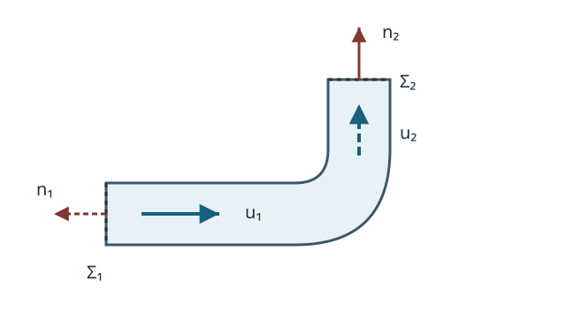

# FLUID5 検査体積を通る流束はどう数えるか

**前提講座（直接）**：[FLUID4 流線・流跡線・流脈線](../FLUID4/index.md)、[CTM5 質量保存と Reynolds 輸送定理](../../CTM/CTM5/index.md#thm-ctm5-material-reynolds)、[CTM7 運動量収支](../../CTM/CTM7/index.md#thm-ctm7-material-momentum)

[CTM5 の固定検査体積の質量収支](../../CTM/CTM5/index.md#cor-ctm5-fixed-control-volume)を使えば、箱から出る質量を数えられる。しかし、箱を流れに合わせて動かしたら、粒子が箱の面を横切る速度は流速そのものではない。さらに、曲がった管に働く力を求めるには、流れ出る質量だけでなく、**どの方向の運動量を持ち去るか**を数える必要がある。

本講は、物質領域の既習の保存則を、固定した箱と動く箱の観測式へ変換する。次に噴流と90度曲管を計算し、力の向きが壁から流体への力なのか、その反作用なのかを区別する。

## 0. 何を積分するか：領域・向き・単位

位置 $x\in\mathbb R^3$ [m]、時刻 $t$ [s]、流体の速度 $u(x,t)$ [m/s]、密度 $\rho(x,t)>0$ [kg/m$^3$] とする。扱う時間区間では各場を必要な回数だけ連続微分可能とし、検査体積の境界は区分的 $C^1$ 級、積分される関数とその導関数は閉包近くまで連続とする。領域は有限体積で、面積分と時間微分を交換できる滑らかな運動を考える。検査面は流体を通してもよい仮想面であり、管壁に限らない。

面の**外向き**単位法線を $n$、面積要素を $dS$、体積要素を $dV$ と書く。入口で $u\cdot n<0$、出口で $u\cdot n>0$ という符号は、この法線の選択で一意に決まる。流れの向きに法線を取り直してはいけない。特に運動量はベクトルなので、流量が正でも運動量流束の各成分が正とは限らない。

[CTM5 の密度](../../CTM/CTM5/index.md#def-ctm5-mass-densities)と[CTM1 の空間速度](../../CTM/CTM1/index.md#def-ctm1-spatial-velocity)を用いる。物質領域と違い、検査体積には流体粒子が出入りしてよい。

## 1. 境界が動いたとき、誰の速度を引くのか

実験室に固定した箱なら、流体が面を横切る速さは流速の法線成分である。しかし船に取り付けた観測箱なら、同じ流速でも箱の動く向きによって流入にも流出にもなる。そこで検査面に**境界速度**を与え、流体速度との差を取る。

<!-- formal-statement-start -->
### 定義（移動検査体積と境界速度）

各時刻の有界領域 $V(t)\subset\mathbb R^3$ とその区分的 $C^1$ 境界 $\partial V(t)$ を考える。$V(t)$ は滑らかな可逆な運動写像で基準領域から移され、$\partial V(t)$ 上の点の速度を $w(x,t)$ とする。このとき $V(t)$ を**移動検査体積**、$w\cdot n$ を境界の外向き法線速度と呼ぶ。$w=0$ なら固定検査体積、境界上で $w\cdot n=u\cdot n$ なら物質が境界を通過しない検査体積である。
<!-- formal-statement-end -->

<!-- definition-example-start: def-fluid5-control-volume -->
### **定義の確認**：右端だけ動く測定区間

断面積 $A>0$ の直線管で、左右の検査面を $x=0$ と $x=L(t)$（$L(t)>0$）に取る。左端の速度は $w=0$、右端は $w=L'(t)e_x$ とする。したがって外向き法線とその成分は、左で $n=-e_x$、右で $n=e_x$ となる。右で $w\cdot n=L'(t)$、左で $w\cdot n=0$ であり、二つの面の動きが異なっても一つの移動検査体積として扱える。側面は管に沿って固定しておく。
<!-- definition-example-end -->

面を横切る相対速度は $u-w$ である。これは流速全体を境界速度に置き換えるという意味ではない。境界面上で交換する量を決めるための速度差である。

<!-- formal-statement-start -->
### 定義（符号付き相対質量流束）

上の $V(t)$ について、境界面での単位面積当たりの**符号付き相対質量流束**を

$$
j_m^{\mathrm{rel}}=\rho(u-w)\cdot n
$$

とする。$j_m^{\mathrm{rel}}>0$ は流出、$j_m^{\mathrm{rel}}<0$ は流入、$j_m^{\mathrm{rel}}=0$ は物質交換がないことを表す。面 $\Sigma\subset\partial V(t)$ の正味流出質量率は $\int_\Sigma j_m^{\mathrm{rel}}\,dS$ [kg/s] である。
<!-- formal-statement-end -->

<!-- definition-example-start: def-fluid5-relative-mass-flux -->
### **定義の確認**：移動出口では流速をそのまま掛けない

前の直管で $\rho=1000$ kg/m$^3$、$A=0.010$ m$^2$、$u=4e_x$ m/s、$L'=1$ m/s とする。左の流束は $1000(4-0)(-1)=-4000$ kg/(m$^2$s)、右は $1000(4-1)(1)=3000$ kg/(m$^2$s)。面積を掛けるとそれぞれ $-40$ kg/s と $+30$ kg/s で、正味流出率は $-10$ kg/s となる。右の境界が流れより遅く動くため、右はなお流出面である。$\rho>0$、外向き法線、相対速度、単位のすべてを直接確認した。
<!-- definition-example-end -->

運動量の交換では、通過する流体一単位質量が持つ運動量は**$u$**である。その粒子が面を通過する相対速度は $u-w$ である。ここを混ぜると、動く箱の中での運動量と実験室系の運動量を取り違える。

<!-- formal-statement-start -->
### 定義（運動量の移流流束）

実験室系の線形運動量 $\rho u$ を数えるとき、移動検査面の単位面積当たりの外向き**運動量移流流束**をベクトル

$$
j_P^{\mathrm{rel}}=\rho u\bigl((u-w)\cdot n\bigr)
$$

と定める。単位は N/m$^2$ であり、面積分は力 N の次元を持つ。これは運動量の輸送であって、圧力・粘性による面力 $\sigma n$ とは別の項である。
<!-- formal-statement-end -->

<!-- definition-example-start: def-fluid5-momentum-flux -->
### **定義の確認**：同じ質量でも出口の向きが変わる

静止した90度曲管の入口は $n_1=-e_x$、出口は $n_2=e_y$ とする。一定密度で両開口の面積が $A$、入口速度 $Ue_x$、出口速度 $Ue_y$、$U>0$ とする。境界速度は $w=0$。入口の質量流束積分は $-\rho AU$、出口は $+\rho AU$ となる。入口の運動量流束積分は $-\rho AU^2e_x$、出口は $+\rho AU^2e_y$ となる。**入口で $u$ は右向きでも外向き流束は負**であり、出口で運ばれるのは $e_y$ 方向の運動量である。各面で質量とベクトルの定義を確かめた。
<!-- definition-example-end -->

## 2. 質量収支：蓄積と正味流出の和がゼロ

[CTM5 の物質質量保存と連続の式](../../CTM/CTM5/index.md#thm-ctm5-mass-equivalence)により、源・吸込がない流体では $\partial_t\rho+\nabla\cdot(\rho u)=0$ が成り立つ。[CTM5 の Reynolds 輸送定理](../../CTM/CTM5/index.md#thm-ctm5-material-reynolds)で使った変数変換の考え方を、境界速度 $w$ の領域運動へ適用する。

<!-- formal-statement-start -->
### 定理（移動検査体積の質量収支）

滑らかで正の密度 $\rho$ と速度場 $u$ が局所連続の式を満たし、$V(t)$ の境界が速度 $w$ で滑らかに動くとする。このとき

$$
\boxed{\frac{d}{dt}\int_{V(t)}\rho\,dV
+\int_{\partial V(t)}\rho(u-w)\cdot n\,dS=0.}
$$

第1項は検査体積内の蓄積率、第2項は正味の外向き流出率である。
<!-- formal-statement-end -->

### 証明の見取り図

動く領域に対する積分微分は、固定位置での密度変化に、境界が掃く体積に含まれる密度を足す。[連続の式](../../CTM/CTM5/index.md#thm-ctm5-mass-equivalence)の発散を体積積分して境界へ移せば、境界速度との差が残る。

<!-- proof-start -->
### 証明

滑らかな領域運動に対して、$V(t)$ を基準領域へ変数変換し Jacobian を時間微分する。[Reynolds 輸送定理の導出](../../CTM/CTM5/index.md#thm-ctm5-material-reynolds)と同じ計算で、今回は運動写像の速度が $u$ でなく $w$ なので

$$
\frac{d}{dt}\int_{V(t)}\rho\,dV
=\int_{V(t)}\bigl[\partial_t\rho+\nabla\cdot(\rho w)\bigr]\,dV.
$$

[Gauss の発散定理を用いた固定検査体積の計算](../../CTM/CTM5/index.md#cor-ctm5-fixed-control-volume)を境界に適用すると

$$
\frac{d}{dt}\int_{V(t)}\rho\,dV
=\int_{V(t)}\partial_t\rho\,dV+
\int_{\partial V(t)}\rho w\cdot n\,dS.
$$

[局所連続の式](../../CTM/CTM5/index.md#thm-ctm5-mass-equivalence)の $\partial_t\rho=-\nabla\cdot(\rho u)$ を代入し、同じ発散定理で

$$
\begin{aligned}
\frac{d}{dt}\int_{V(t)}\rho\,dV
&=-\int_{\partial V(t)}\rho u\cdot n\,dS
+\int_{\partial V(t)}\rho w\cdot n\,dS\\
&=-\int_{\partial V(t)}\rho(u-w)\cdot n\,dS
\end{aligned}
$$

となる。これを移項すれば結論を得る。
<!-- proof-end -->

### 確認：伸びる箱は流体を作らない

第1節の右端が $L'=1$ m/s で動く例では、$\rho$ と $A$ が一定で $M(t)=\rho AL(t)$。よって $M'=\rho AL'=10$ kg/s。一方、正味流出は $-40+30=-10$ kg/s である。両者の和が $0$ となる。右端を固定した場合は $L'=0$ で、二つの流束は $-40,+40$ kg/s となり $M'=0$ である。**体積が増えたことと流体が生成されたことは違う。**

## 3. 運動量収支：流束はベクトルで足す

管の曲がり角では、質量の入口・出口が釣り合っていても運動量の方向が変わる。壁がその変化を引き受ける。[CTM7 の物質領域の運動量収支](../../CTM/CTM7/index.md#thm-ctm7-material-momentum)を検査体積に直す。

<!-- formal-statement-start -->
### 定理（移動検査体積の線形運動量収支）

$\rho,u,V(t),w$ は前定理の仮定を満たし、$u$ は時間・空間で $C^1$ 級、Cauchy 応力 $\sigma$ は空間で $C^1$ 級、単位質量当たりの体積力 $b$ は連続とする。連続体が局所運動量方程式 $\rho D_tu=\nabla\cdot\sigma+\rho b$ を満たすなら、実験室系の運動量は

$$
\boxed{\begin{aligned}
\frac{d}{dt}\int_{V(t)}\rho u\,dV
&+\int_{\partial V(t)}
\rho u\bigl((u-w)\cdot n\bigr)\,dS\\
&=\int_{\partial V(t)}\sigma n\,dS
+\int_{V(t)}\rho b\,dV.
\end{aligned}}
$$

左辺は蓄積と正味運動量移流、右辺は検査体積内の流体に**外部から作用する**面力と体積力である。
<!-- formal-statement-end -->

### 証明の見取り図

局所式を保存形に変えるときに、速度を掛けた連続の式がちょうど消える。この保存形に動く領域の微分公式を適用し、$w$ の掃く運動量だけを差し引く。

<!-- proof-start -->
### 証明

[CTM7 の局所運動量式](../../CTM/CTM7/index.md#thm-ctm7-material-momentum)を成分で書き、$\partial_j=\partial/\partial x_j$、反復添字 $j$ は $1,2,3$ の和とする。積の微分則を二度使うと

$$
\begin{aligned}
\partial_t(\rho u_i)+\partial_j(\rho u_i u_j)
&=\rho\partial_tu_i+u_i\partial_t\rho\\
&\quad+\rho u_j\partial_ju_i+u_i\partial_j(\rho u_j)\\
&=\rho\bigl(\partial_tu_i+u_j\partial_ju_i\bigr)
+u_i\bigl[\partial_t\rho+\partial_j(\rho u_j)\bigr].
\end{aligned}
$$

最後の角括弧は[連続の式](../../CTM/CTM5/index.md#thm-ctm5-mass-equivalence)により $0$ である。よって $\rho D_tu_i=\partial_j\sigma_{ij}+\rho b_i$ から

$$
\partial_t(\rho u_i)+\partial_j(\rho u_i u_j)
=\partial_j\sigma_{ij}+\rho b_i
$$

を得る。$V(t)$ に対して前定理の証明と同じ移動領域の積分微分を $\rho u_i$ に適用すると

$$
\frac{d}{dt}\int_{V(t)}\rho u_i\,dV
=\int_{V(t)}\partial_t(\rho u_i)\,dV+
\int_{\partial V(t)}\rho u_i(w\cdot n)\,dS.
$$

保存形を代入し発散定理で各 $\partial_j$ を境界に移すと

$$
\begin{aligned}
\frac{d}{dt}\int_{V(t)}\rho u_i\,dV
&=-\int_{\partial V(t)}\rho u_i(u\cdot n)\,dS
+\int_{\partial V(t)}\sigma_{ij}n_j\,dS\\
&\quad+\int_{V(t)}\rho b_i\,dV
+\int_{\partial V(t)}\rho u_i(w\cdot n)\,dS.
\end{aligned}
$$

二つの移流項を一つにまとめて左辺へ移すと結論の第 $i$ 成分を得る。$i=1,2,3$ を合わせればベクトル式である。[Cauchy 応力定理](../../CTM/CTM6/index.md#thm-ctm6-cauchy-stress)によって $\sigma n$ は検査面の**外側が内側へ及ぼす**接触力密度となる。
<!-- proof-end -->

### 固定・物質検査体積の二つの極限

固定体積では $w=0$ で、移流は $\rho u(u\cdot n)$ となる。これは既習の [CTM7 の固定検査体積への書き換え](../../CTM/CTM7/index.md#thm-ctm7-material-momentum)と一致する。流体が境界を横断しない物質体積では $(u-w)\cdot n=0$ で移流積分が消え、[物質領域の運動量収支](../../CTM/CTM7/index.md#principle-ctm7-material-balances)へ戻る。**$u-w$ は通過を測り、$u$ は運ばれる運動量を測る**という二役は、この両極限で検査できる。

### 圧力・壁・開口を分ける

[CTM6 の表面力密度](../../CTM/CTM6/index.md#def-ctm6-traction)を使う。粘性を含む一般の壁では $\sigma n$ が面力であり、圧力だけと決めつけられない。理想流体の圧力応力なら $\sigma=-pI$、従って $\sigma n=-pn$ である。入口で $n=-e_x$ なら圧力の力は **$+pAe_x$** となる。

実験で差圧を使う場合、一定大気圧 $p_a$ に対して $p^g=p-p_a$ をゲージ圧とする。閉じた検査面では $\int_{\partial V}p_a n\,dS=0$ なので、全表面で一斉に $-pn$ を $-p^g n$ と書き換えても**合力全体**は変わらない。入口・出口だけをゲージ圧にして壁面には絶対圧を残す、といった混用はできない。

## 4. 噴流が板を押す力：流れの運動量が止まる

断面積 $A>0$、速度 $Ue_x$（$U>0$）の非圧縮・一定密度の定常噴流が、静止した平板に正面衝突し、流れが左右対称に板に沿って上・下方向へ分かれる模型を考える。入口と二つの出口はすべて大気圧、出口流は $x$ 成分 $0$、$y$ 成分の運動量流束は対称性で打ち消し合うと仮定する。重力と空気抵抗、粘性による検査面の接線力は無視できる。検査体積内の運動量蓄積も $0$ とする。

<!-- formal-statement-start -->
### 命題（直角衝突する対称噴流の板への力）

上の模型で入口の質量率を $\dot m=\rho AU$ とすると、流体が平板へ及ぼす合力は

$$
\boxed{F_{\mathrm{fluid\to plate}}=\rho AU^2 e_x.}
$$
<!-- formal-statement-end -->

### 証明の見取り図

入口は外向き法線が $-e_x$ なので、$x$ 運動量流束の積分は $-\rho AU^2$。板が流体へ押し返す力を求め、最後に作用・反作用で反転する。

<!-- proof-start -->
### 証明

[運動量収支](#thm-fluid5-moving-momentum)で $w=0$、蓄積率 $0$ とする。入口の $x$ 運動量流束は

$$
\int_{\Sigma_{\rm in}}\rho u(u\cdot n)\,dS
=\rho(Ue_x)(-U)A=-\rho AU^2e_x.
$$

両出口の $x$ 速度成分は $0$、$y$ 運動量流束は左右対称で相殺されるため、正味流出運動量は $-\rho AU^2e_x$。開口でゲージ圧は $0$、重力なども無視したから、右辺は板から流体への力だけである。すなわち $F_{\rm plate\to fluid}=-\rho AU^2e_x$。作用・反作用より $F_{\rm fluid\to plate}=-F_{\rm plate\to fluid}=+\rho AU^2e_x$。
<!-- proof-end -->

数値例として $\rho=1000$ kg/m$^3$、$A=0.002$ m$^2$、$U=3$ m/s なら $\dot m=6$ kg/s、板への力は $6\times3=18$ N、噴流の進行方向である。運動量を全部失ったのではなく、**入口の $x$ 方向運動量を板に渡した**のである。

## 5. 曲管の反力：出口方向も含める

次の静止した90度曲管では、流れが右から上へ曲がる。入口の外法線は左向き、出口の外法線は上向きであり、流速は両方とも**管の中で進む方向**を指す。

ここでは細い曲管の一様な入口・出口を考え、壁面の合力を一つの未知ベクトルとする。曲がり部で流速が非一様でも、開口で一様という仮定と、定常時の蓄積 $0$ によって積分収支は計算できる。

<!-- formal-statement-start -->
### 命題（定常90度曲管の流体が管へ及ぼす力）

固定検査体積を持つ曲管で、入口速度 $U_1e_x$、出口速度 $U_2e_y$（$U_1,U_2>0$）、開口面積 $A_1,A_2>0$、一定密度 $\rho>0$ とする。定常な質量保存、開口での一様速度、$\dot m=\rho A_1U_1=\rho A_2U_2$、一様ゲージ圧 $p_1^g,p_2^g$ を仮定し、体積力を無視する。壁から流体へ作用する未知合力を $F_{\rm wall\to fluid}$ とすれば、

$$
F_{\rm fluid\to wall}
=(\dot m U_1+p_1^gA_1)e_x
-(\dot m U_2+p_2^gA_2)e_y
$$

が流体から壁への反作用である。壁の合力は全境界で一様大気圧を差し引いた規約によるものとする。
<!-- formal-statement-end -->

### 証明の見取り図

[質量収支](#thm-fluid5-moving-mass)でまず二つの開口の $\dot m$ を等しくする。次に[運動量収支](#thm-fluid5-moving-momentum)の左辺を $-\dot mU_1e_x+\dot mU_2e_y$ とし、入口・出口の圧力と壁の力を分離する。

<!-- proof-start -->
### 証明

定常の[質量収支](#thm-fluid5-moving-mass)で蓄積率は $0$、管壁の相対法線速度も $0$ だから

$$
-\rho A_1U_1+\rho A_2U_2=0.
$$

この共通の正の質量率を $\dot m$ とする。[運動量流束の定義](#def-fluid5-momentum-flux)を二つの開口へ適用すると、正味流出運動量は

$$
-\rho A_1U_1^2e_x+\rho A_2U_2^2e_y
=-\dot mU_1e_x+\dot mU_2e_y.
$$

[圧力の面力](../../CTM/CTM6/index.md#thm-ctm6-cauchy-stress)は $-p^g n$ だから、入口で $+p_1^gA_1e_x$、出口で $-p_2^gA_2e_y$ となる。従って

$$
-\dot mU_1e_x+\dot mU_2e_y
=F_{\rm wall\to fluid}+p_1^gA_1e_x-p_2^gA_2e_y.
$$

これを $F_{\rm wall\to fluid}$ について解き、符号を反転すると表示した $F_{\rm fluid\to wall}$ となる。外向き法線と反作用の二つの符号操作を分離した。
<!-- proof-end -->

$\rho=1000$ kg/m$^3$、$A_1=A_2=0.010$ m$^2$、$U_1=U_2=2$ m/s、$p_1^g=30$ kPa、$p_2^g=20$ kPa のとき $\dot m=20$ kg/s、入口圧力の力は $300e_x$ N、出口圧力の力は $-200e_y$ N。運動量流束は $-40e_x+40e_y$ N なので

$$
F_{\rm wall\to fluid}=(-340e_x+240e_y)\ {\rm N},
\qquad
\boxed{F_{\rm fluid\to wall}=(340e_x-240e_y)\ {\rm N}.}
$$

流体の壁への力は右向き340 N、下向き240 N である。もし管を支える支持具の必要力を求めるなら、管自体の重量・外圧・他の支持作用も含めて**管全体**の釣合を別途書く。

## 6. 演習：流量と力を別々に検算する

### Level A

### A1. 入口・出口で質量流束の符号を確認する

静止した直管の断面積 $A=0.020$ m$^2$、密度 $\rho=1000$ kg/m$^3$、速度 $u=3e_x$ m/s とする。入口 $n=-e_x$、出口 $n=e_x$。各面の質量流束積分と正味流出率を求めよ。

- Level: A

<!-- solution-start -->
#### 詳細解答

[符号付き相対質量流束](#def-fluid5-relative-mass-flux)で $w=0$。入口では $\rho(u\cdot n)A=1000\times(-3)\times0.020=-60$ kg/s、出口では $1000\times3\times0.020=+60$ kg/s。合計 $0$ kg/s である。入口の値が負であるのは入口の**外向き法線**が流れと逆向きだからである。
<!-- solution-end -->

### A2. 動く面が流体を追い越す場合

密度 $\rho=2$ kg/m$^3$、速度 $u=2e_x$ m/s の一様な流体が、右へ $w=5e_x$ m/s で動く面を横切る。面積は $A=3$ m$^2$、外法線は $n=e_x$ とする。相対質量流束積分と流入・流出を判定せよ。

- Level: A

<!-- solution-start -->
#### 詳細解答

[相対質量流束](#def-fluid5-relative-mass-flux)より $(u-w)\cdot n=2-5=-3$ m/s。従って $\rho A((u-w)\cdot n)=2\times3\times(-3)=-18$ kg/s。流体の実験室速度は右向きでも、面がそれを追い越すので、この面から見ると**流入**である。
<!-- solution-end -->

### A3. 出口の面積が変わったら

一定密度 $\rho=1000$ kg/m$^3$、定常流、管壁からの漏出なしとする。入口 $A_1=0.040$ m$^2$、$U_1=2$ m/s、出口 $A_2=0.010$ m$^2$ で、両断面の速度は法線方向に一様である。出口速度 $U_2>0$ と質量率 $\dot m$ を求めよ。

- Level: A

<!-- solution-start -->
#### 詳細解答

定常固定体積なので[質量収支](#thm-fluid5-moving-mass)は $-\rho A_1U_1+\rho A_2U_2=0$。$\rho>0$ で割って $U_2=(A_1/A_2)U_1=(0.040/0.010)\times2=8$ m/s。$\dot m=\rho A_1U_1=1000\times0.040\times2=80$ kg/s。出口でも $1000\times0.010\times8=80$ kg/s と確認できる。
<!-- solution-end -->

### A4. 入口の運動量流束はどちら向きか

入口の外法線を $n=-e_x$、流速を $u=4e_x$ m/s、密度を $2$ kg/m$^3$、面積を $3$ m$^2$ とする。固定検査体積について運動量移流流束の面積分をベクトルで計算せよ。

- Level: A

<!-- solution-start -->
#### 詳細解答

[運動量移流流束](#def-fluid5-momentum-flux)は $\rho u(u\cdot n)$。$u\cdot n=-4$ m/s なので、積分は $2(4e_x)(-4)\times3=-96e_x$ N。速度 $+4e_x$ と、外向き運動量流束 $-96e_x$ は別の量である。単位は $(\mathrm{kg/m^3})(\mathrm{m/s})^2(\mathrm{m^2})=\mathrm{N}$。
<!-- solution-end -->

### A5. ゲージ圧と面力の向き

入口断面積 $A=0.020$ m$^2$、外法線 $n=-e_x$、ゲージ圧 $p^g=50$ kPa とする。ゲージ圧による入口断面の面力を求め、出口の外法線が $+e_x$ なら符号がどうなるか示せ。

- Level: A

<!-- solution-start -->
#### 詳細解答

[表面力密度の関係](../../CTM/CTM6/index.md#def-ctm6-traction)と $\sigma^g=-p^gI$ から入口は $-p^gAn=-50\,000\times0.020(-e_x)=+1000e_x$ N。出口を同じ面積・圧力で比較すると $-1000e_x$ N。法線を逆にすれば圧力面力が逆を向く。ゲージ圧を使うのは閉じた全境界で一様大気圧を差し引く約束に基づく。
<!-- solution-end -->

### Level B

### B1. 断面積が違う直管の軸方向反力

静止した水平直管の入口で $A_1=0.030$ m$^2$、$U_1=2$ m/s、出口で $A_2=0.015$ m$^2$、$U_2>0$ とする。$\rho=1000$ kg/m$^3$、$p_1^g=12$ kPa、$p_2^g=4$ kPa。定常で壁の法線質量流束は $0$、体積力は無視できる。入口・出口は速度・圧力が一様とする。(i) $\dot m,U_2$、(ii) 壁が流体へ及ぼす軸方向力と、その反力を求めよ。

- Level: B

<!-- solution-start -->
#### 詳細解答

(i) [質量収支](#thm-fluid5-moving-mass)から $-\rho A_1U_1+\rho A_2U_2=0$。従って $\dot m=1000\times0.030\times2=60$ kg/s、$U_2=\dot m/(\rho A_2)=60/(1000\times0.015)=4$ m/s。

(ii) [運動量収支](#thm-fluid5-moving-momentum)の流出運動量は $-\dot mU_1+\dot mU_2=60(4-2)=120$ N（$+e_x$）。圧力の合力は入口 $+p_1^gA_1e_x$、出口 $-p_2^gA_2e_x$ なので $(12000\times0.030-4000\times0.015)e_x=300e_x$ N。従って壁の流体への力は $F_{\rm wall\to fluid}=120e_x-300e_x=-180e_x$ N、流体の壁への反力は $+180e_x$ N。符号反転するのは**最後の作用・反作用**である。
<!-- solution-end -->

### B2. 噴流の速度を二倍にする

断面積 $A=0.004$ m$^2$、密度 $\rho=1000$ kg/m$^3$、流速 $U=5$ m/s の対称な噴流が平板に垂直に当たり、流れが面内へ分かれる。第4節の圧力・体積力・定常性の仮定を満たす。(i) 板への力と質量率、(ii) $A$ を固定して $U$ を二倍にした場合の力と質量率の倍率を求めよ。

- Level: B

<!-- solution-start -->
#### 詳細解答

[噴流の板への力](#prop-fluid5-jet-impact)の仮定が成立するので $\dot m=\rho AU=1000\times0.004\times5=20$ kg/s。板への力は $\rho AU^2=1000\times0.004\times25=100$ N で $+e_x$。$U$ を $2U$ とすると質量率は $\rho A(2U)=2\dot m=40$ kg/s、力は $\rho A(2U)^2=4\rho AU^2=400$ N。$U$ は質量率にも単位質量当たり運動量にも一回ずつ現れるため、力は速度の二乗に比例する。
<!-- solution-end -->

### B3. 90度曲管で流体と支持具の力を区別する

第5節と同じ形の静止した90度曲管とする。$\rho=1000$ kg/m$^3$、$A_1=A_2=0.020$ m$^2$、$U_1=U_2=3$ m/s、$p_1^g=20$ kPa、$p_2^g=10$ kPa とし、定常・壁非貫通・開口で一様な流れ、体積力を無視できるものとする。(i) $\dot m$、(ii) 流体が管壁に及ぼす力、(iii) 管の重さ・外部作用を無視した場合に、この力を打ち消すため支持具が管に及ぼす力を求めよ。

- Level: B

<!-- solution-start -->
#### 詳細解答

(i) [質量収支](#thm-fluid5-moving-mass)で $\dot m=1000\times0.020\times3=60$ kg/s。(ii) [曲管反力の命題](#prop-fluid5-elbow-reaction)で $\dot mU_1=\dot mU_2=180$ N、$p_1^gA_1=400$ N、$p_2^gA_2=200$ N だから、$F_{\rm fluid\to wall}=(180+400)e_x-(180+200)e_y=580e_x-380e_y$ N。(iii) 理想化した管の静的釣合では $F_{\rm support\to pipe}+F_{\rm fluid\to wall}=0$ なので $F_{\rm support\to pipe}=-580e_x+380e_y$ N。流体が受ける力と支持具が管に及ぼす力を混同しない。
<!-- solution-end -->

### Level C

### C1. 動く出口と加速する一様流の質量・運動量収支

一定断面積 $A=0.020$ m$^2$ の直線的な検査体積 $V(t)$ を $0<x<L(t)$ に設け、側面の法線流量は $0$ とする。左端 $x=0$ は固定、右端 $x=L(t)$ は右向き一定速度 $W=0.5$ m/s で動く透過検査面である。$L(t)=2+0.5t$ m（$t\ge0$）とする。流体は一様密度 $\rho=1000$ kg/m$^3$、一様速度 $u(t)=U(t)e_x$、$U(t)=3+t$ m/s とし、検査面では与えられた値を取る。時刻 $t=2$ s で、開口ゲージ圧は $p_1^g=20$ kPa、$p_2^g=15$ kPa とする。体積力は無視する。

(i) 質量 $M(t)$、蓄積率 $M'(t)$、両端の相対質量流束積分を求め、収支を確かめよ。

(ii) $x$ 運動量の蓄積率と、入口・出口の外向き運動量移流流束を求め、和がいくらか確認せよ。

(iii) 開口圧力以外の、側面や付加的な外部作用を合計した必要な軸方向力 $F_{\rm other}$ を求めよ。右端の流束を $\rho U^2A$ としてしまう誤りがどの結果を狂わせるかも説明せよ。これは積分収支を確認する与件模型であり、側壁の微視的な流速分布を指定した粘性流の厳密解とは主張しない。

- Level: C

<!-- solution-start -->
#### 詳細解答

**(i) 質量。** $t=2$ で $L=3$ m、$U=5$ m/s、$L'=W=0.5$ m/s。$M(t)=\rho AL(t)=20(2+0.5t)$ kg なので $M(2)=60$ kg、$M'=20\times0.5=10$ kg/s。[相対質量流束](#def-fluid5-relative-mass-flux)より入口は $-\rho AU=-20\times5=-100$ kg/s、出口は $\rho A(U-W)=20(5-0.5)=90$ kg/s。正味流出は $-10$ kg/s なので、[移動検査体積の質量収支](#thm-fluid5-moving-mass)は $10+(-10)=0$ となる。

**(ii) 運動量。** $P_x(t)=\rho AL(t)U(t)=20(2+0.5t)(3+t)$ kg m/s。積の微分則で

$$
P_x'(t)=20\bigl[0.5(3+t)+(2+0.5t)\cdot1\bigr].
$$

$t=2$ を代入すると $P_x'=20(2.5+3)=110$ N。入口の運動量流束は $-\rho AU^2=-20\times25=-500$ N、出口は[運動量移流流束](#def-fluid5-momentum-flux)を使って $\rho AU(U-W)=20\times5\times4.5=450$ N。両面の合計は $-50$ N、蓄積との和は $110-50=60$ N。

**(iii) 圧力と他の力。** [運動量収支](#thm-fluid5-moving-momentum)の右辺で開口圧力が与える合力は $(p_1^gA-p_2^gA)e_x=(20000-15000)0.020e_x=100e_x$ N。従って未知の他の力は $(60-100)e_x=\boxed{-40e_x\ {\rm N}}$。もし出口で相対速度 $U-W$ を無視すると、出口運動量流束を $20\times25=500$ N と誤ってしまう。正味流束が $0$、左辺が $110$ N となり、必要な他の力を $+10e_x$ N と誤算する。さらに質量流束も $-100+100=0$ と誤り、正の蓄積率 $10$ kg/s を説明できない。移動面では**運ばれる運動量 $u$ と横切る速さ $u-w$ が異なる**ためである。
<!-- solution-end -->

## 7. 収支式を読む順序

検査体積の問題は、まず**境界が固定か移動か**を決め、面ごとに外法線 $n$ と境界速度 $w$ を置く。質量の正味流出は $\rho(u-w)\cdot n$、運動量の正味流出は $\rho u((u-w)\cdot n)$ であり、どちらも外向きが正の積分で足す。次に内部蓄積を求め、最後に圧力・壁からの作用・体積力を右辺へ移す。求めたいのが流体への力か、流体から管・板への力かによって、作用・反作用の符号を最後に判断する。

次の FLUID6 では、運動量収支の微分形から、どの仮定の下で流線に沿う Bernoulli 積分が成立するかを調べる。
