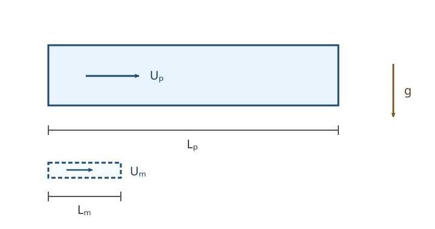

# FLUID7 似た流れを同じ模型で表せる条件は何か

縮小した水槽で船の抵抗を測るとき、「形が同じだから結果を10倍にすればよい」とは限らない。大きさを変えると、慣性・粘性・重力・表面張力の相対的な強さがそれぞれ違う割合で変わる。[FLUID5 の検査体積の運動量収支](../FLUID5/index.md#thm-fluid5-moving-momentum)は力を計算し、[FLUID6 の Bernoulli 積分](../FLUID6/index.md#thm-fluid6-streamline-bernoulli)は仮定付きで圧力と速さを結んだ。しかし、その計算を大きさの異なる二つの流れに共用できる条件は、まだ定めていない。

本講では、まず物理量の単位を数える線形代数から、単位変更で不変な積の個数を与える定理を導く。その後、[CTM16 の Reynolds 数](../../CTM/CTM16/index.md#def-ctm16-reynolds)・[Strouhal 数](../../CTM/CTM16/index.md#def-ctm16-strouhal)に、重力・表面張力・音速の尺度を加え、**幾何学的な相似**と**方程式・境界条件まで揃った相似**を区別する。これらは次講以降の渦や波・境界層・数値流体力学でも、近似を選ぶ物差しになる。

## 0. 対象と記号：同じ「形」だけでは足りない

模型を添字 $m$、実物を $p$ で表す。代表長さ $L>0$ [m]、速度 $U>0$ [m/s]、時間 $T>0$ [s]、密度 $\rho>0$ [kg/m$^3$]、動的粘性係数 $\eta>0$ [Pa s]、重力加速度の大きさ $g>0$ [m/s$^2$]、界面の表面張力 $\gamma>0$ [N/m]、音速 $c>0$ [m/s] とする。個々の実験で不要な物性は変数から除く。**すべてを同時に含む模型を常に仮定するわけではない**。

$\eta$ と $\rho$ の比は[FLUID1 の動粘度](../FLUID1/index.md#def-fluid1-kinematic-viscosity) $\nu=\eta/\rho$ である。[FLUID1 の表面張力](../FLUID1/index.md#def-fluid1-surface-tension)は界面の単位長さ当たりの力であり、単位は N/m。音速 $c$ は一様な平衡状態の周りの微小圧力擾乱が伝わる速さとして、個々の物質と状態に対して測定・指定する。圧縮性方程式を後の講義で導くまでは、$c$ の指定だけで圧力・密度・温度の関係を暗黙に仮定しない。

次元を $M$（質量）、$\mathsf L$（長さ）、$\mathsf T$（時間）と書く。**数値としての**代表長さ $L$ と基本次元 $\mathsf L$ は別の記号である。

| 物理量 | 次元 | 物理量 | 次元 |
| --- | --- | --- | --- |
| $L$ | $\mathsf L$ | $\rho$ | $M\mathsf L^{-3}$ |
| $U$ | $\mathsf L\mathsf T^{-1}$ | $\eta$ | $M\mathsf L^{-1}\mathsf T^{-1}$ |
| $T$ | $\mathsf T$ | $g$ | $\mathsf L\mathsf T^{-2}$ |
| $\gamma$ | $M\mathsf T^{-2}$ | $c$ | $\mathsf L\mathsf T^{-1}$ |

この表の次元は、力 $F=ma$ の $[F]=M\mathsf L\mathsf T^{-2}$ を出発点に、$\eta$ の単位 Pa s と $\gamma$ の単位 N/m を分解して確かめられる。たとえば $[\eta]=(M\mathsf L^{-1}\mathsf T^{-2})\mathsf T$、$[\gamma]=(M\mathsf L\mathsf T^{-2})/\mathsf L$ である。

## 1. 単位を変えても消えない情報は何か

長さと速度と時間を別々の基本単位で測り直しても、模型の物理現象は変わらない。したがって、単位の選び方によって数値が変わる変数より、**単位変更に不変な積**の方が模型の比較に向いている。

### 1.1 次元の列ベクトルと行列

正の量 $q$ の次元が $[q]=M^a\mathsf L^b\mathsf T^d$ なら、指数 $(a,b,d)^\mathsf T$ を縦に並べる。$q_1,\ldots,q_n$ についてこれらを並べた $3\times n$ 行列を使うと、積 $q_1^{\alpha_1}\cdots q_n^{\alpha_n}$ の次元を行列積として計算できる。

<a id="def-fluid7-dimension-matrix"></a>

<!-- formal-statement-start -->
### 定義（次元行列と無次元積）

正の物理量 $q_1,\ldots,q_n$ の次元指数列を $a_j=(a_{Mj},a_{\mathsf Lj},a_{\mathsf Tj})^\mathsf T\in\mathbb R^3$ とし、

$$
A=(a_1\ \cdots\ a_n)\in\mathbb R^{3\times n}
$$

を**次元行列**と呼ぶ。$\alpha=(\alpha_1,\ldots,\alpha_n)^\mathsf T\in\mathbb R^n$ に対して $A\alpha=0$ のとき、積

$$
\Pi_\alpha=\prod_{j=1}^n q_j^{\alpha_j}
$$

は**無次元積**である。指数が実数でも各 $q_j>0$ なので積は定義される。
<!-- formal-statement-end -->

<!-- definition-example-start: def-fluid7-dimension-matrix -->
### **定義の確認**：三変数から無次元比を直接判定

$(q_1,q_2,q_3)=(\rho,U,L)$ について次元列は

$$
A_0=
\begin{pmatrix}
1&0&0\\
-3&1&1\\
0&-1&0
\end{pmatrix}.
$$

行列式は $1$ であるから、$\operatorname{rank}A_0=3$。すなわち $\rho,U,L$ の三つは独立な基本次元をすべて張る。次に $\eta$ を追加すると次元列は $(1,-1,-1)^\mathsf T$ だから、$(\rho,U,L,\eta)$ の指数 $(1,1,1,-1)^\mathsf T$ について

$$
(1,-3,0)+(0,1,-1)+(0,1,0)-(1,-1,-1)=(0,0,0).
$$

よって $\rho UL/\eta$ は無次元である。これは[Reynolds 数の定義](../../CTM/CTM16/index.md#def-ctm16-reynolds)と同じ式を、単位だけから検証した例である。ただし**単位だけでは慣性と粘性の比という意味はまだ証明できない**。
<!-- definition-example-end -->

### 1.2 Buckingham の Π 定理

ここで行列の核と、線形代数で学ぶ「零化空間」との対応を確認する。$A$ の独立な行が張る $W\subset\mathbb R^n$ は $\dim W=r=\operatorname{rank}A$ を満たす。指数ベクトル $\alpha\in\mathbb R^n$ に線形形式 $\varphi_\alpha(w)=w\cdot\alpha$ を対応させると、標準内積によって $\mathbb R^n$ とその双対空間が同一視できる。行列積 $A\alpha$ の各成分は行ベクトルと $\alpha$ の内積なので、

$
A\alpha=0\quad\Longleftrightarrow\quad
(\forall w\in W)\ \varphi_\alpha(w)=0.
$

つまり $\ker A$ は $W$ の零化空間に対応する。[LA3A の零化空間の次元公式](../../../基礎科目/LA/LA3A/index.md#thm-la3a-annihilator-dimension)をこの $n$ 次元空間の $W$ に適用して $\dim\ker A=n-r$ を得る。したがって、独立な無次元積が何個必要かは、単位の指数を並べた段階で分かる。ただし、量の一覧は問題の現象に必要なものを漏れなく指定したものとする。次元定理は未知の物理量や境界条件を発見してくれるわけではない。

<a id="thm-fluid7-buckingham-pi"></a>

<!-- formal-statement-start -->
### 定理（Buckingham の Π 定理：正の量の場合）

$n$ 個の正の物理量 $q_1,\ldots,q_n$ が、$r$ 個の独立な基本次元に関して次元行列 $A$（階数 $r$）を持つとする。量の関係が基本単位の変更に対して不変であるなら、$\ker A$ の基底 $\alpha^{(1)},\ldots,\alpha^{(n-r)}$ から作る $n-r$ 個の独立な無次元積

$$
\Pi_k=\prod_{j=1}^n q_j^{\alpha_j^{(k)}}\qquad (1\le k\le n-r)
$$

だけを変数とする関係 $G(\Pi_1,\ldots,\Pi_{n-r})=0$ で記述できる。従属変数を一つ選んで解けるのは、さらにその変数について解ける条件がある場合に限る。
<!-- formal-statement-end -->

### 証明の見取り図

次元行列で独立な $r$ 列を選ぶ。その $r$ 量が数値1となるよう基本単位を選び直すと、残った $n-r$ 個の値は単位変更に不変である。その不変量を任意の無次元積の基底で書き直せばよい。自由度の数は行列の階数・[零化空間の次元公式](../../../基礎科目/LA/LA3A/index.md#thm-la3a-annihilator-dimension)から出る。

<!-- proof-start -->
### 証明

次元行列の列のうち独立なものを $a_1,\ldots,a_r$ とし、一般性を失わず先頭に並べる。まず次元指数が張る $r$ 次元部分空間に座標を取り直す。この座標では $A$ は $r\times n$ 行列であり、独立な先頭 $r$ 列からなる $A_r$ は $r\times r$ の可逆行列である。固定した基準単位で測った各量の**正の数値**を改めて $q_j$ と書き、その対数 $y_j=\log q_j$ を取り、基本単位の尺度変更を $s=(s_1,\ldots,s_r)^\mathsf T\in\mathbb R^r$ で表すと、単位変更後の数値の対数は

$$
y\longmapsto y+A^\mathsf T s
$$

（正負は尺度の取り方に応じて固定する）となる。$A_r=(a_1\ \cdots\ a_r)$ は可逆だから、

$$
s=-\bigl(A_r^\mathsf T\bigr)^{-1}(y_1,\ldots,y_r)^\mathsf T
$$

を選べば、変換後の先頭 $r$ 個の対数は零、すなわち先頭 $r$ 量の数値はすべて1になる。

残りの第 $r+k$ 量（$1\le k\le n-r$）の変換後の対数を実際に求める。$a_{r+k}$ は $A$ の第 $r+k$ 列であり、先ほど定めた $s$ を代入すると、

$
y_{r+k}+a_{r+k}^{\mathsf T}s
=y_{r+k}-\bigl(A_r^{-1}a_{r+k}\bigr)^{\mathsf T}
(y_1,\ldots,y_r)^{\mathsf T}.
$

この右辺を $\beta^{(k)}\cdot y$ と置く。$\beta^{(k)}$ は先頭 $r$ 成分が $-A_r^{-1}a_{r+k}$、第 $r+k$ 成分が $1$、それ以外が $0$ の指数ベクトルである。したがって

$
A\beta^{(k)}
=-A_r(A_r^{-1}a_{r+k})+a_{r+k}=0,
$

ゆえに任意の単位変更 $s'$ に対して

$
\beta^{(k)}\cdot(y+A^{\mathsf T}s')
=\beta^{(k)}\cdot y.
$

さらに後半 $n-r$ 成分を見ると、各 $\beta^{(k)}$ は異なる位置にだけ $1$ を持つので一次独立である。前節で示した $\dim\ker A=n-r$ と合わせて零化空間の基底になる。対数を指数へ戻せば、変換後の残りの値は $\prod_jq_j^{\beta_j^{(k)}}$ である。

単位不変な関係は同じ単位変更の軌道上で値が変わらず、各軌道には先頭 $r$ 量を1に規格化した代表がただ一つある。ゆえに関係は残りの $n-r$ 個の規格化値のみの関数として表せる。任意の別の零化空間基底への変更は無次元積の対数に可逆線形変換を施すだけなので、関係の記述能力は変わらない。
<!-- proof-end -->

証明で使った「関係」は実験上必要な変数がすべて指定されていることを前提とする。基底の選び方は一意ではないため、得られた無次元数の**個数**は決まっても、名前や物理的な使いやすさは別の判断である。

## 2. 流れの五つの物差しをどう選ぶか

[CTM16 の Reynolds 数](../../CTM/CTM16/index.md#def-ctm16-reynolds)は移流慣性 $\rho U^2/L$ と粘性 $\eta U/L^2$ の比、

$$
\mathrm{Re}=\frac{\rho UL}{\eta}
$$

である。[同章の Strouhal 数](../../CTM/CTM16/index.md#def-ctm16-strouhal)は時間変化 $\rho U/T$ と移流慣性 $\rho U^2/L$ の比、

$$
\mathrm{St}=\frac{L}{UT}.
$$

**周期現象**で $T=1/f$ と選んだときは $\mathrm{St}=fL/U$ となる。時間尺度 $T$ を勝手に $L/U$ に固定すると常に $\mathrm{St}=1$ となり、外から指定された振動周期を比較できなくなる。

### 2.1 重力と慣性：Froude 数

自由水面をもつ流れでは、重力の加速度尺度 $g$ と移流加速度の尺度 $U^2/L$ を比較したい。比は $gL/U^2$。その逆数の平方根を使うと速度の比較として読みやすい。

<a id="def-fluid7-froude"></a>

<!-- formal-statement-start -->
### 定義（Froude 数）

$U,L,g>0$ に対し、**Froude 数**を

$$
\boxed{\mathrm{Fr}=\frac{U}{\sqrt{gL}}}
$$

と定める。これは慣性加速度尺度と重力加速度の比の平方根である。
<!-- formal-statement-end -->

<!-- definition-example-start: def-fluid7-froude -->
### **定義の確認**：代表速度と重力速度

$U=2$ m/s、$L=0.4$ m、$g=10$ m/s$^2$ なら $\sqrt{gL}=\sqrt{4}=2$ m/s なので $\mathrm{Fr}=1$。また $U^2/L=4/0.4=10$ m/s$^2$ は $g$ と等しい。速さを半分にすると $\mathrm{Fr}=1/2$ となるが、加速度**比**は $(1/2)^2=1/4$ になる。
<!-- definition-example-end -->

### 2.2 界面の張力と慣性：Weber 数

表面張力 $\gamma$ [N/m] が長さ $L$ 程度の界面部分へ与える力は $\gamma L$ の尺度を持つ。その力を面積 $L^2$ で割った応力尺度は $\gamma/L$ である。一方、動圧の尺度は $\rho U^2$。界面の形状・曲率の詳細を扱うのは FLUID26 であり、ここでは**力の尺度**だけを比較する。

<a id="def-fluid7-weber"></a>

<!-- formal-statement-start -->
### 定義（Weber 数）

$\rho,U,L,\gamma>0$ に対し、**Weber 数**を

$$
\boxed{\mathrm{We}=\frac{\rho U^2L}{\gamma}}
$$

と定める。これは慣性による応力尺度と表面張力による応力尺度の比である。
<!-- formal-statement-end -->

<!-- definition-example-start: def-fluid7-weber -->
### **定義の確認**：力と応力で二重に検算

$\rho=1000$ kg/m$^3$、$U=2$ m/s、$L=0.02$ m、$\gamma=0.08$ N/m とする。慣性応力は $\rho U^2=4000$ Pa、表面張力応力の尺度は $\gamma/L=4$ Pa。したがって $\mathrm{We}=4000/4=1000$。力として見ても $(\rho U^2L^2)/(\gamma L)=1000$ である。ここで両者が等しい「実際の界面力」という意味ではなく、**どの項を無視できそうか**を比較しただけである。
<!-- definition-example-end -->

### 2.3 音の速さと流れの速さ：Mach 数

流れの速度と、その状態の微小音響擾乱の伝播速度を比較する。音速は単なる定数 $c$ でなく、材料・温度などの状態に依存し得る**選んだ基準状態の値**である。

<a id="def-fluid7-mach"></a>

<!-- formal-statement-start -->
### 定義（Mach 数）

正の代表流速 $U>0$ と基準状態の音速 $c>0$ に対し、**Mach 数**を

$$
\boxed{\mathrm{Ma}=\frac{U}{c}}
$$

と定める。これは流速の音速に対する比であり、音の伝播が物理模型に入る場合の指標である。
<!-- formal-statement-end -->

<!-- definition-example-start: def-fluid7-mach -->
### **定義の確認**：速さの単位を揃える

$U=15$ m/s、$c=300$ m/s なら $\mathrm{Ma}=0.05$。$\mathrm{Ma}<1$ という判定だけでは、密度変動が小さいか、温度変化が無視できるか、自由表面を扱えるかまでは結論できない。必要なのは方程式・状態の範囲・境界条件との組合せである。
<!-- definition-example-end -->

### 2.4 五つの独立な積が揃う理由

八つの正の変数 $(L,U,T,\rho,\eta,g,\gamma,c)$ の次元行列の階数は3である。例えば $\rho,L,U$ の列は第1節で既に独立と確認した。したがって[Π 定理](#thm-fluid7-buckingham-pi)から独立な積は $8-3=5$ 個である。各積をどの物理的な力・時間・速さの比として読むかは上の尺度比較による。

<a id="prop-fluid7-five-groups"></a>

<!-- formal-statement-start -->
### 命題（八変数から得る五つの独立な無次元数）

$\rho,U,L,T,\eta,g,\gamma,c$ がすべて正で基本次元が $M,\mathsf L,\mathsf T$ の三つだけなら、次の五つは互いに独立で、無次元積の基底を与える。

$$
\boxed{
\mathrm{Re}=\frac{\rho UL}{\eta},\quad
\mathrm{Fr}=\frac U{\sqrt{gL}},\quad
\mathrm{We}=\frac{\rho U^2L}{\gamma},\quad
\mathrm{Ma}=\frac Uc,\quad
\mathrm{St}=\frac L{UT}.
}
$$

ここで独立とは、五つの積の指数ベクトルが一次独立であるという意味であり、実験で五つを任意に独立制御できるという主張ではない。
<!-- formal-statement-end -->

### 証明の見取り図

五つとも次元が1であることを確認し、$\eta,g,\gamma,c,T$ のいずれかを一つだけ含む成分に注目する。これらが独立であることと、零化空間の次元5を合わせる。

<!-- proof-start -->
### 証明

次元表の指数を使うと、

$$
[\rho UL/\eta]
=\frac{(M\mathsf L^{-3})(\mathsf L\mathsf T^{-1})\mathsf L}
{M\mathsf L^{-1}\mathsf T^{-1}}=1,
$$

$$
[gL/U^2]
=\frac{(\mathsf L\mathsf T^{-2})\mathsf L}
{\mathsf L^2\mathsf T^{-2}}=1,\qquad
[\rho U^2L/\gamma]
=\frac{(M\mathsf L^{-3})(\mathsf L^2\mathsf T^{-2})\mathsf L}
{M\mathsf T^{-2}}=1.
$$

さらに $[U/c]=1$、$[L/(UT)]=1$ であり、平方根を取っても無次元である。五つの指数ベクトルの線形結合が零だと仮定する。$\eta$ は $\mathrm{Re}$ にしか現れず、$g$ は $\mathrm{Fr}$、$\gamma$ は $\mathrm{We}$、$c$ は $\mathrm{Ma}$、$T$ は $\mathrm{St}$ にしか現れない。したがってそれぞれの係数は零で、五つは一次独立である。次元行列の階数は3、零化空間の次元は5だから、この五つで無次元積の基底を与える。
<!-- proof-end -->

[Π 定理](#thm-fluid7-buckingham-pi)は「五つ以外の要因が絶対に存在しない」とは言っていない。たとえば壁の相対粗さ $\varepsilon/L$、形状比、水面の濡れの条件、材料の圧力・密度・温度を結ぶ物性関係が問題を左右する場合、そもそも変数一覧に追加しなければならない。流れが定常で外部周期を持たなければ独立な $T$ を問題から除けるし、自由界面がなければ $\gamma$ を、非圧縮近似を**正当化した模型**なら $c$ をその方程式の入力から除ける。

## 3. 五つの数が揃えば、方程式も揃うのか

同じ形状の流路を想像しよう。実物と模型の位置をそれぞれの長さで割れば、**無次元の領域**を比較できる。速度を $U$ で、時間を $T$ で、圧力差を $\rho U^2$ で割れば、物理単位の違う数値を同じ座標上へ置ける。ただし、これはまだ解が等しいという主張ではない。

<a id="def-fluid7-dynamic-similarity"></a>

<!-- formal-statement-start -->
### 定義（本講での幾何学的相似と力学的相似）

模型と実物の流体領域・境界が、各代表長さで割った同一の無次元形状を与えるとき、**幾何学的相似**という。各模型で $L,U,T,\rho>0$ を選び、$x$ を位置ベクトル、$t$ を時刻、$u$ を速度場、$p$ を圧力、$p_{\rm ref}$ を空間・時間に依らない基準圧力とする。上付き $*$ は物理単位を除いた量を表し、各々の無次元変数を次のように定める。

$$
x^*=\frac xL,\qquad t^*=\frac tT,\qquad
u^*=\frac uU,\qquad
p^*=\frac{p-p_{\rm ref}}{\rho U^2}.
$$

指定した支配方程式・構成則の無次元形で**方程式の係数・無次元初期条件・境界条件・必要な構成パラメータが一致する**場合、本講では**力学的に相似な問題設定**という。さらに解の無次元表示まで一致する場合だけ「流れの解が相似」と呼ぶ。
<!-- formal-statement-end -->

<!-- definition-example-start: def-fluid7-dynamic-similarity -->
### **定義の確認**：同じ形の平行平板流で係数を確かめる

実物の平板間隔を $L_p=1$ m、模型の間隔を $L_m=0.1$ m とする。いずれも領域 $0<y<L$ であり、無次元座標で比較すれば

$$
y^*=\frac yL,\qquad 0<y^*<1
$$

と同じ形になる。これで幾何学的相似の条件を直接確認した。

一定の密度と粘性係数を模型・実物で共通に選び、実物の上壁速度を $U_p=1$ m/s、模型の上壁速度を $U_m=10$ m/s とする。[Reynolds 数](../../CTM/CTM16/index.md#def-ctm16-reynolds)の比は

$$
\frac{\mathrm{Re}_m}{\mathrm{Re}_p}
=\frac{U_mL_m}{U_pL_p}
=\frac{10\cdot0.1}{1\cdot1}=1.
$$

外力と圧力勾配がない定常平板 Couette 流で、下壁は静止し、上壁が速さ $U$ で動く。両壁の無滑り条件を無次元化すると

$$
u_x^*(0)=0,\qquad u_x^*(1)=1.
$$

[CTM16 の Couette 解](../../CTM/CTM16/index.md#thm-ctm16-couette-profile)をそれぞれへ適用すれば、両問題の解は $u_x^*(y^*)=y^*$ と一致する。定常問題の無次元係数・境界条件・解が実際に揃った例である。

ただしこれは**この厳密解の特性**であって、相似の判定を Reynolds 数の一致だけで済ませた例ではない。たとえば非定常外力や異なる壁条件を加えるなら、同じ境界条件ではなくなり、解の一致を流用できない。
<!-- definition-example-end -->

### 3.1 慣性・重力・粘性が同じ割合で現れる式

一定密度・一定動的粘性係数の非圧縮 Newton 流体に、鉛直上向きの単位ベクトル $e_z$ を使って鉛直下向きの一様重力 $-g e_z$ を加える。ここでは滑らかな古典解と一定の重力を仮定し、自由表面の表面張力も圧縮性効果も**まだ方程式に入れない**。[CTM15 の Navier–Stokes 方程式](../../CTM/CTM15/index.md#thm-ctm15-incompressible-navier-stokes)に重力を足した式を無次元化する。以後 $\nabla^*=(\partial_{x_1^*},\partial_{x_2^*},\partial_{x_3^*})$、$\Delta^*=\sum_{i=1}^3\partial_{x_i^*}^2$ は無次元位置 $x^*=x/L$ に関する演算子とし、$\partial_{t^*}$ は $x^*$ を固定した偏微分とする。

<a id="prop-fluid7-scaled-gravity-ns"></a>

<!-- formal-statement-start -->
### 命題（重力つき非圧縮運動量式の無次元化）

$\rho,\eta,g,L,U,T>0$ を定数、$u,p$ を十分滑らかな非圧縮流の場とし、

$$
\rho\left(\partial_tu+(u\cdot\nabla)u\right)
=-\nabla p+\eta\Delta u-\rho g e_z,\qquad \nabla\cdot u=0
$$

を満たすとする。$x=Lx^*$、$t=Tt^*$、$u=Uu^*$、$p=p_{\rm ref}+\rho U^2p^*$（$p_{\rm ref}$ 定数）とすれば、

$$
\boxed{
\mathrm{St}\,\partial_{t^*}u^*
+(u^*\cdot\nabla^*)u^*
=-\nabla^*p^*+\frac1{\mathrm{Re}}\Delta^*u^*
-\frac1{\mathrm{Fr}^2}e_z,\qquad
\nabla^*\cdot u^*=0.
}
$$

この式に $\mathrm{We}$ や $\mathrm{Ma}$ が登場しないのは、界面力・圧縮性をまだモデル化していないからである。
<!-- formal-statement-end -->

### 証明の見取り図

[CTM16 の無次元 Navier–Stokes 式](../../CTM/CTM16/index.md#thm-ctm16-dimensionless-ns)と同じ連鎖律を使う。単位体積当たりの各項を $\rho U^2/L$ で割り、重力項の係数を $gL/U^2$ として残す。

<!-- proof-start -->
### 証明

$x_i=Lx_i^*$、$t=Tt^*$ より連鎖律で $\partial_{x_i}=L^{-1}\partial_{x_i^*}$、$\partial_t=T^{-1}\partial_{t^*}$ となる。ここで空間偏微分は他の座標と時刻を固定し、時間偏微分は物理位置 $x$ を固定する。$L,T$ は定数なので、$x$ 固定と $x^*$ 固定は同値であり、時間偏微分に余分な移流項は生じない。従って

$$
\partial_tu=\frac UT\partial_{t^*}u^*,\qquad
(u\cdot\nabla)u=\frac{U^2}{L}(u^*\cdot\nabla^*)u^*,
$$

$$
\nabla p=\frac{\rho U^2}{L}\nabla^*p^*,\qquad
\Delta u=\frac U{L^2}\Delta^*u^*.
$$

これを元の式に代入し、両辺を $\rho U^2/L>0$ で割ると、

$$
\frac L{UT}\partial_{t^*}u^*
+(u^*\cdot\nabla^*)u^*
=-\nabla^*p^*
+\frac{\eta}{\rho UL}\Delta^*u^*
-\frac{gL}{U^2}e_z.
$$

最後に[Reynolds 数](../../CTM/CTM16/index.md#def-ctm16-reynolds)、[Strouhal 数](../../CTM/CTM16/index.md#def-ctm16-strouhal)、[Froude 数](#def-fluid7-froude)を代入する。また $\nabla\cdot u=(U/L)\nabla^*\cdot u^*=0$ で、$U/L>0$ より無次元連続の式が従う。
<!-- proof-end -->

$\mathrm{We}$ が必要な模型では表面張力応力の尺度 $\gamma/L$ と圧力尺度 $\rho U^2$ の比 $1/\mathrm{We}$ が**界面での力の釣合いを指定する条件**の係数となる。音速を持つ圧縮性模型では $\mathrm{Ma}$ が圧力・密度の変化と音速の尺度に現れる。ただし、具体的な界面の曲率式や圧縮性の圧力・密度・温度を結ぶ物性関係を、ここで未導入のまま一般定理として使わない。

### 3.2 同じ無次元数だけで相似と宣言できない理由

次の必要条件を区別する。

1. 形状、境界の無次元位置、必要な表面粗さ比などが一致する。
2. 同じ物理法則を使い、実際に残した各項の係数が一致する（必要な無次元数の一致）。
3. 無次元初期値、速度・圧力・温度等の境界条件、界面条件、構成則・圧力・密度・温度を結ぶ物性関係の無次元パラメータが一致する。
4. **解が一致する**と結論する場合は、各々の問題で比較対象の解が一意に定まるか、同じ解枝を選んでいることを別途確かめる。

たとえば同じ $\mathrm{Re}$ でも、一方が滑らかな壁、他方が粗い壁なら異なる境界条件の問題である。また $\mathrm{Re}$ が等しいということは、[CTM16 の無次元運動量式](../../CTM/CTM16/index.md#thm-ctm16-dimensionless-ns)の粘性係数 $1/\mathrm{Re}$ が等しいというだけで、重力下の自由水面の波まで一致するという保証ではない。

## 4. 縮尺を変えたら何を同時に一致させられるか



図で描いたのは**幾何学的相似**に限る。実物の長さを $L_p$、模型を $L_m$ とし、尺度比を

$$
\lambda=\frac{L_m}{L_p},\qquad
s=\frac{U_m}{U_p},\qquad
\tau=\frac{T_m}{T_p}
$$

とする。$\lambda,s,\tau>0$。材料や環境も異なり得るので、$\rho_m/\rho_p=r_\rho$、$\eta_m/\eta_p=r_\eta$、$g_m/g_p=r_g$、$\gamma_m/\gamma_p=r_\gamma$、$c_m/c_p=r_c$ とおく。これらの比は正である。

<a id="prop-fluid7-scale-constraints"></a>

<!-- formal-statement-start -->
### 命題（模型と実物の五つの無次元数の比）

上記の尺度比のもとで、すべての物性が正で代表尺度を同じ規則で選んだなら、

$$
\boxed{
\begin{aligned}
\frac{\mathrm{Re}_m}{\mathrm{Re}_p}&=\frac{r_\rho s\lambda}{r_\eta},&
\frac{\mathrm{Fr}_m}{\mathrm{Fr}_p}&=\frac{s}{\sqrt{r_g\lambda}},\\
\frac{\mathrm{We}_m}{\mathrm{We}_p}&=\frac{r_\rho s^2\lambda}{r_\gamma},&
\frac{\mathrm{Ma}_m}{\mathrm{Ma}_p}&=\frac{s}{r_c},\\
\frac{\mathrm{St}_m}{\mathrm{St}_p}&=\frac{\lambda}{s\tau}.
\end{aligned}
}
$$

同時相似を要求する対象の無次元数については、対応する右辺をすべて1としなければならない。
<!-- formal-statement-end -->

### 証明の見取り図

各定義の分子と分母に模型／実物の比を代入する。例えば重力項は平方根を含むので、Froude 数の比では $\sqrt{\lambda}$ が分母へ現れる。

<!-- proof-start -->
### 証明

[Reynolds 数](../../CTM/CTM16/index.md#def-ctm16-reynolds)を模型・実物で割ると、

$$
\frac{\rho_mU_mL_m/\eta_m}{\rho_pU_pL_p/\eta_p}
=\frac{\rho_m}{\rho_p}\frac{U_m}{U_p}
\frac{L_m}{L_p}\frac{\eta_p}{\eta_m}
=\frac{r_\rho s\lambda}{r_\eta}.
$$

[Froude 数](#def-fluid7-froude)は、

$$
\frac{U_m/\sqrt{g_mL_m}}{U_p/\sqrt{g_pL_p}}
=s\sqrt{\frac{g_pL_p}{g_mL_m}}
=\frac s{\sqrt{r_g\lambda}}.
$$

[Weber 数](#def-fluid7-weber)については、

$$
\frac{\rho_mU_m^2L_m/\gamma_m}
{\rho_pU_p^2L_p/\gamma_p}
=r_\rho s^2\lambda\frac1{r_\gamma}.
$$

[Mach 数](#def-fluid7-mach)では $(U_m/c_m)/(U_p/c_p)=s/r_c$。最後に[Strouhal 数](../../CTM/CTM16/index.md#def-ctm16-strouhal)では、

$$
\frac{L_m/(U_mT_m)}{L_p/(U_pT_p)}
=\frac{L_m}{L_p}\frac{U_p}{U_m}\frac{T_p}{T_m}
=\frac{\lambda}{s\tau}.
$$

以上で五つの比を得る。
<!-- proof-end -->

### 同じ流体・同じ重力なら両立しない条件がある

$r_\rho=r_\eta=r_g=r_\gamma=r_c=1$ とすると、Reynolds 数一致は $s=1/\lambda$、Froude 数一致は $s=\sqrt\lambda$、Weber 数一致は $s=1/\sqrt\lambda$、Mach 数一致は $s=1$ をそれぞれ要求する。

<a id="cor-fluid7-same-fluid-obstruction"></a>

<!-- formal-statement-start -->
### 系（同じ流体で縮尺を変えた場合の相似条件の衝突）

模型と実物で密度・粘性係数・重力加速度・表面張力・音速がそれぞれ共通かつ正であり、長さ比 $\lambda=L_m/L_p>0$ とする。次の二条件

$$
\mathrm{Re}_m=\mathrm{Re}_p,\qquad
\mathrm{Fr}_m=\mathrm{Fr}_p
$$

がともに成立すれば $\lambda=1$、速度比 $s=U_m/U_p=1$ となる。従って $\lambda\ne1$ の縮小・拡大模型では、この二条件を同時には満たせない。Strouhal 数は周期比 $\tau=\lambda/s$ を選べば一致させられるが、それでも Re/Fr の衝突は解消しない。
<!-- formal-statement-end -->

### 証明の見取り図

[尺度比の命題](#prop-fluid7-scale-constraints)へ材料比を1として代入すると、Re は $s\lambda=1$、Fr は $s/\sqrt\lambda=1$。同じ未知数 $s$ に二条件を課す。

<!-- proof-start -->
### 証明

Re の等式から $s=\lambda^{-1}$、Fr の等式から $s=\lambda^{1/2}$ だから

$$
\lambda^{-1}=\lambda^{1/2}
\quad\Longrightarrow\quad
\lambda^{3/2}=1.
$$

$\lambda>0$ より $\lambda=1$ であり、これをいずれかの等式に代入して $s=1$。さらに[St の尺度比](#prop-fluid7-scale-constraints)を1とおけば $\lambda/(s\tau)=1$、従って $\tau=\lambda/s$ である。この式には $\rho,\eta,g$ が含まれず、Re と Fr の矛盾は消せない。
<!-- proof-end -->

これは「どんな縮尺実験も無意味」という結論ではない。**測りたい効果**に不可欠な無次元数を選び、他の効果が小さい範囲と誤差を評価するという設計上の制約である。たとえば重力波を調べる水槽なら Fr を優先し、微小な粘性流路なら Re を優先する判断があり得る。ただし他方を無視してよいかは、実際の方程式・境界条件・測定値で別に確認する。

## 5. 縮尺10分の1の実験を数字で確かめる

同じ水の近似で、実物 $L_p=1$ m、$U_p=1$ m/s、$T_p=1$ s、$\rho=1000$ kg/m$^3$、$\eta=0.001$ Pa s、$\gamma=0.072$ N/m、$g=9.81$ m/s$^2$、音速 $c=1480$ m/s と仮定する。この数値は**練習用の一定物性値**であり、温度・圧力で変わる実測値や全ての水の状態を代表するものではない。

$$
\begin{aligned}
\mathrm{Re}_p&=\frac{1000\cdot1\cdot1}{0.001}=10^6,\\
\mathrm{Fr}_p&=\frac1{\sqrt{9.81}}\simeq0.3193,\\
\mathrm{We}_p&=\frac{1000\cdot1^2\cdot1}{0.072}\simeq13888.9,\\
\mathrm{Ma}_p&=\frac1{1480}\simeq0.000676,\qquad
\mathrm{St}_p=\frac1{1\cdot1}=1.
\end{aligned}
$$

模型の長さは $L_m=0.1$ m、$\lambda=0.1$。Re を実物と一致させるためには $s=1/\lambda=10$、すなわち $U_m=10$ m/s が必要である。St も合わせるなら $\tau=\lambda/s=0.01$、$T_m=0.01$ s にする。すると、

| 無次元数 | 模型／実物の比 | 一致するか |
| --- | ---: | --- |
| Re | $s\lambda=1$ | 一致 |
| Fr | $s/\sqrt\lambda=\sqrt{1000}\simeq31.62$ | 不一致 |
| We | $s^2\lambda=10$ | 不一致 |
| Ma | $s=10$ | 不一致 |
| St | $\lambda/(s\tau)=1$ | 一致 |

一方、Fr を優先すれば $s=\sqrt{0.1}\simeq0.3162$。この場合 Re 比は $\lambda^{3/2}\simeq0.03162$、We 比は $\lambda^2=0.01$ となる。**同じ水だから同じ流れ**ではないし、Re だけを揃えた結果が自由水面の重力波を再現するともいえない。

### 5.1 ブラウザで模型条件を計算する

付属の [similarity_lab.py](similarity_lab.py) はこの節の**尺度比の式だけ**をPython標準ライブラリで計算する。流体方程式は数値積分しないため、計算が成功しても「流れの解が相似」とは判定しない。Re/Fr/We/Ma のうち一つを一致させる速度比 $s$ を求め、五つの比を出力する。時間比を指定しないときは St が一致するよう $\tau=\lambda/s$ を選ぶ。

```python-file-lab
# lab-id: FLUID7-SIMILARITY-FILE
# lab-title: 模型・実物の無次元数の比を検算
# lab-file: textbook/volumes/dream_thater/物理系/FLUID/FLUID7/similarity_lab.py
# timeout-ms: 10000
# lab-preset: 縮尺1/10・Re一致 | --length-ratio 0.1 --match re
# lab-preset: 縮尺1/10・Fr一致 | --length-ratio 0.1 --match fr
# lab-preset: 縮尺1/10・We一致 | --length-ratio 0.1 --match we
# lab-preset: 縮尺1/9・物性を調整 | --length-ratio 0.1111111111111111 --match fr --viscosity-ratio 0.037037037037037035 --tension-ratio 0.012345679012345678 --sound-ratio 0.3333333333333333
```

**検算の観点**：初期プリセットでは Re比=1、Fr比$\simeq31.62$、We比=10、Ma比=10、St比=1。Fr一致へ切り替えると Re比$\simeq0.03162$、We比$=0.01$ になる。計算途中でゼロ・負・無限大の物性比を入れないよう入力を検査する。Python自体を導入しなくても、章中の式と表が静止した独立の検算基準になる。

ローカルでも同じファイルを直接実行し、単体テストで比の恒等式と特殊例を確かめられる。

    python3 textbook/volumes/dream_thater/物理系/FLUID/FLUID7/similarity_lab.py --length-ratio 0.1 --match re
    python3 -m unittest discover -s textbook/volumes/dream_thater/物理系/FLUID/FLUID7 -p 'test_*.py'

## 6. 無次元数の選択を間違えないために

次の三つの区別を最後に確認しよう。

- **次元解析と支配方程式**：無次元な組を数えるだけでは、どの項が現象の支配項か、誤差が何次かを決められない。定常・非定常、壁の無滑り、自由界面、材料構成則を先に確かめる。
- **一致する比と一致しない比**：相似に必要な係数を揃えることは設計条件だが、必要な初期境界条件や形状が異なれば解は一致しない。小さい Ma だけで任意の熱・密度変化を消せるわけではない。
- **双方で連続体近似が成り立つか**：Re が等しくても、気体では [FLUID1 の気体の Knudsen 数](../FLUID1/index.md#def-fluid1-knudsen)を別に調べる。液体も含む一般の流体では、[連続体近似の尺度分離](../FLUID1/index.md#def-fluid1-scale-separation)が両方で成り立つことを確かめる。片方だけ連続体近似が壊れる流れには、同じ古典的流体方程式を適用できない。

## 7. 演習：まず単位、次に模型、最後に仮定

### Level A

### A1. 次元ベクトルを読み取る

$[\eta]=M\mathsf L^{-1}\mathsf T^{-1}$、$[\gamma]=M\mathsf T^{-2}$ を、Pa s と N/m からそれぞれ導出せよ。さらに $(\rho,U,L)$ の次元行列が階数3を持つことを行列式で確かめよ。

- Level: A

<!-- solution-start -->
#### 詳細解答

N の次元は $M\mathsf L\mathsf T^{-2}$、Pa は N/m$^2$ だから $[\mathrm{Pa}]=M\mathsf L^{-1}\mathsf T^{-2}$。従って Pa s は $M\mathsf L^{-1}\mathsf T^{-1}$。N/m は $M\mathsf T^{-2}$。[次元行列の定義](#def-fluid7-dimension-matrix)による三列は

$$
A_0=\begin{pmatrix}1&0&0\\-3&1&1\\0&-1&0\end{pmatrix}.
$$

第1行に沿って行列式を展開すれば $\det A_0=1\cdot(1\cdot0-1\cdot(-1))=1\ne0$。ゆえに階数は3である。
<!-- solution-end -->

### A2. 五つの物差しの数値

$\rho=1000$ kg/m$^3$、$\eta=0.001$ Pa s、$\gamma=0.08$ N/m、$g=10$ m/s$^2$、$c=1500$ m/s、$L=1$ m、$U=2$ m/s、$T=0.5$ s とする。五つの無次元数を計算し、特に Fr と We の尺度比の意味を述べよ。

- Level: A

<!-- solution-start -->
#### 詳細解答

[Re と St の定義](../../CTM/CTM16/index.md#def-ctm16-reynolds)と[本章の五組](#prop-fluid7-five-groups)に値を代入する。

$$
\begin{aligned}
\mathrm{Re}&=\frac{1000\cdot2\cdot1}{0.001}=2.0\times10^6,\\
\mathrm{Fr}&=\frac2{\sqrt{10\cdot1}}=\frac2{\sqrt{10}}\simeq0.6325,\\
\mathrm{We}&=\frac{1000\cdot2^2\cdot1}{0.08}=5.0\times10^4,\\
\mathrm{Ma}&=\frac2{1500}\simeq0.001333,\\
\mathrm{St}&=\frac1{2\cdot0.5}=1.
\end{aligned}
$$

Fr の二乗は慣性加速度 $U^2/L$ と重力 $g$ の比、$\mathrm{Fr}^2=0.4$ である。We は動圧尺度 $\rho U^2=4000$ Pa と表面張力応力尺度 $\gamma/L=0.08$ Pa の比 $4000/0.08=50000$ である。値が大きいからといって界面が存在しないことにはならない。
<!-- solution-end -->

### A3. 同じ流体の縮小模型

同じ $\rho,\eta,g,\gamma,c$ のまま $L_m/L_p=1/4$ とし、Re を一致させる。$U_m/U_p$ と Fr・We・Ma の各比を求めよ。

- Level: A

<!-- solution-start -->
#### 詳細解答

[尺度比の命題](#prop-fluid7-scale-constraints)で全物性比を1とする。Re一致は $s\lambda=1$ なので $s=1/\lambda=4$。

$$
\frac{\mathrm{Fr}_m}{\mathrm{Fr}_p}
=\frac4{\sqrt{1/4}}=8,\quad
\frac{\mathrm{We}_m}{\mathrm{We}_p}
=4^2\cdot\frac14=4,\quad
\frac{\mathrm{Ma}_m}{\mathrm{Ma}_p}=4.
$$

三つとも1ではない。Re の一致だけから重力・界面・音響現象の相似を宣言できない。
<!-- solution-end -->

### A4. 時間尺度と周波数

長さ $L=2$ m、速度 $U=4$ m/s、周期 $T=0.5$ s の周期運動を考える。$f=1/T$ と St を求めよ。$L,T$ を固定して $U$ を2倍にしたら St はどうなるか。

- Level: A

<!-- solution-start -->
#### 詳細解答

$f=1/(0.5\ \mathrm s)=2$ Hz。[Strouhal 数の定義](../../CTM/CTM16/index.md#def-ctm16-strouhal)から

$$
\mathrm{St}=\frac L{UT}=\frac2{4(0.5)}=1
=\frac{fL}{U}.
$$

$U$ のみ2倍にすると $L/(2UT)=\mathrm{St}/2=0.5$。周波数を新しい速度に合わせて自動で変えたわけではないので、元の $f=2$ Hz のままである。
<!-- solution-end -->

### A5. 不要な変数も常に揃えるべきか

次の二つの問題で、Re、Fr、We、Ma、St のうち、単に数値を計算しただけではなく**方程式の係数として照合すべきもの**を挙げ、不要とできる変数の理由を述べよ。(a) 一定密度・定常・自由界面なし・重力なしの粘性流。(b) 周期的な壁運動・重力・自由界面ありの一定密度粘性流（音響をモデルに入れない）。

- Level: A

<!-- solution-start -->
#### 詳細解答

(a) [CTM16 の運動量式の無次元化](../../CTM/CTM16/index.md#thm-ctm16-dimensionless-ns)で係数になる Re を確認する。定常なので外部に独立な周期 $T$ がなく、St を問題の入力へ入れる必要はない。重力項を入れないので Fr、界面力を入れないので We、一定密度・音響なしのモデルなので Ma はその支配方程式に現れない。ただし幾何形状と壁境界条件は別に要る。

(b) 非定常項の St、粘性項の Re、重力項の Fr、界面条件の We を確認する。音響をモデル化していないため Ma の一致を、この**一定密度模型の方程式**に追加要求するのは不適切である。逆に圧縮性の影響が物理的に無視できない条件なら、この模型選択を先に見直す。
<!-- solution-end -->

### Level B

### B1. 独立な無次元積を五つ組み立てる

$(L,U,T,\rho,\eta,g,\gamma,c)$ を正の八変数とする。次元行列の階数と零化空間の次元を求め、$\rho,L,U$ を基本にして独立な五つの無次元積を構成せよ。最後に Re・Fr・We・Ma・St へ書き換えよ。

- Level: B

<!-- solution-start -->
#### 詳細解答

[次元行列の例](#def-fluid7-dimension-matrix)より $\rho,L,U$ の三列が独立であり、全体の行数は3なので階数は3。階数・[零化空間の次元公式](../../../基礎科目/LA/LA3A/index.md#thm-la3a-annihilator-dimension)より $\dim\ker A=8-3=5$。

$\rho,L,U$ の指数を使って残り $\eta,g,\gamma,c,T$ の次元を打ち消すと、

$$
\Pi_\eta=\frac{\eta}{\rho UL},\quad
\Pi_g=\frac{gL}{U^2},\quad
\Pi_\gamma=\frac{\gamma}{\rho U^2L},\quad
\Pi_c=\frac cU,\quad
\Pi_T=\frac{UT}{L}
$$

が得られる。例えば $\Pi_\gamma$ の分子は $M\mathsf T^{-2}$、分母は $(M\mathsf L^{-3})(\mathsf L^2\mathsf T^{-2})\mathsf L=M\mathsf T^{-2}$ で等しい。$\eta,g,\gamma,c,T$ はそれぞれ対応する $\Pi$ にだけ指数1で現れるので独立である。最後に

$$
\mathrm{Re}=\Pi_\eta^{-1},\quad
\mathrm{Fr}=\Pi_g^{-1/2},\quad
\mathrm{We}=\Pi_\gamma^{-1},\quad
\mathrm{Ma}=\Pi_c^{-1},\quad
\mathrm{St}=\Pi_T^{-1}.
$$

ここで $\Pi_T=UT/L$ なので最後を逆数にする点に注意する。
<!-- solution-end -->

### B2. 粘性係数を選んで Re と Fr を合わせる

重力加速度と密度が同じ二つの流体を用い、$\lambda=L_m/L_p=1/16$ で Fr と Re を同時に合わせたい。必要な速度比 $s$ と粘性係数比 $r_\eta$ を導け。表面張力・音速も同じなら We 比も求めよ。

- Level: B

<!-- solution-start -->
#### 詳細解答

重力比 $r_g=1$、密度比 $r_\rho=1$ として[相似条件の式](#prop-fluid7-scale-constraints)を使う。Fr比 $s/\sqrt\lambda=1$ から

$$
s=\sqrt{\lambda}=\frac14.
$$

Re比 $s\lambda/r_\eta=1$ をこの値で解くと、

$$
r_\eta=s\lambda
=\frac14\cdot\frac1{16}=\frac1{64}.
$$

したがって模型側の動的粘性係数を実物の1/64にする必要がある。さらに $r_\gamma=1$ なら、

$$
\frac{\mathrm{We}_m}{\mathrm{We}_p}
=s^2\lambda
=\frac1{16}\cdot\frac1{16}=\frac1{256}.
$$

粘性係数を調整しても、表面張力による問題の相似が自動的に成立するわけではない。
<!-- solution-end -->

### B3. 周期も合わせたい

同じ流体、同じ重力の縮尺 $\lambda=0.1$ で Re を一致させ、外部周期も含む St を一致させる。$s$、$\tau$、周波数比 $f_m/f_p$ を導出せよ。時間比を調整して Fr まで合わせられるか。

- Level: B

<!-- solution-start -->
#### 詳細解答

Re 比は $s\lambda$ だから $s=10$。[St の相似条件](#prop-fluid7-scale-constraints)から $\lambda/(s\tau)=1$、すなわち

$$
\tau=\frac{\lambda}{s}=\frac{0.1}{10}=0.01.
$$

周期が $T_m/T_p=0.01$ だから $f_m/f_p=(1/T_m)/(1/T_p)=1/\tau=100$。一方、Fr比は $\frac{s}{\sqrt\lambda}=10/\sqrt{0.1}\simeq31.62$ であり、式には $T$ がない。従って周期を調整しても Fr は一致しない。矛盾の原因は[Re/Fr の衝突の系](#cor-fluid7-same-fluid-obstruction)にある。
<!-- solution-end -->

### B4. 次元解析で抗力をどう整理するか

力 $F>0$ [N] が、同じ幾何形状の条件下で $(\rho,U,L,\eta)$ にだけ依存すると**仮定**する。この仮定のもとで $F/(\rho U^2L^2)$ が Re の関数と書けることを、[Buckingham の Π 定理](#thm-fluid7-buckingham-pi)から説明せよ。未知の関数の形まで求められるか。

- Level: B

<!-- solution-start -->
#### 詳細解答

変数は $(F,\rho,U,L,\eta)$ の計5個。基本次元は3で、$(\rho,U,L)$ の列が独立だから次元行列の階数は3、無次元積の数は $5-3=2$ である。

力の尺度 $\rho U^2L^2$ は

$$
[\rho U^2L^2]
=(M\mathsf L^{-3})(\mathsf L^2\mathsf T^{-2})(\mathsf L^2)
=M\mathsf L\mathsf T^{-2}=[F].
$$

従って $\Pi_F=F/(\rho U^2L^2)$ が無次元。もう一つは[Reynolds 数](../../CTM/CTM16/index.md#def-ctm16-reynolds)。二つの積が独立で、[Π 定理](#thm-fluid7-buckingham-pi)より無次元関係 $G(\Pi_F,\mathrm{Re})=0$ が成立する。**この関係が $\Pi_F$ について一意に解ける条件**を置くなら

$$
\frac{F}{\rho U^2L^2}=\mathcal F(\mathrm{Re})
$$

と書ける。しかし $\mathcal F$ の具体形・連続性・単調性は次元解析からは得られない。物体形状・壁・自由界面などが変化するなら、そもそもの四入力という仮定を修正する。
<!-- solution-end -->

### Level C

### C1. 縮尺水槽の設計と破れの説明

実物は $L_p=1$ m、$U_p=1$ m/s、$T_p=1$ s、$\rho=1000$ kg/m$^3$、$\eta=0.001$ Pa s、$\gamma=0.072$ N/m、$g=9.81$ m/s$^2$、$c=1480$ m/s とする。模型は長さ1/10、同じ流体・同じ環境とする。

1. 実物の五つの無次元数を計算する。
2. Re と St が一致するよう模型の速度と周期を決め、五つの比を計算する。
3. Fr を優先した場合の速度と、Re・We 比を求める。
4. この実験だけで船の自由表面波・抵抗が完全に相似と判定できるか、欠けている条件とともに論じる。

- Level: C

<!-- solution-start -->
#### 詳細解答

[五つの定義](#prop-fluid7-five-groups)で実物を評価すると、

$$
\begin{aligned}
\mathrm{Re}_p&=10^6,&
\mathrm{Fr}_p&=1/\sqrt{9.81}\simeq0.3193,\\
\mathrm{We}_p&=1000/0.072\simeq13888.9,&
\mathrm{Ma}_p&=1/1480\simeq0.0006757,\\
\mathrm{St}_p&=1/(1\cdot1)=1.
\end{aligned}
$$

$\lambda=0.1$、物性比はすべて1。Re を一致させるには $s=1/\lambda=10$、よって $U_m=10$ m/s。St 一致は $\tau=\lambda/s=0.01$ を要求するので $T_m=0.01$ s。このとき[相似条件の比](#prop-fluid7-scale-constraints)は、

$$
\begin{aligned}
\mathrm{Re}_m/\mathrm{Re}_p&=10(0.1)=1,\\
\mathrm{Fr}_m/\mathrm{Fr}_p&=10/\sqrt{0.1}\simeq31.62,\\
\mathrm{We}_m/\mathrm{We}_p&=10^2(0.1)=10,\\
\mathrm{Ma}_m/\mathrm{Ma}_p&=10,\qquad
\mathrm{St}_m/\mathrm{St}_p=0.1/(10\cdot0.01)=1.
\end{aligned}
$$

Fr を一致させる場合は $s=\sqrt\lambda\simeq0.3162$、$U_m\simeq0.3162$ m/s。Re 比は $s\lambda=\lambda^{3/2}\simeq0.03162$、We 比は $s^2\lambda=\lambda^2=0.01$ となる。

自由表面の重力波が重要なら Fr を無視できず、界面形状や表面張力が重要なら We も関わる。[Re/Fr 衝突](#cor-fluid7-same-fluid-obstruction)のため同じ物性の縮小模型で全条件は一致しない。さらに模型と実物の無次元船体形状・水深・波発生境界・壁の粗さ比・流入条件、必要な運動状態が合うかを確認する必要がある。**抗力の測定値を単純に縮尺倍する結論は、ここからは出ない**。
<!-- solution-end -->

### C2. 物性を変える模型の逆設計

模型の長さ比を $\lambda=1/9$、密度比と重力比を $r_\rho=r_g=1$ とする。Fr、Re、We、Ma、St を形式上すべて一致させるために、速度比 $s$、動的粘性係数比 $r_\eta$、表面張力比 $r_\gamma$、音速比 $r_c$、時間比 $\tau$ を求めよ。また、これで**実際の流れの相似**が証明されたと言えるか説明せよ。

- Level: C

<!-- solution-start -->
#### 詳細解答

最初に[Fr の比](#prop-fluid7-scale-constraints)を1とすると $s/\sqrt\lambda=1$ なので $s=\sqrt{1/9}=1/3$。これを[Re の比](#prop-fluid7-scale-constraints)へ代入すると、

$$
1=\frac{s\lambda}{r_\eta}
\quad\Longrightarrow\quad
r_\eta=s\lambda
=\frac13\cdot\frac19=\frac1{27}.
$$

[We の比](#prop-fluid7-scale-constraints)を1とすると、

$$
1=\frac{s^2\lambda}{r_\gamma}
\quad\Longrightarrow\quad
r_\gamma=s^2\lambda
=\frac19\cdot\frac19=\frac1{81}.
$$

[Ma の比](#prop-fluid7-scale-constraints)を1とすると $r_c=s=1/3$。[St の比](#prop-fluid7-scale-constraints)を1とすると $\tau=\lambda/s=(1/9)/(1/3)=1/3$。確認のためこれらを代入すれば、

$$
\frac{\mathrm{Re}_m}{\mathrm{Re}_p}
=\frac{(1/3)(1/9)}{1/27}=1,\quad
\frac{\mathrm{We}_m}{\mathrm{We}_p}
=\frac{(1/3)^2(1/9)}{1/81}=1,
$$

$$
\frac{\mathrm{Ma}_m}{\mathrm{Ma}_p}=\frac{1/3}{1/3}=1,\qquad
\frac{\mathrm{St}_m}{\mathrm{St}_p}=\frac{1/9}{(1/3)(1/3)}=1
$$

となり、Fr は最初の選択で1である。しかし、実在する流体で密度を固定したまま $\eta,\gamma,c$ をこの比に独立調整できるかは別の材料・熱力学の問題である。実在物性の実現可能性に加えて、幾何形状、界面の境界条件、構成則、初期条件、対応する解の選択も必要であり、**五つの数値が揃ったことだけでは十分でない**。
<!-- solution-end -->

## 8. この先へ

本講で得たのは、縮尺の異なる実験を比較するときに「何を捨てたか」「どの比を守るか」を式で言える道具である。[CTM16 の無次元粘性式](../../CTM/CTM16/index.md#thm-ctm16-dimensionless-ns)は粘性・慣性の比を示し、本講は重力、界面、音速、外部時間を同じ表へ載せた。次の FLUID8 では、理想流体における回転の量を定義し、密度と圧力の勾配がどのように渦度の変化へ現れるかを考える。
