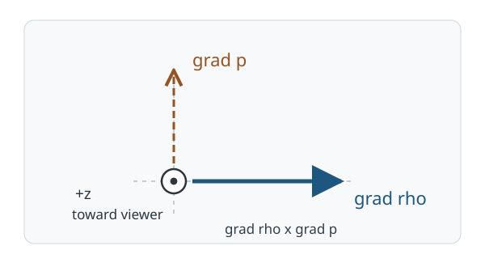

# FLUID8 理想流体で渦度は何から生まれるか

[FLUID6 の Euler 運動方程式](../FLUID6/index.md#thm-fluid6-euler-equation)は、粘性のない流体でも圧力が速度を変えることを示した。しかし、圧力の力が流体を**回す**ことはあるのだろうか。[FLUID6 の Bernoulli 積分](../FLUID6/index.md#thm-fluid6-streamline-bernoulli)で速度の回転として現れた[VC9 の渦度](../../../幾何系/VC/VC9/index.md#def-vc9-vorticity)を、今度は時間発展する未知量として調べる。

本講の結論は、圧力勾配の有無だけでは渦度生成を判定できない、ということである。密度が一様な流体では圧力力の回転は零になるが、密度と圧力の等値面が傾いて交わると、新たな渦度を生む項が残る。すでにある渦度の**輸送・伸長**と、ゼロからの**生成**を区別する。

## 0. 模型と使える微分

空間の開集合 $\mathcal D\subset\mathbb R^3$ と時間区間 $I$ を取り、右手系直交座標 $(x,y,z)$ を用いる。空間点全体は $\boldsymbol x=(x,y,z)\in\mathcal D$ と書き、以下の $x,y,z$ は個々の座標を表す。速度 $u=(u_x,u_y,u_z)$ [m/s]、密度 $\rho$ [kg/m$^3$]、圧力 $p$ [Pa] は $(\boldsymbol x,t)\in\mathcal D\times I$ の場とする。$\rho>0$ とし、$\rho,p$ は空間で少なくとも $C^2$ 級、$u$ は空間で $C^2$ 級・時間で $C^1$ 級、$\rho$ は時間で $C^1$ 級とする。必要な混合微分は連続とする。

[VC9 の物質微分](../../../幾何系/VC/VC9/index.md#def-vc9-material-derivative) $D_tf=\partial_t f+(u\cdot\nabla)f$ は、速度 $u$ とともに動く物質点に沿った $f$ の時間変化を表す。ここで $\partial_t$ は空間点 $\boldsymbol x$ を固定した微分、$\nabla$ は時刻 $t$ を固定した空間微分であり、ベクトル場には成分ごとに作用させる。一定密度の場合だけに限定しないので、[FLUID5 の質量保存則](../FLUID5/index.md#thm-fluid5-moving-mass)を

$$
\partial_t\rho+\nabla\cdot(\rho u)=0
\qquad\Longleftrightarrow\qquad
D_t\rho=-\rho\,\nabla\cdot u
$$

と書く。$\nabla\cdot u$ は速度の発散である。右辺への変形では積の微分を用いた：

$$
\nabla\cdot(\rho u)=u\cdot\nabla\rho+\rho\nabla\cdot u.
$$

[CTM7 の局所運動量式](../../CTM/CTM7/index.md#thm-ctm7-material-momentum)で応力を $\sigma=-pI_3$ とする。$I_3$ は右手系直交基底に関する $3\times3$ 単位行列で、応力成分は $\sigma_{ij}=-p\delta_{ij}$（$\delta_{ij}$ は $i=j$ のとき $1$、それ以外 $0$）となる。よって $(\nabla\cdot\sigma)_i=\sum_{j=1}^3\partial_j(-p\delta_{ij})=-\partial_i p$ である。このため密度が変化しても、**非粘性の古典解**では

$$
D_tu=-\frac1\rho\nabla p-\nabla\Phi
$

となる。ただし [CTM7 の体積力](../../CTM/CTM7/index.md#thm-ctm7-material-momentum)を本講では $f_{\mathrm{ext}}=-\nabla\Phi$ と書き、各 $t\in I$ に対して $\Phi(\cdot,t)\in C^2(\mathcal D)$ とする。$\nabla\Phi$ は時刻を固定した空間勾配なので、$\Phi$ が時間に依存してもよい。$\rho>0$ だから除算できる。この模型に粘性、非保存体積力、不連続面を含む流れは入れない。後の FLUID10 で粘性の寄与を加える。

## 1. 速度の回転を測る

速度ベクトルの微小な循環を局所的に記録するには curl を使う。[VC9 の渦度の定義](../../../幾何系/VC/VC9/index.md#def-vc9-vorticity)を新たな概念として重複定義するのではなく、その右手系座標表示を確認しよう。[FLUID6 の渦度と移流加速度の恒等式](../FLUID6/index.md#thm-fluid6-streamline-bernoulli)もこの量を使っていたが、以下では座標ごとの意味と符号を固定する。

<a id="def-fluid8-vorticity"></a>

<!-- formal-statement-start -->
### 定義（渦度の三次元座標表示：再掲）

上記の右手系座標で、空間 $C^1$ 級の速度場 $u$ の[既習の渦度](../../../幾何系/VC/VC9/index.md#def-vc9-vorticity)を

$$
\omega=\nabla\times u
=\left(
\partial_yu_z-\partial_zu_y,\ 
\partial_zu_x-\partial_xu_z,\ 
\partial_xu_y-\partial_yu_x
\right)
$$

と表示する。単位は s$^{-1}$。とくに $u=(u_x(x,y,t),u_y(x,y,t),0)$ なら $\omega=(0,0,\omega_z)$ である。
<!-- formal-statement-end -->

<!-- definition-example-start: def-fluid8-vorticity -->
### **定義の確認**：回転とせん断を成分で区別する

$\mathcal D=\mathbb R^3$ で、定数 $a$ [s$^{-1}$] に対し $u=(ay,0,0)$ とする。各成分は滑らかで、$\partial_xu_y=0$、$\partial_yu_x=a$、残りの関連微分は零。従って

$$
\omega=(0,0,-a),\qquad
\nabla\cdot u=\partial_x(ay)+\partial_y0=0.
$$

$x$ 方向へ流れる速度が $y$ とともに増えると、渦度は**負の $z$ 方向**になる。流線は水平な直線でも渦度は零とは限らない。また $a$ の単位が s$^{-1}$ なので、各 curl 成分の単位も一致する。
<!-- definition-example-end -->

対照的に、角速度を定数 $\Omega$ [s$^{-1}$] とする剛体回転 $u=(-\Omega y,\Omega x,0)$ では

$$
\omega_z=\partial_x(\Omega x)-\partial_y(-\Omega y)
=\Omega-(-\Omega)=2\Omega.
$$

角速度 $\Omega$ と渦度は同じではなく、ここでは渦度が2倍である。以下で既存の渦が伸びたり流されたりするかを論じる際にも、この**curl の符号**を基準にする。

## 2. 圧力の力を curl すると何が残るか

圧力は勾配 $\nabla p$ の向きに変化するが、密度が場所によって異なると、同じ圧力勾配でも単位質量当たりの加速度 $-\nabla p/\rho$ は異なる。二つの勾配が平行なら局所的な回転の発生はない。平行でなければ向き付きのベクトル積が現れる。

<a id="def-fluid8-baroclinic-source"></a>

<!-- formal-statement-start -->
### 定義（傾圧性の渦度生成項）

$\rho>0$ が空間 $C^1$ 級、$p$ が空間 $C^1$ 級のとき、

$$
S_{\mathrm{baro}}=\frac{\nabla\rho\times\nabla p}{\rho^2}
$$

を**傾圧性の渦度生成項**と呼ぶ。右手系で向きを定める。単位は s$^{-2}$。$\nabla\rho$ または $\nabla p$ が零、もしくは両者が平行なら、この項は零である。
<!-- formal-statement-end -->

<!-- definition-example-start: def-fluid8-baroclinic-source -->
### **定義の確認**：非平行な二つの勾配

$\rho_0>0$、$a>0$ [m$^{-1}$]、$b>0$ [Pa/m] とし、$1+ax>0$ の領域で

$$
\rho=\rho_0(1+ax),\qquad p=p_0+by.
$$

$\nabla\rho=(\rho_0a,0,0)$、$\nabla p=(0,b,0)$ なので、右手系の $e_x\times e_y=e_z$ に従い

$$
S_{\mathrm{baro}}=
\left(0,0,\frac{ab}{\rho_0(1+ax)^2}\right).
$$

密度は正で式は定義でき、生成項の向きは $+z$、大きさは正である。圧力に加えた定数 $p_0$ には依存しない。
<!-- definition-example-end -->

この関係を図で確認する。密度が増す向きの $\nabla\rho$ と圧力が増す向きの $\nabla p$ は直交し、ベクトル積は紙面の手前向き（$+z$）である。



[拡大して図を見る](assets/baroclinic-directions.svg)

## 3. 渦度方程式を Euler 方程式から導く

移流加速度を curl の形に直してから Euler 方程式へ適用する。[FLUID6 の Bernoulli の議論](../FLUID6/index.md#thm-fluid6-streamline-bernoulli)では勾配成分を流線方向に積分した。今度は勾配成分が curl を取ると消えることを利用する。

<a id="thm-fluid8-vorticity-equation"></a>

<!-- formal-statement-start -->
### 定理（非粘性圧縮性流体の渦度方程式）

$\mathcal D\subset\mathbb R^3$ は開集合、$I$ は時間区間とする。$\rho>0$、$u,p,\Phi$ は第0節の正則性を持ち、質量保存および Euler 方程式 を各点で満たすとする。$\omega=\nabla\times u$ とおけば

$$
\boxed{
D_t\omega
=(\omega\cdot\nabla)u
-\omega(\nabla\cdot u)
+\frac{\nabla\rho\times\nabla p}{\rho^2}
}
$$

が $\mathcal D\times I$ で成立する。右辺第1項は渦の伸長・傾斜、第2項は体積膨張・圧縮の寄与、第3項は傾圧性の生成項である。$\Phi$ の保存力項は寄与しない。
<!-- formal-statement-end -->

### 証明の見取り図

まず $(u\cdot\nabla)u$ を速度二乗の勾配と $u\times\omega$ に分ける。curl を取ると二つの勾配が消える。圧力項だけは $1/\rho$ が空間変化し得るため、積の curl からベクトル積が残る。最後に $\nabla\times(u\times\omega)$ を展開して輸送形へ移す。

<!-- proof-start -->
### 証明

$(u_1,u_2,u_3)=(u_x,u_y,u_z)$、$\omega=\nabla\times u$ とし、添字 $i,j,k,\ell,m$ は $1,2,3$ を動くものとする。[VC7 の Levi-Civita 記号](../../../幾何系/VC/VC7/index.md#def-vc7-epsilon) $\varepsilon_{ijk}$ は $(i,j,k)$ が $(1,2,3)$ の偶置換なら $+1$、奇置換なら $-1$、重複する添字があれば $0$ である。第0節の Kronecker 記号を使うと縮約公式は

$$
\sum_{k=1}^3\varepsilon_{ijk}\varepsilon_{k\ell m}
=\delta_{i\ell}\delta_{jm}-\delta_{im}\delta_{j\ell}.
$$

したがって、$u\times\omega$ の第 $i$ 成分は

$$
\begin{aligned}
(u\times\omega)_i
&=\sum_{j,k} \varepsilon_{ijk}u_j
  \sum_{\ell,m}\varepsilon_{k\ell m}\partial_\ell u_m\\
&=\sum_j u_j\partial_i u_j-\sum_j u_j\partial_j u_i\\
&=\partial_i\left(\frac12\sum_j u_j^2\right)-(u\cdot\nabla)u_i.
\end{aligned}
$$

従って三成分を束ねると、**移流加速度の恒等式**は

$$
(u\cdot\nabla)u
=\nabla\left(\frac{|u|^2}{2}\right)-u\times\omega.
$$

これを Euler 方程式 へ代入して勾配項を左へ移す：

$$
\partial_tu
=u\times\omega-\nabla\left(\frac{|u|^2}{2}\right)
-\frac1\rho\nabla p-\nabla\Phi.
$$

時間微分と curl の交換が許され、滑らかなスカラー場の勾配の curl が零だから

$$
\partial_t\omega
=\nabla\times(u\times\omega)
-\nabla\times\left(\frac1\rho\nabla p\right).
$$

積の curl は $\nabla\times(f\nabla p)=\nabla f\times\nabla p+f\nabla\times\nabla p$。$f=1/\rho$ とすると

$$
\begin{aligned}
-\nabla\times\left(\frac1\rho\nabla p\right)
&=-\nabla(\rho^{-1})\times\nabla p\\
&=-\left(-\rho^{-2}\nabla\rho\right)\times\nabla p\\
&=\frac{\nabla\rho\times\nabla p}{\rho^2}.
\end{aligned}
$$

一方、ベクトル積の curl も同じ縮約公式と積の微分法則から得られる。第 $i$ 成分を先に計算すると

$$
\begin{aligned}
[\nabla\times(u\times\omega)]_i
&=\sum_{j,k,\ell,m}\varepsilon_{ijk}\varepsilon_{k\ell m}
  \partial_j(u_\ell\omega_m)\\
&=\sum_j\partial_j(u_i\omega_j)-\sum_j\partial_j(u_j\omega_i)\\
&=\sum_j\bigl((\partial_j u_i)\omega_j+u_i\partial_j\omega_j
-(\partial_j u_j)\omega_i-u_j\partial_j\omega_i\bigr).
\end{aligned}
$$

成分を束ねれば

$$
\begin{aligned}
\nabla\times(u\times\omega)
&=u(\nabla\cdot\omega)-\omega(\nabla\cdot u)
+(\omega\cdot\nabla)u-(u\cdot\nabla)\omega\\
&=(\omega\cdot\nabla)u-\omega(\nabla\cdot u)
-(u\cdot\nabla)\omega.
\end{aligned}
$$

最後の等号は $\nabla\cdot(\nabla\times u)=0$ による。移流項を左辺へ移せば $\partial_t\omega+(u\cdot\nabla)\omega=D_t\omega$ となり、結論を得る。ここまで非圧縮性も順圧性も仮定していない。
<!-- proof-end -->

次元も確認する。左辺 $D_t\omega$ と右辺の各項の単位は s$^{-2}$ であり、傾圧項も

$$
\frac{[\rho]/\mathrm m\cdot [p]/\mathrm m}{[\rho]^2}
=\frac{[\mathrm{Pa}]}{[\rho]\,\mathrm m^2}
=\mathrm s^{-2}
$$

となる。符号を取り違えると第2節の正の $z$ 方向の判定が反転する。

## 4. 密度が一定なら何が消え、順圧なら何が消えるか

密度が変わっても、圧力勾配が密度勾配と平行になる十分な条件を、圧力が密度だけの関数で書けるという**構成関係**で表す。両勾配のどちらかが零でも傾圧項は消えるので、等値面が常に一対一に一致する必要はない。これが順圧の条件であり、[FLUID6 の順圧圧力ポテンシャル](../FLUID6/index.md#def-fluid6-barotropic-enthalpy)の条件とも対応する。

<a id="def-fluid8-barotropic"></a>

<!-- formal-statement-start -->
### 定義（本講での順圧条件）

$\rho>0$、$p$ が $C^1$ 級の場で、$\rho$ の値域を含む開区間 $J\subset(0,\infty)$ 上の $C^1$ 関数 $P:J\to\mathbb R$ が存在し、

$$
p(\boldsymbol x,t)=P(\rho(\boldsymbol x,t))
$$

が考える領域・時刻で成り立つとき、**順圧**であるという。$P$ は場所・時刻によって変えない。
<!-- formal-statement-end -->

<!-- definition-example-start: def-fluid8-barotropic -->
### **定義の確認**：密度が変化しても傾圧項は零

$\rho=\rho_0(1+ax)>0$、$p=K\rho^2$（$K>0$ は単位の合う定数）を取る。$P(r)=Kr^2$ は正の $r$ 上 $C^1$ 級で、実際に $p=P(\rho)$ を満たす。連鎖律を各座標へ適用すると

$$
\nabla p=2K\rho\nabla\rho,\qquad
\nabla\rho\times\nabla p
=2K\rho(\nabla\rho\times\nabla\rho)=0.
$$

密度が一定でなくても傾圧項は零になる。順圧は「圧力が空間一定」という意味ではない。
<!-- definition-example-end -->

<a id="prop-fluid8-no-baroclinic"></a>

<!-- formal-statement-start -->
### 命題（一定密度または順圧の流れでの傾圧項消失）

第3節の渦度方程式の仮定のもとで、$\rho$ が空間・時間とも正定数なら $\nabla\cdot u=0$ かつ $S_{\mathrm{baro}}=0$ であり、

$$
D_t\omega=(\omega\cdot\nabla)u.
$$

また、密度が変化しても第4節の順圧条件 $p=P(\rho)$ が成立すれば $S_{\mathrm{baro}}=0$ であり、

$$
D_t\omega=(\omega\cdot\nabla)u-\omega(\nabla\cdot u).
$$
<!-- formal-statement-end -->

### 証明の見取り図

一定密度では連続の式を使って発散も零にする。順圧では連鎖律で二つの勾配が平行だと示す。両者は同じ仮定ではない。

<!-- proof-start -->
### 証明

一定密度 $\rho=\rho_0>0$ なら $\nabla\rho=0$ であり、[質量保存則](../FLUID5/index.md#thm-fluid5-moving-mass)の展開形から $0=D_t\rho=-\rho_0\nabla\cdot u$、従って $\nabla\cdot u=0$。第3節の[渦度方程式](#thm-fluid8-vorticity-equation)に代入して第1式を得る。

順圧条件のもとでは各 $i$ について $\partial_ip=P'(\rho)\partial_i\rho$ なので $\nabla p=P'(\rho)\nabla\rho$。したがってベクトル積が零になる。これは $\nabla\cdot u=0$ を意味しないから、膨張項を残して第2式を得る。
<!-- proof-end -->

### 4.1 流線が直線でも渦は存在する

第1節のせん断流 $u=(ay,0,0)$ を密度一定、圧力一定、$\Phi=0$ とともに考える。$D_tu=0$、$\nabla\cdot u=0$ なので連続の式と Euler 方程式を**ともに**満たす。渦度 $\omega=(0,0,-a)$ は一定で、$D_t\omega=0$、$(\omega\cdot\nabla)u=0$。生成源が零であることは、最初から渦度が零であることを意味しない。

一方、剛体回転 $u=(-\Omega y,\Omega x,0)$ で $\Omega$ を一定、$\rho=\rho_0>0$ とし、

$$
p=p_0+\frac{\rho_0\Omega^2}{2}(x^2+y^2),\qquad \Phi=0
$$

とする。$\partial_tu=0$ かつ

$$
(u\cdot\nabla)u=(-\Omega^2x,-\Omega^2y,0)
=-\frac1{\rho_0}\nabla p.
$$

$\nabla\cdot u=0$、$\omega=(0,0,2\Omega)$。こちらも渦度が存在するのに傾圧生成は零である。定常であることと、無渦であることは別条件である。

## 5. 二次元で渦度はどう輸送されるか

一定密度・非圧縮の二次元場 $u=(u_x(x,y,t),u_y(x,y,t),0)$ では、渦度は鉛直方向だけを向く。速度が $z$ に依存しなければ、渦度方向への速度微分 $(\omega\cdot\nabla)u=\omega_z\partial_zu$ は零になる。

<a id="prop-fluid8-2d-transport"></a>

<!-- formal-statement-start -->
### 命題（二次元一定密度 Euler 流の渦度輸送）

第3節の仮定に加え、$\rho>0$ が定数、$u=(u_x(x,y,t),u_y(x,y,t),0)$ が $z$ に依存せず、$\nabla\cdot u=0$ とする。このとき

$$
\boxed{\partial_t\omega_z+u_x\partial_x\omega_z
+u_y\partial_y\omega_z=0.}
$$

さらに $C^1$ 級の流跡 $X(t)$ が $\dot X(t)=u(X(t),t)$ を満たして流体領域内にある間は、$\omega_z(X(t),t)$ は一定である。
<!-- formal-statement-end -->

### 証明の見取り図

[一定密度の場合の命題](#prop-fluid8-no-baroclinic)で傾圧項と膨張項を除き、$z$ 方向の伸長がないことを確認する。最後に流跡に沿った連鎖律を使う。

<!-- proof-start -->
### 証明

二次元性から $\omega=(0,0,\omega_z)$ で、$u$ は $z$ に依存しない。したがって

$$
(\omega\cdot\nabla)u=\omega_z\partial_zu=0.
$$

[一定密度の渦度式](#prop-fluid8-no-baroclinic)は $D_t\omega=0$ へ簡約され、その $z$ 成分が表示した輸送式である。流跡 $X(t)=(X_1(t),X_2(t),X_3(t))$ 上で連鎖律を取ると

$$
\begin{aligned}
\frac{d}{dt}\omega_z(X(t),t)
&=\partial_t\omega_z(X(t),t)
+\sum_{j=1}^3\partial_j\omega_z(X(t),t)\dot X_j(t)\\
&=\partial_t\omega_z+u_x\partial_x\omega_z+u_y\partial_y\omega_z=0,
\end{aligned}
$$

ただし最後の場は $(X(t),t)$ で評価し、$\partial_z\omega_z=0$ を使った。従って流跡上で一定である。
<!-- proof-end -->

これは**既存の渦度が流される**という主張であって、渦度が最初から零であるという仮定を含まない。また三次元では伸長項が残り、二次元でも密度と圧力が非平行なら傾圧項が残る。いずれも無条件に「渦度保存」としてはいけない。

## 6. 非平行な勾配からの生成を瞬間的に直接計算する

第2節と同じ密度・圧力を $t=0$ の初期場とし、初速度を $u(\boldsymbol x,0)=0$ とする。$p_0$ は考える有界領域で圧力が正になるように選んでもよい。$\rho_0>0$ と $1+ax>0$ を保ち、非粘性・保存体積力 $\Phi=0$ の**滑らかな解が初期時刻の近傍に存在する場合**だけを論じる。たとえば圧縮性の熱力学モデルでは、非一様な温度・エントロピーと整合する初期値として与える必要があり、ここで全時間の解を構成したと主張しない。

初速度が零だから初期渦度も零で、初期時刻の移流・伸長・膨張項はすべて零。Euler 方程式から初期加速度は

$$
\left.\partial_tu\right|_{t=0}
=-\frac1{\rho_0(1+ax)}(0,b,0).
$$

よって curl の $z$ 成分を直接微分すると

$$
\begin{aligned}
\left.\partial_t\omega_z\right|_{t=0}
&=\partial_x\left(-\frac b{\rho_0(1+ax)}\right)-\partial_y0\\
&=\frac{ab}{\rho_0(1+ax)^2}.
\end{aligned}
$$

これは第2節の[傾圧生成項の定義](#def-fluid8-baroclinic-source)で得た式と、**向きも係数も**一致する。$a,b>0$ なら初期渦度ゼロから正の渦度が生じる。任意の時刻で同じ式になるという意味ではない。

### 6.1 ブラウザで curl の符号を独立検算する

付属の [vorticity_lab.py](vorticity_lab.py) は、第6節の**初期加速度の差分から求めた curl**と式から直接求めた傾圧項、ならびに第1節のせん断流と剛体回転の curl を比較する。Python 標準ライブラリだけを使う。流体方程式を時間積分するプログラムではない。距離刻み $h$ を半分にすると差分誤差がどう変わるか、また $a$ または $b$ の符号を反転すると生成方向が反転することを確認する。

```python-file-lab
# lab-id: FLUID8-VORTICITY-FILE
# lab-title: 渦度と傾圧項の符号・差分収束
# lab-file: textbook/volumes/dream_thater/物理系/FLUID/FLUID8/vorticity_lab.py
# timeout-ms: 10000
# lab-preset: 正のz方向へ生成 | --rho0 2 --a 0.2 --b 6 --x 1 --h 0.1
# lab-preset: 密度勾配を反転 | --rho0 2 --a -0.2 --b 6 --x 1 --h 0.1
# lab-preset: 刻み幅を縮める | --rho0 2 --a 0.2 --b 6 --x 1 --h 0.025
```

**数値的な注意**：差分は数学的な証明の代わりではない。中央差分の誤差はこの滑らかな例で $O(h^2)$ であり、$\rho(x\pm h)>0$ が必要。独立した紙上の検算値は $(\rho_0,a,b,x)=(2,0.2,6,1)$ について

$$
S_{\mathrm{baro},z}=\frac{0.2\cdot6}{2\cdot1.2^2}
=\frac5{12}\simeq0.4166667\ \mathrm{s}^{-2}
$$

となる。プログラム中でも解析式と有限差分を**別々の経路**で計算する。

## 7. 発生・増幅・移流を混同しない

第3節の式を物質粒子に沿って読むと、傾圧項は $\omega=0$ でも零とは限らず、**生成源**になり得る。一方、伸長と膨張は $\omega$ に比例し、渦度が最初から零の滑らかな流れでは、それだけで直ちに非零の渦度を作らない。

密度が変化する流れでは、物質体積の変化と渦度の変化を区別するため $\omega/\rho$ を調べると、保存則がもう一つ見える。

<a id="prop-fluid8-specific-vorticity"></a>

<!-- formal-statement-start -->
### 命題（単位密度当たりの渦度の発展）

第3節の定理の仮定のもとで、$q=\omega/\rho$ とおくと

$$
\boxed{D_tq=(q\cdot\nabla)u
+\frac{\nabla\rho\times\nabla p}{\rho^3}.}
$$

特に順圧流では右辺第2項は零となる。ただし三次元では第1項が残り得るので、$q$ の各成分が物質粒子上で一定とは限らない。
<!-- formal-statement-end -->

### 証明の見取り図

$\omega/\rho$ の物質微分に商の微分法則を適用し、質量保存の $D_t\rho=-\rho\nabla\cdot u$ を代入して体積膨張の項が打ち消し合うことを確認する。

<!-- proof-start -->
### 証明

$\rho>0$ だから

$$
\begin{aligned}
D_t\left(\frac{\omega}{\rho}\right)
&=\frac{D_t\omega}{\rho}
-\frac{\omega}{\rho^2}D_t\rho\\
&=\frac{(\omega\cdot\nabla)u}{\rho}
-\frac{\omega}{\rho}(\nabla\cdot u)
+\frac{\nabla\rho\times\nabla p}{\rho^3}
+\frac{\omega}{\rho}(\nabla\cdot u)\\
&=\left(\frac{\omega}{\rho}\cdot\nabla\right)u
+\frac{\nabla\rho\times\nabla p}{\rho^3}.
\end{aligned}
$$

これが主張である。順圧条件を代入すれば最後のベクトル積は零になる。
<!-- proof-end -->

**仮定を外すと**どうなるか。非保存外力 $f_{\mathrm{ext}}$ を用いれば第3節の式に $\nabla\times f_{\mathrm{ext}}$ が増える。粘性応力を加えれば応力発散の curl が増える。不連続な波面のように滑らかさが破れる場では上記の古典的な微分をそのまま行えない。したがって「理想流体の渦度生成は傾圧項だけ」と言えるのは、**ここで固定した非粘性・保存力・滑らかな模型に限る**。

次講 FLUID9 では、点ごとの渦度ではなく、流れとともに動く**閉曲線に沿う循環**がどの仮定で保存されるかを調べる。

## 8. 演習：式をどこで使い分けるか

### Level A

### A1. curl の符号と次元

$u=(3y,-2x,0)$ [m/s]（$x,y$ は m、係数は s$^{-1}$）とする。渦度、発散、渦度の単位を求めよ。

- Level: A

<!-- solution-start -->
#### 詳細解答

[渦度の定義](#def-fluid8-vorticity)により

$$
\omega_z=\partial_x(-2x)-\partial_y(3y)
=-2-3=-5\ \mathrm{s}^{-1}.
$$

$u_z=0$、$z$ 依存性もないので $\omega_x=\omega_y=0$。発散は $\partial_x(3y)+\partial_y(-2x)=0$。速度を長さで微分するから $[\omega]=(\mathrm{m/s})/\mathrm m=\mathrm{s}^{-1}$。
<!-- solution-end -->

### A2. 傾圧項のベクトル積

ある点で $\rho=4$ kg/m$^3$、$\nabla\rho=(2,0,0)$ kg/m$^4$、$\nabla p=(0,-8,0)$ Pa/m とする。$S_{\mathrm{baro}}$ の向きと各成分を求めよ。

- Level: A

<!-- solution-start -->
#### 詳細解答

[傾圧項の定義](#def-fluid8-baroclinic-source)で、$e_x\times(-e_y)=-e_z$ だから

$$
\nabla\rho\times\nabla p=(0,0,-16),\qquad
S_{\mathrm{baro}}=(0,0,-16/4^2)=(0,0,-1)\ \mathrm{s}^{-2}.
$$

分母は $\rho$ ではなく $\rho^2=16$ である。
<!-- solution-end -->

### A3. 順圧なのに密度が変化する例

$x>-1/2$ で $\rho=1+2x$、$p=3\rho^2$ とする。順圧条件を満たす $P$ を明記し、傾圧項が零であることを成分で確認せよ。

- Level: A

<!-- solution-start -->
#### 詳細解答

$P(r)=3r^2$ を $r>0$ で定義すれば $p=P(\rho)$ となる。[順圧条件](#def-fluid8-barotropic)を満たす。勾配は

$$
\nabla\rho=(2,0,0),\qquad
\nabla p=6\rho(2,0,0)=(12\rho,0,0).
$$

両者のベクトル積は $(0,0,0)$ であり、$\rho>0$ なので $S_{\mathrm{baro}}=0$。$\partial_xp=12\rho\ne0$ であっても渦度生成項は零である。
<!-- solution-end -->

### A4. 一定密度の帰結

$\rho=\rho_0>0$ が空間・時間とも一定の古典的 Euler 解について、質量保存と渦度方程式を順に簡約せよ。$\omega\ne0$ が許されるか答えよ。

- Level: A

<!-- solution-start -->
#### 詳細解答

[質量保存](../FLUID5/index.md#thm-fluid5-moving-mass)は $0=D_t\rho=-\rho_0\nabla\cdot u$ だから $\nabla\cdot u=0$ を与える。また $\nabla\rho=0$ で[傾圧項](#def-fluid8-baroclinic-source)も零となる。[渦度方程式](#thm-fluid8-vorticity-equation)は

$$
D_t\omega=(\omega\cdot\nabla)u.
$$

これは $\omega=0$ を強制しない。実際に第4.1節の定常せん断流では $\omega=(0,0,-a)\ne0$ を満たす。
<!-- solution-end -->

### Level B

### B1. 初期加速度の curl と生成項の一致

$\rho(\boldsymbol x,0)=3(1+0.1x)$、$p(\boldsymbol x,0)=p_0-9y$、$u(\boldsymbol x,0)=0$、$\Phi=0$ とする。$1+0.1x>0$ で滑らかな Euler 解が存在すると仮定する。$\partial_tu(\boldsymbol x,0)$ を求め、その curl と傾圧項をそれぞれ計算して一致を示せ。

- Level: B

<!-- solution-start -->
#### 詳細解答

初期速度が零なので $(u\cdot\nabla)u=0$。[CTM7 の局所運動量式](../../CTM/CTM7/index.md#thm-ctm7-material-momentum)へ $\sigma=-pI_3$ と $f_{\mathrm{ext}}=0$ を代入した第0節の**変密度でも成り立つ**非粘性運動量式から

$$
\left.\partial_tu\right|_0
=-\frac1{3(1+0.1x)}(0,-9,0)
=\left(0,\frac3{1+0.1x},0\right).
$$

初期加速度の curl の $z$ 成分は

$$
\partial_x\frac3{1+0.1x}-\partial_y0
=-\frac{0.3}{(1+0.1x)^2}.
$$

独立に $\nabla\rho=(0.3,0,0)$、$\nabla p=(0,-9,0)$ だから

$$
\frac{(\nabla\rho\times\nabla p)_z}{\rho^2}
=\frac{-2.7}{9(1+0.1x)^2}
=-\frac{0.3}{(1+0.1x)^2}.
$$

一致する。初期渦度は零だから、これは初期時刻の $D_t\omega_z$ でもある。負符号は圧力勾配が $-y$ 方向を向くためである。
<!-- solution-end -->

### B2. 二次元輸送の連鎖律

一定密度の二次元 Euler 解で初期流跡 $X(t_0)=(x_0,y_0)$ を考える。$\dot X=(u_x,u_y)$ のとき、渦度の物質微分が零なら流跡上で一定となることを、$x$・$y$ の両成分を明示して示せ。二次元でも一般にこの結論が成り立たない仮定の変更を一つ挙げよ。

- Level: B

<!-- solution-start -->
#### 詳細解答

[二次元渦度輸送](#prop-fluid8-2d-transport)は $\partial_t\omega_z+u_x\partial_x\omega_z+u_y\partial_y\omega_z=0$。流跡上で連鎖律を逐次使うと

$$
\begin{aligned}
\frac d{dt}\omega_z(X_1(t),X_2(t),t)
&=\partial_x\omega_z\,\dot X_1+\partial_y\omega_z\,\dot X_2+\partial_t\omega_z\\
&=u_x\partial_x\omega_z+u_y\partial_y\omega_z+\partial_t\omega_z=0.
\end{aligned}
$$

よって積分区間上で $\omega_z(X(t),t)=\omega_z(x_0,y_0,t_0)$。密度を空間変化させ、$\nabla\rho\times\nabla p\ne0$ を許すと、二次元でも傾圧項の $z$ 成分が残り、この計算の最後は一般に零にならない。
<!-- solution-end -->

### B3. 密度で割る理由

順圧だが圧縮・膨張がある三次元理想流について、$q=\omega/\rho$ の物質微分を最初から計算し、$\nabla\cdot u$ の項が消えることを示せ。$D_tq=0$ と結論できるかも述べよ。

- Level: B

<!-- solution-start -->
#### 詳細解答

[質量保存](../FLUID5/index.md#thm-fluid5-moving-mass)から $D_t\rho=-\rho\nabla\cdot u$。[順圧の渦度式](#prop-fluid8-no-baroclinic)から $D_t\omega=(\omega\cdot\nabla)u-\omega\nabla\cdot u$。商を微分すると

$$
\begin{aligned}
D_t(\omega/\rho)
&=\rho^{-1}D_t\omega-\rho^{-2}\omega D_t\rho\\
&=\rho^{-1}(\omega\cdot\nabla)u
-\rho^{-1}\omega\nabla\cdot u
+\rho^{-1}\omega\nabla\cdot u\\
&=(q\cdot\nabla)u.
\end{aligned}
$$

最後の項は一般に零ではない。したがって三次元では $q$ が流跡上で一定とは限らない。零になるのは例えば $q=0$、または $(q\cdot\nabla)u=0$ のときである。
<!-- solution-end -->

### B4. 三次元の渦伸長を自力で判定する

定数 $k>0$、$\Omega_0\ne0$ とし、$\Omega(t)=\Omega_0e^{kt}$、

$$
u(x,y,z,t)=\left(-\frac k2x-\Omega(t)y,\ 
\Omega(t)x-\frac k2y,\ kz\right)
$$

とする。発散、渦度、$D_t\omega$、$(\omega\cdot\nabla)u$ を求めよ。一定密度の Euler 解として圧力を構成せよ（$\Phi=0$）。

- Level: B

<!-- solution-start -->
#### 詳細解答

各対角偏微分から $\nabla\cdot u=-k/2-k/2+k=0$。curl の $z$ 成分は

$$
\omega_z=\partial_xu_y-\partial_yu_x
=\Omega(t)-(-\Omega(t))=2\Omega(t);
\qquad \omega_x=\omega_y=0.
$$

$\omega$ は空間に依存せず、$\Omega'(t)=d\Omega(t)/dt=k\Omega(t)$（プライムは時間 $t$ に関する導関数）なので

$$
D_t\omega=\partial_t\omega=(0,0,2k\Omega).
$$

他方 $(\omega\cdot\nabla)u=2\Omega\,\partial_zu=(0,0,2k\Omega)$。伸長項と一致する。圧力を検査するため $r^2=x^2+y^2$ として、直接計算すれば

$$
\begin{aligned}
D_tu_x&=(k^2/4-\Omega^2)x+(k\Omega-\Omega')y,\\
D_tu_y&=(\Omega'-k\Omega)x+(k^2/4-\Omega^2)y,\\
D_tu_z&=k^2z.
\end{aligned}
$$

$\Omega'=k\Omega$ で交差項が消えるので、密度 $\rho_0>0$ を一定にして

$$
p=p_0+\frac{\rho_0}{2}
\left[(\Omega(t)^2-k^2/4)r^2-k^2z^2\right]
$$

と選べば $-\nabla p/\rho_0=D_tu$。有界な空間領域と有限時間区間に限れば、$p_0$ を十分大きくしてその全域で圧力を正にできる。これは既存渦度の**伸長による増幅**であり、傾圧的な新規生成ではない。
<!-- solution-end -->

### Level C

### C1. 「圧力があるから渦が生まれる」は正しいか

次の三つの模型を同じ渦度方程式で吟味せよ。いずれも $\Phi=0$、滑らかな解が存在する場合を考える。

1. 空間一定密度で $\nabla p\ne0$ の非圧縮理想流。
2. 密度が空間変化する順圧理想流。
3. $t=0$ で $u=0$、$\rho=\rho_0(1+ax)$、$p=p_0+by$（$\rho_0>0$、$1+ax>0$ の領域、$ab\ne0$）の非順圧初期場。

各場合で傾圧項を計算し、他の項と区別したうえで、**初期渦度が零から生成され得るのはどの場合か**を論じよ。また保存体積力の仮定を外すと結論がどう変わるか示せ。

- Level: C

<!-- solution-start -->
#### 詳細解答

出発点は[非粘性渦度方程式](#thm-fluid8-vorticity-equation)

$$
D_t\omega=(\omega\cdot\nabla)u-\omega\nabla\cdot u+S_{\mathrm{baro}},
\qquad S_{\mathrm{baro}}=\rho^{-2}\nabla\rho\times\nabla p
$$

である。

まず、傾圧項が零のときに、滑らかな流れが零初期渦度を保つ理由を調べる。流跡 $X(t)$ に沿う各成分は

$$
\frac{d}{dt}\omega_i(X(t),t)
=\sum_{j=1}^3\omega_j(X(t),t)\partial_j u_i(X(t),t)
-\bigl(\nabla\cdot u\bigr)(X(t),t)\omega_i(X(t),t)
$$

を満たす。$v_i(t)=\omega_i(X(t),t)$ とすれば同次線形 ODE である。滑らかな流跡の任意の有限部分区間で係数は有界だから、各右辺の係数の絶対値の行和を抑える定数 $M>0$ を選べる。初期値 $v_i(t_0)=0$ と時間幅 $\delta>0$ に対し、

$$
V=\sup_{t_0\le s\le t_0+\delta}\max_{i=1,2,3}|v_i(s)|
$$

とおけば、方程式を積分して

$$
|v_i(t)|\le\int_{t_0}^t M\max_j|v_j(s)|\,ds\le M\delta V,
\qquad V\le M\delta V
$$

を得る。$M\delta<1$ の短い区間では $V=0$ であり、これを繰り返せば流跡が滑らかに存在する限り零のままである。この議論は膨張項がある場合にも使える。

1. $\rho=\rho_0>0$ では $\nabla\rho=0$ なので $S_{\mathrm{baro}}=0$。さらに質量保存から $\nabla\cdot u=0$。従って $D_t\omega=(\omega\cdot\nabla)u$。$\nabla p$ の大きさだけでは渦は生成されない。すでにある渦度は伸長され得るが、零初期値からは上の同次線形輸送により零のままである。
2. [順圧条件](#def-fluid8-barotropic) $p=P(\rho)$ では連鎖律 $\nabla p=P'(\rho)\nabla\rho$ により $S_{\mathrm{baro}}=0$。密度変化があるので $\nabla\cdot u$ は一般には零と断定できないが、右辺の残り二項は $\omega$ に比例する。従って零初期渦度は同じく零のままである。圧力一定・密度一定を仮定したわけではない。
3. $\nabla\rho=(\rho_0a,0,0)$、$\nabla p=(0,b,0)$ だから

$$
S_{\mathrm{baro}}=
\left(0,0,\frac{ab}{\rho_0(1+ax)^2}\right)\ne0.
$$

初期速度が零なので $\omega(\boldsymbol x,0)=0$、従って他の二項は初期時刻で零。よって $\partial_t\omega_z(\boldsymbol x,0)=ab/[\rho_0(1+ax)^2]$。滑らかな局所解があれば $t=0$ からの短時間で渦度が生成される。符号は $ab$ の符号と一致する。第6節の初期加速度の curl による独立計算でも同じ結論を得る。

最後に保存外力 $f_{\mathrm{ext}}=-\nabla\Phi$ の仮定を外し、一般の滑らかな単位質量当たりの外力 $f_{\mathrm{ext}}$ を許せば、curl の計算から追加項 $\nabla\times f_{\mathrm{ext}}$ が現れる。これが非零なら一定密度・順圧でも渦度が生成され得る。したがって結論は流体の非粘性だけではなく、外力と正則性の仮定に依存する。
<!-- solution-end -->

## 9. 自己点検

- curl の向きと密度・圧力勾配の順序を間違えず、$S_{\mathrm{baro}}$ の符号を説明できるか。
- 密度一定の場合と順圧の場合で、$\nabla\cdot u=0$ を使える条件を区別できるか。
- 初期渦度ゼロからの生成と、既存渦度の伸長・移流を区別できるか。
- 具体例を流体解として用いる際、質量保存と Euler 方程式の両方を点検したか。
- 不連続な波面・粘性・非保存外力に、今回の式を無条件に外挿していないか。
