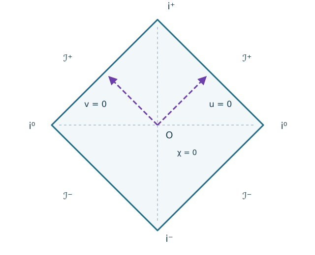
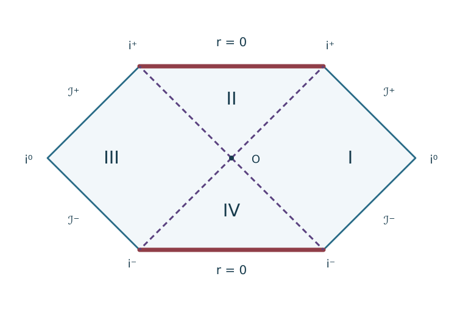

# GR28 共形コンパクト化とPenrose図

<!-- definition-example-audit: strict -->

[GR27のKruskal延長](../GR27/index.md#def-gr27-kruskal-domain)では、$UV<1$ という無限に広がる領域に、二つの外部と未来・過去の内部を一枚で配置できました。しかし、$U,V$ が無限大へ向かう光線は、紙面のどこへ行くのでしょう。地平線に達する光と遠方まで逃げる光を比べるには、無限遠まで含めた**因果関係の地図**が必要です。

有限の紙面へ写したいのは距離や曲率ではなく、まず光円錐です。[LORG8の共形因果不変性](../../../幾何系/LORG/LORG8/index.md#thm-lorg8-conformal-causality)によれば、計量を滑らかな正の関数の二乗倍にしても、内部の未来向き因果曲線は変わりません。この事実を、無限に長い零座標を有界な区間へ移す操作と組み合わせます。

ここでのPenrose図は**角度を固定した動径二次元部分の因果図**です。四次元全体の距離や角度方向の計量を、そのまま二次元の紙面へ保存するものではありません。以下、計量の符号は $(-,+)$ または四次元では $(-,+,+,+)$、未来向きは零座標がともに増加する向きとします。三角関数の角度はラジアンで測ります。

## 1. 無限に広い零座標を有界にする

まず二次元Minkowski平面を使います。時間座標 $t$ と空間座標 $x$ を同じ単位で測り、$ds_2^2=-dt^2+dx^2$ とします。右向きの光は $x=t+\text{定数}$、左向きの光は $x=-t+\text{定数}$ を進みます。そこで、光に沿って一定になる零座標を

$$
u:=t-x,\qquad v:=t+x
$$

と置きます。$dt=(du+dv)/2$、$dx=(dv-du)/2$ を代入すると

$$
-dt^2+dx^2=-\frac14(du+dv)^2+\frac14(dv-du)^2=-du\,dv.
$$

$u,v$ は実数全体を動くので、例えば単調な逆正接関数 $\arctan:\mathbb R\to(-\pi/2,\pi/2)$ でそれぞれ有界化します。元の無限遠を図の**境界の極限**として表すための操作であり、境界点をもとの時空に加える操作とは分けて考えます。

<!-- formal-statement-start -->
> **定義（零座標の有界化）**
> 実数値の二つの零座標 $z,w$ に対し、有界な座標 $p,q$ と、その時間・空間型の表示 $\tau,\chi$ を

$$
\boxed{p=\arctan z,\quad q=\arctan w,\qquad
\tau=\frac{p+q}{2},\quad\chi=\frac{q-p}{2}}
$$

> で定める。逆変換は $z=\tan(\tau-\chi)$、$w=\tan(\tau+\chi)$ であり、常に $|\tau-\chi|<\pi/2$、$|\tau+\chi|<\pi/2$ を課す。
<!-- formal-statement-end -->

<!-- definition-example-start: def-gr28-compact-nulls -->
**定義の確認**。$z=0,w=1$ なら $p=0,q=\pi/4$、したがって $(\tau,\chi)=(\pi/8,\pi/8)$ です。逆に $\tau-\chi=0$ と $\tau+\chi=\pi/4$ から $(z,w)=(0,1)$ を復元できます。$z,w$ が有限なら $\arctan$ の値は開区間に入り、逆関数の $\tan$ も定義されています。$w\to+\infty$ の場合だけ $q\to\pi/2$ という**内部にはない境界値**へ近づきます。
<!-- definition-example-end -->

何が図として許されるかも明確にしておきます。「座標を有界化した」だけでは計量の光円錐が保存されたとはまだ言えません。変換後の計量から発散する係数を、正の共形因子で取り除きます。

<!-- formal-statement-start -->
> **定義（二次元共形因果図）**
> 時間向き付き二次元Lorentz時空 $(D,g_2)$ を、有界な開座標域 $D'$ へ微分同相に写す。$D'$ の内部で正の滑らかな関数 $\omega$ によって、計量を次の形に直せるとする。

$$
\widehat g_2=\omega^2g_2=-dp\,dq.
$$

> このとき $\tau=(p+q)/2$、$\chi=(q-p)/2$ を用いて $D'$ とその境界の極限を描いたものを、ここでは二次元共形因果図（Penrose図）という。境界は原時空の点とは限らない。
<!-- formal-statement-end -->

<!-- definition-example-start: def-gr28-causal-diagram -->
**定義の確認**。先ほどのMinkowski平面では $g_2=-du\,dv$ とし、二つの零座標を逆正接で有界化します。

$$
p=\arctan u,\qquad q=\arctan v.
$$

内部では $\omega^2=\cos^2p\cos^2q>0$ が滑らかなので、再尺度後の計量は $\widehat g_2=-dp\,dq$ です。二本の零方向はそれぞれ

$$
d\tau=d\chi,\qquad d\tau=-d\chi
$$

となり、図では45度の直線です。境界 $p=\pi/2$ では倍率が零に向かうため、[LORG8の正の共形再尺度](../../../幾何系/LORG/LORG8/index.md#def-lorg8-conformal-rescaling)をその境界自体には直接適用できません。
<!-- definition-example-end -->

<!-- formal-statement-start -->
> **命題（二重零計量の共形有界化）**
> $D\subset\mathbb R^2$ を開集合、$A:D\to(0,\infty)$ を滑らかな関数とし、$D$ 上の時間向き付きLorentz計量を $g_2=-A(z,w)\,dz\,dw$ とする。$p=\arctan z,q=\arctan w$ で移した開領域 $D'$ において

$$
\boxed{\omega^2(p,q):=\frac{\cos^2p\cos^2q}{A(\tan p,\tan q)}>0}
$$

> とすれば、次の共形計量を得る。

$$
\widehat g_2:=\omega^2g_2=-dp\,dq=-d\tau^2+d\chi^2.
$$

> 未来向き零曲線は $\tau,\chi$ 平面で傾き $\pm1$ の直線に写る。
<!-- formal-statement-end -->

### 証明の見取り図

$dz=\sec^2p\,dp$ と $dw=\sec^2q\,dq$ によって現れる発散係数を $\cos^2p\cos^2q$ で相殺します。$A>0$ の仮定は、計量が非退化であり、倍率が内部で正になるために不可欠です。

<!-- proof-start -->
### 証明

$z=\tan p$ の微分は $dz/dp=1/\cos^2p$、$w=\tan q$ についても同様です。従って

$$
g_2=-A(\tan p,\tan q)\frac{dp\,dq}{\cos^2p\cos^2q}.
$$

$|p|,|q|<\pi/2$ では余弦が零にならず、$A>0$ ですから $\omega^2$ は滑らかで正です。掛け合わせると

$$
\omega^2g_2=-dp\,dq.
$$

さらに $p=\tau-\chi$、$q=\tau+\chi$ なので

$$
dp\,dq=(d\tau-d\chi)(d\tau+d\chi)=d\tau^2-d\chi^2.
$$

零接ベクトルは $-d\tau^2+d\chi^2=0$、すなわち $d\tau=\pm d\chi$ であり、未来向きには $d\tau>0$ を取ります。[共形因果不変性](../../../幾何系/LORG/LORG8/index.md#thm-lorg8-conformal-causality)により、内部の因果曲線の許容集合は変わりません。$\square$
<!-- proof-end -->

ここで保存されるのは因果的な向きと到達関係です。計量の数値、固有時、測地線のアフィンパラメータ、曲率は一般に保存されません。特に、図の角度をそのまま四次元時空の角度と見なしてはいけません。

## 2. Minkowski平面をひし形に収める

Minkowski平面では $A\equiv1$ です。$p,q\in(-\pi/2,\pi/2)$ の正方形は、$\tau,\chi$ の座標では45度回転したひし形になります。無限遠の異なる方向が、ひし形の辺や頂点のどこに向かうかを確かめます。

<!-- formal-statement-start -->
> **命題（Minkowski平面の共形ダイヤモンド）**
> 二次元Minkowski平面 $(\mathbb R^{1+1},-dt^2+dx^2)$ で $u=t-x,v=t+x$ と置き、$p=\arctan u,q=\arctan v$、$\tau=(p+q)/2,\chi=(q-p)/2$ とする。写像先は

$$
\boxed{|\tau|+|\chi|<\frac\pi2}
$$

> であり、$\omega^2=\cos^2p\cos^2q$ によって $\widehat g_2=-d\tau^2+d\chi^2$ になる。$x=0$ の未来・過去無限の端点は $(\pm\pi/2,0)$、右向きの未来零光線 $x=t$、$t\ge0$ の境界端点は $(\pi/4,\pi/4)$ である（座標順は $(\tau,\chi)$）。
<!-- formal-statement-end -->

### 証明の見取り図

$p=\tau-\chi$ と $q=\tau+\chi$ がともに開区間にある条件を一つの不等式へまとめます。世界線の端点は $t\to\pm\infty$、零光線の端点は $t\to+\infty$ を直接代入します。

<!-- proof-start -->
### 証明

$p,q$ の値域は

$$
|\tau-\chi|<\frac\pi2,\qquad|\tau+\chi|<\frac\pi2.
$$

実数 $a,b$ に対して $\max\{|a-b|,|a+b|\}=|a|+|b|$ であるため、この二条件は $|\tau|+|\chi|<\pi/2$ と同値です。[二重零計量の共形有界化](#prop-gr28-null-rescaling)へ $A=1$ を代入すると計量の式が従います。

静止世界線 $x=0$ では $u=v=t$ なので $p=q=\arctan t$、したがって $\tau=\arctan t$、$\chi=0$ です。$t\to\pm\infty$ で $\tau\to\pm\pi/2$。右向き光線 $x=t$、$t\ge0$ では $u=0,v=2t$ なので $p=0$、$q=\arctan(2t)\to\pi/2$、ゆえに $(\tau,\chi)\to(\pi/4,\pi/4)$ です。$\square$
<!-- proof-end -->

[Minkowski図を原寸で表示](assets/minkowski-penrose.svg)

図では、時間が無限に進む静止世界線は上端の頂点、一定の零座標を持つ出射光線は斜めの上辺に終わります。この違いを区別する名前が必要です。

<!-- formal-statement-start -->
> **定義（共形図における無限遠の記号）**
> 上の二次元Minkowskiダイヤモンドで、未来・過去に無限に延びる時間的世界線の端点 $(\pm\pi/2,0)$ をそれぞれ $i^+,i^-$、左右の空間方向へ無限に延びる空間的直線の端点 $(0,\pm\pi/2)$ を左右の $i^0$ と書く。未来向き光線が達する上側の二辺を未来零無限遠 $\mathscr I^+$、過去から入射する下側の二辺を過去零無限遠 $\mathscr I^-$ と書く。ここでは辺の内部を $\mathscr I^\pm$ とし、その端点と区別する。
<!-- formal-statement-end -->

<!-- definition-example-start: def-gr28-infinities -->
**定義の確認**。$x=0$、$t\to+\infty$ では前の命題から $(\tau,\chi)\to(\pi/2,0)=i^+$ です。右へ逃げる $x=t$、$t\to+\infty$ では $(\pi/4,\pi/4)$ で、$\tau+\chi=\pi/2$ かつ $0<\tau<\pi/2$ を満たす未来零無限遠の辺の内部に入ります。時刻 $t=0$ で $x\to+\infty$ とすると $u=-x\to-\infty$、$v=x\to+\infty$、$(\tau,\chi)\to(0,\pi/2)$ となり、こちらは右の $i^0$ です。
<!-- definition-example-end -->

二次元平面には左右二つの $i^0$ が存在します。四次元Minkowski時空で球対称に縮約した $r\ge0$ の図は、空間方向の負の半直線がないため形が異なります。図に何を縮約したかを指定せず、頂点の数を数えてはいけません。

## 3. Kruskalの四領域を有限の六角形へ

本題のSchwarzschild真空のKruskal延長では、[GR27のKruskal計量](../GR27/index.md#prop-gr27-regular-metric)を使います。$r_s=2GM/c^2>0$ とし、$U,V$ は無次元、$r=r(U,V)>0$ は[単調な関係式](../GR27/index.md#prop-gr27-radius-unique)

$$
UV=F(r/r_s),\qquad F(y)=(1-y)e^y,\qquad UV<1
$$

を満たします。動径二次元計量を $r_s^2$ で割った無次元の計量を $h_2$ と書けば

$$
h_2:=\frac{ds_{(2)}^2}{r_s^2}=-A(r)\,dU\,dV,
\qquad A(r):=\frac{4r_s}{r}e^{-r/r_s}>0.
$$

すでに正の係数の二重零形なので、$p=\arctan U,q=\arctan V$ をそのまま使えます。$\omega^2=\cos^2p\cos^2q/A(r)$ とすれば $\widehat h_2=-d\tau^2+d\chi^2$ です。ただしこの $\omega$ は**動径二次元計量用**であり、$r^2d\Omega^2$ を含めた四次元計量が同じ平坦計量になるという主張ではありません。

<!-- formal-statement-start -->
> **命題（Kruskal延長の共形領域と六つの境界辺）**
> $r_s>0$、$\mathcal K=\{(U,V)\in\mathbb R^2:UV<1\}$ 上で $p=\arctan U,q=\arctan V$、$\tau=(p+q)/2,\chi=(q-p)/2$ とする。Kruskalの動径二次元計量は内部で $-d\tau^2+d\chi^2$ に共形同値であり、写像先は

$$
\boxed{|\tau|<\frac\pi4,\qquad|\tau|+|\chi|<\frac\pi2.}
$$

> その境界は上・下の水平な二線分 $\tau=\pm\pi/4$、および外側の斜めの四線分 $|\tau|+|\chi|=\pi/2$ の計六辺からなる。四つの開領域 I, II, III, IV はそれぞれ $\chi>|\tau|$、$\tau>|\chi|$、$-\chi>|\tau|$、$-\tau>|\chi|$ に対応する。
<!-- formal-statement-end -->

### 証明の見取り図

まず $|p|,|q|<\pi/2$ がMinkowskiと同じダイヤモンドを与えます。それに $UV=\tan p\tan q<1$ というKruskal固有の条件を重ねます。両座標が同符号のときだけ後者が境界を切り落とし、上下が水平になります。

<!-- proof-start -->
### 証明

逆正接は実数全体で滑らかな狭義単調増加全単射なので、$p,q$ はそれぞれ $(-\pi/2,\pi/2)$ に入り、[Minkowskiの場合と同じ計算](#prop-gr28-minkowski-diamond)から $|\tau|+|\chi|<\pi/2$ が必要十分です。

次に $UV=\tan p\tan q$ を判定します。$pq\le0$ の場合は積 $\tan p\tan q\le0<1$ で制約はありません。$p,q>0$ の場合は $\cos p\cos q>0$ を用いて

$$
\tan p\tan q<1
\iff \cos p\cos q-\sin p\sin q>0
\iff \cos(p+q)>0.
$$

$0<p+q<\pi$ なので、これは $p+q<\pi/2$、すなわち $\tau<\pi/4$ に等しい。$p,q<0$ では $-\pi<p+q<0$ なので同じ余弦条件が $p+q>-\pi/2$、すなわち $\tau>-\pi/4$ になります。異符号の場合は $|\tau|=|p+q|/2<\pi/4$ が自動的に成り立ちます。従って全条件は主張の二つの不等式です。

境界の形は、$\tau=\pi/4$ と $|\tau|+|\chi|=\pi/2$ の交点が $\chi=\pm\pi/4$、下側も同様であることから従います。最後に $\arctan$ が符号を保つので、$U=\tan(\tau-\chi)$ と $V=\tan(\tau+\chi)$ の符号表を作れば、[GR27の四領域](../GR27/index.md#prop-gr27-regions-ef)と同じ四つの不等式を得ます。計量の共形形は[前の命題](#prop-gr28-null-rescaling)に $A(r)>0$ を代入したものです。$\square$
<!-- proof-end -->

[Kruskal図を原寸で表示](assets/kruskal-penrose.svg)

図の左右は無限遠に開けた二つの外部です。中央の斜線は地平線で、**内部に属する正則な零曲線**です。上下の太い水平線は別物で、$r=0$ へ近づく物理的な特異境界です。二種類の線を色と線種で区別しました。

## 4. 地平線、無限遠、特異境界を混同しない

何らかの線が図の有限の場所に引かれても、それだけではその線が時空に属するか、そこで曲率が発散するかは分かりません。[GR27の半径対応](../GR27/index.md#prop-gr27-radius-unique)と[GR25の曲率判定](../GR25/index.md#prop-gr25-curvature-limits)を使って別々に検算します。

<!-- formal-statement-start -->
> **命題（地平線と特異境界の判定）**
> $r_s>0$ のKruskal延長で $UV=F(r/r_s)$、$F(y)=(1-y)e^y$ とする。$p=\arctan U$、$q=\arctan V$、$\tau=(p+q)/2$、$\chi=(q-p)/2$ として次が成立する。
>
> (i) $p=0$ または $q=0$ の内部線分は $r=r_s$ の正則な零地平線である。
>
> (ii) 上下の開いた水平境界線分では、以下の極限となる。

$$
\tau=\pm\frac\pi4,\qquad |\chi|<\frac\pi4,\qquad r\downarrow0.
$$

> これは曲率特異境界である。(iii) 右外部で $p\in(-\pi/2,0)$ を固定して $q\uparrow\pi/2$ とすると、$r\to\infty$ の未来零無限遠となる。左外部と過去側も対応する符号の極限で得られる。
<!-- formal-statement-end -->

### 証明の見取り図

(i) は $UV=0$、(ii) は $UV\uparrow1$、(iii) は $UV\to-\infty$ に変換します。$F$ は狭義減少で、値域が $(-\infty,1)$ です。地平線の正則性は計量で、特異性は曲率不変量でそれぞれ調べます。

<!-- proof-start -->
### 証明

(i) $p=0$ なら $U=\tan p=0$、$q=0$ なら $V=0$ です。いずれも $UV=0=F(1)$ なので $r=r_s$ です。[Kruskal計量の地平線正則性](../GR27/index.md#prop-gr27-regular-metric)によれば $r_s$ で動径計量の係数は有限で非零、よって地平線は座標の欠落ではありません。$dp=0$ または $dq=0$ は $\widehat h_2=-dp\,dq$ の零方向です。

(ii) 上側境界の開線分では $0<p,q<\pi/2$、$p+q=\pi/2$ です。$\tan p\tan q=1$ なので、内部から近づくと $UV\uparrow1$。下側でも $-\pi/2<p,q<0$、$p+q=-\pi/2$ から同様に $UV\uparrow1$ です。$F(y)\to1$ となるのは $y\downarrow0$ の場合だけですから $r\downarrow0$。[GR25のKretschmann不変量](../GR25/index.md#thm-gr25-kretschmann-schwarzschild)は

$$
K=\frac{12r_s^2}{r^6}\longrightarrow\infty.
$$

従って滑らかなLorentz計量点として追加できない曲率特異境界です。一方、地平線では $K(r_s)=12/r_s^4$ と有限です。

(iii) $p<0$ を固定すれば $U=\tan p<0$ は有限の負定数で、$q\uparrow\pi/2$ により $V=\tan q\to+\infty$。ゆえに $UV\to-\infty$ なので $F$ の単調性から $r\to\infty$。$q$ 一定が零方向であることと、$q=\pi/2$ が有限の境界座標になることから、これは右外部の未来零無限遠の開いた辺です。左外部では $p\uparrow\pi/2$、負の $q$ を固定して同様の議論を行えます。$\square$
<!-- proof-end -->

右側外部での境界対応を、極限経路まで記して整理します（開いた辺の端点は一括して含めません）。

| 対象 | $(p,q)$ の極限 | $(\tau,\chi)$ 上の位置 | 判定 |
| --- | --- | --- | --- |
| 未来零無限遠 $\mathscr I^+_R$ | $q\uparrow\pi/2$, $-\pi/2<p<0$ 固定 | 右上の斜めの開辺 | $r\to\infty$ |
| 過去零無限遠 $\mathscr I^-_R$ | $p\downarrow-\pi/2$, $0<q<\pi/2$ 固定 | 右下の斜めの開辺 | $r\to\infty$ |
| 空間的無限遠 $i^0_R$ | $p\to-\pi/2$, $q\to\pi/2$ | 右端 $\chi=\pi/2$ | $r\to\infty$ を伴う極限 |
| 未来・過去地平線 | $p=0,q>0$ / $q=0,p<0$ | 中央から右上 / 右下の斜線 | $r=r_s$、内部点 |
| 未来の特異境界 | $p,q>0$, $p+q\to\pi/2$ | 上の水平開辺 | $r\downarrow0$ |

左側は $U,V$ の符号を同時に反転する対称性により同様です。例えば左の未来零無限遠は $p\uparrow\pi/2$、$q\in(-\pi/2,0)$ 固定に対応します。

**角の読み方に注意。** 右上の角 $(p,q)=(0,\pi/2)$ は、右側外部の時間的無限遠 $i_R^+$ へ向かう極限の行き先であると同時に、上側特異線の端にも接します。この一点が滑らかな四次元境界点として両者を同一化する、という主張ではありません。$UV=\tan p\tan q$ の極限は、$p\to0$ と $q\to\pi/2$ の**近づき方に依存**し、有限負値にも $1$ にも向かえます。図の角は異なる極限の接合を模式的に表します。

## 5. 図が語る因果関係と語らない長さ

[GR27の因果半径命題](../GR27/index.md#prop-gr27-causal-radius)では、未来向き因果曲線に沿い $dU,dV\ge0$ です。$\arctan$ の導関数は $1/(1+s^2)>0$ なので $dp,dq\ge0$、従って $d\tau=(dp+dq)/2\ge|dq-dp|/2=|d\chi|$ が成り立ちます。紙面上で未来向き因果曲線は**上向き45度の光円錐の内側**に留まります。これは動径以外の因果曲線を二次元へ射影した場合にも必要条件です。射影線が45度でも、角度方向に速度があれば四次元の零曲線とは限りません。

たとえば領域IIで $U,V>0$ を未来へ増加させると $UV$ が増えます。$F$ は減少関数なので $r$ は減少し、どの未来向き因果曲線も外側の零無限遠へ「再脱出」できません。一方、領域Iの外へ向かう動径零曲線は、$U$ を一定の負値に保ちながら $V\to+\infty$ へ進み、$\mathscr I^+_R$ に近づけます。この比較は、物理的な距離の比較ではなく**因果方向と到達先**の比較です。

時計の数値については[共形再尺度でのLorentz長さ](../../../幾何系/LORG/LORG8/index.md#prop-lorg8-length-change)の命題から、同じ時間的曲線 $\gamma$ でも $L_{\widehat g}(\gamma)=\int\omega(\gamma)\sqrt{-g(\dot\gamma,\dot\gamma)}\,ds$ へ変わります。例えばMinkowskiの $x=0$ を $t=0$ から $t=1$ まで進むと、元の固有時は $1$、コンパクト化後の $\chi=0$ に沿う時間の長さは

$$
\int_{0}^{1}\frac{dt}{1+t^2}=\arctan1-\arctan0=\frac\pi4.
$$

共形図の線分の長さ $\pi/4$ は物理的な固有時 $1$ ではありません。また四次元の二球面の面積 $4\pi r^2$ も紙面上の幅では読めず、$r(U,V)$ から別に計算します。**図から読むべきものは何がどこへ因果的に到達し得るか、図から読んではいけないものは物理的な距離・時計の長さ・曲率そのもの**です。

## 6. 演習：図の線を式から判定する

### Level A：一つの写像・端点を検算する

#### GR28-A01 逆正接の微分
- Level: A

$z\in\mathbb R$ に $p=\arctan z$ を対応させる。逆写像、$dz/dp$、$z\to\pm\infty$ における $p$ の極限を求めよ。

<!-- solution-start -->
**詳細解答。** $-\pi/2<p<\pi/2$ で $\tan$ は $\arctan$ の逆関数なので $z=\tan p$ です。$dz/dp=1+\tan^2p=1/\cos^2p$ となります。$\arctan$ は単調増加で値域が開区間 $(-\pi/2,\pi/2)$ なので、$z\to+\infty$ では $p\uparrow\pi/2$、$z\to-\infty$ では $p\downarrow-\pi/2$ です。いずれも等号の値には有限の $z$ は対応しません。
<!-- solution-end -->

#### GR28-A02 係数を消す共形倍率
- Level: A

$g_2=-2(1+z^2)(1+w^2)\,dz\,dw$ とする。$p=\arctan z,q=\arctan w$ へ移した計量を求め、$-dp\,dq$ にする正の共形倍率 $\omega^2$ を求めよ。

<!-- solution-start -->
**詳細解答。** $1+z^2=\sec^2p$、$dz=\sec^2p\,dp$、および $w$ にも同じ式があります。したがって

$$
g_2=-2\sec^4p\sec^4q\,dp\,dq.
$$

$|p|,|q|<\pi/2$ では $\cos p,\cos q>0$ だから、$\omega^2=\tfrac12\cos^4p\cos^4q>0$ を掛ければ $\omega^2g_2=-dp\,dq$ です。共形倍率が境界で零へ向かっても、内部で正なら[LORG8の共形条件](../../../幾何系/LORG/LORG8/index.md#def-lorg8-conformal-rescaling)を満たします。
<!-- solution-end -->

#### GR28-A03 Minkowskiのひし形
- Level: A

$p=\tau-\chi,q=\tau+\chi$ が共に $(-\pi/2,\pi/2)$ にあるための必要十分条件を $|\tau|,|\chi|$ だけで書き、上端・右端・左端・下端の座標を求めよ。

<!-- solution-start -->
**詳細解答。** 必要十分条件は $|\tau-\chi|<\pi/2$ かつ $|\tau+\chi|<\pi/2$ です。両辺の最大値は $|\tau|+|\chi|$ なので $|\tau|+|\chi|<\pi/2$ となります。閉包の四頂点は $(\tau,\chi)=(\pi/2,0),(0,\pi/2),(0,-\pi/2),(-\pi/2,0)$ です。いずれも開領域には含まれません。
<!-- solution-end -->

#### GR28-A04 光と静止時計の終点
- Level: A

Minkowski平面で $u=t-x,v=t+x$、$p=\arctan u,q=\arctan v$ とする。$x=0,t\to+\infty$ と $x=t,t\to+\infty$ の $(\tau,\chi)$ の極限を計算し、$i^+$ と $\mathscr I^+$ のどちらに当たるか判定せよ。

<!-- solution-start -->
**詳細解答。** $x=0$ なら $u=v=t$ なので $p=q\to\pi/2$、よって $(\tau,\chi)\to(\pi/2,0)=i^+$ です。一方 $x=t$ では $u=0,v=2t$、$p=0,q\to\pi/2$ ですから $(\tau,\chi)\to(\pi/4,\pi/4)$。これは上側の斜めの開辺 $\tau+\chi=\pi/2$ にあるので、未来零無限遠 $\mathscr I^+$ です。
<!-- solution-end -->

#### GR28-A05 地平線は内部の線である
- Level: A

Kruskal領域で $p=\arctan U,q=\arctan V$ とし、$U=0,V=1$ を考える。$(\tau,\chi)$、半径 $r$、この点が共形図の境界に属するかどうかを判定せよ。

<!-- solution-start -->
**詳細解答。** $p=0,q=\pi/4$ なので $(\tau,\chi)=(\pi/8,\pi/8)$。$UV=0=F(1)$ より $r=r_s$ です。$|\tau|=\pi/8<\pi/4$、$|\tau|+|\chi|=\pi/4<\pi/2$ を満たすため、六角形の**内部**です。$p=0$ なので地平線の零線上ですが、共形図の外周の境界ではありません。
<!-- solution-end -->

### Level B：領域と境界の条件を接続する

#### GR28-B01 六角形の上辺を導く
- Level: B

$U,V>0$、$UV<1$ とする。$p=\arctan U,q=\arctan V$ から $p+q<\pi/2$ を証明し、$UV\uparrow1$ の境界がなぜ水平か、半径 $r$ とともに答えよ。

<!-- solution-start -->
**詳細解答。** $U,V>0$ なので $0<p,q<\pi/2$ です。$\cos p\cos q>0$ により

$$
1-\tan p\tan q
=\frac{\cos p\cos q-\sin p\sin q}{\cos p\cos q}
=\frac{\cos(p+q)}{\cos p\cos q}.
$$

$UV=\tan p\tan q<1$ なら $\cos(p+q)>0$。$0<p+q<\pi$ なので $p+q<\pi/2$ です。$UV\uparrow1$ では $p+q\uparrow\pi/2$、$\tau=(p+q)/2\uparrow\pi/4$ は $\chi$ に依存せず一定です。また $UV=F(r/r_s)$ と $F(0+)=1$ から $r\downarrow0$。この上辺は特異境界です。
<!-- solution-end -->

#### GR28-B02 零無限遠と特異境界の分離
- Level: B

Kruskalで $p=-\pi/4$ 固定のまま $q\uparrow\pi/2$ とする極限と、$p=q\uparrow\pi/4$ とする極限について、$UV$、$r$、境界の種類を判定せよ。ただし $F(y)=(1-y)e^y$ は $y>0$ から $(-\infty,1)$ への減少全単射である。

<!-- solution-start -->
**詳細解答。** 第1の極限では $U=\tan(-\pi/4)=-1$、$V=\tan q\to+\infty$ なので $UV\to-\infty$、従って $r/r_s=F^{-1}(UV)\to\infty$ です。$(\tau,\chi)\to(\pi/8,3\pi/8)$ は右上の斜辺の内部で、未来零無限遠です。第2では $p=q\to\pi/4$、$UV=\tan^2p\uparrow1$ なので $r\downarrow0$。$(\tau,\chi)\to(\pi/4,0)$ は上辺の内部で、曲率が発散する特異境界です。同じ「有限位置の境界」でも物理的性質は正反対です。
<!-- solution-end -->

#### GR28-B03 共形長さと物理的固有時
- Level: B

二次元Minkowski計量 $-dt^2+dx^2$ を $p=\arctan(t-x),q=\arctan(t+x)$ で有界化する。世界線 $x=0$ の $t=0$ から $t=a>0$ までの物理的固有時と、共形図の $-d\tau^2+d\chi^2$ で測った長さを計算し、二つが異なる理由を述べよ。

<!-- solution-start -->
**詳細解答。** $x=0$ で $dx=0$、$ds^2=-dt^2$ ですから、物理的固有時は $\int_0^a dt=a$ です。$u=v=t$ なので $p=q=\arctan t$、$\chi=0$、$\tau=\arctan t$。従って図の計量で測った長さは

$$
\int_0^a\sqrt{(d\tau/dt)^2-(d\chi/dt)^2}\,dt
=\int_0^a\frac{dt}{1+t^2}
=\arctan a.
$$

内部の共形倍率 $\omega^2=\cos^4(\arctan t)=(1+t^2)^{-2}$ は厳密に正ですが一般に1ではありません。[長さ変換の命題](../../../幾何系/LORG/LORG8/index.md#prop-lorg8-length-change)により、因果関係は保存されても長さは保存されないためです。
<!-- solution-end -->

#### GR28-B04 内部から未来零無限遠へ進めるか
- Level: B

Kruskalの未来向き因果接ベクトルでは $dU,dV\ge0$、$UV=F(r/r_s)$、$F'(y)<0$ とする。領域II（$U,V>0$）の曲線と、外部Iの動径零曲線 $U=-1,V\to+\infty$ について、半径の変化と境界の行き先を比較せよ。

<!-- solution-start -->
**詳細解答。** IIで非零の未来向き因果接ベクトルを取ると $dU,dV\ge0$ で少なくとも一方は正です。この領域では $U,V>0$ なので、

$$
d(UV)=VdU+UdV>0.
$$

[GR27の半径関係](../GR27/index.md#prop-gr27-causal-radius)を微分すると

$$
F'(r/r_s)\frac{dr}{r_s}=d(UV).
$$

$F'<0$ より $dr<0$ であり、半径が増える無限遠へは向かえません。

一方、外部Iで $U=-1$ を固定して $V\to+\infty$ とすれば、$dU=0,dV>0$ の未来向き動径零曲線です。$UV=-V\to-\infty$ なので $r\to\infty$ であり、コンパクト化座標では $p=-\pi/4$ を保って $q\to\pi/2$ の未来零無限遠に近づきます。
<!-- solution-end -->

### Level C：一枚の図の因果構造を再構成する

#### GR28-C01 SchwarzschildのPenrose六角形を式から作る
- Level: C

$r_s>0$、$UV=F(r/r_s)$、$F(y)=(1-y)e^y$、$r>0$、$ds_{(2)}^2=-(4r_s^3/r)e^{-r/r_s}dU\,dV$ とする。$U,V\in\mathbb R$、$UV<1$、時間向きは $dU,dV\ge0$ とする。

1. $p=\arctan U,q=\arctan V$、$\tau=(p+q)/2,\chi=(q-p)/2$ により、動径二次元計量を正の共形倍率で $-d\tau^2+d\chi^2$ に直せ。
2. 図の内部の二つの不等式を証明し、六つの辺と四つの開領域の位置を特定せよ。
3. $p=0,q>0$ と $p,q>0,p+q\to\pi/2$ を比較して、正則地平線と曲率特異境界を区別せよ。$K=12r_s^2/r^6$ を使ってよい。
4. 右外部の未来零無限遠へ向かう具体的な未来向き零曲線を作れ。また、図を見ただけではその曲線の物理的長さを確定できない理由を述べよ。

<!-- solution-start -->
**詳細解答。**

1. $h_2=ds_{(2)}^2/r_s^2=-A(r)dU\,dV$、$A(r)=4r_s e^{-r/r_s}/r>0$ と置きます。$dU=dp/\cos^2p$、$dV=dq/\cos^2q$ より

$$
h_2=-\frac{A(r)}{\cos^2p\cos^2q}\,dp\,dq.
$$

従って $\omega^2=\cos^2p\cos^2q/A(r)>0$ を掛けると $-dp\,dq=-d\tau^2+d\chi^2$ です。

2. $p,q\in(-\pi/2,\pi/2)$ は $|\tau|+|\chi|<\pi/2$ と同値です。$UV=\tan p\tan q<1$ は、$p,q>0$ で $\cos(p+q)>0$ から $\tau<\pi/4$、$p,q<0$ で $\tau>-\pi/4$、異符号では自動的に成立します。よって $|\tau|<\pi/4$ が加わります。上下面は $\tau=\pm\pi/4$、$|\chi|<\pi/4$ の水平線分、残る四辺は $|\tau|+|\chi|=\pi/2$ の斜辺です。$U=\tan(\tau-\chi)$、$V=\tan(\tau+\chi)$ の符号により I: $\chi>|\tau|$、II: $\tau>|\chi|$、III: $-\chi>|\tau|$、IV: $-\tau>|\chi|$ と判定します。

3. $p=0$ なら $U=0$ なので $UV=0$、$F(1)=0$ から $r=r_s$。動径計量の交差係数は地平線でも有限非零で、$K(r_s)=12/r_s^4<\infty$ です。上辺は $p,q>0,p+q\to\pi/2$ より $UV=\tan p\tan q\to1$、$F(0+)=1$ から $r\downarrow0$、$K\to\infty$。地平線は図の内部の零線、上辺は時空に含まない特異境界です。

4. 右外部で次の曲線を取ります。

   $$
   U(s)=-1,\qquad V(s)=s+1,\qquad s\ge0.
   $$

   $UV=-(s+1)<1$ で右外部に属します。$dU=0$、$dV/ds=1>0$ なので、これは未来向き動径零曲線です。座標の極限は

   $$
   p=-\frac{\pi}{4},\qquad q=\arctan(s+1)\uparrow\frac{\pi}{2}
   $$

   となり、未来零無限遠へ近づきます。

   図の計量 $-d\tau^2+d\chi^2$ は正の共形倍率を掛けた別計量なので、図上の座標線分の長さから元の計量の物理的固有時やアフィンパラメータを復元できません。零曲線の**Lorentz長さ**はどちらの計量でも零ですが、図上の座標距離が物理距離になるわけではありません。
<!-- solution-end -->

零座標を有界化しただけでは、曲率特異点も地平線も自動的に分かりません。元の計量と半径の式を戻して確認してこそ、図に物理的な意味が生まれます。次のGR29では、この因果図を基に事象地平線の**大域的な定義**と、見かけ・Killing地平線との違いを扱います。
