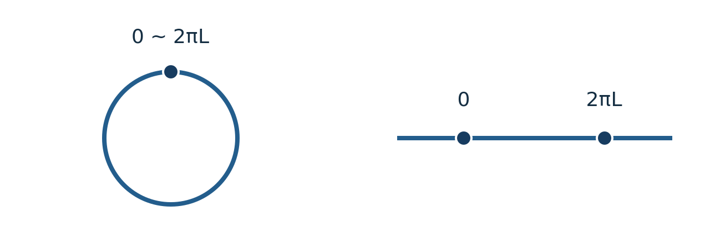

# HOLO1 反de Sitter時空の埋め込みと定曲率

<!-- definition-example-audit: strict -->

[GR6の曲率](../../GR/GR6/index.md#def-gr6-ricci-scalar)では、Lorentz計量からRiemann・Ricci・スカラー曲率を定義しました。しかし「曲率が負で一定の時空がある」と言うだけでは、具体的な点・接線・時間方向はまだ分かりません。対称性の高い時空をまず**平坦な大きい空間の中の超曲面**として作り、実際の計量と曲率を計算しましょう。

本章の主役は反de Sitter時空（anti-de Sitter spacetime、略称AdS）です。時間方向が一つの時空ですが、その埋め込みに使う平坦空間には時間的な符号が**二つ**必要です。さらに、埋め込まれた双曲面そのものは時間が一周するので、物理で通常「global AdS」と呼ぶ時空ではその時間をほどいた被覆を使います。この二つを混同すると、局所の曲率は正しくても因果構造を取り違えます。

以下では整数 $d\ge2$、曲率半径 $L>0$ とし、時空次元は $n=d+1$ です。単位は $c=1$、計量の符号は時間方向一つが負の $(-,+,\ldots,+)$ とします。曲率作用素は[GEO16で導入されGR6でも採用した規約](../../../幾何系/GEO/GEO16/index.md#def-geo16-curvature)

$$
R(u,v)w=\nabla_u\nabla_vw-\nabla_v\nabla_uw-\nabla_{[u,v]}w
$$

を用います。本章は古典Lorentz幾何だけを扱い、$G_N$、$\hbar$、場の作用や境界反項をまだ使いません。AdS/CFTという双対性自体は、この双曲面の構成からは証明されません。

## 1. 二つの負符号から一つの時間方向を作る

まず $d+2$ 次元の実ベクトル空間を、二つの座標 $U,V$ と $d$ 個の空間座標 $x^1,\ldots,x^d$ で表します。これは物理的な時空ではなく、双曲面を作るために内積を一定の行列で定めた補助空間です。点を $X=(U,V,\boldsymbol{x})$ と書き、双線形形式を

$$
\langle X,Y\rangle_{2,d}=-U_XU_Y-V_XV_Y+
\sum_{i=1}^d x_X^iy_Y^i
$$

とします。この形式は符号数 $(2,d)$ であり、普通のMinkowski空間の符号数 $(1,d+1)$ とは異なります。この違いは埋め込み空間だけのもので、後で作るAdSの時間方向は一つになります。

方程式 $\langle X,X\rangle_{2,d}=-L^2$ を満たす点を集め、その接ベクトルどうしの内積を上の形式から制限する、というのが構成の基本です。

<!-- formal-statement-start -->
> **定義（反de Sitter双曲面とその誘導計量）**
> $d\ge2$、$L>0$ とする。平坦な $\mathbb R^{2,d}$ において

$$
Q_L=\left\{(U,V,\boldsymbol{x})\in\mathbb R^{d+2}:
-U^2-V^2+|\boldsymbol{x}|^2=-L^2\right\}
$$

> を反de Sitter双曲面と呼ぶ。その接空間上で $\langle\cdot,\cdot\rangle_{2,d}$ を制限した計量 $g$ を**誘導計量**とする。時間を周期的に同一視するこのLorentz多様体を、ここでは $Q_L$ と表記する。
<!-- formal-statement-end -->

<!-- definition-example-start: def-holo1-ads-quadric -->
**定義の確認**：$\boldsymbol{x}=0$ なら $U^2+V^2=L^2$ なので、点 $p=(L,0,\boldsymbol0)$ は $Q_L$ 上にあります。制約式の微分は

$$
-2U\,dU-2V\,dV+2\sum_i x^i dx^i=0.
$$

従って $p$ では $dU=0$、接方向は $dV,dx^1,\ldots,dx^d$ です。誘導計量は $-dV^2+\sum_i(dx^i)^2$ となり、負方向は**ちょうど一つ**です。一般点では制約微分がゼロ写像にならず、法線 $X/L$ の内積が $-1$ なので、接空間は同じく符号数 $(1,d)$ です。単に制約式へ点を代入しただけではなく、正則性・計量の符号まで確認しました。
<!-- definition-example-end -->

ここで一般点の接線と法線を整理しておきます。$F(X)=\langle X,X\rangle_{2,d}+L^2$ とすると

$$
dF_X(v)=2\langle X,v\rangle_{2,d},
\qquad
T_XQ_L=\{v:\langle X,v\rangle_{2,d}=0\}.
$$

$\langle X,X\rangle_{2,d}=-L^2<0$ だから $X$ はゼロでなく、$dF_X$ は非零です。単位法線を $N(X)=X/L$ と取ると $\langle N,N\rangle_{2,d}=-1$ です。負の法線を取り除くことで、符号数 $(2,d)$ から $(1,d)$ が得られるのです。これは[LORG4のLorentz計量とLevi-Civita接続](../../../幾何系/LORG/LORG4/index.md#thm-lorg4-lorentz-levi-civita)を使える滑らかな時空です。

## 2. 埋め込み制約からglobal計量を導く

双曲面上の各点では $U^2+V^2=L^2+|\boldsymbol{x}|^2$ です。右辺が正なので、$U,V$ を半径 $A=\sqrt{L^2+|\boldsymbol{x}|^2}$ の円周上の点として表せます。円の角度を無次元の $\tau$、長さ次元の時刻を $t=L\tau$ と定めます。まず角度は $\tau\in\mathbb R/(2\pi\mathbb Z)$ です。

$$
U=A\cos\tau,\qquad V=A\sin\tau,
\qquad A=\sqrt{L^2+|\boldsymbol{x}|^2}.
$$

<!-- formal-statement-start -->
> **命題（双曲面のglobal計量）**
> $d\ge2$、$L>0$ とし、$Q_L$ 上で $t=L\tau$（周期 $2\pi L$）、$\boldsymbol{x}\in\mathbb R^d$ を上の埋め込みにより定める。$r=|\boldsymbol{x}|>0$ の領域で球面角度を $\omega\in S^{d-1}$ とすると、誘導計量は

$$
ds^2=-\left(1+\frac{r^2}{L^2}\right)dt^2
+\frac{dr^2}{1+r^2/L^2}+r^2d\Omega_{d-1}^2.
$$

> ここで $d\Omega_{d-1}^2$ は単位球面の標準計量である。$r=0$ は球座標の退化点であって時空の特異点ではなく、直交座標 $\boldsymbol{x}$ で計量は滑らかに延長される。
<!-- formal-statement-end -->

### 証明の見取り図

$U,V$ の微分で円の半径方向と角度方向の交差項が消えます。その後 $A$ の微分を制約から求め、空間の直交座標を動径と角方向へ分けます。「負号二つ」から負の時刻成分一つが残るところを確認してください。

<!-- proof-start -->
### 証明

埋め込みを微分すると

$$
dU=\cos\tau\,dA-A\sin\tau\,d\tau,\qquad
dV=\sin\tau\,dA+A\cos\tau\,d\tau.
$$

二乗の和を展開すれば、$dA\,d\tau$ の係数は $2A(-\cos\tau\sin\tau+\sin\tau\cos\tau)=0$ です。従って

$$
-dU^2-dV^2=-dA^2-A^2d\tau^2.
$$

$A^2=L^2+\sum_i(x^i)^2$ を微分し、$A>0$ で割ると

$$
2A\,dA=2\sum_i x^i dx^i,\qquad
dA=\frac{\boldsymbol{x}\cdot d\boldsymbol{x}}{A}.
$$

よって誘導計量の直交座標表示は

$$
ds^2=-\frac{L^2+r^2}{L^2}\,dt^2
+\sum_i(dx^i)^2
-\frac{(\sum_i x^i dx^i)^2}{L^2+r^2}.
$$

$r>0$ で $\boldsymbol{x}=r\omega$、$|\omega|=1$ とすると、$\omega\cdot d\omega=0$ は $d(\omega\cdot\omega)=0$ から従います。従って

$$
\sum_i(dx^i)^2=dr^2+r^2d\Omega_{d-1}^2,\qquad
\boldsymbol{x}\cdot d\boldsymbol{x}=r\,dr.
$$

動径成分は $1-r^2/(L^2+r^2)=L^2/(L^2+r^2)$ です。$r=0$ では直交座標表示を使えば分母 $L^2+r^2>0$ なので滑らかです。$\square$
<!-- proof-end -->

**数値での検算**：$r=L$ では時刻の係数は $-2$、動径の係数は $1/2$ です。どちらかの負号を取り違えると、時刻・空間の因果型が不正になります。さらに $r=0$ では $ds^2=-dt^2+d\boldsymbol{x}^2$ となり、中心の時計の固有時は $|dt|$ です。

距離の無次元化も行いましょう。$r=L\sinh\rho$、$\rho\ge0$ と置くと

$$
dr=L\cosh\rho\,d\rho,\qquad
1+\frac{r^2}{L^2}=\cosh^2\rho.
$$

よって同じ計量は

$$
ds^2=L^2\left(-\cosh^2\rho\,d\tau^2+d\rho^2
+\sinh^2\rho\,d\Omega_{d-1}^2\right)
$$

と書けます。ここで $L$ は単なる座標の定数でなく、すべての長さを一様に伸縮する幾何学的尺度です。この計量を別の座標系で書き直し、どこまで覆うかを比較するのは次講の主題です。

## 3. なぜ曲率は負の定数になるか

global計量の全Christoffel係数を一つずつ求める方法もありますが、埋め込みを使うと曲率の**符号がなぜ負になるのか**まで見えます。ここでは平坦な埋め込み空間の微分を $D$、$Q_L$ 上のLevi-Civita接続を $\nabla$ と呼びます。$D$ は普通の座標微分です。

接ベクトル場 $u,v$ に対して $\langle v,N\rangle_{2,d}=0$ を $u$ に沿って微分すると

$$
\langle D_uv,N\rangle_{2,d}
+\langle v,D_uN\rangle_{2,d}=0,\qquad
D_uN=\frac{u}{L}.
$$

$\langle N,N\rangle_{2,d}=-1$ に注意して法線成分を求めると、$D_uv$ の法線射影は $g(u,v)N/L$ です。接成分が $\nabla_uv$ ですから

$$
\boxed{D_uv=\nabla_uv+\frac{g(u,v)}{L}N}.
$$

この等式は「外から微分した結果」と「曲面に沿う微分」の差がどこに出るかを明確にします。

<!-- formal-statement-start -->
> **定理（AdSの定曲率と縮約）**
> $d\ge2$、$L>0$ とし、$Q_L$ に上の誘導Lorentz計量と、GR6/GEO16の曲率作用素規約を入れる。任意の接ベクトル場 $u,v,w$ に対して

$$
R(u,v)w=-\frac1{L^2}\bigl(g(v,w)u-g(u,w)v\bigr).
$$

> 従って、非退化な接二平面の断面曲率、Ricci曲率、スカラー曲率はそれぞれ

$$
K=-\frac1{L^2},\qquad
\operatorname{Ric}=-\frac{d}{L^2}g,\qquad
\mathcal R=-\frac{d(d+1)}{L^2}.
$$
<!-- formal-statement-end -->

### 証明の見取り図

埋め込み空間は平坦なので $D$ の曲率はゼロです。しかし $D_uv$ には法線成分があり、その法線自体も $D_uN=u/L$ と回転します。$D$ の曲率ゼロを**接方向へ射影**すると、法線が回転する分を打ち消すための負の曲率が現れます。縮約の係数は[GR6の定曲率縮約](../../GR/GR6/index.md#prop-gr6-constant-curvature)とも照合します。

<!-- proof-start -->
### 証明

まず上の分解を使って $D_uD_vw$ の接成分を求めます。$D_vw=\nabla_vw+g(v,w)N/L$ なので

$$
\bigl(D_uD_vw\bigr)^\top
=\nabla_u\nabla_vw+\frac{g(v,w)}L(D_uN)^\top
=\nabla_u\nabla_vw+\frac{g(v,w)}{L^2}u.
$$

係数 $u[g(v,w)]N/L$ は法線方向であり接射影に寄与しません。$u,v$ を交換した式と、$D_{[u,v]}w$ の接成分 $\nabla_{[u,v]}w$ を引きます。埋め込み空間の平坦性から左辺はゼロです。

$$
0=R(u,v)w+\frac1{L^2}
\bigl(g(v,w)u-g(u,w)v\bigr).
$$

これを移項して最初の式を得ます。非退化な二平面で分母 $g(u,u)g(v,v)-g(u,v)^2\ne0$ を使って断面曲率を定義すれば、分子 $g(R(u,v)v,u)$ は同じ分母の $-1/L^2$ 倍です。

次に $n=d+1$ 次元のLorentz正規直交枠 $e_0,\ldots,e_d$ を一点で取り、$\varepsilon_a=g(e_a,e_a)\in\{-1,1\}$ とします。[GR6のRicci縮約定義](../../GR/GR6/index.md#def-gr6-ricci-scalar)では

$$
\operatorname{Ric}(v,w)
=\sum_{a=0}^{d}\varepsilon_a g(R(e_a,v)w,e_a).
$$

曲率式を代入すると

$$
\operatorname{Ric}(v,w)
=-\frac1{L^2}
\left(g(v,w)\sum_a\varepsilon_a g(e_a,e_a)
-\sum_a\varepsilon_a g(e_a,w)g(v,e_a)\right).
$$

第一の和は $n$、第二の和は直交枠の完全性により $g(v,w)$ です。したがって $\operatorname{Ric}=-(n-1)g/L^2=-dg/L^2$。逆計量でさらに縮約すると $g^{ab}g_{ab}=n$ だから $\mathcal R=-n(n-1)/L^2=-d(d+1)/L^2$ です。時間方向の負符号は $\varepsilon_0$ に含まれており、勝手に正定値の跡を使っていません。$\square$
<!-- proof-end -->

**定義からの適用例**：$d=3$（4次元時空）なら $\operatorname{Ric}=-3g/L^2$、$\mathcal R=-12/L^2$ です。[Einsteinテンソルの定義](../../GR/GR7/index.md#def-gr7-einstein-tensor) $G_{ab}=\operatorname{Ric}_{ab}-\mathcal Rg_{ab}/2$ を用いると

$$
G_{ab}=\frac{3}{L^2}g_{ab}.
$$

従って真空方程式 $G_{ab}+\Lambda g_{ab}=0$ を満たす宇宙項は $\Lambda=-3/L^2<0$ です。一般の $d$ に対しても同様に $\Lambda=-d(d-1)/(2L^2)$ ですが、これだけでAdS/CFT対応や量子重力の成立が導かれるわけではありません。

## 4. 双曲面の時計と、時間をほどいた時空

角度 $\tau$ を一周させれば $\cos\tau,\sin\tau$ は元の値に戻ります。$Q_L$ では $t$ と $t+2\pi L$ は**同じ点**です。一方、[global計量](#prop-holo1-global-metric)で $\boldsymbol{x}$ を固定すれば、空間方向の変化はなく

$$
ds^2=-\left(1+\frac{r^2}{L^2}\right)dt^2<0
$$

となるため、これは時間的曲線です。その曲線が一周して元の点へ戻るので、$Q_L$ には閉じた時間的曲線が存在します。単なる座標記法の問題でなく、物理的な因果性に関わります。

そこで周期同一視を外し、$t$ を任意の実数として扱う新しい時空を考えます。これは[GEO18の被覆写像の定義](../../../幾何系/GEO/GEO18/index.md#def-geo18-covering-map)の局所的なシートを、整数回の周回ごとに分ける操作です。もとの円周上の時刻と違い、整数回だけ周回した点もそれぞれ別の点です。

図の左は $Q_L$ の円周時刻、右はその被覆上の実数時刻を表します。空間方向は省き、**点の同一視だけ**を示した図です。図の円が埋め込み空間内の曲率や時空の距離を表すわけではありません。

<!-- formal-statement-start -->
> **定義（時間を解いた普遍被覆AdS）**
> $d\ge2$、$L>0$ とし、$Q_L$ の上記global座標に対し

$$
\widetilde{\mathrm{AdS}}_{d+1}
=\mathbb R_t\times\mathbb R^d_{\boldsymbol{x}}
$$

> に[global計量](#prop-holo1-global-metric)の直交座標表示を与える。写像 $\pi:\widetilde{\mathrm{AdS}}_{d+1}\to Q_L$ を

$$
\pi(t,\boldsymbol{x})
=\left(A\cos(t/L),A\sin(t/L),\boldsymbol{x}\right),
\quad A=\sqrt{L^2+|\boldsymbol{x}|^2}
$$

> とする。これは局所等長な普遍被覆であり、本講以降、特に断らなければこの時刻をほどいた時空をAdSと呼ぶ。
<!-- formal-statement-end -->

<!-- definition-example-start: def-holo1-universal-cover -->
**定義の確認**：$\pi(0,\boldsymbol0)=\pi(2\pi L,\boldsymbol0)=(L,0,\boldsymbol0)$ ですが、被覆上の $(0,\boldsymbol0)$ と $(2\pi L,\boldsymbol0)$ は別の点です。

時刻微分とその内積を計算すると

$$
\partial_t(U,V)=\frac{A}{L}(-\sin(t/L),\cos(t/L)),
\qquad \langle\partial_tX,\partial_tX\rangle_{2,d}=-\frac{A^2}{L^2}.
$$

空間方向の微分も第2節と同じため、$\pi^*g$ は定義したglobal計量に一致します。各点の近くで時刻を幅 $2\pi L$ 未満に制限すれば逆角度が選べるので、$\pi$ は局所微分同相です。

被覆空間は $\mathbb R\times\mathbb R^d$ であり、[GEO18の単連結性の定義](../../../幾何系/GEO/GEO18/index.md#def-geo18-simply-connected)を満たします。$Q_L$ は円周時刻と $\mathbb R^d$ の積なので、$\pi$ は普遍被覆です。
<!-- definition-example-end -->

時刻をほどいても、[曲率定理](#thm-holo1-constant-curvature)は局所的な計量だけから決まるため変化しません。一方、被覆上では非零の因果接ベクトル $v$ に対し、未来向きを $dt(v)>0$ と選べます。計量の空間部分は正定値なので $dt(v)=0$ かつ $g(v,v)\le0$ は $v=0$ しかありません。従って、非定数の未来向き因果曲線に沿って $t$ は厳密増加し、閉じることはできません。

| 比較 | 双曲面 $Q_L$ | 時間をほどいたAdS |
| --- | --- | --- |
| 時刻 | $t$ を $2\pi L$ ごとに同一視 | $t\in\mathbb R$ |
| 大域的な形 | $S^1\times\mathbb R^d$ | $\mathbb R^{d+1}$ |
| 中心の一周 | 閉時間的曲線 | 始点と終点が別 |
| 局所計量・曲率 | 上のglobal計量、$K=-L^{-2}$ | 同じ |

## 5. 等長変換はどこから来るか

AdSの高い対称性は、埋め込み空間の二次形式を保つ線形変換から見えます。行列 $\eta=\operatorname{diag}(-1,-1,1,\ldots,1)$ を置くと、条件 $M^\mathsf T\eta M=\eta$ を満たす行列は制約式と接ベクトル間の内積を保ちます。従ってその制限は $Q_L$ の等長変換になります。

<!-- formal-statement-start -->
> **命題（AdSの線形等長変換と時間周期）**
> $d\ge2$、$L>0$ とする。$O(2,d)=\{M\in GL(d+2,\mathbb R):M^\mathsf T\eta M=\eta\}$ は $Q_L$ に等長的に作用する。その単位成分 $SO_0(2,d)$ のLie代数は

$$
\mathfrak{so}(2,d)=
\{B:B^\mathsf T\eta+\eta B=0\}
$$

> であり、次元は $(d+2)(d+1)/2$ である。時間をほどいた普遍被覆では、$SO(2)$ の $2\pi$ 回転が双曲面上では恒等写像でも被覆上では時刻 $2\pi L$ の非自明な移動となるため、被覆上の大域作用には適切な持ち上げ群を使う。
<!-- formal-statement-end -->

### 証明の見取り図

行列が二次形式を保てば、双曲面上の点も接ベクトルもそのまま移ります。連続変換は $M(s)=I+sB+O(s^2)$ と微分すれば反対称条件へ落ち、独立成分数を数えられます。ただし、時計の一周をほどく操作により、同じ「回転」が被覆上の恒等変換でなくなることが大域的な注意点です。

<!-- proof-start -->
### 証明

$M^\mathsf T\eta M=\eta$ なら

$$
\langle MX,MX\rangle_{2,d}
=X^\mathsf TM^\mathsf T\eta MX
=X^\mathsf T\eta X=-L^2.
$$

従って $M$ は $Q_L$ を保ちます。接ベクトル $u,v$ に対しても $\langle Mu,Mv\rangle_{2,d}=\langle u,v\rangle_{2,d}$ なので、誘導計量を保ちます。

$M(s)^\mathsf T\eta M(s)=\eta$ を $s=0$ で微分すると、$B=M'(0)$ は $B^\mathsf T\eta+\eta B=0$ を満たします。$\eta B$ は反対称な $(d+2)\times(d+2)$ 行列で、上三角の非対角成分が自由です。従って次元は $\binom{d+2}{2}=(d+2)(d+1)/2$ です。

$U,V$ 平面の回転では $(U,V)\mapsto(U\cos\theta-V\sin\theta,U\sin\theta+V\cos\theta)$ となり、global時刻は $t\mapsto t+L\theta$ です。$\theta=2\pi$ は $Q_L$ では同じ点へ戻りますが、被覆上では $t\mapsto t+2\pi L$ となります。従って被覆上の作用を角度 $\theta\bmod2\pi$ のみから定義することはできません。$\square$
<!-- proof-end -->

他にも、たとえば $U$ と $x^1$ の混合は $\delta U=x^1,\ \delta x^1=U$ を満たし、$\delta(-U^2+(x^1)^2)=0$ です。これは単なる空間回転ではない等長変換の無限小方向を与えます。これらを含む埋め込み由来の連続対称性の次元は $(d+2)(d+1)/2$ です。任意の等長写像がこの形になることまで主張するなら、無限小等長変換の一意性などを別に証明する必要があります。

「AdSの等長群は $SO(2,d)$」という短い説明は通常、局所対称性や双曲面の連結な等長変換を指します。**普遍被覆そのものの大域等長群を、そのまま同じ行列群と同一視してはいけません。** この区別は次講で境界の時間と共形変換を比較するときに役立ちます。

## 6. 何を得て、何をまだ得ていないか

反de Sitter時空は、**一つの時間方向を持つ定負曲率Lorentz多様体**として構成できました。曲率半径 $L$ は $K=-L^{-2}$ により座標に依存しない意味を持ちます。一方、閉時間的曲線を含む埋め込み双曲面と、因果的に使う時間被覆は別物です。

本章ではglobal座標を得ましたが、共形境界を定義したりPoincaré patchが全体を覆うと主張したりしていません。それは**HOLO2「座標と共形境界」**で実際に座標領域・光線・境界の因果構造を計算して決めます。

## 7. 演習

### A1. 制約超曲面の正則性

- Level: A

$d=2$、$L>0$ とし、$\mathbb R^{2,2}$ で $F=-U^2-V^2+(x^1)^2+(x^2)^2+L^2$ とする。$F=0$ 上で $dF$ が消えないことを示し、点 $p=(L,0,0,0)$ で誘導計量の符号数を求めよ。

<!-- solution-start -->
**詳細解答。** 偏微分は $(-2U,-2V,2x^1,2x^2)$ です。これがすべてゼロなら $X=0$ となり、$F(0)=L^2\ne0$ に矛盾します。従って $F^{-1}(0)$ は正則な超曲面です。

$p$ では $dF_p=-2L\,dU$ だから $T_pQ_L$ は $dU=0$。基底 $\partial_V,\partial_{x^1},\partial_{x^2}$ における内積行列は $\operatorname{diag}(-1,1,1)$ であり、時間方向一つ・空間方向二つです。
<!-- solution-end -->

### A2. 中心から離れた点の接計量

- Level: A

$d\ge2$、$a>0$、$L>0$ とする。$Q_L$ の点 $p=(\sqrt{L^2+a^2},0,a,0,\ldots,0)$ において、$t=0$ のglobal座標の接ベクトル $\partial_tX,\partial_{x^1}X$ の内積を計算し、前者が時間的、後者が空間的で互いに直交することを示せ。

<!-- solution-start -->
**詳細解答。** $A=\sqrt{L^2+a^2}$ とすると、[global埋め込み](#prop-holo1-global-metric)を $t$ で微分したベクトルは $(0,A/L,0,\ldots,0)$、$x^1$ で微分したベクトルは $(a/A,0,1,0,\ldots,0)$ です。従って

$$
\langle\partial_tX,\partial_tX\rangle=-A^2/L^2<0,
\quad
\langle\partial_{x^1}X,\partial_{x^1}X\rangle
=1-a^2/A^2=L^2/A^2>0.
$$

互いの内積は、非零の成分が異なる座標にあるためゼロです。制約式の微分との直交も $-A(a/A)+a=0$ で直接確認できます。
<!-- solution-end -->

### A3. 無次元動径座標

- Level: A

$d=3$、$L>0$ のglobal AdS計量で $r=L\sinh\rho$、$t=L\tau$ と置く。$\rho\ge0$ で新しい計量を導き、$\rho=0$ の時刻係数を求めよ。

<!-- solution-start -->
**詳細解答。** [global計量](#prop-holo1-global-metric)に $dr=L\cosh\rho\,d\rho$ と $dt=L\,d\tau$ を代入します。$1+r^2/L^2=1+\sinh^2\rho=\cosh^2\rho$ より、時刻項は $-L^2\cosh^2\rho\,d\tau^2$、動径項は $L^2\cosh^2\rho\,d\rho^2/\cosh^2\rho=L^2d\rho^2$、球面項は $L^2\sinh^2\rho\,d\Omega_2^2$ です。$\rho=0$ では $g_{\tau\tau}=-L^2$ です。
<!-- solution-end -->

### A4. 断面曲率からRicciを読む

- Level: A

$d=4$、$L=2$ の $AdS_5$ に対し、断面曲率 $K$、Ricci係数 $\operatorname{Ric}=cg$ の $c$、スカラー曲率 $\mathcal R$ を求めよ。4次元時空の係数を流用しないこと。

<!-- solution-start -->
**詳細解答。** 時空次元は $n=d+1=5$ です。[定曲率定理](#thm-holo1-constant-curvature)に $L^2=4$、$d=4$ を代入すると

$$
K=-\frac14,\qquad
c=-\frac{4}{4}=-1,\qquad
\mathcal R=-\frac{4\cdot5}{4}=-5.
$$

係数が $d$ と $d(d+1)$ になるのは $n-1$ と $n(n-1)$ の縮約によるもので、4次元の $-3/L^2$ と $-12/L^2$ を固定値として使うのは誤りです。
<!-- solution-end -->

### A5. 一周する時計

- Level: A

$d\ge2$、$L>0$ とし、$Q_L$ の $r=R\ge0$、角度一定の曲線で $t$ を $0$ から $2\pi L$ へ増やす。この曲線が閉時間的曲線であることを示し、固有時長さを計算せよ。時間被覆では閉じるか。

<!-- solution-start -->
**詳細解答。** [global計量](#prop-holo1-global-metric)で $dr=d\Omega=0$ とすれば $ds^2=-(1+R^2/L^2)dt^2<0$ で時間的です。埋め込みの $\cos(t/L),\sin(t/L)$ は周期 $2\pi L$ なので始点と終点が同じです。固有時は

$$
\int_0^{2\pi L}\sqrt{-g_{tt}}\,dt
=2\pi L\sqrt{1+R^2/L^2}.
$$

時間被覆の点 $(0,\boldsymbol{x})$ と $(2\pi L,\boldsymbol{x})$ は異なるので、その曲線は閉じません。
<!-- solution-end -->

### B1. 法線射影と負曲率

- Level: B

$Q_L$ 上の接ベクトル場 $u,v,w$ と $N=X/L$ を考える。埋め込み空間の平坦接続 $D$ について、$D_uv=\nabla_uv+g(u,v)N/L$ を制約式から導き、$D$ の曲率がゼロであることから $R(u,v)w$ を求めよ。法線の内積の符号に注意せよ。

<!-- solution-start -->
**詳細解答。** $g(v,N)=0$ を微分すると $\langle D_uv,N\rangle=-\langle v,D_uN\rangle=-g(u,v)/L$ です。法線が $g(N,N)=-1$ なので、法線射影の係数は $[-g(u,v)/L]/(-1)=g(u,v)/L$ です。従って指定された分解が成立します。

$D_vw=\nabla_vw+g(v,w)N/L$ をもう一度微分し、接成分を取ると

$$
(D_uD_vw)^\top=\nabla_u\nabla_vw+\frac{g(v,w)}{L^2}u
$$

です。$u,v$ 交換式との差から

$$
0=\bigl(D_uD_vw-D_vD_uw-D_{[u,v]}w\bigr)^\top
=R(u,v)w+\frac{g(v,w)u-g(u,w)v}{L^2}.
$$

従って $R(u,v)w=-[g(v,w)u-g(u,w)v]/L^2$ です。法線を正の単位長と誤認すればこの負号を誤ります。
<!-- solution-end -->

### B2. 真空Einstein方程式と宇宙項

- Level: B

$d\ge2$、$L>0$ で $n=d+1$ 次元AdSの $G_{ab}$ を求めよ。$G_{ab}+\Lambda g_{ab}=0$ の宇宙項 $\Lambda$ を求め、$d=3$ の場合を検算せよ。$G_N$ を導入せず幾何学的な真空方程式だけを使う。

<!-- solution-start -->
**詳細解答。** [曲率定理](#thm-holo1-constant-curvature)で $\operatorname{Ric}_{ab}=-d\,g_{ab}/L^2$、$\mathcal R=-d(d+1)/L^2$ です。[Einsteinテンソル](../../GR/GR7/index.md#def-gr7-einstein-tensor)へそれぞれ代入すると

$$
G_{ab}=-\frac d{L^2}g_{ab}
-\frac12\left(-\frac{d(d+1)}{L^2}\right)g_{ab}
=\frac{d(d-1)}{2L^2}g_{ab}.
$$

計量は非退化なので、$G_{ab}+\Lambda g_{ab}=0$ は $\Lambda=-d(d-1)/(2L^2)$ と同値です。$d=3$ なら $\Lambda=-3/L^2$ となり、本文の4次元検算と一致します。
<!-- solution-end -->

### B3. 空間回転ではない等長変換

- Level: B

$d\ge2$、$L>0$ の $\mathbb R^{2,d}$ で無限小変換 $\delta U=x^1$、$\delta x^1=U$、他成分の変化ゼロを考える。双曲面制約と誘導計量を保つ理由を示せ。さらに $U,V$ 平面の回転角 $2\pi$ が $Q_L$ と時間被覆でどう作用するか区別せよ。

<!-- solution-start -->
**詳細解答。** 変換行列の非零成分を $B^U{}_{x^1}=B^{x^1}{}_U=1$ とすると、$B^\mathsf T\eta+\eta B=0$ は $(U,x^1)$ の $2\times2$ 成分で

$$
\begin{pmatrix}0&1\\1&0\end{pmatrix}
\begin{pmatrix}-1&0\\0&1\end{pmatrix}
+
\begin{pmatrix}-1&0\\0&1\end{pmatrix}
\begin{pmatrix}0&1\\1&0\end{pmatrix}
=0
$$

となります。よって $e^{sB}$ は $\eta$ を保ち、[AdSの線形等長変換と時間周期](#prop-holo1-linear-isometry)により $Q_L$ の等長変換です。一次の変分でも $\delta(-U^2+(x^1)^2)=-2Ux^1+2x^1U=0$ と確認できます。

$U,V$ の角度を $2\pi$ 増す回転は行列として恒等で、$Q_L$ 上の点を変えません。しかし被覆に持ち上げた角度の連続経路の終点は $t\mapsto t+2\pi L$ であり、被覆上では恒等ではありません。被覆群を無視して単に $SO(2,d)$ が同じ形で作用するとしてはいけません。
<!-- solution-end -->

### C1. AdS3を一つの構成として再現する

- Level: C

$d=2$、$L>0$ とし、$\mathbb R^{2,2}$ の双曲面 $-U^2-V^2+(x^1)^2+(x^2)^2=-L^2$ を考える。次を一つの論証として示せ。

1. $U=\sqrt{L^2+r^2}\cos(t/L)$、$V=\sqrt{L^2+r^2}\sin(t/L)$、$(x^1,x^2)=r(\cos\phi,\sin\phi)$ から $r>0$ での誘導計量を求め、$r=0$ が真の曲率特異点でないことを説明する。
2. 埋め込み法線 $N=X/L$ と平坦接続 $D$ を用いて $R(u,v)w$ の定曲率形を求め、$\operatorname{Ric}$、$\mathcal R$、真空方程式の $\Lambda$ を求める。
3. 埋め込み双曲面で $r=0$ の時計が閉じる理由を示し、時間被覆では閉じない理由を説明する。

<!-- solution-start -->
**詳細解答。**

1. $A=\sqrt{L^2+r^2}$ と置けば、$dU^2+dV^2=dA^2+A^2dt^2/L^2$ で、$dA=r\,dr/A$ です。空間座標は $dx_1^2+dx_2^2=dr^2+r^2d\phi^2$ となるため

   $$
   ds^2=-\left(1+\frac{r^2}{L^2}\right)dt^2
   +\frac{L^2}{L^2+r^2}\,dr^2+r^2d\phi^2.
   $$

   $r=0$ で $\phi$ が不定になるのは極座標の退化です。元の $(x^1,x^2)$ での計量は

   $$
   ds^2=-\frac{L^2+|\boldsymbol{x}|^2}{L^2}dt^2
   +|d\boldsymbol{x}|^2
   -\frac{(\boldsymbol{x}\cdot d\boldsymbol{x})^2}{L^2+|\boldsymbol{x}|^2}
   $$

   で分母が常に正、$r=0$ に滑らかに延長されます。

2. 接方向 $u$ では $D_uN=u/L$ で、$g(N,N)=-1$。接ベクトル場 $v$ の微分を法線射影すると $D_uv=\nabla_uv+g(u,v)N/L$ です。これを $D_uD_vw-D_vD_uw-D_{[u,v]}w=0$ に代入し、接成分を取れば

   $$
   R(u,v)w=-\frac{g(v,w)u-g(u,w)v}{L^2}.
   $$

   直交枠でRicciを取ると時空次元 $n=3$ より

   $$
   \operatorname{Ric}=-\frac{2}{L^2}g,\qquad
   \mathcal R=-\frac6{L^2}.
   $$

   従って $G_{ab}=(-2+3)g_{ab}/L^2=g_{ab}/L^2$ で $\Lambda=-1/L^2$ となります。

3. $r=0$ では $U=L\cos(t/L)$、$V=L\sin(t/L)$ なので、$t$ と $t+2\pi L$ は同じ埋め込み点です。誘導計量は $ds^2=-dt^2$ で、時計の一周は固有時 $2\pi L$ を持つ閉時間的曲線です。

   一方、時間被覆では実数時刻を持つ別々の点を同一視しません。さらに未来向き因果曲線に沿って $dt>0$ なので、別の経路を経ても閉じられません。局所曲率は被覆で変化しないのに大域因果性は変わる、というのが構成の要点です。
<!-- solution-end -->
