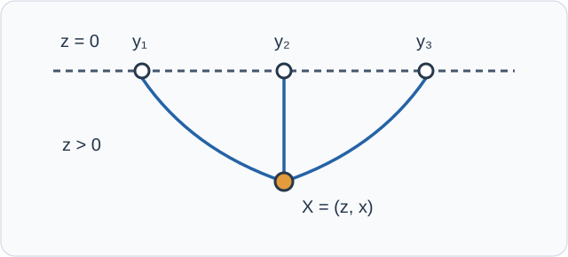

# HOLO10 Witten接触図

[HOLO9のGKPW辞書](../HOLO9/index.md#def-holo9-gkpw)では、自由スカラーを境界源で2回微分すると、離れた点の2点関数が得られました。ところが自由作用は源について二次式なので、**連結3点関数は零**です。では、バルクの相互作用は境界にどのような3点相関を作るのでしょうか。

本講では固定したEuclid AdS上に**局所的な3次相互作用**を加えます。3本の境界からの線が内部の同じ一点に集まる「接触 Witten 図」は、図の頂点の位置をAdS全域で積分する計算です。積分がなぜ収束するか、境界共形対称性によって距離依存がなぜ固定されるか、結合定数とGamma関数が係数にどう入るかまで導きます。一般の強結合CFTでの双対性の存在は仮定であって、ここで証明するものではありません。

## 0. 模型と計算の約束

整数 $d\ge2$、半径 $L>0$、$\hbar=1$ とし、重力の逆反作用とループを無視したEuclid $AdS_{d+1}$ のPoincaré計量を用います。

$$
ds_E^2=\frac{L^2}{z^2}(dz^2+dx\cdot dx),\qquad
\sqrt g\,d^{d+1}X=L^{d+1}\frac{dz\,d^dx}{z^{d+1}},
\quad z>0,\ x\in\mathbb R^d.
$$

まず3種類の実スカラー $\phi_i$ ($i=1,2,3$) を考えます。質量 $m_i$ は

$$
\nu_i=\sqrt{\frac{d^2}{4}+m_i^2L^2}\in(0,1),\qquad
\Delta_i=\frac d2+\nu_i,\qquad
m_i^2L^2=\Delta_i(\Delta_i-d)
$$

を満たすものとします。$\nu_i$ の窓は[HOLO8の境界指数](../HOLO8/index.md#prop-holo8-mass-dimension)と[HOLO9の核の規格化](../HOLO9/index.md#def-holo9-bulk-boundary)をそのまま使うための条件です。源 $J_i\in C_c^\infty(\mathbb R^d)$ は実数値、選択するEuclid解は赤外で正則で、境界の遅い冪の係数を固定する標準境界条件とします。

作用は、3種類が異なる場合

$$
S_E[\phi_i]=\sum_{i=1}^3\frac12\int_{\mathrm{AdS}}\!
\sqrt g\,\bigl(g^{ab}\partial_a\phi_i\partial_b\phi_i+m_i^2\phi_i^2\bigr)\,d^{d+1}X
+g_3\int_{\mathrm{AdS}}\!\sqrt g\,\phi_1\phi_2\phi_3\,d^{d+1}X
$$

です。各自由場に[HOLO9の繰り込み](../HOLO9/index.md#def-holo9-renormalized-action)を施し、$g_3$ の**一次まで**を計算します。境界源を持つ汎関数は $W[J_i]=\log Z[J_i]\simeq-S_{\mathrm{ren}}[J_i]$ とします。したがって、以下で扱う連結3点は $W$ を異なる3つの源で微分したものです。

同一の実スカラー1種類を用いる場合は、作用の相互作用を $g_3\phi^3/3!$ と書きます。この $3!$ の有無は最後の係数に効くので混同しません。定数 $g_3$ は選んだ場の規格化に依存します。

## 1. 1つの内部頂点に3本の核が集まる

まず各源の情報を内部の点 $X=(z,x)$ へ運びます。[核の方程式と境界規格化](../HOLO9/index.md#prop-holo9-kernel-solution)により、$g_3=0$ の自由解は

$$
\phi_i^{(0)}(z,x)=\int_{\mathbb R^d}K_{\Delta_i}(z,x;y)J_i(y)\,d^dy,
\qquad
K_{\Delta_i}(z,x;y)=c_i\left(\frac{z}{z^2+|x-y|^2}\right)^{\Delta_i},
$$

$$
c_i=\frac{\Gamma(\Delta_i)}
{\pi^{d/2}\Gamma(\Delta_i-d/2)}.
$$

内部の点 $X$ でこれら3つの解を掛けると、そこで3つの境界源が相互作用した寄与になります。各 $X$ は相互作用の起こりうる位置なので、測度 $\sqrt g\,d^{d+1}X$ で積分します。

図の線は自由伝播を表す核の**模式的な接続**です。曲線が実際の粒子軌道・測地線を表すのではありません。線は3本とも外線であり、HOLO11で扱う交換図の内部伝播子はまだありません。

<!-- formal-statement-start -->
> **定義（接触Witten積分）**  
> $d\ge2$、$L>0$、$z>0$、$x\in\mathbb R^d$ とし、$\Delta_i>d/2$ および相異なる $y_1,y_2,y_3\in\mathbb R^d$ を取る。上の核で定まる次の積分が収束するとき、接触Witten積分とする。

$$
\mathcal D_{\Delta_1\Delta_2\Delta_3}(y_1,y_2,y_3)
=\int_0^\infty\frac{dz}{z^{d+1}}
\int_{\mathbb R^d}d^dx\,\prod_{i=1}^3 K_{\Delta_i}(z,x;y_i).
$$

> $L^{d+1}$ は測度からの別の係数として、ここでは $\mathcal D$ に含めない。
<!-- formal-statement-end -->

<!-- definition-example-start: def-holo10-contact-integral -->
**定義の確認**：$d=3$、各 $\Delta_i=2$ なら、[HOLO9の具体例](../HOLO9/index.md#def-holo9-bulk-boundary)より $c_i=1/\pi^2$ です。被積分関数は

$$
\frac{1}{\pi^6}\,
\frac{z^{6-4}}{\prod_{i=1}^3(z^2+|x-y_i|^2)^2}
=\frac{z^2}{\pi^6\prod_i(z^2+|x-y_i|^2)^2}.
$$

積分領域は $z>0$ とすべての $x$ で、3点は相異なるので分母に同時に零となる点はありません。ただし、この観察だけでは境界 $z=0$ の可積分性は保証しません。次の命題で各境界点を区別して検査します。
<!-- definition-example-end -->

### なぜ自由解だけを代入してよいか

相互作用で場は $\phi_i=\phi_i^{(0)}+g_3\phi_i^{(1)}+O(g_3^2)$ と変わります。しかし**境界源 $J_i$ を固定**すると、自由作用の $\phi_i^{(0)}$ での一次変分は、自由方程式と固定境界値条件のため消えます（[HOLO7の変分](../HOLO7/index.md#prop-holo7-boundary-variation)）。したがって on-shell 作用の $O(g_3)$ 部分には、自由場を相互作用項に代入したものだけが残ります。この議論では相互作用により生じうる境界発散を、有限cutoffで評価してから適切に処理する必要があります。以下は収束域の分離点相関を計算するので、その非局所項には追加の境界減算を必要としません。

<!-- formal-statement-start -->
> **命題（木レベル3点と接触積分）**  
> 上記3種類のEuclidスカラー模型で源を固定し、相互作用の一次までを取り、異なる境界点 $y_1,y_2,y_3$ で接触積分が収束するとする。GKPWの木レベル辞書を仮定すれば、非接触部分は

$$
\left\langle\mathcal O_1(y_1)\mathcal O_2(y_2)
\mathcal O_3(y_3)\right\rangle_{\mathrm{conn}}^{(1)}
=-g_3 L^{d+1}\mathcal D_{\Delta_1\Delta_2\Delta_3}(y_1,y_2,y_3).
$$

> 同一場の $g_3\phi^3/3!$ 模型でも、3回の源微分が $3!$ を与えるので右辺は同じ形となる。等号は固定背景・一次相互作用・木レベルについてである。
<!-- formal-statement-end -->

### 証明の見取り図

[GKPW辞書](../HOLO9/index.md#def-holo9-gkpw)の $W=-S_{\mathrm{ren}}$ が負号を決めます。自由解の3重積を展開したとき $J_1J_2J_3$ の係数が核の積であるため、各源微分が対応する核を1本ずつ残します。

<!-- proof-start -->
### 証明

摂動展開で自由作用の一次変分が消えることから、$J_1J_2J_3$ に3重線形な部分は

$$
S_{\mathrm{ren}}^{(1)}[J_i]
=g_3L^{d+1}\int_0^\infty\!\frac{dz}{z^{d+1}}
\int d^dx\int\prod_{i=1}^3
\bigl[d^dy_i\,K_{\Delta_i}(z,x;y_i)J_i(y_i)\bigr].
$$

試験源に対する有限cutoff計算から始め、後節の収束条件の下で積分順を交換します。$J_i$ は別々の変数に線形なので

$$
\left.
\frac{\delta^3 S_{\mathrm{ren}}^{(1)}}
{\delta J_1(y_1)\delta J_2(y_2)\delta J_3(y_3)}
\right|_{J_i=0}
=g_3L^{d+1}\mathcal D_{\Delta_1\Delta_2\Delta_3}.
$$

$W=-S_{\mathrm{ren}}$ へ代入すると主張の負号を得ます。同一場では $(\int KJ)^3$ を3回微分すると $3!K_1K_2K_3$ となり、作用の $1/3!$ と相殺します。$\square$
<!-- proof-end -->

## 2. 収束する領域と、境界のどこが危険か

積分の見た目から $\Delta_i>d/2$ だけで安全と判断してはいけません。境界の点 $x=y_i$ に寄ると、その核だけは他の2本とは逆の尺度で振る舞います。収束を決めるのは**3つの指数の組合せ**です。以後

$$
\Sigma=\Delta_1+\Delta_2+\Delta_3,\quad
\beta=\frac{\Sigma-d}{2},\quad
a_{12}=\frac{\Delta_1+\Delta_2-\Delta_3}{2},
$$

$$
a_{13}=\frac{\Delta_1+\Delta_3-\Delta_2}{2},\qquad
a_{23}=\frac{\Delta_2+\Delta_3-\Delta_1}{2}
$$

と書きます。

<!-- formal-statement-start -->
> **命題（接触積分の絶対収束条件）**  
> $d\ge2$、$\Delta_i>d/2$、相異なる $y_1,y_2,y_3\in\mathbb R^d$ とする。正の核からなる接触積分 $\mathcal D_{\Delta_1\Delta_2\Delta_3}$ は、次の4条件がすべて満たされるとき、かつそのときに限り有限である。

$$
\Sigma>d,\qquad
a_{12}>0,\quad a_{13}>0,\quad a_{23}>0.
$$

> 特に本講で採用した $0<\nu_i<1$、$d\ge2$ の窓ではすべて成立する。
<!-- formal-statement-end -->

### 証明の見取り図

境界で3点から離れた所では3本の核の $z$ の冪を掛けます。一方、$y_1$ 近傍では $z$ と $|x-y_1|$ を同じ小さい長さ $r$ に合わせて拡大し、動径積分 $r^{\Delta_2+\Delta_3-\Delta_1-1}dr$ の収束を見ます。他の点でも添字を巡回します。無限遠は3本の核の減衰で抑えられます。

<!-- proof-start -->
### 証明

境界の3点の互いに交わらない小球を除き、$x$ を有界領域に限定すると、各 $|x-y_i|$ は零から離れます。よって被積分関数の $z$ 依存は $z^{\Sigma-d-1}$ に漸近し、境界面の任意の小領域では $\int_0^\epsilon z^{\Sigma-d-1}dz$ が有限である必要十分条件は $\Sigma>d$ です。

次に $y_1$ 近傍で $x-y_1=r\omega$、$z=r\cos\theta$ のように上半空間の極座標を取り、$r=(z^2+|x-y_1|^2)^{1/2}$ とします。$\theta$ は角方向で、$z=r\,u$ ($0<u\le1$) と書けます。$y_2,y_3$ と $y_1$ は分離しているため、後者2本の分母は正の定数に近づきます。測度 $dz\,d^dx$ は $r^d dr$ と角度測度の積で、被積分関数全体の動径次数は

$$
r^d\,r^{-d-1}\,r^{\Sigma}\,r^{-2\Delta_1}\,dr
=r^{\Delta_2+\Delta_3-\Delta_1-1}\,dr
=r^{2a_{23}-1}\,dr.
$$

角方向には $u^{\Sigma-d-1}$ が掛かり、$\Sigma>d$ の下で可積分です。したがって $y_1$ での必要十分条件は $a_{23}>0$。同じ計算を $y_2,y_3$ で行うと $a_{13}>0,a_{12}>0$ となります。

残る無限遠では $R=(z^2+|x|^2)^{1/2}$ を使います。$R$ がすべての $|y_i|$ より十分大きいとき各分母は $R^2$ に比較でき、動径因子は $R^{-\Sigma-1}dR$、角度の $u^{\Sigma-d-1}$ は上と同じ条件で可積分です。$\Delta_i>0$ により遠方の動径積分も有限です。この4条件で全領域が覆われ、必要性も各局所領域の正値性から従います。

最後に $0<\nu_i<1$ なら $\Delta_i>d/2$ なので $\Sigma>d$。また

$$
\Delta_j+\Delta_k-\Delta_i
>\frac d2+\frac d2-\left(\frac d2+1\right)
=\frac d2-1\ge0,
$$

厳密不等号があるため $d=2$ でも正です。$\square$
<!-- proof-end -->

**境界値を外れた例。** $d=3$、$(\Delta_1,\Delta_2,\Delta_3)=(4,2,2)$ なら $\Sigma=8>d$ ですが $a_{23}=0$ です。$y_1$ 付近の積分は $\int dr/r$ となり対数発散します。この例は先ほどの $0<\nu_i<1$ の適用範囲外ですが、「総和だけで収束を決める」という誤りの反例です。cutoffを入れた境界項・局所または半局所の寄与を整理するには追加の繰り込みが必要であり、発散積分をそのまま有限の3点係数として使うことはできません。

## 3. Gamma関数で接触積分を計算する

何が3点の距離依存を決めるかを先に考えます。測度 $dz\,d^dx/z^{d+1}$ はAdSの等長変換で不変で、各 $K_{\Delta_i}$ は境界座標の共形変換の下で重み $\Delta_i$ を持ちます。したがって積分も[境界CFTのスカラー一次場](../../QFT/QFT48/index.md#def-qft48-scalar-primary)と同じ共形変換則を持ち、分離3点の形は定数倍まで固定されます。係数は「3点目を無限遠に送る」積分を実際に評価して決めます。

<!-- formal-statement-start -->
> **命題（接触積分の厳密評価）**  
> $d\ge2$、$\Delta_i>d/2$、相異なる $y_i\in\mathbb R^d$ について $\beta>0$ と $a_{12},a_{13},a_{23}>0$ を仮定する。$r_{ij}=|y_i-y_j|$ と置くと、正規化された核の積分は

$$
\mathcal D_{\Delta_1\Delta_2\Delta_3}
=\frac{\mathcal A(\Delta_1,\Delta_2,\Delta_3)}
{r_{12}^{\,2a_{12}}r_{13}^{\,2a_{13}}r_{23}^{\,2a_{23}}},
$$

$$
\mathcal A
=\frac{\pi^{d/2}}{2}\,
\frac{\Gamma(\beta)\Gamma(a_{12})\Gamma(a_{13})\Gamma(a_{23})}
{\Gamma(\Delta_1)\Gamma(\Delta_2)\Gamma(\Delta_3)}
\prod_{i=1}^3 c_i.
$$

> この式は収束域での通常の積分値であり、収束域外への解析接続による分布・繰り込み相関の主張ではない。
<!-- formal-statement-end -->

### 証明の見取り図

点の移動・回転・尺度変換とAdSの反転等長変換を使えば、分離3点の距離冪は決まります。係数については $y_3$ を遠くへ送ると3本目が単純な $z^{\Delta_3}$ となり、残る2分母をFeynmanパラメータで一つにして、$x$ のGaussian型積分、$z$ のBeta積分、最後にパラメータのBeta積分を順番に解けばよいのです。

<!-- proof-start -->
### 証明

**(1) 共形変換則を確認する。** 境界の反転 $y\mapsto y'=y/|y|^2$ に対応するバルクの写像を

$$
(z,x)\longmapsto (z',x')
=\frac{(z,x)}{z^2+|x|^2}
$$

とします。分母の恒等式

$$
z'^2+|x'-y_i'|^2
=\frac{z^2+|x-y_i|^2}{(z^2+|x|^2)|y_i|^2}
$$

から $K_{\Delta_i}(z',x';y_i')=|y_i|^{2\Delta_i}K_{\Delta_i}(z,x;y_i)$ です。バルク測度 $dz\,d^dx/z^{d+1}$ はこの等長写像で不変です。平行移動・回転・尺度変換も合わせると、3点の共形共変な距離冪は

$$
r_{12}^{-(\Delta_1+\Delta_2-\Delta_3)}
r_{13}^{-(\Delta_1+\Delta_3-\Delta_2)}
r_{23}^{-(\Delta_2+\Delta_3-\Delta_1)}
$$

だけとなります。実際、各 $y_i$ の反転重みを代入すると $i$ にかかる冪の和が $2\Delta_i$ となり一致します。ここでの変換は積分の変数変換で、双対性を使ってこの形を仮定したのではありません。

**(2) 係数を固定する。** $y_1=0$、$|y_2|=r>0$ とし、$|y_3|\to\infty$ とします。収束条件の下では遠方領域の寄与を抑えた後に極限を取れ（$a_{12}>0$ が遠方部分の消失に効く）、3本目の核は $|y_3|^{2\Delta_3}K_{\Delta_3}\to c_3z^{\Delta_3}$ です。よって

$$
\lim_{|y_3|\to\infty}|y_3|^{2\Delta_3}\mathcal D
=\left(\prod_i c_i\right)I(r),
$$

$$
I(r)=\int_0^\infty dz\int_{\mathbb R^d}d^dx\,
\frac{z^{\Sigma-d-1}}
{(z^2+|x|^2)^{\Delta_1}(z^2+|x-y_2|^2)^{\Delta_2}}.
$$

**(3) 2つの分母をまとめる。** $A,B>0$、$p,q>0$ に対するGamma積分を2回使い、$s=t_1+t_2$、$u=t_1/s$ と変数変換すると

$$
\frac1{A^pB^q}
=\frac{\Gamma(p+q)}{\Gamma(p)\Gamma(q)}
\int_0^1\frac{u^{p-1}(1-u)^{q-1}}
{[uA+(1-u)B]^{p+q}}\,du.
$$

ここで $p=\Delta_1,q=\Delta_2$、$A=z^2+|x|^2$、$B=z^2+|x-y_2|^2$ とすると

$$
uA+(1-u)B
=z^2+|x-(1-u)y_2|^2+u(1-u)r^2.
$$

**(4) $x$ 積分。** $\Delta_1+\Delta_2>d/2$ で、$\int_{\mathbb R^d}(v^2+M^2)^{-s}dv=\pi^{d/2}\Gamma(s-d/2)(M^2)^{d/2-s}/\Gamma(s)$ をGamma積分とGaussian積分から得ます。従って

$$
I(r)=\frac{\pi^{d/2}\Gamma(\Delta_1+\Delta_2-d/2)}
{\Gamma(\Delta_1)\Gamma(\Delta_2)}
\int_0^1\!du\,u^{\Delta_1-1}(1-u)^{\Delta_2-1}
\int_0^\infty\!dz\,z^{2\beta-1}
[z^2+u(1-u)r^2]^{d/2-\Delta_1-\Delta_2}.
$$

**(5) $z$ 積分。** $q=u(1-u)r^2$ とし、$t=z^2/q$ に替えると $dz\,z^{2\beta-1}=\tfrac12q^\beta t^{\beta-1}dt$ なので

$$
\int_0^\infty\!dz\,z^{2\beta-1}(z^2+q)^{d/2-\Delta_1-\Delta_2}
=\frac12q^{-a_{12}}\,
\frac{\Gamma(\beta)\Gamma(a_{12})}
{\Gamma(\Delta_1+\Delta_2-d/2)}.
$$

ここでは $\beta>0,a_{12}>0$ を使いました。$\Gamma(\Delta_1+\Delta_2-d/2)$ は手順(4)の係数と打ち消されます。

**(6) $u$ 積分。** 残る指数は $\Delta_1-1-a_{12}=a_{13}-1$、$\Delta_2-1-a_{12}=a_{23}-1$ です。$a_{13},a_{23}>0$ だからBeta積分を適用でき、

$$
I(r)=\frac{\pi^{d/2}}2\,
\frac{\Gamma(\beta)\Gamma(a_{12})}
{\Gamma(\Delta_1)\Gamma(\Delta_2)}
r^{-2a_{12}}
\int_0^1 u^{a_{13}-1}(1-u)^{a_{23}-1}du
$$

$$
=\frac{\pi^{d/2}}2\,
\frac{\Gamma(\beta)\Gamma(a_{12})\Gamma(a_{13})\Gamma(a_{23})}
{\Gamma(\Delta_1)\Gamma(\Delta_2)\Gamma(\Delta_3)}
r^{-2a_{12}}.
$$

最後の等号では $a_{13}+a_{23}=\Delta_3$ を代入しました。(1) の距離冪と、$|y_3|^{2\Delta_3}$ による遠方規格化を合わせると所望の式です。$\square$
<!-- proof-end -->

### $d=3$ の具体例

各 $\Delta_i=2$ なら $\beta=3/2$、$a_{12}=a_{13}=a_{23}=1$、$c_i=1/\pi^2$ です。$\Gamma(3/2)=\sqrt\pi/2$ と $\Gamma(2)=\Gamma(1)=1$ から

$$
\frac{\pi^{3/2}}2\Gamma(3/2)=\frac{\pi^2}4,\qquad
\mathcal D_{222}(y_1,y_2,y_3)
=\frac{1}{4\pi^4\,r_{12}^2r_{13}^2r_{23}^2}.
$$

これは座標の形だけでなく**積分の規格化まで**確かめた結果です。距離 $r_{12}$ だけ2倍にすると、他の2距離が同じなら全体は $1/4$ 倍になります。

## 4. 3点関数の係数は何で決まるか

前節の積分を[木レベル3点の命題](#prop-holo10-tree-vertex)に代入します。

<!-- formal-statement-start -->
> **命題（木レベルの共形3点関数）**  
> $d\ge2$、$0<\nu_i<1$、$\Delta_i=d/2+\nu_i$、相異なる $y_i$、固定Euclid AdS背景、標準量子化、$g_3$ の一次・木レベル、GKPW辞書を仮定する。3種類の境界演算子の連結3点関数の分離点部分は

$$
\langle\mathcal O_1(y_1)\mathcal O_2(y_2)\mathcal O_3(y_3)\rangle_{\rm conn}^{(1)}
=\frac{C_{123}}
{r_{12}^{\Delta_1+\Delta_2-\Delta_3}
 r_{13}^{\Delta_1+\Delta_3-\Delta_2}
 r_{23}^{\Delta_2+\Delta_3-\Delta_1}},
$$

$$
C_{123}=-g_3L^{d+1}\frac{\pi^{d/2}}2\,
\frac{\Gamma(\beta)\prod_{i<j}\Gamma(a_{ij})}
{\prod_{i=1}^3\Gamma(\Delta_i)}
\prod_{i=1}^3c_i.
$$

> 同一の実場で $\Delta_i=\Delta$、作用の3次項が $g_3\phi^3/3!$ の場合も同じ公式に一致する。$C_{123}$ の符号・大きさは作用の符号・場の正規化・結合に依存し、距離冪は共形共変性で固定される。
<!-- formal-statement-end -->

### 証明の見取り図

相互作用頂点の係数は $-g_3 L^{d+1}$、核の積分係数は $\mathcal A$ です。$i<j$ の3組の冪を合わせます。

<!-- proof-start -->
### 証明

[木レベル3点](#prop-holo10-tree-vertex)の右辺に[接触積分の評価](#prop-holo10-threepoint-integral)を代入すると

$$
-g_3L^{d+1}\mathcal D
=-g_3L^{d+1}\mathcal A\,
r_{12}^{-2a_{12}}r_{13}^{-2a_{13}}r_{23}^{-2a_{23}}.
$$

$2a_{ij}=\Delta_i+\Delta_j-\Delta_k$ と $\mathcal A$ の係数を順に置き換えれば結論です。同一場では前命題の $3!$ の相殺を用い、3本の核を同じものに置き換えます。$\square$
<!-- proof-end -->

同一場の一般式は

$$
\langle\mathcal O(y_1)\mathcal O(y_2)\mathcal O(y_3)\rangle_{\rm conn}^{(1)}
=-\frac{g_3L^{d+1}}{2\pi^d}\,
\frac{\Gamma((3\Delta-d)/2)\Gamma(\Delta/2)^3}
{\Gamma(\Delta-d/2)^3}
\frac1{(r_{12}r_{13}r_{23})^\Delta}.
$$

$d=3$、$\Delta=2$ に代入すると

$$
\langle\mathcal O(y_1)\mathcal O(y_2)\mathcal O(y_3)\rangle_{\rm conn}^{(1)}
=-\frac{g_3L^4}{4\pi^4\,r_{12}^2r_{13}^2r_{23}^2}.
$$

**係数と近似の読み方。** 2点関数の正規化はHOLO9の $L^{d-1}$ を含みますが、3点の頂点積分には $L^{d+1}$ が掛かります。実際の有効理論では自由作用の前置係数や場の再スケーリングが存在し、$C_{123}$ と $1/N$ の次数はそのモデルの結合定数・作用係数を指定して初めて確定します。今の式から任意のCFTに普遍的な3点係数を宣言することはできません。

**分離点と接触項。** ここでは $y_i\ne y_j$ かつ収束域の通常積分を扱いました。境界点が一致すると相関関数は分布として扱う必要があります。有限の局所反項は同一点に支持を持つ項を変え、窓を外れれば境界での発散・対数・尺度依存も問題になります。境界の繰り込みを一般に扱うのはHOLO14です。

## 5. 演習

各問で $r_{ij}=|y_i-y_j|$、$\Sigma=\sum_i\Delta_i$ とします。特記がなければ境界3点は相異なり、Euclid計算です。

### Level A：定義と単独計算

**HOLO10-A1（AdS測度と3本の核）**  
$d=3$、$\Delta_i=2$ とする。$\sqrt g$、接触積分の $z$ の分子次数、および $L$ の前置係数を求め、$\mathcal D$ 自身には $L$ を含めない理由を説明せよ。

- Level: A

<!-- solution-start -->
**詳細解答**：計量の対角成分は $L^2/z^2$ が4個なので行列式は $(L^2/z^2)^4$、平方根は $L^4/z^4$ です。各核は $c_2z^2/(z^2+|x-y_i|^2)^2$ なので3本の積は $c_2^3z^6/\prod_i(\cdots)^2$。測度の $z^{-4}$ と合わせて $z^2$ です。$\mathcal D$ の定義は $dz\,d^3x/z^4$ を使い、作用由来の $L^4$ は外側へ置いています。したがって作用の係数は $g_3L^4\mathcal D$ となります。
<!-- solution-end -->

**HOLO10-A2（境界の一般点と特異点）**  
$\Sigma>d$ を仮定する。$x$ が3つの源点から離れるときの $z$ 積分の収束条件を直接求め、$x\sim y_1$ では追加のどの不等式が必要か答えよ。

- Level: A

<!-- solution-start -->
**詳細解答**：距離の分母は3本とも非零定数へ収束するので、$z$ 方向は $\int_0^\epsilon z^{\Sigma-d-1}dz=\epsilon^{\Sigma-d}/(\Sigma-d)$ であり $\Sigma>d$ なら有限です。$x=y_1+O(r)$、$z=O(r)$ の同時極限では分母1本が $r^{2\Delta_1}$、残りが定数で、体積を含む動径積分は $\int_0^\epsilon r^{\Delta_2+\Delta_3-\Delta_1-1}dr$。追加条件は $\Delta_2+\Delta_3>\Delta_1$、すなわち $a_{23}>0$ です。
<!-- solution-end -->

**HOLO10-A3（3次微分の組合せ係数）**  
同一実場で相互作用 $g_3\phi^3/3!$、自由解 $\phi^{(0)}(X)=\int K(X;y)J(y)\,dy$ とする。$J=0$ で3回微分すると前置係数がなぜ $g_3$ になるか示せ。

- Level: A

<!-- solution-start -->
**詳細解答**：自由解の立方は $\int K(X;y_1)K(X;y_2)K(X;y_3)J(y_1)J(y_2)J(y_3)\,dy_1dy_2dy_3$ です。3回微分では、それぞれの微分が3個の $J$ のどれに当たるか $3\cdot2\cdot1=6$ 通りあります。よって $6/(3!)=1$。$S^{(1)}$ の微分係数は $+g_3$、$W=-S$ の係数は $-g_3$ です。
<!-- solution-end -->

**HOLO10-A4（Gamma関数の具体係数）**  
$d=3$、$\Delta_1=\Delta_2=\Delta_3=2$ とする。$\beta,a_{ij},c_i$ を求め、$g_3$ を除いた3点係数を計算せよ。

- Level: A

<!-- solution-start -->
**詳細解答**：$\Sigma=6$ より $\beta=(6-3)/2=3/2$、各 $a_{ij}=(2+2-2)/2=1$ です。$c_i=\Gamma(2)/[\pi^{3/2}\Gamma(1/2)]=1/\pi^2$。したがって $\mathcal A=(\pi^{3/2}/2)(\sqrt\pi/2)\cdot(1/\pi^2)^3=1/(4\pi^4)$。$W$ の係数まで含めると $C_{123}=-g_3L^4/(4\pi^4)$ です。
<!-- solution-end -->

**HOLO10-A5（距離冪と尺度）**  
一般の3点関数の分離点形を用い、3点すべてを $y_i\mapsto s y_i$（$s>0$）と縮尺変更したときの倍率を求めよ。$d=3$、$\Delta_i=2$ ならいくらか。

- Level: A

<!-- solution-start -->
**詳細解答**：各距離は $r_{ij}\mapsto s r_{ij}$ です。分母の総冪は $(\Delta_1+\Delta_2-\Delta_3)+(\Delta_1+\Delta_3-\Delta_2)+(\Delta_2+\Delta_3-\Delta_1)=\Sigma$。従って倍率は $s^{-\Sigma}$、指定例では $s^{-6}$ です。これは3つの一次場の次元の総和と一致します。
<!-- solution-end -->

### Level B：計算の接続と適用条件

**HOLO10-B1（2分母の積分）**  
$A,B>0$、$p,q>0$ とする。Gamma積分からFeynmanパラメータの恒等式を導出せよ。特に変数変換のJacobianを明示せよ。

- Level: B

<!-- solution-start -->
**詳細解答**：各逆冪を $A^{-p}=\Gamma(p)^{-1}\int_0^\infty t_1^{p-1}e^{-At_1}dt_1$、$B^{-q}=\Gamma(q)^{-1}\int_0^\infty t_2^{q-1}e^{-Bt_2}dt_2$ とします。$t_1=su$、$t_2=s(1-u)$、$s>0,0<u<1$ に変換すると $|\partial(t_1,t_2)/\partial(s,u)|=s$。積とJacobianは $s^{p+q-1}u^{p-1}(1-u)^{q-1}$、指数は $e^{-s[uA+(1-u)B]}$ です。$s$ 積分は $\Gamma(p+q)[uA+(1-u)B]^{-(p+q)}$ だから

$$
\frac{1}{A^pB^q}
=\frac{\Gamma(p+q)}{\Gamma(p)\Gamma(q)}
\int_0^1\frac{u^{p-1}(1-u)^{q-1}}{[uA+(1-u)B]^{p+q}}du.
$$

各積分は正でTonelli型の順序交換が許されます。
<!-- solution-end -->

**HOLO10-B2（反転変換と距離冪）**  
$X=(z,x)$、$R^2=z^2+|x|^2$、$y'=y/|y|^2$（$y\ne0$）、$X'=X/R^2$ とする。$K_\Delta(X';y')$ の変換則を計算し、3点公式の $y_1$ にかかる重みを確かめよ。

- Level: B

<!-- solution-start -->
**詳細解答**：展開すると $z'^2+|x'-y'|^2=R^{-4}(z^2+|x|^2)-2x\cdot y/(R^2|y|^2)+1/|y|^2=(z^2+|x-y|^2)/(R^2|y|^2)$。分子は $z'=z/R^2$ なので $z'/(z'^2+|x'-y'|^2)=|y|^2z/(z^2+|x-y|^2)$。よって $K_\Delta(X';y')=|y|^{2\Delta}K_\Delta(X;y)$。一方、$r'_{ij}=r_{ij}/(|y_i||y_j|)$。3点距離冪で $y_1$ にかかる $|y_1|$ は $2a_{12}+2a_{13}=(\Delta_1+\Delta_2-\Delta_3)+(\Delta_1+\Delta_3-\Delta_2)=2\Delta_1$ で、核の変換則と一致します。
<!-- solution-end -->

**HOLO10-B3（1点を無限遠へ送る積分）**  
収束条件を仮定し、$y_1=0$、$|y_2|=r$、$|y_3|\to\infty$ とする。$u$ と $z$ を積分した後に残るBeta積分のパラメータを求め、$\Delta_3$ に等しい和を確認せよ。

- Level: B

<!-- solution-start -->
**詳細解答**：Feynmanパラメータは $u^{\Delta_1-1}(1-u)^{\Delta_2-1}$ です。平方完成から $q=u(1-u)r^2$、$z$ 積分は $q^{-a_{12}}$ に比例します。したがって $u$ の残る冪は $u^{\Delta_1-a_{12}-1}(1-u)^{\Delta_2-a_{12}-1}$ で、Beta積分の引数は $\Delta_1-a_{12}=a_{13}$ と $\Delta_2-a_{12}=a_{23}$。その和は $a_{13}+a_{23}=\Delta_3$ です。よって残りは $\Gamma(a_{13})\Gamma(a_{23})/\Gamma(\Delta_3)$、距離冪は $r^{-2a_{12}}$ となります。
<!-- solution-end -->

**HOLO10-B4（収束域の外では何が壊れるか）**  
$d=3$、$(\Delta_1,\Delta_2,\Delta_3)=(4,2,2)$ で境界点は相異なるとする。$\Sigma>d$ だけを検査した誤りを説明し、$y_1$ 近くの発散の次数と、前節のGamma係数のどの因子が特異になるか確かめよ。

- Level: B

<!-- solution-start -->
**詳細解答**：$\Sigma=8>3$ なので3点から離れた境界では $z^{8-4}=z^4$ により収束します。一方 $y_1$ では $\Delta_2+\Delta_3-\Delta_1=2+2-4=0$。よって動径積分は $\int_\epsilon^1r^{-1}dr=\log(1/\epsilon)$ と発散します。$a_{23}=(2+2-4)/2=0$ なので積分評価の $\Gamma(a_{23})=\Gamma(0)$ が特異となるのと対応します。通常の積分値として係数を代入できず、cutoff・反項を指定して扱います。この指数組は本講の $0<\nu_i<1$ の窓には含まれません。
<!-- solution-end -->

### Level C：一つの模型を最後まで導く

**HOLO10-C1（$\phi^3$ と境界3点を一括検算）**  
$d=3$、$\nu=1/2$ の単一実場について、固定Euclid AdS背景上の作用の相互作用を $g_3\phi^3/3!$ とする。境界源 $J$ の標準選択を仮定し、(i) $\Delta$ と核の係数、(ii) $z=0$ の各種類の領域での収束、(iii) 接触積分の係数、(iv) $W$ の3回の変分と最終的な分離点3点関数を導き、(v) その結果だけから一般のAdS/CFTを証明できない理由を述べよ。

- Level: C

<!-- solution-start -->
**詳細解答**：

(i) $d/2=3/2$、$\nu=1/2$ なので $\Delta=2$、$\Delta_-=1$ です。[核の規格化](../HOLO9/index.md#def-holo9-bulk-boundary)から $c_2=\Gamma(2)/[\pi^{3/2}\Gamma(1/2)]=1/\pi^2$、$K_2=z^2/[\pi^2(z^2+|x-y|^2)^2]$ です。

(ii) 一般点の境界極限は $z^{\Sigma-d-1}=z^{6-3-1}=z^2$ で可積分です。各 $y_i$ の近傍は $r^{\Delta+\Delta-\Delta-1}=r^1$ なので可積分です。無限遠は $R^{-\Sigma-1}=R^{-7}$、角方向は $u^{\Sigma-d-1}=u^2$ で、いずれも有限です。よってcutoffの除去は分離点で許されます。

(iii) $\beta=(3\Delta-d)/2=3/2$、3つの $a_{ij}=\Delta/2=1$ です。Gamma関数では $\Gamma(3/2)=\sqrt\pi/2$、$\Gamma(1)=\Gamma(2)=1$。核の係数を含まない積分の係数は $(\pi^{3/2}/2)(\sqrt\pi/2)=\pi^2/4$。3本の $c_2$ を掛けて $\mathcal A=(\pi^2/4)\pi^{-6}=1/(4\pi^4)$ となります。

(iv) 自由作用の一次変分は固定源の自由方程式のため零で、$O(g_3)$ の作用は $(g_3L^4/3!)\int dz\,d^3x\,z^{-4}(\int K_2J)^3$ です。3回の $J$ 微分により $3!$ 通りを数え、これを相互作用の $1/3!$ と打ち消します。さらに $W=-S_{\mathrm{ren}}$ で符号が反転するため、$y_i\ne y_j$ で

$$
\langle\mathcal O(y_1)\mathcal O(y_2)\mathcal O(y_3)\rangle_{\rm conn}^{(1)}
=-\frac{g_3L^4}{4\pi^4|y_1-y_2|^2|y_1-y_3|^2|y_2-y_3|^2}.
$$

(v) これは与えた**半古典バルク作用**と**GKPW対応の仮定**から計算した一つの係数です。対応する任意のCFTの存在、有限 $N$ の重力ループ、他の場の高次相互作用、接触点の繰り込みまで証明したものではありません。
<!-- solution-end -->

## 6. この講義で得たものと次の問い

3本のbulk-to-boundary核を単一頂点で掛けてバルク積分すると、分離点の共形3点の**距離冪が定まり、結合定数に比例する係数をGamma関数まで計算**できました。自由2点の計算を超えた最初の相互作用の具体例です。なお導出は固定Euclid背景、相互作用一次、分離点、収束域という条件に依存します。

次のHOLO11では、頂点が2個になり、**バルク内部の2頂点をつなぐbulk-to-bulk伝播子**が登場します。4点関数に複数の距離比（共形交差比）が残り、今回のように対称性だけでは関数形を固定できなくなることを確かめます。
