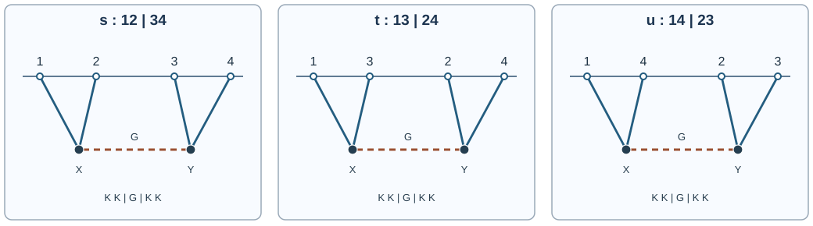

# HOLO11 交換図と4点関数

[HOLO10の接触Witten図](../HOLO10/index.md#def-holo10-contact-integral)では、3つの境界点から伸びる外線を1個の内部頂点で掛けました。4点では2個の頂点が内部を伝わる場で結ばれることがあります。**何を伝播子として積分し、なぜ3種類の組み方が生じるのでしょうか。**

本講では、固定Euclid AdS上のスカラー2種類に限り、内部場の方程式を解くことで交換図の符号と対称因子まで計算します。さらに4点では共形対称性だけで数値関数が決まらない理由を交差比から確かめ、境界の演算子積展開（OPE）と大$N$次数との対応を検査します。一般のAdS/CFT双対性の証明ではなく、[GKPWの木レベル辞書](../HOLO9/index.md#def-holo9-gkpw)を仮定した模型計算です。

## 0. 模型、境界条件、計算の範囲

整数$d\ge2$、$L>0$、$\hbar=1$とし、Euclid $AdS_{d+1}$ のPoincaré座標$X=(z,x)$を用います。

$$
ds_E^2=\frac{L^2}{z^2}(dz^2+dx\cdot dx),\qquad
d\mu(X)=L^{d+1}z^{-d-1}\,dz\,d^dx.
$$

境界に源を持つ実場$\phi$と、境界源を零に固定した交換用実場$\chi$を導入します。$\phi$は[HOLO9の核](../HOLO9/index.md#def-holo9-bulk-boundary)に従う標準量子化を選び、$\Delta=d/2+\nu$、$0<\nu<1$、$m_\phi^2L^2=\Delta(\Delta-d)$です。$\chi$の質量$M^2>0$とします。相互作用は局所的な$\chi\phi^2$、すなわち

$$
S_E[\phi,\chi]=\frac12\int d\mu(X)\,
\bigl(|\nabla\phi|^2+m_\phi^2\phi^2
+|\nabla\chi|^2+M^2\chi^2+g\chi\phi^2\bigr),
$$

$$
A=-\nabla^2+m_\phi^2,\quad B=-\nabla^2+M^2,\qquad
\langle f,h\rangle=\int d\mu\,fh
$$

です。非零の境界源を持つ$\phi$の自由作用を部分積分すると境界項が残るため、ここでは$\langle\phi,A\phi\rangle/2$だけで作用全体を表してはいけません。一方、境界値零の$\chi$については、[HOLO7の有限cutoff Dirichlet条件](../HOLO7/index.md#def-holo7-cutoff-dirichlet)のもとでその自由作用を$\langle\chi,B\chi\rangle/2$と書けます。

境界の源$J\in C_c^\infty(\mathbb R^d)$は$\phi$の遅い漸近モードを固定し、$\chi$は遅いモードを零にします。Euclid解は赤外で正則とします。$g$は摂動結合で、$g^2$まで・バルクの**木レベル**のみを計算し、重力の反作用とループは含めません。三次相互作用だけでポテンシャルの大域的安定性は保証されないため、非摂動的なEuclid経路積分の収束を主張しません。

以下のGreen関数と汎関数操作は、まず$z=\epsilon>0$でDirichlet境界条件を課し、有限領域または十分な減衰を持つ試験源について行います。$\epsilon\to0$の分離点相関は、積分が収束し必要な局所反項を指定できる場合に限って解釈します。一致点での分布や一般の繰り込みはHOLO14へ譲ります。

## 1. 2つの内部点を結ぶ逆演算子

[接触図](../HOLO10/index.md#def-holo10-contact-integral)の核$K_\Delta(X;y)$は「境界点$y$から内部点$X$」への解を作りました。今回は頂点$X$で生じた源を別の内部点$Y$へ運ぶ必要があります。そのため内部場の微分演算子$B$を逆にする二点核をまず構成します。以下、$g_{ab}$はEuclid計量の成分、$\sqrt{\det g_{ab}}$は体積密度を表し、相互作用の結合定数$g$とは区別します。

<!-- formal-statement-start -->
> **定義（Dirichletバルク間Green関数）**  
> 第0節の正質量スカラー場について切断領域で考える。境界値が零で、赤外で減衰する二点分布が次の方程式を満たすとする。

$$
B_XG_{\chi,\epsilon}(X,Y)=\frac{\delta(z-z')\delta^{(d)}(x-y)}{\sqrt{\det g_{ab}(X)}},
\qquad G_{\chi,\epsilon}(\epsilon,x;Y)=0
$$

> これをDirichletバルク間Green関数と呼ぶ。ここで$Y$は第2のバルク点であり、$B_X$は第0節の演算子を第1の点に作用させる。右辺は不変体積について積分すれば第2の点で評価するデルタ分布である。
<!-- formal-statement-end -->

<!-- definition-example-start: def-holo11-bulk-green -->
**定義の確認**：まず境界方向のFourier零波数（運動量の長さが $k=0$ の成分）で、**方程式・境界値・赤外減衰・デルタ係数**を一つずつ確認します。$d=3$、$M^2L^2=7/4$とすると、上の計量から$z\ne z'$での動径方程式は

$$
\left[-\frac{d^2}{dz^2}+\frac2z\frac d{dz}+\frac{7}{4z^2}\right]f(z)=0.
$$

$f(z)=z^\alpha$を代入して$-\alpha(\alpha-1)+2\alpha+7/4=0$、すなわち$\alpha(\alpha-3)=7/4$を得ます。根は$\alpha=7/2,-1/2$です。これは後で用いる$\nu_\chi=\sqrt{d^2/4+M^2L^2}=2$と$\alpha=d/2\pm\nu_\chi$にも一致します。

切断面$z=\epsilon$で消える解と、$z\to\infty$で減衰する解をそれぞれ

$$
f_\epsilon(z)=z^{7/2}-\epsilon^4z^{-1/2},\qquad
h(z)=z^{-1/2}
$$

と選びます。実際、$f_\epsilon(\epsilon)=\epsilon^{7/2}-\epsilon^4\epsilon^{-1/2}=0$であり、$h(z)\to0$です。両者は上の斉次方程式の解なので、$z\ne z'$でのGreen方程式も満たします。$z_<=\min(z,z')$、$z_>=\max(z,z')$とし、連続な核を$c f_\epsilon(z_<)h(z_>)$とおきます。$z'$を固定した一階導関数の跳び（右極限から左極限を引く）は

$$
c\{f_\epsilon(z')h'(z')-f_\epsilon'(z')h(z')\}
=-4c z'^2.
$$

定義の方程式を$z'$の両側で積分すると、右辺のFourier零モードは$z'^2\delta(z-z')/L^2$なので、跳びは$-z'^2/L^2$でなければなりません。従って$c=1/(4L^2)$となり、

$$
g_{0,\epsilon}(z,z')
=\frac{(z_<^{7/2}-\epsilon^4z_<^{-1/2})z_>^{-1/2}}{4L^2},
\qquad
g_0(z,z')=\lim_{\epsilon\to0}g_{0,\epsilon}(z,z')
=\frac{z_<^{7/2}z_>^{-1/2}}{4L^2}.
$$

有限$\epsilon$でも、$z=z'$における左右の導関数は

$$
\partial_z g_{0,\epsilon}(z'-0,z')
=\frac{7z'^2+\epsilon^4z'^{-2}}{8L^2},\qquad
\partial_z g_{0,\epsilon}(z'+0,z')
=\frac{-z'^2+\epsilon^4z'^{-2}}{8L^2}.
$$

よって跳びは確かに$-z'^2/L^2$で、$-\partial_z^2g_{0,\epsilon}$のデルタ係数が$+z'^2/L^2$となります。**これは境界方向の零波数成分の確認**であって、位置空間全体のデルタ関数をこの一成分だけで示したわけではありません。
<!-- definition-example-end -->

内部Green関数の係数を曖昧にしないため、境界方向のFourier運動量$p\in\mathbb R^d$（ベクトル）とその長さ$k=|p|\ge0$（スカラー）を区別します。回転対称性から動径核は$k$にのみ依存するので、

$$
G_\chi(X,Y)=\int_{\mathbb R^d}\frac{d^dp}{(2\pi)^d}\,
e^{ip\cdot(x-y)}g_{|p|}(z,z')
$$

とおきます。この表示をGreen方程式へ代入すると

$$
\left[-\partial_z^2+\frac{d-1}{z}\partial_z
+k^2+\frac{M^2L^2}{z^2}\right]g_k(z,z')
=\frac{z^{d-1}}{L^{d-1}}\delta(z-z').
$$

なぜBessel関数が現れるかも方程式から確かめます。$k>0$で$t=kz$、$f(z)=z^{d/2}F(t)$を斉次方程式へ代入すると、

$$
0=z^{d/2-2}
\left[-t^2F''(t)-tF'(t)
+\left(t^2+\frac{d^2}{4}+M^2L^2\right)F(t)\right].
$$

ここで$F'(t),F''(t)$は**引数$t$による常微分**です。従って$\nu_\chi=\sqrt{d^2/4+M^2L^2}>0$とおけば、$F$は修正Bessel方程式

$$
t^2F''+tF'-(t^2+\nu_\chi^2)F=0
$$

を満たします。その独立な解$I_{\nu_\chi}(t),K_{\nu_\chi}(t)$は、それぞれ$t\to0$で$t^{\nu_\chi}$型、$t\to\infty$で減衰する解です。このため$z^{d/2}I_{\nu_\chi}(kz)$を小さい$z$側、$z^{d/2}K_{\nu_\chi}(kz)$を大きい$z$側に使います。

<!-- formal-statement-start -->
> **命題（バルクGreen関数のFourier表示）**  
> $d\ge2$、$L>0$、$M^2>0$とし、標準境界条件と赤外正則性を課す。境界Fourier運動量$p\in\mathbb R^d$の長さ$k=|p|>0$の場合、$\epsilon\to0$におけるFourier核は

$$
g_k(z,z')=\frac{(zz')^{d/2}}{L^{d-1}}\,
I_{\nu_\chi}(kz_<)\,K_{\nu_\chi}(kz_>).
$$

> $k=0$はこの式の連続極限で定義する。この表示は自由な内部場$\chi$のGreen関数であり、相互作用を含む厳密な量子伝播子とは区別する。
<!-- formal-statement-end -->

### 証明の見取り図

源点以外では2階斉次方程式の解を使い、源点では関数の連続性と**一階導関数の跳び**でデルタ関数の係数を固定します。積分の向きにより跳びの符号が反転するので、そこを検算します。

<!-- proof-start -->
### 証明

$d\mu=L^{d+1}z^{-d-1}dz\,d^dx$および

$$
-\nabla^2+M^2
=\frac{z^2}{L^2}\left[-\partial_z^2+\frac{d-1}{z}\partial_z-\partial_x^2\right]+M^2
$$

をGreen方程式に代入し、$z^2/L^2$で割ると先述の常微分方程式を得ます。$g_k$を$z<z'$で$C(z')z^{d/2}I_{\nu_\chi}(kz)$、$z>z'$で$D(z')z^{d/2}K_{\nu_\chi}(kz)$とおき、$z=z'$で連続につなぎます。両側を一式にまとめた積の係数を$c$とすると

$$
g_k=c(zz')^{d/2}I_{\nu_\chi}(kz_<)K_{\nu_\chi}(kz_>).
$$

修正Bessel関数のWronskian恒等式を

$$
I_\nu(t)K_\nu'(t)-I_\nu'(t)K_\nu(t)=-\frac1t
$$

と書きます。この定数$-1$は、2つの斉次解のWronskianが微分方程式から$C/t$と分かり、小さい$t$での$I_\nu(t)\sim (t/2)^\nu/\Gamma(\nu+1)$、$K_\nu(t)\sim\Gamma(\nu)(t/2)^{-\nu}/2$を代入して$C=-1$と定めたものです。したがって固定$z'$での導関数の跳びは

$$
\partial_zg_k(z'+0,z')-\partial_zg_k(z'-0,z')
=c z'^d k\left(I_\nu(kz')K_\nu'(kz')-I_\nu'(kz')K_\nu(kz')\right)
=-c z'^{d-1}.
$$

方程式を$z'\!-\!\eta$から$z'\!+\!\eta$まで積分すると、$\eta\to0$で正則な項は消え、

$$
-\left[\partial_zg_k\right]_{z'-0}^{z'+0}
=\frac{z'^{d-1}}{L^{d-1}}
$$

となるから$c=L^{1-d}$です。$k\to0$では$I_\nu(kz_<)K_\nu(kz_>)\to(z_</z_>)^\nu/(2\nu)$となり、$g_0=z_<^{d/2+\nu}z_>^{d/2-\nu}/(2\nu L^{d-1})$。これで直接例の係数も確認できます。有限$\epsilon$では小さい$z$側を$I_\nu(kz)-I_\nu(k\epsilon)K_\nu(kz)/K_\nu(k\epsilon)$で置き換えれば$\epsilon$で零となり、$\epsilon\to0$で上式に戻ります。$\square$
<!-- proof-end -->

この命題は「二つの点の間を線で結ぶ」ことを**微分方程式の逆演算子**に置き換えました。接触図と異なり、頂点$X$と$Y$の両方に積分が必要です。

## 2. 内部場を消去し、3つの交換チャネルを作る

図は計算上の接続だけを表し、曲線を測地線や粒子の軌道と解釈しません。たとえば$s$チャネルは境界点1・2が同じ頂点$X$へ、3・4が別の頂点$Y$へ入り、$G_\chi(X,Y)$で結ばれます。

<!-- formal-statement-start -->
> **定義（スカラー交換Witten積分）**  
> 上記の模型の境界から内部への核$K_\Delta(X;y)$と内部Green関数$G_\chi(X,Y)$を用い、互いに異なる4境界点$y_1,\ldots,y_4$を取る。正則化された以下の2重積分が存在するとき、

$$
\mathcal E_{12|34}(y_i)=\int d\mu(X)\int d\mu(Y)\,
K_\Delta(X;y_1)K_\Delta(X;y_2)\,
G_\chi(X,Y)\,K_\Delta(Y;y_3)K_\Delta(Y;y_4)
$$

> を$12|34$チャネルの交換Witten積分と呼ぶ。$13|24$、$14|23$は添字を組み替えて定める。カットオフ除去後の意味付けには収束・反項の条件を別途課す。
<!-- formal-statement-end -->

<!-- definition-example-start: def-holo11-exchange-integral -->
**定義の確認**：$12|34$では$X$に外線1・2、$Y$に3・4があります。$d=3$、$\Delta=2$で[HOLO9の規格化された境界―バルク核](../HOLO9/index.md#def-holo9-bulk-boundary)を代入すると、各核は

$$
K_2(X;y_i)=\frac{z^2}{\pi^2(z^2+|x-y_i|^2)^2}.
$$

従って**外線4本の係数**は$\pi^{-8}$、内部線は$G_\chi(X,Y)$、測度は両方に$L^4$、すなわち$L^8$です。$13|24$では1・3を$X$に移すだけで、別の4点配置を表します。積分の正規化に[第1節で導いたGreen核](#prop-holo11-green-fourier)の$d=3$での係数$L^{-2}$も残るので、全体の$L$次数は$L^6$（$g$の次元は別）です。
<!-- definition-example-end -->

<!-- formal-statement-start -->
> **命題（木レベル4点の交換寄与と対称係数）**  
> 第0節の作用と固定境界源、内部場の零境界源、赤外正則性および有限cutoffのDirichlet問題を仮定する。自由解と木レベル生成汎関数は次のように定める。

$$
\phi_0(X)=\int K_\Delta(X;y)J(y)\,d^dy,\qquad W[J]=-S_{\rm on\text{-}shell,ren}[J].
$$

$$
W^{(4)}_{\mathrm{ex}}[J]
=\frac{g^2}{8}\int d\mu(X)d\mu(Y)\,
\phi_0(X)^2G_\chi(X,Y)\phi_0(Y)^2 .
$$

> 内部場を古典方程式で消去すると、源の4次の交換寄与は次の式になる。分離4点でcutoff除去が存在する場合、4回の源微分により

$$
\langle\mathcal O(y_1)\mathcal O(y_2)\mathcal O(y_3)\mathcal O(y_4)\rangle_{\rm conn,ex}
=g^2\bigl(\mathcal E_{12|34}+\mathcal E_{13|24}+\mathcal E_{14|23}\bigr)+O(g^4).
$$

> ここで右辺は**交換図由来の木レベル寄与のみ**であり、追加の局所$\phi^4$相互作用、ループ、背景反作用があれば別の項が加わる。
<!-- formal-statement-end -->

### 証明の見取り図

$\chi$の方程式は$B\chi=-g\phi^2/2$です。逆演算子$G_\chi$で$\chi$を表して平方完成し、$W=-S$の符号を戻します。4回微分では4個の源を二組に分ける**3通り**と、頂点ごとの並べ替えが現れます。

<!-- proof-start -->
### 証明

[HOLO7の固定源の変分](../HOLO7/index.md#prop-holo7-boundary-variation)により$\phi=\phi_0+O(g^2)$です。$\chi$の境界値を零とした変分は

$$
\delta_\chi S_E
=\langle \delta\chi,B\chi+(g/2)\phi^2\rangle
$$

であり、内部方程式から

$$
\chi_{\rm cl}(X)=-\frac g2\int d\mu(Y)\,G_\chi(X,Y)\phi_0(Y)^2+O(g^3)
$$

となります。$\chi$を含む作用の2項を平方完成すると

$$
\frac12\langle\chi,B\chi\rangle+\frac g2\langle\chi,\phi^2\rangle
=\frac12\langle\chi+\tfrac g2G_\chi\phi^2,
B(\chi+\tfrac g2G_\chi\phi^2)\rangle
-\frac{g^2}{8}\langle\phi^2,G_\chi\phi^2\rangle .
$$

これを古典解で評価すると最初の平方項は零です。自由作用の$\phi_0$まわりの一次変分は固定源により零で、$\phi-\phi_0=O(g^2)$の作用への影響は$O(g^4)$です。したがって$S_{\rm on\text{-}shell}$の4次部分は$-g^2\langle\phi_0^2,G_\chi\phi_0^2\rangle/8$、$W=-S$なので符号は正となります。

この計数には$G_\chi(X,Y)=G_\chi(Y,X)$を使います。[HOLO7の境界付き第一変分](../HOLO7/index.md#prop-holo7-boundary-variation)と同じ部分積分で、Dirichlet境界値零・赤外減衰を満たす試験関数$f,h$に対して

$$
\langle f,Bh\rangle-\langle Bf,h\rangle
=\int_{\partial\Omega}\bigl(h\,\partial_n f-f\,\partial_n h\bigr)\,d\Sigma=0
$$

です。従って$B$のDirichlet逆演算子$G_\chi=B^{-1}$は対称で、核の二点交換が許されます。

4つの相異なる形式変数$J_1,\ldots,J_4$を用い、$\phi_0=\sum_i J_iK_i$とすると、$\phi_0(X)^2$で2つの異なる添字を選ぶ順序が2通り、$Y$でも2通りです。2組の頂点割り当ては$\binom42=6$通り。従って$4\cdot6=24$個の項があります。$X\leftrightarrow Y$の対称性により同じチャネルごとに8個ずつ集まるので

$$
\frac{g^2}{8}\cdot 8
\bigl(\mathcal E_{12|34}+\mathcal E_{13|24}+\mathcal E_{14|23}\bigr)
=g^2\sum_{\rm 3\ channels}\mathcal E .
$$

これが4回源微分の結果です。$\square$
<!-- proof-end -->

**符号について**：Euclid作用を$+\frac g2\chi\phi^2$と書いたため、内部場を解いて作用に戻すと$-g^2/8$、$W=-S$では$+g^2/8$です。接触の$\phi^4$頂点を$+\lambda_4\phi^4/4!$と書けばその木レベル4点は$-\lambda_4\int K_1K_2K_3K_4\,d\mu$であり、符号は異なります。

## 3. なぜ4点は交差比の関数になるか

[HOLO10の3点関数](../HOLO10/index.md#prop-holo10-cft-threepoint)の分離点での距離冪は対称性が定数倍まで固定しました。しかし4点では、同じ一斉拡大に対して不変な**無次元比**が2つ残ります。以下、[QFT48の四点共形交差比の定義](../../QFT/QFT48/index.md#def-qft48-conformal-cross-ratios)も参照し、$r_{ij}=|y_i-y_j|$、境界は$d\ge2$のEuclid空間とします。ここでは対称性から二つの比が残る理由も計算し直します。

$$
u=\frac{r_{12}^2r_{34}^2}{r_{13}^2r_{24}^2},
\qquad
v=\frac{r_{14}^2r_{23}^2}{r_{13}^2r_{24}^2}.
$$

これらを交差比と呼びます。距離の一斉拡大では分子も分母も4次で打ち消されます。反転では$r_{ij}'=r_{ij}/(|y_i||y_j|)$なので、各点の因子も打ち消されます。

<!-- formal-statement-start -->
> **命題（同一次元スカラー4点の共形形式と交換対称性）**  
> $d\ge2$のEuclid CFTで、同一のスカラー一次演算子$\mathcal O$のスケーリング次元を$\Delta$とし、相異なる4点での共形共変性を仮定する。完全4点関数は

$$
\langle\mathcal O_1\mathcal O_2\mathcal O_3\mathcal O_4\rangle
=\frac{\mathcal G(u,v)}{r_{12}^{2\Delta}r_{34}^{2\Delta}}
$$

> と表せる。点2と3の入れ替えに対して、同一演算子の交換対称性は

$$
\mathcal G(u,v)=u^\Delta\mathcal G(1/u,v/u)
$$

> を要求する。この式だけでは$\mathcal G$の値は一意に決まらない。
<!-- formal-statement-end -->

### 証明の見取り図

4点のスケールを分母で外へ出した後、反転・平行移動・回転・拡大で不変な残余を$u,v$へまとめます。交換対称性では、**比だけでなく先頭の距離因子も変わる**ことを忘れないようにします。

<!-- proof-start -->
### 証明

[HOLO4の境界共形変換](../HOLO4/index.md#prop-holo4-special-conformal-isometry)と[既習のスカラー一次場の変換則](../../QFT/QFT48/index.md#def-qft48-scalar-primary)を使い、4点の共変な冪の一つを先頭因子として抜き出します。

$$
\frac{1}{r_{12}^{2\Delta}r_{34}^{2\Delta}}.
$$

残りは4点配置の共形不変量にのみ依存します。独立な量の数を実際に数えましょう。異なる3点を共形変換で次の位置に移します。

$$
y_1=0,\qquad y_3=e_1,\qquad y_4=\infty.
$$

残る点を$y_2=(a,b)$と書きます。ここで$b$は$e_1$に直交する成分です。残る回転対称性により、$b$はその長さだけで特徴付けられます。この配置で

$$
u=|y_2|^2=a^2+|b|^2,\qquad
v=|y_2-e_1|^2=(a-1)^2+|b|^2.
$$

従って$a=(1+u-v)/2$、$|b|^2=u-a^2$です。一般位置で$u,v$が残る二つの独立な実数パラメータであり、特殊な共線配置では$|b|=0$という制約があることも分かります。ゆえに残りを$\mathcal G(u,v)$と書けます。

点2と3を交換すると、新しい比は

$$
u'=\frac{r_{13}^2r_{24}^2}{r_{12}^2r_{34}^2}=\frac1u,\qquad
v'=\frac{r_{14}^2r_{23}^2}{r_{12}^2r_{34}^2}=\frac vu.
$$

交換後の先頭因子は$(r_{13}^{2\Delta}r_{24}^{2\Delta})^{-1}$で、元の因子に対する比は$u^\Delta$です。従って$\mathcal G(u,v)=u^\Delta\mathcal G(1/u,v/u)$です。例えば後節の$1+u^\Delta+(u/v)^\Delta$はこの関係を満たしますが、相互作用に由来する補正も取りうるため、一意性は主張できません。$\square$
<!-- proof-end -->

### 数値の直接例

$y_1=0,y_2=1,y_3=2,y_4=4$を$\mathbb R^d$の同一直線上に置くと、$r_{12}=1,r_{34}=2,r_{13}=2,r_{24}=3,r_{14}=4,r_{23}=1$だから

$$
u=\frac{1^2\cdot2^2}{2^2\cdot3^2}=\frac19,\qquad
v=\frac{4^2\cdot1^2}{2^2\cdot3^2}=\frac49.
$$

$\Delta=2$で、後の一般化自由場の$\mathcal G_0=1+u^2+(u/v)^2$を代入すれば$\mathcal G_0=1+1/81+1/16=1393/1296$です。共線の例でも交差比の**値**を具体的に確認できます。ただし、共線配置だけから一般配置の自由度2を証明したことにはなりません。

## 4. OPEと大$N$：単一トレースと二重トレースを分ける

境界の[演算子積展開（OPE）](../../QFT/QFT54/index.md#def-qft54-ope)は、例えば$y_1\to y_2$のとき$\mathcal O(y_1)\mathcal O(y_2)$を局所演算子の和として整理する道具です。$12|34$の内部$\chi$は対応する単一トレース演算子$\mathcal O_\chi$とその子孫の交換を表す**候補**になります。しかし**交換Witten図全体が一つの共形ブロックそのものになるわけではありません**。積分は一般に二重トレース演算子族の寄与も含みます。固有のブロック係数を得るには実際のOPE解析や分解が必要です。

ここで数え上げる大$N$は、[HOLO6の大N因子化の数え上げ](../HOLO6/index.md#prop-holo6-factorization)と同じ、適切な大型$N$行列理論で単一トレース演算子の2点を$O(1)$へ規格化する状況です。モデルに依存する特殊な選択則・混合は別途検討します。

<!-- formal-statement-start -->
> **命題（規格化単一トレース4点の主要次数）**  
> 同一の規格化単一トレーススカラーについて、次の2点規格化と平面図の連結次数を仮定する。

$$
\langle\mathcal O(y)\mathcal O(0)\rangle=|y|^{-2\Delta},\qquad
\langle\mathcal O(y_1)\cdots\mathcal O(y_n)\rangle_{\rm conn}=O(N^{2-n}).
$$

> このとき4点の非連結主要項は

$$
\langle\mathcal O_1\mathcal O_2\mathcal O_3\mathcal O_4\rangle_{\rm disc}
=\frac1{r_{12}^{2\Delta}r_{34}^{2\Delta}}
+\frac1{r_{13}^{2\Delta}r_{24}^{2\Delta}}
+\frac1{r_{14}^{2\Delta}r_{23}^{2\Delta}}+O(N^{-2})
$$

> であり、真の連結4点は$O(N^{-2})$。従って規格化された4点関数の先頭項は

$$
\mathcal G_0(u,v)=1+u^\Delta+(u/v)^\Delta.
$$

> バルクの木レベルで規格化された3点頂点が$O(N^{-1})$なら、その2個の積からなる交換図は$O(N^{-2})$である。
<!-- formal-statement-end -->

### 証明の見取り図

$N$次数を数える前に、全4点を2点積と連結4点に分けます。交換図は連結なので2点積の$O(1)$と同じ次数に置いてはいけません。最後に3個のペアを交差比へ直します。

<!-- proof-start -->
### 証明

2点の規格化により各ペア積は$O(1)$です。1点期待値を零にした場を用い、$W[J]=\log Z[J]$から非連結部分を直接導きます。$W=W_2+W_3+W_4+\cdots$と源の次数で分解し、$Z=\exp W$の4次項を展開すると、$W_4+W_2^2/2$だけが残ります。4回微分では$W_4$から連結4点を、$W_2^2/2$から3つの2点積を得るので

$$
\langle\mathcal O_1\mathcal O_2\mathcal O_3\mathcal O_4\rangle
=\sum_{\{ij|kl\}}\langle\mathcal O_i\mathcal O_j\rangle
\langle\mathcal O_k\mathcal O_l\rangle
+\langle\mathcal O_1\mathcal O_2\mathcal O_3\mathcal O_4\rangle_{\rm conn}
$$

です。規格化単一トレースの平面次数を用いると連結4点は$N^{2-4}=N^{-2}$。最初の項で$12|34$を抜き出し、$13|24$との比は$u^\Delta$、$14|23$との比は$(u/v)^\Delta$です。交換木図は連結3点頂点が2個、内部線が1本で、正規化済みの内部線を$O(1)$として$N^{-1}\cdot N^{-1}=N^{-2}$です。$\square$
<!-- proof-end -->

### OPEでの対応をどこまで言えるか

- 単一トレース$\mathcal O_\chi$の交換は、$\mathcal O\times\mathcal O$のOPE係数$C_{\mathcal O\mathcal O\chi}=O(N^{-1})$を持つ場合に連結4点へ$O(N^{-2})$で寄与します。
- 二重トレース$[\mathcal O\mathcal O]_{n,\ell}$は、大$N$の一般化自由場近似では概ね$\Delta_{n,\ell}=2\Delta+2n+\ell+O(N^{-2})$の族です。同一のボース型スカラー2個のOPEでは交換対称性により偶数スピン$\ell$のみが現れます。通常の模型では非連結主要項にも寄与し、交換・接触図はそのOPE係数や異常次元の補正にも関与します。
- **図1枚が特定の一つのブロックを意味するわけではありません。** この章で証明したのは交換積分の組合せ、Green方程式、交差比と大$N$次数であり、一般の共形部分波分解の係数・収束域を計算したわけではありません。

## 5. 演習

すべてEuclid計算とする。特記なければ$y_i$は相異なり、分離点の相関を扱う。内部Green関数は第1節のDirichlet条件とする。

### Level A：単独の確認

**HOLO11-A1（Green方程式のデルタ係数）**  
$d\mu=L^{d+1}z^{-d-1}dz\,d^dx$を使い、Fourier変換後の$g_k$のデルタ係数が$z^{d-1}/L^{d-1}$であることを示せ。

- Level: A

<!-- solution-start -->
**詳細解答**：不変デルタ関数は$z^{d+1}L^{-d-1}\delta(z-z')\delta^{(d)}(x-y)$です。$B$の微分項を$z^2/L^2$でくくって両辺を$L^2/z^2$倍すると、右辺は$(z^{d+1}/L^{d+1})(L^2/z^2)\delta=z^{d-1}L^{1-d}\delta$です。$x$のFourier変換で$\delta^{(d)}(x-y)$が消去されても、$z$の係数は変わりません。
<!-- solution-end -->

**HOLO11-A2（零波数の跳び）**  
$d=3,M^2L^2=7/4$について$g_0=z_<^{7/2}z_>^{-1/2}/(4L^2)$の跳びを求めよ。

- Level: A

<!-- solution-start -->
**詳細解答**：$z<z'$では$\partial_zg_0=(7/8L^2)z^{5/2}z'^{-1/2}$なので$z=z'$で$7z'^2/(8L^2)$です。$z>z'$では$\partial_zg_0=-(1/8L^2)z'^{7/2}z^{-3/2}$なので$-z'^2/(8L^2)$です。後者から前者を引くと$-z'^2/L^2$。微分方程式の最高階項は$-\partial_z^2$なのでデルタ係数は$+z'^2/L^2$となり、$d=3$の$z'^{d-1}/L^{d-1}$に一致します。
<!-- solution-end -->

**HOLO11-A3（3種類のチャネル）**  
4個の相異なる境界点を2個ずつの組に分け、頂点交換を同一視したときのチャネルを列挙せよ。

- Level: A

<!-- solution-start -->
**詳細解答**：点1と同じ頂点になる相手は点2、点3、点4の3種類しかありません。残った2点がもう一つの頂点になります。従って$12|34$、$13|24$、$14|23$です。順序を付ければ$\binom42=6$通りですが$X\leftrightarrow Y$で2重に数えるため$6/2=3$です。
<!-- solution-end -->

**HOLO11-A4（具体交差比）**  
同一直線上に$y_1=0,y_2=1,y_3=2,y_4=4$と配置する。$u,v$と$\Delta=2$の$\mathcal G_0(u,v)$を求めよ。

- Level: A

<!-- solution-start -->
**詳細解答**：$r_{12}=1,r_{34}=2,r_{13}=2,r_{24}=3,r_{14}=4,r_{23}=1$なので$u=4/36=1/9$、$v=16/36=4/9$です。$u/v=1/4$より$\mathcal G_0=1+(1/9)^2+(1/4)^2=1+1/81+1/16=1393/1296$です。
<!-- solution-end -->

**HOLO11-A5（大$N$の次数）**  
規格化単一トレース2点が$O(1)$、連結3点が$O(N^{-1})$、連結4点が$O(N^{-2})$のとき、非連結4点と2頂点交換図の次数を述べよ。

- Level: A

<!-- solution-start -->
**詳細解答**：非連結4点は2点積3個の和であり、各項が$O(1)\cdot O(1)=O(1)$です。2個の三次頂点の積は$O(N^{-1})^2=O(N^{-2})$で、規格化された内部線は$O(1)$です。従って交換図は連結4点と同じ$O(N^{-2})$ですが、非連結項より$N^{-2}$だけ抑制されます。
<!-- solution-end -->

### Level B：計算を接続する

**HOLO11-B1（WronskianからGreen核を再構成）**  
$\nu_\chi>0$、$k>0$とし、$I_\nu K_\nu'-I_\nu'K_\nu=-1/t$を使う。$g_k=c(zz')^{d/2}I_\nu(kz_<)K_\nu(kz_>)$の係数$c$を求めよ。

- Level: B

<!-- solution-start -->
**詳細解答**：$z=z'$の両側で$z^{d/2}$を微分した項は連続性により相殺されます。残る跳びは$c z'^d k[I_\nu(kz')K_\nu'(kz')-I_\nu'(kz')K_\nu(kz')]=-c z'^{d-1}$です。方程式を源点をまたいで積分すると$-[\partial_zg_k]=z'^{d-1}/L^{d-1}$なので$c z'^{d-1}=z'^{d-1}/L^{d-1}$、従って$c=L^{1-d}$です。境界・赤外の両解を選んだことが、任意の斉次解を加えない条件です。
<!-- solution-end -->

**HOLO11-B2（内部場の消去と符号）**  
$B$を対称な正のDirichlet演算子とする。$F=\phi^2$について$\frac12\langle\chi,B\chi\rangle+\frac g2\langle\chi,F\rangle$を平方完成し、$W=-S$での符号を確かめよ。

- Level: B

<!-- solution-start -->
**詳細解答**：$G=B^{-1}$と置くと$B(GF)=F$です。$\frac12\langle\chi+\frac g2GF,B(\chi+\frac g2GF)\rangle$を展開すると$\frac12\langle\chi,B\chi\rangle+\frac g2\langle\chi,F\rangle+\frac{g^2}{8}\langle GF,BGF\rangle$です。最後は$\frac{g^2}{8}\langle F,GF\rangle$なので、元の式との差は$-\frac{g^2}{8}\langle F,GF\rangle$。古典解$\chi=-gGF/2$では平方項が零になり、作用の寄与は負、$W=-S$の寄与は正となります。
<!-- solution-end -->

**HOLO11-B3（4回微分の24通り）**  
$F(X)=(\sum_{i=1}^4J_iK_i(X))^2$とし、$\langle F,GF\rangle$の$J_1J_2J_3J_4$係数を$\mathcal E$で表せ。

- Level: B

<!-- solution-start -->
**詳細解答**：$X$側へ入れる2添字の集合は$\binom42=6$通り、各集合の積は$(J_iK_i+J_jK_j)^2$から$2J_iJ_jK_iK_j$です。$Y$側も係数2なので、各割り当ては4倍。従って総数は$6\cdot4=24$。頂点$X,Y$の交換で同じ積分が2回現れ、3チャネルそれぞれの係数は$4\cdot2=8$です。ゆえに$[J_1J_2J_3J_4]\langle F,GF\rangle=8(\mathcal E_{12|34}+\mathcal E_{13|24}+\mathcal E_{14|23})$です。
<!-- solution-end -->

**HOLO11-B4（交差対称性の正しい前置因子）**  
点2と3を入れ替えたとき$(u,v)$の変換を求め、$\mathcal G(u,v)=u^\Delta\mathcal G(1/u,v/u)$が$\mathcal G_0=1+u^\Delta+(u/v)^\Delta$で成立することを示せ。

- Level: B

<!-- solution-start -->
**詳細解答**：交換で分母の距離積$r_{13}^2r_{24}^2$と元の分子$r_{12}^2r_{34}^2$が入れ替わるから$u'=1/u$、$v'=v/u$です。交換後の外側の距離因子は元のものの$u^\Delta$倍。よって右辺は$u^\Delta[1+(1/u)^\Delta+((1/u)/(v/u))^\Delta]=u^\Delta+1+(u/v)^\Delta=\mathcal G_0(u,v)$です。$u^\Delta$を落とすと誤った交差条件になります。
<!-- solution-end -->

### Level C：模型から境界の次数まで通す

**HOLO11-C1（交換図・交差比・大$N$の総合検算）**  
固定Euclid AdS背景・木レベルで、$\chi$の境界源は零とする。標準量子化を選び、次のパラメータを与える。

$$
d=3,\quad m_\phi^2L^2=-2,\quad M^2L^2=7/4,\quad S_{\rm int}=\frac g2\int d\mu\,\chi\phi^2.
$$

次を順に説明・計算せよ。

1. 外線の次元と境界からの核、および交換場の次元。
2. 零波数内部Green核と導関数の跳びの規格化。
3. 結合の2次の4点交換寄与（3チャネルと各係数）。
4. 一般化自由場4点の主要項と大$N$の連結次数。
5. 内部線1本を一つの共形ブロック全体と同一視できない理由。

- Level: C

<!-- solution-start -->
**詳細解答**：

(i) $m_\phi^2L^2=\Delta(\Delta-3)=-2$の解は$\Delta=1,2$。標準量子化は$\Delta=2$で、[HOLO9の核](../HOLO9/index.md#def-holo9-bulk-boundary)から$c_2=\Gamma(2)/[\pi^{3/2}\Gamma(1/2)]=1/\pi^2$です。よって

$$
K_2(z,x;y)=\frac{z^2}{\pi^2(z^2+|x-y|^2)^2}.
$$

交換場は$\nu_\chi=\sqrt{9/4+7/4}=2$、従って$\Delta_\chi=3/2+2=7/2$で、境界源零の標準条件を選びます。

(ii) [$k=0$のGreen極限](#prop-holo11-green-fourier)は

$$
g_0(z,z')=\frac{z_<^{3/2+2}z_>^{3/2-2}}{2\cdot2L^2}
=\frac{z_<^{7/2}z_>^{-1/2}}{4L^2}.
$$

左右の導関数を代入すると$7z'^2/(8L^2)$と$-z'^2/(8L^2)$、跳び$-z'^2/L^2$です。$-\partial_z^2$のデルタ係数は$+z'^2/L^2$となります。

(iii) $\chi_{\rm cl}=-(g/2)G_\chi\phi_0^2$を場の方程式から求め、平方完成すると$S^{(4)}_{\rm ex}=-g^2\langle\phi_0^2,G_\chi\phi_0^2\rangle/8$、$W$では正です。4回微分で24項が3組に8項ずつ集まり、

$$
\langle\mathcal O_1\mathcal O_2\mathcal O_3\mathcal O_4\rangle_{\rm conn,ex}
=g^2(\mathcal E_{12|34}+\mathcal E_{13|24}+\mathcal E_{14|23})+O(g^4)
$$

です。積分は有限cutoffでまず定義し、境界極限と反項の要否を別途確認します。これを一般の完全4点と同一視しません。

(iv) $\Delta=2$の規格化2点を$r^{-4}$とする大$N$模型では、3つの2点積が$O(1)$で

$$
\langle\mathcal O_1\mathcal O_2\mathcal O_3\mathcal O_4\rangle
=\frac{1+u^2+(u/v)^2}{r_{12}^4r_{34}^4}+O(N^{-2}).
$$

連結4点は$O(N^{-2})$、三次頂点が各$O(N^{-1})$である規格化なら交換図も$O(N^{-2})$です。$g$の$N$依存を定めないまま$g^2=N^{-2}$と同一視しません。

(v) 交換積分の内部線は$\mathcal O_\chi$の族をOPEチャネルに生みますが、バルクの全頂点積分には二重トレース演算子族の寄与も混じり、他のチャネルや接触相互作用も4点の交差条件に関係します。一つの線の図式は一つの共形ブロックへの射影操作ではなく、ブロック分解を実行していないので等号は主張できません。
<!-- solution-end -->

## 6. まとめと次講への接続

**2頂点の交換図は、境界からの4本の核・内部場のGreen関数・二つのバルク積分で定義でき、3チャネルの係数を古典作用の平方完成から再現**できました。境界4点には独立な交差比が残るため、3点と違って共形対称性だけでは動的関数$\mathcal G(u,v)$が決まりません。大$N$では非連結の$O(1)$と木レベル連結の$O(N^{-2})$を区別する必要があります。

ここまでのGreen方程式・符号・組合せ係数は指定した模型での導出です。一方でOPEにおける詳細なブロック係数、一般の交換積分の閉形式、任意のCFTに対する完全な双対性は**この講義で証明していません**。次のHOLO12ではスカラーをゲージ場へ替え、保存流の境界源とゲージ不変性を調べます。
