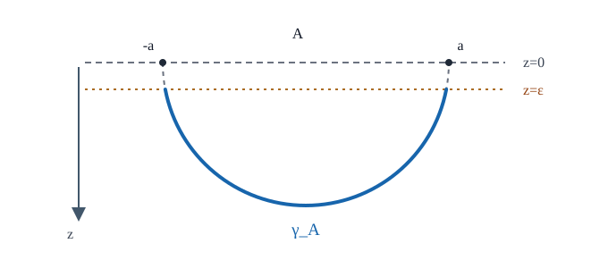

# HOLO18 RT公式の最小模型

[HOLO17の境界区間エントロピー](../HOLO17/index.md#def-holo17-boundary-data)では、二次元CFTの真空区間 $A=[-a,a]$ の普遍主項が $S(A)\sim(c/3)\log(\ell/\epsilon)$（$\ell=2a$）になることを整理しました。しかし境界の量子状態を縮約する計算と、三次元重力の**曲線の長さ**を求める計算は別の仕事です。境界量子論と幾何を結ぶ等式は、半円の長さを計算するだけでは証明できません。

本章の問いは、**静的な純AdSの一つの区間で、重力側からどこまで実際に計算でき、どの段階でRT処方を入力するのか**です。[HOLO3の境界アンカー測地線](../HOLO3/index.md#def-holo3-regulated-length)と[HOLO13のBrown–Henneaux関係](../HOLO13/index.md#prop-holo13-brown-henneaux)を、正則化の規約を揃えて結びます。$\hbar=1$、自然対数、境界に重力がない標準的なAdS/CFTの半古典的領域を使います。

## 1. 区間と、長さに置き換える候補

Lorentz符号を $(-,+,+)$ とするPoincaré $AdS_3$ の計量を

$$
ds^2=\frac{L^2}{z^2}(-dt^2+dx^2+dz^2),
\qquad L>0,\ z>0,\quad t,x\in\mathbb R
$$

とします。$t=0$ 断面では $dt=0$ なので、長さの計算に使う**正定値な二次元計量**は

$$
h=\frac{L^2}{z^2}(dx^2+dz^2)
$$

です。これは[HOLO3のEuclid AdS半上空間表示](../HOLO3/index.md#def-holo3-euclidean-ads)を、静的な時間断面に制限したものと同じ双曲平面の計量です。$\partial A=\{-a,a\}$ は $z=0$ の共形境界上の端点であり、バルク内の有限距離の点ではありません。

境界の同時刻の区間を $A=[-a,a]$（$a>0$）、その座標長を $\ell=2a$ と固定します。$z=\epsilon$（$0<\epsilon

<!-- formal-statement-start -->
> **定義（静的単一区間の正則化RT幾何量）**  
> $L,G_3,a>0$、$0<\epsilon<a$ とする。上記の $t=0$ 時間断面において、共形境界の $x=\pm a$ にアンカーされる半円の $z\ge\epsilon$ の部分を $\gamma_{A,\epsilon}$ とする。誘導計量 $h$ によるその長さを $D_{A,\epsilon}$ とし、次の幾何量を定める。

$$
\gamma_{A,\epsilon}
=\{(x,z):x^2+z^2=a^2,\ z\ge\epsilon\},
\qquad
S_{\mathrm{RT},\epsilon}^{(0)}(A)
=\frac{D_{A,\epsilon}}{4G_3}.
$$

> 上付き $(0)$ は古典的な面積項を表す。この定義だけでは、境界CFTの縮約密度行列のエントロピーと等しいとは主張しない。
<!-- formal-statement-end -->

**定義から計算への橋渡し。** 境界アンカー付き半円の選び方は[HOLO3の正則化境界アンカー測地線長の定義](../HOLO3/index.md#def-holo3-regulated-length)と同じです。[対称二端点を結ぶ半円測地線とその最短性](../HOLO3/index.md#thm-holo3-semicircle)は、境界上の点 $(\pm a,0)$ にそのまま適用するものではありません。第2節では、$z=\epsilon$ で残る弧の**実際の端点**にその定理を適用します。長さは、曲線のパラメータ $u$ に対して接ベクトル $\dot\gamma(u)=d\gamma/du$ を計量 $h$ に代入し、$\int\sqrt{h(\dot\gamma,\dot\gamma)}\,du$ で求めます。定義にある $G_3$ は三次元Newton定数で、曲線長から無次元の古典的RT量へ換算する係数です。

<!-- definition-example-start: def-holo18-regulated-rt-length -->
**定義の確認**（$a=1,\epsilon=1/2$）。 $x^2+z^2=1$ と $z=1/2$ の交点は $x=\pm\sqrt3/2$。従って $\gamma_{A,\epsilon}$ はこの二点間の半円弧で、$z\ge1/2>0$ に収まり、両端の元のアンカー $x=\pm1,z=0$ と異なります。$\theta\in[\pi/6,5\pi/6]$ により $(x,z)=(\cos\theta,\sin\theta)$ と表します。ここで $\dot\gamma=d\gamma/d\theta=(-\sin\theta,\cos\theta)$ だから、接ベクトルを上の正定値計量へ代入すると

$$
h(\dot\gamma,\dot\gamma)
=\frac{L^2}{\sin^2\theta}
\bigl((-\sin\theta)^2+\cos^2\theta\bigr)
=\frac{L^2}{\sin^2\theta}>0
$$

です。$\theta\in(0,\pi)$ なので線素は $ds=L\,d\theta/\sin\theta$ となり、定義した長さは

$$
D_{A,1/2}
=L\int_{\pi/6}^{5\pi/6}\frac{d\theta}{\sin\theta}
=2L\log(2+\sqrt3)>0,
\qquad
S_{\mathrm{RT},1/2}^{(0)}
=\frac{L}{2G_3}\log(2+\sqrt3).
$$

これは長さの直接確認です。特に $G_3>0$ が幾何量の非負性に必要で、まだ境界の物理的エントロピーの計算にはなっていません。
<!-- definition-example-end -->

図では $z=0$ の両端点を境界のアンカー、点線 $z=\epsilon$ と曲線の交点を実際の積分端点として分けました。**cutoff面上の $x=\pm a$ を固定して新しく最短測地線を求める問題とは異なる**ことに注意してください。

## 2. なぜ半円になり、どの長さを積分するか

ここで改めて、半円の形を変分法から手で確かめます。$z=z(x)>0$ と局所的に表せる曲線について、$z'(x)=dz/dx$ は**横座標 $x$ に関する導関数**と定めます（以下の $\partial F/\partial z'$ は、$x,z$ を固定して傾き $z'$ で偏微分します）。長さ汎関数は

$$
D[z]=L\int_{-a}^{a}
\frac{\sqrt{1+z'(x)^2}}{z(x)}\,dx
$$

です。積分の端点はまず形式上の境界アンカーとし、長さそのものは $\epsilon$ で切ってから評価します。対称な停留曲線の頂点を $(0,b)$ と書き、$b=z(0)>0$、$z'(0)=0$ と置きます。$b$ はまだ未知の高さです。$F=L\sqrt{1+z'^2}/z$ は $x$ に陽に依存しないので、[HOLO3で確認した変分の第一積分](../HOLO3/index.md#thm-holo3-semicircle)を具体的に書くと

$$
F-z'\frac{\partial F}{\partial z'}
=\frac{L}{z\sqrt{1+z'^2}}
=\frac{L}{b}.
$$

この等式の最後の定数は、頂点で $z=b,z'=0$ を代入して評価した $L/b$ です。従って

$$
z^2(1+z'^2)=b^2,
\qquad
z'^2=\frac{b^2-z^2}{z^2}.
$$

頂点を除く各枝では $0<z<b$ かつ $z'\ne0$ なので逆関数として $x=x(z)$ を使えます。$dx/dz=1/z'$ を積分し、頂点 $(x,z)=(0,b)$ で積分定数を決めると

$$
\frac{dx}{dz}=\mp\frac{z}{\sqrt{b^2-z^2}},
\qquad
x=\pm\sqrt{b^2-z^2}.
$$

境界アンカーで $z\downarrow0$ としたとき、両枝の横座標は $\pm b$ に近づきます。指定したアンカーが $x=\pm a$ だから $b=a$ と**ここで初めて**確定し、$x^2+z^2=a^2$ を得ます。第一積分だけで示したのは停留曲線の形です。

大域的な最短性を有限長の問題として確認します。切断後の端点は $P_\pm=(\pm x_\epsilon,\epsilon)$、$x_\epsilon=\sqrt{a^2-\epsilon^2}>0$ です。[対称二端点を結ぶ半円測地線とその最短性](../HOLO3/index.md#thm-holo3-semicircle)へ、同定理の半幅を $x_\epsilon$ として代入すると、最短円弧の半径は

$$
R=\sqrt{x_\epsilon^2+\epsilon^2}
=\sqrt{a^2-\epsilon^2+\epsilon^2}=a
$$

となります。従って切断後の半円は、**その実際のcutoff交点間で**最短です。元の境界アンカー $(\pm a,0)$ とcutoff面上の固定点 $(\pm a,\epsilon)$ を同一視したわけではありません。

半円を $\theta$ で表すと

$$
x=a\cos\theta,\quad z=a\sin\theta,\quad
0<\theta<\pi,\qquad
dx^2+dz^2=a^2d\theta^2.
$$

ここから $ds^2=L^2d\theta^2/\sin^2\theta$、従って $ds=L\,d\theta/\sin\theta$ です。$z=\epsilon$ で切る角度を $\theta_\epsilon=\arcsin(\epsilon/a)$ とおくと、範囲は $\theta_\epsilon\le\theta\le\pi-\theta_\epsilon$ になります。

## 3. 有限cutoffの長さを正確に評価する

積分に必要な原始関数を確認します。$\sin\theta>0$ の範囲で

$$
\frac{d}{d\theta}\log\tan\frac{\theta}{2}
=\frac{1}{2\sin(\theta/2)\cos(\theta/2)}
=\frac{1}{\sin\theta}.
$$

<!-- formal-statement-start -->
> **命題（AdS3区間半円の正則化長）**  
> $L,a>0$、$\ell=2a$、$0<\epsilon<a$ とする。$t=0$ のPoincaré $AdS_3$ において、境界の端点 $x=\pm a$ にアンカーされた半円を $z\ge\epsilon$ で切った長さは

$$
D_{A,\epsilon}
=2L\operatorname{arcosh}\frac{a}{\epsilon}
=2L\log
\frac{a+\sqrt{a^2-\epsilon^2}}{\epsilon}
=2L\log\frac{\ell}{\epsilon}
+O\left(L\frac{\epsilon^2}{\ell^2}\right).
$$

> 最後の評価は $\epsilon/\ell\to0$ におけるもの。Big-Oの定数はこの比が十分小さい範囲で一様に取れる。
<!-- formal-statement-end -->

### 証明の見取り図

角度積分の上下限を正しく代入し、半角公式で対数を境界距離とcutoffに書き換えます。$\epsilon$ が有限なら、対数主項と同一ではありません。

<!-- proof-start -->
### 証明

長さの積分は、上の半円の線素より

$$
D_{A,\epsilon}
=L\int_{\theta_\epsilon}^{\pi-\theta_\epsilon}
\frac{d\theta}{\sin\theta}
=L\left[
\log\tan\frac{\theta}{2}
\right]_{\theta_\epsilon}^{\pi-\theta_\epsilon}.
$$

$\tan((\pi-\theta_\epsilon)/2)=1/\tan(\theta_\epsilon/2)$ なので

$$
D_{A,\epsilon}
=-2L\log\tan\frac{\theta_\epsilon}{2}.
$$

半角公式と $\sin\theta_\epsilon=\epsilon/a$、$\cos\theta_\epsilon=\sqrt{a^2-\epsilon^2}/a$ を用いると

$$
\tan\frac{\theta_\epsilon}{2}
=\frac{\sin\theta_\epsilon}{1+\cos\theta_\epsilon}
=\frac{\epsilon}{a+\sqrt{a^2-\epsilon^2}}.
$$

これを代入して対数の正確な式を得ます。$\operatorname{arcosh}u=\log(u+\sqrt{u^2-1})$ を $u=a/\epsilon>1$ に適用すると最初の等式にもなります。

漸近式では $\delta=\epsilon/a$ とおき、平方根のTaylor展開を使います。

$$
a+\sqrt{a^2-\epsilon^2}
=2a\left(1-\frac{\delta^2}{4}+O(\delta^4)\right).
$$

従って

$$
\begin{aligned}
D_{A,\epsilon}
&=2L\log\frac{2a}{\epsilon}
+2L\log\left(1-\frac{\delta^2}{4}+O(\delta^4)\right)\\
&=2L\log\frac{\ell}{\epsilon}
-\frac{L\epsilon^2}{2a^2}
+O\left(L\frac{\epsilon^4}{a^4}\right)\\
&=2L\log\frac{\ell}{\epsilon}
-\frac{2L\epsilon^2}{\ell^2}
+O\left(L\frac{\epsilon^4}{\ell^4}\right).
\end{aligned}
$$

$\delta\to0$ の条件があるのでTaylor展開とBig-O評価を用いることができます。
<!-- proof-end -->

**有限cutoffで間違えやすい比較。** 元の境界アンカー $x=\pm a,z=0$ に対応するのは上の $D_{A,\epsilon}$ です。一方、$z=\epsilon$ 上の固定された点 $(\pm a,\epsilon)$ を直接結ぶ最短曲線は、半径 $\sqrt{a^2+\epsilon^2}$ の別の円弧になります。[HOLO3のcutoff端点比較命題](../HOLO3/index.md#prop-holo3-cutoff-lengths)の式をこの記号に直すと

$$
D_{\mathrm{fixed}}=2L\operatorname{arsinh}\frac{a}{\epsilon}
=2L\log\frac{a+\sqrt{a^2+\epsilon^2}}{\epsilon}.
$$

両者は有限 $\epsilon$ では異なりますが、$\epsilon/a\to0$ ではどちらも $2L\log(\ell/\epsilon)$ を主項に持ちます。何を固定してから切断したかを明記せず、有限cutoffの正確な等式を取り替えてはいけません。

## 4. RTの入力と中央電荷の照合

**重力側の測地線計算から境界のエントロピーが出る、という部分は追加の物理的入力**です。静的・時間反転対称な漸近AdSの古典Einstein重力サドルで、境界部分領域に対応する適切な最小余次元2面の面積を $4G_3$ で割る、という **Ryu–Takayanagi（RT）処方**を使います。本章の単一区間・純AdS真空では、該当する面が上の半円です。一般の複数候補に課すhomology条件はHOLO19で詳しく扱います。

物理的なエントロピーとの対応は半古典的な主次数の主張であり、一般には

$$
S_{\mathrm{CFT},\epsilon}(A)
=S_{\mathrm{RT},\epsilon}^{(0)}(A)
+\text{量子補正・正則化に依存する項}
$$

と理解します。端点近くの局所的なcutoff規約を両側で揃えない限り、非普遍的な定数を比較する意味はありません。有限 $G_3$ での全状態・全領域について、この式を測地線の最短性から証明したとは主張しません。

<!-- formal-statement-start -->
> **定理（RT仮定の下でのAdS3区間普遍係数）**  
> $L,G_3>0$、$\ell>0$ とし、$t=0$ のPoincaré $AdS_3$ 真空、単一区間 $A$、$0<\epsilon<\ell/2$ を考える。左右の中央電荷が等しい境界二次元CFT、純三次元Einstein重力、Brown–Henneaux型境界条件、$\hbar=1$、古典RT処方を仮定する。さらに境界とバルクのUV cutoffsを整合させ、$c=3L/(2G_3)$ とすると、古典的RT項の主対数は

$$
S_{\mathrm{RT},\epsilon}^{(0)}(A)
=\frac{c}{3}\log\frac{\ell}{\epsilon}
+O\left(c\frac{\epsilon^2}{\ell^2}\right).
$$

> この計算が境界CFTの区間エントロピーと一致させるのは普遍的な対数係数である。全ての非普遍定数や量子補正の一致を結論しない。
<!-- formal-statement-end -->

### 証明の見取り図

長さの係数 $2L$ を $4G_3$ で割り、中央電荷へ読み替えます。Brown–Henneaux関係が成立する重力理論と境界条件を明示することが、この一行の物理的中身です。

<!-- proof-start -->
### 証明

[正則化長の命題](#prop-holo18-regulated-length)から

$$
\frac{D_{A,\epsilon}}{4G_3}
=\frac{2L}{4G_3}\log\frac{\ell}{\epsilon}
+O\left(\frac{L}{G_3}\frac{\epsilon^2}{\ell^2}\right).
$$

ここで[HOLO13のBrown–Henneaux関係](../HOLO13/index.md#prop-holo13-brown-henneaux)を、同命題に記載された純Einstein重力・境界条件・異常正規化・$\hbar=1$ の下で使います。その式を変形すれば

$$
c=\frac{3L}{2G_3}
\quad\Longrightarrow\quad
\frac{L}{2G_3}=\frac{c}{3},
\qquad
\frac{L}{G_3}=\frac{2c}{3}.
$$

よって主項は $(c/3)\log(\ell/\epsilon)$、誤差は $O(c\epsilon^2/\ell^2)$ です。境界側は[HOLO17の平面真空・単一区間の計算](../HOLO17/index.md#def-holo17-boundary-data)および[QFT59の条件付き区間結果](../../QFT/QFT59/index.md#thm-qft59-conditional-von-neumann)から、適切なレプリカ解析接続・状態・cutoffの仮定の下で同じ係数 $c/3$ を得ます。二つの**独立な係数計算**を比較したのであり、RT処方自体の一般的な導出ではありません。
<!-- proof-end -->

**数値で係数を確認。** 長さの単位を固定して $L=2$、$G_3=1/4$ とすると $c=3\cdot2/(2\cdot1/4)=12$ です。重力側の対数係数は $L/(2G_3)=4$、境界側は $c/3=4$。同じ4になりました。これは係数の照合であって、$S(A)$ の全ての定数項を決めたわけではありません。

## 5. 何が一致し、何をまだ言えないか

非普遍的な定数よりも、同じ状態・同じcutoffで区間長を変えた**差**は曖昧さが小さい量です。

<!-- formal-statement-start -->
> **命題（同一cutoffの二つの区間長の比較）**  
> $L,G_3>0$、$\ell_1,\ell_2>2\epsilon>0$ とし、同じPoincaré $AdS_3$ の静的真空・同じ境界cutoffで長さ $\ell_i$ の単一区間を考える。定義した古典RT幾何量の差は

$$
S_{\mathrm{RT},\epsilon}^{(0)}(\ell_2)
-S_{\mathrm{RT},\epsilon}^{(0)}(\ell_1)
=\frac{L}{2G_3}
\left[
\operatorname{arcosh}\frac{\ell_2}{2\epsilon}
-\operatorname{arcosh}\frac{\ell_1}{2\epsilon}
\right].
$$

> $\epsilon/\min(\ell_1,\ell_2)\to0$ で、右辺は $(c/3)\log(\ell_2/\ell_1)$ に近づく。ただし $c=3L/(2G_3)$ を仮定する。
<!-- formal-statement-end -->

### 証明の見取り図

二つの区間へ同じ正則化長を適用し、共通する発散対数を差で消します。非普遍定数の消去には**同じ規約**が必要です。

<!-- proof-start -->
### 証明

[正則化長の命題](#prop-holo18-regulated-length)で $a_i=\ell_i/2$ とおくと

$$
S_{\mathrm{RT},\epsilon}^{(0)}(\ell_i)
=\frac{2L}{4G_3}
\operatorname{arcosh}\frac{\ell_i}{2\epsilon}.
$$

二式を引いて最初の等式を得ます。また $\operatorname{arcosh}(\ell_i/(2\epsilon))=\log(\ell_i/\epsilon)+O(\epsilon^2/\ell_i^2)$ なので

$$
\begin{aligned}
\Delta S_{\mathrm{RT}}^{(0)}
&=\frac{L}{2G_3}
\left[\log\frac{\ell_2}{\epsilon}
-\log\frac{\ell_1}{\epsilon}\right]
+O\left(\frac{L\epsilon^2}{G_3\min(\ell_1,\ell_2)^2}\right)\\
&=\frac{c}{3}\log\frac{\ell_2}{\ell_1}
+O\left(c\frac{\epsilon^2}{\min(\ell_1,\ell_2)^2}\right).
\end{aligned}
$$

同一の $\epsilon$ であることを使って対数を引きました。
<!-- proof-end -->

例えば $\ell_2=2\ell_1$ とすれば主項は $(c/3)\log2$ です。[HOLO17のCFT区間長比較](../HOLO17/index.md#def-holo17-boundary-data)とも一致します。逆に $\epsilon$ の定義を $\epsilon\mapsto\lambda\epsilon$ と変えれば、単一の式には $-(c/3)\log\lambda$ の規約依存のシフトが入ります。

**条件を外した場合。** 同じ境界区間でも、熱状態では[QFT60の熱直線の結果](../../QFT/QFT60/index.md#thm-qft60-conditional-von-neumann)は $\sinh(\pi\ell/\beta)$ を含み、純粋円周真空では $\sin(\pi\ell/R)$ を含みます。これらに上の**純Poincaré AdS真空の半円長**を代入してはいけません。熱状態のバルク幾何、円周の大域構造、適切な候補曲線の選択を改めて調べる必要があります。複数の区間・地平線のある断面では、端点を結ぶだけの曲線が常に選択されるわけでもありません（次講）。

**結論の範囲。** 本章で直接証明したのは、指定した正定値断面での最短半円の形・正則化長・その漸近と、Brown–Henneaux関係を用いた係数照合です。RTが境界エントロピーを与えるという対応、半古典重力の有効性、cutoffの整合は物理的な仮定です。量子補正（バルクのエントロピー）、時間依存の場合の共変極値曲面、有限cutoffの全係数一致は、ここで導いた結果ではありません。

## 6. 演習：半円・cutoff・境界の係数

### Level A：計量から係数までを手で確認する

**A1. 時間断面と余次元。** 上の $AdS_3$ 計量の $t=0$ 断面の線素を求め、RT候補が断面全体の二次元面積でなく曲線長である理由を次元から述べよ。
- Level: A
<!-- solution-start -->
**詳細解答。** $t$ を一定に固定すると $dt=0$ であり $ds^2=L^2(dx^2+dz^2)/z^2$。$z>0$、$L>0$ より正定値である。三次元時空で余次元2の極小対象は次元 $3-2=1$ の曲線なので、その誘導計量の平方根を積分する。固定時間断面自体は次元2であってRT対象とは異なる。
<!-- solution-end -->

**A2. 変分の第一積分。** $F=L\sqrt{1+z'^2}/z$、頂点 $(0,a)$ で $z'=0$ として、停留曲線の方程式を導き、$x^2+z^2=a^2$ を得よ。
- Level: A
<!-- solution-start -->
**詳細解答。** 横座標 $x$ に対する傾き $z'=dz/dx$ を使います。$F=L\sqrt{1+z'^2}/z$ を傾きで偏微分すると

$$
\frac{\partial F}{\partial z'}
=\frac{Lz'}{z\sqrt{1+z'^2}},
\qquad
F-z'\frac{\partial F}{\partial z'}
=\frac{L}{z\sqrt{1+z'^2}}.
$$

$F$ が $x$ に陽に依存しないため、右辺は停留曲線に沿って一定です。与えられた頂点 $(0,a)$ の $z'=0$ を代入すると定数は $L/a$ となり、

$$
z^2(1+z'^2)=a^2,
\qquad
z'^2=\frac{a^2-z^2}{z^2}
$$

を得ます。頂点以外の $0<z<a$ では $z'\ne0$ なので逆関数微分を使えます。左右の枝について

$$
\frac{dx}{dz}=\mp\frac{z}{\sqrt{a^2-z^2}},
\qquad
x=\pm\sqrt{a^2-z^2}
$$

と積分し、頂点 $x=0,z=a$ で積分定数を固定します。したがって両枝を合わせると $x^2+z^2=a^2$ です。

最短性は第一積分だけからは従いません。任意の $0<\epsilon<a$ について、切断後の端点を $P_\pm=(\pm\sqrt{a^2-\epsilon^2},\epsilon)$ として[対称二端点を結ぶ半円測地線とその最短性](../HOLO3/index.md#thm-holo3-semicircle)を適用します。同定理の最短円の半径は

$$
R=\sqrt{(a^2-\epsilon^2)+\epsilon^2}=a
$$

なので、求めた切断弧が**このcutoff端点間で**最短です。
<!-- solution-end -->

**A3. 角度積分の具体値。** $a=2,\epsilon=1,L>0$ で $\theta_\epsilon$ と $D_{A,\epsilon}$ を、対数の具体値まで求めよ。
- Level: A
<!-- solution-start -->
**詳細解答。** $\sin\theta_\epsilon=\epsilon/a=1/2$、$0<\theta_\epsilon<\pi/2$ なので $\theta_\epsilon=\pi/6$。弧長線素は $L\,d\theta/\sin\theta$。従って $D=L[\log\tan(\theta/2)]_{\pi/6}^{5\pi/6}=-2L\log\tan(\pi/12)$。$\tan(\pi/12)=2-\sqrt3$、$(2-\sqrt3)(2+\sqrt3)=1$ より $D=2L\log(2+\sqrt3)$。
<!-- solution-end -->

**A4. Brown–Henneaux係数。** $L=2,G_3=1/4$ とし、[HOLO13のBrown–Henneaux関係](../HOLO13/index.md#prop-holo13-brown-henneaux)から $c$ を計算し、$L/(2G_3)=c/3$ を数値で検算せよ。
- Level: A
<!-- solution-start -->
**詳細解答。** 関係式の適用には純三次元Einstein重力・指定された漸近境界条件・$\hbar=1$・左右の中央電荷の一致が必要である。$c=3L/(2G_3)=6/(1/2)=12$。従って $c/3=4$。他方 $L/(2G_3)=2/(1/2)=4$ なので一致する。この数値比較はRT処方自体を証明しない。
<!-- solution-end -->

**A5. 二種類のcutoff端点。** $a=1,\epsilon=1/2$ における境界アンカー半円のcutoff交点と、固定点 $(\pm1,1/2)$ を結ぶ測地線の半径を求めよ。二つの正確な長さを書いて比較せよ。
- Level: A
<!-- solution-start -->
**詳細解答。** 境界アンカー半円は $x^2+z^2=1$。$z=1/2$ の交点は $(\pm\sqrt3/2,1/2)$ で、[正則化長の命題](#prop-holo18-regulated-length)から

$$
D_{\mathrm{anc}}=2L\operatorname{arcosh}2
=2L\log(2+\sqrt3).
$$

固定点 $(\pm1,1/2)$ を通る対称半円は $x^2+z^2=1+1/4=5/4$、半径は $\sqrt5/2$。[HOLO3のcutoff比較](../HOLO3/index.md#prop-holo3-cutoff-lengths)より

$$
D_{\mathrm{fixed}}=2L\operatorname{arsinh}2
=2L\log(2+\sqrt5).
$$

$\sqrt5>\sqrt3$ なので後者の方が長い。別の端点問題を解いているため、有限cutoffで等しい必要はない。
<!-- solution-end -->

### Level B：同じ式の適用条件を検査する

**B1. 二つの区間の差。** $0<2\epsilon<\ell$ とし、同一cutoffで $\ell$ と $2\ell$ の古典RT幾何量の差を正確な逆双曲関数で書き、$\epsilon/\ell\to0$ の主項を求めよ。
- Level: B
<!-- solution-start -->
**詳細解答。** [同一cutoff比較命題](#prop-holo18-length-difference)へ $\ell_1=\ell,\ell_2=2\ell$ を代入し、差は $\frac{L}{2G_3}[\operatorname{arcosh}(\ell/\epsilon)-\operatorname{arcosh}(\ell/(2\epsilon))]$。各項を $\log(2u)+O(u^{-2})$（$u\to\infty$）で展開すると、括弧は $\log(2\ell/\epsilon)-\log(\ell/\epsilon)+O(\epsilon^2/\ell^2)=\log2+O(\epsilon^2/\ell^2)$。従って主項は $(L/(2G_3))\log2=(c/3)\log2$。
<!-- solution-end -->

**B2. Rényi係数との接続。** 左右の中央電荷が $c$ の二次元CFTの平面真空区間で、既習の整数 $n\ge2$ の普遍係数 $\frac c6(1+1/n)$ を用いる。$n=2$ の係数を求め、物理的な $n\to1$ 接続が成立する場合の係数と比較し、なぜ整数値だけでは後者を確定できないか述べよ。
- Level: B
<!-- solution-start -->
**詳細解答。** [HOLO17で確認した区間Rényiの係数](../HOLO17/index.md#def-holo17-boundary-data)は $n=2$ で $\frac c6(1+\frac12)=c/4$。同じ式を $n=1$ へ連続的に延長できるときは $\frac c6(1+1)=c/3$。$c/4\ne c/3$ で、二次RényiをそのままRTのvon Neumann量へ代入してはいけない。整数レプリカ値を補間する任意の解析関数へ、例えば $\alpha\sin(\pi n)$ を加えても整数点で変化しないが $n=1$ 近傍の導関数は変わるため、**補間条件だけでは**解析接続の微分は一意に決まらない。ただし有限次元密度行列の全整数モーメントが厳密に既知である場合はスペクトル和の構造から復元できる（[HOLO17の有限次元についての説明](../HOLO17/index.md#def-holo17-boundary-data)）。連続体CFTの経路積分には[QFT59の条件付きvon Neumann結果](../../QFT/QFT59/index.md#thm-qft59-conditional-von-neumann)の仮定が必要である。
<!-- solution-end -->

**B3. 正則化の尺度変更。** $\ell=2a>0$、$0<4\epsilon<\ell$、$\lambda=2$ とする（cutoffを倍にしても $2\epsilon<\ell/2$）。対数主項の式で $\epsilon\mapsto2\epsilon$ とした場合と、同じ $\epsilon$ で $\ell\mapsto2\ell$ とした場合の変化を求めよ。さらに $(\ell,\epsilon)\mapsto(2\ell,2\epsilon)$ とするとどうなるか。
- Level: B
<!-- solution-start -->
**詳細解答。** $S^{(0)}_{\rm lead}=(c/3)\log(\ell/\epsilon)$ を使うと、cutoffだけ倍にした差は $\frac c3[\log(\ell/(2\epsilon))-\log(\ell/\epsilon)]=-(c/3)\log2$。区間長だけ倍にした差は $(c/3)\log2$。両方倍にすると比 $(2\ell)/(2\epsilon)=\ell/\epsilon$ が保たれるので差は0。実際に[正確な長さ](#prop-holo18-regulated-length)は $\operatorname{arcosh}(\ell/(2\epsilon))$ の関数なので、同時尺度変換なら有限cutoffでも幾何量が不変である。これは非普遍定数の絶対値がRT計算だけでは固定されないことを示す。
<!-- solution-end -->

**B4. 真空と熱状態を混同しない。** 境界が逆温度 $\beta>0$ の無限直線の二次元CFT熱状態だとする。[QFT60の条件付き熱区間式](../../QFT/QFT60/index.md#thm-qft60-conditional-von-neumann)を使い、同じ規約の真空区間主項との差を $\ell/\beta\ll1$ で2次まで求め、純AdS真空半円を熱状態へ無条件に用いられない理由を述べよ。
- Level: B
<!-- solution-start -->
**詳細解答。** 両式の共通な $(c/3)\log(\ell/\epsilon)$ と同じ非普遍定数を引いた普遍部分の差は $\Delta S=\frac c3\log[\sinh u/u]$、$u=\pi\ell/\beta$。$\sinh u=u+u^3/6+O(u^5)$ なので $\sinh u/u=1+u^2/6+O(u^4)$、さらに $\log(1+v)=v+O(v^2)$ を代入して $\Delta S=\frac c3[u^2/6+O(u^4)]=\frac{c\pi^2\ell^2}{18\beta^2}+O(c\ell^4/\beta^4)$。$\ell/\beta$ が有限なら追加項があり、純Poincaré AdSの半円長だけでは熱状態の答えを得られない。幾何と状態を適切に替える必要がある。
<!-- solution-end -->

### Level C：仮定と結論をまとめて再構成する

**C1. 一つの区間で幾何から境界係数まで。** $t=0$ のPoincaré $AdS_3$、$L,G_3>0$、$\ell=2a$、$0<\epsilon<a$、$\hbar=1$ とする。(i) 長さ汎関数の第一積分から境界アンカー半円を導く。(ii) $\epsilon$ で切った長さを厳密に積分して主対数と最初の補正を得る。(iii) 純Einstein重力・Brown–Henneaux境界条件・静的RT処方を**仮定**して、CFT平面真空区間の係数と比較する。(iv) 有限cutoffでの端点と非普遍定数に関する注意を述べる。
- Level: C
<!-- solution-start -->
**詳細解答。** (i) $h=L^2(dx^2+dz^2)/z^2$ を用い、$z'=dz/dx$ と定めます。曲線長の密度 $F=L\sqrt{1+z'^2}/z$ は $x$ に陽に依存しません。対称な頂点の高さを未知数 $b=z(0)>0$ と置き、$z'(0)=0$ を用いて第一積分を計算すると

$$
F-z'\frac{\partial F}{\partial z'}
=\frac{L}{z\sqrt{1+z'^2}}
=\frac{L}{b},
\qquad
z'^2=\frac{b^2-z^2}{z^2}.
$$

頂点以外の $0<z<b$ では $z'\ne0$ なので $dx/dz=1/z'$ として枝ごとに積分できます。

$$
\frac{dx}{dz}=\mp\frac{z}{\sqrt{b^2-z^2}}
\quad\Longrightarrow\quad
x=\pm\sqrt{b^2-z^2}.
$$

積分定数は頂点 $(0,b)$ で決めています。$z\downarrow0$ で $x\to\pm b$ となるため、境界アンカーが $x=\pm a$ という条件から $b=a$ が従い、$x^2+z^2=a^2$ です。

最短性を確かめるため、切断弧の端点を $P_\pm=(\pm\sqrt{a^2-\epsilon^2},\epsilon)$ とします。ここに[対称二端点を結ぶ半円測地線とその最短性](../HOLO3/index.md#thm-holo3-semicircle)を適用します。定理が与える最短円弧の半径は

$$
R=\sqrt{a^2-\epsilon^2+\epsilon^2}=a
$$

となるため、切断後の弧がこの端点間で最短であることも分かります。

(ii) $x=a\cos\theta,z=a\sin\theta$ と置くと線素は $L\,d\theta/\sin\theta$、上下限は $\theta_\epsilon=\arcsin(\epsilon/a)$ と $\pi-\theta_\epsilon$。従って $D=-2L\log\tan(\theta_\epsilon/2)=2L\log[(a+\sqrt{a^2-\epsilon^2})/\epsilon]$。$\sqrt{1-u}=1-u/2+O(u^2)$ に $u=\epsilon^2/a^2$ を代入し、

$$
D
=2L\log\frac{\ell}{\epsilon}
-\frac{2L\epsilon^2}{\ell^2}
+O\left(L\frac{\epsilon^4}{\ell^4}\right).
$$

(iii) 古典RT処方を**追加入力**として $S_{\rm RT}^{(0)}=D/(4G_3)$。さらに[Brown–Henneaux関係](../HOLO13/index.md#prop-holo13-brown-henneaux)の純Einstein重力・漸近境界条件を満たすなら $c=3L/(2G_3)$ だから $S_{\rm RT}^{(0)}=(c/3)\log(\ell/\epsilon)+O(c\epsilon^2/\ell^2)$。[QFT59のCFT区間定理](../../QFT/QFT59/index.md#thm-qft59-conditional-von-neumann)と一致するのは主対数の係数である。

(iv) 半円と $z=\epsilon$ の交点は $x=\pm\sqrt{a^2-\epsilon^2}$ で、$x=\pm a$ のcutoff面上の二点ではない。後者を固定すると別の長さ $2L\operatorname{arsinh}(a/\epsilon)$ になる。$\epsilon$ の対応と境界の正則化を変えると非普遍定数が変化し得る。量子補正やRT処方自体の証明は(i)〜(iii)に含まれない。
<!-- solution-end -->

## 7. 次の講義へ

半円が一つだけ選べる非コンパクト真空区間では、何を最小化するかが見えました。しかし、境界領域が複数に分かれたり、バルクに地平線があったりすると、端点を結ぶ局所的な最短曲線をそれぞれ探すだけでは答えが一意になりません。**HOLO19では、どの曲線を境界領域に対応させるかというhomology条件と、複数の候補面の競合**を調べます。
