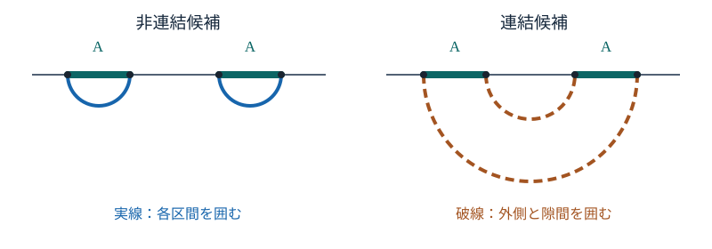

# HOLO19 homology条件と面積競合

[HOLO18の単一区間RT計算](../HOLO18/index.md#thm-holo18-interval-coefficient)は、純粋なPoincaré $AdS_3$ の一つの区間について正則化長を求めました。しかし境界が二つの区間からなる場合や、バルクに地平線がある場合は、**端点に届く曲線が一組に決まるとは限りません**。個々の曲線が測地線であるだけで、どの面を選んでよいか判断できるでしょうか。

本章は二つの操作を分離します。**(i) 境界部分領域とともにバルク領域を囲めるか（homology条件）**、**(ii) 許された停留候補のうち面積（$AdS_3$ では長さ）が最小か**、です。静的・時間反転対称な古典Einstein重力のRT処方を入力として採用し、境界のCFTエントロピーとの一致そのものを測地線計算から証明したとは主張しません。$L,G_3>0$、$\hbar=1$、自然対数、Lorentz符号 $(-,+,+)$ とします。

## 1. 端点一致だけでは不十分：homology条件

静的な時間断面を二次元の向き付け可能な空間 $\Sigma$ とします。境界時刻の部分領域 $A$ は $\Sigma$ の共形境界上にあり、その端点を $\partial A$ と書きます。長さは発散するため、境界近くでcutoffを入れ、どの候補にも同一の規約を使います。曲線の端点が $\partial A$ に一致することと、曲線が $A$ に対応する内側のバルク領域を区切ることは別です。

通常のRT処方でいう**homology（相同）条件**を、この二次元断面に限って説明します。境界上の $A$ とバルクの曲線の和が、ある二次元領域の「外周」となっていることを要求します。複数の成分を持つ領域も許し、曲線の長さは成分の和です。切り口の向きで符号を取り違えないよう、本章の領域境界の計算はまず係数 $\mathbb Z_2$（重なった辺を偶数回数えれば消える）で行います。

<!-- formal-statement-start -->
> **定義（静的RT面の相同条件）**  
> 静的漸近 $AdS_3$ 時間断面 $\Sigma$ の、同時刻の境界領域 $A$ を固定する。$\partial\gamma=\partial A$ を満たすバルク内の有限本の曲線の和 $\gamma$ が、$\Sigma$ 内の二次元領域 $R_A$ を選んで
>
$$
\partial R_A=A+\gamma\pmod2
$$
>
> と書けるとき、$\gamma$ は $A$ と相同であるという。地平線を境界とする外部領域を用いる場合、地平線の閉曲線を $\gamma$ の成分として含めてよいが、$A$ でも $\gamma$ でもない余分な境界を右辺へ残してはならない。境界cutoffで短い端点連結片を挿入する場合は、同じ規約で加えた後にcutoffを除く。
<!-- formal-statement-end -->

これは二次元断面上の具体的な領域境界による判定です。一般次元では $A$ と余次元2面の間を埋める**余次元1の領域**を用います。特に、$A$ と $\gamma$ を単に点集合として比較するだけの条件ではありません。

**定義から判定への橋渡し。** 一つの区間 $A=[x_1,x_2]$ に対し、[HOLO3の半円測地線](../HOLO3/index.md#thm-holo3-semicircle) $\gamma_{12}$ と境界区間の間には半円板状の $R_A$ が存在します。半円板の外周は上辺 $A$ と弧 $\gamma_{12}$ ですから $\partial R_A=A+\gamma_{12}$ となります。ここでいう「内側」は双曲計量での面積を別途積分して定義したのではなく、平面上の領域の境界として決まります。

<!-- definition-example-start: def-holo19-homology -->
**定義の確認**（二つの区間）。 $x_1<x_2<x_3<x_4$、$A=[x_1,x_2]\cup[x_3,x_4]$ とします。各区間の半円板を $R_{12},R_{34}$ と書けば、それらの和の境界は
$$
\partial(R_{12}+R_{34})
=(A_{12}+\gamma_{12})+(A_{34}+\gamma_{34})
=A+\gamma_{12}+\gamma_{34}.
$$
よって $\gamma_{\rm dis}=\gamma_{12}+\gamma_{34}$ は相同条件を満たします。一方、外側の半円板 $R_{14}$ から隙間の半円板 $R_{23}$ を除いた帯状領域について、$\mathbb Z_2$ では差も和であることを使うと
$$
\partial(R_{14}+R_{23})
=(A_{14}+\gamma_{14})+(A_{23}+\gamma_{23})
=A+\gamma_{14}+\gamma_{23}.
$$
$A_{14}+A_{23}=A_{12}+A_{34}$ を用いました。従って $\gamma_{\rm con}=\gamma_{14}+\gamma_{23}$ も相同です。二つとも**端点条件と相同条件を満たす**ため、この先は長さ比較が必要です。
<!-- definition-example-end -->

次の図は二候補の**位相的な模式図**です。横線上の二つの太線が同じ $A$ であり、実線・破線はそれぞれ候補の曲線を表します。曲線の見かけの高さを長さの大小と読んではいけません。計算には必ず双曲計量を使います。

## 2. 純AdSの二つの区間で連結候補が勝つとき

平面の $t=0$ 断面を
$$
h=\frac{L^2}{z^2}(dx^2+dz^2),\qquad z>0
$$
とし、四つの境界端点 $x_1<x_2<x_3<x_4$ を固定します。[AdS3区間半円の正則化長](../HOLO18/index.md#prop-holo18-regulated-length)によれば、端点距離 $d_{ij}=x_j-x_i>0$ にアンカーされた半円の長さは
$$
D_{ij,\epsilon}
=2L\log\frac{d_{ij}}{\epsilon}
+O\left(L\frac{\epsilon^2}{d_{ij}^2}\right),
\qquad \epsilon/d_{ij}\to0.
$$
すべての端点距離を固定し、$\epsilon\to0$ を同時に取ります。正確な有限cutoffの測地線と境界アンカーから切り出した弧を混同せず、**以下の候補比較は正則化を除く極限での古典RT主項**とします。

<!-- formal-statement-start -->
> **命題（二つの区間のRT候補と長さ差）**  
> Poincaré $AdS_3$ の静的真空で、$A=[x_1,x_2]\cup[x_3,x_4]$、$x_1<x_2<x_3<x_4$ とする。同じ境界cutoff $\epsilon$ を用いると、互いに交差しない端点接続の二候補は
>
$$
\gamma_{\rm dis}=\gamma_{12}\cup\gamma_{34},
\qquad
\gamma_{\rm con}=\gamma_{14}\cup\gamma_{23}.
$$
>
> どちらも $A$ と相同であり、正則化長の差は
>
$$
D_{\rm con}-D_{\rm dis}
=2L\log\frac{d_{14}d_{23}}{d_{12}d_{34}}
+o(1)\qquad(\epsilon\to0).
$$
>
> この二候補を比較する古典RT処方の下では、対数の比が1未満なら連結候補が、1より大きければ非連結候補が勝ち、等しいとき主次数で縮退する。交差する接続 $\gamma_{13}\cup\gamma_{24}$ は大域的な長さ最小候補にはならない。
<!-- formal-statement-end -->

### 証明の見取り図

前節で両候補の相同条件を直接確かめました。それぞれに既習の半円長を二回代入すると、四端点に共通するcutoff発散が消えます。交差する曲線は交点で切り替えて短くできるので、追加の勝者候補にはなりません。

<!-- proof-start -->
### 証明

相同条件は[定義の確認](#def-holo19-homology)で構成した領域 $R_{12}+R_{34}$ と $R_{14}+R_{23}$ から従います。長さは成分ごとに加法的なので、[HOLO18の正則化長](../HOLO18/index.md#prop-holo18-regulated-length)へ $(i,j)=(1,2),(3,4),(1,4),(2,3)$ をそれぞれ代入し、
$$
\begin{aligned}
D_{\rm dis}&=2L\log\frac{d_{12}d_{34}}{\epsilon^2}+o(1),\\
D_{\rm con}&=2L\log\frac{d_{14}d_{23}}{\epsilon^2}+o(1)
\end{aligned}
$$
を得ます。二式を引いて $\log \epsilon^2$ が消え、表示した差になります。

残りの接続 $(13)(24)$ の二弧は、端点が境界上に交互に現れるため双曲平面内で交わります。交点を $p$ とすれば、測地線の部分弧を $p$ でつなぎ直して $(12)(34)$ または $(14)(23)$ の端点を結ぶ曲線を作れます。各部分弧の長さの総和は元の二本と同じです。しかしつなぎ直した曲線は交点 $p$ に角を持ち、その近傍で角を丸めれば長さを**厳密に**短くできます（交差が接線を共有する退化の場合は二測地線が同じになり、四つの相異なる端点と矛盾します）。さらにそれぞれの端点対の[最短半円](../HOLO3/index.md#thm-holo3-semicircle)へ置き換えれば長さは増えません。従って交差候補は大域最小ではありません。

各候補の正則化長は同じcutoff規約です。$\epsilon\to0$ 後に非零の長さ差の符号は対数比で定まります。等号の場合は古典主項の範囲で縮退します。量子補正での縮退の解消はここからは分かりません。
<!-- proof-end -->

**等しい二つの区間で計算する。** 区間長を $a>0$、隙間を $b>0$ として
$$
(x_1,x_2,x_3,x_4)=(0,a,a+b,2a+b)
$$
を代入します。差は
$$
D_{\rm con}-D_{\rm dis}
=2L\log\frac{b(2a+b)}{a^2}+o(1).
$$
よって $u=b/a>0$ に対して $u(2+u)<1$、すなわち $0<u<\sqrt2-1$ のとき連結候補が短い。$a=1,b=1/4$ なら比は $(1/4)(9/4)=9/16$ なので連結候補が勝ち、$a=b=1$ なら比は3なので非連結候補が勝ちます。

境界エントロピーの組合せとしては、[HOLO17の正則化エントロピーデータ](../HOLO17/index.md#def-holo17-boundary-data)を用い、同一状態・同一cutoffの相互情報量 $I(A_1:A_2)=S(A_1)+S(A_2)-S(A_1\cup A_2)$ を考えます。**古典RT処方を仮定し** [HOLO18の係数](../HOLO18/index.md#thm-holo18-interval-coefficient)を代入すると、等長区間の場合は
$$
I^{(0)}(A_1:A_2)
=\frac{c}{3}\max\left\{0,\log\frac{a^2}{b(2a+b)}\right\}.
$$
ここで $c=3L/(2G_3)$ は純三次元Einstein重力とBrown–Henneaux条件での中央電荷です。非連結相で右辺が零なのは**古典的主次数**についてだけであり、有限 $G_3$ の相互情報量が厳密に零という意味ではありません。

## 3. BTZでは補集合の測地線だけを使えない

[HOLO16の非回転BTZ外部領域](../HOLO16/index.md#def-holo16-btz)の計量と、[同章の地平線熱力学](../HOLO16/index.md#prop-holo16-btz-thermo)を使います。
$$
ds^2=-\frac{r^2-r_+^2}{L^2}dt^2
+\frac{L^2}{r^2-r_+^2}dr^2+r^2d\phi^2,\quad
r>r_+,\quad \phi\sim\phi+2\pi.
$$
$t=0$ の片側外部断面は、外側に境界円 $B$、内側に地平線円 $H$ を持つ**環状の領域**です。ここで $H$ は曲線そのものを表し、その長さは $H_{\rm len}=2\pi r_+$ と区別します。境界での空間円周を $R=2\pi L$ とし、境界区間 $A$ の長さを $0<\ell<R$、補区間 $A^c$ の長さを $R-\ell$ とします。$B=A+A^c$（端点はmod 2で扱う）です。

$a=A^c$ について境界 $A^c$ とそれを結ぶ測地線 $\gamma_{A^c}$ の間の小帯 $R_{A^c}$ は $\partial R_{A^c}=A^c+\gamma_{A^c}$ を満たします。しかし **$\gamma_{A^c}$ 単独を $A$ のRT面として選ぶことはできません**。環全体の境界が $\partial\Sigma=B+H$ であることを利用すると、
$$
\partial(\Sigma+R_{A^c})
=(B+H)+(A^c+\gamma_{A^c})
=A+H+\gamma_{A^c}.
$$
従って $A$ に相同なのは $\gamma_{A^c}\cup H$ という**地平線を加えた候補**です。一方 $A$ と $\gamma_A$ の間の帯の境界は $A+\gamma_A$ なので、直接の測地線 $\gamma_A$ も許されます。ここでの環状領域は片側外部の時間対称断面における相同判定であり、二境界BTZの橋全体と同一視しません。

<!-- formal-statement-start -->
> **命題（BTZの二候補と地平線の必要性）**  
> 非回転BTZ片側外部の静的環状時間断面で $0<\ell<R=2\pi L$ の一つの境界区間 $A$ を考える。境界アンカーが同一で、地平線円を成分に含められる静的RT候補には
>
$$
\gamma_{\rm dir}=\gamma_A,\qquad
\gamma_{\rm hor}=\gamma_{A^c}\cup H
$$
>
> があり、両者は $A$ と相同である。補集合を結ぶ $\gamma_{A^c}$ **だけ**では $A$ と相同でない。$H$ の長さは $H_{\rm len}=2\pi r_+$ である。
<!-- formal-statement-end -->

### 証明の見取り図

環の境界 $B+H$ と、補区間を埋める小帯の境界 $A^c+\gamma_{A^c}$ を足します。$A^c$ が二度現れて消えることが、地平線円が候補に残る理由です。

<!-- proof-start -->
### 証明

$R_A$ を $A$ と直接測地線の間の小帯とすれば $\partial R_A=A+\gamma_A$ です。他方、$\partial R_{A^c}=A^c+\gamma_{A^c}$ と $\partial\Sigma=A+A^c+H$ を足して
$$
\partial(\Sigma+R_{A^c})
=A+A^c+H+A^c+\gamma_{A^c}
=A+H+\gamma_{A^c}
$$
となります。ここで $A^c+A^c=0$ は係数 $\mathbb Z_2$ の和です。地平線円を除いて $\partial R=A+\gamma_{A^c}$ とする領域がないことも確認します。もしそのような $R$ があれば、既に構成した $R_{A^c}$ と足すと
$
\partial(R+R_{A^c})=A+A^c=B
$
となります。しかし環を小三角形に分割して $\mathbb Z_2$ 係数で考えると、外側境界 $B$ の各辺を境界に持つためには、その辺に接する三角形の係数は1です。内部で余分な境界辺を生じないには隣接三角形の係数も1でなければならず、連結な環の全三角形を選ぶことになります。その境界は $B+H$ であり、$B$ だけにはできません。従って矛盾します。地平線上の誘導線素は $ds=r_+d\phi$ だから、$\phi$ を0から $2\pi$ まで積分すると $H_{\rm len}=\int_0^{2\pi}r_+\,d\phi=2\pi r_+$ です。
<!-- proof-end -->

**失われる仮定。** 境界の円周上で状態が純粋なら $S(A)=S(A^c)$ が期待されますが、片側BTZに対応する[TFDの片側熱状態](../HOLO16/index.md#prop-holo16-partial-trace)は混合状態です。従って一般に二つのエントロピーは等しくありません。地平線を無視した「いつでも短い補集合の弧を使う」という処方は、相同条件を破るだけでなく、熱状態の全境界エントロピーを再現できなくします。

## 4. BTZ測地線長を計量から再現する

境界円の座標間隔を $\Delta\phi=\ell/L$ とします。外部の時間断面の計量は
$$
h=\frac{L^2}{r^2-r_+^2}dr^2+r^2d\phi^2.
$$
両端が外側境界にあり、最も深い位置が $r_*>r_+$ である同時刻測地線を考えます。固有長 $s$ をパラメータに選び、上付きの点を固有長による微分 $d/ds$ と定義すれば $h(\dot\gamma,\dot\gamma)=1$ です。測地線のLagrange関数
$
\mathcal L=\frac12\left(\frac{L^2\dot r^2}{r^2-r_+^2}+r^2\dot\phi^2\right)
$
は $\phi$ に陽に依存しないため、Euler–Lagrange方程式から
$
\frac{d}{ds}\frac{\partial\mathcal L}{\partial\dot\phi}
=\frac{\partial\mathcal L}{\partial\phi}=0,
\qquad J=\frac{\partial\mathcal L}{\partial\dot\phi}=r^2\dot\phi
$
が一定です。角度が増加する枝を選ぶと、折返し点 $\dot r=0$ での規格化 $1=r_*^2\dot\phi^2$ より $J=r_*$ です。規格化式を解くと
$$
\frac{dr}{ds}
=\frac{\sqrt{(r^2-r_+^2)(r^2-r_*^2)}}{Lr},
\qquad
\frac{d\phi}{dr}
=\frac{Lr_*}{r\sqrt{r^2-r_+^2}\sqrt{r^2-r_*^2}}.
$$
前者は外へ向かう半分を表示しました。両端が境界 $r\to\infty$ にあるので、角度差の半分は $r_*$ から無限遠までの積分です。$u=\sqrt{r^2-r_*^2}$、$a^2=r_*^2-r_+^2>0$ を用い、さらに $u=a\sinh v$、$w=\tanh v$ と置くと
$$
\begin{aligned}
\frac{\Delta\phi}{2}
&=Lr_*\int_0^\infty\frac{du}{(u^2+r_*^2)\sqrt{u^2+a^2}}\\
&=Lr_*\int_0^1\frac{dw}{r_*^2-r_+^2w^2}
=\frac{L}{r_+}\operatorname{artanh}\frac{r_+}{r_*}.
\end{aligned}
$$
従って
$$
r_*=r_+\coth\left(\frac{r_+\ell}{2L^2}\right).
$$
次に半分の長さは
$$
\begin{aligned}
\frac{D_\ell(r_c)}2
&=\int_{r_*}^{r_c}
\frac{Lr\,dr}{\sqrt{r^2-r_+^2}\sqrt{r^2-r_*^2}}\\
&=L\operatorname{arsinh}
\frac{\sqrt{r_c^2-r_*^2}}{\sqrt{r_*^2-r_+^2}},
\end{aligned}
$$
です。これは $u=\sqrt{r^2-r_*^2}$ を用いると $L\int_0^{\sqrt{r_c^2-r_*^2}}du/\sqrt{u^2+a^2}$ になることから導けます。

<!-- formal-statement-start -->
> **命題（BTZ境界区間の正則化測地線長）**  
> $L,r_+>0$ の非回転BTZ外部で、角度差 $0<\Delta\phi<2\pi$ の境界二点を巻き数0の同時刻測地線で結ぶ。境界代表計量の距離を $\ell=L\Delta\phi$、$r_c\to\infty$ のcutoffを $\epsilon=L^2/r_c$、[BTZの逆温度](../HOLO16/index.md#prop-holo16-btz-thermo)を $\beta=2\pi L^2/r_+$ とする。この境界アンカー測地線を $r\le r_c$ で切った長さの主項は
>
$$
D_\ell(r_c)=2L\log\left[
\frac{\beta}{\pi\epsilon}
\sinh\left(\frac{\pi\ell}{\beta}\right)
\right]+o(1)
\quad(r_c\to\infty;\ \ell,L,r_+\text{固定}).
$$
>
> 同じcutoffの下で $\ell$ を $R-\ell$ に変えた式も成り立つ。これは**候補曲線の長さ**であって、どの候補がRT面かをまだ選んでいない。
<!-- formal-statement-end -->

### 証明の見取り図

上で求めたturning pointを長さ積分へ代入します。$\coth^2u-1=\operatorname{csch}^2u$ を用いると、長さの対数内に $\sinh(\pi\ell/\beta)$ が現れます。

<!-- proof-start -->
### 証明

$u=r_+\ell/(2L^2)$ とおくと上の第一積分から $r_*=r_+\coth u$ です。したがって
$$
\sqrt{r_*^2-r_+^2}
=r_+\sqrt{\coth^2u-1}
=\frac{r_+}{\sinh u}.
$$
$r_c\to\infty$ で $\operatorname{arsinh}y=\log(2y)+O(y^{-2})$、$\sqrt{r_c^2-r_*^2}=r_c[1+O(r_*^2/r_c^2)]$ を固定した $r_*$ に使うと
$$
D_\ell(r_c)
=2L\log\left(\frac{2r_c}{r_+}\sinh u\right)+o(1).
$$
[非回転BTZの温度と熱力学](../HOLO16/index.md#prop-holo16-btz-thermo)より $r_+=2\pi L^2/\beta$、$\epsilon=L^2/r_c$ なので
$$
\frac{2r_c}{r_+}=\frac{\beta}{\pi\epsilon},
\qquad
u=\frac{r_+\ell}{2L^2}=\frac{\pi\ell}{\beta}.
$$
代入して表示式が得られます。この導出は外部計量での**長さ積分**に関するもので、熱CFTのエントロピーとの同定にはRT処方が別途必要です。
<!-- proof-end -->

[HOLO17が示した熱直線CFTの区間結果](../HOLO17/index.md#def-holo17-boundary-data)には同じ $\sinh$ が現れます。ただしここは空間が**有限円周**であり、熱直線の式を大域的なエントロピー公式として流用できません。候補比較と地平線を含むhomologyを検査した後で、BTZサドルの古典面積項として解釈します。

## 5. 地平線を含む候補への切替と熱的エントロピー

$k=\pi/\beta>0$、$R=2\pi L$ と書き、前節の共通発散を除いて候補長を比較します。直接候補は $D_{\rm dir}=D_\ell$、地平線つき候補は $D_{\rm hor}=D_{R-\ell}+2\pi r_+$。差を $4G_3$ で割った式の符号を調べればよいので、まず長さで計算します。
$$
\begin{aligned}
D_{\rm dir}-D_{\rm hor}
&=2L\log\frac{\sinh(k\ell)}{\sinh(k(R-\ell))}
-2\pi r_++o(1)\\
&=2L\left[
\log\frac{\sinh(k\ell)}{\sinh(k(R-\ell))}
-kR\right]+o(1).
\end{aligned}
$$
最後の変形では $2\pi r_+/(2L)=\pi r_+/L=kR$ を使いました。

<!-- formal-statement-start -->
> **命題（非回転BTZの古典RT候補の切替）**  
> 上記BTZ静的サドル、共通の境界cutoff、$R=2\pi L$、$\beta=2\pi L^2/r_+$ を仮定し、同時刻の二候補 $\gamma_A$ および $\gamma_{A^c}\cup H$ の古典RT長を比較する。$\epsilon\to0$ 後に $0<\ell<R$ を固定したとき、等長となる切替点は唯一で
>
$$
\ell_*=\frac{\beta}{2\pi}
\log\frac{1+\exp(2\pi R/\beta)}{2}.
$$
>
> $0<\ell<\ell_*$ では直接候補、$\ell_*<\ell<R$ では地平線つき候補が短い。古典RT処方を適用するなら、先頭のエントロピーは候補長の小さい方を $4G_3$ で割った値になる。この主張は指定したBTZサドル内の比較であり、境界CFTの全状態・全温度に対する厳密公式ではない。
<!-- formal-statement-end -->

### 証明の見取り図

長さ差を $\ell$ で微分すると正になるため、切替は一度しか起こりません。等長式を指数関数へ直せば、切替点を陽に解けます。

<!-- proof-start -->
### 証明

比較用に
$$
F(\ell)=\log\sinh(k\ell)-\log\sinh(k(R-\ell))-kR
$$
を定義します。$0<\ell<R$ では両方の $\sinh$ は正で、
$$
F'(\ell)
=k\coth(k\ell)+k\coth(k(R-\ell))>0
$$
です。$F(R/2)=-kR<0$、$\ell\to R$ では二番目の対数が $-\infty$ に向かうので $F(\ell)\to+\infty$。従って中間値の定理と狭義単調性で一意の $\ell_*\in(R/2,R)$ が存在します。

$F(\ell_*)=0$ は
$$
\sinh(k\ell_*)=e^{kR}\sinh(k(R-\ell_*))
$$
と同値です。両辺を指数関数で展開して $2$ 倍すると
$$
e^{k\ell_*}-e^{-k\ell_*}
=e^{2kR-k\ell_*}-e^{k\ell_*}.
$$
これを移項し $e^{k\ell_*}>0$ を掛ければ
$$
2e^{2k\ell_*}=1+e^{2kR},
\qquad
\ell_*=\frac1{2k}\log\frac{1+e^{2kR}}2.
$$
$k=\pi/\beta$ を戻して表示式を得ます。差 $D_{\rm dir}-D_{\rm hor}=2LF+o(1)$ の符号により短い候補が決まります。
<!-- proof-end -->

**全境界への近づき方。** 高温側で $kR\gg1$ なら
$$
\ell_*
=R-\frac{\log2}{2k}
+\frac1{2k}\log(1+e^{-2kR}),
$$
なので切替は全円周に近い位置で起きます。$\ell\to R$ を**固定したcutoffのまま**取り $\ell_{A^c}\lesssim\epsilon$ として上の対数式を流用してはいけません。先にcutoffを除き、補区間の長さがcutoffより十分大きい領域で候補比較を行います。全境界 $A=B$ 自身では $\partial A=\varnothing$ であり、空の曲線と地平線が別の相同類に属します。片側の熱状態に対応する相同条件を満たす地平線の長さから $S_{\rm BH}=H_{\rm len}/(4G_3)=2\pi r_+/(4G_3)$ を得ます。これは[HOLO16のBTZエントロピー](../HOLO16/index.md#prop-holo16-btz-thermo)と一致します。

**三つの区別。** まず各候補内で長さを変分して停留曲線を求めます。次にhomology条件によって、境界領域に対応する候補として許されるかを判定します。最後に、許された複数の候補の長さを比較してRT面を選びます。境界の量子補正とQESは後のHOLO23・HOLO24で別途扱う課題であり、ここでの古典的な候補選択に無条件に含めてはいけません。

## 6. 演習：領域の境界から切替を自力で追う

### Level A：定義・係数・地平線

**A1. 相同条件の境界計算。** $x_1<x_2<x_3<x_4$ において $\partial R_{ij}=A_{ij}+\gamma_{ij}$ とする。$R_{14}+R_{23}$ の境界が $A_{12}+A_{34}+\gamma_{14}+\gamma_{23}$ になることを $\mathbb Z_2$ で示せ。
- Level: A
<!-- solution-start -->
**詳細解答。** 境界演算は加法的なので $\partial(R_{14}+R_{23})=A_{14}+\gamma_{14}+A_{23}+\gamma_{23}$。区間を $A_{14}=A_{12}+A_{23}+A_{34}$ と分割すると、$A_{23}+A_{23}=0$ だから $A_{14}+A_{23}=A_{12}+A_{34}$。従って求める境界式になる。$\partial A$ の四点が合うだけでなく、実際に領域 $R_{14}+R_{23}$ を構成して境界を計算した。
<!-- solution-end -->

**A2. 二候補の長さ。** $a=2,b=1,L>0$、$\epsilon\to0$ として $A=[0,2]\cup[3,5]$ の二候補の正則化長の主項と勝者を求めよ。
- Level: A
<!-- solution-start -->
**詳細解答。** 距離は $d_{12}=d_{34}=2$、$d_{23}=1$、$d_{14}=5$。[二候補の長さ差](#prop-holo19-two-pairings)の導出と同じく、$D_{\rm dis}=2L\log(4/\epsilon^2)+o(1)$、$D_{\rm con}=2L\log(5/\epsilon^2)+o(1)$。差は $2L\log(5/4)>0$ であるから非連結候補が勝つ。cutoffは両候補で共通なので差に残らない。
<!-- solution-end -->

**A3. 連結相の閾値。** 等しい二つの区間長 $a>0$ と隙間 $b>0$ のとき、連結候補が短い範囲を $b/a$ で求めよ。
- Level: A
<!-- solution-start -->
**詳細解答。** $d_{14}=2a+b,d_{23}=b,d_{12}=d_{34}=a$ から長さ差の対数内は $b(2a+b)/a^2$。$u=b/a>0$ と置くと[二候補の長さ差](#prop-holo19-two-pairings)から連結候補の条件は $u^2+2u-1<0$。平方完成して $(u+1)^2<2$、$u>0$ と合わせて $0<u<\sqrt2-1$。等号は主項での縮退である。
<!-- solution-end -->

**A4. BTZの単位と地平線。** $r_+=2L$ とした非回転BTZで $\beta,R,H_{\rm len},S_{\rm BH}$ を $L,G_3$ で求めよ。
- Level: A
<!-- solution-start -->
**詳細解答。** [HOLO16の温度](../HOLO16/index.md#prop-holo16-btz-thermo)から $\beta=2\pi L^2/r_+=\pi L$。境界代表計量の空間円周は $R=2\pi L$。地平線の誘導線素は $r_+d\phi$ なので $H_{\rm len}=\int_0^{2\pi}r_+\,d\phi=4\pi L$。古典面積エントロピーは $H_{\rm len}/(4G_3)=\pi L/G_3$。ここでは $\beta=R/2$ である。
<!-- solution-end -->

**A5. 地平線を忘れると何が残るか。** BTZの環状断面で $\partial\Sigma=A+A^c+H$、$\partial R_{A^c}=A^c+\gamma_{A^c}$ とする。二領域の和の境界を計算し、$\gamma_{A^c}$ のみでは不十分な理由を述べよ。
- Level: A
<!-- solution-start -->
**詳細解答。** $\partial(\Sigma+R_{A^c})=A+A^c+H+A^c+\gamma_{A^c}=A+H+\gamma_{A^c}$。従って $A$ と相同な候補には $H$ が含まれる。$H$ を除くと境界式の右辺に未処理の地平線円が残り、環の穴を一周する非自明なサイクルの差が消えない。端点は $\partial\gamma_{A^c}=\partial A$ でも、相同条件は満たさない。
<!-- solution-end -->

### Level B：非自明な導出と反例

**B1. 交差候補を棄却する。** 四端点の対 $(13)(24)$ を結ぶ二本の双曲測地線が内部で交わるとする。なぜその二本が全体の長さ最小になれないか説明せよ。
- Level: B
<!-- solution-start -->
**詳細解答。** この $z>0$ の双曲平面模型で境界点が交互に並ぶので、二本の弧は内部点 $p$ で交差する。$p$ でそれぞれの弧を前半・後半に切り、異なる後半を交換すると同じ四端点を結ぶが、総延長は変わらない曲線ができる。交換後の各曲線は $p$ で折れている。双曲計量は $z>0$ で滑らかな正定値なので、交点の十分小さい近傍で角を丸めれば局所長が厳密に短くなる。さらに[HOLO3の最短測地線](../HOLO3/index.md#thm-holo3-semicircle)へ置換すれば長さは増えない。よって元の交差候補は最小ではない。$p$ がcutoffより内側にあるよう十分小さいcutoffを選べば論証は正則化後も成立する。
<!-- solution-end -->

**B2. 相互情報量の古典主項。** 二つの長さ $a$ の区間が距離 $b$ 離れる。古典RT係数 $S^{(0)}(d)=(c/3)\log(d/\epsilon)$ を各半円に適用し、相互情報量の主項を導け。$a=1,b=1/4$ の値も求めよ。
- Level: B
<!-- solution-start -->
**詳細解答。** 単一区間二つの和は $(2c/3)\log(a/\epsilon)$。和領域の候補エントロピーは非連結なら同じ値、連結なら $(c/3)[\log((2a+b)/\epsilon)+\log(b/\epsilon)]$。[二候補の長さ比較](#prop-holo19-two-pairings)によって小さい方を $S^{(0)}(A_1\cup A_2)$ とすれば差は $(c/3)\max\{0,\log(a^2/[b(2a+b)])\}$。$a=1,b=1/4$ では $b(2a+b)=9/16$ なので $I^{(0)}=(c/3)\log(16/9)$。非連結相の零は $O(G_3^{-1})$ の主項に限り、量子補正を零とはしない。
<!-- solution-end -->

**B3. BTZの第一積分。** 非回転BTZの $t=0$ 計量から固有長パラメータでの $J=r^2\dot\phi$ と $\dot r$ の式を求め、$r_*$ を $\beta,\ell$ で表せ。
- Level: B
<!-- solution-start -->
**詳細解答。** 計量は $L^2dr^2/(r^2-r_+^2)+r^2d\phi^2$ で $\phi$ に陽に依存しないから、長さを固有長 $s$ で規格化すると $J=r^2\,d\phi/ds$ は一定。折返し点で $dr/ds=0$ なので $1=r_*^2(d\phi/ds)^2$、右向きの枝で $J=r_*$。従って $1=L^2\dot r^2/(r^2-r_+^2)+r_*^2/r^2$、これを解いて $\dot r=\sqrt{(r^2-r_+^2)(r^2-r_*^2)}/(Lr)$。比を取ると $d\phi/dr=Lr_*/[r\sqrt{r^2-r_+^2}\sqrt{r^2-r_*^2}]$。$u=\sqrt{r^2-r_*^2}$、次いで $w=u/\sqrt{u^2+r_*^2-r_+^2}$ とすると $\Delta\phi/2=Lr_*\int_0^1dw/(r_*^2-r_+^2w^2)=(L/r_+)\operatorname{artanh}(r_+/r_*)$。$\ell=L\Delta\phi$、$r_+=2\pi L^2/\beta$ を代入して $r_*=r_+\coth(\pi\ell/\beta)$。
<!-- solution-end -->

**B4. BTZの切替点。** $k=\pi/\beta$、$R=2\pi L$ とし、$F(\ell)=\log[\sinh(k\ell)/\sinh(k(R-\ell))]-kR$ を用いて切替点が一つだけであること、$\ell_*>R/2$ を示せ。
- Level: B
<!-- solution-start -->
**詳細解答。** $0<\ell<R$ で $F'(\ell)=k[\coth(k\ell)+\coth(k(R-\ell))]>0$。また $F(R/2)=-kR<0$ で $\ell\uparrow R$ において $F\to+\infty$ なので零点は一つだけで $R/2$ より右にある。等式 $\sinh(k\ell_*)=e^{kR}\sinh(k(R-\ell_*))$ を指数で展開すると $2e^{2k\ell_*}=1+e^{2kR}$。従って $\ell_*=(2k)^{-1}\log[(1+e^{2kR})/2]$。この式は長さ差の主項の零点で、cutoffを有限に固定した正確な転移点とは断定しない。
<!-- solution-end -->

### Level C：二種類の相同条件を統合する

**C1. 二つのRT相転移を比較する。** (i) Poincaré $AdS_3$ 真空の $[0,a]\cup[a+b,2a+b]$、(ii) 片側BTZの円周長 $R=2\pi L$ に対する長さ $\ell$ の一区間について、各々の許された二候補を構成し、切替条件を導け。さらに「熱状態でも補集合の測地線だけを候補にする」という誤りを、領域境界とエントロピーの双方から反証せよ。
- Level: C
<!-- solution-start -->
**詳細解答。** (i) 二つの半円板 $R_{12}+R_{34}$ の境界は $A+\gamma_{12}+\gamma_{34}$。外半円板と隙間の半円板 $R_{14}+R_{23}$ の和の境界は $A+\gamma_{14}+\gamma_{23}$。従って両方相同であり、候補の長さ差は [二候補の命題](#prop-holo19-two-pairings)へ $d_{12}=d_{34}=a,d_{23}=b,d_{14}=2a+b$ を代入して $2L\log[b(2a+b)/a^2]$。$u=b/a$ と置けば $u^2+2u<1$、すなわち $u<\sqrt2-1$ のとき連結候補が勝つ。

(ii) BTZ外部断面 $\Sigma$ は環であり、$\partial\Sigma=A+A^c+H$。直接候補 $\gamma_A$ については帯 $R_A$ の $\partial R_A=A+\gamma_A$ がある。補集合候補については $\partial(\Sigma+R_{A^c})=A+\gamma_{A^c}+H$ なので $\gamma_{A^c}\cup H$ だけが許される。共通のcutoffを用いた[BTZ測地線長](#prop-holo19-btz-geodesic)は $D_d=2L\log[(\beta/(\pi\epsilon))\sinh(\pi d/\beta)]+o(1)$。従って $D_{\rm dir}-D_{\rm hor}=2L[\log(\sinh(k\ell)/\sinh(k(R-\ell)))-kR]+o(1)$（$k=\pi/\beta$）。等長式を指数へ直すと $2e^{2k\ell_*}=1+e^{2kR}$、よって $\ell_*=\log[(1+e^{2kR})/2]/(2k)$。単調性 $F'(\ell)>0$ から $\ell<\ell_*$ では直接、$\ell>\ell_*$ では地平線つき候補が勝つ。

$\gamma_{A^c}$ 単独は $\partial R=A+\gamma_{A^c}$ を満たす領域を環に作れず、周回の相同類が違う。さらに $A=B$ なら熱状態の全境界エントロピーの古典値は[BTZ地平線エントロピー](../HOLO16/index.md#prop-holo16-btz-thermo) $H/(4G_3)>0$ だが、補集合が空というだけで空曲線を選ぶ誤った処方は零を与える。これは熱状態を純粋な全境界状態と誤認したことになる。両模型とも**homologyを先に検査し、許された候補を面積で比較する**が、純AdSの単連結断面とBTZの環状断面では許される候補の構成が異なる。
<!-- solution-end -->

## 7. 得られた範囲と次講への橋

ここで証明したのは、指定した静的模型での**相同判定、候補の測地線長、長さ差と切替**です。RTによる境界エントロピーへの翻訳は古典的な半古典サドルにおける処方であり、有限 $G_3$ での全CFTの厳密な定理ではありません。面を切り貼りするとエントロピー不等式を導ける理由は次のHOLO20で扱います。時刻依存の場合のHRT面、バルク場の量子補正、QESの極値化は、それぞれ追加の仮定と定義を要します。
