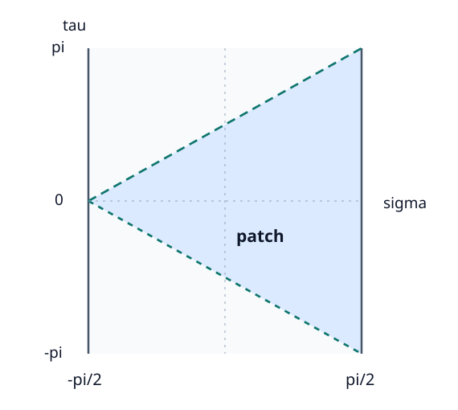

# HOLO2 座標と共形境界

<!-- definition-example-audit: strict -->

[HOLO1のglobal計量](../HOLO1/index.md#prop-holo1-global-metric)では、曲率半径 $L$ の反de Sitter（AdS）時空を全空間にわたる座標で記述しました。しかし $r\to\infty$ はどこまで遠いのでしょうか。光はそこへ届くのでしょうか。また、AdS/CFTで使う平坦な境界座標は、球面を持つglobal座標とどのようにつながるのでしょうか。

本講では遠方を有限の座標へ移して**共形境界**を調べ、次に平坦な境界が見える**Poincaré座標**を埋め込みから導きます。両者は同じ局所AdS計量を表しますが、覆う領域も境界で見える座標範囲も異なります。

整数 $d\ge2$、長さ $L>0$ とし、時空次元は $d+1$、単位は $c=1$ とします。時間方向一つが負の $(-,+,\ldots,+)$ 計量を用います。$\mathrm{AdS}_{d+1}$ は特に断らなければ[HOLO1で定義した時間をほどいた普遍被覆](../HOLO1/index.md#def-holo1-universal-cover)です。$G_N$、$\hbar$、場の作用や双対性はまだ用いません。

## 1. 無限遠を有限の動径座標に移す

[global計量](../HOLO1/index.md#prop-holo1-global-metric)の動径 $r\ge0$ を $r=L\tan\rho$ と置き換えます。$r$ が $0$ から無限大まで動く間に、無次元の $\rho$ は $0\le\rho<\pi/2$ を動きます。さらに $\tau=t_{\mathrm g}/L\in\mathbb R$ を無次元時刻とし、$t_{\mathrm g}$ をglobal時刻と呼びます。球面座標の計量は $d\Omega_{d-1}^2$ と書きます。

$$
dr=L\sec^2\rho\,d\rho,\qquad
1+\frac{r^2}{L^2}=\sec^2\rho,\qquad
r^2=L^2\tan^2\rho.
$$

これらを一項ずつ代入すると、時刻項は $-L^2\sec^2\rho\,d\tau^2$、動径項は $L^2\sec^2\rho\,d\rho^2$、球面項は $L^2\sec^2\rho\sin^2\rho\,d\Omega_{d-1}^2$ です。従って

$$
ds^2=\frac{L^2}{\cos^2\rho}
\left(-d\tau^2+d\rho^2+\sin^2\rho\,d\Omega_{d-1}^2\right).
$$

括弧内は $\rho=\pi/2$ でも有限です。ただし元の時空に $\rho=\pi/2$ の点が加わったわけではありません。計量が発散する係数を一度取り除き、「無限遠で何が残るか」を調べます。Lorentz計量 $g$ に正の関数の二乗を掛けても $g(v,v)=0$ の零方向が変わらないことが、この方法の鍵です。

### 1.1 共形的に境界を付ける

[GEO8で定義した境界付き多様体](../../../幾何系/GEO/GEO8/index.md#def-geo8-manifold-with-boundary)では、境界点の近くを半空間の座標で扱えます。global AdSでは、空間の方向を $\boldsymbol n\in S^{d-1}$ として $\boldsymbol q=\rho\boldsymbol n$ を使い、$|\boldsymbol q|\le\pi/2$ の閉球まで動径範囲を広げた $\overline M=\mathbb R_\tau\times\{\boldsymbol q\in\mathbb R^d:|\boldsymbol q|\le\pi/2\}$ を考えます。$\rho=0$ では $\boldsymbol n$ が定まらなくても、$\boldsymbol q=0$ は普通の内部点です。

この広げた空間の内部で正、付け加えた境界でだけゼロになる滑らかな関数 $\omega$ を探します。境界で $d\omega\ne0$ は、$\omega=0$ が境界に垂直な方向へ一次で変化し、滑らかな一枚の境界を指定するための条件です。

<!-- formal-statement-start -->
> **定義（共形コンパクト化と共形境界）**
> Lorentz多様体 $(M,g)$ が、滑らかな境界付き多様体 $\overline M$ の内部であるとする。次の条件を満たす滑らかな関数 $\omega$ を取る。
>
> - $\omega$ は内部で正、境界 $\partial\overline M$ でゼロ、かつ境界上で $d\omega\ne0$ である。
> - $\overline g=\omega^2g$ は境界まで滑らかな非退化Lorentz計量として延長される。
>
> このとき、この組を**共形コンパクト化**と呼ぶ。$\omega$ を境界定義関数、$\partial\overline M$ を**共形境界**と呼ぶ。境界そのものがコンパクトであることは要求しない。
<!-- formal-statement-end -->

<!-- definition-example-start: def-holo2-conformal-compactification -->
**定義の確認**： global AdSで $\omega=\cos\rho/L$ と取ると内部 $0\le\rho<\pi/2$ で正、$\rho=\pi/2$ でゼロです。境界で

$$
d\omega=-\frac{\sin\rho}{L}\,d\rho
\longrightarrow-\frac1L\,d\rho\ne0.
$$

さらに

$$
\overline g=\omega^2g
=-d\tau^2+d\rho^2+\sin^2\rho\,d\Omega_{d-1}^2
$$

は境界まで滑らかで、そこでの符号は一つが負、残りが正です。中心 $\rho=0$ の球面角度は極座標と同様に退化しますが、$\boldsymbol q=\rho\boldsymbol n$ を使えば滑らかな内部点です。実際、$s(\rho)=\sin\rho/\rho$、$s(0)=1$ とおくと空間計量は

$$
d\rho^2+\sin^2\rho\,d\Omega_{d-1}^2
=s(\rho)^2\sum_{i=1}^d(dq^i)^2
+\frac{1-s(\rho)^2}{\rho^2}\left(\sum_{i=1}^dq^i\,dq^i\right)^2.
$$

$s(\rho)^2=1-\rho^2/3+O(\rho^4)$ なので最後の係数も $\rho=0$ へ滑らかに延長します。$\omega=\cos|\boldsymbol q|/L$ も中心で滑らかです。従って新しい境界だけでなく内部を含む $\overline M$ 全体で必要な滑らかさが成り立ち、定義の全条件を確認しました。
<!-- definition-example-end -->

境界上の計量は $\overline g$ を境界に接するベクトルへ制限して得ます。しかし $\omega$ は一意ではありません。正の関数を掛け直すと長さは変わる一方、光の方向は変わりません。そこで特定の境界計量ではなく、正の倍数を同一視します。

<!-- formal-statement-start -->
> **定義（境界計量の共形類）**
> 共形コンパクト化の境界 $\mathscr I=\partial\overline M$ で、$\overline g$ の接方向への制限 $h$ が非退化Lorentz計量であるとする。$\mathscr I$ 上の滑らかな実関数 $f$ に対する $h'=e^{2f}h$ を $h$ と共形同値と呼び、同値な計量の集合 $[h]$ を**境界計量の共形類**と呼ぶ。
<!-- formal-statement-end -->

<!-- definition-example-start: def-holo2-boundary-class -->
**定義の確認**： $\omega'=2\omega$ とすると $\omega'>0$ は内部で保たれ、境界で $\omega'=0$、$d\omega'=2d\omega\ne0$ です。新しい延長計量は $\overline g'=4\overline g$ なので境界では $h'=4h=e^{2\log2}h$。任意の接ベクトル $v$ に対して $h'(v,v)=4h(v,v)$ ですから、零方向と時間・空間の区別も保たれます。二つの関数は別の計量代表を与えますが、同じ $[h]$ を表します。
<!-- definition-example-end -->

### 1.2 global境界の因果構造

<!-- formal-statement-start -->
> **命題（global AdSの共形境界と径方向零曲線）**
> $d\ge2$、$L>0$ の時間をほどいたglobal $\mathrm{AdS}_{d+1}$ で、$r=L\tan\rho$、$\tau=t_{\mathrm g}/L$ とする。$\omega=\cos\rho/L$ による共形境界は $\mathscr I\cong\mathbb R_\tau\times S^{d-1}$ であり、その共形類は次の計量で代表される。

$$
h_{\mathrm{cyl}}=-d\tau^2+d\Omega_{d-1}^2.
$$

> 角度一定の径方向零曲線は $d\tau=\pm d\rho$ を満たす。中心 $\rho=0$ からの外向き零曲線は $\Delta\tau=\pi/2$ で共形境界に到達する。
<!-- formal-statement-end -->

### 証明の見取り図

共形因子を外せば境界上で径方向成分 $d\rho$ は消え、時間と球面の計量だけが残ります。正の因子 $L^2/\cos^2\rho$ を外しても零条件は同じなので、径方向の光は $\tau$–$\rho$ 平面で傾き $\pm1$ の直線です。

<!-- proof-start -->
### 証明

上で確認した $\overline g$ を $\rho=\pi/2$ の接ベクトルへ制限します。境界への接ベクトルは $d\rho=0$ なので

$$
\left.\overline g\right|_{T\mathscr I}
=-d\tau^2+\sin^2(\pi/2)d\Omega_{d-1}^2
=-d\tau^2+d\Omega_{d-1}^2.
$$

時間は[普遍被覆の定義](../HOLO1/index.md#def-holo1-universal-cover)により $\tau\in\mathbb R$ で周期同一視されず、角方向は $S^{d-1}$ です。角度を固定して $d\Omega_{d-1}=0$ とすると内部の零条件は

$$
0=\frac{L^2}{\cos^2\rho}(-d\tau^2+d\rho^2)
\quad\Longleftrightarrow\quad
\frac{d\tau}{d\rho}=\pm1
$$

です。外向き未来零曲線で正号を選び、$\rho:0\to\pi/2$ を積分すれば $\Delta\tau=\int_0^{\pi/2}d\rho=\pi/2$。$\square$
<!-- proof-end -->

これは光が有限の**global座標時刻**で無限遠に達するという結論です。物理計量で同時刻面の動径距離を測ると

$$
\ell(\rho_0,\rho)=L\int_{\rho_0}^{\rho}\sec s\,ds
=L\left[\log(\sec s+\tan s)\right]_{\rho_0}^{\rho}
\longrightarrow\infty\quad(\rho\uparrow\pi/2).
$$

有限な座標時刻と無限の空間距離は矛盾しません。境界 $h_{\mathrm{cyl}}$ 自体も時間方向を一つ持ちます。球面上の大円を局所角度 $\phi$ で表すと $h_{\mathrm{cyl}}=-d\tau^2+d\phi^2$ なので $d\phi=\pm d\tau$ は境界内の零方向です。境界を「空間的な球面だけ」と考えるのは誤りです。

## 2. 平坦な境界が見えるPoincaré座標

global境界は円筒 $\mathbb R\times S^{d-1}$ でした。局所的にはこれを平坦な時空の座標で見たいのですが、球面を一組の平坦座標で全域表示することはできません。そこで埋め込み双曲面の一部分を切り出し、その部分だけに適した座標を作ります。

[HOLO1の埋め込み双曲面](../HOLO1/index.md#def-holo1-ads-quadric)の座標を $X=(U,V,w^1,\ldots,w^{d-1},W)$ と書き、最後の空間成分 $W=w^d$ を特別扱いします。制約は

$$
-U^2-V^2+\sum_{a=1}^{d-1}(w^a)^2+W^2=-L^2.
$$

いま $U+W>0$ の部分を考えます。正の数 $U+W$ の逆数を新しい動径 $z$ にし、時間 $V$ と横方向 $w^a$ を同じ比率で測るのが自然です。これがPoincaré座標の出発点です。

<!-- formal-statement-start -->
> **定義（Poincaré座標パッチ）**
> $d\ge2$、$L>0$ とし、$Q_L\subset\mathbb R^{2,d}$ の開領域 $U+W>0$ 上で、長さ次元の座標 $(t,\boldsymbol y,z)$ を

$$
z=\frac{L^2}{U+W}>0,\qquad
t=\frac{LV}{U+W},\qquad
y^a=\frac{Lw^a}{U+W}\quad(1\le a\le d-1)
$$

> により定義する。この領域を**Poincaréパッチ**と呼ぶ。時間をほどいたAdS上では、$U+W>0$ の逆像のうち $\tau=0$ の中心を含む連結成分を一つのPoincaréパッチとする。
<!-- formal-statement-end -->

<!-- definition-example-start: def-holo2-poincare-patch -->
**定義の確認**： 双曲面の点 $(U,V,\boldsymbol w,W)=(L,0,\boldsymbol0,0)$ は制約を満たし、$U+W=L>0$ です。この点では $z=L$、$t=0$、$\boldsymbol y=0$。$U+W=-L<0$ の点 $(-L,0,\boldsymbol0,0)$ も双曲面上にありますが、こちらに $z>0$ の定義は適用できません。従って定義域は双曲面全体ではありません。被覆上の $\tau=0$ と $\tau=2\pi$ の中心は異なる点ですが、埋め込み値は同じなので、連結成分の選択を省くと被覆上の一対一座標にはなりません。
<!-- definition-example-end -->

<!-- formal-statement-start -->
> **命題（Poincaréパッチの計量と領域）**
> $d\ge2$、$L>0$ の $Q_L$ の開領域 $U+W>0$ では、上の $(t,\boldsymbol y,z)\in\mathbb R\times\mathbb R^{d-1}\times(0,\infty)$ は一対一の滑らかな座標であり、逆変換は

$$
\begin{aligned}
U&=\frac{L^2+z^2+|\boldsymbol y|^2-t^2}{2z},
&W&=\frac{L^2-z^2-|\boldsymbol y|^2+t^2}{2z},\\
V&=\frac{Lt}{z},
&w^a&=\frac{Ly^a}{z}.
\end{aligned}
$$

> この座標でのAdS誘導計量は

$$
ds^2=\frac{L^2}{z^2}\left(dz^2-dt^2+\sum_{a=1}^{d-1}(dy^a)^2\right).
$$

> 被覆上では各連結持ち上げにこの表示が成立するが、$U+W=0$ を越える全AdSの単一座標にはならない。
<!-- formal-statement-end -->

### 証明の見取り図

$U+W=L^2/z$ と埋め込み制約から $U-W$ も決まります。次に $U,W$ の差平方を積 $d(U+W)\,d(U-W)$ に置き換えると、ほかの埋め込み座標の微分との交差項が消え、係数 $L^2/z^2$ が残ります。

<!-- proof-start -->
### 証明

定義式から $U+W=L^2/z$、$V=Lt/z$、$w^a=Ly^a/z$ です。[双曲面制約](../HOLO1/index.md#def-holo1-ads-quadric)を

$$
(U+W)(U-W)=L^2+\sum_a(w^a)^2-V^2
$$

と書くと

$$
U-W=\frac{z^2+|\boldsymbol y|^2-t^2}{z}
$$

です。和と差を半分ずつ取れば命題の逆変換を得ます。これらを制約へ戻すと $-L^2$ であり、逆に任意の $z>0$ から $U+W=L^2/z>0$ を得るので、$Q_L$ の指定領域と座標領域は一対一です。逆変換は $z>0$ 上で滑らかです。

計量を検算します。$A=U+W=L^2/z$、$B=U-W=z+(|\boldsymbol y|^2-t^2)/z$ と書くと

$$
-dU^2+dW^2=-dA\,dB,
\qquad dA=-\frac{L^2}{z^2}dz,
$$

$$
dB=\left(1-\frac{|\boldsymbol y|^2-t^2}{z^2}\right)dz
+\frac{2\boldsymbol y\cdot d\boldsymbol y-2t\,dt}{z}.
$$

一方 $V=Lt/z$、$w^a=Ly^a/z$ の微分から

$$
\begin{aligned}
-dV^2+\sum_a(dw^a)^2
=\frac{L^2}{z^2}\Bigl[&-dt^2+|d\boldsymbol y|^2\\
&+\frac{2(t\,dt-\boldsymbol y\cdot d\boldsymbol y)}{z}dz
+\frac{|\boldsymbol y|^2-t^2}{z^2}dz^2\Bigr].
\end{aligned}
$$

二つを加えると $dt\,dz$ と $dy^a\,dz$ の交差項、さらに $(|\boldsymbol y|^2-t^2)dz^2/z^2$ が相殺され、$L^2z^{-2}(dz^2-dt^2+|d\boldsymbol y|^2)$ が残ります。被覆上では各連結成分が双曲面上のこの単連結なパッチへ局所等長に写り、一枚の持ち上げを選べば同じ式です。$\square$
<!-- proof-end -->

**何が見えるか。** $z$ 固定の断面は $d$ 次元のMinkowski時空に正の係数を掛けたものです。$z\downarrow0$ はその断面に対応する共形境界です。一方 $z\to\infty$ を固定された $(t,\boldsymbol y)$ で眺めることと、全AdSのあらゆる無限遠を眺めることは同じではありません。$U+W=0$ はこの座標が途切れる**パッチの地平面**であり曲率の発散ではありません。[AdSの定曲率と縮約](../HOLO1/index.md#thm-holo1-constant-curvature)から、この領域でも曲率は $-1/L^2$ のままです。

## 3. globalとPoincaréはどこで重なるか

両座標を結びましょう。global側では空間方向を $\boldsymbol n=(n^1,\ldots,n^d)\in S^{d-1}$ とし、$r=L\tan\rho$、$\tau=t_{\mathrm g}/L$ を使います。[global埋め込み](../HOLO1/index.md#prop-holo1-global-metric)により

$$
U=\frac{L\cos\tau}{\cos\rho},\quad
V=\frac{L\sin\tau}{\cos\rho},\quad
w^a=\frac{L\sin\rho\,n^a}{\cos\rho},\quad
W=\frac{L\sin\rho\,n^d}{\cos\rho}.
$$

ここで $D(\tau,\rho,\boldsymbol n)=\cos\tau+\sin\rho\,n^d$ と名付けます。$U+W=LD/\cos\rho$ で、内部では $\cos\rho>0$ なので正のパッチ条件はちょうど $D>0$ です。定義式へ代入して

$$
z=\frac{L\cos\rho}{D},\qquad
t=\frac{L\sin\tau}{D},\qquad
y^a=\frac{L\sin\rho\,n^a}{D}.
$$

これが**両座標の重なる領域だけ**における変換です。global中心 $\rho=0$ では $D=\cos\tau$ なので、$\tau=0$ は正パッチの内部、$\tau=\pi/2$ はその地平面、$\tau=\pi$ は正パッチの外側です。普遍被覆の $\tau$ は実数全体を動き、$D>0$ も $2\pi$ ごとに繰り返しますが、それらの持ち上げを同一視してはいけません。

平面 $w^1=\cdots=w^{d-1}=0$ で $W=L\tan\sigma$ と符号付きの動径 $\sigma\in(-\pi/2,\pi/2)$ を使うと、$U=L\sec\sigma\cos\tau$ であり、パッチ条件は $\cos\tau+\sin\sigma>0$ です。$\tau=0$ を含む持ち上げに限れば $|\tau|<\pi/2+\sigma$。次の図では、**斜めの破線は零地平面**、両端の縦線はglobal側の共形境界を表します。この2次元断面の三角形を高次元AdS全体の形と同一視せず、領域の不等式を読むために使ってください。

### 3.1 共形境界で何が起きるか

global境界上では $\rho=\pi/2$ なので $D$ は $D_0=\cos\tau+n^d$ となります。$D_0>0$ の開集合では上式の $z$ がゼロへ近づき、有限なPoincaré境界座標は

$$
t=\frac{L\sin\tau}{D_0},\qquad
y^a=\frac{Ln^a}{D_0},\qquad
D_0=\cos\tau+n^d>0.
$$

<!-- formal-statement-start -->
> **命題（二つの境界計量の共形関係）**
> $d\ge2$、$L>0$ のglobal AdS共形境界 $\mathbb R_\tau\times S^{d-1}$ 上で $D_0=\cos\tau+n^d>0$ とする。上記の $(t,\boldsymbol y)$ への写像は局所微分同相であり、Poincaré境界のMinkowski計量 $h_{\mathrm M}=-dt^2+\sum_a(dy^a)^2$ は次を満たす。

$$
h_{\mathrm M}=\frac{L^2}{D_0^2}
\left(-d\tau^2+d\Omega_{d-1}^2\right).
$$

> 従って両者は重なる境界領域で同じ共形類を持つが、Minkowski座標のパッチをglobal円筒全体と同一視できない。
<!-- formal-statement-end -->

### 証明の見取り図

同じ物理計量 $g$ をglobal側では $\cos^2\rho/L^2$、Poincaré側では $z^2/L^2$ で掛けます。境界で $z=L\cos\rho/D$ を代入すれば二つの代表計量の係数が比べられます。境界の接方向では $z$ が恒等的にゼロなので $dz$ も消えます。

<!-- proof-start -->
### 証明

[global側の共形コンパクト化](#prop-holo2-global-boundary)では

$$
\frac{\cos^2\rho}{L^2}g
=-d\tau^2+d\rho^2+\sin^2\rho\,d\Omega_{d-1}^2.
$$

[Poincaré計量](#prop-holo2-poincare-metric)からは

$$
\frac{z^2}{L^2}g
=dz^2-dt^2+|d\boldsymbol y|^2.
$$

重なりで $z=L\cos\rho/D$ を代入すると

$$
\frac{\cos^2\rho}{L^2}g
=\frac{D^2}{L^2}\left(dz^2-dt^2+|d\boldsymbol y|^2\right).
$$

境界 $\rho=\pi/2$ の接ベクトルに制限すると $d\rho=0$。さらに $z=L\cos\rho/D$ は $D_0>0$ で境界上恒等的にゼロなので、境界接方向の $dz=0$ です。よって

$$
-d\tau^2+d\Omega_{d-1}^2
=\frac{D_0^2}{L^2}(-dt^2+|d\boldsymbol y|^2).
$$

$D_0/L>0$ なので係数は非零で、右辺は非退化Lorentz計量です。ゆえに写像の微分は境界接空間で核を持たず、同次元間の局所微分同相となります。$\square$
<!-- proof-end -->

**角度一つの直接検算。** $d=2$ なら $\boldsymbol n=(\sin\theta,\cos\theta)$ と取れます。$\theta$ は円周上の局所角度です。$D_0=\cos\tau+\cos\theta$ の領域で

$$
\frac{t+y}{L}=\tan\frac{\tau+\theta}{2},\qquad
\frac{t-y}{L}=\tan\frac{\tau-\theta}{2}
$$

となります。分子の $\sin\tau+\sin\theta$ を $2\sin((\tau+\theta)/2)\cos((\tau-\theta)/2)$ に、分母の $D_0$ を $2\cos((\tau+\theta)/2)\cos((\tau-\theta)/2)$ に書き直し、共通因子を約分しました。二つを微分すると

$$
-dt^2+dy^2
=-\frac{L^2}{4}\sec^2\frac{\tau+\theta}{2}
\sec^2\frac{\tau-\theta}{2}(d\tau^2-d\theta^2)
=\frac{L^2}{D_0^2}(-d\tau^2+d\theta^2).
$$

最後の等号には $D_0=2\cos((\tau+\theta)/2)\cos((\tau-\theta)/2)$ を使いました。$D_0=0$ ではこの平坦境界座標は発散または座標変換が破綻しますが、global側の $h_{\mathrm{cyl}}$ は滑らかです。**座標の端を時空の特異点と取り違えない**ことが重要です。

## 4. Fefferman–Graham型表示が何を固定するか

境界に近い重力計算では、動径と境界に沿う方向を混ぜない座標を選びたいものです。Poincaré計量はすでに $dz\,dx^i$ の交差項がなく、$dz^2$ の係数が $L^2/z^2$ です。この形を少し一般化したものを、Fefferman–Graham（FG）型の表示と呼びます。$x^i$ は境界に沿う $d$ 個の座標で、ここでは $x^0=t$、$x^a=y^a$ に相当します。

以下の $h_{ij}$ は $z$ を固定した断面に沿う計量を、接ベクトルの座標基底 $\partial_{x^i}$ で表した係数です。繰り返す添字 $i,j$ は $0,\ldots,d-1$ にわたって和を取ります。例えば $v=v^i\partial_{x^i}$、$w=w^j\partial_{x^j}$ に対して

$$
h(v,w)=\sum_{i,j=0}^{d-1}h_{ij}v^iw^j.
$$

従って係数行列の可逆性は「$h(v,w)=0$ がすべての $w$ に対して成立するなら $v=0$」という非退化性に対応します。これは[GR7の座標計量の非退化性の確認](../../GR/GR7/index.md#def-gr7-covariant-divergence)と同じ基底による判定です。

<!-- formal-statement-start -->
> **定義（Fefferman–Graham型表示）**
> $d\ge2$、$L>0$ とし、Lorentz計量が境界近くの座標 $(z,x^0,\ldots,x^{d-1})$、$z>0$ で

$$
g=\frac{L^2}{z^2}
\left(dz^2+h_{ij}(z,x)\,dx^i dx^j\right)
$$

> と表され、$dz\,dx^i$ の交差項がなく、$h_{ij}(z,x)$ が $z=0$ へ滑らかに延長し $h_{ij}(0,x)$ が非退化Lorentz計量となるとき、この領域での**Fefferman–Graham型表示**と呼ぶ。ここでは滑らかな場合の幾何学的表示を定義するだけで、一般のEinstein方程式に対する展開の存在や係数の形は主張しない。
<!-- formal-statement-end -->

<!-- definition-example-start: def-holo2-fg-form -->
**定義の確認**：[Poincaré計量](#prop-holo2-poincare-metric)で境界に沿う座標を $x^i=(t,y^1,\ldots,y^{d-1})$ と置きます。その係数行列は

$$
h_{ij}(z,x)=\operatorname{diag}(-1,1,\ldots,1).
$$

この行列は $-dt^2+\sum_a(dy^a)^2$ の基底表示です。交差項 $g_{zi}=0$、動径成分 $g_{zz}=L^2/z^2$ が定義の指定形です。行列 $h_{ij}$ は $z$ に依らず境界まで滑らかで、行列式 $-1\ne0$ により非退化、対角成分の符号から負方向は一つです。

また $\omega=z/L$ は内部で正、$z=0$ でゼロ、$d\omega=dz/L\ne0$ です。従ってFG型条件と[共形コンパクト化の条件](#def-holo2-conformal-compactification)の両方を満たします。
<!-- definition-example-end -->

**注意。** これはPoincaréパッチで厳密に成立する表示です。任意の漸近AdS計量が全域で同じ座標を持つこと、あるいはその $h_{ij}$ が一意に決まることを意味しません。曲率・運動方程式を入れた漸近展開と反項は後続講義で扱います。

## 5. Poincaré地平面と零曲線

Poincaré座標は $z>0$ のすべてを覆いますが、AdS全体を覆うわけではありません。パッチを切る $U+W=0$ の面がどの因果型か、埋め込みから直接判定しましょう。

Lorentz時空の滑らかな超曲面 $F=0$（$dF\ne0$）で、計量を使って $dF$ に対応させた法線ベクトルが零ベクトルではなく、長さの二乗がゼロとなる場合を**零超曲面**と呼びます。このとき $dF$ をその法線に作用させてもゼロなので、法線自身が面に接することが特徴です。以下ではこの条件を双曲面の誘導計量で確かめます。

<!-- formal-statement-start -->
> **命題（Poincaré地平面の零性）**
> $d\ge2$、$L>0$ のAdS埋め込み双曲面 $Q_L$ で、$F=U+W$ と置く。$F=0$ と $Q_L$ の交わりは滑らかな零超曲面であり、Poincaré領域 $F>0$ の地平面となる。$F=0$ はAdS計量の曲率特異点ではない。
<!-- formal-statement-end -->

### 証明の見取り図

埋め込み空間で $F$ の勾配を上げると、$U$ の負符号と $W$ の正符号が打ち消し合って零ベクトルになります。$F=0$ ではこの勾配は双曲面にも接するため、境界面の法線がその面に接する零方向になります。

<!-- proof-start -->
### 証明

埋め込み計量 $-dU^2-dV^2+\sum_a(dw^a)^2+dW^2$ で $dF=dU+dW$ に対応する勾配は $N_F=-\partial_U+\partial_W$ です。その長さの二乗は

$$
\langle N_F,N_F\rangle_{2,d}=-1+1=0.
$$

点 $X\in Q_L$ では[接空間の条件](../HOLO1/index.md#def-holo1-ads-quadric)は $\langle X,v\rangle_{2,d}=0$ でした。$F(X)=0$ なら

$$
\langle X,N_F\rangle_{2,d}=U+W=0,
$$

ゆえに $N_F\in T_XQ_L$ です。さらに双曲面の任意の接ベクトル $v$ に対して

$$
dF(v)=\langle N_F,v\rangle_{2,d},\qquad
dF(N_F)=0
$$

です。$N_F$ は零でない接ベクトルであり、非退化な誘導計量によって $dF$ の接空間への制限も非零です。

従って $F=0$ は正則な超曲面で、その法線は同時に面に接する零方向です。[AdS定曲率](../HOLO1/index.md#thm-holo1-constant-curvature)はこの面の上でも有限なので、ここで幾何が壊れるのではなく座標パッチが終わります。$\square$
<!-- proof-end -->

代表的な光路も比べましょう。[Poincaré計量](#prop-holo2-poincare-metric)で $d\boldsymbol y=0$ とする零曲線は

$$
0=\frac{L^2}{z^2}(dz^2-dt^2),\qquad
dt=\pm dz.
$$

例えば $z=z_0-t+t_0$ は $t=t_0$ の $z_0>0$ から、$t=t_0+z_0$ に $z=0$ へ進みます。これは**Poincaré時刻が有限**という主張であり、物理計量のアフィンパラメータまで有限だと言っているわけではありません。$t$ 一定面での径方向距離も $L\int_\epsilon^{z_0}dz/z=L\log(z_0/\epsilon)$ と発散します。

| 見方 | global座標 | Poincaré座標 |
| --- | --- | --- |
| 動径 | $0\le\rho<\pi/2$ | $0<z<\infty$ |
| 境界の代表計量 | 円筒 $-d\tau^2+d\Omega_{d-1}^2$ | Minkowski $-dt^2+|d\boldsymbol y|^2$ |
| 領域 | 時間をほどいたAdS全体（中心の球面座標退化を除く） | $U+W>0$ の一つの持ち上げ |
| 零曲線の一例 | $d\tau=d\rho$ | $dt=-dz$ |
| パッチの端 | $\rho=\pi/2$ は共形無限遠 | $z=0$ は共形境界、$U+W=0$ は零地平面 |

global円筒の一部が平坦な境界に写ること、境界の光方向が共形変換で保存されること、Poincaréパッチは全AdSでないことを、ここまでの式で別々に検算できました。次講ではこの幾何を使い、境界cutoffとバルクの深さ、測地線長の関係を計算します。

## 6. 演習

### A1. global計量を有限動径へ移す

- Level: A

$d=3$、$L>0$ のglobal AdS計量で $r=L\tan\rho$、$t_{\mathrm g}=L\tau$ と置く。$0\le\rho<\pi/2$ の計量と、$\omega=\cos\rho/L$ による境界代表計量を求めよ。

<!-- solution-start -->
**詳細解答。** [global計量](../HOLO1/index.md#prop-holo1-global-metric)へ $dr=L\sec^2\rho\,d\rho$ を代入します。$1+r^2/L^2=\sec^2\rho$ により動径項は $L^2\sec^4\rho/\sec^2\rho=L^2\sec^2\rho$、球面項は $L^2\tan^2\rho\,d\Omega_2^2$ です。従って

$$
ds^2=L^2\sec^2\rho\bigl(-d\tau^2+d\rho^2+\sin^2\rho\,d\Omega_2^2\bigr).
$$

$\omega^2g=-d\tau^2+d\rho^2+\sin^2\rho\,d\Omega_2^2$ で、境界接方向は $d\rho=0$、$\sin(\pi/2)=1$ だから $h=-d\tau^2+d\Omega_2^2$ です。
<!-- solution-end -->

### A2. 無限の距離と有限の到達時刻

- Level: A

$d\ge2$、$L>0$ のglobal AdSで角度一定の外向き零曲線が $\rho=\rho_0\in[0,\pi/2)$ を出る。境界までの無次元時刻差と、$\tau$ 一定面の $\rho_0$ から境界までの距離を求めて比較せよ。

<!-- solution-start -->
**詳細解答。** [径方向零曲線の命題](#prop-holo2-global-boundary)の $d\tau=d\rho$ により $\Delta\tau=\int_{\rho_0}^{\pi/2}d\rho=\pi/2-\rho_0$ です。一方空間距離は

$$
\ell=L\int_{\rho_0}^{\pi/2}\frac{d\rho}{\cos\rho}
=L\left[\log(\sec\rho+\tan\rho)\right]_{\rho_0}^{\pi/2}=\infty.
$$

積分上端では $\sec\rho+\tan\rho\to\infty$ です。光路は零であり空間的な同時刻曲線ではないので、二つの値は矛盾しません。
<!-- solution-end -->

### A3. Poincaré逆変換を双曲面へ代入する

- Level: A

$d=2$、$L>0$ とし、$z=L$、$t=L$、$y=0$ を[Poincaré座標の対応式](#prop-holo2-poincare-metric)へ代入する。得られた $(U,V,w^1,W)$ が双曲面制約とパッチの符号条件を満たすことを確かめよ。

<!-- solution-start -->
**詳細解答。** $U=(L^2+L^2-L^2)/(2L)=L/2$、$W=(L^2-L^2+L^2)/(2L)=L/2$、$V=Lt/z=L$、$w^1=0$ です。従って

$$
-U^2-V^2+(w^1)^2+W^2
=-\frac{L^2}{4}-L^2+0+\frac{L^2}{4}=-L^2.
$$

また $U+W=L>0$ で、$z=L^2/(U+W)=L$ と戻ります。この例は制約と領域条件の両方を確認しています。
<!-- solution-end -->

### A4. Poincaré境界と光の向き

- Level: A

$d=3$、$L>0$ のPoincaré計量で $z=\epsilon>0$ の断面計量と、その共形極限を求めよ。さらに $y^1,y^2$ 一定の未来向き零曲線の $t,z$ の関係を求めよ。

<!-- solution-start -->
**詳細解答。** $dz=0$ とすると $g|_{z=\epsilon}=L^2\epsilon^{-2}(-dt^2+(dy^1)^2+(dy^2)^2)$ です。$\omega=z/L$ を掛ければ境界で $h_{\mathrm M}=-dt^2+(dy^1)^2+(dy^2)^2$ が得られます。横方向固定では $0=L^2z^{-2}(dz^2-dt^2)$ なので $dt=\pm dz$。未来向きは $dt>0$、境界へ向かう $dz<0$ では $dt=-dz$ です。
<!-- solution-end -->

### A5. 境界定義関数の取り替え

- Level: A

共形コンパクト化 $(\overline M,\overline g,\omega)$ において $\omega'=e^{f}\omega$ とする。$f$ は境界を含む近傍で滑らかな実関数とする。$\omega'$ が定義関数であることと境界計量の変換式を示せ。

<!-- solution-start -->
**詳細解答。** $e^f>0$ なので内部の正値性と境界での零性は変わりません。微分は

$$
d\omega'=e^f(d\omega+\omega\,df),\qquad
\left.d\omega'\right|_{\mathscr I}=e^{f|_{\mathscr I}}d\omega\ne0.
$$

新たな計量は $\overline g'=(\omega')^2g=e^{2f}\overline g$ なので、境界接方向へ制限すると $h'=e^{2f|_{\mathscr I}}h$。従って[境界計量の共形類](#def-holo2-boundary-class)は変わりません。
<!-- solution-end -->

### B1. Poincaré計量の交差項が消える理由

- Level: B

$d\ge2$、$L>0$ とし、$A=L^2/z$、$B=z+(|\boldsymbol y|^2-t^2)/z$、$V=Lt/z$、$w^a=Ly^a/z$ とする。$U=(A+B)/2$、$W=(A-B)/2$ から誘導計量を求め、$dt\,dz$ と $dy^a\,dz$ の交差項を明示的に相殺せよ。

<!-- solution-start -->
**詳細解答。** $-dU^2+dW^2=-dA\,dB$ です。$C=|\boldsymbol y|^2-t^2$ とすると $dC=2\boldsymbol y\cdot d\boldsymbol y-2t\,dt$ で、

$$
-dA\,dB=\frac{L^2}{z^2}\left[\left(1-\frac C{z^2}\right)dz^2
+\frac{dC}{z}dz\right].
$$

他の成分は

$$
-dV^2+\sum_a(dw^a)^2
=\frac{L^2}{z^2}\left[-dt^2+|d\boldsymbol y|^2
-\frac{dC}{z}dz+\frac C{z^2}dz^2\right].
$$

第一式の交差項は $(2\boldsymbol y\cdot d\boldsymbol y-2t\,dt)dz/z$、第二式はその負です。$Cdz^2/z^2$ も相殺され、残るのは $L^2z^{-2}(dz^2-dt^2+|d\boldsymbol y|^2)$。全域計量が平坦だという意味ではなく、正の共形因子を持つAdS計量です。
<!-- solution-end -->

### B2. パッチの中と外をglobal中心で区別する

- Level: B

$d\ge2$、$L>0$ のglobal AdSで $\rho=0$、$\tau=0,\pi/2,\pi$ の三点を比較する。$D=\cos\tau+\sin\rho\,n^d$ の符号、Poincaré座標の適用、地平面の位置を判定せよ。$\tau=2\pi$ の中心を $\tau=0$ と同一視してよいかも述べよ。

<!-- solution-start -->
**詳細解答。** 中心 $\rho=0$ では $\sin\rho=0$ なので $D=\cos\tau$ です。各時刻で判定すると、

- $\tau=0$：$D=1>0$ で、Poincaré座標は $(z,t,\boldsymbol y)=(L,0,\boldsymbol0)$。
- $\tau=\pi/2$：$D=0$ で $U+W=0$ の地平面上。有限なPoincaré座標は定義されない。
- $\tau=\pi$：$D=-1<0$ で正パッチの外。

$\tau=2\pi$ は埋め込みの値こそ $\tau=0$ と同じですが、[時間被覆](../HOLO1/index.md#def-holo1-universal-cover)では別の点です。最初のパッチと別の連結持ち上げの点を同一視できません。
<!-- solution-end -->

### B3. AdS3境界の半角変換

- Level: B

$d=2$、$L>0$ のglobal境界で $n^1=\sin\theta$、$n^2=\cos\theta$ とする。$D_0=\cos\tau+\cos\theta>0$ の領域で、$t=L\sin\tau/D_0$、$y=L\sin\theta/D_0$ から光円錐座標 $u=(t+y)/L$、$v=(t-y)/L$ を導き、$h_{\mathrm M}=(L^2/D_0^2)h_{\mathrm{cyl}}$ を直接確認せよ。

<!-- solution-start -->
**詳細解答。** 積和公式から $D_0=2\cos((\tau+\theta)/2)\cos((\tau-\theta)/2)$、$\sin\tau\pm\sin\theta=2\sin((\tau\pm\theta)/2)\cos((\tau\mp\theta)/2)$ なので

$$
u=\tan\frac{\tau+\theta}{2},\qquad
v=\tan\frac{\tau-\theta}{2}.
$$

$t=L(u+v)/2$、$y=L(u-v)/2$ と戻せば $-dt^2+dy^2=-L^2du\,dv$。さらに

$$
du=\frac12\sec^2\frac{\tau+\theta}{2}(d\tau+d\theta),
\quad
dv=\frac12\sec^2\frac{\tau-\theta}{2}(d\tau-d\theta).
$$

従って $du\,dv=(d\tau^2-d\theta^2)/[4\cos^2((\tau+\theta)/2)\cos^2((\tau-\theta)/2)]$ となります。分母は $D_0^2$ だから、結論は $-dt^2+dy^2=(L^2/D_0^2)(-d\tau^2+d\theta^2)$ です。
<!-- solution-end -->

### B4. 地平面の法線が零になる仕組み

- Level: B

$d\ge2$、$L>0$ の埋め込み双曲面で $F=U+W$ とする。$F=0$ 上の $N_F=-\partial_U+\partial_W$ が双曲面と地平面の両方に接し、かつ地平面の法線であることを示せ。どの曲率の性質から特異点でないと分かるか。

<!-- solution-start -->
**詳細解答。** 埋め込み計量により $\langle N_F,N_F\rangle=-1+1=0$、また $\langle X,N_F\rangle=U+W=F=0$ だから $N_F$ は[双曲面の接空間条件](../HOLO1/index.md#def-holo1-ads-quadric)を満たします。さらに

$$
dF(N_F)=dU(N_F)+dW(N_F)=-1+1=0
$$

なので $F=0$ の接方向でもあります。任意の双曲面接ベクトル $v$ に $dF(v)=\langle N_F,v\rangle$ が成立するため、$N_F$ は $F=0$ の誘導法線です。非退化なAdS計量で零でない $N_F$ の双対1形式は非零であり、面は正則です。[AdS定曲率定理](../HOLO1/index.md#thm-holo1-constant-curvature)の $K=-1/L^2$ は面の近傍でも一定なので曲率発散は起きません。
<!-- solution-end -->

### C1. global・Poincaré・境界を一つの計算でつなぐ

- Level: C

$d=2$、$L>0$ の時間をほどいた $\mathrm{AdS}_3$ を考える。global座標 $(\tau,\rho,\theta)$、$0\le\rho<\pi/2$、$n=(\sin\theta,\cos\theta)$ を用い、正のPoincaréパッチを $D=\cos\tau+\sin\rho\cos\theta>0$ で選ぶ。以下を順に示せ。

1. $U,V,w^1,W$ をglobal座標で書き、$(t,y,z)$ への変換を導け。中心 $\rho=0$ で $\tau=0$ と $\tau=\pi$ の包含関係を判定せよ。
2. $\rho\uparrow\pi/2$ かつ $D_0=\cos\tau+\cos\theta>0$ での境界座標を導き、境界計量が共形であることを光円錐座標を使って検算せよ。
3. global中心から外向きの径方向零曲線が境界に達する時刻と、Poincaré座標で $y$ 一定の外向き零曲線が $z=z_0>0$ から $z=0$ へ進む時刻を求めよ。二つの座標系の光路を同じ光路と無条件に同一視してはいけない理由も説明せよ。

<!-- solution-start -->
**詳細解答。**

1. [global埋め込み](../HOLO1/index.md#prop-holo1-global-metric)から

   $$
   U=\frac{L\cos\tau}{\cos\rho},\quad
   V=\frac{L\sin\tau}{\cos\rho},\quad
   w^1=L\tan\rho\sin\theta,\quad
   W=L\tan\rho\cos\theta.
   $$

   $U+W=LD/\cos\rho$ ですから[パッチの定義](#def-holo2-poincare-patch)にそれぞれ代入すると

   $$
   z=\frac{L\cos\rho}{D},\qquad
   t=\frac{L\sin\tau}{D},\qquad
   y=\frac{L\sin\rho\sin\theta}{D}.
   $$

   $\rho=0$ では $D=\cos\tau$。$\tau=0$ は $D=1$ で内部の $(z,t,y)=(L,0,0)$ に、$\tau=\pi$ は $D=-1$ でパッチ外にあります。

2. $\rho\uparrow\pi/2$ で $D\to D_0>0$、$z\to0$ となり

   $$
   t=\frac{L\sin\tau}{D_0},\qquad
   y=\frac{L\sin\theta}{D_0}.
   $$

   $u=(t+y)/L$、$v=(t-y)/L$ とすると、半角公式から $u=\tan((\tau+\theta)/2)$、$v=\tan((\tau-\theta)/2)$ です。$-dt^2+dy^2=-L^2du\,dv$ へ微分式を代入し、$D_0=2\cos((\tau+\theta)/2)\cos((\tau-\theta)/2)$ を使って

   $$
   -dt^2+dy^2=\frac{L^2}{D_0^2}(-d\tau^2+d\theta^2)
   $$

   を得ます。$D_0>0$ で因子は滑らかかつ正なので、零方向と共形類が一致します。

3. global計量で角度一定かつ零なら $d\tau=d\rho$。中心を時刻 $\tau_0$ に出る外向き光線は、積分により

   $$
   \tau=\tau_0+\rho,\qquad
   \tau_{\mathrm{end}}=\tau_0+\frac{\pi}{2}
   $$

   で境界に達します。

   Poincaré側で $dy=0$ とした未来外向き零曲線は $dt=-dz$。初期条件 $(t_0,z_0)$ を使うと

   $$
   z=z_0-(t-t_0),\qquad
   t_{\mathrm{end}}=t_0+z_0
   $$

   です。globalの「球面角度固定」とPoincaréの「$y$ 固定」は一般には同じ曲線条件ではありません。両者の時間座標は非線形に関係し、後者は指定パッチ内の光路に限られます。到達時刻を無条件に同じ数として比較するのは誤りです。
<!-- solution-end -->
