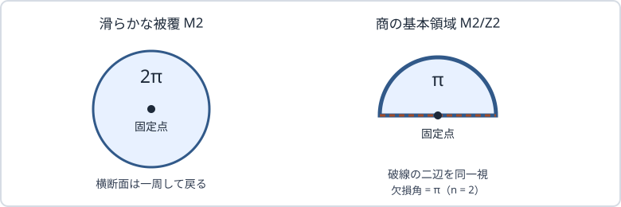

# HOLO21 重力レプリカ法

[HOLO20の静的RTの幾何学的不等式](../HOLO20/index.md#thm-holo20-ssa)では、RT公式を**入力**して、面積の切断・貼り合わせから境界エントロピーの性質を確かめました。しかしなぜ面積を $4G_N$ で割るのでしょうか。[HOLO18の区間RT公式](../HOLO18/index.md#thm-holo18-interval-coefficient)も、そこでは重力からの導出ではなく処方でした。本章では、整数枚の境界場理論を貼ったレプリカ経路積分を、対称なEuclid重力鞍点で評価することで、面積項が現れる機構を追います。

議論の出発点は[QFT57の有限cutoffレプリカモーメント](../../QFT/QFT57/index.md#def-qft57-replica-moments)と[HOLO17の正則化境界エントロピーデータ](../HOLO17/index.md#def-holo17-boundary-data)です。**整数レプリカの構成、重力の鞍点近似、物理的な解析接続は、別々の仮定**です。

以下ではEuclid符号のEinstein–Hilbert作用、$\hbar=1$、$G_N>0$、共通のUV cutoff、自然対数を用います。$N$ はバルク時空の次元ではなく、境界理論の大$N$ パラメータです。バルクは $d+1$ 次元で、重力Newton定数を $G_N$ と記します。

古典重力の次数は $O(G_N^{-1})$ です。本講ではこの主項だけを扱い、バルク量子エントロピーの $O(G_N^0)$ はHOLO23へ送ります。

## 1. 境界の整数レプリカを重力へ渡す

境界の有限cutoff領域 $A$ の縮約密度演算子を $\rho_A$ とし、そのトレースを1に正規化します。整数 $n\ge2$ では $n$ 個のEuclid経路積分を $A$ の切断に沿って巡回的に貼ります。すると $\operatorname{Tr}\rho_A^n$ を計算する境界多様体 $\mathcal B_n$ が生じます。

**これは時空の別々のコピーを貼る操作**であり、境界部分領域 $A$ を物理的な壁で仕切る操作ではありません。[QFT58の整数レプリカの分配関数比](../../QFT/QFT58/index.md#thm-qft58-replica-partition)では、この貼合せとトレースとの対応を扱いました。

正規化前の境界分配関数を $Z[\mathcal B_n]$、元のものを $Z[\mathcal B_1]$ と書きます。重力側では、指定した境界 $\partial M_n=\mathcal B_n$ を持つEuclid鞍点 $M_n$ の繰り込み済み作用 $I_n=I_E[M_n]$ を用います。背景に応じた境界項は[HOLO13のGHYを含むDirichlet作用](../HOLO13/index.md#def-holo13-dirichlet-action)を、局所反項の考え方は[HOLO14の反項の定義](../HOLO14/index.md#def-holo14-local-counterterm)を参照してください。

<!-- formal-statement-start -->
> **定義（正規化された重力レプリカ量）**  
> 同一の境界UV cutoff、境界条件および作用規約を固定する。整数 $n\ge2$ に対して境界分配関数 $Z[\mathcal B_n]$ と $Z[\mathcal B_1]$ が非零であるとき、正規化モーメントを
>
$$
R_n(A)=\frac{Z[\mathcal B_n]}{Z[\mathcal B_1]^n}
$$
>
> と書く。各分配関数が指定された単一の支配的Euclid重力鞍点で近似できる場合には、その**古典鞍点近似**を
>
$$
\log R_n(A)\simeq-I_n+nI_1
$$
>
> と定める。右辺の近似は一般のAdS/CFTにおける厳密等式ではない。
<!-- formal-statement-end -->

<!-- definition-example-start: def-holo21-gravity-replica -->
**定義の確認**（規格化を落とさない例）。 有限二準位で $\rho_A=\operatorname{diag}(3/4,1/4)$ とすると、$R_2=(3/4)^2+(1/4)^2=5/8$ です。未規格化演算子を $W=Z_1\rho_A$ と置くと $\operatorname{Tr}W^2=Z_1^2(5/8)$、従って $\operatorname{Tr}W^2/(\operatorname{Tr}W)^2=5/8$。重力でも $-I_2$ だけを微分せず、分母による $+nI_1$ を残す必要があります。
<!-- definition-example-end -->

物理的に適切な $n=1$ 近傍の連続・微分可能な拡張が得られ、規格化 $R_1=1$ と微分・正則化極限の交換を正当化できるなら、[有限次元レプリカ微分公式](../../QFT/QFT57/index.md#thm-qft57-replica-derivative)に対応する重力側の形式は

$$
S^{(0)}(A)
=-\left.\partial_n\log R_n(A)\right|_{n=1}
=\left.\partial_n(I_n-nI_1)\right|_{n=1}.
$$

右辺の $I_n$ は非整数 $n$ の「枚数の多様体」ではありません。**選ばれた鞍点族を記述する連続パラメータ**として $n$ を解釈します。整数のデータのみからこの微分を宣言してはいけません。二次Rényiと通常のエントロピーが異なることは、前の有限二準位の例でも確認できます。

## 2. 対称鞍点を商にすると円錐が現れる

整数 $n$ の境界 $\mathcal B_n$ は[巡回置換](../../../代数系/GRP/GRP1/index.md#def-grp1-cycle)により $\mathbb Z_n$ 対称です。しかし**境界の対称性からバルクの支配的鞍点の対称性は自動では従いません**。ここでは、少なくとも $n=1$ 近傍で追跡する鞍点族 $M_n$ が対称で、整数 $n$ ではその固定点近傍の被覆 $M_n$ が滑らかであると仮定します。

被覆を[巡回群](../../../代数系/GRP/GRP1/index.md#def-grp1-cyclic-group)で割った商を $\widehat M_n=M_n/\mathbb Z_n$ と呼びます。固定点集合を $\mathcal C_n$ とします。これは局所的に余次元2で、$n=1$ では面 $\gamma_A=\lim_{n\to1}\mathcal C_n$ になります。固定点の周囲の二次元横断面で、距離 $r$ と角度 $\tau$ を用いると、商の角度周期は $2\pi/n$ です。

<!-- formal-statement-start -->
> **定義（レプリカ対称商の円錐欠損）**  
> 整数 $n\ge2$ の滑らかなEuclid重力鞍点 $M_n$ が、余次元2の固定点集合 $\mathcal C_n$ を持つ $\mathbb Z_n$ 等長対称性を保つとする。商 $\widehat M_n=M_n/\mathbb Z_n$ で $\mathcal C_n$ を囲む小円の角度周期が $2\pi/n$ となるとき、この商の**円錐欠損角**を
>
$$
\delta_n=2\pi\left(1-\frac1n\right)
$$
>
> と呼ぶ。固定点のない場所は通常の滑らかなEinstein方程式を満たす。$n=1$ における極限面 $\gamma_A$ は、その時点では単なる固定面の極限であり、まだ極値性や大域最小性を仮定しない。
<!-- formal-statement-end -->

<!-- definition-example-start: def-holo21-quotient-cone -->
**定義の確認**（角度と次元）。 $n=2$ なら商の角度周期は $\pi$、欠損は $\pi$、$n=3$ なら周期 $2\pi/3$、欠損 $4\pi/3$ です。$n=1$ へ戻すと周期 $2\pi$、欠損0です。$d+1$ 次元のバルクではこの横断二次元を除いた $\mathcal C_n$ の次元は $(d+1)-2=d-1$。特に $AdS_3$ では曲線、$AdS_4$ では曲面です。
<!-- definition-example-end -->

| 見る空間 | 固定点のまわりの局所角 | 正則性 |
| --- | --- | --- |
| 整数 $n$ の被覆 $M_n$ | $2\pi$（適切な滑らかな局所座標） | **滑らか**と仮定 |
| 一枚分の商 $\widehat M_n$ | $2\pi/n$ | 固定面上に**円錐欠損** |
| $n\to1$ の極限 | $2\pi$ | 欠損が消える |

図は $n=2$ の**局所的な横断面を平面に展開した模式図**です。右の扇形の破線二辺を同一視すると、固定点の周囲が欠損角 $\pi$ の円錐になります。左の円板は滑らかな被覆であって、二枚分の境界パス積分を図の面積比から読み取るものではありません。

この表は**局所的な横断面**の比較です。被覆を切って円錐の扇形を貼った模式的理解と、各整数に対する滑らかな重力解そのものを混同しないでください。$\mathbb Z_n$ 対称性が破れる別鞍点や相転移では、同じ商から始める議論をそのまま適用できません。

## 3. Einstein作用で面積の係数が現れる場所

円錐の欠損が「面積」と掛け合わされるのは、固定面に直交する**二次元**の曲率積分が有限の局在寄与を持つためです。まず実際の滑らかな被覆とは区別して、角度周期 $2\pi\alpha$ を持つ平坦円錐の先端を正則化した比較模型を使います。$\alpha>1$ は**円錐過剰**、$\alpha<1$ は欠損です。

<!-- formal-statement-start -->
> **補題（円錐の局在スカラー曲率）**  
> 半径 $r>0$ では計量 $dr^2+r^2d\tau^2$、$\tau\in[0,2\pi\alpha)$ を持つ二次元円錐を、原点付近で滑らかに丸める。原点の外側は平坦で、境界円を固定して正則化幅を0へ送ると、スカラー曲率の原点からの寄与は
>
$$
\int_{\rm tip}\sqrt g\,R
=4\pi(1-\alpha).
$$
>
> 固定された滑らかな余次元2面 $\gamma$ の周囲にこの横断円錐を直積的に置く模型では、局在寄与は $4\pi(1-\alpha)\operatorname{Area}(\gamma)$ となる。
<!-- formal-statement-end -->

### 証明の見取り図

円錐先端を含む円板にGauss–Bonnetの式を使います。外周の測地曲率積分は $2\pi\alpha$ であり、円板のEuler標数は1なので、残りの曲率は $2\pi(1-\alpha)$ です。二次元ではスカラー曲率がGauss曲率の2倍である点に注意します。

<!-- proof-start -->
### 証明

先端を丸めた円板 $D_r$ の外縁は、先端の外側の平坦計量で $r=\text{一定}$ とします。周長は $\int_0^{2\pi\alpha}r\,d\tau=2\pi\alpha r$。平坦な領域での外向き単位法線を使う外周の測地曲率は $k_g=1/r$ なので

$$
\oint_{\partial D_r}k_g\,ds
=\int_0^{2\pi\alpha}\frac1r(r\,d\tau)
=2\pi\alpha.
$$

円板に対する[境界付きGauss–Bonnetの定理](../../../幾何系/GEO/GEO19/index.md#thm-geo19-gauss-bonnet-boundary)の $\int_{D_r}K\,dA+\oint k_g\,ds=2\pi\chi(D_r)$ に $\chi(D_r)=1$ を代入し、

$$
\int_{D_r}K\,dA=2\pi(1-\alpha).
$$

二次元では $R=2K$ だから、原点の外は平坦であることと合わせて表示式になります。横断二次元と固定面の直積では体積要素が積に分解し、$\gamma$ 上で積分すると面積因子を得ます。一般の曲がった近傍への適用には、管状近傍を縮める極限で他の項が消える滑らかさが追加で必要です。
<!-- proof-end -->

次にEuclid Einstein–Hilbert作用を

$$
I_E[g]=-\frac{1}{16\pi G_N}
\int_M\sqrt g\,(R-2\Lambda)
+I_{\rm GHY}+I_{\rm ct}
$$

と宣言します。ここで $I_{\rm GHY}$ は境界の外部曲率項、$I_{\rm ct}$ は漸近境界の局所反項です。$(-,+,\ldots,+)$ のLorentz計量からEuclidへ移った後の符号であり、Lorentz作用とそのまま混ぜません。$\alpha$ の変化を固定された内部面の小さい管状近傍に局在させる比較では、$\Lambda$ 項の体積は管半径とともに消えます。前補題を曲率項に代入すると

$$
I_{\rm tip}(\alpha)
=-\frac{4\pi(1-\alpha)}{16\pi G_N}
\operatorname{Area}(\gamma)
=\frac{\alpha-1}{4G_N}\operatorname{Area}(\gamma).
$$

**重要な区別：** これは円錐先端を含めた**比較用の特異計量**の局在寄与です。実際の整数 $n$ の被覆 $M_n$ は滑らかで、商 $\widehat M_n$ の先端を曲率デルタ関数として数えるか、先端を除いた作用を用いるかで境界項の記帳が変わります。特異曲率を数えた後で同じ先端の境界項をもう一度足すと面積を二重計上します。ここでは滑らかな被覆の微分における小管の境界寄与が、次の円錐模型の一次変分と等しい、という**追加の鞍点仮定**を明示して使います。

<!-- formal-statement-start -->
> **命題（対称Euclidレプリカの古典面積項：条件付き）**  
> 境界領域 $A$ に対する $\mathcal B_n$ の重力鞍点族が、$n=1$ の近くで微分可能に選ばれ、整数点で滑らかな被覆と $\mathbb Z_n$ 対称商を持つとする。Einstein重力の適切なDirichlet境界項・共通UV反項を用い、レプリカの正規化差の**一次変分**が、上の角度 $2\pi n$ の円錐過剰比較模型で得る局在寄与に一致し、他の一次境界寄与が消えると仮定する。$n\to1$ の固定面極限を $\gamma_A$ とすれば、
>
$$
I_n-nI_1
=(n-1)\frac{\operatorname{Area}(\gamma_A)}{4G_N}
+O((n-1)^2)
$$
>
> が古典次数で成立し、従って境界領域のvon Neumannエントロピーの同次数は
>
$$
S^{(0)}(A)=\frac{\operatorname{Area}(\gamma_A)}{4G_N}.
$$
>
> 面積は他の境界反項と整合する同一cutoffの量とし、ここでは一般の鞍点存在・優越・解析接続・相同条件を証明しない。
<!-- formal-statement-end -->

### 証明の見取り図

境界モーメントの規格化を先に取り、固定面を横断する小さな二次元円錐の曲率を作用へ入れます。円錐の一次係数を $n$ で微分すると $1/(4G_N)$ が残ります。その他の変分が消えるのは仮定に含まれ、円錐の幾何から勝手に結論する部分ではありません。

<!-- proof-start -->
### 証明

[円錐曲率の補題](#lem-holo21-cone-curvature)に $\alpha=n$ を入れ、上で宣言したEuclid作用の曲率係数を掛けます。局在寄与は

$$
-\frac{1}{16\pi G_N}\,4\pi(1-n)
\operatorname{Area}(\gamma_A)
=(n-1)\frac{\operatorname{Area}(\gamma_A)}{4G_N}.
$$

滑らかな鞍点のon-shell微分をこの比較計算へ移すための境界項の整合と鞍点族の滑らかさを命題で仮定したので、規格化後の差の一次項はこれに等しくなります。$I_1$ は $n$ に依存しないから

$$
\left.\partial_n(I_n-nI_1)\right|_{n=1}
=\frac{\operatorname{Area}(\gamma_A)}{4G_N}.
$$

[正規化された重力レプリカ量](#def-holo21-gravity-replica)を使って $\log R_n=-I_n+nI_1$ を代入します。これを $n=1$ で微分すれば、表示した古典主項になります。$n=1$ 近傍の解析接続と微分可能性を使ったので、整数 $n=2$ の円錐欠損だけから同じ結論は得られません。
<!-- proof-end -->

## 4. 固定面はなぜ極値面になるのか

面積係数が出ても、$\gamma_A$ の**位置**が未決定です。ここで商の円錐欠損を、固定面上の余次元2の張力源として表示します。これはEinstein方程式を面に垂直な小円板で積分する局所計算により、欠損角と張力を結び付ける書き方です。商に実在の新しい物質を必ず追加するという意味ではありません。

欠損角と張力の関係 $\delta=8\pi G_N T$ に[商の定義](#def-holo21-quotient-cone)を代入すれば

$$
T_n=\frac{\delta_n}{8\pi G_N}
=\frac{n-1}{4nG_N}.
$$

$n>1$ では正、$n\to1$ では0です。商を**先端を除いた重力作用 + $T_n\operatorname{Area}(\mathcal C_n)$ の有効表示**で扱うと、位置の変分から極値条件を得られます。ただし前節で曲率先端を含めた作用とこの表示を**同時には加算しません**。

<!-- formal-statement-start -->
> **命題（レプリカ固定面の局所的極値条件：条件付き）**  
> 上記の対称商の固定面 $\mathcal C_n$ が滑らかに埋め込まれた余次元2面で、$n>1$ についてその位置を任意のコンパクト支持の法線変位で動かせるとする。重力場の運動方程式と境界条件を満たす商の有効作用が、位置変分に対して $T_n\operatorname{Area}(\mathcal C_n)$ の項を与え、他の独立な局在面源がないとする。このとき固定面の二つの法線方向の平均曲率成分がともに0である。滑らかな $n\to1$ 極限が存在すれば $\gamma_A$ はEuclid計量で極値面となる。
<!-- formal-statement-end -->

### 証明の見取り図

位置に関する作用の停留は張力と面積の第一変分を通じて平均曲率を拘束します。$n>1$ で張力が零ではないことと、自由な法線変位を両方向に選べることが鍵です。面積の停留は大域最小であることを意味しません。

<!-- proof-start -->
### 証明

固定面の誘導計量を $h_{ij}$、独立な二本の単位法線を $N_a$（$a=1,2$）、その方向の第二基本形式のトレースを $H_a=h^{ij}K^{(a)}_{ij}$ とします。境界のアンカーを固定し、コンパクト支持の法線変位を $V=V^aN_a$ とした面積第一変分は

$$
\delta_V\operatorname{Area}(\mathcal C_n)
=-\int_{\mathcal C_n}\sqrt h\,
(H_1V^1+H_2V^2).
$$

実際、第二基本形式の符号を $\delta_Vh_{ij}=-2V^aK^{(a)}_{ij}$ と取ると、行列式の第一変分 $\delta_V\sqrt h=(\sqrt h/2)h^{ij}\delta_Vh_{ij}$ により上式を得ます。ここで各法線方向のトレースが $H_a=h^{ij}K^{(a)}_{ij}$ です。前提の有効作用の位置停留から

$$
0=\delta_V I_{\rm eff}
=-T_n\int_{\mathcal C_n}\sqrt h\,
(H_1V^1+H_2V^2)
$$

となります。$n>1$ では $T_n>0$ であるため、任意の法線変位の積分係数が零でなければなりません。

$V^2=0$ とします。$H_1$ がある点で正なら、連続性により近傍でも正です。そこに非負かつ零でない滑らかな $V^1$ を支えを持たせて選ぶと、作用変分は負になり矛盾します。負の場合も同様に矛盾するため、$H_1=0$ です。

次に $V^1=0$ として同じ論証を繰り返すと $H_2=0$ です。誘導計量と第二基本形式が $n\to1$ で連続なら、この等式は極限面 $\gamma_A$ にも成立します。

面をさらに動かしたときの面積変化の符号や、大域最小性はここでは得られません。
<!-- proof-end -->

静的かつ時間反転対称な背景では、時間対称断面に載るEuclid極値面を静的RT候補へ対応付けられます。どの候補が許されるかには[HOLO19の相同条件](../HOLO19/index.md#def-holo19-homology)、どの候補が勝つかには支配鞍点の選択が必要です。共変Lorentz時空のHRTにおける極値面の選択則はHOLO22で分けて扱います。

## 5. $AdS_3$ 区間で係数を再計算する

半古典的な純粋 $AdS_3$ の静的真空で、平面境界の長さ $\ell>0$ の単一区間 $A$ と同一cutoff $0<\epsilon\ll\ell$ を取ります。時間反転対称な一定時刻断面において、[HOLO3の半円測地線](../HOLO3/index.md#thm-holo3-semicircle)が端点をつなぐ候補です。[HOLO19の相同条件](../HOLO19/index.md#def-holo19-homology)を満たす半円板を使い、別の位相の競合鞍点がない支配サドルを仮定します。

<!-- formal-statement-start -->
> **命題（単一区間の重力レプリカ係数の照合）**  
> 前節までの重力レプリカ仮定と静的RT候補の支配を満たす純粋 $AdS_3$ 真空で、曲率半径 $L>0$、Newton定数 $G_3>0$、境界区間長 $\ell\gg\epsilon>0$ とする。正則化後の古典エントロピーの普遍対数主項は
>
$$
S^{(0)}(A)
=\frac{L}{2G_3}\log\frac{\ell}{\epsilon}
+O\left(\frac{L}{G_3}\frac{\epsilon^2}{\ell^2}\right)
=\frac{c_{\rm BH}}3\log\frac{\ell}{\epsilon}
+O\left(c_{\rm BH}\frac{\epsilon^2}{\ell^2}\right),
$$
>
> ただし $c_{\rm BH}=3L/(2G_3)$ は同じ境界条件でのBrown–Henneaux中央電荷で、非普遍的な端点項はcutoff規約に依存する。
<!-- formal-statement-end -->

### 証明の見取り図

固定面の極値条件を満たす半円曲線の長さを既習の正則化式へ代入し、$4G_3$ で割ります。最後に中央電荷との対応を代入し、境界CFT側の値との一致を調べます。

<!-- proof-start -->
### 証明

[HOLO18の正則化半円長](../HOLO18/index.md#prop-holo18-regulated-length)は

$$
\operatorname{Length}(\gamma_A)
=2L\log\frac{\ell}{\epsilon}
+O\left(L\frac{\epsilon^2}{\ell^2}\right).
$$

[条件付き面積命題](#prop-holo21-area-term)の $d+1=3$ を使うと面積は曲線長であり、

$$
\frac{\operatorname{Length}(\gamma_A)}{4G_3}
=\frac{2L}{4G_3}\log\frac{\ell}{\epsilon}
+O\left(\frac{L}{G_3}\frac{\epsilon^2}{\ell^2}\right).
$$

さらに[HOLO13のBrown–Henneaux関係](../HOLO13/index.md#prop-holo13-brown-henneaux) $c_{\rm BH}=3L/(2G_3)$ を代入すれば $L/(2G_3)=c_{\rm BH}/3$ です。[QFT59の条件付きvon Neumann普遍係数](../../QFT/QFT59/index.md#thm-qft59-conditional-von-neumann)は同じ平面真空条件で $c/3$ を与えます。**係数が一致するのは指定した半古典的双対性・状態・cutoff・解析接続の下**であり、この一例からAdS/CFT一般の証明はできません。
<!-- proof-end -->

## 6. 証明したことと証明していないこと

| 論点 | 本章で確かめられること | 追加で必要なこと |
| --- | --- | --- |
| 整数レプリカ | $Z[\mathcal B_n]/Z[\mathcal B_1]^n$ の規格化と重力鞍点の対応 | 境界パス積分と重力パス積分の対象・状態の指定 |
| 円錐の曲率 | 局所の $4\pi(1-\alpha)$ と面積係数 | 滑らかな被覆のon-shell微分と局所模型を同定する正則性 |
| 固定面の位置 | 有効張力源の位置変分なら平均曲率0 | 他の局在源なし・位置変分可・境界と相同 |
| $n\to1$ | 条件付きで $S^{(0)}=\operatorname{Area}/(4G_N)$ | 物理的解析接続、鞍点支配・微分可能性 |
| 量子補正 | 古典 $O(G_N^{-1})$ の導出 | $O(G_N^0)$ のバルクエントロピーと局所反項（HOLO23） |

**解析接続の反例。** 任意の整数 $k\ge1$ で $\sin(\pi k)=0$ です。したがって、与えられた整数データの解析補間 $F(n)$ に $\eta\sin(\pi n)$ を加えても全整数点での値は不変ですが、$n=1$ での微分は $\eta\pi\cos\pi=-\eta\pi$ だけ変わります。これは**物理的に許される分配関数の候補**を示したのではありません。整数データ一致だけでは微分を一意に定めないという論理的な反例です。[QFT59の解析接続条件](../../QFT/QFT59/index.md#thm-qft59-conditional-von-neumann)と同様、場の理論と重力の双方で物理的な制約を別に検査します。

**鞍点競合の反例。** $n=1$ で同じ正規化作用を持つ二つの形式的な候補があっても、$n>1$ の作用の一次傾きが異なればどちらの鞍点が支配するか変わります。固定面が局所的な極値であるというだけでは、二候補の面積のどちらを取るかは決まりません。相同条件と全体の鞍点比較を省くと、この選択が壊れます。ましてレプリカ対称性が破れた支配鞍点には商の単純な固定面の議論を流用できません。

## 7. 演習：規格化・円錐・極値・選択条件

### Level A：計算の入力を確認する

**A1. 正規化と二次Rényi。** 二準位の縮約状態 $\rho_A=\operatorname{diag}(3/4,1/4)$ に対して $R_1,R_2,S_2$ を求める。さらに $W=5\rho_A$ とした場合、$\operatorname{Tr}W^2/(\operatorname{Tr}W)^2$ を計算せよ。
- Level: A
<!-- solution-start -->
**詳細解答。** $\operatorname{Tr}\rho_A=3/4+1/4=1$ なので $R_1=1$。$R_2=(3/4)^2+(1/4)^2=(9+1)/16=5/8$、従って[有限cutoffのレプリカモーメントとRényiエントロピー](../../QFT/QFT57/index.md#def-qft57-replica-moments)から $S_2=\log(5/8)/(1-2)=\log(8/5)$。$W$ の固有値は $15/4,5/4$ で、$\operatorname{Tr}W=5$、$\operatorname{Tr}W^2=(225+25)/16=125/8$。比は $(125/8)/25=5/8$。分母の二乗を忘れるとこの不変性が崩れる。
<!-- solution-end -->

**A2. 商の角度と張力。** $n=2,3$ とした商の開き角、欠損角および張力 $T_n$ を $G_N>0$ で表し、$n\downarrow1$ の極限を求めよ。
- Level: A
<!-- solution-start -->
**詳細解答。** [商の円錐欠損](#def-holo21-quotient-cone)から $n=2$ では開き角 $2\pi/2=\pi$、欠損 $\pi$、$T_2=\pi/(8\pi G_N)=1/(8G_N)$。$n=3$ では開き角 $2\pi/3$、欠損 $2\pi(1-1/3)=4\pi/3$、$T_3=(4\pi/3)/(8\pi G_N)=1/(6G_N)$。一般に $T_n=(n-1)/(4nG_N)\to0$。張力が極限で消えても $\partial_n T_n|_{1}=1/(4G_N)$ は有限である。
<!-- solution-end -->

**A3. 円錐の符号。** 横断角度周期が $2\pi\alpha$ の円錐を考え、$\alpha=3/2$ と $\alpha=1/2$ に対する $\int R\sqrt g$ とEinstein曲率作用の先端項を、固定面積 $\mathcal A>0$ で計算せよ。
- Level: A
<!-- solution-start -->
**詳細解答。** [円錐曲率補題](#lem-holo21-cone-curvature)より $\alpha=3/2$ では $\int_{\rm tip}R\sqrt g=4\pi(1-3/2)=-2\pi$、作用の局在寄与は $-(-2\pi)\mathcal A/(16\pi G_N)=\mathcal A/(8G_N)$。$\alpha=1/2$ では曲率積分は $2\pi$、作用寄与は $-2\pi\mathcal A/(16\pi G_N)=-\mathcal A/(8G_N)$。前者は円錐過剰、後者は欠損であり、$I_{\rm tip}=(\alpha-1)\mathcal A/(4G_N)$ に代入しても符号が一致する。
<!-- solution-end -->

**A4. 微分の正規化。** $I_n=nI_1+(n-1)K+b(n-1)^2$、$K>0$、$b$ は $n$ に依らない定数とする。$-\partial_n\log R_n|_{1}$ の古典近似を求めよ。$-\partial_n(-I_n)|_{1}$ と比較せよ。
- Level: A
<!-- solution-start -->
**詳細解答。** [規格化された重力レプリカ量](#def-holo21-gravity-replica)から $\log R_n\simeq-I_n+nI_1=-(n-1)K-b(n-1)^2$。微分して $\partial_n\log R_n|_{1}=-K$、従って $S^{(0)}=K$。一方、分母を落とした $-\partial_n(-I_n)|_{1}=I_1+K$ は $I_1$ だけ余分である。$b$ の項は $\partial_n(n-1)^2|_1=0$ なので寄与しない。
<!-- solution-end -->

**A5. $AdS_3$ の面積係数。** $L=2G_3$、$\ell/\epsilon=e^3$ とする。真空単一区間の正則化半円長と古典エントロピーの対数主項、中央電荷 $c_{\rm BH}$ を求めよ。
- Level: A
<!-- solution-start -->
**詳細解答。** [半円長](../HOLO18/index.md#prop-holo18-regulated-length)の主項は $2L\log(\ell/\epsilon)=2(2G_3)\cdot3=12G_3$。これを $4G_3$ で割ると $S^{(0)}=3$（cutoff補正を除く）。中央電荷は $c_{\rm BH}=3L/(2G_3)=3$ で、$c_{\rm BH}\log(\ell/\epsilon)/3=(3/3)\cdot3=3$ と一致する。有限cutoffの正確なエントロピーを3と断定したのではない。
<!-- solution-end -->

### Level B：仮定を使って導出する

**B1. 曲率積分からレプリカ微分へ。** $\int_{D_r}K\,dA+\oint_{\partial D_r}k_gds=2\pi$、$\oint k_gds=2\pi n$ とし、固定面積 $\mathcal A$ を持つ局所円錐過剰比較模型に対して $I_{\rm tip}(n)$ と $\partial_n I_{\rm tip}|_1$ を導け。なぜこれだけでは実際の重力レプリカの一般定理にならないか述べよ。
- Level: B
<!-- solution-start -->
**詳細解答。** 外周積分をGauss–Bonnetへ代入し、$\int KdA=2\pi-2\pi n=2\pi(1-n)$。二次元の $R=2K$ より $\int RdA=4\pi(1-n)$。余次元2面の面積を掛けてEinstein作用の曲率係数 $-1/(16\pi G_N)$ を作用させると
$$
I_{\rm tip}(n)
=-\frac{4\pi(1-n)\mathcal A}{16\pi G_N}
=(n-1)\frac{\mathcal A}{4G_N}.
$$
従って $\partial_n I_{\rm tip}|_1=\mathcal A/(4G_N)$。しかし実際の整数レプリカ被覆は滑らかで、比較円錐の特異作用と同一ではない。[面積項の命題](#prop-holo21-area-term)が要求する正則な鞍点族、境界項の扱い、局在寄与へのon-shell一次微分の同定、物理的解析接続を別に確認する必要がある。
<!-- solution-end -->

**B2. 法線二方向を区別する。** 余次元2の固定面に対して $H_1,H_2$ が定義され、$\delta\mathcal A=-\int\sqrt h(H_1V^1+H_2V^2)$ とする。$n>1$ で $T_n=(n-1)/(4nG_N)$ の張力源が停留するとき、両平均曲率が0であることを導け。また、これは面積の大域最小性を含むか。
- Level: B
<!-- solution-start -->
**詳細解答。** [固定面の極値条件](#prop-holo21-fixed-surface)の仮定で作用の位置変分は零です。$G_N>0$、$n>1$ より $T_n>0$ なので、

$$
\int\sqrt h(H_1V^1+H_2V^2)=0
$$

が任意のコンパクト支持の法線変位で成り立ちます。

$V^2=0$ として $V^1$ だけを動かします。$H_1$ が一点で正なら、連続性から正の小近傍があり、そこで非負で零でない $V^1$ を選ぶと積分は正になって矛盾します。負の点も同様なので $H_1=0$ です。

次に $V^1=0$ として $V^2$ だけ動かせば、同じ理由で $H_2=0$ です。

これは一次変分が零という条件であり、二次の面積変化や別の相同候補との大域比較を与えません。ゆえに大域最小性は含みません。
<!-- solution-end -->

**B3. 整数点の補間反例。** $F(n)=(n-1)K$ と $\widetilde F(n)=F(n)+\eta\sin(\pi n)$、$K,\eta$ は実数とする。すべての正整数 $n$ で両者が一致することと、$n=1$ の微分の差を計算し、この差が物理的に許される重力鞍点を意味しない理由を述べよ。
- Level: B
<!-- solution-start -->
**詳細解答。** 正整数 $k$ では $\sin(\pi k)=0$ なので、両関数はすべての整数点で一致します。ところが微分すると
$$
F'(n)=K,\qquad
\widetilde F'(n)=K+\eta\pi\cos(\pi n).
$$
よって $n=1$ での微分差は
$$
\widetilde F'(1)-F'(1)=\eta\pi\cos\pi=-\eta\pi.
$$
$\eta\ne0$ なら差は零ではありません。したがって解析関数として整数点を補間するだけでは微分は固定されません。

ただし[QFT59の条件付きvon Neumann普遍係数](../../QFT/QFT59/index.md#thm-qft59-conditional-von-neumann)で要求する正値性・スペクトル構造・境界条件・鞍点選択を、この $\widetilde F$ が満たすとは示していません。物理的な別解の存在は結論できません。
<!-- solution-end -->

**B4. 二つの極値候補。** 正規化されたレプリカ作用差の候補が $F_a(n)=(n-1)a+O((n-1)^2)$、$F_b(n)=(n-1)b+O((n-1)^2)$、$0<a<b$ とする。$n>1$ の十分近くでどちらの $e^{-F}$ が大きいかを判断し、局所極値条件・鞍点支配・相同条件の役割を分けよ。
- Level: B
<!-- solution-start -->
**詳細解答。** 差は $F_b-F_a=(n-1)(b-a)+O((n-1)^2)$。$b-a>0$ なので十分小さい $n-1>0$ では $F_b-F_a>0$、従って $e^{-F_a}>e^{-F_b}$ となる。ただしこれは両候補が同一の $n=1$ 主鞍点に接続し、競合の重みが単純に指数作用で比較でき、解析接続が同じ枝である形式的な場合である。[固定面の命題](#prop-holo21-fixed-surface)は各候補の一次変分0しか述べず、大小比較は与えない。さらに[相同条件](../HOLO19/index.md#def-holo19-homology)を満たさない候補は、面積が小さくても境界領域 $A$ の許容RT候補として数えられない。支配枝が入れ替わる点の微分可能性も確認が必要。
<!-- solution-end -->

### Level C：境界データから幾何の係数まで統合する

**C1. 正規化・円錐・$AdS_3$照合と失敗条件。** 古典Euclid Einstein重力が支配する平面真空 $AdS_3$ の長さ $\ell\gg\epsilon$ の単一区間で、曲率半径 $L$、Newton定数 $G_3$ とする。滑らかな $\mathbb Z_n$ 対称レプリカ被覆、物理的な $n\to1$ 接続、固定面が半円RT面へ連続すること、同一cutoffの境界項の整合を仮定する。

1. $Z_n$ と $I_n$ による $\operatorname{Tr}\rho_A^n$ の鞍点近似を書き、$n=1$ の微分式を導け。
2. 商の欠損角と張力を求め、なぜ固定面が極値であっても大域最小と断言できないか述べよ。
3. 円錐の曲率積分から面積係数を計算し、$AdS_3$ 半円長を代入して $S^{(0)}$ の対数係数を求め、境界CFTと比較せよ。
4. 鞍点がレプリカ対称性を破る場合、または整数データだけが分かる場合、上のどの行が正当化されなくなるか特定せよ。
- Level: C
<!-- solution-start -->
**詳細解答。**

**（1）** [正規化された重力レプリカ量](#def-holo21-gravity-replica)より $\operatorname{Tr}\rho_A^n=Z[\mathcal B_n]/Z[\mathcal B_1]^n\simeq e^{-I_n+nI_1}$。したがって $\log R_n\simeq-I_n+nI_1$。$R_1=1$ と物理的な微分可能性を仮定し、
$$
S^{(0)}=-\partial_n\log R_n|_1
=\partial_n(I_n-nI_1)|_1
=I_n'|_1-I_1.
$$
分母の $nI_1$ は最後の $-I_1$ を生むため省略できない。

**（2）** [円錐欠損の定義](#def-holo21-quotient-cone)より $\delta_n=2\pi(1-1/n)$、$T_n=\delta_n/(8\pi G_3)=(n-1)/(4nG_3)$。$n>1$ で $T_n>0$ と独立な法線変分を許すと[固定面の極値条件](#prop-holo21-fixed-surface)により平均曲率は各方向で0となる。しかし一次変分0は二次変分や他候補との作用比較を決めない。[相同条件](../HOLO19/index.md#def-holo19-homology)と支配鞍点の選択が別途必要である。

**（3）** 横断面の角度を $2\pi\alpha$ とすれば $\int_{\rm tip}R\sqrt g=4\pi(1-\alpha)$。[円錐曲率補題](#lem-holo21-cone-curvature)を $\alpha=n$ へ代入し、Einstein作用の係数を掛けて
$$
I_{\rm tip}(n)
=-\frac{4\pi(1-n)}{16\pi G_3}\operatorname{Length}(\gamma_A)
=(n-1)\frac{\operatorname{Length}(\gamma_A)}{4G_3}.
$$
仮定した滑らかな鞍点の一次変分との同定により $S^{(0)}=\operatorname{Length}(\gamma_A)/(4G_3)$。[正則化半円長](../HOLO18/index.md#prop-holo18-regulated-length)は $2L\log(\ell/\epsilon)+O(L\epsilon^2/\ell^2)$ なので
$$
S^{(0)}
=\frac{L}{2G_3}\log\frac{\ell}{\epsilon}
+O\left(\frac{L}{G_3}\frac{\epsilon^2}{\ell^2}\right).
$$
[HOLO18の中央電荷の照合](../HOLO18/index.md#thm-holo18-interval-coefficient)から $c_{\rm BH}=3L/(2G_3)$、従って係数は $c_{\rm BH}/3$。[QFT59の境界CFT結果](../../QFT/QFT59/index.md#thm-qft59-conditional-von-neumann)と条件付きで一致する。

**（4）** レプリカ対称性が破れる支配鞍点では $M_n/\mathbb Z_n$ という固定面の単純な商構成と張力源の議論が成立しない。整数データだけなら $n\to1$ の微分可能な**物理的な**補間が定まらず、(1) の最後の微分と (3) の作用微分からエントロピーを読む行が未証明となる。どちらの場合も「円錐模型の局所曲率を計算できた」ことだけではこの不足を補えない。
<!-- solution-end -->

## 8. 次講との接続

本章で得たのは、**対称Euclid Einstein重力の十分に制御された古典サドルに限る**、円錐近傍の面積係数と固定面の極値条件です。円錐欠損・張力・微分可能性・鞍点の選択を仮定と導出に分けました。静的RT面は時間反転対称な特殊な場合です。次のHOLO22ではLorentz時空の共変HRT面と選択条件を扱い、さらにHOLO23でバルク量子補正、HOLO24で一般化エントロピーの量子極値面へ進みます。

参考：Lewkowycz–Maldacena, [*Generalized gravitational entropy*](https://arxiv.org/abs/1304.4926) (2013)。本章の条件付き局所導出は、この論文の一般的な議論全体を独習用に再証明したものではありません。
