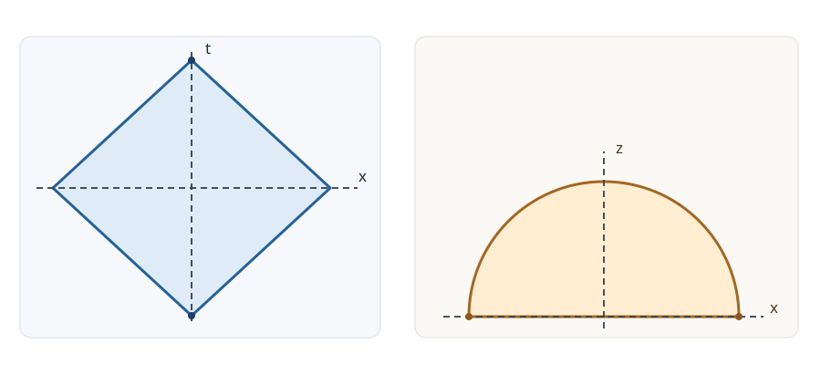

# HOLO25 causal wedgeとentanglement wedge

[HOLO24のQES処方](../HOLO24/index.md#def-holo24-minimal-qes)では、境界領域 $A$ にアンカーする曲面を選びました。しかし面が決まっても、「境界の $A$ で何を観測すればバルクのどこへ届くか」という問いにはまだ答えていません。境界から光信号を送り、反射して戻せる領域と、縮約状態 $\rho_A$ に結び付くバルク領域は、同じなのでしょうか。

この講では二つの領域を別々に定義し、**純 $AdS_3$ の真空区間で両者が一致することを光円錐とRT半円から計算**します。その後、一般時空での包含には追加の仮定が要る理由と、包含だけからバルク作用素の再構成が証明できない理由を整理します。

対象は時間向きのある漸近AdSの半古典的バルクと、境界上の空間的領域 $A$ です。計量符号は $(-,+,\ldots,+)$ とします。具体計算は [Poincaréパッチの計量](../HOLO2/index.md#prop-holo2-poincare-metric)
$$
ds^2=\frac{L^2}{z^2}(-dt^2+dx^2+dz^2),\qquad z>0,\quad L>0
$$
を持つ純 $AdS_3$、境界真空、境界時刻 $t=0$ の区間 $A=\{x:|x|<R\}$（$R>0$）に限ります。境界は $z=0$ の共形極限で、そこへの信号の入出力は固定したAdS境界条件に従います。曲面の面積は共通cutoffで正則化し、まず $O(G_N^{-1})$ の古典RT/HRT領域を扱います。有限 $G_N$ では量子補正と領域代数に追加の注意が必要です。

## 1. 境界の一枚の時刻断面から因果菱形へ

$A$ の「情報が定まる範囲」を考えるには、まず境界の因果構造を用います。**領域の依存域**とは、指定した初期データを通らない因果曲線から影響を受けない点を集めたものです。境界の Minkowski 計量 $-dt^2+dx^2$ では、未来へ進む因果曲線の速さは $|dx/dt|\le1$ です。時刻 $t>0$ の点 $(t,x)$ から過去へ延びる因果曲線が $t=0$ で到達し得る $x_0$ の範囲は $[x-t,x+t]$ です。これが全て $(-R,R)$ に入る条件を、次で定義します。

<!-- formal-statement-start -->
> **定義（境界領域の依存域と因果菱形）**  
> 境界Lorentz時空において、空間的Cauchy断面の部分領域 $A$ に対し、すべての過去向き（未来向き）の延長不能な境界因果曲線が $A$ と交わる点を $D^+(A)$（$D^-(A)$）とする。境界の依存域を $D(A)=D^+(A)\cup D^-(A)$ と呼ぶ。一次元空間の Minkowski 境界で $A=\{t=0,\ |x|<R\}$ の場合は、境界を除く開いた因果菱形
>
$$
D(A)=\{(t,x):|t|+|x|<R\}
$$
>
> を考える。境界上の等号は因果菱形の閉包に属するものとする。
<!-- formal-statement-end -->

<!-- definition-example-start: def-holo25-boundary-diamond -->
**直接例。** $R=3$、$(t,x)=(1,1)$ なら、時刻零に戻る全信号の着地点は $x_0\in[0,2]\subset(-3,3)$ なので $D(A)$ に含まれます。一方 $(1,5/2)$ から左向きに遡る信号だけを選べば $x_0=3/2$ ですが、右向きに遡る信号なら $x_0=7/2\notin A$ です。したがってその点は $D(A)$ に入りません。単に「ある信号が届く」のでなく「すべての延長不能な因果曲線が初期領域に当たる」ことが条件です。
<!-- definition-example-end -->

<!-- formal-statement-start -->
> **命題（Minkowski境界の区間依存域）**  
> $1+1$ 次元Minkowski時空の $A=\{t=0,\ |x|<R\}$、$R>0$ に対し、初期面の端を除く依存域は $D(A)=\{|t|+|x|<R\}$ である。閉包の二つの先端は $q_-=(-R,0)$ と $q_+=(R,0)$ である。
<!-- formal-statement-end -->

**証明の見取り図：** 時刻零に戻した光線の両端がともに区間内にあるかを調べます。

<!-- proof-start -->
### 証明

まず $t>0$ とし、因果速度制限 $|dx/dt|\le1$ を積分すると、時刻零の着地点 $x_0$ は $|x_0-x|\le t$ を満たします。等号は左右二つの光線で実現できるので、可能な着地点の全体は $[x-t,x+t]$ です。これが $(-R,R)$ に含まれる必要十分条件は
$$
x-t>-R,\qquad x+t<R.
$$
二式をまとめて $t+|x|<R$ となります。$t<0$ では時間反転して $-t+|x|<R$、$t=0$ では $|x|<R$ です。したがって $|t|+|x|<R$ を得ます。境界 $|t|+|x|=R$ の二つの斜線が先端で合わさる点を求めると $(t,x)=(\pm R,0)$ です。
<!-- proof-end -->

端点を含む閉領域を初期集合に選ぶ場合の因果境界や、一般時空でのCauchy horizonの取り扱いには別途条件があります。以下では内点に対する厳密な不等号で計算します。

## 2. 光を送って戻せるバルク領域

バルクの点 $p$ が境界の $D(A)$ から未来向きの因果曲線で到達でき、かつ $p$ から $D(A)$ へ因果曲線を返せるとき、その点は因果的に往復アクセスできます。この二条件の共通部分を **causal wedge（因果くさび領域）** と呼びます。

<!-- formal-statement-start -->
> **定義（causal wedge）**  
> 時間向きのある漸近AdSバルク $M$ とその共形境界 $\partial M$、境界の空間的領域 $A$ および依存域 $D(A)$ を固定する。バルクの因果未来・過去をそれぞれ $J^+_{\rm bulk},J^-_{\rm bulk}$ とするとき、$A$ の因果くさび領域の内部を
>
$$
\mathcal C(A)=\operatorname{Int}_M
\left(J^+_{\rm bulk}(D(A))\cap J^-_{\rm bulk}(D(A))\right)
$$
>
> と定める。境界とバルクの因果関係は共形境界を含む極限で定義し、バルクの時間向き・境界条件を固定する。$J^+$ は $D(A)$ からの未来向き、$J^-$ は $D(A)$ へ到達可能な点の集合である。
<!-- formal-statement-end -->

<!-- definition-example-start: def-holo25-causal-wedge -->
**定義の確認。** $R=2$、バルク点 $p=(t,x,z)=(0,0,1)$ を取ります。境界の先端 $q_-=(-2,0)$ からの光の到達時間は空間距離 $\sqrt{0^2+1^2}=1$ であり、先端から $p$ までの時間差は $2>1$ です。同様に $p$ から $q_+=(2,0)$ までの時間差も $2>1$ です。先端そのものではなく、その近くの **$D(A)$ 内部** を出発・到着点としても因果曲線が存在するので、両条件を満たし $p\in\mathcal C(A)$ です。一方 $(0,0,3)$ ではどちらの時間差も $2<3$ で、往復アクセスできません。
<!-- definition-example-end -->

光が描く境界を追うために、往復条件の二つのnull境界が交わる場所を別の対象として名付けます。この場所は一般に面積の極値条件で定義されるわけではありません。

<!-- formal-statement-start -->
> **定義（causal information surface）**  
> $\mathcal C(A)$ の未来側・過去側を限る二つのnull境界（それぞれ $\partial J^-_{\rm bulk}(D(A))$ と $\partial J^+_{\rm bulk}(D(A))$）の、境界の端を除く適切な空間的交差集合を $\Xi_A$ と呼ぶ。滑らかな交差面が存在する場合、これを causal information surface（因果情報面）とする。存在・滑らかさ・連結性は仮定に依存し、面積極値性は定義に含まれない。
<!-- formal-statement-end -->

<!-- definition-example-start: def-holo25-causal-information-surface -->
**直接例への導線。** 次節の純AdS計算では、二つのnull境界は $t=-R+s$ と $t=R-s$（$s=\sqrt{x^2+z^2}$）となります。その交点は $t=0,s=R$ で、$x^2+z^2=R^2$ の半円です。これは上の**二枚のnull面の共通部分**を実際に解いたもので、$\Xi_A$ を測地線だと最初から仮定してはいません。
<!-- definition-example-end -->

## 3. 純AdSの区間でcausal wedgeを計算する

共形因子 $L^2/z^2$ は $z>0$ で正なので、[Poincaré計量](../HOLO2/index.md#prop-holo2-poincare-metric)の因果曲線は平坦計量 $-dt^2+dx^2+dz^2$ と同じです。境界からバルクへの最短の信号所要時間は、ユークリッド平面 $(x,z)$ での距離 $\sqrt{z^2+(x-y)^2}$ になります。

<!-- formal-statement-start -->
> **命題（純AdS区間の因果くさび領域）**  
> 純Poincaré $AdS_3$、$R>0$、境界領域 $A=\{t=0,\ |x|<R\}$ を固定する。境界の共形極限に関する開いたcausal wedgeは
>
$$
\boxed{\mathcal C(A)=\{(t,x,z):z>0,\ |t|+\sqrt{x^2+z^2}<R\}.}
$$
>
> その二つのnull境界は $t=-R+s$ と $t=R-s$（$s=\sqrt{x^2+z^2}$）、causal information surfaceは $t=0,\ x^2+z^2=R^2,\ z>0$ である。
<!-- formal-statement-end -->

**証明の見取り図：** 菱形内の任意の送信点を考える必要がありますが、三角不等式を使うと、先端からの光円錐が最も外側の到達限界を与えることが分かります。

<!-- proof-start -->
### 証明

点 $p=(t,x,z)$ に $D(A)$ 内の点 $(\tau,y,0)$ から因果信号を送れるなら
$$
t-\tau\ge\sqrt{z^2+(x-y)^2}.
$$
一方、[境界菱形の命題](#prop-holo25-boundary-diamond)によって $\tau>-R+|y|$ です。したがって
$$
t+R> |y|+\sqrt{z^2+(x-y)^2}
\ge\sqrt{z^2+x^2}=s.
$$
最後の不等式は、平面上のベクトル $(0,y)$ と $(z,x-y)$ の三角不等式です。これで未来側に入る必要条件 $t>-R+s$ を得ます。

逆に $t>-R+s$ なら、境界の過去先端 $(-R,0)$ から少しだけ内側へ動かした $(\tau,0)\in D(A)$ を選んでも $t-\tau>s$ となります。例えば $0<\eta<\min\{R,(t+R-s)/2\}$ と置き $\tau=-R+\eta$ とすれば、$\tau\in(-R,R)$ で不等式が成立します。よってこの条件は十分です。

同じ議論を未来先端 $(R,0)$ に対して時間反転すると、$p$ から $D(A)$ へ帰還できる必要十分条件は $t<R-s$ です。二条件を同時に満たすのは
$$
-R+s<t<R-s
\quad\Longleftrightarrow\quad |t|+s<R.
$$
null境界の交点は $-R+s=R-s$、すなわち $s=R$、$t=0$。$z>0$ の部分は半円 $x^2+z^2=R^2$ です。
<!-- proof-end -->

$R=2$ のとき、$t=1/2$ の断面では $x^2+z^2<(3/2)^2$ となり、時刻零の半径 $2$ の半円より小さくなります。「時刻零の半円柱全体」をwedgeと呼ぶと、時間発展で狭まることを見落とします。

## 4. 面を囲む領域：entanglement wedge

次は光の往復ではなく、境界部分領域の縮約状態をどのバルク領域へ対応させるかという問いです。[HRT面](../HOLO22/index.md#def-holo22-hrt-surface)は境界の $\partial A$ を端として [相同条件](../HOLO19/index.md#def-holo19-homology)を満たす空間的余次元2曲面です。静的な場合はRT面を使います。量子補正が必要な場合には [QES](../HOLO24/index.md#def-holo24-qes)を候補とし、最小一般化エントロピー処方で選択します。

曲面と $A$ で囲む空間的領域を $\Sigma_A$ としたとき、**その領域から因果的に決定されるバルクの領域**を考えます。AdSは境界が時間的なので、依存域を語るには反射型などの適切な境界条件と、境界データとの整合が欠かせません。ここでは領域とその境界のデータを含む初期値問題の依存域として定義します。

<!-- formal-statement-start -->
> **定義（entanglement wedge）**  
> 漸近AdSの時間向きのある半古典的バルクで、境界の空間的領域 $A$ と、その端にアンカーされ $A$ と相同な選択済みHRT面 $\gamma_A$（量子補正を考える場合には選択済みQES）を固定する。適切なバルク空間的部分Cauchy領域 $\Sigma_A$ が $\partial\Sigma_A=A\cup\gamma_A$ を満たすとする。境界条件を固定して定めた $\Sigma_A$ のバルク依存域を **entanglement wedge（エンタングルメントくさび領域）** $\mathcal E(A)=D_{\rm bulk}(\Sigma_A)$ と呼ぶ。バルクの因果境界の扱いと、量子状態・コード部分空間に対する処方の有効範囲を明示して用いる。
<!-- formal-statement-end -->

<!-- definition-example-start: def-holo25-entanglement-wedge -->
**定義の直接確認（静的真空）。** $AdS_3$ の $t=0$ 断面を取ります。[RT区間の半円](../HOLO18/index.md#prop-holo18-regulated-length)は $z=\sqrt{R^2-x^2}$ で、端は $(x,z)=(\pm R,0)$ です。したがって
$$
\Sigma_A=\{t=0,\ z>0,\ x^2+z^2<R^2\}
$$
は境界で $A$、内部で半円に接し、[相同条件](../HOLO19/index.md#def-holo19-homology)を満たします。これが定義の空間的領域と境界アンカーの直接確認です。次の命題で、この領域から決まる時空部分がどこかも調べます。
<!-- definition-example-end -->

<!-- formal-statement-start -->
> **命題（純AdS真空区間における二つのwedgeの一致）**  
> 境界真空の純 $AdS_3$、$A=\{t=0,\ |x|<R\}$、古典RT処方、相同な半円 $\gamma_A$、固定した整合的AdS境界条件を仮定する。この場合、$\Sigma_A$ の二枚の因果的null境界は
>
$$
t=\pm(R-\sqrt{x^2+z^2}),
$$
>
> したがって開いた領域として
>
$$
\boxed{\mathcal E(A)=\mathcal C(A)
=\{z>0,\ |t|+\sqrt{x^2+z^2}<R\}.}
$$
>
> 等号はこの対称な真空模型の古典主項についてであり、一般時空や全量子補正での無条件な等式を主張しない。
<!-- formal-statement-end -->

**証明の見取り図：** 半円を境界とする $t=0$ のバルク領域を固定し、その縁から伸びるnull特性面を求めます。特性面がcausal wedgeの二枚の境界と同じになることを示します。

<!-- proof-start -->
### 証明

$t=0$ 断面のRT面は $s=\sqrt{x^2+z^2}=R$ です。この半円上で、$t=0$ 断面の内向き単位方向は平坦共形計量で $(-x,-z)/R$ です。各半円上の点 $(x_0,z_0)$ から内向きに進むnull曲線を
$$
t=\lambda,\qquad
(x,z)=\left(1-\frac{\lambda}{R}\right)(x_0,z_0),
\qquad 0\le\lambda<R
$$
と置きます。$x_0^2+z_0^2=R^2$ なので
$$
\left(\frac{dt}{d\lambda}\right)^2
-\left(\frac{dx}{d\lambda}\right)^2
-\left(\frac{dz}{d\lambda}\right)^2
=1-\frac{x_0^2+z_0^2}{R^2}=0,
$$
つまりこの曲線はnullです。また $s=R-\lambda$、$t=\lambda$ なので $t=R-s$ にあります。負の $\lambda$ に向かう反対向きのnull特性面は $t=-R+s$ です。

バルク内部の初期領域 $\Sigma_A$ において、二つの特性面より内側（$|t|+s<R$）は初期データと固定したAdS境界条件の因果的決定域になります。特性面上では外側から初期データに触れずに到来するnull曲線が現れ、これを越えた点はこの初期領域の依存域に含められません。ここでは純AdSの反射型境界初期値問題を採用しています。したがって $\mathcal E(A)=\{|t|+s<R\}$ です。[因果くさび領域の計算](#prop-holo25-pure-ads-causal-wedge)と一致します。
<!-- proof-end -->

一般の $AdS_{d+1}$ に対しても球 $|\mathbf x|<R$ の真空に限れば、球面対称なRT半球 $z^2+|\mathbf x|^2=R^2$ と同じ光円錐計算が使えます。この章で全次元のRT面の大域的最小性を一から証明したわけではなく、そこで必要な古典RT処方と対称性は既知の入力です。

## 5. 図で読む：何が境界で、何が面なのか

以下の二枚は**異なる断面**を表します。左は境界の $t$–$x$ 断面で因果菱形を、右はバルクの $t=0$ の $x$–$z$ 断面で相同領域と半円を示します。両図の横軸が同じ $x$ であることに注意してください。時間発展を示す三次元の立体図ではありません。

左の菱形の先端から出る光円錐が、右の半円を $t=0$ でなぞります。$\Xi_A$ は**因果境界同士の交点**であり、$\gamma_A$ は**面積極値かつ相同な曲面**です。真空球では形が一致しても、定義・選択原理は違います。

## 6. 一般には包含と一致を分ける

古典重力で [null曲率条件](../HOLO22/index.md#def-holo22-null-curvature) $R_{ab}k^ak^b\ge0$ は、null測地線に沿う測地線束の集束を制御する仮定です。ただしそれだけでは、HRT面の存在、安定性、因果境界の正則性や望ましい時空全域を保証しません。[古典maximinの条件付き定理](../HOLO22/index.md#thm-holo22-maximin-conditional)が要求する大域的仮定を含めて検討する必要があります。

<!-- formal-statement-start -->
> **定理（古典的causal wedge inclusion：適用条件付き既存結果）**  
> 一つの境界を持つ適切に因果的な漸近AdS古典Lorentz時空について、境界領域 $A$ にアンカーするHRT面 $\gamma_A$ が存在して安定なmaximin選択を持ち、null曲率条件 $R_{ab}k^ak^b\ge0$、必要なgenericity・特異点・境界・大域的因果条件が満たされ、HRT面が因果境界に遮られない標準的設定を仮定する。このとき、対応する開いた領域は
>
$$
\mathcal C(A)\subseteq\mathcal E(A)
$$
>
> を満たす。これは古典HRTの因果的整合性についての**既存の幾何学的結果**を条件付きで用いるものであり、ここでの純AdS計算のみから一般時空に対して証明したものではない。
<!-- formal-statement-end -->

**どの論証を引用しているか。** null束の面積変化を比較するために曲率条件が必要です。HRT面をnull境界の不適切な側へ動かしても面積が減らない、といった比較を成立させるには、maximin・安定性・境界と特異点の扱いを加えます。本講で独立に証明したのは [純AdSの等号](#prop-holo25-vacuum-wedge-equality)までで、一般のnull射影の大域的面積比較・HRT面の存在はこの節の証明には含まれません。原論文として [Wall, *Maximin Surfaces*](https://arxiv.org/abs/1211.3494) と [Headrick–Hubeny–Lawrence–Rangamani, *Causality & holographic entanglement entropy*](https://arxiv.org/abs/1408.6300) を参照してください。

包含が真に狭くなり得ることを、幾何条件だけを持つ比較模型で見ておきます。これは現実の重力解を作る証明ではありません。$|x|<R$ の $t=0$ 断面で
$$
z_E(x)=\sqrt{R^2-x^2},\qquad
z_C(x)=\sqrt{R^2-x^2}-\frac{\delta}{R^2}(R^2-x^2),
\qquad 0<\delta<R
$$
という二つの曲線を指定します。$s_x=\sqrt{R^2-x^2}\in(0,R]$ と置くと
$$
z_C=s_x(1-\delta s_x/R^2)>0,\qquad
z_E-z_C=\delta s_x^2/R^2>0.
$$
したがって両者は同じ境界端で零になるにもかかわらず、$0<z<z_C$ の領域は $0<z<z_E$ の領域に真に含まれます。**包含から等号は導けない**ことの幾何学的説明であって、この二曲線が同じEinstein方程式の解から生成した因果情報面とHRT面であることは示していません。

量子補正を入れれば、[QESの一般化エントロピー](../HOLO24/index.md#def-holo24-generalized-entropy)と状態依存の領域選択を使います。量子的な集束条件などの追加仮定がなければ、古典のnullエネルギー条件をそのまま代入して全量子での包含を断定できません。

## 7. 因果的アクセスと作用素再構成は別問題

| 問い | causal wedge | entanglement wedge |
| --- | --- | --- |
| 出発点 | 境界依存域 $D(A)$ とバルク光円錐 | RT/HRT面、量子補正ではQESと相同領域 |
| 領域の計算 | $J^+(D(A))\cap J^-(D(A))$ | 選択面の $A$ 側領域の依存域 |
| 純AdS真空球 | $|t|+\sqrt{x^2+z^2}<R$ | 同じ領域（古典主項） |
| 一般時空 | 光の往復可能性を検査する | 幾何・状態・近似と面選択が必要 |
| まだ言えないこと | 任意の局所作用素が復号できるとは限らない | 任意の状態・有限$N$で厳密な復号が自動的に従うわけではない |

因果くさび領域は、境界の信号を使って「因果的に調べられる場所」を選びます。しかしその点にある量子場の演算子を境界の $A$ だけから**どんな演算子等式として、どの近似で**復元できるかは、伝播方程式、正規化可能モード、コード部分空間など別の入力を要します。逆にentanglement wedgeが包含する点が、境界への単純な往復光信号でアクセスできるとも限りません。

次の **HOLO26** では自由場の方程式と境界モードからHKLL再構成の具体的な積分を作ります。HOLO27以降では、領域再構成をコード部分空間や相対エントロピーの制約と結び付けます。ここでは「幾何の包含」と「再構成定理」を同一視しません。

## 8. 演習と詳細解答

この節は全て $L,R>0$、$z>0$、$ds^2=(L^2/z^2)(-dt^2+dx^2+dz^2)$ を用います。$D(A)$ と $\mathcal C(A)$ は開いた内点を扱い、等号は境界です。$t=0$ の $\Sigma_A$ は、古典RT真空半円が選ばれた場合に限って定義します。問題中で指定する「比較模型」は物理的重力解を保証しません。

### Level A：定義を実際に判定する

### 演習 HOLO25-A01：因果菱形に入るか
- Level: A

$R=4$ の境界で $(t,x)=(1,2),(2,3),(-3,0)$ の三点が $D(A)$ の内部・境界・外部のどれか判定し、それぞれ時刻零に戻した光線の着地点を記せ。

<!-- solution-start -->
**詳細解答。** [区間依存域の命題](#prop-holo25-boundary-diamond)を使うと、第一点は $|1|+|2|=3<4$ で内部、第二点は $2+3=5>4$ で外部、第三点は $3+0=3<4$ で内部です。未来側では時刻零への二つの光線の着地点は $x-t,x+t$ なので、第一点は $(1,3)$、第二点は $(1,5)$ です。第二点の右側は区間外です。過去側の第三点から時刻零へ未来向きに進む二光線は $x\pm|t|=(-3,3)$ となり、いずれも区間内です。等号の判定例は例えば $(t,x)=(1,3)$ なら $|t|+|x|=4$、着地点の片方が $4$ なので境界です。
<!-- solution-end -->

### 演習 HOLO25-A02：光の往復
- Level: A

$R=3$ で $p=(t,x,z)=(0,0,2)$、$q=(1,0,2)$、$r=(0,1,2)$ はそれぞれ $\mathcal C(A)$ の内部にあるか。直接不等式で判定せよ。

<!-- solution-start -->
**詳細解答。** [因果くさび領域の命題](#prop-holo25-pure-ads-causal-wedge)の左辺 $|t|+\sqrt{x^2+z^2}$ を評価します。$p$ は $0+\sqrt4=2<3$ で内部です。$q$ は $1+2=3$ でnull境界上、開いたwedgeの内部ではありません。$r$ は $0+\sqrt{1+4}=\sqrt5<3$ で内部です。境界を含めるかどうかの取り決めを無視して $q$ を内点扱いしないことが重要です。
<!-- solution-end -->

### 演習 HOLO25-A03：因果情報面
- Level: A

$R=5$ で二つのnull境界 $t=-5+\sqrt{x^2+z^2}$、$t=5-\sqrt{x^2+z^2}$ の交点を求め、$x=3$ のときの深さ $z$ を求めよ。

<!-- solution-start -->
**詳細解答。** 両式の右辺を等置すると $-5+s=5-s$ なので $2s=10$、$s=5$ です。代入して $t=-5+5=0$。したがって $\Xi_A$ は $t=0,x^2+z^2=25,z>0$。$x=3$ なら $z^2=25-9=16$、$z>0$ から $z=4$ です。これは [因果情報面の定義](#def-holo25-causal-information-surface)に従う二枚のnull境界の交差であり、面積極値を仮定した計算ではありません。
<!-- solution-end -->

### 演習 HOLO25-A04：RTの相同領域
- Level: A

$R=2$ の $t=0$ 断面で $(x,z)=(0,1),(3/2,1),(1,2)$ が $\Sigma_A$ の内部にあるか調べ、境界のアンカーを答えよ。

<!-- solution-start -->
**詳細解答。** [entanglement wedgeの定義例](#def-holo25-entanglement-wedge)より初期領域の条件は $z>0,\ x^2+z^2<4$ です。$(0,1)$ は $1<4$ なので内部、$(3/2,1)$ は $9/4+1=13/4<4$ なので内部、$(1,2)$ は $1+4=5>4$ なので外部です。RT半円 $x^2+z^2=4$ を $z=0$ へ延長すると $(x,z)=(\pm2,0)$ であり、これが $\partial A$ への二端アンカーです。半円と $A$ の間の領域を選んでいるので相同条件も確認できます。
<!-- solution-end -->

### 演習 HOLO25-A05：時刻が変わると断面は縮む
- Level: A

$R=5$ の純AdSで $t=0,\ t=2,\ t=4$ のcausal wedge断面の半径 $s_{\max}$ を求め、$z=1,x=1,t=4$ が内部かを判定せよ。

<!-- solution-start -->
**詳細解答。** 各時刻の条件は $\sqrt{x^2+z^2}<R-|t|$ です。従って半径の上限は順に $5,3,1$ となります。点 $(4,1,1)$ では $|t|+\sqrt{x^2+z^2}=4+\sqrt2>5$、つまり $\sqrt2>1$ なので外部です。時刻零の円盤に入っていても、時刻が後なら依然としてwedgeに入るとは限りません。
<!-- solution-end -->

### Level B：中間計算と仮定の効きを再現する

### 演習 HOLO25-B01：先端以外から送っても広がらない
- Level: B

$R=4$、$p=(t,x,z)$ とする。$D(A)$ の任意の送信点 $(\tau,y,0)$ から $p$ に因果的に到達できるなら $t+4>\sqrt{x^2+z^2}$ を示せ。また逆向きの不等式から送信点を具体的に選び、必要十分性を示せ。

<!-- solution-start -->
**詳細解答。** [菱形の定義](#def-holo25-boundary-diamond)により $\tau>-4+|y|$。因果到達可能性から $t-\tau\ge\sqrt{z^2+(x-y)^2}$。従って
$$
t+4>|y|+\sqrt{z^2+(x-y)^2}
\ge\sqrt{z^2+x^2},
$$
最後は $(0,y)+(z,x-y)=(z,x)$ に対する三角不等式です。逆に $t+4>s$ とする。$0<\eta<\min\{4,(t+4-s)/2\}$ を選べば $\tau=-4+\eta\in(-4,4)$、$y=0$ は $D(A)$ の点であり
$$
t-\tau=t+4-\eta> s+\frac{t+4-s}{2}>s
$$
（最後の途中式は $\eta<(t+4-s)/2$ より従う）です。これで $D(A)$ 内の点から $p$ へ時間的な経路が存在します。
<!-- solution-end -->

### 演習 HOLO25-B02：null生成線を検算する
- Level: B

$R=2$、半円上の点 $(x_0,z_0)=(\sqrt3,1)$ から内向きに $t=\lambda$、$(x,z)=(1-\lambda/2)(x_0,z_0)$、$0\le\lambda<2$ と進む曲線について、null性と $t=R-\sqrt{x^2+z^2}$ を満たすことを直接示せ。

<!-- solution-start -->
**詳細解答。** 初期点は $x_0^2+z_0^2=3+1=4=R^2$ にあります。微分すると $dt/d\lambda=1$、$dx/d\lambda=-\sqrt3/2$、$dz/d\lambda=-1/2$ です。平坦共形計量での速度の長さは
$$
-1+\frac{3}{4}+\frac14=0.
$$
AdS計量は正の共形因子を掛けただけなのでnull性は変わりません。また $\sqrt{x^2+z^2}=(1-\lambda/2)\sqrt4=2-\lambda$、従って $R-\sqrt{x^2+z^2}=2-(2-\lambda)=\lambda=t$ です。これが [真空wedge一致命題](#prop-holo25-vacuum-wedge-equality)で用いた内向きnull生成線の検算です。
<!-- solution-end -->

### 演習 HOLO25-B03：包含は等号でない（比較模型）
- Level: B

$R=2$、$\delta=1/2$ とし、$|x|<R$ 上で $z_E(x)=\sqrt{R^2-x^2}$、$z_C(x)=z_E(x)-\delta(R^2-x^2)/R^2$ とする。(i) 両曲線が同じ端点へ行くこと、(ii) $0<z_C<z_E$、(iii) $x=0$ での二曲線間の深さの差を証明せよ。これを物理的なHRT面の実例と呼べない理由も述べよ。

<!-- solution-start -->
**詳細解答。** $s=\sqrt{4-x^2}$ とおくと $0<s\le2$、$z_E=s$、$z_C=s-s^2/8=s(1-s/8)$ です。$|x|\to2$ では $s\to0$ なので両者は零へ近づき同じアンカーを持ちます。さらに $1-s/8\ge3/4>0$ で $z_C>0$、差は $z_E-z_C=s^2/8>0$ です。$x=0$ では $s=2$ なので $z_E=2$、$z_C=2-4/8=3/2$、差 $1/2$ です。この計算は指定した二関数の集合包含を示すだけで、曲率条件・場の方程式・面積極値性を確認していません。ゆえに二曲線を物理的な同一背景のcausal information surfaceとHRT面だとは言えません。
<!-- solution-end -->

### 演習 HOLO25-B04：境界のLorentz boost
- Level: B

$|v|<1$、$\Gamma=(1-v^2)^{-1/2}$ とし、$T=\Gamma(t-vx)$、$X=\Gamma(x-vt)$、$Z=z$ と置く。Poincaré $AdS_3$ の計量が同じ形であることを計算し、新座標の $T=0,|X|<R$ に対応するcausal wedgeを元の座標で表せ。

<!-- solution-start -->
**詳細解答。** 微分は $dT=\Gamma(dt-vdx)$、$dX=\Gamma(dx-vdt)$ なので
$$
-dT^2+dX^2
=\Gamma^2[-(dt-vdx)^2+(dx-vdt)^2]
=\Gamma^2(1-v^2)(-dt^2+dx^2)
=-dt^2+dx^2.
$$
$Z=z$ なので共形因子 $L^2/Z^2$ も不変で、計量は $L^2/Z^2(-dT^2+dX^2+dZ^2)$ のままです。[純AdS因果くさびの命題](#prop-holo25-pure-ads-causal-wedge)を $(T,X,Z)$ に適用すると $|T|+\sqrt{X^2+Z^2}<R$。元の座標では
$$
\Gamma|t-vx|+
\sqrt{\Gamma^2(x-vt)^2+z^2}<R
$$
です。変換は可逆で $\Gamma^2(1-v^2)=1$ だから、因果条件を失っていません。
<!-- solution-end -->

### Level C：二つのwedgeと座標変換を統合する

### 演習 HOLO25-C01：動く区間の因果・情報領域を求める
- Level: C

純 $AdS_3$、真空、古典RT/HRTを用いる。$v=3/5$、$\Gamma=5/4$、$R=2$、$T=\Gamma(t-vx)$、$X=\Gamma(x-vt)$、$Z=z$ とし、境界領域 $A'$ を $T=0,|X|<2$ と定める。

1. 境界菱形の先端 $T=\pm2,X=0$ を元の $(t,x)$ で求めよ。
2. $\mathcal C(A')$ の内部条件と、対応するHRT半円の元の座標式を求めよ。
3. 点 $p=(t,x,z)=(1,1,1/2)$ が $\mathcal C(A')$ と $\mathcal E(A')$ に入るか判定せよ。
4. この一致を一般状態や量子QESに無条件に移せない理由を二つ述べよ。

<!-- solution-start -->
**詳細解答。**

(1) 逆Lorentz変換は $t=\Gamma(T+vX)$、$x=\Gamma(X+vT)$ です。$X=0$、$T=\pm2$ を代入すると
$$
(t,x)=\left(\pm\frac54\cdot2,\ \pm\frac54\cdot\frac35\cdot2\right)
=\left(\pm\frac52,\pm\frac32\right).
$$
元の座標の先端は $t$ 軸上に揃わず、移動した因果菱形の先端となります。

(2) [boostされたwedgeの解法](#ex-holo25-b04)を適用して
$$
\frac54\left|t-\frac35x\right|
+\sqrt{\frac{25}{16}\left(x-\frac35t\right)^2+z^2}<2
$$
です。HRT面は $T=0$ と $X^2+Z^2=R^2=4$ の交差です。従って
$$
t=\frac35x,\qquad
\frac{25}{16}\left(x-\frac35t\right)^2+z^2=4.
$$
$T=0$ から $t=vx$ が従い、この面は元の時刻 $t=0$ 断面には一般に収まりません。

(3) $t=x=1$ で
$$
T=\frac54\left(1-\frac35\right)=\frac12,\qquad
X=\frac54\left(1-\frac35\right)=\frac12,\qquad Z=\frac12.
$$
したがって
$$
|T|+\sqrt{X^2+Z^2}
=\frac12+\sqrt{\frac14+\frac14}
=\frac12+\frac1{\sqrt2}<2.
$$
よって $p\in\mathcal C(A')$ です。座標変換は純AdSの等長変換なので、[真空区間のwedge一致](#prop-holo25-vacuum-wedge-equality)をそのまま移した $\mathcal E(A')$ にも $p$ は入ります。これは新しい一般的再構成定理を使っていません。

(4) 一般状態ではHRT面が真空半円やそのboost像と一致する保証はなく、$\Xi_{A'}$ との形状の一致も失われ得ます。また有限 $G_N$ では [一般化エントロピーのQES処方](../HOLO24/index.md#def-holo24-qes)を使うため、古典面の位置と領域選択が変化し得ます。従ってこの模型の等号を一般状態・全量子次数に昇格できません。
<!-- solution-end -->

## 9. 本講の要点と次講

[境界因果菱形](#def-holo25-boundary-diamond)からの信号往復が [causal wedge](#def-holo25-causal-wedge)を決め、[RT/HRT面と相同領域](#def-holo25-entanglement-wedge)が entanglement wedge を決めます。純AdSの真空区間ではどちらも $|t|+\sqrt{x^2+z^2}<R$ に等しくなります。一般の包含は因果条件と古典重力の追加仮定の下での結果であって、再構成可能性そのものを示したわけではありません。

**次講：HOLO26「HKLL再構成」**。自由バルク場の境界極限とモード展開を使い、境界演算子の積分からバルク場を復元する条件を計算します。
