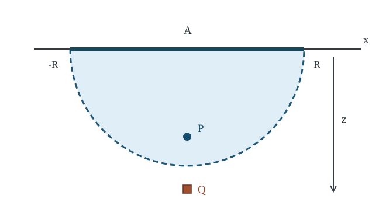

# HOLO27 部分領域再構成

<!-- definition-example-audit: strict -->

[HOLO26の有限モードHKLL再構成](../HOLO26/index.md#thm-holo26-finite-hkll)は、global $AdS_3$ の**全境界**の時間波形から内部の自由場を取り出しました。しかし境界の空間領域を小さくしたとき、同じ積分核がその領域にだけ載るとは限りません。一方、[HOLO25のエンタングルメントくさび](../HOLO25/index.md#def-holo25-entanglement-wedge)は境界領域ごとにバルクの幾何学的領域を対応させます。**幾何の対応から、どのような条件で実際の演算子を復号できるのでしょうか。**

本講は二つの問題を順に解きます。まず真空 $AdS_3$ の区間に対応する AdS–Rindler 座標を構成し、局所モードの方程式と「どこが領域の内側か」を計算します。次に有限個の波を境界部分領域の複数の測定値で区別できる条件を線形代数で調べます。さらに、量子状態を小さい符号化空間へ制限したとき、境界側の演算子が符号化前の演算子と同じ作用をする条件を直接検証します。両者は異なる数学的命題です。一般のエンタングルメントくさび再構成は本講の有限模型からは証明されず、その仮定と限界を明示します。

## 0. 模型と有効範囲

半径 $L>0$ の純 $AdS_3$ の Poincaré パッチを使い、境界座標を $(t,x)$、バルク動径を $z>0$、計量符号を $(-,+,+)$、$\hbar=c=1$ とします。[HOLO2のPoincaré計量](../HOLO2/index.md#prop-holo2-poincare-metric)は

$$
ds^2=\frac{L^2}{z^2}(-dt^2+dx^2+dz^2).
$$

境界時刻 $t=0$ の開区間 $A=\{(0,x):|x|<R\}$、$R>0$ を選びます。背景と境界真空は固定し、相互作用・重力逆反作用を無視した質量 $m\ge0$ の自由スカラー場を考えます。後半の量子情報模型は**有限次元**であり、重力理論や連続QFTの厳密な作用素代数を有限次元だと主張するものではありません。大 $N$ の近似条件は[HOLO6の制御範囲](../HOLO6/index.md#def-holo6-controlled-window)を参照してください。

## 1. 区間の因果菱形と AdS–Rindler くさび

先に幾何で、観測に使える境界時空とバルク時空を区別します。[HOLO25の区間依存域](../HOLO25/index.md#prop-holo25-boundary-diamond)から、境界の因果菱形は

$$
D(A)=\{(t,x):|t|+|x|<R\}.
$$

[純AdSのcausal wedge計算](../HOLO25/index.md#prop-holo25-pure-ads-causal-wedge)をここでは独立に確認します。境界の過去頂点 $(-R,0)$ から出た未来向きnull光と未来頂点 $(R,0)$ へ入る過去向きnull光の距離条件は

$$
t+R>\sqrt{x^2+z^2},\qquad R-t>\sqrt{x^2+z^2}.
$$

左右をまとめると、開領域は次になります。

<!-- formal-statement-start -->
> **命題（純AdS区間のくさび判定）**  
> 純 Poincaré $AdS_3$ と境界真空の区間 $A=\{t=0,|x|<R\}$（$R>0$）に対して、境界の因果依存域は $D(A)=\{|t|+|x|<R\}$、バルクの開causal wedgeは

$$
C(A)=\{(t,x,z):z>0,\ |t|+\sqrt{x^2+z^2}<R\}
$$

> である。$t=0$ 断面は $x^2+z^2<R^2$ の半円板で、その内部境界は $x^2+z^2=R^2$、$z>0$ となる。この真空区間では古典RT面を使ったentanglement wedgeも $C(A)$ に一致する。
<!-- formal-statement-end -->

**証明の見取り図。** この計量ではnull曲線の条件は $-dt^2+dx^2+dz^2=0$ です。二頂点からの光円錐を交差させ、$s=\sqrt{x^2+z^2}$ を用いて $-R+s<t<R-s$ とします。最後のくさび一致は、[RTの半円](../HOLO18/index.md#prop-holo18-regulated-length)をもつ領域の依存域が同じnull境界に囲まれるという[HOLO25の真空一致命題](../HOLO25/index.md#prop-holo25-vacuum-wedge-equality)を使います。

<!-- proof-start -->
### 証明

$z>0$ では共形因子 $L^2/z^2$ が正なのでnull方向は平坦な $(-dt^2+dx^2+dz^2)$ の光円錐と一致します。過去頂点から未来向きに到達可能であることは $t+R>s$、未来頂点へ送信可能であることは $R-t>s$ です。したがって交差は

$$
s-R<t<R-s.
$$

両不等式を満たす時刻が存在する条件は $s<R$ です。そこで交差の開領域は

$$
|t|<R-s,\qquad |t|+s<R
$$

と同値になります。境界極限 $z\downarrow0$ では $s\to|x|$ となるため、境界の依存域 $D(A)$ を得ます。また時刻 $t=0$ では

$$
x^2+z^2<R^2.
$$

[真空RT半円とその領域の依存域の一致](../HOLO25/index.md#prop-holo25-vacuum-wedge-equality)を静的真空に適用すると、エンタングルメントくさびとの一致が得られます。一般の励起状態へは、この一致を延長していません。
<!-- proof-end -->

図は $t=0$ だけを示します。小画面では[図を原寸で拡大](assets/ads-rindler-section.svg)できます。**半円の内側の点 $P$** はこの真空のくさび内で、**外側の点 $Q$** は入りません。時間方向の全体は上記の不等式で判断します。図の半円そのものは開領域に含めません。

**直接判定例。** $P=(0,0,3R/4)$ は $|t|+\sqrt{x^2+z^2}=3R/4<R$ なので内部です。$Q=(0,0,6R/5)$ は $6R/5>R$ なので外部です。これは**幾何学的な場所**の判定であり、点 $P$ の量子演算子を $A$ だけから再構成できることの証明ではありません。

## 2. AdS–Rindler座標を実際に作る

図のくさびに適合した「時間」を選ぶと、局所モード展開を用意できます。$r>1$、$\tau,\chi\in\mathbb R$ とし、$u=\sqrt{r^2-1}>0$、$D=r\cosh\chi+u\cosh\tau>0$ を補助量として

$$
t=\frac{Ru\sinh\tau}{D},\qquad
x=\frac{Rr\sinh\chi}{D},\qquad
z=\frac{R}{D}
$$

と置きます。$r$ は境界へ向かう半径、$\tau$ はくさびに沿った時間、$\chi$ はくさびに沿った空間座標です。$r=1$ は座標範囲の境界で、後に現れる分岐曲線です。以下、$\operatorname{sech}\chi=1/\cosh\chi$ と書きます。

<!-- formal-statement-start -->
> **定義（区間に適合するAdS–Rindler座標）**  
> 半径 $L>0$ の純 Poincaré $AdS_3$ で、境界区間と座標の範囲を次で指定する。

$$
A=\{(0,x):|x|<R\},\quad R>0,\quad r>1,\quad \tau,\chi\in\mathbb R.
$$

> 以下の補助量を定める。

$$
u=\sqrt{r^2-1},\qquad D=r\cosh\chi+u\cosh\tau.
$$

> 次の変換の像を、その区間の AdS–Rindler 座標表示とする。

$$
(t,x,z)=
\left(\frac{Ru\sinh\tau}{D},
\frac{Rr\sinh\chi}{D},
\frac R D\right).
$$

> $r=1$ の有限 $\tau,\chi$ 極限は座標くさびの分岐曲線を表す。
<!-- formal-statement-end -->

<!-- definition-example-start: def-holo27-rindler-chart -->
**定義の確認**。 $\tau=\chi=0$、$r=5/4$ を代入すると $u=3/4$、$D=2$ なので $(t,x,z)=(0,0,R/2)$ です。前節の不等式では $R/2<R$、従ってこの点はくさび内です。また $D>0$ は $r>1$ と双曲余弦の正値性から従い、$z>0$ です。
<!-- definition-example-end -->

この変換の像が[くさび判定](#prop-holo27-ads-wedge)の領域に入ることも、座標の条件から確かめられます。$r^2-u^2=1$ より

$$
(r\cosh\chi)^2-(1+r^2\sinh^2\chi)=u^2>0,
$$

したがって $r\cosh\chi>\sqrt{1+r^2\sinh^2\chi}$ です。さらに $\cosh\tau>|\sinh\tau|$ と $u>0$ から

$$
\begin{aligned}
|t|+\sqrt{x^2+z^2}
&=\frac{R}{D}\left(u|\sinh\tau|+\sqrt{1+r^2\sinh^2\chi}\right)\\
&<\frac{R}{D}(u\cosh\tau+r\cosh\chi)=R.
\end{aligned}
$$

ここでは $D>0$ を用いています。よって $r>1$ の各座標点は確かに $C(A)$ 内にあります。逆にすべての内部点を表せることは、次の埋め込み座標の計算で確認します。

<!-- formal-statement-start -->
> **命題（AdS–Rindler計量と分岐曲線）**  
> 前記の区間 $A$ の AdS–Rindler 変換では、$r>1$ において

$$
ds^2=L^2\left[-(r^2-1)d\tau^2+\frac{dr^2}{r^2-1}+r^2d\chi^2\right].
$$

> また $r\downarrow1$ を有限 $\tau,\chi$ で取ると、$t=0$、$x=R\tanh\chi$、$z=R\operatorname{sech}\chi$ となり、分岐曲線は $x^2+z^2=R^2$、$z>0$ を走る。
<!-- formal-statement-end -->

**証明の見取り図。** 変換を直接微分する代わりに、四つの補助座標へ移すと交差項の打ち消しを追えます。そこで $r^2-u^2=1$ が決定的です。

<!-- proof-start -->
### 証明

[HOLO2のPoincaré座標と埋め込みの対応](../HOLO2/index.md#prop-holo2-poincare-metric)を利用します。同命題の埋め込み座標 $(U,W,w,V)$ は AdS 半径 $L$ を尺度としていました。本講では境界区間の半幅 $R$ に合わせ、次の尺度変換を行います。

$$
\tilde t=\frac{L}{R}t,\qquad
\tilde x=\frac{L}{R}x,\qquad
\tilde z=\frac{L}{R}z.
$$

一斉に拡大・縮小すると $d\tilde t/\tilde z=dt/z$ 等が成立し、Poincaré計量の形は不変です。この変換後の埋め込み座標を $L$ で割り、$(Y_{-1},Y_0,Y_1,Y_2)=(U/L,W/L,w/L,V/L)$ と定義します。

$$
Y_{-1}=\frac{R^2+z^2+x^2-t^2}{2Rz},\quad
Y_0=\frac{R^2-z^2-x^2+t^2}{2Rz},\quad
Y_1=\frac{x}{z},\quad Y_2=\frac{t}{z}.
$$

定義した $D$ と $z=R/D$ を代入すると、$Y_1=r\sinh\chi$、$Y_2=u\sinh\tau$ です。$Y_{-1}+Y_0=R/z=D$、$Y_{-1}-Y_0=(z^2+x^2-t^2)/(Rz)$ を使い、$\cosh^2-\sinh^2=1$ と $r^2-u^2=1$ を代入すれば

$$
Y_{-1}=r\cosh\chi,\qquad Y_0=u\cosh\tau
$$

となります。これらは $-Y_{-1}^2+Y_0^2+Y_1^2-Y_2^2=-1$ を満たします。上の尺度変換と[既習の埋め込み誘導計量](../HOLO2/index.md#prop-holo2-poincare-metric)を使うと、Poincaré計量は

$$
\frac{ds^2}{L^2}=-dY_{-1}^2+dY_0^2+dY_1^2-dY_2^2.
$$

$\chi$ 微分を含む組から $-dr^2+r^2d\chi^2$、$\tau$ 微分を含む組から $du^2-u^2d\tau^2$ が生じます。$du/dr=r/u$ なので

$$
-dr^2+du^2
=-dr^2+\frac{r^2}{u^2}dr^2
=\frac{dr^2}{r^2-1}.
$$

つまり $(-1+r^2/u^2)dr^2=dr^2/u^2$ となるので計量式を得ます。さらに $u\downarrow0$ で $D\to\cosh\chi$、よって $t\to0,x\to R\tanh\chi,z\to R/\cosh\chi$ です。最後に

$$
x^2+z^2=R^2(\tanh^2\chi+\operatorname{sech}^2\chi)=R^2
$$

であり、$\chi\in\mathbb R$ は半円を両端への極限を除いて覆います。
<!-- proof-end -->

この座標が $C(A)$ 全体を一対一に覆うことも確認しておきます。任意の $(t,x,z)\in C(A)$ で $s=\sqrt{x^2+z^2}$ と置くと、$s+|t|<R$ から

$$
R^2-s^2+t^2>2R|t|,
\qquad
Y_0=\frac{R^2-s^2+t^2}{2Rz}>\frac{|t|}{z}=|Y_2|.
$$

また $Y_{-1}>0$ で、双曲面制約から

$$
Y_{-1}^2-Y_1^2=1+Y_0^2-Y_2^2>1.
$$

従って $u=\sqrt{Y_0^2-Y_2^2}>0$、$r=\sqrt{Y_{-1}^2-Y_1^2}=\sqrt{1+u^2}>1$ と定まり、$\tanh\tau=Y_2/Y_0$、$\tanh\chi=Y_1/Y_{-1}$ によって実数の $\tau,\chi$ が一意に復元されます。これで像が単にくさびの一部であるだけでなく、開領域全体に一致することが確かめられました。

境界 $r\to\infty$ では $u/r\to1$ なので

$$
t_{\partial}=\frac{R\sinh\tau}{\cosh\chi+\cosh\tau},\qquad
x_{\partial}=\frac{R\sinh\chi}{\cosh\chi+\cosh\tau}.
$$

分母から分子の絶対値の和を引くと $e^{-|\tau|}+e^{-|\chi|}>0$ だから、$|t_{\partial}|+|x_{\partial}|<R$ です。さらに $\tau=0$ で $x_{\partial}=R\tanh(\chi/2)$、これが区間全体を覆うことも分かります。

## 3. 区間へ適合する場のモード

AdS–Rindler計量では $\partial_\tau$ に沿う時間並進があり、$\chi$ は非コンパクトな空間座標です。global の離散整数周波数を持ち込むのではなく、実数 $\omega,k$ の連続モードを考えます。

$\Box_g$ は計量の波動作用素を表します。方程式 $(-\Box_g+m^2)\phi=0$ を課し、境界では源零の速い減衰枝を選びます。

$\partial_\tau,\partial_\chi,\partial_r$ は他の二座標を固定して微分します。一方、径関数 $F(r)$ は一変数関数なので、$F'(r)=dF/dr=\partial_rF(r)$ と書きます。

$\phi=e^{-i\omega\tau+ik\chi}F_{\omega k}(r)$ と置きます。$\sqrt{|g|}=L^3r$、$g^{\tau\tau}=-[L^2(r^2-1)]^{-1}$、$g^{rr}=(r^2-1)/L^2$、$g^{\chi\chi}=1/(L^2r^2)$ を波動作用素の発散形へ代入すると径方程式を得ます。

<!-- formal-statement-start -->
> **定義（AdS–Rindler分離モード）**  
> $r>1$ の前記 AdS–Rindler 計量、質量 $m\ge0$ の自由スカラー場に対し、$\omega,k\in\mathbb R$ と径関数 $F_{\omega k}$ で表される

$$
\phi_{\omega k}(\tau,r,\chi)=e^{-i\omega\tau+ik\chi}F_{\omega k}(r)
$$

> を分離モードと呼ぶ。ただし $F_{\omega k}$ は $(-\Box_g+m^2)\phi_{\omega k}=0$ を満たし、境界 $r\to\infty$ で源零の速い減衰枝を選ぶものとする。地平面での正則性や量子状態の選択は別の条件であり、分離形だけでは決まらない。
<!-- formal-statement-end -->

<!-- definition-example-start: def-holo27-rindler-mode -->
**定義の確認**。 $m=k=\omega=0$ とすると、$\phi=F(r)$ のため $\partial_\tau\phi=\partial_\chi\phi=0$ で、径方程式は $d[r(r^2-1)F']/dr=0$ です。実際に条件を満たす非零の例は

$$
F(r)=\log(1-r^{-2})\quad(r>1)
$$

です。直接微分すると

$$
F'(r)=\frac{2}{r(r^2-1)},\qquad
\frac{d}{dr}[r(r^2-1)F'(r)]=\frac{d}{dr}2=0.
$$

従って波動方程式を満たします。また境界では

$$
F(r)=-r^{-2}+O(r^{-4}),\qquad
\Delta_+=1+\sqrt{1+m^2L^2}=2\quad(m=0)
$$

となります。指数式は $d=2,m=0$ を[HOLO8の質量・漸近指数の関係](../HOLO8/index.md#prop-holo8-mass-dimension)へ代入して得たものです。したがって速い減衰枝に属し、境界の源は零です。

対して非零定数 $F$ は方程式の解でも、境界で消えないため源零条件に不適合です。上の正例は $r\downarrow1$ で対数発散するので、地平面正則性を別に要求すると使えません。分離形・場の方程式・境界条件・地平面条件を区別してください。
<!-- definition-example-end -->

<!-- formal-statement-start -->
> **命題（AdS–Rindler径方程式と地平面指数）**  
> 上記の分離モードは次を満たす。

$$
\frac1r\frac{d}{dr}\left[r(r^2-1)F'_{\omega k}\right]
+\left[\frac{\omega^2}{r^2-1}-\frac{k^2}{r^2}-m^2L^2\right]F_{\omega k}=0.
$$

> $r\to\infty$ での源零枝は $F=O(r^{-\Delta_+})$、$\Delta_+=1+\sqrt{1+m^2L^2}$。$\omega\ne0$、$r\downarrow1$ で先頭の独立な局所冪は $(r-1)^{\pm i\omega/2}$ である。
<!-- formal-statement-end -->

**証明の見取り図。** 計量の成分行列の行列式から発散形の各係数を作り、$r\gg1$ と $\rho=r-1\ll1$ の極限に分けて冪指数を照合します。ここで $\rho$ は地平面までの座標差であり、第2節の $u=\sqrt{r^2-1}$ とは異なります。

<!-- proof-start -->
### 証明

$g$ の対角成分を掛けると $\det g=-L^6r^2$。$\sqrt{|g|}=L^3r$ を用いて

$$
L^2\Box_g\phi=
-\frac1{r^2-1}\partial_\tau^2\phi
+\frac1r\partial_r\!\left[r(r^2-1)\partial_r\phi\right]
+\frac1{r^2}\partial_\chi^2\phi.
$$

$\partial_\tau^2\phi=-\omega^2\phi$、$\partial_\chi^2\phi=-k^2\phi$ を代入し、$(-\Box_g+m^2)\phi=0$ から径方程式を得ます。境界では $r(r^2-1)\sim r^3$、$F=r^{-\Delta}$ を入れると

$$
\frac1r(r^3F')'-m^2L^2F
=\{\Delta(\Delta-2)-m^2L^2\}r^{-\Delta}+o(r^{-\Delta}).
$$

従って $\Delta(\Delta-2)=m^2L^2$、源零の速い枝 $\Delta_+$ を選びます。これは[HOLO8の質量・次元関係](../HOLO8/index.md#prop-holo8-mass-dimension)とも一致します。次に $\rho=r-1>0$ と置くと $r^2-1=2\rho+O(\rho^2)$ です。局所冪 $F=\rho^\alpha$ に対して $d/dr=d/d\rho$ なので、径方程式の主要次数は

$$
2\alpha^2\rho^{\alpha-1}+\frac{\omega^2}{2}\rho^{\alpha-1}=0.
$$

$\alpha^2=-\omega^2/4$ より $\alpha=\pm i\omega/2$ です。$\omega=0$ は重根になり対数枝の可能性があるので、この結論から除いています。
<!-- proof-end -->

**何を復号できるか。** 正周波数・角番号の一組を指定しただけでは境界 $D(A)$ の有限精度データからその振幅を安定に復元できるとは言えません。非コンパクトな $\chi$ のFourier積分と地平面付近の条件、モードの正規化、境界係数の減衰を別々に調べる必要があります。さらに相互作用・大 $N$ の次数も必要です。本節が示したのは、**どの幾何領域に適合する局所波動方程式があるか**までです。

## 4. 有限モードの境界データは何を識別するか

ここからは、境界部分領域の有限個の測定がどのモード係数を区別できるかを調べます。境界 $D(A)$ 上で許容した $q$ 個のモードの境界波形を $b_j$ とします。窓関数による積分や離散標本として、$p$ 個の線形観測 $\ell_i$ を先に固定します。

各観測へ第 $j$ モードが与える値を第 $j$ 列に置くと、線形性から

$$
M_{ij}:=\ell_i(b_j),\qquad
d_i=\ell_i\!\left(\sum_{j=1}^q c_jb_j\right)
=\sum_{j=1}^q M_{ij}c_j
\quad (1\le i\le p).
$$

ここで $c_j$ はモード係数、$d_i$ は観測値で、いずれも複素数です。以下、$M^\dagger$ は複素共役転置、$\|v\|_2^2=\sum_j|v_j|^2$ は複素Euclidノルムです。

これは固定した有限モード・測定手順の模型です。無限個の AdS–Rindler モードの逆核が必ず有界だとは主張しません。

<!-- formal-statement-start -->
> **定義（制限境界データの測定行列）**  
> 許容モードの係数 $c\in\mathbb C^q$ と、境界部分領域 $D(A)$ に支持された線形観測 $p$ 個からなるデータ $d\in\mathbb C^p$ について、$d=Mc$ を満たす $p\times q$ 行列 $M$ を制限測定行列と呼ぶ。列 $j$ は第 $j$ モードだけを振幅1にしたときの $p$ 個の測定結果である。
<!-- formal-statement-end -->

<!-- definition-example-start: def-holo27-restricted-measurement -->
**定義の確認**。 二つのモードの境界波形が、選んだ二測定でそれぞれ $(1,1)^T$ と $(1,-1)^T$ を与えるなら、第一列・第二列を並べて $M=\begin{pmatrix}1&1\\1&-1\end{pmatrix}$ です。$c=(2,1)^T$ に対し $d=(3,1)^T$ となります。これを具体的な AdS の完全なモードスペクトルだと同一視せず、**測定手順の線形代数模型**として使います。
<!-- definition-example-end -->

<!-- formal-statement-start -->
> **定理（有限モードの識別可能性と安定性）**  
> $M\in\mathbb C^{p\times q}$、$d=Mc$ で測定誤差がない場合、すべての $c\in\mathbb C^q$ を $d$ から一意に復元できる必要十分条件は $\operatorname{rank}M=q$ である。このとき

$$
c=(M^\dagger M)^{-1}M^\dagger d
$$

> が成立する。さらに最小特異値を $\sigma_{\min}=\min_{\|v\|_2=1}\|Mv\|_2>0$ とし、観測雑音を $\delta d$ とすると、最小二乗復元の係数誤差は

$$
\|\delta c\|_2\le \frac{\|\delta d\|_2}{\sigma_{\min}}.
$$
<!-- formal-statement-end -->

**証明の見取り図。** 核 $\ker M$ に非零ベクトルがあるなら、$c$ と $c+v$ は区別できません。核が零なら $M^\dagger M$ が正定値で逆行列を持ち、特異値は逆写像の最大増幅率を測ります。

<!-- proof-start -->
### 証明

$Mv=0$ で $v\ne0$ なら、$M(c+v)=Mc$ のため復元は一意ではありません。逆に階数が $q$ なら $\ker M=\{0\}$ であり、

$$
v^\dagger M^\dagger Mv=\|Mv\|_2^2>0\quad(v\ne0)
$$

なので $M^\dagger M$ は可逆です。$d=Mc$ の両辺へ $(M^\dagger M)^{-1}M^\dagger$ を掛ければ再構成式を得ます。

**複素行列の安定性を直接証明します。** 測定誤差による最小二乗解の差を $\delta c=(M^\dagger M)^{-1}M^\dagger\delta d$ とし、残差を $e=\delta d-M\delta c$ と置きます。

既習の[最小二乗の正規方程式](../../../基礎科目/F0/F0-00E1/index.md#thm-f0-00e1-normal-equations)は実行列についての定理です。ここでは複素行列に対して、上記の左逆の定義から直接

$$
M^\dagger M\delta c=M^\dagger\delta d,\qquad
M^\dagger e=M^\dagger\delta d-M^\dagger M\delta c=0
$$

を確認します。したがって複素内積でも $\langle M\delta c,e\rangle=(\delta c)^\dagger M^\dagger e=0$ です。この直交関係を使うと

$$
\|\delta d\|_2^2
=\|M\delta c+e\|_2^2
=\|M\delta c\|_2^2+\|e\|_2^2
\ge\sigma_{\min}^2\|\delta c\|_2^2.
$$

ここで $\sigma_{\min}>0$ は $M$ が単射なので単位球面上の連続関数 $v\mapsto\|Mv\|_2$ の最小値が正であることから従い、複素行列の最小特異値と一致します。平方根を取れば要求の誤差評価が得られます。これは既習の[実行列の特異値分解](../../../基礎科目/F0/F0-00F2/index.md#thm-f0-00f2-svd)を複素行列へ無条件で適用する代わりに、必要な複素内積の評価をここで閉じた証明です。

行列の列数より測定数が少ない場合 $p<q$ では階数条件を満たせません。
<!-- proof-end -->

$M_\varepsilon=\begin{pmatrix}1&1\\1&1+\varepsilon\end{pmatrix}$（$\varepsilon>0$）の行列式は $\varepsilon$ で、復元は形式上可能です。しかし

$$
d_2-d_1=\varepsilon c_2,\qquad
c_2=\frac{d_2-d_1}{\varepsilon},\qquad
c_1=d_1-c_2
$$

だから、差を取る際の誤差が $1/\varepsilon$ 倍されます。**可逆性と安定性は別の条件**です。連続なAdS–Rindlerモードを有限精度で扱うときにもこの区別が必要ですが、この小行列だけから実際の高運動量モードの減衰率は求まりません。

## 5. コード部分空間上の演算子再構成

古典的なモード係数が定まったとしても、バルクの量子演算子を**一つの境界領域だけに置けるか**は別問題です。有限次元で境界を $A$ とその補集合 $\bar A$ に分け、物理Hilbert空間を $\mathcal H_A\otimes\mathcal H_{\bar A}$ とします。符号化前の小さいHilbert空間 $\mathcal H_{\mathrm{code}}$ の各状態を、内積を保つ線形写像 $V$（$V^\dagger V=I$）で物理空間へ埋め込むとき、その像を**コード部分空間**と見ます。$\mathcal H_{\mathrm{code}}$ の演算子 $O$ を論理演算子と呼びます。

ある物理演算子 $O_A$ が $A$ だけに作用して $O_A\otimes I_{\bar A}$ となるなら、符号化したすべての状態へ $O$ と同じ作用をするかを確認できます。

<!-- formal-statement-start -->
> **定義（コード上での部分領域演算子再構成）**  
> 有限次元Hilbert空間 $\mathcal H_{\mathrm{code}},\mathcal H_A,\mathcal H_{\bar A}$、等長埋め込み $V:\mathcal H_{\mathrm{code}}\to\mathcal H_A\otimes\mathcal H_{\bar A}$ と論理演算子 $O$ を固定する。ある $A$ 上の演算子 $O_A$ が存在し

$$
(O_A\otimes I_{\bar A})V=VO
$$

> が成立するとき、$O$ は領域 $A$ 上で再構成可能であるという。随伴演算子も同時に扱うときはそれぞれについて同じ条件を要求する。単に $V^\dagger(O_A\otimes I)V=O$ という圧縮等式だけでは定義を満たさない。
<!-- formal-statement-end -->

<!-- definition-example-start: def-holo27-subregion-reconstruction -->
**定義の確認**。 $\mathcal H_{\mathrm{code}}=\mathbb C^2$、$\mathcal H_A=\mathcal H_{\bar A}=\mathbb C^2$ として

$$
V|0\rangle=|00\rangle,\qquad V|1\rangle=|11\rangle
$$

とします。二つの像は直交する単位ベクトルなので $V^\dagger V=I$ です。論理 $Z|0\rangle=|0\rangle$、$Z|1\rangle=-|1\rangle$ に対して $Z_A|0\rangle=|0\rangle$、$Z_A|1\rangle=-|1\rangle$ とすると、両基底で $(Z_A\otimes I)V|j\rangle=VZ|j\rangle$。線形性により任意のコード状態で成立し、**$Z$ は $A$ に再構成できます**。
<!-- definition-example-end -->

領域 $A$ で区別できない二つのコード状態に対して、論理演算子の期待値だけが異なれば、その演算子は $A$ に置けないはずです。これを単なる直感で終わらせず、部分トレースで示します。$|ab\rangle=|a\rangle_A\otimes|b\rangle_{\bar A}$ などと書くと、補集合を消す部分トレースは

$$
\operatorname{Tr}_{\bar A}(|ab\rangle\langle cd|)
=|a\rangle\langle c|\,\langle d|b\rangle
$$

で定義され、線形性で一般の密度行列へ延長します。$\|X\|_1=\operatorname{Tr}\sqrt{X^\dagger X}$ はトレースノルム、$\|O_A\|_\infty$ は最大特異値（作用素ノルム）です。有限次元なのでどちらも有限です。

<!-- formal-statement-start -->
> **定理（部分領域が識別できない状態の障害）**  
> 上記の有限次元コードで、規格化された $\psi,\varphi\in\mathcal H_{\mathrm{code}}$ の符号化状態から補集合を部分トレースして得る密度行列を

$$
\rho_A^\psi=\operatorname{Tr}_{\bar A}(V|\psi\rangle\langle\psi|V^\dagger),
\qquad
\rho_A^\varphi=\operatorname{Tr}_{\bar A}(V|\varphi\rangle\langle\varphi|V^\dagger)
$$

> とする。$O$ が $A$ 上の有界演算子 $O_A$ によって上の意味で再構成できるなら

$$
|\langle\psi|O|\psi\rangle-\langle\varphi|O|\varphi\rangle|
\le\|O_A\|_\infty\,\|\rho_A^\psi-\rho_A^\varphi\|_1.
$$

> 特に $\rho_A^\psi=\rho_A^\varphi$ なのに論理期待値が異なる場合、その $O$ は $A$ 上に再構成できない。
<!-- formal-statement-end -->

**証明の見取り図。** 再構成等式から論理期待値を物理側の期待値へ移し、部分トレースの定義で $A$ 上だけのトレースにします。最後は有限次元のトレースノルム不等式です。

<!-- proof-start -->
### 証明

$|\Psi\rangle=V|\psi\rangle$ とすると、等長性と再構成等式より

$$
\langle\psi|O|\psi\rangle
=\langle V\psi|VO|\psi\rangle
=\langle\Psi|(O_A\otimes I)|\Psi\rangle
=\operatorname{Tr}(O_A\rho_A^\psi).
$$

$\varphi$ にも同じ計算を行って差を取ると

$$
\langle\psi|O|\psi\rangle-\langle\varphi|O|\varphi\rangle
=\operatorname{Tr}\!\left[O_A(\rho_A^\psi-\rho_A^\varphi)\right].
$$

ここで $X=\rho_A^\psi-\rho_A^\varphi$ は Hermitian です。有限次元で固有値 $\lambda_j\in\mathbb R$ と正規直交固有ベクトル $|e_j\rangle$ を選ぶと、$X=\sum_j\lambda_j|e_j\rangle\langle e_j|$ です。従って

$$
\begin{aligned}
|\operatorname{Tr}(O_AX)|
&=\left|\sum_j\lambda_j\langle e_j|O_A|e_j\rangle\right|\\
&\le\sum_j|\lambda_j|\,\|O_A\|_\infty
=\|O_A\|_\infty\,\|X\|_1.
\end{aligned}
$$

これは複素行列にも通用し、$X$ が Hermitian であることを使ってトレースノルムを $\sum_j|\lambda_j|$ と評価しました。右辺が零なのに左辺が非零なら、$O_A$ の存在と矛盾します。
<!-- proof-end -->

**失敗例：同じコードの $X$ は再構成できない。** 先ほどの符号化で $|\pm\rangle=(|0\rangle\pm|1\rangle)/\sqrt2$ を考えると

$$
V|\pm\rangle=\frac{|00\rangle\pm|11\rangle}{\sqrt2},\qquad
\rho_A^\pm=\frac{|0\rangle\langle0|+|1\rangle\langle1|}{2}.
$$

補集合の二つの基底状態は直交しています。したがって、交差項の部分トレースは

$$
\operatorname{Tr}_{\bar A}(|00\rangle\langle11|)
=|0\rangle\langle1|\langle1|0\rangle=0
$$

となり、$\rho_A^+=\rho_A^-=I/2$ です。

しかし論理Pauli演算子 $X$ は、基底を入れ替える作用を持ちます。

$$
X|0\rangle=|1\rangle,\quad X|1\rangle=|0\rangle,\quad
X|\pm\rangle=\pm|\pm\rangle.
$$

そのため期待値はそれぞれ $+1$ と $-1$ です。[部分領域が識別できない状態の障害](#thm-holo27-indistinguishability)によれば、$X$ は $A$ に再構成できません。$Z$ の再構成が可能でも $X$ は不可能です。**「一部の論理演算子が局在する」と「全論理代数が局在する」は異なります。**

近似再構成として $\|(O_A\otimes I)V-VO\|_\infty\le\eta$ の場合、規格化状態の期待値誤差は各状態で高々 $\eta$ です。上の二状態について $\rho_A^+=\rho_A^-$ なら $2=|1-(-1)|\le2\eta$ となり、この $X$ を誤差 $\eta<1$ で再構成することもできません。この下限は有限次元模型の演算子ノルムでの結論であって、重力側の $1/N$ 補正の数値見積りではありません。

## 6. 幾何・モード・量子コードの接続と限界

| 問い | 今回実際に検算したもの | 今回まだ証明していないもの |
| --- | --- | --- |
| 点 $X$ が区間に対応する場所にあるか | 真空の $C(A)=EW(A)$ と領域不等式、RT半円 | 一般の励起状態でのwedge一致 |
| 局所自由場をどの基底で書くか | AdS–Rindler座標と分離モードの径方程式 | 無限連続モードの有界な逆変換 |
| 一組のモード振幅が境界測定で決まるか | 固定した有限モード集合での $\operatorname{rank}M=q$ | 任意のバルク局所場の $D(A)$ への局在 |
| 論理演算子が $A$ に置けるか | 有限コードでの再構成等式と識別不能性の障害 | 有限 $N$ での厳密な重力局所演算子 |

AdS–Rindlerの局所モードには、境界で小さな振幅しか示さないのに内部では無視できない**高運動量の応答**があり得ます。全モードに対する逆変換の連続性を主張するには、境界データのノルム、地平面での波の条件、紫外カットオフ等を指定しなければなりません。[全境界のHKLL核](../HOLO26/index.md#def-holo26-smearing-kernel)を積分領域だけ $D(A)$ に切り詰めても、モードの係数を抽出する直交性は一般には残りません。

ホログラフィーで使う**エンタングルメントくさび再構成**は、適切な半古典状態の集合とコード部分空間において、$EW(A)$ 内のバルク演算子を $A$ の境界演算子として（次数を制御して）表せる、という追加の物理的主張です。本講では**幾何が一致する純AdS真空という特殊例**と、復号条件の有限模型だけを確認しました。一般の場合に境界とバルクの量子情報的な比較から復号へ進む議論は次講 HOLO28 に譲ります。復号可能性は復号アルゴリズムの計算効率を保証せず、重力のdressingやゲージ不変な位置指定も別の課題です。

## 7. 演習と詳細解答

特に断らない限り第0節の背景と $R>0$ を用い、コード演習は第5節の有限次元模型です。

### Level A：幾何と定義の直接確認

### 演習 HOLO27-A01：時刻を含めたくさび判定
- Level: A

$P=(R/5,3R/5,2R/5)$ と $Q=(R/5,4R/5,R/10)$ はそれぞれ $(t,x,z)$ 座標で $C(A)$ に含まれるか。平方根を残して厳密に答えよ。

<!-- solution-start -->
**詳細解答。** [くさび判定](#prop-holo27-ads-wedge)へ代入すると $P$ について

$$
|t|+\sqrt{x^2+z^2}
=\frac{R}{5}+\sqrt{\frac{9R^2+4R^2}{25}}
=\frac{1+\sqrt{13}}{5}R<R
$$

です。最後は $\sqrt{13}<4$（$13<16$）を用いました。$Q$ では

$$
|t|+\sqrt{x^2+z^2}
=\frac{R}{5}+\frac{\sqrt{65}}{10}R>R
$$

です。$\sqrt{65}>8$（$65>64$）より $1/5+8/10=1$ を超えます。従って $P$ は内部、$Q$ は外部です。
<!-- solution-end -->

### 演習 HOLO27-A02：境界と半円の異なる双曲関数
- Level: A

AdS–Rindler変換について、(i) $r\to\infty$ の後に $\tau=0$ としたときの $x_\partial$、(ii) $r\downarrow1$ を有限 $\tau$ で取ったときの $(x,z)$ を求めよ。両者の双曲正接の引数がなぜ異なるか述べよ。

<!-- solution-start -->
**詳細解答。** (i) $u/r\to1$、$D/r\to\cosh\chi+\cosh\tau$ だから、$\tau=0$ で

$$
x_\partial=\frac{R\sinh\chi}{\cosh\chi+1}
=R\tanh(\chi/2).
$$

最後は $\sinh\chi=2\sinh(\chi/2)\cosh(\chi/2)$、$\cosh\chi+1=2\cosh^2(\chi/2)$ によります。(ii) $u\to0$ で $D\to\cosh\chi$ なので $x=R\tanh\chi$、$z=R\operatorname{sech}\chi$。前者は境界の $r\to\infty$、後者は分岐曲線の $r\to1$ と、**異なる極限**だからです。後者では $\tanh^2\chi+\operatorname{sech}^2\chi=1$ から半円となります。
<!-- solution-end -->

### 演習 HOLO27-A03：波動作用素の動径成分
- Level: A

第2節の計量から $\sqrt{|g|}$ と $\sqrt{|g|}g^{rr}$ を求め、波動作用素の動径成分が $[L^2r]^{-1}\partial_r[r(r^2-1)\partial_r\phi]$ であることを示せ。

<!-- solution-start -->
**詳細解答。** 対角成分の積は

$$
\det g=-L^6(r^2-1)\frac1{r^2-1}r^2=-L^6r^2.
$$

従って $\sqrt{|g|}=L^3r$。また $g^{rr}=(r^2-1)/L^2$ なので $\sqrt{|g|}g^{rr}=Lr(r^2-1)$。よって

$$
\frac1{\sqrt{|g|}}\partial_r(\sqrt{|g|}g^{rr}\partial_r\phi)
=\frac1{L^3r}\partial_r[Lr(r^2-1)\partial_r\phi]
=\frac1{L^2r}\partial_r[r(r^2-1)\partial_r\phi].
$$
<!-- solution-end -->

### 演習 HOLO27-A04：地平面での指数
- Level: A

$\omega\ne0$ とする。$\rho=r-1\downarrow0$ で $F=\rho^\alpha$ と置き、径方程式の主要項から $\alpha$ を求めよ。第2節の $u$ との違いにも注意せよ。$k$ と $m$ が先頭の指数を変えない理由も説明せよ。

<!-- solution-start -->
**詳細解答。** $r(r^2-1)=2\rho+O(\rho^2)$、$1/r=1+O(\rho)$ で、$d/dr=d/d\rho$ です。微分項は $2\alpha^2\rho^{\alpha-1}+O(\rho^\alpha)$。周波数項は $\omega^2F/(r^2-1)=(\omega^2/2)\rho^{\alpha-1}+O(\rho^\alpha)$。一方 $-k^2F/r^2$ と $-m^2L^2F$ はどちらも $O(\rho^\alpha)$ に留まります。従って $2\alpha^2+\omega^2/2=0$、解は $\alpha=\pm i\omega/2$ です。$\omega=0$ ではこの議論に重根が現れ、別に対数解を検査します。
<!-- solution-end -->

### 演習 HOLO27-A05：コード上の $Z$ の作用
- Level: A

$V|0\rangle=|00\rangle$、$V|1\rangle=|11\rangle$、$Z|0\rangle=|0\rangle$、$Z|1\rangle=-|1\rangle$ とする。$\psi=a|0\rangle+b|1\rangle$（$|a|^2+|b|^2=1$）で $(Z_A\otimes I)V\psi=VZ\psi$ を直接確認せよ。

<!-- solution-start -->
**詳細解答。** 等長性は $\langle00|11\rangle=0$ と各ノルム1から従います。左辺は

$$
(Z_A\otimes I)(a|00\rangle+b|11\rangle)=a|00\rangle-b|11\rangle.
$$

右辺は $Z\psi=a|0\rangle-b|1\rangle$ を $V$ に入れて $VZ\psi=a|00\rangle-b|11\rangle$。任意の $a,b$ で一致するため、[部分領域再構成の定義](#def-holo27-subregion-reconstruction)を満たします。
<!-- solution-end -->

### Level B：復号可能性とその障害

### 演習 HOLO27-B01：座標と領域の整合性
- Level: B

$\tau=\chi=0$ と $r=5/4$、$r=2$ の各値について Poincaré 座標を求めよ。また $r\downarrow1$、$r\to\infty$ の極限で何が起こるか説明せよ。

<!-- solution-start -->
**詳細解答。** $\tau=\chi=0$ では $D=r+\sqrt{r^2-1}$ で、$t=x=0$、$z=R/D$ です。$r=5/4$ では $\sqrt{25/16-1}=3/4$ なので $z=R/2$。$r=2$ では $z=R/(2+\sqrt3)=(2-\sqrt3)R$。どちらも $0<z<R$ で、[くさび判定](#prop-holo27-ads-wedge)を満たします。$r\downarrow1$ で $z\to R$ は半円の頂点（分岐曲線）、$r\to\infty$ で $z\to0$ は境界の中心です。$r$ が大きいほど奥へ行くのではなく**境界へ近づく**座標である点に注意します。
<!-- solution-end -->

### 演習 HOLO27-B02：二モードの測定行列
- Level: B

$M=\begin{pmatrix}1&1\\1&-1\end{pmatrix}$、$d=(3,1)^T$ とする。階数を検査し、$c=(c_1,c_2)^T$ を復元せよ。内部点 $X$ での二モードの値が $u_1(X)=2,u_2(X)=-1$ なら $\phi(X)=c_1u_1(X)+c_2u_2(X)$ を求めよ。

<!-- solution-start -->
**詳細解答。** $\det M=-2\ne0$ なので階数は2であり、[有限モード復元定理](#thm-holo27-finite-recovery)を適用できます。連立式は $c_1+c_2=3$、$c_1-c_2=1$。加減して $2c_1=4$、$2c_2=2$、従って $c_1=2,c_2=1$。内部点で $\phi(X)=2\cdot2+1\cdot(-1)=3$ です。数値は有限線形代数模型の測定であり、単一の AdS 点を選んだだけで局所境界演算子が得られたわけではありません。
<!-- solution-end -->

### 演習 HOLO27-B03：悪条件な復号
- Level: B

$0<\varepsilon<1$ とし $M_\varepsilon=\begin{pmatrix}1&1\\1&1+\varepsilon\end{pmatrix}$ とする。(i) 逆行列と復元式、(ii) $\delta d=(0,\eta)^T$ の測定誤差で生じる $\delta c$、(iii) $\varepsilon\downarrow0$ で何が壊れるかを求めよ。

<!-- solution-start -->
**詳細解答。** (i) 行列式は $\varepsilon$ だから

$$
M_\varepsilon^{-1}=\frac1\varepsilon
\begin{pmatrix}1+\varepsilon&-1\\-1&1\end{pmatrix},\qquad
c_2=(d_2-d_1)/\varepsilon,\quad
c_1=((1+\varepsilon)d_1-d_2)/\varepsilon.
$$

(ii) $\delta c=M_\varepsilon^{-1}\delta d=(-\eta/\varepsilon,\eta/\varepsilon)^T$ なので $\|\delta c\|_2=\sqrt2|\eta|/\varepsilon$。データ誤差の $\|\delta d\|_2=|\eta|$ に比べて増幅します。(iii) 各 $\varepsilon>0$ では可逆ですが、$\varepsilon\to0$ で列が一致し階数が1へ落ちます。その直前から逆写像は有界でなくなります。有限精度と復元の一意性を同一視しないための模型です。
<!-- solution-end -->

### 演習 HOLO27-B04：部分トレースで見えなくなる位相
- Level: B

$V|\pm\rangle=(|00\rangle\pm|11\rangle)/\sqrt2$ とする。$A$ だけの縮約密度行列を計算し、論理Pauli $X$ が $A$ へ再構成不能であることを示せ。失った条件を明記せよ。

<!-- solution-start -->
**詳細解答。** 全体の密度行列を展開すると

$$
\frac12\bigl(|00\rangle\langle00|+|11\rangle\langle11|
\pm|00\rangle\langle11|\pm|11\rangle\langle00|\bigr).
$$

$\operatorname{Tr}_{\bar A}(|ab\rangle\langle cd|)=|a\rangle\langle c|\langle d|b\rangle$ なので交差項は $\langle1|0\rangle=0$ により消えます。従って $\rho_A^\pm=(|0\rangle\langle0|+|1\rangle\langle1|)/2=I/2$。しかし $X|\pm\rangle=\pm|\pm\rangle$ なので期待値差は2です。[部分領域が識別できない状態の障害](#thm-holo27-indistinguishability)の右辺は0で矛盾します。$A$ に失われたのは二枝の**相対位相の情報**であり、$Z$ に対する再構成の成功は $X$ の再構成へ拡張できません。
<!-- solution-end -->

### Level C：幾何・有限復元・量子再構成を区別する

### 演習 HOLO27-C01：三つの「再構成」を監査する
- Level: C

純 $AdS_3$ の真空区間 $A=\{|x|<R,t=0\}$ を考える。

1. 点 $X=(R/5,3R/5,2R/5)$ と $Y=(0,0,6R/5)$ のどちらが古典エンタングルメントくさび内か判定せよ。
2. 有限二モードの制限測定行列が $M=\begin{pmatrix}1&1\\1&5/4\end{pmatrix}$、観測値が $d=(2,9/4)^T$ であるとする。係数 $c_1,c_2$ を復元し、内部点のモード値が $(2,-1)$ なら合成値を求めよ。
3. $d_2$ だけ $1/100$ 増加したときの係数と合成値の変化を求めよ。
4. 別の有限量子コード $V|0\rangle=|00\rangle,V|1\rangle=|11\rangle$ について、$Z$ は $A$ に再構成できても $X$ はできないことを証明せよ。この結果と(1)〜(3)だけで一般のエンタングルメントくさび再構成が証明されたと言えるか。

<!-- solution-start -->
**詳細解答。**

(1) [くさびの不等式](#prop-holo27-ads-wedge)により $X$ の左辺は $R(1+\sqrt{13})/5<R$、$Y$ では $6R/5>R$。この純AdS真空では古典 $EW(A)=C(A)$ なので $X$ が内部、$Y$ が外部です。$X$ の不等式には $\sqrt{13}<4$ を用いています。

(2) 連立式は $c_1+c_2=2$、$c_1+5c_2/4=9/4$ です。後者から前者を引くと $c_2/4=1/4$ より $c_2=1$、$c_1=1$。行列式も $1/4\ne0$ なので一意です。内部合成値は $2c_1-c_2=2-1=1$。

(3) データ差は $\delta d=(0,1/100)^T$ です。二式の差から $\delta c_2/4=1/100$、よって $\delta c_2=1/25$、第一式から $\delta c_1=-1/25$。内部合成値の差は

$$
\delta\phi(X)=2\delta c_1-\delta c_2
=-\frac2{25}-\frac1{25}=-\frac3{25}.
$$

$1/100$ の測定誤差でも合成値は $3/25$ 変わるので安定性を必ず別に検査します。

(4) $Z_A\otimes I$ は二つの符号化基底に $Z$ と同じ作用をするため、[再構成の定義](#def-holo27-subregion-reconstruction)を満たします。一方 $|\pm\rangle$ の縮約密度行列は両方 $I/2$ ですが、論理 $X$ の期待値は $+1,-1$ です。[部分領域が識別できない状態の障害](#thm-holo27-indistinguishability)に矛盾するので $X$ の局在表現はありません。幾何の包含、有限測定行列の可逆性、一部の論理演算子の復号は互いに別の条件であり、一般の連続QFT/重力のコード部分空間に対する再構成定理は導かれません。そこで必要な状態範囲・誤差次数・境界とバルクのエントロピー関係を別に仮定して調べる必要があります。
<!-- solution-end -->

## 8. 次講への導線

区間の因果菱形に適合した AdS–Rindler座標から、くさびの位置と自由場の分離モードを具体的に求めました。有限測定の復元には**階数と特異値**が、コード上の演算子再構成には**作用等式と縮約状態に関する障害の検査**が必要で、いずれも幾何学的な半円だけからは従いません。

次の **HOLO28（JLMS）** では、境界とバルクの量子情報量を比較する条件付きの辞書を導入します。これが、幾何のくさびとコード上の復号を結ぶ、さらに強い入力となります。

**参考資料**：Hamilton–Kabat–Lifschytz–Lowe, [*Local bulk operators in AdS/CFT*](https://arxiv.org/abs/hep-th/0506118)；Almheiri–Dong–Harlow, [*Bulk Locality and Quantum Error Correction in AdS/CFT*](https://arxiv.org/abs/1411.7041)；Harlow, [*TASI Lectures on the Emergence of the Bulk in AdS/CFT*](https://arxiv.org/abs/1802.01040)。この講義の座標変換、有限行列、符号例の計算は本文内で直接検算し、連続理論への一般化は引用文献に条件付きで位置付けました。
