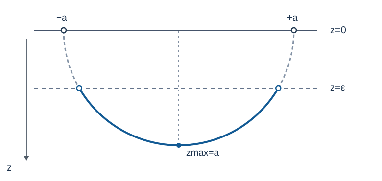

# HOLO3 境界のUV/IRと測地線

<!-- definition-example-audit: strict -->

[HOLO2のPoincaré計量](../HOLO2/index.md#prop-holo2-poincare-metric)では、境界に近い方向を $z\downarrow0$ として表しました。同じ境界の二点を結ぶバルクの曲線は、二点を離すほど深い $z$ まで入り込むのでしょうか。さらに、その曲線の長さを測れば境界の相関の距離依存を理解できるのでしょうか。

本講では、Lorentz時空の光路とは別に**Euclid AdSのRiemann計量**を作り、二点を結ぶ測地線を実際に最短化します。境界は無限遠なので、長さの計算では cutoff の入れ方を二種類に分けます。最後に、幾何学から従うことと、重い場の相関関数に追加で必要な物理的仮定を区別します。

整数 $d\ge2$、曲率半径 $L>0$ を固定し、長さは $L$ と同じ単位で測ります。符号規約はLorentz側で $(-,+,\ldots,+)$、Euclid側で正定値です。場の近似を論じる最後の節では $\hbar=1$ とし、重力の逆反作用を無視できる固定背景を考えます。

## 1. Euclid AdSと尺度の変換

### 1.1 時間を虚数方向へ回すと何が変わるか

[Poincaré計量](../HOLO2/index.md#prop-holo2-poincare-metric)の時間座標 $t$ を、形式的に $t=-i\tau_E$、実数のEuclid時刻 $\tau_E$ へ置き換えると、$-dt^2=d\tau_E^2$ になります。これは実Lorentz多様体の実座標変換ではありません。ここでは得られる正定値計量を、独立したRiemann幾何として扱います。

境界の座標を $\boldsymbol x=(\tau_E,y^1,\ldots,y^{d-1})\in\mathbb R^d$ とまとめます。計量の総和記号に使う成分番号は

$$
x^1=\tau_E,\qquad x^i=y^{i-1}\quad (2\le i\le d)
$$

と定めます。各 $dx^i$ は対応する境界座標の微分、$dz$ は動径座標の微分です。

<!-- formal-statement-start -->
> **定義（Euclid AdSの半上空間表示）**
>
> $d\ge2$、$L>0$ とする。集合 $H^{d+1}=\{(z,\boldsymbol x):z>0,\ \boldsymbol x\in\mathbb R^d\}$ に次の正定値計量を入れたRiemann多様体を、ここでは**Euclid AdS**（双曲半上空間模型）と呼ぶ。

$$
g_E=\frac{L^2}{z^2}\left(dz^2+\sum_{i=1}^{d}(dx^i)^2\right).
$$

> $z=0$ は多様体内部の点ではなく、その共形境界を表す。$z=\epsilon>0$ を有限の**動径cutoff面**と呼ぶ。
<!-- formal-statement-end -->

<!-- definition-example-start: def-holo3-euclidean-ads -->
**定義の確認**： $d=2$ として $(z,\tau_E,y)=(L,0,0)$ を取ります。座標基底 $\partial_z,\partial_{\tau_E},\partial_y$ で接ベクトルを $v=v_z\partial_z+v_\tau\partial_{\tau_E}+v_y\partial_y$ と展開すると、その成分 $(v_z,v_\tau,v_y)$ に対し

$$
g_E(v,v)=\frac{L^2}{L^2}(v_z^2+v_\tau^2+v_y^2)>0\quad(v\ne0)
$$

です。この計算は一点の例ですが、任意の $z>0$ でも $g_E(v,v)=(L^2/z^2)(v_z^2+v_\tau^2+v_y^2)>0$（$v\ne0$）なので、正定値性は全定義域で成立します。$z=\epsilon$ 上で $dy$ だけを動かすと $dz=d\tau_E=0$ であり、固有長要素は $L|dy|/\epsilon$ です。

$z=0$ は係数が発散し、この計量を内部点の計量としてそのまま代入できません。[共形コンパクト化](../HOLO2/index.md#def-holo2-conformal-compactification)の条件を正定値計量に読み替え、$\omega=z/L$ とします。内部で $\omega>0$、付け加えた境界で $\omega=0$、そこで $d\omega=dz/L\ne0$ です。さらに

$$
\overline g_E=\omega^2g_E=dz^2+d\tau_E^2+dy^2
$$

は境界まで滑らかで、座標基底に関する係数行列が単位行列なので境界でも非退化かつ正定値です。HOLO2の元の定義の**Lorentz符号**ではなく、ここではEuclid側の正定値性を確認している点に注意します。
<!-- definition-example-end -->

「深い」とは $z$ が大きいことです。ただし $z$ 自身は固有距離でなく、例えば同じ $\boldsymbol x$ のまま $z_1$ から $z_2$ へ進む長さは

$$
L\int_{z_1}^{z_2}\frac{|dz|}{z}=L\left|\log\frac{z_2}{z_1}\right|.
$$

### 1.2 距離の尺度と動径は一緒に変わる

境界の座標間隔だけを変えると、同じ物理計量の表示がどう変わるか確認します。$\lambda>0$ に対して、境界の全座標と動径を一緒に $\lambda$ 倍してみましょう。

<!-- formal-statement-start -->
> **命題（尺度変換と境界距離・深さの同時変化）**
>
> $d\ge2$、$L>0$ のEuclid AdS半上空間 $H^{d+1}$ と、任意の $\lambda>0$ に対し写像を

$$
S_\lambda(z,\boldsymbol x)=(\lambda z,\lambda\boldsymbol x)
$$

> と定める。これは $g_E$ の等長変換である。したがって、同じEuclid境界時刻にある二点の座標間隔 $\ell$ と、それらを結ぶ最大動径の存在する曲線の $z_{\max}$ は、この変換でともに $\lambda$ 倍される。
<!-- formal-statement-end -->

### 証明の見取り図

分子の座標微分は $\lambda^2$ 倍、分母の $z^2$ も $\lambda^2$ 倍です。固有長は変わらず、座標としての距離と深さだけが同じ倍率で変わります。

<!-- proof-start -->
### 証明

ここで $z'$、$x'^i$ のプライムは**変換後の座標**を表し、後で使う $z'(x)=dz/dx$ という導関数とは異なります。$z'=\lambda z$、$x'^i=\lambda x^i$ とすると、$\lambda$ を固定して微分して $dz'=\lambda dz$、$dx'^i=\lambda dx^i$ であり、引き戻し計量は

$$
S_\lambda^*g_E=\frac{L^2}{(\lambda z)^2}\left((\lambda dz)^2+\sum_i(\lambda dx^i)^2\right)=g_E.
$$

$z>0$ は $\lambda>0$ で保たれ、逆写像は $S_{1/\lambda}$ なので、これは全域の等長微分同相です。境界座標の差は $\lambda(\boldsymbol x_2-\boldsymbol x_1)$ となり、Euclid長は $\lambda\ell$ です。曲線上の各動径が $\lambda z$ に写るため、最大値も $\lambda z_{\max}$ になります。$\square$
<!-- proof-end -->

**注意。** $z=\epsilon$ のcutoff面を固定したまま境界座標だけ拡大すると、上の等長性は使えません。等長写像として比較するなら $\epsilon$ も $\lambda\epsilon$ に写します。長さの対数に $\ell/\epsilon$ が現れる理由は、ここにあります。

## 2. 二点を結ぶ測地線はなぜ半円か

同じEuclid時刻 $\tau_E=0$、その他の境界座標 $y^2,\ldots,y^{d-1}=0$ を固定し、二点の分離方向を $x=y^1$ と書きます。この二次元断面の計量は

$$
ds_E^2=\frac{L^2}{z^2}(dx^2+dz^2),\qquad z>0.
$$

任意の曲線をパラメータ $s$ で $(x(s),z(s),q^1(s),\ldots,q^{d-1}(s))$ と表し、$q^j$ は残りの境界座標とします。この段落だけプライムを $s$ に関する導関数として書けば、正定値性から

$$
\mathcal L_{\mathrm{full}}
=L\int\frac{\sqrt{(x')^2+(z')^2+\sum_j(q'^j)^2}}{z}\,ds
\ge L\int\frac{\sqrt{(x')^2+(z')^2}}{z}\,ds.
$$

右辺は二次元断面への射影の長さです。等号には $q'^j=0$（ほとんど至る所）が必要です。従って断面内で全ての曲線に対する最短性を証明できれば、全 $H^{d+1}$ に対する最短性も従います。

### 2.1 変分の第一積分から円を求める

まずcutoff面の二点 $P_-=(-a,\epsilon)$、$P_+=(a,\epsilon)$ を固定します。ここで $a>0$ は半分の座標間隔、$\epsilon>0$ はcutoff動径です。上側へ膨らむ曲線を $z=z(x)>0$ というグラフで書けば、長さ汎関数は

$$
\mathcal L[z]=L\int_{-a}^a\frac{\sqrt{1+(z'(x))^2}}{z(x)}\,dx.
$$

ここからは $z'(x)=dz/dx$ を $x$ に関する導関数とします。$p=z'(x)$ と書くと、$F(z,p)=\sqrt{1+p^2}/z$ は $x$ に明示的に依存しません。$z>0$ の滑らかな固定端グラフについて[VAR1の第一変分と境界項](../../../解析系/VAR/VAR1/index.md#prop-var1-first-variation-boundary)を適用し、端点の変分をゼロにすると $F_z-dF_p/dx=0$ です。実際、

$$
F_z=-\frac{\sqrt{1+p^2}}{z^2},\qquad
F_p=\frac{p}{z\sqrt{1+p^2}}
$$

なので、連鎖律 $p=dz/dx$ より

$$
\frac{d}{dx}(F-pF_p)
=p\left(F_z-\frac{dF_p}{dx}\right)=0.
$$

$F-pF_p>0$ だから正数 $R$ を用いて

$$
F-pF_p=\frac{1}{z\sqrt{1+p^2}}=\frac1R,
\qquad z^2(1+p^2)=R^2
$$

と表せます。$0<z<R$、$p\ne0$ の上昇・下降する各枝では、逆関数の微分 $dx/dz=1/p$ を使えます。この範囲で

$$
\frac{dx}{dz}=\pm\frac{z}{\sqrt{R^2-z^2}},\qquad
\frac{d}{dz}\sqrt{R^2-z^2}=-\frac{z}{\sqrt{R^2-z^2}}
$$

を積分し、定数 $x_0$ と枝の符号を選ぶと円 $(x-x_0)^2+z^2=R^2$ を得ます。二端点を代入して

$$
(-a-x_0)^2+\epsilon^2
=(a-x_0)^2+\epsilon^2=R^2
$$

ですから、$a>0$ により $x_0=0$、$R^2=a^2+\epsilon^2$ です。頂点 $z=R$ では $p=0$ なので逆関数表示は使えませんが、$z=\sqrt{R^2-x^2}$ はそこで滑らかに両枝をつなぎます。ただし、停留曲線を求めただけではまだ「最短」を示したことにはなりません。

<!-- formal-statement-start -->
> **定理（対称二端点を結ぶ半円測地線とその最短性）**
>
> $d\ge2$、$L,a,\epsilon>0$ とする。Euclid AdSの同じEuclid時刻・同じ横方向座標を持つ二点 $P_-=(-a,\epsilon)$、$P_+=(a,\epsilon)$ の間で、最短曲線は二次元断面上の円弧

$$
x^2+z^2=R^2,\qquad z>0,\qquad R=\sqrt{a^2+\epsilon^2}
$$

> の二点間の上側の弧であり、滑らかな再パラメータ化を除き一意である。最大動径は $z_{\max}=R$、最短長は

$$
D_{\mathrm{cut}}(a,\epsilon)=2L\log\frac{\sqrt{a^2+\epsilon^2}+a}{\epsilon}
=2L\operatorname{arsinh}\frac{a}{\epsilon}.
$$
<!-- formal-statement-end -->

### 証明の見取り図

円弧が停留曲線であることは上の第一積分で分かりました。最短性は、$\operatorname{Im}\zeta>0$ の領域の実係数Möbius等長変換で円弧を縦線へ移して証明します。縦線に沿う距離は $L|d\log z|$ で、横移動を加えれば長さは増すからです。

<!-- proof-start -->
### 証明

複素変数 $\zeta=x+iz$（$z>0$）を使い、$R=\sqrt{a^2+\epsilon^2}$ と置きます。実係数の分数線形写像

$$
w=\frac{\zeta+R}{R-\zeta}=u+iv
$$

は $z>0$ で定義され、直接微分すると

$$
\frac{dw}{d\zeta}=\frac{2R}{(R-\zeta)^2},\qquad
v=\operatorname{Im}w=\frac{2Rz}{|R-\zeta|^2}>0.
$$

よって

$$
\frac{L^2|dw|^2}{v^2}
=\frac{L^2(2R)^2|d\zeta|^2/|R-\zeta|^4}
{(2Rz)^2/|R-\zeta|^4}
=\frac{L^2|d\zeta|^2}{z^2}.
$$

この写像は上半平面の正定値計量 $L^2|d\zeta|^2/z^2$ を保ち、逆写像 $\zeta=R(w-1)/(w+1)$ も $v>0$ 上で定義されます。したがって曲線を像へ移してから戻せます。円 $|\zeta|=R$ では分子・分母に $R-\overline\zeta$ を掛けると

$$
w=\frac{R(\zeta-\overline\zeta)}{|R-\zeta|^2}
=i\frac{2Rz}{|R-\zeta|^2}=iv,
$$

つまり半円は $u=0$ の縦線へ写ります。二端点の像を計算すると、$R^2-a^2=\epsilon^2$ を使って

$$
w(P_-)=i\frac{\epsilon}{R+a},\qquad
w(P_+)=i\frac{R+a}{\epsilon}.
$$

端点の高さも直接確かめます。$P_-$ で $|R-\zeta|^2=(R+a)^2+\epsilon^2=2R(R+a)$ ですから $v_-=\epsilon/(R+a)$ です。$P_+$ では $|R-\zeta|^2=2R(R-a)$ となり、$v_+=\epsilon/(R-a)=(R+a)/\epsilon$ です。

像の任意の区分的滑らかな曲線 $w(s)=u(s)+iv(s)$ は $v(s)>0$ を満たし、ここで $u'$ と $v'$ はパラメータ $s$ に関する微分です。その長さに

$$
\begin{aligned}
\mathcal L[w]
&=L\int\frac{\sqrt{(u')^2+(v')^2}}{v}\,ds\\
&\ge L\int\frac{|v'|}{v}\,ds
\ge L\left|\log\frac{v(P_+)}{v(P_-)}\right|
=2L\log\frac{R+a}{\epsilon}
\end{aligned}
$$

が成立します。等号には $u'=0$ と $v$ の単調性が必要で、端点を結ぶ縦線がちょうどこれを満たします。逆写像は縦線を円弧へ戻します。さらに、断面外の変位を持つ曲線は正定値計量で非負の速度二乗を余分に加えるため長さが短くなりません。従って全空間でもこの円弧が一意の最短曲線です（再パラメータ化を除く）。

最後に $\operatorname{arsinh}s=\log(s+\sqrt{1+s^2})$ を $s=a/\epsilon$ に適用し、二つの長さ表示が一致します。$\square$
<!-- proof-end -->

**直接例。** $a=\epsilon$ とすれば $R=\sqrt2\,\epsilon$ なので、最大深さは $\sqrt2\,\epsilon$、長さは $2L\log(1+\sqrt2)$ です。端点を同じ $z=\epsilon$ に置いても、最短曲線は水平線ではありません。水平線の長さは $L(2a)/\epsilon=2L$ で、$2L\log(1+\sqrt2)<2L$ です。

## 3. 境界の二点とcutoff面の二点を区別する

AdS/CFTで「境界の二点」と言うとき、その点は $z=0$ にあります。しかし $z=0$ へ到達する固有長は無限大です。有限の数を得るには、境界を結ぶ半円の**どの部分を残すか**を決める必要があります。

境界座標 $x=-a,a$（$a=\ell/2>0$）を固定すると、理想的な半円は $x^2+z^2=a^2$ です。ここで $\epsilon\in(0,a)$ より浅い部分 $z<\epsilon$ を捨て、残った弧の長さを記録します。

<!-- formal-statement-start -->
> **定義（正則化された境界アンカー測地線長）**
>
> $L>0$、$a>0$、$\ell=2a$、$0<\epsilon<a$ とする。境界の二点 $(x,z)=(\pm a,0)$ にアンカーされた半円の切断弧を

$$
\gamma_{a,\epsilon}=\{(x,z):x^2+z^2=a^2,\ z\ge\epsilon\}
$$

> と置く。この弧の正定値計量 $g_E$ による長さを**正則化された境界アンカー測地線長**と呼び、次で表す。

$$
D_{\mathrm{anc}}(\ell,\epsilon)=\int_{\gamma_{a,\epsilon}}ds_E.
$$

> これは有限cutoff面上の二点 $(\pm a,\epsilon)$ を固定して最短化した $D_{\mathrm{cut}}(a,\epsilon)$ とは異なる。
<!-- formal-statement-end -->

<!-- definition-example-start: def-holo3-regulated-length -->
**定義の確認**： $a=2\epsilon$ を例に、半円へ $z=\epsilon$ を代入すると $x=\pm\sqrt{a^2-\epsilon^2}=\pm\sqrt3\,\epsilon$ で切断されます。境界のアンカーは依然として $x=\pm2\epsilon$ です。一方、cutoff面の $x=\pm2\epsilon$ を固定する別問題では円の半径が $\sqrt5\,\epsilon$ になります。切断弧は $z\ge\epsilon$ を満たし、後者の二端点はそれぞれ $z=\epsilon$ にあるので、二つの設定はどちらも正則ですが対象の円は異なります。
<!-- definition-example-end -->

図では $z$ の正方向を下向きに描いています。実線の半円は境界のアンカーを持ち、破線は $z=\epsilon$ のcutoff面です。残すのは破線より深い部分です。特に**破線との交点は元の境界アンカーより内側にある**ことを確認してください。

[半円とcutoffの図を拡大表示](assets/semicircle-geodesic-cutoff.svg)

<!-- formal-statement-start -->
> **命題（境界アンカーとcutoff端点の長さの差）**
>
> $L>0$、$\ell=2a>0$、$0<\epsilon<a$ とする。境界アンカー半円の正則化長と、同じ横座標 $x=\pm a$ を持つcutoff面上の二点間最短長は、それぞれ

$$
\begin{aligned}
D_{\mathrm{anc}}(\ell,\epsilon)
&=2L\log\frac{a+\sqrt{a^2-\epsilon^2}}{\epsilon},\\
D_{\mathrm{cut}}(a,\epsilon)
&=2L\log\frac{a+\sqrt{a^2+\epsilon^2}}{\epsilon}.
\end{aligned}
$$

> $\epsilon/\ell\to0$ で両者は共通の発散項 $2L\log(\ell/\epsilon)$ を持つが、$\epsilon>0$ では一致しない。より詳しく

$$
\begin{aligned}
D_{\mathrm{anc}}&=2L\log(\ell/\epsilon)-2L\,\epsilon^2/\ell^2+O(L\epsilon^4/\ell^4),\\
D_{\mathrm{cut}}&=2L\log(\ell/\epsilon)+2L\,\epsilon^2/\ell^2+O(L\epsilon^4/\ell^4).
\end{aligned}
$$
<!-- formal-statement-end -->

### 証明の見取り図

半円を $(x,z)=(a\cos\theta,a\sin\theta)$ と置くと、計量の長さ要素は $L\,d\theta/\sin\theta$ になります。$z=\epsilon$ の交点角を使って積分し、もう一方の設定は[二端点の最短長](#thm-holo3-semicircle)を使います。

<!-- proof-start -->
### 証明

境界アンカー半円を $0<\theta<\pi$ で

$$
x=a\cos\theta,\qquad z=a\sin\theta
$$

と表示すると $dx=-a\sin\theta\,d\theta$、$dz=a\cos\theta\,d\theta$、従って $dx^2+dz^2=a^2d\theta^2$ です。$\theta_\epsilon=\arcsin(\epsilon/a)\in(0,\pi/2)$ とすれば $z\ge\epsilon$ は $\theta\in[\theta_\epsilon,\pi-\theta_\epsilon]$ です。よって

$$
\begin{aligned}
D_{\mathrm{anc}}
&=L\int_{\theta_\epsilon}^{\pi-\theta_\epsilon}\frac{d\theta}{\sin\theta}\\
&=L\left[\log\tan\frac\theta2\right]_{\theta_\epsilon}^{\pi-\theta_\epsilon}
=2L\log\cot\frac{\theta_\epsilon}{2}.
\end{aligned}
$$

$\cot(\theta/2)=(1+\cos\theta)/\sin\theta$、$\cos\theta_\epsilon=\sqrt{a^2-\epsilon^2}/a$ を代入すると第一式を得ます。第二式は[半円最短定理](#thm-holo3-semicircle)で $R=\sqrt{a^2+\epsilon^2}$ としたものです。

漸近展開は $u=\epsilon^2/a^2$ とおいて検算できます。$u\to0$ で

$$
\begin{aligned}
\frac{a+\sqrt{a^2-\epsilon^2}}{\epsilon}
&=\frac{2a}{\epsilon}\left(1-\frac{u}{4}+O(u^2)\right),\\
\frac{a+\sqrt{a^2+\epsilon^2}}{\epsilon}
&=\frac{2a}{\epsilon}\left(1+\frac{u}{4}+O(u^2)\right).
\end{aligned}
$$

$\log(1+v)=v+O(v^2)$ を適用し、$u/4=\epsilon^2/\ell^2$、$2a=\ell$ を代入すれば命題の両展開です。$\square$
<!-- proof-end -->

**発散を除いた長さ。** 比較の基準長を $L$ として、境界アンカーの「繰り込んだ」数値を

$$
D_{\mathrm{ren}}(\ell;L)
:=\lim_{\epsilon\downarrow0}\left[D_{\mathrm{anc}}(\ell,\epsilon)-2L\log\frac{L}{\epsilon}\right]
=2L\log\frac{\ell}{L}
$$

と定められます。これは正の固有長そのものではなく、引き算後の量なので負にもなります。減算に使う基準長を変更すれば有限定数が変わります。一方、二つの分離 $\ell_1,\ell_2$ の差は

$$
D_{\mathrm{ren}}(\ell_2;L)-D_{\mathrm{ren}}(\ell_1;L)=2L\log\frac{\ell_2}{\ell_1}
$$

と基準に依りません。

## 4. 「深さ」と「境界の粗視化」の関係

境界アンカーが $x=\pm\ell/2$ のとき、半円の最深点は厳密に $z_{\max}=\ell/2$ です。短い間隔の二点なら浅い領域しか通らず、間隔を大きくすると深く入ります。例えば $\ell=L$ では最深点が $L/2$、$\ell=4L$ では $2L$ です。

固定した $z=z_0$ 上で、境界座標の小さな幅 $\delta x$ が表す固有長は $L|\delta x|/z_0$ でした。固有長を例えば $L$ に固定すると、座標幅は $|\delta x|=z_0$ となります。$z_0$ が大きい場所ほど、同じ固有長に対応する境界の幅が大きいのです。

これが幾何学的な**UV/IR対応**の中身です。境界で短い長さ（UV、典型的な大きな運動量の逆数）を調べる幾何は $z\ll L$ に寄り、境界で長い長さ（IR）を調べる幾何は大きな $z$ へ届きます。記号的にエネルギー尺度を $\mu$ と書けば $\mu\sim1/z$ という次元的目安になります。ただし比例係数、エネルギーの定義、粗視化の具体的な写像は幾何だけでは決まりません。**任意の場・任意の状態について厳密なRG等号 $\mu=1/z$ を証明したわけではありません。**

## 5. 重い演算子と測地線近似はどこまで対応するか

固定したEuclid AdS背景で、質量 $m>0$ の重い点状プローブの世界線を考えます。$\hbar=1$ ではそのEuclid作用の長さ項は $mD$ です。$mL\gg1$ で世界線経路積分が最短測地線の近傍に集中し、他の鞍点・背景の逆反作用・量子補正を制御できる場合、境界二点を固定した量について形式的に

$$
G_\epsilon(\ell)\simeq A_\epsilon(\ell)\,e^{-mD_{\mathrm{anc}}(\ell,\epsilon)}
$$

という**測地線近似**を使えます。$A_\epsilon$ はゆらぎ・正規化等を含む前因子で、単に1と決まるものではありません。これは本章で導いた幾何定理ではなく、追加の物理的サドル近似です。

[正則化長の公式](#prop-holo3-cutoff-lengths)によれば、先頭の指数因子を正規化すると

$$
\begin{aligned}
\lim_{\epsilon\downarrow0}
\left(\frac{L}{\epsilon}\right)^{2mL}e^{-mD_{\mathrm{anc}}(\ell,\epsilon)}
&=e^{-mD_{\mathrm{ren}}(\ell;L)}\\
&=\left(\frac L\ell\right)^{2mL}.
\end{aligned}
$$

一方、$d\ge3$ のEuclid CFTにおいて、対称性と一次場の仮定を満たすスカラー演算子の相異なる点での正確な二点関数は、[スカラー一次場の二点関数と次元の選択則](../../QFT/QFT48/index.md#thm-qft48-primary-two-point)により次の形です。

$$
G(\ell)=C\ell^{-2\Delta},\qquad \ell>0.
$$

$\Delta$ は一次演算子のスケーリング次元で、$C$ は理論・正規化による係数です。重い演算子を適切なバルクプローブで記述でき、主な指数が $mL$ に支配される模型では、$\Delta=mL+O(1)$ という**重い極限での先頭次数**が距離冪と整合します。

しかし $\Delta=mL$ を全質量での厳密等号としてはいけません。バルク場の境界漸近から質量と次元の関係を導くには、運動方程式・境界条件・正規化の検討が必要です。また、$d=2$ の場合も一般の相関関数に上のQFT48の $d\ge3$ 定理を無条件適用しません。質量と次元の厳密な関係は後の講義で独立に導きます。

さらに測地線長は**二点の相関の重い極限を近似する道具**で、任意のCFT相関関数の厳密値ではなく、境界領域のエントロピーそのものでもありません。両者が半円を使う場合があっても、物理的な辞書と係数は別々に証明する必要があります。

## 6. 演習

### A1. Euclid計量の正定値性

- Level: A
- 問題: $d=2$、$L>0$ のPoincaré AdSで $ds^2=L^2z^{-2}(dz^2-dt^2+dy^2)$ とする。$t=-i\tau_E$ から得る正定値計量を書き、点 $z=2L$ で速度 $v=(1,2,2)$ の長さの二乗を計算せよ。

<!-- solution-start -->
**詳細解答。** $dt=-i\,d\tau_E$ より $-dt^2=+d\tau_E^2$ です。従って

$$
ds_E^2=\frac{L^2}{z^2}(dz^2+d\tau_E^2+dy^2).
$$

$z=2L$ では係数 $L^2/z^2=1/4$、$v$ のEuclid二乗は $1^2+2^2+2^2=9$ なので $g_E(v,v)=9/4>0$ です。これはLorentz計量を実座標変換したものではない点にも注意します。
<!-- solution-end -->

### A2. 倍率を一緒に変える

- Level: A
- 問題: $L>0$、$z>0$ のEuclid AdSで $z'=3z$、$x'^i=3x^i$ とする。計量が不変なことを代入で示せ。また $z=z_0$ 上で境界方向の間隔 $\delta x=z_0$ の固有長を求めよ。

<!-- solution-start -->
**詳細解答。** $dz'=3dz$、$dx'^i=3dx^i$ を代入すると

$$
\frac{L^2}{z'^2}\left(dz'^2+\sum_i dx'^i{}^2\right)
=\frac{L^2}{9z^2}\left(9dz^2+9\sum_i dx^i{}^2\right)=g_E.
$$

固定 $z=z_0$ なら $ds=L|dx|/z_0$ で、直線区間の固有長は $L\delta x/z_0=L$ です。[尺度等長性](#prop-holo3-scale-isometry)の具体的な確認です。
<!-- solution-end -->

### A3. 第一積分を直接確認する

- Level: A
- 問題: $F(z,p)=\sqrt{1+p^2}/z$（$z>0$）とする。$F-p\,\partial F/\partial p$ を計算し、これを $1/R$ とおいたときの $p^2$ を導け。$R>0$ とする。

<!-- solution-start -->
**詳細解答。** $\partial F/\partial p=p/(z\sqrt{1+p^2})$ なので

$$
F-pF_p=\frac{1+p^2-p^2}{z\sqrt{1+p^2}}
=\frac{1}{z\sqrt{1+p^2}}.
$$

$1/(z\sqrt{1+p^2})=1/R$ から $z\sqrt{1+p^2}=R$。両辺を二乗して $z^2(1+p^2)=R^2$、従って $p^2=R^2/z^2-1$ です。実数の傾きには $0<z\le R$ が必要です。
<!-- solution-end -->

### A4. 有限cutoff面上の二点

- Level: A
- 問題: $L>0$、$\epsilon>0$ の半上平面で $P_\pm=(\pm\epsilon,\epsilon)$ を結ぶ最短半円の半径、最大深さ、長さを求めよ。

<!-- solution-start -->
**詳細解答。** $a=\epsilon$ とおき、[半円最短定理](#thm-holo3-semicircle)で $R^2=a^2+\epsilon^2=2\epsilon^2$ です。よって $R=z_{\max}=\sqrt2\epsilon$。

$$
D=2L\log\frac{\sqrt2\epsilon+\epsilon}{\epsilon}
=2L\log(1+\sqrt2).
$$

水平線の長さ $2L$ より小さいことも $\log(1+\sqrt2)\approx0.881<1$ から確認できます。
<!-- solution-end -->

### A5. 境界アンカー半円の切断点

- Level: A
- 問題: $L,a>0$、$\epsilon=a/2$ とする。境界のアンカー $(\pm a,0)$ を持つ半円のcutoffとの交点と、残した弧の長さを求めよ。

<!-- solution-start -->
**詳細解答。** 半円 $x^2+z^2=a^2$ に $z=a/2$ を代入すると $x^2=3a^2/4$、交点は $(\pm\sqrt3\,a/2,a/2)$ です。[正則化長の公式](#prop-holo3-cutoff-lengths)をこの設定に代入すると

$$
D_{\mathrm{anc}}=2L\log\frac{a+\sqrt{a^2-a^2/4}}{a/2}
=2L\log(2+\sqrt3).
$$

端点を $(\pm a,a/2)$ に置く別の問題とは異なります。
<!-- solution-end -->

### B1. Möbius写像で最短性を示す

- Level: B
- 問題: $L>0$、$a,\epsilon>0$、$R=\sqrt{a^2+\epsilon^2}$ とする。$w=(\zeta+R)/(R-\zeta)$（$\zeta=x+iz$）が $L^2|d\zeta|^2/z^2$ を保つことを計算で示し、$x^2+z^2=R^2$ の上側円弧が二端点 $(\pm a,\epsilon)$ を最短で結ぶことを証明せよ。

<!-- solution-start -->
**詳細解答。** 商の微分から $dw/d\zeta=2R/(R-\zeta)^2$、虚部は

$$
v=\operatorname{Im}w=\frac{2Rz}{|R-\zeta|^2}>0.
$$

従って $|dw|/v=|d\zeta|/z$、すなわち長さが保たれます。円弧では $|\zeta|^2=R^2$ を使って

$$
w=\frac{(\zeta+R)(R-\bar\zeta)}{|R-\zeta|^2}
=\frac{R(\zeta-\bar\zeta)}{|R-\zeta|^2}
$$

なので $\operatorname{Re}w=0$ です。像の端点の高さは $v_-=\epsilon/(R+a)$、$v_+=(R+a)/\epsilon$。任意の像の曲線に対して

$$
L\int\frac{\sqrt{u'^2+v'^2}}v\,ds
\ge L\int\frac{|v'|}v\,ds
\ge L\log\frac{v_+}{v_-}
$$

です。縦線は $u'=0$ かつ $v$ 単調なので等号が成り立ちます。逆像が指定円弧であり、長さは $2L\log((R+a)/\epsilon)$。さらに断面外へ動けば長さは増すため全空間で最短です。
<!-- solution-end -->

### B2. 二種類のcutoffの次項

- Level: B
- 問題: $L,\ell>0$、$\epsilon/\ell\to0$ とする。$D_{\mathrm{anc}}$ と $D_{\mathrm{cut}}$ の厳密式を用い、$2L\log(\ell/\epsilon)$ を引いた後の最初の非零項をそれぞれ求めよ。ここでcutoff端点の分離も $\ell$ とする。

<!-- solution-start -->
**詳細解答。** $a=\ell/2$、$u=\epsilon^2/a^2$ と置きます。$\sqrt{1\pm u}=1\pm u/2-u^2/8+O(u^3)$ なので

$$
\log\frac{a+\sqrt{a^2\pm\epsilon^2}}{\epsilon}
=\log\frac{2a}{\epsilon}+\log\left(1\pm\frac{u}{4}+O(u^2)\right)
=\log\frac\ell\epsilon\pm\frac{u}{4}+O(u^2).
$$

ここで $u/4=\epsilon^2/\ell^2$ です。負号が境界アンカー、正号がcutoff固定端点なので

$$
D_{\mathrm{anc}}-2L\log(\ell/\epsilon)=-2L\frac{\epsilon^2}{\ell^2}+O(L\epsilon^4/\ell^4),
$$

$$
D_{\mathrm{cut}}-2L\log(\ell/\epsilon)=+2L\frac{\epsilon^2}{\ell^2}+O(L\epsilon^4/\ell^4).
$$

一方の近似をもう一方へ転用すると次項の符号が誤ります。
<!-- solution-end -->

### B3. 深さと分離比から読み取る

- Level: B
- 問題: $L>0$ のEuclid AdSで、境界アンカー間隔 $\ell_1=L$、$\ell_2=4L$ の二本の半円を考える。最大深さの比、cutoff長の共通発散を除いた差を求め、尺度変換で変わる量と変わらない量を述べよ。

<!-- solution-start -->
**詳細解答。** 境界アンカー半円は $z_{\max}=\ell/2$ なので $z_{\max,1}=L/2$、$z_{\max,2}=2L$ です。比は4。繰り込んだ長さの差は

$$
2L\log(\ell_2/L)-2L\log(\ell_1/L)=2L\log4.
$$

境界座標と動径とcutoffを全て4倍する[等長写像](#prop-holo3-scale-isometry)は固有長を変えず、$\ell/\epsilon$ も保ちます。ここでは同じ $L$・同じ減算規約で異なる二つの間隔を比較しているので、差 $2L\log4$ が残ります。これはエネルギー $\mu$ の絶対的な換算係数を決めません。
<!-- solution-end -->

### B4. 二点関数の厳密式との距離

- Level: B
- 問題: $d=3$ のEuclid CFTにスケーリング次元 $\Delta>0$ のスカラー一次演算子があり、相異なる点での二点関数を次で与える（$C\ne0$）。

$$
G(\ell)=C\ell^{-2\Delta},\qquad \ell>0.
$$

一方、重いバルクプローブの質量 $m>0$ は $mL\gg1$ を満たし、測地線近似の**先頭指数因子だけ**を

$$
G_{\mathrm{geo}}^{(\mathrm{exp})}(\ell):=e^{-mD_{\mathrm{ren}}(\ell;L)}
$$

と定める。前因子は一般に $\ell$ に依存し得るので、この記号は完全な相関関数を表さない。距離の指数を比較し、$\Delta=mL+\delta$（$\delta$ が $mL\to\infty$ でも有界）なら、この近似が何を保証し、何を保証しないか述べよ。

<!-- solution-start -->
**詳細解答。** [繰り込み長](#prop-holo3-cutoff-lengths)の後に定めた $D_{\rm ren}=2L\log(\ell/L)$ を使うと

$$
G_{\rm geo}^{(\mathrm{exp})}(\ell)=\exp[-2mL\log(\ell/L)]=(L/\ell)^{2mL}.
$$

[一次場二点関数定理](../../QFT/QFT48/index.md#thm-qft48-primary-two-point)による厳密な距離指数は $2\Delta=2mL+2\delta$。大きな $mL$ に比例する**先頭指数**は一致しますが、差の因子 $(L/\ell)^{2\delta}$ は一般に1とは限りません。ゆらぎの前因子、演算子の正規化、状態・背景・作用の仮定も必要で、測地線だけから $C$ や全次数の厳密等号は出ません。
<!-- solution-end -->

### C1. 二つのcutoff処方とUV/IR・重いプローブ

- Level: C
- 問題: $L,a>0$、整数 $n>2$ とする。境界アンカーを $(\pm a,0)$、cutoffを $\epsilon=a/n$ とする。以下を一つの計算として導け。

  1. 境界アンカー半円の切断点、最深点、正則化長 $D_{\rm anc}$。
  2. cutoff面上で横座標 $x=\pm a$ を固定した最短曲線の最深点と長さ $D_{\rm cut}$。
  3. $n\to\infty$ における両者の差の先頭項、減算後の共通有限値。
  4. 半円の深さが境界のUV/IRを表す意味と、$e^{-mD}$ をCFT二点関数の厳密式と呼べない理由。

<!-- solution-start -->
**詳細解答。** (1) 理想半円は $x^2+z^2=a^2$ で、$z=a/n$ との交点は

$$
\left(x,z\right)=\left(\pm a\sqrt{1-n^{-2}},a/n\right).
$$

最深点は $z=a$ です。$\ell=2a$ を用いた[切断弧の長さ](#prop-holo3-cutoff-lengths)は

$$
D_{\rm anc}=2L\log\left[n\left(1+\sqrt{1-n^{-2}}\right)\right].
$$

(2) cutoff面の端点を $(\pm a,a/n)$ に固定すると、[最短半円](#thm-holo3-semicircle)の半径と最深点は $R=a\sqrt{1+n^{-2}}$ です。よって

$$
D_{\rm cut}=2L\log\left[n\left(1+\sqrt{1+n^{-2}}\right)\right].
$$

(3) $u=n^{-2}$ とすると、$\sqrt{1\pm u}=1\pm u/2+O(u^2)$ です。このため $1+\sqrt{1\pm u}=2(1\pm u/4+O(u^2))$ であり、$\log(1+v)=v+O(v^2)$ を $v=\pm u/4+O(u^2)$ に適用します。すると

$$
\begin{aligned}
D_{\rm cut}-D_{\rm anc}
&=2L\log\frac{1+\sqrt{1+u}}{1+\sqrt{1-u}}\\
&=2L\left(\frac{u}{2}+O(u^2)\right)
=\frac{L}{n^2}+O(Ln^{-4}).
\end{aligned}
$$

両者から $2L\log(L/\epsilon)$ を引き $n\to\infty$ とすれば、共通有限値は $2L\log(2a/L)$ です。なお、上の差の先頭係数は、個別展開の $\pm L/(2n^2)$ を差し引いても確認できます。

(4) 境界アンカー間隔は $\ell=2a$ で、最深点 $z=a=\ell/2$ です。境界間隔を2倍すれば到達深さも2倍なので、短距離ほど浅い領域、長距離ほど深い領域を使う幾何的UV/IRが見えます。一方、$e^{-mD}$ は $mL\gg1$ の世界線サドルの主要指数に過ぎず、前因子、質量と一次演算子の次元の関係、量子補正等を含みません。[QFT48の二点関数](../../QFT/QFT48/index.md#thm-qft48-primary-two-point)の厳密な距離冪は共形対称性と演算子の仮定から従う別の主張です。
<!-- solution-end -->

## この講義で確認したこと

- Euclid AdSは正定値の双曲半上空間で、境界方向と動径の同時拡大縮小は等長変換である。
- 対称二端点の最短曲線は半円であり、変分の第一積分だけでなくMöbius等長変換で最短性も示せる。
- 境界アンカー半円の切断とcutoff面上の固定端点は異なる正則化だが、先頭発散はともに $2L\log(\ell/\epsilon)$ である。
- 最大深さ $z_{\max}=\ell/2$ は幾何学的UV/IRを可視化する。$\mu\sim1/z$ は具体的なRG辞書を自動的に与えない。
- 重い演算子の距離冪を測地線長から読むには世界線サドル等の追加仮定が必要で、CFT二点関数の全次数の厳密等号ではない。

次の講義では、ここで使った幾何が境界CFTの共形変換・一次演算子とどう対応するかを詳しく調べます。
