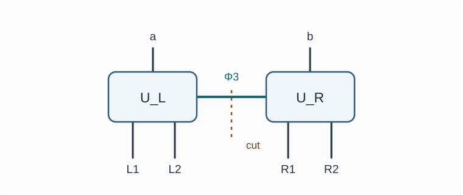

# HOLO31 テンソル網・HaPPY模型

<!-- definition-example-audit: strict -->

[HOLO29の消失訂正符号](../HOLO29/index.md#thm-holo29-three-representations)は、一つの論理qutritを三つの物理qutritへ分散し、どれか一つが消えても残る二つから回復できるものでした。[HOLO30の作用素代数再構成](../HOLO30/index.md#def-holo30-algebra-reconstruction)では、何を回復するかを論理作用素の代数で指定しました。ところが境界が多数の区画へ分かれた場合、**どの区画の組合せで、どのバルク自由度を読めるか**を毎回一から符号表で調べるのは大変です。

そこで局所的な等長写像を線でつなぎ、その**接続の形**から回復領域やエントロピーを調べる「テンソル網」を作ります。まず四つのqutritからなる完全テンソルを厳密に検算し、次にそれを二つ連結します。これは[Pastawski–Yoshida–Harlow–PreskillのHaPPY符号](https://arxiv.org/abs/1503.06237)に現れる発想を小さくした**有限次元の説明模型**であり、元論文の双曲的な多角形敷き詰めと同じ網を作ったという意味ではありません。

## 0. 設定と読み方

すべてのHilbert空間は複素有限次元です。一つのqutritは $Q=\mathbb C^3$、計算基底は $|0\rangle,|1\rangle,|2\rangle$ とし、添字の加減乗算は体 $\mathbb F_3=\{0,1,2\}$ で行います。したがって $2=-1$、$3=0$、$2^{-1}=2$ です。$I_Q$ は $Q$ の恒等作用素、$V^\dagger$ は随伴、$\operatorname{Tr}_E$ は系 $E$ を捨てる部分トレースです。von Neumannエントロピーは

$$
S(\rho)=-\operatorname{Tr}(\rho\log\rho)
$$

で定め、$0\log0=0$ とします。対数は自然対数（単位 nat）です。$a,b$ は論理qutrit、$L_1,L_2,R_1,R_2$ は境界の物理qutritです。「領域から再構成」は、物理空間の**符号像に限って**すべての論理入力に同じ作用を与えることを指し、全物理空間で論理演算子と同じ行列を要求するものではありません。

## 1. 任意の半分から残り半分を決めるテンソル

四つの脚（qutrit因子）を持つ量子状態を、その計算基底で四添字の係数表としても見ます。「脚を切り分ける」とは、この四因子を二組 $X,Y$ に分け、係数を $X$ 側の添字と $Y$ 側の添字を持つ行列として読むことです。行列の列が直交して等しい長さなら、適切に規格化して $X$ から $Y$ への等長写像になります。この対応を使うため、まず状態の部分トレースで条件を定めます。

<!-- formal-statement-start -->
> **定義（四脚の完全テンソル）**  
> $Q_1,Q_2,Q_3,Q_4$ をそれぞれ $\mathbb C^3$ とし、正規化された純粋状態 $|T\rangle\in Q_1\otimes Q_2\otimes Q_3\otimes Q_4$ を考える。任意の脚集合 $X\subseteq\{1,2,3,4\}$ で $|X|\le2$ を満たすものについて、その縮約が

$$
\operatorname{Tr}_{X^c}|T\rangle\langle T|
=\frac{I_{3^{|X|}}}{3^{|X|}}
$$

> となるとき、$|T\rangle$ を四脚の**完全テンソル**（perfect tensor）と呼ぶ。ここで $X^c$ は補集合で、右辺の恒等行列は $X$ 側の計算基底に関するものである。
<!-- formal-statement-end -->

「最大混合」の意味は、例えば二脚なら9個の基底状態がそれぞれ確率 $1/9$ を持ち、非対角成分もゼロになることです。正規化済みの純粋状態では、**すべての二脚を検査すれば十分**です。一脚の縮約は、任意のそれを含む二脚の恒等行列をさらに部分トレースして得られ、空集合の縮約はノルム1だからです。

具体的な候補を次で与えます。

$$
|T_3\rangle
=\frac13\sum_{i,j\in\mathbb F_3}
|i\rangle_1|j\rangle_2|i+j\rangle_3|i+2j\rangle_4.
$$

二脚の縮約が最大混合になるかを、単なる「対称性」ではなく**二脚が元の $(i,j)$ を一意に決めること**で判定します。四脚の値は行ベクトル

$$
r_1=(1,0),\quad r_2=(0,1),\quad
r_3=(1,1),\quad r_4=(1,2)
$$

と列 $(i,j)^{\mathsf T}$ の積です。二脚 $s,t$ の値は $2\times2$ 行列 $(r_s;r_t)$ による線形変換であり、行列式が非零なら $\mathbb F_3^2$ 上の全単射です。さらに**残りの二脚側も全単射**であることが、非対角成分を消すために必要です。

<!-- formal-statement-start -->
> **命題（四qutritの完全テンソル）**  
> 上記の $|T_3\rangle$ は四脚の完全テンソルである。任意の二脚 $X$ と残りの二脚 $Y$ の間には、計算基底の順序を固定すると、あるユニタリ写像 $U_{X\to Y}:Q_X\to Q_Y$ が存在し、

$$
|T_3\rangle
=\frac13\sum_{x\in\mathbb F_3^2}
|x\rangle_X\otimes U_{X\to Y}|x\rangle_X
$$

> と書ける。特に、二脚側からもう一方の二脚側への写像は、基底の置換として構成できる。
<!-- formal-statement-end -->

**証明の見取り図。** 六組すべての二脚の行列式を検査します。どの組でも写像が可逆なら、和を二脚の基底 $x$ で取り直せます。残りの二脚にも重複がないので、部分トレースで非対角項が消え、対角成分がすべて $1/9$ になります。

<!-- proof-start -->
### 証明

二行を上から並べた行列の行列式を $\mathbb F_3$ で計算すると

$$
\begin{array}{c|rrrrrr}
(s,t)&(1,2)&(1,3)&(1,4)&(2,3)&(2,4)&(3,4)\\ \hline
\det(r_s;r_t)&1&1&2&2&2&1
\end{array}
$$

です。いずれも $0$ ではありません。したがって任意の二脚 $X$ の値 $x$ と元の $(i,j)$ は全単射に対応します。補集合 $Y$ に対しても、同じ判定から値 $y$ は $(i,j)$ の全単射な関数です。よって $x$ に対応する $y$ を $f(x)$ とすると

$$
|T_3\rangle=\frac13\sum_x|x\rangle_X|f(x)\rangle_Y.
$$

$f$ は九つの基底を重複なく置換するので、$U_{X\to Y}|x\rangle=|f(x)\rangle$ はユニタリです。正規化は九つの互いに直交する項から $\langle T_3|T_3\rangle=9/9=1$。$Y$ を部分トレースすると

$$
\begin{aligned}
\rho_X
&=\frac19\sum_{x,x'}
|x\rangle\langle x'|\,
\langle f(x')|f(x)\rangle\\
&=\frac19\sum_{x,x'}\delta_{x,x'}|x\rangle\langle x'|
=\frac{I_9}{9}.
\end{aligned}
$$

一脚については、例えば $\operatorname{Tr}_{Q_2}(I_9/9)=3I_3/9=I_3/3$ であり、他の脚も二脚の組を選べば同じ計算です。ゆえに定義のすべての条件が成り立ちます。
<!-- proof-end -->

<!-- definition-example-start: def-holo31-perfect-tensor -->
**定義の確認**（直接例と失敗例）。 $X=\{1,2\}$ とすると、$Y=\{3,4\}$ の基底ラベルは $(i+j,i+2j)$ です。逆写像は

$$
i=2x-y,\qquad j=y-x
\quad\text{（$x=i+j,\ y=i+2j$）}
$$

となります。両辺を代入すれば $(2x-y)+(y-x)=x$、$(2x-y)+2(y-x)=y$ です。したがって九つの入力基底は九つの異なる出力基底に移り、二脚縮約は $I_9/9$ です。これに対し四qubitのGHZ状態 $(|0000\rangle+|1111\rangle)/\sqrt2$ は、一脚縮約こそ $I_2/2$ ですが、二脚縮約は $(|00\rangle\langle00|+|11\rangle\langle11|)/2$ であり $I_4/4$ ではありません。**一脚だけの検査では完全性を判定できません。**
<!-- definition-example-end -->

## 2. 完全性から消失訂正へ

前節で得たユニタリを、向きを指定して使います。脚1・2を入力、脚3・4を出力とすると

$$
U|i,j\rangle=|i+j,i+2j\rangle,\qquad
U^\dagger|x,y\rangle=|2x-y,y-x\rangle.
$$

これは係数を並べた四脚状態 $|T_3\rangle$ の**二脚対二脚**の読み方です。反対に脚1だけを入力に選び、残り三脚へ送る写像を

$$
W|i\rangle=\frac1{\sqrt3}\sum_{j\in\mathbb F_3}
|j,i+j,i+2j\rangle
$$

とすれば、$W^\dagger W=I_3$ です。実際、$W|i\rangle$ と $W|i'\rangle$ の内積は

$$
\frac13\sum_{j,j'}
\delta_{j,j'}\delta_{i+j,i'+j'}\delta_{i+2j,i'+2j'}
=\frac13\sum_j\delta_{i,i'}=\delta_{i,i'}.
$$

この $W$ は、係数表示が[HOLO29の三qutrit消失訂正符号](../HOLO29/index.md#thm-holo29-three-representations)と一致します（論理添字の名前の違いだけです）。例えば第1・第2物理脚の値を $(j,k)=(j,i+j)$ とすると、失われた第3脚は $\ell=i+2j=k+j$ です。保持した二脚へ

$$
D_{12}|j,k\rangle=|k-j,k+j\rangle
$$

という基底置換をかければ、逆変換は $j=(\ell-i)/2$、$k=i+j$ で求まります。$\mathbb F_3$ では $2$ が可逆なので、これはユニタリです。すると

$$
(D_{12}\otimes I_3)W|i\rangle
=|i\rangle\otimes\frac1{\sqrt3}
\sum_{\ell=0}^2|\ell\rangle|\ell\rangle.
$$

第1因子を取り出して二つの補助因子を捨てれば、任意の重ね合わせ・混合状態に作用する**同一の復号チャネル**になります。単なる基底状態の識別より強い条件です。

## 3. 二つの局所テンソルをつなぐ

テンソル網では、局所テンソルの脚のうち二つを内部で結び、残りを外へ出します。この小模型では、左右それぞれの局所ユニタリ $U$ が論理脚と内部脚を受け取り、二つの境界脚を出力します。結ぶ二つの内部qutritには、規格化された最大エンタングル状態

$$
|\Phi_3\rangle_{e_Le_R}=\frac1{\sqrt3}
\sum_{e=0}^2|e\rangle_{e_L}|e\rangle_{e_R}
$$

を入れます。係数を掛け合わせて内部添字 $e$ を足す操作が、ここでの「脚の縮約」です。左右の入力 $a,b$ は互いに独立な論理脚で、境界脚とは別に数えます。

<!-- formal-statement-start -->
> **定義（二頂点のテンソル網符号）**  
> 論理空間と境界空間をそれぞれ

$$
H_{\mathrm{bulk}}=Q_a\otimes Q_b,\qquad
H_{\mathrm{bdry}}=(Q_{L_1}\otimes Q_{L_2})\otimes(Q_{R_1}\otimes Q_{R_2})
$$

> とする。第2節のユニタリ $U$ を左右に、$|\Phi_3\rangle$ を内部脚に用いて、線形写像 $V:H_{\mathrm{bulk}}\to H_{\mathrm{bdry}}$ を基底上で

$$
V|a,b\rangle=\frac1{\sqrt3}
\sum_{e\in\mathbb F_3}
|a+e,a+2e\rangle_L
\otimes|b+e,b+2e\rangle_R
$$

> と定め、線形に延長する。この写像を**二頂点のテンソル網符号**と呼ぶ。下付きの $L,R$ はそれぞれ二つの物理qutritの順序を表す。
<!-- formal-statement-end -->

左の二つの出力と右の二つの出力の間を結ぶ**内部脚は一本**です。左の二つの出力をまとめた領域 $L=L_1L_2$、右を $R=R_1R_2$ とします。

図は頂点の配置と内部脚・外部脚の**接続関係**を表します。描画上の距離や角度はAdS時空の物理的長さではありません。

<!-- definition-example-start: def-holo31-two-vertex-network -->
**定義の確認**（入力を一つ固定）。 $a=1,b=2$ の場合、$e=0,1,2$ を順に代入すると

$$
V|1,2\rangle
=\frac{|11\rangle_L|22\rangle_R
+|20\rangle_L|01\rangle_R
+|02\rangle_L|10\rangle_R}{\sqrt3}.
$$

各項は四脚の計算基底で互いに直交し、ノルムの二乗は $3(1/3)=1$ です。異なる $(a,b)$ の像の直交性も次の定理で確認します。
<!-- definition-example-end -->

<!-- formal-statement-start -->
> **定理（二頂点網の等長性と領域再構成）**  
> 定義の $V$ は $V^\dagger V=I_9$ を満たす。論理代数 $\mathcal B(Q_a)\otimes I_b$ のすべての作用素は境界領域 $L_1L_2$ 上で、$I_a\otimes\mathcal B(Q_b)$ のすべての作用素は $R_1R_2$ 上で、入力状態によらず再構成できる。一方、どの**一つだけの境界qutrit**を残しても、任意の論理状態に対するその縮約は $I_3/3$ であり、全論理情報は復元できない。
<!-- formal-statement-end -->

**証明の見取り図。** 左右の $U^\dagger$ を作用させると、見かけ上複雑な四脚の状態は「論理 $a$」「論理 $b$」「独立に共有するBell対」の積に戻ります。その形なら等長性と領域再構成が直ちに計算できます。一脚の秘匿性は、残りの脚をトレースして全入力の非対角項が消えることを確認します。

<!-- proof-start -->
### 証明

論理基底上で左右の $U^\dagger$ を適用すると、

$$
(U_L^\dagger\otimes U_R^\dagger)V|a,b\rangle
=|a\rangle|b\rangle\otimes
\frac1{\sqrt3}\sum_e|e\rangle_{e_L}|e\rangle_{e_R}.
$$

右辺の因子の並べ方は $a,e_L,b,e_R$ と読んでも同じです。このとき $|\Phi_3\rangle$ のノルムは1なので、任意の二つの論理基底 $(a,b),(a',b')$ の像について

$$
\langle Va',b'|Va,b\rangle
=\delta_{a,a'}\delta_{b,b'}
\langle\Phi_3|\Phi_3\rangle
=\delta_{a,a'}\delta_{b,b'}.
$$

よって $V^\dagger V=I_9$ です。

$O_a\in\mathcal B(Q_a)$ に対し、$L$ 上の作用素を

$$
\pi_L(O_a)=U_L(O_a\otimes I_{e_L})U_L^\dagger
$$

とします。$U_L$ がユニタリなので、$\pi_L$ は単位・和・積・随伴をすべて保ちます。さらに

$$
(\pi_L(O_a)\otimes I_R)V
=V(O_a\otimes I_b)
$$

が全論理基底上で成立します。右側についても $\pi_R(O_b)=U_R(O_b\otimes I_{e_R})U_R^\dagger$ が同様に働きます。これは[HOLO30の完全再構成の定義](../HOLO30/index.md#def-holo30-algebra-reconstruction)を満たします。

次に任意の論理密度行列 $\rho_{ab}$ について、上で示した因子分解から

$$
\rho_L=\operatorname{Tr}_R(V\rho_{ab}V^\dagger)
=U_L\left(\rho_a\otimes\frac{I_{e_L}}3\right)U_L^\dagger,\qquad
\rho_a=\operatorname{Tr}_b\rho_{ab}
$$

です。第1物理脚だけを残すときは $\rho_a=\sum_{a,a'}c_{aa'}|a\rangle\langle a'|$ と展開します。内部添字は縮約の両側で同じ $e$ なので、第2脚のトレースに現れる係数は

$$
\langle a'+2e|a+2e\rangle
=\delta_{a,a'}.
$$

残る第1脚の対角項については $a+e$ が $e=0,1,2$ を一巡するから、

$$
\rho_{L_1}
=\frac13\sum_{a,e}c_{aa}|a+e\rangle\langle a+e|
=\left(\sum_a c_{aa}\right)\frac{I_3}3
=\frac{I_3}3.
$$

第2脚だけを残す場合も、トレースする第1脚の条件 $a+e=a'+e$ が $a=a'$ を与え、$a+2e$ が全値を一巡するため $I_3/3$ です。右側は $b$ を用いて同じ二つの計算を行えます。一脚の縮約がすべての $\rho_{ab}$ で同一なので、例えば異なる二つの論理基底状態を一つの復号器で識別することさえ不可能です。
<!-- proof-end -->

**二つの物理脚で何が読めるか。** $\omega=e^{2\pi i/3}$、$X|a\rangle=|a+1\rangle$、$Z|a\rangle=\omega^a|a\rangle$ とします。$U|a,e\rangle=|x,y\rangle$ では $x=a+e,y=a+2e$ なので、$a$ を1増やす操作は $x,y$ をともに1増やします。また $a=2x-y$ です。よって左側の作用素は

$$
X_a\longleftrightarrow X_{L_1}X_{L_2},
\qquad
Z_a\longleftrightarrow Z_{L_1}^{\,2}Z_{L_2}^{-1}
$$

となります。右側では $a,L$ を $b,R$ に替えます。両式は各基底で検算でき、$ZX=\omega XZ$ も $2-1=1$ の指数から一致します。

## 4. どこまで吸収できるか：greedyな復号の判定

大きな網で局所ユニタリを全部掛け合わせる代わりに、境界領域から内側へ頂点を順に取り込めるかを調べます。ここで「吸収」は幾何的な変形ではなく、完全テンソルを**入力が2脚以下の等長写像として向きを変えて読む操作**です。

<!-- formal-statement-start -->
> **定義（四脚完全テンソル網のgreedy吸収）**  
> 四脚完全テンソルを頂点とし、脚を内部で結んだ有限網と、保持する境界脚の集合 $A$ を固定する。はじめに $A$ の脚だけを「取得済み」とする。未処理の頂点で、取得済みの脚が**少なくとも2本**あるものを選び、その頂点の残りの脚を取得済みに加える操作を繰り返す。新たな頂点を選べなくなったところで止め、到達した内部脚・論理脚をこの手順での到達集合と呼ぶ。内部結合と脚の次元・向きを指定した上で行う構成手順であり、到達しないこと自体は再構成不能の証明ではない。
<!-- formal-statement-end -->

<!-- definition-example-start: def-holo31-greedy-absorption -->
**定義の確認**。 二頂点網で $A=\{L_1,L_2\}$ とすると、左頂点は二本の脚を既に持つので取り込めます。そこから論理脚 $a$ と内部脚 $e_L$ に達します。右頂点で取得済みなのは内部脚の一本だけで、二本の条件を満たさず停止します。従って左の論理 $a$ の再構成を検出しますが、右の論理 $b$ はこの手順では検出しません。$A=\{L_1,R_1\}$ では各頂点が一本ずつしか持たず、吸収は一回も進みません。
<!-- definition-example-end -->

実際の局所等長性がなぜ必要かを確かめます。$|T_3\rangle$ を $k\le2$ 本の脚 $X$ と残り $Y$ に分け、計算基底によって

$$
W_X|x\rangle
=\sqrt{3^k}(\langle x|_X\otimes I_Y)|T_3\rangle
$$

を定めます。第1節で示した $\rho_X=I/3^k$ から、

$$
\langle x'|W_X^\dagger W_X|x\rangle
=3^k\langle x| \rho_X|x'\rangle
=\delta_{x,x'}.
$$

つまり $W_X^\dagger W_X=I_X$ です。二脚対二脚なら次元が同じなのでユニタリ、一本対三本なら等長埋め込みです。状態 $|T_3\rangle$ の上で演算子を脚 $X$ から $Y$ へ移すときは、計算基底に関する**転置**が現れ、

$$
(O_X\otimes I_Y)|T_3\rangle
=(I_X\otimes W_XO_X^{\mathsf T}W_X^\dagger)|T_3\rangle.
$$

これは係数 $O_{uv}$ を両辺で展開して比較すれば確認できます。この「状態上での転置を伴う移動」と、前節の符号化写像 $U$ での $UOU^\dagger$ という演算子表現は**向きの異なる操作**です。区別せずに転置を落とすと、一般の複素行列で誤った再構成式になります。

本講の二頂点では、左右それぞれの二本の境界脚から論理演算子へ届くことが、定理の具体的な $\pi_L,\pi_R$ で保証されています。より大きな網でのgreedy手順は**十分な再構成構成法**として有用ですが、任意の非局所演算子の再構成可能性まで判定する必要十分条件ではありません。

## 5. 一本のcutとエントロピー

[HOLO18のRT模型](../HOLO18/index.md#thm-holo18-interval-coefficient)では、境界区間のエントロピーを幾何学的な長さで読みました。離散網では長さの代わりに、左右を分離するために切る**内部の脚の数**を数えることができます。ただし、数えた脚の次元から求められるのはまず情報容量の上限です。エントロピーとの等号には、結合状態と論理入力に条件が要ります。

<!-- formal-statement-start -->
> **定義（内部脚のcut容量）**  
> 有限テンソル網の境界脚を互いに交わらない領域 $L,R$ に分ける。頂点を $L$ 側と $R$ 側に分けるとき、異なる側を結ぶ内部脚の集合をcutと呼ぶ。内部脚 $e$ の次元を $d_e$ として、cut容量を

$$
C(\gamma)=\sum_{e\in\gamma}\log d_e
$$

> とする。指定した境界の分離を実現するcutの中で容量が最小のものを**最小cut**と呼ぶ。この量は網の接続と脚の次元の値であり、一般にはそれだけで境界状態のエントロピーとは一致しない。
<!-- formal-statement-end -->

<!-- definition-example-start: def-holo31-bond-cut -->
**定義の確認**。 二頂点網では、$L_1,L_2$ に接続する左頂点と $R_1,R_2$ に接続する右頂点を異なる側へ置くと、切る内部脚は $e_Le_R$ の接続一本だけです。次元は3で正なので $C(\gamma)=\log3$。これより少ない内部脚で左右の二頂点を分離できません。**論理入力の脚 $a,b$ は、それぞれ対応する側へ固定**したときの比較です。
<!-- definition-example-end -->

<!-- formal-statement-start -->
> **定理（二頂点網の量子RT型エントロピー恒等式）**  
> 第3節の等長符号 $V$ を固定し、任意の二論理qutritの密度行列 $\rho_{ab}$ を入力する。$L=L_1L_2$ の縮約 $\rho_L$、$R=R_1R_2$ の縮約 $\rho_R$ について

$$
S(\rho_L)=\log3+S(\rho_a),\qquad
S(\rho_R)=\log3+S(\rho_b)
$$

> が厳密に成り立つ。とくに論理入力が積の純粋状態なら $S(\rho_L)=S(\rho_R)=\log3$ であり、双方は内部一本の最小cut容量に一致する。一方、論理入力がもつれていれば、$S(\rho_a)$ は一般に正であり、cut容量だけからはエントロピーを決められない。
<!-- formal-statement-end -->

**証明の見取り図。** 左右の局所ユニタリを逆にかけると、境界の左には入力の $\rho_a$ と最大混合な内部脚が並びます。ユニタリでエントロピーは変わらず、テンソル積の固有値は各固有値を三つに分けるため、$\log3$ が加わります。

<!-- proof-start -->
### 証明

等長性の証明で求めた

$$
\rho_L=U_L\left(\rho_a\otimes\frac{I_3}3\right)U_L^\dagger
$$

を使います。$\rho_a$ の非零固有値を $r_j$ とすると、$\rho_a\otimes I_3/3$ の非零固有値は $r_j/3$ が各 $j$ について3回です。$U_L$ はユニタリなので同じ固有値を保ちます。従って

$$
\begin{aligned}
S(\rho_L)
&=-\sum_j3\frac{r_j}3\log\frac{r_j}3\\
&=-\sum_jr_j\log r_j+\sum_jr_j\log3\\
&=S(\rho_a)+\log3,
\end{aligned}
$$

ここで $\sum_jr_j=1$ を使いました。右も $\rho_R=U_R(\rho_b\otimes I_3/3)U_R^\dagger$ から同じ式です。純粋な積入力なら $\rho_a,\rho_b$ はともに純粋なのでそのエントロピーは0であり、$\log3$ は前節で直接計算した一本のcut容量と一致します。
<!-- proof-end -->

**数値で比較する。** 入力が $|0\rangle_a|0\rangle_b$ なら $S(\rho_a)=0$、ゆえに $S(\rho_L)=\log3$ です。ところが入力が

$$
|\Psi\rangle_{ab}=\frac1{\sqrt3}\sum_{j=0}^2|j\rangle_a|j\rangle_b
$$

なら $\rho_a=I_3/3$ なので $S(\rho_L)=2\log3$。**内部脚一本の容量は依然 $\log3$**です。追加の $\log3$ は両論理入力にもともとあったもつれから来ます。[HOLO30の面積型中心項を含むエントロピー式](../HOLO30/index.md#thm-holo30-algebraic-rt)と同じく、ここでも「幾何的な項」と「論理・バルクの情報の項」を分けて読む必要があります。ただし本模型の $\log3$ を重力の $\mathrm{Area}/4G_N$ と等置するものではありません。

**失敗例：最大エンタングル結合を捨てる。** 接続状態を $|\Phi_3\rangle$ から $|0\rangle_{e_L}|0\rangle_{e_R}$ に変更し、同じ局所 $U$ と三次元の内部脚を保持するとします。このとき積の純粋入力は

$$
U_L(|a\rangle|0\rangle)\otimes
U_R(|b\rangle|0\rangle)
$$

という左右の積状態へ移るので、$S(\rho_L)=0$ です。網の脚を「次元3の一本」と数えればcut容量はなお $\log3$ ですが、もつれのSchmidt階数は1へ落ちています。壊れたのは**内部脚が最大エンタングル状態を運ぶという仮定**であり、最小cutからエントロピーへの等号を支えていた機構です。

## 6. 複数領域の情報とHaPPYの意味

左だけで $a$ を、右だけで $b$ を回復できるという結果は、複数領域をまとめるとさらに新しい観測量が読める可能性を排除しません。例えば $L_1$ と $R_1$ という**離れた二脚**を同時に測ると、符号像の各項で

$$
x_{L_1}=a+e,\qquad x_{R_1}=b+e,\qquad
x_{L_1}-x_{R_1}=a-b.
$$

したがって、$Z|j\rangle=\omega^j|j\rangle$ としたとき

$$
(Z_{L_1}\otimes Z_{R_1}^{-1})V
=V(Z_a\otimes Z_b^{-1}).
$$

この式はすべての基底 $|a,b\rangle$ に成り立つので重ね合わせにも成り立ちます。つまり $L_1R_1$ から**二つの論理値の差**という観測量が読めます。一脚ずつではどちらも $I_3/3$ で情報を持たないのに、連結した相関を調べると違いが分かるのです。第4節のgreedy吸収はどちらの頂点も取り込めないので、この演算子の存在を検出しません。これは「greedyで進めない」ことを「再構成不能」と読み替えてはいけない直接例です。

本講の二頂点では、[HOLO30の有限直和代数の再構成](../HOLO30/index.md#thm-holo30-complementary-reconstruction)に比べて新しいのは**脚の接続を使ってどの物理区画を観測するかを設計する**点です。HaPPYの原論文では、完全テンソルを負曲率空間を模した多角形の敷き詰めに配置し、多数の境界脚へバルク脚を符号化します。完全性による演算子の移動と、ある領域に対応するcutの大小が、部分領域再構成やRT型関係の有限模型を与えます。ただし、**最小cut等号は任意の状態・任意の切り方で無条件に成立するわけではありません**。

特に次の三つは区別します。

- **ここで完全に示したもの：** $\mathbb F_3$ の四脚完全テンソル、二頂点網の等長性、局所再構成、単一脚の秘匿、内部一本のcut容量、条件付きの厳密なエントロピー恒等式、離れた二脚からの差の観測。
- **原論文のHaPPY模型が目指すもの：** より大きな多角形網での幾何的な領域割当て、greedyな領域再構成、特定の条件下でのRT型最小cut。局所のテンソルの脚数・網の配置・辺状態は本講の二頂点例とは異なります。
- **この模型からは従わないもの：** 連続的なAdS計量、Einstein方程式、任意の境界CFTとの完全双対、$1/N$ 補正、QESの極値面の運動、連続QFTのType III作用素代数の厳密な回復。これらには[HOLO6の半古典的な制御条件](../HOLO6/index.md#def-holo6-controlled-window)、[HOLO24の量子極値曲面](../HOLO24/index.md#def-holo24-generalized-entropy)、[HOLO28のJLMS辞書の仮定](../HOLO28/index.md#def-holo28-jlms-dictionary)など、別の議論が必要です。

## 7. 演習と詳細解答

以下の各問題で $\mathbb F_3$ の計算を用い、断らない限り $U|a,e\rangle=|a+e,a+2e\rangle$、$V|a,b\rangle=3^{-1/2}\sum_e U|a,e\rangle_LU|b,e\rangle_R$ とします。演算子の等式はすべて符号像上で判定します。

### Level A：脚の再配置と基本的な失敗例

### 演習 HOLO31-A01：六組の二脚行列
- Level: A

四脚に対応する $r_1=(1,0),r_2=(0,1),r_3=(1,1),r_4=(1,2)$ について、六組の行列式を $\mathbb F_3$ で求め、どの二脚からも $(i,j)$ が一意に定まることを説明せよ。

<!-- solution-start -->
**詳細解答。** 行列式は $(u_1,u_2),(v_1,v_2)$ に対して $u_1v_2-u_2v_1$ です。順に $(1,2):1\cdot1-0\cdot0=1$、$(1,3):1\cdot1-0\cdot1=1$、$(1,4):1\cdot2-0\cdot1=2$、$(2,3):0\cdot1-1\cdot1=-1=2$、$(2,4):0\cdot2-1\cdot1=-1=2$、$(3,4):1\cdot2-1\cdot1=1$ となります。$\mathbb F_3$ で非零の数は逆数を持つので、各二行の行列は可逆です。よって二脚の値に対応する $(i,j)$ はただ一つで、全九組が過不足なく出現します。
<!-- solution-end -->

### 演習 HOLO31-A02：一脚の最大混合性
- Level: A

四脚状態 $|T_3\rangle$ の第1・第2脚の縮約が $I_9/9$ であるとして、第1脚の縮約とそのエントロピーを求めよ。

<!-- solution-start -->
**詳細解答。** 第2脚の三つの基底の対角和をとると、$\operatorname{Tr}_2(|i,j\rangle\langle i',j'|)=\delta_{j,j'}|i\rangle\langle i'|$ です。従って

$$
\operatorname{Tr}_2(I_9/9)=\frac19\sum_{i,j}|i\rangle\langle i|
=\frac39\sum_i|i\rangle\langle i|=\frac{I_3}3.
$$

固有値は $1/3$ が3つなので $S=-3(1/3)\log(1/3)=\log3$。任意の一脚は、それを含む二脚を先にトレースして同じ答えです。
<!-- solution-end -->

### 演習 HOLO31-A03：二脚ユニタリの逆
- Level: A

$U|a,e\rangle=|a+e,a+2e\rangle$ について、出力 $(x,y)$ から入力 $(a,e)$ を求めよ。これが9次元上のユニタリを与える理由も述べよ。

<!-- solution-start -->
**詳細解答。** 式 $x=a+e$、$y=a+2e$ の差をとると $e=y-x$。これを $x=a+e$ へ戻すと $a=x-(y-x)=2x-y$ です。逆代入で $(2x-y)+(y-x)=x$、$(2x-y)+2(y-x)=y$。よって各出力基底に一意の入力基底が対応し、$U$ は九つの正規直交基底を九つの正規直交基底へ置換します。したがって $U^\dagger U=UU^\dagger=I_9$ です。
<!-- solution-end -->

### 演習 HOLO31-A04：GHZ状態が完全でない場所
- Level: A

四qubitの $|G\rangle=(|0000\rangle+|1111\rangle)/\sqrt2$ の第1・第2脚の密度行列を求め、完全テンソルの二脚条件が壊れる理由を示せ。

<!-- solution-start -->
**詳細解答。** 射影 $|G\rangle\langle G|$ は $|0000\rangle\langle0000|$、$|1111\rangle\langle1111|$、二つの交差項の和を係数 $1/2$ で含みます。第3・第4脚をトレースすると交差項には $\langle11|00\rangle=0$ が掛かって消え、前二項のみが残ります。ゆえに

$$
\rho_{12}=\frac{|00\rangle\langle00|+|11\rangle\langle11|}{2}.
$$

固有値は $1/2,1/2,0,0$。完全テンソルなら二脚は $I_4/4$ で固有値がすべて $1/4$ のはずなので失敗です。壊れているのは二脚対二脚の最大混合性（四つの基底を独立に運ぶ等長性）です。
<!-- solution-end -->

### 演習 HOLO31-A05：結合を弱める
- Level: A

内部の結合だけを $|\chi_p\rangle=\sqrt p\,|00\rangle+\sqrt{1-p}\,|11\rangle$（$0\le p\le1$）に替え、論理入力を $|0\rangle_a|0\rangle_b$ とする。左領域のエントロピーを求め、三次元の脚一本を数えたcut容量と比較せよ。

<!-- solution-start -->
**詳細解答。** 左右で $U^\dagger$ を作用させると論理入力は積の純粋状態に戻り、内部脚の左縮約は

$$
\sigma_{e_L}=p|0\rangle\langle0|+(1-p)|1\rangle\langle1|.
$$

固有値は $p,1-p,0$ なので $S(L)=-p\log p-(1-p)\log(1-p)$（端点では $0\log0=0$）。これは最大でも $\log2$ であり $\log3$ より小さい。三次元脚一本という接続の容量は $\log3$ のままなので、等号は成立しません。差の原因は内部脚が三次元で最大エンタングルではなくなったことです。
<!-- solution-end -->

### Level B：復号と領域上の演算子

### 演習 HOLO31-B01：一脚消失の復号表
- Level: B

$W|i\rangle=3^{-1/2}\sum_j|j,i+j,i+2j\rangle$ とする。第3脚が失われたとき、第1・第2脚へ $D_{12}|j,k\rangle=|k-j,k+j\rangle$ を作用させて、復号系と補助系を分離せよ。$D_{12}$ の可逆性を確認し、全入力への回復写像を述べよ。

<!-- solution-start -->
**詳細解答。** 入力 $i$ の各項では $k=i+j$ なので、$D_{12}$ の第一出力は $k-j=i$、第二出力は $k+j=i+2j=\ell$ です。$j$ が全値を動くと $\ell=i+2j$ も全値を動きます。逆変換は $j=(\ell-i)/2$、$k=i+j$ で、$\mathbb F_3$ の $2$ は可逆だから $D_{12}$ は9つの基底を置換するユニタリです。従って

$$
(D_{12}\otimes I)W|i\rangle
=|i\rangle\otimes\frac1{\sqrt3}\sum_{\ell=0}^2|\ell\rangle|\ell\rangle.
$$

線形性により任意の $|\psi\rangle=\sum_ic_i|i\rangle$ でも右辺の第一因子だけが $|\psi\rangle$ に変わります。保持二脚に $D_{12}$ を適用して第二出力をトレースする写像はCPTPで、失われた第3脚の値によらず入力を復元します。混合入力にも線形性で同じ式が成立します。
<!-- solution-end -->

### 演習 HOLO31-B02：非対角入力でも左側は同じ復号
- Level: B

任意の行列単位 $|a,b\rangle\langle a',b'|$ に対し、$V(\cdot)V^\dagger$ を右領域 $R$ で部分トレースした結果を計算し、全密度行列について $\rho_L=U_L(\rho_a\otimes I_3/3)U_L^\dagger$ を再導出せよ。

<!-- solution-start -->
**詳細解答。** 定義から、右を捨てた式は

$$
\frac13\sum_{e,e'}
U_L|a,e\rangle\langle a',e'|U_L^\dagger\,
\langle U_R(b',e')|U_R(b,e)\rangle
$$

です。$U_R$ はユニタリなので内積は $\delta_{b,b'}\delta_{e,e'}$。したがって結果は

$$
\delta_{b,b'}\,U_L
\left(|a\rangle\langle a'|\otimes\frac{I_3}3\right)U_L^\dagger.
$$

任意の $\rho_{ab}=\sum_{a,b,a',b'}c_{ab,a'b'}|a,b\rangle\langle a',b'|$ では、$b=b'$ の項だけが残ります。$\sum_b c_{ab,a'b}$ はまさに $\rho_a$ の $(a,a')$ 成分なので、結論の式を得ます。$a\ne a'$ の非対角成分も残しており、基底確率だけの検算ではありません。
<!-- solution-end -->

### 演習 HOLO31-B03：境界二脚上の論理 $X,Z$
- Level: B

$\omega=e^{2\pi i/3}$、$X|a\rangle=|a+1\rangle$、$Z|a\rangle=\omega^a|a\rangle$ とする。左二脚での論理 $X_a,Z_a$ の表現を $U_L$ から求め、両者の交換関係を直接計算せよ。

<!-- solution-start -->
**詳細解答。** 左出力を $(x,y)=(a+e,a+2e)$ とすると、$X_a$ は $(a,e)\mapsto(a+1,e)$ なので $(x,y)\mapsto(x+1,y+1)$。従って $\pi_L(X_a)=X_{L_1}X_{L_2}$ です。$a=2x-y$ なので、$Z_a$ による位相は $\omega^{2x-y}$。従って $\pi_L(Z_a)=Z_{L_1}^2Z_{L_2}^{-1}$ です。

一脚の行列で $ZX=\omega XZ$ を計算基底に作用させて確かめると、境界二脚では

$$
\pi_L(Z_a)\pi_L(X_a)
=\omega^{2-1}\pi_L(X_a)\pi_L(Z_a)
=\omega\,\pi_L(X_a)\pi_L(Z_a).
$$

これは論理 $ZX=\omega XZ$ と一致し、$\pi_L$ が積も保つことの具体的確認です。
<!-- solution-end -->

### 演習 HOLO31-B04：離れた二脚の合同測定
- Level: B

$L_1$ と $R_1$ のみを保持する。$M=Z_{L_1}\otimes Z_{R_1}^{-1}$ がどの論理演算子を表すか求めよ。また、各脚を単独で測っても分からない情報が二脚の同時測定で分かる理由を説明せよ。

<!-- solution-start -->
**詳細解答。** 符号像の項では $L_1=a+e$、$R_1=b+e$。従って

$$
M V|a,b\rangle
=\frac1{\sqrt3}\sum_e\omega^{(a+e)-(b+e)}
U_L|a,e\rangle U_R|b,e\rangle
=\omega^{a-b}V|a,b\rangle.
$$

つまり $MV=V(Z_a\otimes Z_b^{-1})$。値 $a-b=t$ の射影は $\Pi_t=3^{-1}\sum_{k=0}^2\omega^{-kt}M^k$ とすればよく、$M$ の固有値が $\omega^0,\omega^1,\omega^2$ であることから $\Pi_tV|a,b\rangle=\delta_{a-b,t}V|a,b\rangle$ です。一脚の縮約はどの論理入力でも $I_3/3$ なので $a$ や $b$ を単独で推定できません。しかし同じ内部添字 $e$ が両脚に加わる**相関**は二脚の差で消去され、合同測定は論理差を回復します。
<!-- solution-end -->

### Level C：接続・回復・エントロピーを一つにする

### 演習 HOLO31-C01：二頂点の情報分配を総合する
- Level: C

二頂点網 $V$ と論理密度行列 $\rho_{ab}$ を用い、次を求めよ。

1. $V$ が等長で、$a$ の全作用素が $L_1L_2$ 上から再構成できることを示せ。
2. $S(L)=\log3+S(\rho_a)$、$S(R)=\log3+S(\rho_b)$ を導き、$\rho_{ab}=|\Psi\rangle\langle\Psi|$、$|\Psi\rangle=3^{-1/2}\sum_j|j,j\rangle$ のときの値を求めよ。
3. 境界全体を $LR$ とした相互情報量 $I(L:R)=S(L)+S(R)-S(LR)$ を $I(a:b)$ で表せ。
4. 結合 $|\Phi_3\rangle$ を $|00\rangle$ に置き換えたとき、(2) のどの項が消えるか述べよ。

<!-- solution-start -->
**詳細解答。**

**(1)** 各基底に $U_L^\dagger\otimes U_R^\dagger$ をかけると $|a,b\rangle\otimes|\Phi_3\rangle$ へ戻ります。$\langle\Phi_3|\Phi_3\rangle=1$ なので

$$
\langle Va',b'|Va,b\rangle
=\delta_{a,a'}\delta_{b,b'}.
$$

全論理基底が正規直交に写るため $V^\dagger V=I_9$。任意の $O_a$ に対して $\pi_L(O_a)=U_L(O_a\otimes I_3)U_L^\dagger$ を定めれば、$U_L^\dagger U_L=I$ を使って $(\pi_L(O_a)\otimes I_R)V=V(O_a\otimes I_b)$。$O_a$ の和・積・随伴はユニタリ共役で保存されるので、これは全論理代数の再構成です。

**(2)** 右をトレースすると $\operatorname{Tr}_{e_R}|\Phi_3\rangle\langle\Phi_3|=I_3/3$ であり、

$$
\rho_L=U_L(\rho_a\otimes I_3/3)U_L^\dagger.
$$

$\rho_a$ の固有値が $r_j$ なら左縮約の固有値は $r_j/3$ が各3回です。従って $S(L)=-\sum_jr_j\log r_j+\log3$。右側も $S(R)=S(\rho_b)+\log3$ です。指定された純粋な最大エンタングル入力は $\rho_a=\rho_b=I_3/3$ を持ち、$S(\rho_a)=S(\rho_b)=\log3$ なので

$$
S(L)=S(R)=2\log3.
$$

内部一本のcut容量 $\log3$ との差の $\log3$ は論理入力のもつれに由来します。

**(3)** 等長写像は入力の非零固有値を保ち、出力では符号像の外に零固有値を付加するだけなので $S(LR)=S(\rho_{ab})$ です。ゆえに

$$
\begin{aligned}
I(L:R)
&=S(\rho_a)+\log3+S(\rho_b)+\log3-S(\rho_{ab})\\
&=2\log3+I(a:b),
\end{aligned}
$$

ここで $I(a:b)=S(\rho_a)+S(\rho_b)-S(\rho_{ab})$ です。指定された $|\Psi\rangle$ は純粋で、$I(a:b)=2\log3$。従って $I(L:R)=4\log3$ となり、$S(LR)=0$ と (2) の値からも一致します。

**(4)** 結合を積状態 $|00\rangle$ に変えると、局所ユニタリを逆にかけた後の左側は $\rho_a\otimes|0\rangle\langle0|$ です。よって $S(L)=S(\rho_a)$、同じく $S(R)=S(\rho_b)$。**内部結合由来の $\log3$ が両方で消えます。** 一方、次元3の内部脚を図で一本と数えることは変わらず、したがって容量の計数だけでは等号を保証できません。
<!-- solution-end -->

## 8. 学びの接続

この章では、完全テンソルの多方向の等長性を剰余3の行列式で確認し、脚を一本結ぶだけでも、論理入力の局在と境界で測れる相関の構造が現れることを計算しました。静的な網における切断とエントロピーの関係は、**結合の状態と入力が指定されたときに**厳密になります。

次のHOLO32「エンタングルメントと重力の線形応答」では、テンソル網の接続をそのまま時空の運動方程式と見なすのではなく、境界のエンタングルメント第一法則と重力の線形化された制約を、必要な条件とともに別途結び付けます。

参考文献：F. Pastawski, B. Yoshida, D. Harlow, J. Preskill, [Holographic quantum error-correcting codes: toy models for the bulk/boundary correspondence](https://arxiv.org/abs/1503.06237), JHEP 06 (2015) 149.