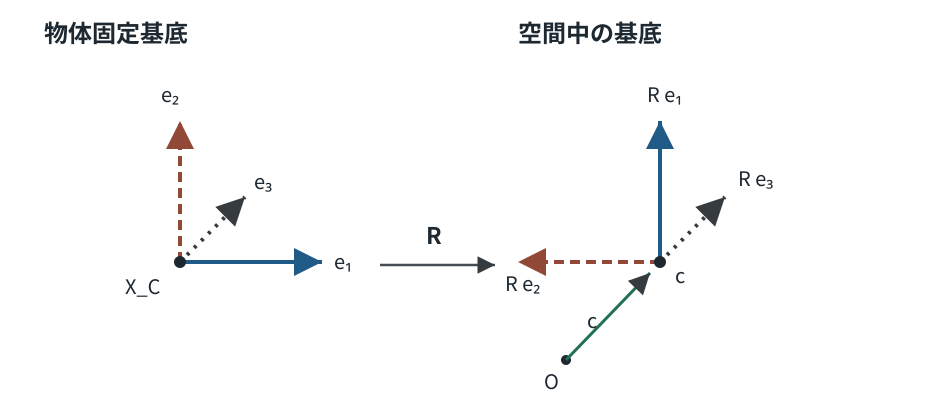

# RBD1 剛体の配置と六自由度

<!-- definition-example-audit: strict -->

> **前提**：[MECH8 の剛体の定義](../../MECH/MECH8/index.md#def-mech8-rigid-body)、[MECH7 の重心](../../MECH/MECH7/index.md#def-mech7-center-of-mass)を使います。本章では物体内の距離が変わらないという仮定を、向きを表す行列と位置の組へ結び付けます。角速度・運動方程式そのものは次講以降で扱います。

## 1. 多数の点を六つの数で追えるのはなぜか

多数の質点の位置を一つずつ記録すれば、それだけで多くの座標が必要になります。しかし、[剛体](../../MECH/MECH8/index.md#def-mech8-rigid-body)では、どの二点間の距離も変化しません。物体を丸ごと動かしたり回したりしても、内部の形は同じです。

ここで区別する座標系は二つです。

- **物体固定座標**：物体上の標識点に付けた、時間によらない列ベクトル $X\in\mathbb R^3$。
- **空間座標**：実験室に固定した正規直交基底で測った、時刻 $t$ における同じ点の列ベクトル $x(t,X)\in\mathbb R^3$。

基準時刻 $t_0$ の物体配置を物体固定座標の基準とし、物体の重心を表す点を $X_C$ と書きます。重心の現在位置を $c(t)$ と書けば、点 $X_C$ は $x(t,X_C)=c(t)$ へ移ります。では各点の重心からのずれを、一斉に変換するには何が要るでしょうか。

記号の対応に注意してください。[MECH8](../../MECH/MECH8/index.md#def-mech8-rigid-body) では重心の位置を $R(t)$ と記しましたが、本章では重心位置を **$c(t)$**、物体の向きを表す $3\times3$ 行列を **$R(t)$** とします。同じ文字 $R$ でも表す対象と次元が異なり、以降の $R(t)$ は重心位置ではありません。

**並進**は共通のベクトル $c$ を足す操作です。**向きを変える操作**は、長さと角度を保ち、右手系の向きも保つ線形変換です。この二つを分けると、物体の移動と向きの変化を混同せずにすみます。

## 2. 長さと向きを保つ回転行列

列ベクトル $u$ の長さは $|u|^2=u^{\mathsf T}u$ です。$3\times3$ 実行列 $R$ について、$|Ru|=|u|$ がすべての $u$ で成り立つ条件を考えます。

$$
|Ru|^2=u^{\mathsf T}R^{\mathsf T}Ru.
$$

$R^{\mathsf T}R=I_3$ なら長さが保たれます。逆に全 $u$ で長さが保たれると、$u=e_i$（標準基底）を代入して $R^{\mathsf T}R$ の対角成分が $1$、$u=e_i+e_j$ を代入して非対角成分が $0$ と分かります。従って両条件は同値です。

標準基底を $e_1,e_2,e_3$ とすると、$R$ の第 $j$ 列は $Re_j$ です。任意のベクトル $u=u_1e_1+u_2e_2+u_3e_3$ の行き先は

$$
Ru=u_1Re_1+u_2Re_2+u_3Re_3
$$

なので、三本の列の長さと互いの内積を調べれば、すべての $u$ の長さを保つか判定できます。実際、$R^{\mathsf T}R$ の $(i,j)$ 成分は $(Re_i)\cdot(Re_j)$ です。

しかし、長さだけでは鏡映も排除できません。$R^{\mathsf T}R=I_3$ なら行列式を取って $(\det R)^2=1$ なので、$\det R$ は $+1$ または $-1$ のどちらかです。三本の列がつくる向き付き体積の符号が $\det R$ であり、後者は右手系と左手系の向きを入れ替えます。

<!-- formal-statement-start -->
### 定義（向きを保つ回転）

$3\times3$ 実行列 $R$ が

$$
R^{\mathsf T}R=I_3,\qquad \det R=1
$$

を満たすとき、$R$ を **向きを保つ回転行列** と呼ぶ。その集合を $SO(3)$ と書く。$I_3$ は $3\times3$ 単位行列である。
<!-- formal-statement-end -->

<!-- definition-example-start: def-rbd1-proper-rotation -->
### 例：四分の一回転と鏡映の判別

**定義の確認**

$z$ 軸の正方向から見て反時計回りの $90^\circ$ 回転では、基底ベクトルが $e_1\mapsto e_2$、$e_2\mapsto -e_1$、$e_3\mapsto e_3$ に移ります。これらの像を順に列へ並べたものが

$$
Q=\begin{pmatrix}0&-1&0\\1&0&0\\0&0&1\end{pmatrix}
$$

です。列同士の内積は相異なる列間で $0$、各列の長さの二乗は $1$ です。実際、

$$
Q^{\mathsf T}Q
=\begin{pmatrix}0&1&0\\-1&0&0\\0&0&1\end{pmatrix}
\begin{pmatrix}0&-1&0\\1&0&0\\0&0&1\end{pmatrix}
=I_3.
$$

上左 $2\times2$ 部分の行列式は $0-(-1)=1$ なので $\det Q=1$ です。両条件を確認したため、$Q\in SO(3)$ です。

対して $F=\operatorname{diag}(-1,1,1)$ は $F^{\mathsf T}F=I_3$ ですが $\det F=-1$。これは $x$ 座標を反転する鏡映であり、**回転行列ではありません**。距離保存だけで回転と判断するのが典型的な誤りです。
<!-- definition-example-end -->

## 3. 剛体の配置：位置と向きの組

物体に対して一つの回転行列 $R(t)$ を決めると、物体固定座標のずれ $X-X_C$ を空間座標のずれへ変換できます。このとき、$R$ の各列は物体固定基底の各単位方向が空間ではどの方向を向くかを表します。

<!-- formal-statement-start -->
### 定義（剛体の配置）

三次元の物体固定座標 $X$、基準重心 $X_C$ に対して、空間中の重心位置 $c\in\mathbb R^3$ と回転行列 $R\in SO(3)$ の組 $(c,R)$ が与えられたとき、**剛体の配置**を

$$
\boxed{x(X)=c+R(X-X_C)}
$$

で定める。時間に依存する配置では $c=c(t),R=R(t)$ と書く。
<!-- formal-statement-end -->

図は、物体上で固定された三方向の矢印が、空間では回転行列 $R$ の列になることを示します。平行移動 $c$ はそれらの向きを変えず、回転 $R$ は重心位置そのものを指定しません。二つの役割を分けて読んでください。

<!-- definition-example-start: def-rbd1-configuration -->
### 例：四つの標識点を一度に移動する

**定義の確認**

基準重心 $X_C=0$ とし、$c=(2,1,3)^{\mathsf T}$、前節の $Q\in SO(3)$ を取ります。標識点 $X_0=0$、$X_1=e_1$、$X_2=e_2$、$X_3=e_3$ について

$$
\begin{aligned}
x(X_0)&=(2,1,3)^{\mathsf T},\\
x(X_1)&=c+Qe_1=(2,2,3)^{\mathsf T},\\
x(X_2)&=c+Qe_2=(1,1,3)^{\mathsf T},\\
x(X_3)&=c+Qe_3=(2,1,4)^{\mathsf T}.
\end{aligned}
$$

すべてに同じ $c$ と $Q$ を使いました。例えば

$$
|x(X_1)-x(X_2)|^2
=|(1,1,0)|^2=2
=|X_1-X_2|^2.
$$

また $x(X_0)=c$ なので重心に選んだ基準点の行き先も一致しています。**配置の式・距離・回転の向き**をそれぞれ確認しました。
<!-- definition-example-end -->

この $X_C=0$ の例は基準座標の原点を重心に選んだモデルです。四つの標識点へ等しい質量を置いた系の重心が原点だ、という主張ではありません。物体全体の質量分布は別途与えます。

## 4. 距離不変から、共通の回転行列が作れるか

配置の式から距離不変はすぐ分かります。興味深いのはその逆です。**物体に一直線上にも一平面上にも収まらない四つの標識点があれば、距離保存と運動の連続性から配置を再構成できます**。

四点 $X_0,X_1,X_2,X_3$ が **アフィン独立** とは、$X_0$ から残りの三点へ向かう差ベクトル $X_1-X_0,X_2-X_0,X_3-X_0$ が線形独立であることです。それらを列に並べた $3\times3$ 行列 $A_0$ が可逆、すなわち $\det A_0\ne0$ であることと同値です。この条件があるから、三つの差ベクトルを写す行列を $A(t)A_0^{-1}$ として復元できます。

また、列ベクトル $b_1,b_2,b_3$ を並べた行列 $A=(b_1,b_2,b_3)$ に対し、$A^{\mathsf T}A$ の $(i,j)$ 成分は $b_i\cdot b_j$ です。これは三本の差ベクトルの長さと互いの内積を並べた行列であり、次の証明では点間距離を使って移動前後のこの行列が一致することを確かめます。

<!-- formal-statement-start -->
### 定理（距離を保つ三次元剛体運動の表示）

基準時刻 $t_0$ における三次元の標識点を $X_i\in\mathbb R^3$ とし、そのうち $X_0,X_1,X_2,X_3$ はアフィン独立、すなわち

$$
A_0=(X_1-X_0,\ X_2-X_0,\ X_3-X_0),\qquad \det A_0\ne0
$$

とする。各標識点 $X_i$ の位置 $x_i(t)$ は時刻 $t$ に関して連続で、$x_i(t_0)=X_i$ とする。すべての点の組で

$$
|x_i(t)-x_j(t)|=|X_i-X_j|
$$

が、$t_0$ を含む連結な時間区間で保たれるなら、一意な連続関数 $a(t)\in\mathbb R^3$ と $R(t)\in SO(3)$ が存在して

$$
x_i(t)=a(t)+R(t)X_i
$$

をすべての標識点について満たす。逆に、この形で $R(t)\in SO(3)$ なら点間距離は保存される。
<!-- formal-statement-end -->

### 証明の見取り図

四点から作った三本の差ベクトルを列に並べます。六本の距離から二本ずつの内積が復元できるため、移動前後の列行列の Gram 行列は同じです。基準の列行列が可逆なので、移動後と移動前を結ぶ行列が直交行列だと判定できます。行列式の符号は連続性と初期値で決まります。

<!-- proof-start -->
### 証明

まず四つの標識点だけで構成します。$b_j(t)=x_j(t)-x_0(t)$（$j=1,2,3$）と置き、

$$
A(t)=(b_1(t),b_2(t),b_3(t))
$$

と定めます。距離条件から $|b_j(t)|=|X_j-X_0|$ です。また恒等式

$$
2u\cdot v=|u|^2+|v|^2-|u-v|^2
$$

に $u=b_i(t),v=b_j(t)$ を代入すると、三つの距離がいずれも不変なので

$$
b_i(t)\cdot b_j(t)=(X_i-X_0)\cdot(X_j-X_0)
$$

となります。従って

$$
A(t)^{\mathsf T}A(t)=A_0^{\mathsf T}A_0.
$$

$A_0$ は可逆なので $R(t):=A(t)A_0^{-1}$ と置けます。両辺から

$$
\begin{aligned}
R^{\mathsf T}R
&=(A_0^{-1})^{\mathsf T}A(t)^{\mathsf T}A(t)A_0^{-1}\\
&=(A_0^{-1})^{\mathsf T}A_0^{\mathsf T}A_0A_0^{-1}
=I_3.
\end{aligned}
$$

従って $\det R=\pm1$ です。$A(t)$ の各成分は連続で、$A_0^{-1}$ は固定行列だから $\det R(t)$ も連続です。連結区間上で値が $\pm1$ しか取れない連続関数は符号を変えられません。$A(t_0)=A_0$ だから $R(t_0)=I_3$、よって $\det R(t)=1$ です。

次に $a(t):=x_0(t)-R(t)X_0$ と置けば、$j=1,2,3$ では $A(t)=R(t)A_0$ により $x_j=a+RX_j$ です。残りの任意の標識点 $X_k$ の予測位置 $y_k:=a+RX_k$ を考えます。直交性から各 $j=0,1,2,3$ に対して

$$
|y_k-x_j|=|R(X_k-X_j)|=|X_k-X_j|=|x_k-x_j|.
$$

両辺の二乗から、$j=0$ の式を $j=1,2,3$ の式からそれぞれ引くと

$$
2(x_k-y_k)\cdot(x_j-x_0)=0\qquad(j=1,2,3)
$$

となります。三本 $x_j-x_0$ は $A(t)=R(t)A_0$ の列で、両行列は可逆です。三本すべてに直交するベクトルは $0$ しかないので $x_k=y_k$、すなわちすべての点に共通の配置式が成立します。

また、三本の差ベクトルをそれぞれ写す行列は $R=A(t)A_0^{-1}$ と一意に定まり、それが分かれば $a=x_0-RX_0$ も一意です。最後に逆向きは任意の $i,j$ について

$$
|x_i-x_j|=|R(X_i-X_j)|=|X_i-X_j|
$$

と確認できます。これで両方向を示しました。
<!-- proof-end -->

定理の $a$ は基準原点の移動先です。[重心](../../MECH/MECH7/index.md#def-mech7-center-of-mass)を基準にした表記に直すと、$c=a+RX_C$ なので

$$
a+RX=c+R(X-X_C).
$$

質点の質量 $m_i>0$ が一定なら $X_C=(\sum_i m_iX_i)/M$、$M=\sum_i m_i$ であり、線形性から

$$
\frac1M\sum_i m_i x_i
=a+R\frac1M\sum_i m_iX_i
=a+RX_C=c.
$$

従って $c$ は本当に現在の重心です。

**仮定が落ちると何が壊れるか。** すべての標識点が一直線上なら $A_0^{-1}$ は存在せず、棒の軸まわりの回転は標識点の位置から決まりません。一方、距離保存だけで時間の連続性を落とすと、反射 $F$ も許されます。前者では回転の一意性が、後者では $\det R=+1$ を選ぶ論証が失われます。

## 5. 配置の合成と逆変換

重心を原点に取った物体座標 $y=X-X_C$ について、配置の操作を $T_{c,R}(y)=c+Ry$ と書きます。移動・回転を二回続けるなら、同じ空間座標を入力とする二つの変換の**順序**を確定する必要があります。

<!-- formal-statement-start -->
### 命題（剛体配置の合成と逆変換）

$c_1,c_2\in\mathbb R^3$、$R_1,R_2\in SO(3)$ に対し $T_{c,R}(y)=c+Ry$ と定める。このとき

$$
\boxed{T_{c_2,R_2}\circ T_{c_1,R_1}=T_{c_2+R_2c_1,\ R_2R_1}}
$$

が成り立つ。逆変換は

$$
\boxed{T_{c,R}^{-1}=T_{-R^{\mathsf T}c,\ R^{\mathsf T}}}
$$

であり、合成後の回転行列も $SO(3)$ に属する。
<!-- formal-statement-end -->

### 証明の見取り図

右側の変換から先に作用させます。行列の積の順序を逆にすると、違う空間上の動きを表してしまいます。

<!-- proof-start -->
### 証明

任意の $y$ に対して

$$
\begin{aligned}
T_{c_2,R_2}(T_{c_1,R_1}(y))
&=c_2+R_2(c_1+R_1y)\\
&=(c_2+R_2c_1)+(R_2R_1)y.
\end{aligned}
$$

また

$$
(R_2R_1)^{\mathsf T}(R_2R_1)
=R_1^{\mathsf T}(R_2^{\mathsf T}R_2)R_1=I_3,
\quad\det(R_2R_1)=1\cdot1=1
$$

であるため $R_2R_1\in SO(3)$ です。$R^{\mathsf T}R=I_3$ より $R^{-1}=R^{\mathsf T}$ なので、$x=c+Ry$ を $y$ について解けば

$$
y=R^{\mathsf T}(x-c)=(-R^{\mathsf T}c)+R^{\mathsf T}x.
$$

さらに $\det R^{\mathsf T}=\det R=1$ だから逆変換も許される剛体配置です。
<!-- proof-end -->

二回目の並進 $c_2$ と一回目の並進 $c_1$ を、単純に $c_1+c_2$ と足してよいわけではありません。$c_1$ も二回目の回転で $R_2c_1$ に移るからです。

## 6. 六自由度の意味と限界

位置を表す $c=(c_1,c_2,c_3)^{\mathsf T}$ には独立な三成分があります。では九成分を持つ行列 $R$ のほうは、本当に三つの自由な量だけで決まるのでしょうか。

ここで $t$ は時間、$\dot R(t)=dR(t)/dt$ は行列の各成分を $t$ で微分したものです。同様に $\dot c(t)=dc(t)/dt$ と書きます。いずれも物体固定座標 $X$ を固定して時間だけを動かす微分であり、空間座標に関する偏微分ではありません。

<!-- formal-statement-start -->
### 命題（標識された三次元剛体の局所的な六自由度）

四つのアフィン独立な標識点を持つ三次元剛体の配置を $(c,R)\in\mathbb R^3\times SO(3)$ で指定する。$R(t)$ を時刻 $t$ の近傍で微分可能な回転行列とすると、各時刻の回転の微小変化は独立な三成分で表される。従って配置の局所的な自由度は、重心の並進三成分と向きの変化三成分の合計 **六** である。
<!-- formal-statement-end -->

### 証明の見取り図

回転を表す行列が九成分だから九自由度、という数え方は誤りです。正規直交性を微分し、許される微小変化が反対称行列で表されることを確かめます。

<!-- proof-start -->
### 証明

$R^{\mathsf T}R=I_3$ を時間微分し、積の微分を行うと

$$
\dot R^{\mathsf T}R+R^{\mathsf T}\dot R=0.
$$

$A:=R^{\mathsf T}\dot R$ とおけば $A^{\mathsf T}=\dot R^{\mathsf T}R$ だから

$$
A^{\mathsf T}=-A.
$$

三次元反対称行列は必ず

$$
A=\begin{pmatrix}0&-\alpha_3&\alpha_2\\
\alpha_3&0&-\alpha_1\\
-\alpha_2&\alpha_1&0\end{pmatrix}
$$

の形であり、独立な量は $\alpha_1,\alpha_2,\alpha_3$ の三個です。ただし微分から三成分という上限が得られただけでは、それらを実際の回転で独立に動かせることまでは示せません。

そこで、任意の反対称行列 $S^{\mathsf T}=-S$ に対し、単位行列近傍の回転を具体的に作ります。まず任意の $v\in\mathbb R^3$ について $v^{\mathsf T}Sv=0$ なので

$$
|(I_3-S)v|^2=|v|^2+|Sv|^2.
$$

従って $I_3-S$ は可逆です。次の行列を考えます。

$$
U(S):=(I_3+S)(I_3-S)^{-1}.
$$

$(I_3+S)$ と $(I_3-S)$ は同じ $S$ の多項式なので可換です。転置して $S^{\mathsf T}=-S$ を使うと

$$
\begin{aligned}
U(S)^{\mathsf T}U(S)
&=(I_3+S)^{-1}(I_3-S)(I_3+S)(I_3-S)^{-1}\\
&=I_3.
\end{aligned}
$$

さらに $s\in[0,1]$ について $U(sS)$ は連続に直交行列を動き、$U(0)=I_3$ です。行列式は $\pm1$ の間を連続には移れないため $\det U(S)=1$ です。

逆に、固定した姿勢 $R_0\in SO(3)$ の十分近くにある $R\in SO(3)$ なら、$Q:=R_0^{\mathsf T}R$ は $I_3$ に近く、$Q+I_3$ は可逆です。このとき

$$
S:=(Q-I_3)(Q+I_3)^{-1}
$$

と置くと、$Q^{\mathsf T}=Q^{-1}$ と積の可換性から

$$
S^{\mathsf T}
=(Q^{\mathsf T}+I_3)^{-1}(Q^{\mathsf T}-I_3)
=(Q+I_3)^{-1}(I_3-Q)=-S.
$$

式を $S(Q+I_3)=Q-I_3$ と書き直すと $(I_3-S)Q=I_3+S$、すなわち $Q=U(S)$ です。よって $R=R_0U(S)$ と $S$ は近傍で一対一に対応します。反対称行列 $S$ の独立成分三個が、実際に姿勢を局所的に指定する三つの量であることも示されました。

並進の速度 $\dot c$ の三成分には $R^{\mathsf T}R=I_3$ による制約がありません。したがって並進三成分と回転三成分を合わせて六自由度です。
<!-- proof-end -->

これは**局所的**な自由度です。すべての姿勢にわたり一つの滑らかな三角度表示が特異点なしで使える、と主張したわけではありません（Euler角の座標特異性は RBD4 で扱います）。

また、四標識点がアフィン独立という仮定も大切です。軸上の標識点だけを持つ棒の位置からは、棒軸のまわりの回転は読み取れません。完全な球でも標識がなく外見だけで姿勢を区別しないなら、識別可能な配置は六自由度より少なく見えます。ここでいう六自由度は、内部の三次元的な**標識を区別できる剛体**の配置の自由度です。平面内で運動を制限した剛体なら二つの並進と面に垂直な軸の回転で三自由度です。

## 7. 演習

各問の数値や標識点は独立に与えています。すべての解答で「行列の条件をどこで使ったか」を追ってください。

### Level A

### 問題 A1：四分の一回転は本当に回転か

$Q=\begin{pmatrix}0&-1&0\\1&0&0\\0&0&1\end{pmatrix}$ について $Q^{\mathsf T}Q$ と $\det Q$ を求め、$Q\in SO(3)$ を確認せよ。

- Level: A

<!-- solution-start -->
### 詳細解答

転置と積を計算すると

$$
Q^{\mathsf T}Q=
\begin{pmatrix}0&1&0\\-1&0&0\\0&0&1\end{pmatrix}
\begin{pmatrix}0&-1&0\\1&0&0\\0&0&1\end{pmatrix}
=\begin{pmatrix}1&0&0\\0&1&0\\0&0&1\end{pmatrix}.
$$

$z$ 方向の第3行・列は単位成分なので、行列式は左上 $2\times2$ 行列の行列式に等しく、

$$
\det Q=0\cdot0-(-1)\cdot1=1.
$$

従って二条件 $Q^{\mathsf T}Q=I_3$、$\det Q=1$ をともに満たし、$Q\in SO(3)$ です。
<!-- solution-end -->

### 問題 A2：鏡映は回転ではない

$F=\operatorname{diag}(1,-1,1)$ はすべての距離を保つが、$SO(3)$ に属さないことを示せ。

- Level: A

<!-- solution-start -->
### 詳細解答

$F^{\mathsf T}=F$、$F^2=I_3$ なので $F^{\mathsf T}F=I_3$ です。任意の点 $u,v$ に対して

$$
|Fu-Fv|^2=(u-v)^{\mathsf T}F^{\mathsf T}F(u-v)=|u-v|^2.
$$

一方、対角行列の行列式は対角成分の積なので $\det F=1\cdot(-1)\cdot1=-1$ です。距離は保ちますが、右手系の向きを反転するため $F\notin SO(3)$ です。
<!-- solution-end -->

### 問題 A3：標識点を実験室へ写す

基準重心 $X_C=0$、$c=(1,-2,3)^{\mathsf T}$、$R=Q$（問題 A1）とする。点 $X=(2,1,-1)^{\mathsf T}$ の空間位置 $x$ を求めよ。

- Level: A

<!-- solution-start -->
### 詳細解答

配置の定義式は $x=c+R(X-X_C)$ です。$X_C=0$ だから

$$
RX=Q\begin{pmatrix}2\\1\\-1\end{pmatrix}
=\begin{pmatrix}-1\\2\\-1\end{pmatrix}.
$$

各成分に $c$ を足して

$$
x=\begin{pmatrix}1\\-2\\3\end{pmatrix}
+\begin{pmatrix}-1\\2\\-1\end{pmatrix}
=\boxed{\begin{pmatrix}0\\0\\2\end{pmatrix}}.
$$
<!-- solution-end -->

### 問題 A4：並進しても点間距離は変わらない

$X_C=0$、$c\in\mathbb R^3$、$R\in SO(3)$ を固定する。二点 $X_1,X_2$ の移動後の距離が移動前の距離と等しいことを示せ。

- Level: A

<!-- solution-start -->
### 詳細解答

移動後の二点は $x_1=c+RX_1$、$x_2=c+RX_2$ です。差を取ると $c$ が消えて

$$
x_1-x_2=R(X_1-X_2).
$$

$u=X_1-X_2$ と置けば、$R^{\mathsf T}R=I_3$ より

$$
|x_1-x_2|^2=|Ru|^2=u^{\mathsf T}R^{\mathsf T}Ru=u^{\mathsf T}u=|X_1-X_2|^2.
$$

距離は非負なので平方根を取って $|x_1-x_2|=|X_1-X_2|$ です。$\det R=1$ は向きの区別に必要ですが、この距離の等式だけには不要です。
<!-- solution-end -->

### 問題 A5：重心の選択と配置

質量 $m,2m$（$m>0$）の二質点の基準位置を $X_1=(0,0,0)^{\mathsf T}$、$X_2=(3,0,0)^{\mathsf T}$ とする。基準重心 $X_C$ を求め、配置 $x_i=c+R(X_i-X_C)$ による移動後の重心を計算せよ。ただし $R\in SO(3)$ とする。

- Level: A

<!-- solution-start -->
### 詳細解答

質量の合計は $M=3m$ なので、[重心の定義](../../MECH/MECH7/index.md#def-mech7-center-of-mass)から

$$
X_C=\frac{mX_1+2mX_2}{3m}=(2,0,0)^{\mathsf T}.
$$

現在の質量加重平均を取ると

$$
\begin{aligned}
\frac{mx_1+2mx_2}{3m}
&=\frac{m[c+R(X_1-X_C)]+2m[c+R(X_2-X_C)]}{3m}\\
&=c+\frac{R}{3}(X_1+2X_2-3X_C).
\end{aligned}
$$

$X_1+2X_2=(6,0,0)^{\mathsf T}=3X_C$ だから括弧は $0$ です。移動後の重心は $\boxed{c}$ です。二点だけでは空間中の向きを一意に決められませんが、この重心計算は成り立ちます。
<!-- solution-end -->

### Level B

### 問題 B1：距離から内積と直交性を復元する

四標識点の基準配置を $X_0=0$、$X_1=e_1$、$X_2=e_2$、$X_3=e_3$ とする。移動後の $x_0,x_1,x_2,x_3$ の六つの点間距離が元と一致するとき、$B=(x_1-x_0,x_2-x_0,x_3-x_0)$ について $B^{\mathsf T}B=I_3$ を示せ。これだけで $\det B=1$ と結論できるか。

- Level: B

<!-- solution-start -->
### 詳細解答

$b_i=x_i-x_0$ と書くと、原点からの基準距離 $|e_i|=1$ が保存されるため $|b_i|^2=1$ です。異なる $i,j$ について基準距離は $|e_i-e_j|^2=2$ であり、

$$
|b_i-b_j|^2=|b_i|^2+|b_j|^2-2b_i\cdot b_j
=2-2b_i\cdot b_j.
$$

これが $2$ なので $b_i\cdot b_j=0$。$B^{\mathsf T}B$ の $(i,j)$ 成分は $b_i\cdot b_j$ だから $B^{\mathsf T}B=I_3$ です。行列式を取れば $(\det B)^2=1$ ですが、$\det B=-1$ の可能性は残ります。実際 $B=F=\operatorname{diag}(-1,1,1)$ も同じ距離を満たします。従って連続性と初期向き、または別途 $\det B=1$ の仮定が必要です。
<!-- solution-end -->

### 問題 B2：二つの配置はどちらから作用させるか

$Q$ を問題 A1 の行列、$c_1=e_1$、$R_1=I_3$、$c_2=e_2$、$R_2=Q$ とする。先に $T_{c_1,R_1}$、後に $T_{c_2,R_2}$ を作用させたときの配置の組と原点の像を求めよ。逆順の場合とも比較せよ。

- Level: B

<!-- solution-start -->
### 詳細解答

先に 1、後に 2 なので、[剛体配置の合成と逆変換](#prop-rbd1-composition)を適用すると合成は

$$
(c_2+R_2c_1,R_2R_1)=(e_2+Qe_1,Q).
$$

$Qe_1=e_2$ より並進成分は $2e_2$ で、原点 $0$ の像も $2e_2$ です。

逆順では先に 2、後に 1 なので

$$
(c_1+R_1c_2,R_1R_2)=(e_1+e_2,Q)
$$

となり、原点の像は $e_1+e_2$ です。二つの位置は異なります。**行列の向きだけを見ると同じ $Q$ でも、並進と回転の合成順序が位置に効きます**。
<!-- solution-end -->

### 問題 B3：三点と二点では何が違うか

物体が平面 $z=0$ 上の標識点だけからなり、そのうち $X_0=(0,0,0)$、$X_1=(1,0,0)$、$X_2=(0,1,0)$ があるとする。これら三点の像が与えられ、距離保存と向きを保つ回転を仮定した場合、姿勢が一意に定まる理由を説明せよ。標識点が $X_0,X_1$ の二点だけならなぜ一意でないか。

- Level: B

<!-- solution-start -->
### 詳細解答

移動後の差を $u=x_1-x_0$、$v=x_2-x_0$ とします。基準距離から $|u|=|v|=1$、$u\cdot v=0$ です。向きを保つ回転なら

$$
Re_1=u,\quad Re_2=v,\quad Re_3=u\times v.
$$

最後の式は右手系の向きを保つことにより決まります。$u,v,u\times v$ は正規直交基底なので、これらを列に並べた行列が唯一の $R\in SO(3)$ です。$x_0$ から並進 $a=x_0$ も決まり、平面内の任意の $X=(s,t,0)$ の像は $x_0+su+tv$ と決まります。

二点だけなら $Re_1=u$ は分かっても、$u$ に垂直な二方向は、$u$ のまわりに任意の角度だけ回せます。従って一意な $R$ を得られません。平面内の三非共線点についてのこの議論は、三次元の四アフィン独立点を仮定した[一般の表示定理](#thm-rbd1-rigid-motion)をそのまま適用したのではなく、ベクトル積で向きを補った特別な場合です。
<!-- solution-end -->

### 問題 B4：回転速度の独立成分

微分可能な $R(t)\in SO(3)$ を考え、$A=R^{\mathsf T}\dot R$ と置く。$A$ の対角成分と非対角成分の関係を導き、独立成分が三個であることを示せ。$R=I_3$、$\dot R=\begin{pmatrix}0&-\lambda&0\\\lambda&0&0\\0&0&0\end{pmatrix}$ がこの条件を満たすことを確かめよ。

- Level: B

<!-- solution-start -->
### 詳細解答

直交条件の微分から

$$
0=\frac{d}{dt}(R^{\mathsf T}R)
=\dot R^{\mathsf T}R+R^{\mathsf T}\dot R
=A^{\mathsf T}+A.
$$

したがって各成分に対し $A_{ij}=-A_{ji}$。特に $i=j$ なら $2A_{ii}=0$ なので対角成分はすべて $0$。非対角では上三角の $A_{12},A_{13},A_{23}$ を決めれば下三角はその符号反転となり、独立な三成分です。

問題の例では $R=I_3$ なので $A=\dot R$ であり、対角成分は $0$、$(1,2)$ と $(2,1)$ の成分は $-\lambda,\lambda$ で逆符号、残りは $0$ です。従って $A^{\mathsf T}=-A$ を満たします。

この微分は実際の回転からも得られます。定数 $\lambda\in\mathbb R$ について

$$
R(t)=\begin{pmatrix}
\cos(\lambda t)&-\sin(\lambda t)&0\\
\sin(\lambda t)&\cos(\lambda t)&0\\
0&0&1
\end{pmatrix}
$$

は任意の $t$ で $SO(3)$ に属し、$R(0)=I_3$、$\dot R(0)=\begin{pmatrix}0&-\lambda&0\\\lambda&0&0\\0&0&0\end{pmatrix}$ です。問題の二行列は **同じ時刻 $t=0$ における値と時間微分** を表し、すべての時刻で $R=I_3$ のまま $\dot R\ne0$ という意味ではありません。
<!-- solution-end -->

### Level C

### 問題 C1：四点から配置を復元し、反射を排除する

基準標識点を $X_0=0$、$X_1=e_1$、$X_2=e_2$、$X_3=e_3$ とする。現在位置を

$$
x_0=(2,-1,1)^{\mathsf T},\quad
x_1=(2,0,1)^{\mathsf T},\quad
x_2=(1,-1,1)^{\mathsf T},\quad
x_3=(2,-1,2)^{\mathsf T}
$$

とする。

1. 六つの点間距離の保存を確認せよ。
2. $a,R$ を復元し、$R\in SO(3)$ とその一意性を検証せよ。
3. $X_C=(1/4,1/4,1/4)^{\mathsf T}$ とするとき重心表示の $c$ を求めよ。
4. $x_3$ だけを $(2,-1,0)^{\mathsf T}$ に変更した場合、距離だけでは何が判定できないか説明せよ.

- Level: C

<!-- solution-start -->
### 詳細解答

**(1)** $x_0$ からの三本の差ベクトルは

$$
b_1=(0,1,0)^{\mathsf T},\quad
b_2=(-1,0,0)^{\mathsf T},\quad
b_3=(0,0,1)^{\mathsf T}
$$

です。長さはいずれも $1$ で、内積は $b_1\cdot b_2=b_1\cdot b_3=b_2\cdot b_3=0$ です。従って

$$
|b_i-b_j|^2=|b_i|^2+|b_j|^2-2b_i\cdot b_j=2
$$

が $i\ne j$ で成り立ちます。基準点 $e_i$ についても原点との距離は $1$、互いの距離は $\sqrt2$ なので、原点との三組・それ以外の三組、合計六組の距離が一致します。

**(2)** 基準列行列は $A_0=I_3$ だから、[距離不変からの表示定理](#thm-rbd1-rigid-motion)の構成に従い

$$
R=(b_1,b_2,b_3)A_0^{-1}
=\begin{pmatrix}0&-1&0\\1&0&0\\0&0&1\end{pmatrix},\quad
a=x_0-RX_0=(2,-1,1)^{\mathsf T}.
$$

$R$ の列は正規直交しているので $R^{\mathsf T}R=I_3$。行列式は $1$ なので $R\in SO(3)$ です。$A_0$ が可逆なため、この三本の差ベクトルを写す行列は一つだけで、$a$ も $x_0$ により一意です。

**(3)** 重心表示は $c=a+RX_C$ です。$RX_C=(-1/4,1/4,1/4)^{\mathsf T}$ なので

$$
c=\begin{pmatrix}2\\-1\\1\end{pmatrix}
+\begin{pmatrix}-1/4\\1/4\\1/4\end{pmatrix}
=\boxed{\begin{pmatrix}7/4\\-3/4\\5/4\end{pmatrix}}.
$$

**(4)** 第三列が $(0,0,-1)^{\mathsf T}$ へ変わるため、新しい行列は

$$
R'=\begin{pmatrix}0&-1&0\\1&0&0\\0&0&-1\end{pmatrix}.
$$

三本の列は依然として正規直交し、六つの距離も同じですが

$$
\det R'=(1)(-1)=-1.
$$

従って $R'$ は回転ではなく反射を含む直交変換です。距離情報だけでは鏡映か回転かを決められません。初期姿勢 $R(t_0)=I_3$ からの連続な距離保存運動という仮定があれば、行列式の符号は途中で変えられないのでこの配置変更は許されません。
<!-- solution-end -->

## 8. 次に何を学ぶか

本章では、距離保存という剛体の条件から、並進 $c$ と向きを保つ回転 $R$ の組を作り、距離保存・鏡映の排除・合成・六自由度の根拠を確認しました。

次の **RBD2** では、回転行列そのものを軸と角度から構成し、三次元で有限回転の順序を入れ替えられない理由を調べます。