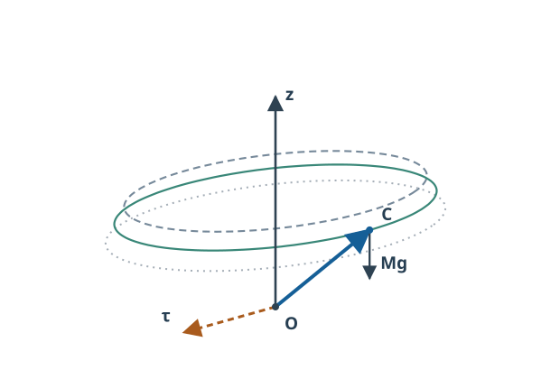

# RBD12 定常歳差・章動とジャイロ近似

<!-- definition-example-audit: strict -->

[RBD11の二つの保存運動量とエネルギー](../RBD11/index.md#thm-rbd11-momenta-energy)から、重力を受ける対称こまでも鉛直角運動量 $h$、物体軸角運動量 $k$、全エネルギー $E$ は一定でした。[RBD11の傾きの一変数帰着](../RBD11/index.md#thm-rbd11-reduced-theta)によって、傾き $\theta(t)$ の許容範囲まで決められます。しかし、エネルギーで許される角度が実際に**一定のまま**なのか、**上下に往復**するのかは、まだ区別していません。

本講では、傾きを保ったまま周回する**定常歳差**、傾きが振動する**章動**を初期値と方程式から判定します。最後に、重いこまがすぐ倒れずゆっくり向きを変えるときの $\Omega\simeq Mgl/L_{\mathrm{spin}}$ が、何を捨てた近似なのかまで検算します。

定常歳差は、軸 $n$ が鉛直 $z$ のまわりに傾き一定の円を描く運動です。章動すると傾きが $\theta_-$ と $\theta_+$ の間を移り、円ではなく**帯状の軌道**になります。次の斜投影図では、内外の楕円は傾きの境界、実線の楕円は定常歳差の基準円です。青実線は支点 $O$ から重心 $C$ への物体軸、重心から下向きの矢印は重力、橙破線は支点まわりの重力トルクの方向です（トルクは O に作用する力ではありません）。模式図の傾き境界は数値例の厳密な転回点を表すものではなく、両者の位置関係を示します。

[図を原寸で開く](assets/steady-nutation-cone.svg)

## 1. 前提となる模型と角度速度

対象は[RBD11の固定点を持つ重い対称こま](../RBD11/index.md#def-rbd11-heavy-top)です。支点 $O$ は固定、重心は第三物体軸 $n=Re_3$ 上の距離 $l>0$ にあり、重力は鉛直下向きです。支点まわりの主慣性値は $\operatorname{diag}(I,I,J)$、$I,J>0$ で、支点反力にトルクと仕事はありません。$a:=Mgl>0$ と略記します。重心が上向きのとき $\theta=0$、下向きが $\theta=\pi$ です。正則な ZYZ Euler角の領域 $0<\theta<\pi$ のみで除算します。

[RBD11の保存則](../RBD11/index.md#thm-rbd11-momenta-energy)と[有効ポテンシャル](../RBD11/index.md#def-rbd11-effective-potential)を、次の形で引き継ぎます。

$$
\begin{aligned}
k&=J(\dot\psi+\dot\phi\cos\theta),\\
h&=I\dot\phi\sin^2\theta+k\cos\theta,\\
V(\theta)&=\frac{(h-k\cos\theta)^2}{2I\sin^2\theta}+a\cos\theta,\\
\varepsilon&=E-\frac{k^2}{2J},\qquad
\frac I2\dot\theta^2+V(\theta)=\varepsilon,\qquad
I\ddot\theta=-V'(\theta).
\end{aligned}
$$

最後の二階方程式は折返し点 $\dot\theta=0$ でも成り立ちます。$h,k$ を固定したときの角度に依存する歳差速度を

$$
\Omega(\theta):=\frac{h-k\cos\theta}{I\sin^2\theta}
$$

と書きます。これはあくまでその時刻の $\dot\phi$ であり、$\dot\psi$ でも物体軸の角速度成分 $k/J$ でもありません。もとの姿勢は

$$
\dot\phi=\Omega(\theta),\qquad
\dot\psi=\frac{k}{J}-\Omega(\theta)\cos\theta
$$

を積分して[RBD4の能動 ZYZ 姿勢表示](../RBD4/index.md#def-rbd4-zyz-euler)から復元します。したがって角度の一変数方程式は、姿勢全体を求めるための省略ではなく**等価な帰着**です（極ではこの座標表示を使いません）。

## 2. 定常歳差は有効ポテンシャルの停留点

空間で対称軸の傾きが変わらず、鉛直まわりに一定の速さで回る運動を考えます。対称軸の向き $n=(\sin\theta\cos\phi,\sin\theta\sin\phi,\cos\theta)$ は、$\theta$ が一定なら円錐の母線上を動きます。回転の向きを表す $\dot\phi$ は符号付きです。

<!-- formal-statement-start -->
### 定義（定常歳差）

[RBD11の重い対称こま](../RBD11/index.md#def-rbd11-heavy-top)の滑らかな解が、ある時間区間で $0<\theta_0<\pi$、$\theta(t)=\theta_0$ かつ $\phi(t)=\phi_0+\Omega t$（定数 $\Omega\in\mathbb R$）を満たすとき、その運動を**定常歳差**という。このとき $k$ も一定なので $\dot\psi=k/J-\Omega\cos\theta_0$ は一定である。$\Omega=0$ も定義の上では許すが、$a>0$ の本模型の正則域では実現しない。
<!-- formal-statement-end -->

<!-- definition-example-start: def-rbd12-steady-precession -->
### 直接例：傾いたまま回り続けるこま

$I=2,J=1,a=3,k=3$、$\theta_0=\pi/2$ とします。$\Omega=1$、$h=I\Omega\sin^2\theta_0+k\cos\theta_0=2$ を選ぶと、$\dot\phi=1$、$\dot\psi=k/J=3$、$\dot\theta=0$ です。[RBD11の傾きの二階式](../RBD11/index.md#thm-rbd11-reduced-theta)を速度表示で評価すると

$$
I\ddot\theta
=I\Omega^2\sin\theta\cos\theta-k\Omega\sin\theta+a\sin\theta
=0-3+3=0.
$$

したがって $\theta(t)=\pi/2,\ \phi(t)=\phi_0+t,\ \psi(t)=\psi_0+3t$ は、傾き・歳差速度が一定という定義を満たす実際の解です。物体軸の方向は水平面を一周しますが、重力トルクは零ではありません。支点、重心位置、正の慣性値、重力以外の偶力がないことは本章の模型の仮定として満たしています。
<!-- definition-example-end -->

### なぜ極値が条件になるか

$h,k$ を固定して $\theta=\theta_0$ が定数なら $\dot\theta=\ddot\theta=0$ です。[傾きの二階方程式](../RBD11/index.md#thm-rbd11-reduced-theta)より $V'(\theta_0)=0$ が必要です。逆に $\theta(0)=\theta_0$、$\dot\theta(0)=0$、$V'(\theta_0)=0$ なら、正則域で滑らかな二階初期値問題の局所一意性により一定解が実現します。**停留点を選ぶだけでなく、初期の傾き速度も零にする**必要があります。

<!-- formal-statement-start -->
### 定理（定常歳差の条件と二つの枝）

$a=Mgl>0$、$I,J>0$ とし、[RBD11の固定点対称こま](../RBD11/index.md#def-rbd11-heavy-top)が $0<\theta_0<\pi$ で[定常歳差](#def-rbd12-steady-precession)するものとする。$\Omega=\dot\phi$、$k=J(\dot\psi+\Omega\cos\theta_0)$ とおくと

$$
\boxed{I\cos\theta_0\,\Omega^2-k\Omega+a=0},
\qquad
\boxed{h=I\Omega\sin^2\theta_0+k\cos\theta_0}.
$$

逆に $0<\theta_0<\pi$、$\Omega,k$ が第一式を満たし、第二式で $h$ を定めて $\dot\theta(0)=0$ とすれば、正則域に定常歳差解が存在する。$c=\cos\theta_0\ne0$ なら判別式と候補の歳差速度は

$$
D=k^2-4Iac,\qquad
\boxed{\Omega_\pm=\frac{k\pm\sqrt D}{2Ic}}
$$

で、実数解の条件は $D\ge0$ である。$c=0$ なら $-k\Omega+a=0$ であるため、$k\ne0$ のときだけ $\Omega=a/k$ が存在する。
<!-- formal-statement-end -->

### 証明の見取り図

[有効ポテンシャルの導関数](../RBD11/index.md#thm-rbd11-reduced-theta)を $\Omega(\theta)$ で表し直すと、停留条件が二次方程式に変わります。逆方向では二次方程式から一意な初期値問題の一定解を作ります。

<!-- proof-start -->
### 証明

$A(\theta)=h-k\cos\theta$ と置くと $A'=k\sin\theta$ であり、[有効ポテンシャル](../RBD11/index.md#def-rbd11-effective-potential)の微分は

$$
\begin{aligned}
V'(\theta)
&=\frac{kA}{I\sin\theta}
-\frac{A^2\cos\theta}{I\sin^3\theta}-a\sin\theta\\
&=\sin\theta\bigl[k\Omega(\theta)-I\Omega(\theta)^2\cos\theta-a\bigr].
\end{aligned}
$$

$0<\theta_0<\pi$ では $\sin\theta_0>0$ です。$V'(\theta_0)=0$ と置き、$\Omega=\Omega(\theta_0)$ を代入すれば $k\Omega-I\Omega^2c-a=0$、すなわち第一式です。$h$ の式は[RBD11の鉛直運動量](../RBD11/index.md#thm-rbd11-momenta-energy)そのものです。

逆に第一式と $h$ の式が成立すれば $\Omega(\theta_0)=\Omega$、上式から $V'(\theta_0)=0$ です。正則域内では $V$ は滑らかで、初期値 $(\theta_0,0)$ に対する $I\ddot\theta=-V'(\theta)$ の一定解が初期値問題の解です。$\phi$ と $\psi$ の微分方程式の右辺もそこで定数になり、定義の解が得られます。$c\ne0$ は二次方程式の解の公式、$c=0$ は一次方程式から結論します。
<!-- proof-end -->

### 速い枝と遅い枝、歳差の符号

$k>0$ とします。$\theta_0$ が上半球側（$c>0$）なら、$D\ge0$ が必要で、二根はともに正です。$D=0$ で二根は合流し、$D<0$ では**その傾きの定常歳差は不可能**です。$c<0$ なら $D>k^2$ となり、正の根と負の根が一つずつあります。赤道 $c=0$ は $k\ne0$ なら $\Omega=a/k$ で一つだけ有限な速度が残ります。

高速自転のとき、$k>0$ に対する有限で小さい側の根を**遅い歳差**、絶対値が大きい側を**速い歳差**と区別します。$c\ne0$ の遅い枝は、分子分母に $k+\sqrt D$ を掛けて

$$
\boxed{\Omega_{\mathrm{slow}}=\frac{2a}{k+\sqrt{k^2-4Iac}}}
$$

とも書けるので、$c\to0$ でも有限です。速い枝は $c\to0$ で発散し、この定常歳差の有限な解にはつながりません。$k<0$ では歳差の向きが反転します。$k=0$ は上半球で定常歳差できず、下半球なら正負二根があり得ます。**二つの枝の存在と安定性は別問題**です。

### 具体例：同じ傾きでも二つの速度

$I=2,J=1,a=3,k=10$、$\theta_0=\pi/3$ とすると、$c=1/2$、$\sin^2\theta_0=3/4$ です。判別式は $D=100-4\cdot2\cdot3\cdot(1/2)=88$ なので

$$
\Omega_{\mathrm{slow}}=5-\sqrt{22}\simeq0.3096,\qquad
\Omega_{\mathrm{fast}}=5+\sqrt{22}\simeq9.6904.
$$

各枝について $h=I\Omega(3/4)+10(1/2)=5+\frac32\Omega$ を別々に選びます。**同じ $h,k$ のまま二つの根を往復するのではありません**。遅い枝なら $h\simeq5.4644$、$\dot\psi=10-\Omega/2\simeq9.8452$ です。[定常条件](#thm-rbd12-steady-branches)への代入でも $I(1/2)\Omega^2-10\Omega+3=\Omega^2-10\Omega+3=0$ と確認できます。

## 3. 章動：停留点の近くで傾きが往復する

初期の $\dot\theta$ が零でも、そこが有効ポテンシャルの停留点でなければ $\ddot\theta=-V'/I$ は一般に零ではありません。傾きが上下する運動を調べるため、まずその用語と、往復が起こる条件を区別します。

<!-- formal-statement-start -->
### 定義（章動と転回点）

[RBD11の重い対称こま](../RBD11/index.md#def-rbd11-heavy-top)の運動で $0<\theta(t)<\pi$ の範囲において $\theta(t)$ が時間に依存して変化することを**章動**という。特に、ある閉区間 $[\theta_-,\theta_+]\subset(0,\pi)$ 内で $\theta_-\lt\theta_+$ の二つの**転回点**の間を往復するものを往復章動という。転回点とは $\dot\theta=0$ となる点で、[エネルギー式](../RBD11/index.md#thm-rbd11-reduced-theta)から $V(\theta_\pm)=\varepsilon$ を満たす。ただしこの等号だけでは往復を保証せず、区間内部の許容域と加速度の向きも必要である。
<!-- formal-statement-end -->

<!-- definition-example-start: def-rbd12-nutation -->
### 直接例：定常歳差から傾きだけを少しずらす

前節の $I=2,J=1,a=3,k=10$、遅い枝の $\theta_0=\pi/3$ と $h=5+\frac32(5-\sqrt{22})$ を固定します。初期値を $\theta(0)=\theta_0+\eta,\ \dot\theta(0)=0$（小さい $\eta>0$）に変え、$\dot\phi(0)=\Omega(\theta_0+\eta)$、$\dot\psi(0)=10-\dot\phi(0)\cos(\theta_0+\eta)$ とします。$h,k$ の条件は依然満たしますが、停留点からずれた場所では一般に $V'\ne0$ であり、$\ddot\theta(0)\ne0$ です。後に証明する $V''(\theta_0)>0$ から、小さい $\eta$ に対して $V'(\theta_0+\eta)>0$、したがって $\ddot\theta(0)<0$。この初期角は外側の転回点となり、近くの反対側の転回点まで進んで戻る往復章動を生みます。**$\dot\theta(0)=0$ でも章動しないとは限らない**、という定義の非自明な部分を確認できます。
<!-- definition-example-end -->

<!-- formal-statement-start -->
### 定理（正則な定常歳差の小章動と固有振動数）

[本章の定常歳差条件](#thm-rbd12-steady-branches)を満たす $a>0$、$I,J>0$、$0<\theta_0<\pi$、固定した保存量 $h,k$ を考える。定常歳差速度を $\Omega_0$ とすると

$$
\boxed{V''(\theta_0)=\frac{(k-2I\Omega_0\cos\theta_0)^2}{I}
+I\Omega_0^2\sin^2\theta_0>0}.
$$

従って固定した $h,k$ に関する傾きの微小変位 $\eta=\theta-\theta_0$ は、線形近似で

$$
\ddot\eta+\nu^2\eta=0,\qquad
\boxed{\nu^2=\left(\frac{k}{I}-2\Omega_0\cos\theta_0\right)^2
+\Omega_0^2\sin^2\theta_0}
$$

を満たし、$\eta(t)=A\cos(\nu t)+B\sin(\nu t)$ となる。十分小さい非零のエネルギー超過では、正則域内の二転回点間で往復章動が生じ、その周期は振幅が零へ向かうと $2\pi/\nu$ に近づく。
<!-- formal-statement-end -->

### 証明の見取り図

$V'$ を微分するとき、$\Omega(\theta)$ を一定としてはいけません。**固定するのは $h,k$** です。これを反映させると平方和が得られ、定常歳差が有効ポテンシャルの厳密な局所最小であることまで示せます。

<!-- proof-start -->
### 証明

$\Omega(\theta)=(h-k\cos\theta)/(I\sin^2\theta)$ で $h,k$ は定数ですから、分子・分母を微分して

$$
\Omega'(\theta)
=\frac{k\sin\theta}{I\sin^2\theta}
-\frac{2(h-k\cos\theta)\cos\theta}{I\sin^3\theta}
=\frac{k-2I\Omega(\theta)\cos\theta}{I\sin\theta}.
$$

前節で得た $V'(\theta)=\sin\theta[k\Omega-I\Omega^2\cos\theta-a]$ を微分します。角括弧は $\theta_0$ で零なので、その点での積の微分のうち $\cos\theta$ を掛けた項は消え、

$$
\begin{aligned}
V''(\theta_0)
&=\sin\theta_0\bigl[(k-2I\Omega_0\cos\theta_0)\Omega'(\theta_0)
+I\Omega_0^2\sin\theta_0\bigr]\\
&=\frac{(k-2I\Omega_0\cos\theta_0)^2}{I}
+I\Omega_0^2\sin^2\theta_0.
\end{aligned}
$$

二つの非負項がともに零なら $\Omega_0=0$（$\sin\theta_0>0$）かつ $k=0$ ですが、そのとき定常条件は $a=0$ を要求し $a>0$ に反します。よって厳密に正です。

$V$ を $\theta_0$ の周りに Taylor 展開すると

$$
V'(\theta_0+\eta)
=V'(\theta_0)+V''(\theta_0)\eta+O(\eta^2)
=V''(\theta_0)\eta+O(\eta^2).
$$

[RBD11の二階式](../RBD11/index.md#thm-rbd11-reduced-theta)に代入して $I\ddot\eta=-V''(\theta_0)\eta+O(\eta^2)$。一次まで取れば主張の線形方程式です。$\nu^2=V''/I>0$ なので実振動数 $\nu$ を持ちます。

さらに $V'(\theta_0)=0$、$V''(\theta_0)>0$ と連続性から、十分小さい近傍で $V$ は左側で単調減少、右側で単調増加です。$\varepsilon=V(\theta_0)+\delta$（十分小さい $\delta>0$）に対して近傍の左右に各一つ $V(\theta_\pm)=\varepsilon$ の根があり、内部で $V<\varepsilon$ です。[エネルギー式](../RBD11/index.md#thm-rbd11-reduced-theta)はそこで $\dot\theta^2>0$、両端で零を与えます。左端では $V'<0$ なので $\ddot\theta>0$、右端では $V'>0$ なので $\ddot\theta<0$、従って反転して往復します。半周期の積分

$$
\frac{T}{2}=\sqrt{\frac I2}\int_{\theta_-}^{\theta_+}
\frac{d\theta}{\sqrt{\varepsilon-V(\theta)}}
$$

に $V(\theta)=V(\theta_0)+V''(\theta_0)(\theta-\theta_0)^2/2+O((\theta-\theta_0)^3)$ を用い、微小振幅で $\eta=A\sin u$ と置き換えると

$$
\frac{T}{2}\longrightarrow
\sqrt{\frac I{V''(\theta_0)}}\int_{-\pi/2}^{\pi/2}du
=\frac{\pi}{\nu},
$$

従って $T\to2\pi/\nu$ です。ここでの安定性は**固定した保存量 $h,k$ の傾きの運動**についての結論で、摩擦や外部駆動を加えた系へはそのまま拡張しません。
<!-- proof-end -->

### 直接計算：赤道の定常歳差からの小振動

前節の直接例 $I=2,a=3,k=3,\theta_0=\pi/2,\Omega_0=1$ に戻ります。$h=2$ のまま傾きを微小にずらしたとき

$$
V''(\pi/2)=\frac{3^2}{2}+2\cdot1^2=\frac{13}{2},
\qquad
\nu^2=\frac{13}{4},\qquad \nu=\frac{\sqrt{13}}{2}.
$$

従って微小傾きの周期は $T\simeq4\pi/\sqrt{13}$ です。この周期は一定角で歳差する一周時間 $2\pi/|\Omega_0|=2\pi$ と**別の時間尺度**です。二つを混同すると章動が見えなくなります。

### 反証例：折返し点と定常歳差を混同しない

$I=2,a=3,h=0,k=2$、$\theta(0)=\pi/2,\dot\theta(0)=0$ を考えます。ここでは $\Omega(\pi/2)=0$ なので

$$
I\ddot\theta(0)
=I\cdot0-2\cdot0+3=3,\qquad \ddot\theta(0)=\frac32.
$$

**初速度が零でも、すぐ傾きが増加**します。失われている定常条件は $V'(\pi/2)=0$ です。エネルギーの転回点条件だけを見て $\ddot\theta=0$ と推論するのは誤りです。

## 4. ジャイロの「ゆっくり倒れない」近似

重力トルクは[RBD11の式](../RBD11/index.md#thm-rbd11-momenta-energy)から $\tau_{O,s}=a\,e_z\times n$ です。大きな体軸角運動量 $k=J\omega_3$ を持ち、横方向の回転が小さければ、角運動量ベクトルを $L_{O,s}\simeq k n$ と近似できます。ゆっくり歳差する $n$ について $\dot n=\Omega(e_z\times n)$ なので

$$
\frac{dL_{O,s}}{dt}\simeq k\Omega(e_z\times n)
=\tau_{O,s}=a(e_z\times n).
$$

正則な傾きなら $e_z\times n\ne0$ だから、$k\Omega\simeq a$。ただしこの議論は**定常歳差の遅い枝**を念頭に横慣性による角運動量の寄与を捨てたものです。定常歳差では横角運動量の大きさは $I|\Omega|\sin\theta_0$ なので、$L_{O,s}\simeq kn$ を独立に正当化するには $I|\Omega|\sin\theta_0\ll k$ も確認します。遅い枝で $k^2\gg Ia$ ならこれは従います。重力下のすべての運動に使える厳密式ではありません。

<!-- formal-statement-start -->
### 命題（遅い歳差のジャイロ近似と誤差）

$a,I,J>0$、$k>0$、$0<\theta_0<\pi$、$c=\cos\theta_0$ とする。[定常歳差の実数条件](#thm-rbd12-steady-branches) $D=k^2-4Iac\ge0$ のもとで遅い枝を選ぶ。$k^2\gg4Ia|c|$ なら

$$
\boxed{\Omega_{\mathrm{slow}}\simeq \Omega_{\mathrm{gyro}}:=\frac{a}{k}
=\frac{Mgl}{L_{\mathrm{spin}}}},\qquad L_{\mathrm{spin}}:=k=J\omega_3.
$$

$c\ne0$ でも $c=0$ でも、厳密な遅い枝に対する相対誤差は

$$
\boxed{
\frac{|\Omega_{\mathrm{slow}}-\Omega_{\mathrm{gyro}}|}
{|\Omega_{\mathrm{slow}}|}
=\frac{\left|1-\sqrt{1-4Iac/k^2}\right|}{2}}.
$$

$c=0$ では代数的な誤差は零であるが、これだけから高速自転や $L_{O,s}\simeq kn$ が成立するとはいえない。速い枝、非定常な章動、摩擦や支点運動を伴う模型についての近似ではない。
<!-- formal-statement-end -->

### 証明の見取り図

平方根を近似する前に遅い根を有理化し、比を**正確に**計算します。無次元量 $4Iac/k^2$ が小さいときだけ平方根を展開します。

<!-- proof-start -->
### 証明

[定常歳差の二次方程式](#thm-rbd12-steady-branches)の遅い根を有理化すると、$c\ne0$ に対して

$$
\Omega_{\mathrm{slow}}
=\frac{k-\sqrt{k^2-4Iac}}{2Ic}
=\frac{2a}{k+\sqrt{k^2-4Iac}}.
$$

$c\to0$ では連続的に $a/k$ へ近づき、赤道の一次方程式の解と一致します。$q:=4Iac/k^2$ と置けば $D=k^2(1-q)$ で、$k>0$ より

$$
\frac{\Omega_{\mathrm{gyro}}}{\Omega_{\mathrm{slow}}}
=\frac{a}{k}\frac{k+\sqrt D}{2a}
=\frac{1+\sqrt{1-q}}{2}.
$$

従って相対誤差は $|1-(1+\sqrt{1-q})/2|=|1-\sqrt{1-q}|/2$。$|q|\ll1$ のとき

$$
\sqrt{1-q}=1-\frac q2+O(q^2),\qquad
\Omega_{\mathrm{slow}}=\frac ak\left(1+\frac q4+O(q^2)\right).
$$

よって近似の相対誤差は $|q|/4+O(q^2)$、すなわち概ね $Ia|c|/k^2$ で制御されます。$k\Omega\simeq a$ のベクトル近似の理由もここで定量化されました。
<!-- proof-end -->

### 数値で誤差を測る

$I=2,a=3,k=10,\theta_0=\pi/3$ では $q=0.12$ で

$$
\Omega_{\mathrm{gyro}}=0.3,\quad
\Omega_{\mathrm{slow}}=5-\sqrt{22}\simeq0.3096,\quad
\frac{|\Omega_{\mathrm{slow}}-0.3|}{\Omega_{\mathrm{slow}}}
=\frac{1-\sqrt{0.88}}2\simeq0.03096.
$$

約 $3.1\%$ ずれます。「高速に自転している」だけで誤差が零になるわけではありません。また速い枝 $\Omega_{\mathrm{fast}}\simeq9.6904$ へ $0.3$ を代入するのは、比較する解そのものが違うので不適切です。

## 5. 初期条件と運動の見分け方

[定常歳差条件](#thm-rbd12-steady-branches)で傾き $\theta_0$ と根 $\Omega$ を選び、$h=I\Omega\sin^2\theta_0+k\cos\theta_0$、$\dot\theta(0)=0$ とすれば定常歳差です。$h,k$ を固定したまま $\theta(0)$ を少しずらして $\dot\theta(0)=0$ とすれば、[小章動定理](#thm-rbd12-small-nutation)の局所的な井戸の中で往復運動になります。$\varepsilon$ を決めるときは必ず初期角 $\theta_i$ と初期傾き速度 $v_i$ から

$$
\varepsilon=\frac I2v_i^2+V(\theta_i)
$$

を計算します。$V(\theta)=\varepsilon$ の根は候補の転回点ですが、初期値と同じ許容域成分にある根を使います。極 $\theta=0,\pi$ で $\sin^2\theta$ による除算はできず、[RBD11の極への到達条件](../RBD11/index.md#prop-rbd11-pole-conditions)を別途調べます。

力学的な違いを式で振り返る

| 状態 | 初期値と条件 | 傾きの振る舞い |
| --- | --- | --- |
| 定常歳差 | $\dot\theta=0,\ V'(\theta)=0$ | $\theta=\theta_0$ が一定 |
| 一般の転回点 | $\dot\theta=0,\ V'(\theta)\ne0$ | $I\ddot\theta=-V'$ で直ちに動き始める |
| 小さい往復章動 | $\varepsilon>V(\theta_0)$、厳密局所最小の近傍 | $\theta_-\le\theta(t)\le\theta_+$ |
| 遅いジャイロ歳差 | 定常歳差の遅い根かつ $k^2\gg 4Ia|\cos\theta_0|$ | $\Omega\simeq a/k$ に近い |

[定常歳差と章動を比較する数値プレイヤー（別ページ）](https://insuns21.github.io/toukei-kentei_grade1_preparation/textbook/volumes/dream_thater/物理系/RBD/RBD12/assets/heavy-top-precession.html) では、同じ $I,J,a,k,\theta_0$ から定常歳差・初期傾き摂動の三つの条件を切り替えます。$I\ddot\theta=-V'$ と二つの角度速度を数値積分し、$h,k,E$ と方程式残差を表示します。プレイヤーを開かなくても上の式と数値例で結論を追えるようにしています。

## 演習

## Level A

### 問題 A1：赤道での定常歳差

$I=2,J=1,a=3,k=6,\theta_0=\pi/2$ とする。定常歳差の $\Omega,h,\dot\psi$ と全エネルギー $E$ を求めよ。

- Level: A

<!-- solution-start -->
### 詳細解答

[定常歳差の赤道条件](#thm-rbd12-steady-branches)で $c=0$ なので $-k\Omega+a=0$、従って $\Omega=3/6=1/2$。$h=I\Omega\sin^2\theta_0+k\cos\theta_0=2(1/2)=1$。$\dot\psi=k/J-\Omega c=6$ です。[RBD11のエネルギー公式](../RBD11/index.md#thm-rbd11-momenta-energy)で $\dot\theta=0$ より

$$
E=\frac I2\Omega^2\sin^2\theta_0+\frac{k^2}{2J}+a\cos\theta_0
=1\cdot\frac14+18+0=\frac{73}{4}.
$$

解の正則条件 $0<\pi/2<\pi$ と正の慣性値も満たします。
<!-- solution-end -->

### 問題 A2：二枝と判別式

$I=2,a=3,k=10,\theta_0=\pi/3$ の二つの定常歳差速度を厳密に求め、いずれの符号か判定せよ。

- Level: A

<!-- solution-start -->
### 詳細解答

$c=1/2$、$D=k^2-4Iac=100-4\cdot2\cdot3\cdot(1/2)=88>0$。[定常歳差の二次式](#thm-rbd12-steady-branches)は $\Omega^2-10\Omega+3=0$。解の公式から

$$
\Omega_\pm=\frac{10\pm\sqrt{88}}2=5\pm\sqrt{22}.
$$

$\sqrt{22}<5$ なので両方正。小さい方が遅い枝です。これは $k>0$ かつ $c>0$ の場合の符号規則と一致します。
<!-- solution-end -->

### 問題 A3：折返しでも静止しない

$I=2,a=3,h=0,k=2$、$\theta(0)=\pi/2,\dot\theta(0)=0$ のとき、$\Omega(0)$ と $\ddot\theta(0)$ を求め、定常歳差か判定せよ。

- Level: A

<!-- solution-start -->
### 詳細解答

[歳差速度の復元式](../RBD11/index.md#thm-rbd11-reduced-theta)より $\Omega=(h-k\cos\theta)/(I\sin^2\theta)=0$。正則域での傾き方程式を用いると

$$
I\ddot\theta
=I\Omega^2\sin\theta\cos\theta-k\Omega\sin\theta+a\sin\theta
=3.
$$

従って $\ddot\theta(0)=3/2>0$。定常歳差は $\ddot\theta=0$ が必要なので成立しません。$\dot\theta(0)=0$ は瞬間的な転回点を示すだけです。
<!-- solution-end -->

### 問題 A4：章動と歳差の周期の違い

$I=2,a=3,k=3,\theta_0=\pi/2$ の定常歳差から、$\Omega_0$、$\nu$、線形章動周期と歳差一周時間を求めよ。

- Level: A

<!-- solution-start -->
### 詳細解答

$\Omega_0=a/k=1$。[小章動の振動数](#thm-rbd12-small-nutation)は $c=0$、$\sin\theta_0=1$ より

$$
\nu^2=(k/I)^2+\Omega_0^2=(3/2)^2+1=\frac{13}{4},\quad
\nu=\frac{\sqrt{13}}2.
$$

従って微小振幅極限の章動周期は $T_\theta=2\pi/\nu=4\pi/\sqrt{13}$、歳差の一周時間は $T_\phi=2\pi/|\Omega_0|=2\pi$。二つは等しくありません。
<!-- solution-end -->

### 問題 A5：ジャイロ近似の相対誤差

$I=2,a=3,k=10,\cos\theta_0=1/2$ の遅い枝について $q=4Ia\cos\theta_0/k^2$ と近似相対誤差を求めよ。

- Level: A

<!-- solution-start -->
### 詳細解答

$q=(4\cdot2\cdot3\cdot1/2)/100=0.12$ です。[厳密誤差公式](#prop-rbd12-gyro-approx)へ代入すると

$$
\frac{|\Omega_{\mathrm{slow}}-a/k|}{|\Omega_{\mathrm{slow}}|}
=\frac{|1-\sqrt{1-0.12}|}{2}
=\frac{1-\sqrt{0.88}}2\simeq0.03096.
$$

約 $3.1\%$ です。分母は近似値 $a/k$ でなく厳密な遅い枝 $|\Omega_{\mathrm{slow}}|$ です。
<!-- solution-end -->

## Level B

### 問題 B1：固定保存量での二階微分

$I=2,k=3,a=3,\theta_0=\pi/2$ の定常歳差で $h=2$ とする。$\Omega'(\theta_0)$ を求め、そこから $V''(\theta_0)>0$ を示せ。

- Level: B

<!-- solution-start -->
### 詳細解答

保存量 $h,k$ を固定して $\Omega(\theta)=(h-k\cos\theta)/(I\sin^2\theta)$ を微分します。[小章動定理の導出式](#thm-rbd12-small-nutation)から

$$
\Omega'(\theta)=\frac{k-2I\Omega(\theta)\cos\theta}{I\sin\theta}.
$$

$\theta_0=\pi/2$、$\Omega_0=1$ なので $\Omega'(\theta_0)=3/2$。一方 $V'=\sin\theta[k\Omega-I\Omega^2\cos\theta-a]$。停留点の角括弧は零ですから

$$
\begin{aligned}
V''(\theta_0)
&=\sin\theta_0[(k-2I\Omega_0\cos\theta_0)\Omega'(\theta_0)
+I\Omega_0^2\sin\theta_0]\\
&=3\cdot\frac32+2=\frac{13}2>0.
\end{aligned}
$$

$\Omega$ を角度によらない定数として微分すると第一項 $9/2$ が失われます。
<!-- solution-end -->

### 問題 B2：初期エネルギーと転回点

定常歳差 $(h,k,\theta_0)$ が $V''(\theta_0)>0$ を満たすとする。同じ $h,k$ のまま $\theta(0)=\theta_0$、$\dot\theta(0)=v\ne0$ としたとき、$\varepsilon$、微小振幅 $A$、初期の章動の近似式を求めよ。$v$ は十分小さいものとする。

- Level: B

<!-- solution-start -->
### 詳細解答

[傾きの保存エネルギー](../RBD11/index.md#thm-rbd11-reduced-theta)より $\varepsilon=V(\theta_0)+(I/2)v^2$。$V'(\theta_0)=0$ なので $\eta=\theta-\theta_0$ に対して

$$
V(\theta_0+\eta)=V(\theta_0)+\frac12V''(\theta_0)\eta^2+O(\eta^3).
$$

転回点では $\dot\eta=0$、よって二次近似で $(I/2)v^2=(V''/2)A^2$、$A=|v|\sqrt{I/V''}=|v|/\nu$ です。[線形章動方程式](#thm-rbd12-small-nutation)に $\eta(0)=0,\dot\eta(0)=v$ を代入すると

$$
\boxed{\eta(t)\simeq\frac v\nu\sin(\nu t)},\qquad
\nu=\sqrt{V''(\theta_0)/I}.
$$

小さい $|v|$ を仮定したため転回点は正則域内にとどまり、局所近似が正当化されます。
<!-- solution-end -->

### 問題 B3：南半球側と歳差の向き

$I=2,a=3,k=2,\theta_0=2\pi/3$ とする。二つの歳差速度と対応する鉛直保存運動量 $h$ を求めよ。二つの枝の歳差方向は同じか。

- Level: B

<!-- solution-start -->
### 詳細解答

$c=-1/2$、$\sin^2\theta_0=3/4$ です。判別式は

$$
D=k^2-4Iac=4-4\cdot2\cdot3\cdot(-1/2)=16.
$$

二次式 $I c\Omega^2-k\Omega+a=0$ は $-\Omega^2-2\Omega+3=0$ なので

$$
\Omega=\frac{2\pm4}{-2}\in\{-3,1\}.
$$

[鉛直運動量の公式](../RBD11/index.md#thm-rbd11-momenta-energy)から $h=I\Omega\sin^2\theta_0+kc=(3/2)\Omega-1$。$\Omega=1$ には $h=1/2$、$\Omega=-3$ には $h=-11/2$ が対応します。したがって一方は正、他方は負の向きであり、南半球側で必ず同方向という主張は誤りです。
<!-- solution-end -->

### 問題 B4：高速自転だけで足りるか

$I,a>0$、$k>0$、正則な定常歳差で $\theta_0$ を固定する。ジャイロ近似の誤差が小さくなる無次元条件を示し、$D<0$ の場合に近似歳差を実在する定常歳差と扱えない理由を説明せよ。

- Level: B

<!-- solution-start -->
### 詳細解答

[ジャイロ近似の誤差命題](#prop-rbd12-gyro-approx)より $q=4Ia\cos\theta_0/k^2$、相対誤差は $|1-\sqrt{1-q}|/2$。$|q|\ll1$ なら $|q|/4+O(q^2)$ であり、条件は $k^2\gg4Ia|\cos\theta_0|$ です。単に $\dot\psi$ が大きいのでなく、体軸角運動量 $k=J(\dot\psi+\dot\phi\cos\theta_0)$ と横慣性 $I$、重力スケール $a$ を比べる必要があります。

$D<0$ のとき[定常歳差二次方程式](#thm-rbd12-steady-branches)の実数解はないので、任意に書いた $a/k$ はその傾きの定常歳差を満たしません。無次元条件 $|q|\ll1$ が成立すれば自動的に $1-q>0$ ですが、条件を外した領域で近似値だけを使って解の存在を結論できません。
<!-- solution-end -->

## Level C

### 問題 C1：定常歳差から章動と近似誤差まで復元する

$I=2,J=1,a=3,k=10,\theta_0=\pi/3$ の遅い定常歳差を考える。以下を順に求めよ。

(1) $\Omega_0,h,\dot\psi_0$ を厳密に求め、元の二次方程式へ代入せよ。

(2) 対応する傾き用エネルギー $\varepsilon_0$ と全エネルギー $E_0$ を求めよ。

(3) $h,k$ は固定し、初期傾きを $\theta_i=\theta_0+\delta$、$\dot\theta(0)=0$ に変える（$0<\delta\ll1$）。初期 $\dot\phi,\dot\psi$、$\varepsilon-\varepsilon_0$ の主要項、初期加速度の符号、微小章動周期を求めよ。

(4) 遅い枝への近似 $\Omega_{\mathrm{gyro}}=a/k$ の相対誤差を示せ。

- Level: C

<!-- solution-start -->
### 詳細解答

(1) $c=1/2$、$\sin^2\theta_0=3/4$、判別式 $D=100-12=88$ より[定常歳差の解](#thm-rbd12-steady-branches)は

$$
\Omega_0=5-\sqrt{22},\qquad
h=I\Omega_0\frac34+k\frac12
=5+\frac32(5-\sqrt{22}),
$$

$$
\dot\psi_0=\frac{k}{J}-\Omega_0c=10-\frac12(5-\sqrt{22}).
$$

二次式の左辺は $I c\Omega_0^2-k\Omega_0+a=\Omega_0^2-10\Omega_0+3$ です。$\Omega_0=5-\sqrt{22}$ を代入すると $(25-10\sqrt{22}+22)-(50-10\sqrt{22})+3=0$ です。

(2) [RBD11のエネルギー](../RBD11/index.md#thm-rbd11-momenta-energy)より、$\dot\theta_0=0$ で

$$
\varepsilon_0=\frac I2\Omega_0^2\sin^2\theta_0+a c
=\frac34(5-\sqrt{22})^2+\frac32,\qquad
E_0=\varepsilon_0+\frac{k^2}{2J}=\varepsilon_0+50.
$$

(3) $h,k$ を固定した[速度の復元](../RBD11/index.md#thm-rbd11-reduced-theta)は初期角で評価しなければなりません。

$$
\dot\phi(0)=\frac{h-10\cos(\pi/3+\delta)}{2\sin^2(\pi/3+\delta)},\qquad
\dot\psi(0)=10-\dot\phi(0)\cos(\pi/3+\delta).
$$

$\theta_0$ での [小章動定理](#thm-rbd12-small-nutation)から

$$
V''(\theta_0)
=\frac{(10-2\Omega_0)^2}{2}+\frac32\Omega_0^2,
\quad
\nu^2=\frac{V''(\theta_0)}{2}
=(5-\Omega_0)^2+\frac34\Omega_0^2.
$$

$V'(\theta_0)=0$ なので Taylor 展開で

$$
\varepsilon-\varepsilon_0
=V(\theta_0+\delta)-V(\theta_0)
=\frac12V''(\theta_0)\delta^2+O(\delta^3)>0
$$

が小さい正の $\delta$ に対して成立します。また $I\ddot\theta(0)=-V'(\theta_0+\delta)=-V''(\theta_0)\delta+O(\delta^2)<0$ です。したがって $\delta$ 側は外側の転回点となり、線形近似で

$$
\theta(t)\simeq\theta_0+\delta\cos(\nu t),\qquad
T_\theta\simeq\frac{2\pi}{\sqrt{(5-\Omega_0)^2+3\Omega_0^2/4}}.
$$

(4) $q=4Iac/k^2=0.12$、$\Omega_{\mathrm{gyro}}=3/10$ です。[相対誤差の公式](#prop-rbd12-gyro-approx)から

$$
\frac{|\Omega_0-3/10|}{\Omega_0}
=\frac{1-\sqrt{0.88}}2\simeq0.03096.
$$

この解は十分高い自転の遅い枝で近似が数％精度ですが、章動のある場合に瞬間的な $\dot\phi(t)$ を常時 $a/k$ に置き換えてよいことは意味しません。
<!-- solution-end -->

## まとめ

重い対称こまの一定傾きは、単に「速く回る」ことではなく $V'(\theta_0)=0$ と $\dot\theta(0)=0$ を同時に満たす**定常歳差**です。一般には初期角・初期傾き速度から $V$ の井戸で傾きが往復し、これが章動です。$k$ が十分大きい遅い枝に限り、$Mgl/k$ は便利な近似値になり、誤差は $4Ia\cos\theta_0/k^2$ という無次元量で測れます。次の RBD13 では支点固定から接点が入れ替わる転がりへ進みます。
